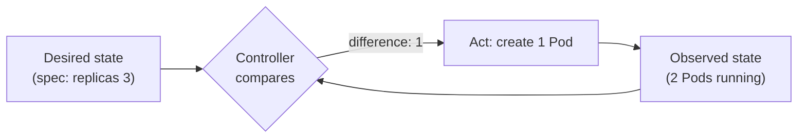
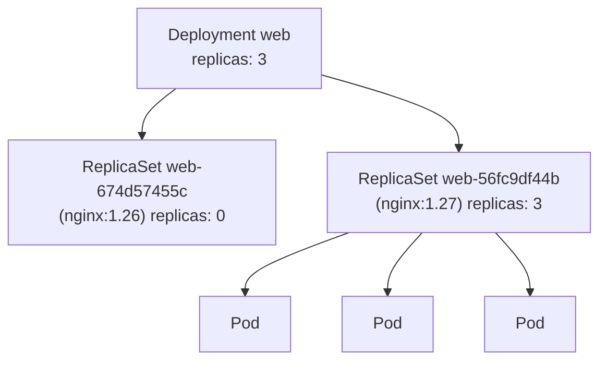

# Chapter 05: Controllers: ReplicaSets, Deployments, rollouts and rollbacks

> **Exams:** KCNA · CKAD · CKA
> **Difficulty:** Beginner
> **Time:** ~50 min reading, ~35 min lab
> **Lab tier:** 1 (kind)
> **Prerequisites:** Chapter 04 (Pods in depth)

## Learning objectives

After this chapter you can:

- Explain the controller pattern: how a controller compares desired state with observed state and acts on the difference
- Describe how a ReplicaSet keeps a number of Pods running, and how it finds "its" Pods through a label selector
- Explain why you create Deployments rather than ReplicaSets, and how a Deployment manages ReplicaSets
- Create and scale Deployments imperatively and declaratively
- Perform a rolling update, follow it with `kubectl rollout status`, and tune it with `maxSurge` and `maxUnavailable`
- Read a Deployment's revision history, record a change cause, and roll back to any revision
- Recognize a stuck rollout and recover from it
- Choose between a Deployment, a DaemonSet, a StatefulSet, and a Job for a given workload

## Concepts

### Why controllers

At the end of Chapter 04 you saw the catch with bare Pods: when one dies, or its
node fails, nothing brings it back. Production workloads need something that
*watches* and *repairs*. In Kubernetes that something is a **controller**.

A controller is a loop. It reads the **desired state** you declared (for
example "three replicas of this Pod"), observes the **actual state** of the
cluster, and takes the smallest action that moves actual toward desired. Then
it does it again. Chapter 02 introduced this as reconciliation; the
`kube-controller-manager` runs dozens of these loops, one per kind of object.



*Text description: a controller compares the desired state in an object's spec with the observed state of the cluster, acts on the difference, and observes again, in a loop.*

Two consequences matter every day:

- **You change the spec, not the Pods.** To get five replicas you edit the
  number; you never start two Pods yourself. If you delete a Pod a controller
  owns, the controller replaces it within seconds.
- **Controllers are level-triggered.** They act on *what is*, not on events they
  might have missed. A controller that restarts simply looks at the cluster again
  and carries on.

### ReplicaSets

A **ReplicaSet** keeps a stable number of identical Pods running. Its spec has
three parts:

```yaml
apiVersion: apps/v1
kind: ReplicaSet
metadata:
  name: web
spec:
  replicas: 3                  # how many Pods
  selector:                    # which Pods count as "mine"
    matchLabels:
      app: web
  template:                    # how to make a new one
    metadata:
      labels:
        app: web               # must match the selector
    spec:
      containers:
        - name: web
          image: nginx:1.27
```

The **selector** is how a ReplicaSet finds its Pods: it counts every Pod in its
namespace whose labels match and that no other controller owns. The template's
labels must match the selector, or the API server rejects the object. Each Pod a
ReplicaSet creates carries an `ownerReference` pointing back to it, which is
how `kubectl delete` of the ReplicaSet knows to delete its Pods too (Chapter 02
showed the same field on static Pods, where the owner is a Node).

Labels are the only link. If you remove the `app=web` label from one of the
Pods, the ReplicaSet no longer counts it and creates a replacement, while the
relabelled Pod keeps running on its own. That trick is occasionally useful for
debugging one misbehaving replica without losing capacity.

You will rarely create a ReplicaSet yourself. It can keep Pods running, but it
cannot *change* them: editing its template affects only Pods created after the
edit. Updating an application is the job of the Deployment.

### Deployments

A **Deployment** manages ReplicaSets the way a ReplicaSet manages Pods. Its spec
looks almost the same (replicas, selector, template), plus a `strategy` for
updates. When you change the Pod template, for example the image, the
Deployment creates a **new ReplicaSet** for the new template and gradually
shifts the replica count from the old ReplicaSet to the new one.



*Text description: a Deployment owns two ReplicaSets, one per revision of its Pod template. The old one is scaled to zero and kept; the new one runs all three Pods.*

The Deployment controller names each ReplicaSet after the Deployment plus a
hash of the Pod template, and adds that hash to the Pods as the label
`pod-template-hash`. That label keeps the ReplicaSets of one Deployment from
claiming each other's Pods. Old ReplicaSets are kept at zero replicas; they are
the **revision history** that makes rollbacks possible. `revisionHistoryLimit`
(default 10) controls how many are kept.

Only changes to `spec.template` create a new revision. Scaling changes
`spec.replicas` on the existing ReplicaSet and creates nothing new.

### Rolling updates

The default `strategy` is `RollingUpdate`. Two settings control its pace:

| Setting | Meaning | Default |
| --- | --- | --- |
| `maxSurge` | How many Pods *above* `replicas` may exist during the update | 25% (rounded up) |
| `maxUnavailable` | How many Pods *below* `replicas` may be unavailable during the update | 25% (rounded down) |

Both take a number or a percentage. With `replicas: 4` and the defaults, the
Deployment may run up to 5 Pods and must keep at least 3 available, so it
replaces Pods one or two at a time. Setting `maxUnavailable: 0` and
`maxSurge: 1` means "never drop below full capacity; add one new Pod, wait for
it to be ready, then remove one old Pod", which is the safest and slowest
choice. They cannot both be 0.

"Ready" is what gates each step. A new Pod counts as available only once it is
ready (Chapter 10 adds readiness probes that make "ready" mean "actually serving
traffic"). If new Pods never become ready, because the image cannot be pulled or
the process crashes, the rollout stops: old Pods that were not yet replaced keep
running. A bad update stalls instead of taking the whole application down.

The other strategy, `Recreate`, deletes all old Pods before creating new ones.
It causes downtime, and is right only when two versions must never run at the
same time (for example, an application that takes an exclusive lock on its
data).

### Revisions, history, and rollbacks

Every new ReplicaSet is a numbered **revision**. `kubectl rollout history`
lists them; `kubectl rollout undo` makes the Deployment's template match an
earlier revision again, which is itself recorded as a new revision. Rollback is
just another rolling update, toward an old template.

The `CHANGE-CAUSE` column comes from the annotation `kubernetes.io/change-cause`
on the Deployment at the time of the change. Nothing fills it in automatically
(the old `--record` flag that did so is deprecated), so annotate the Deployment
when you make a change you will want to recognize later.

A Deployment also tracks progress. If a rollout makes no progress for
`progressDeadlineSeconds` (default 600), its `Progressing` condition turns
false with reason `ProgressDeadlineExceeded`, and `kubectl rollout status`
exits with an error. Kubernetes does not roll back by itself; the condition is
a signal for you or your tooling.

`kubectl rollout pause` stops the Deployment from acting on template changes,
so you can make several edits and release them as one rollout with
`kubectl rollout resume`.

### Choosing a workload resource

Deployments are the default for stateless applications, but not the only
controller. You meet the others in later chapters; know when each is right:

| Resource | Use it for | Pods are |
| --- | --- | --- |
| Deployment | Stateless services: web servers, APIs, workers | Interchangeable, any node |
| StatefulSet | Databases and clustered software that need stable names and storage | Named `name-0`, `name-1`, ...; each keeps its own volume |
| DaemonSet | One Pod per node: log collectors, node agents, `kube-proxy` | One per (matching) node |
| Job / CronJob | Run-to-completion work, once or on a schedule (Chapter 08) | Finish and stop |
| Bare Pod | Experiments and one-off debugging | Not replaced when they die |

> **Exam tip:** If a question says "make sure it keeps running", "highly
> available", or "N replicas", it wants a Deployment. "On every node" means a
> DaemonSet. "Runs once" or "on a schedule" means a Job or CronJob.

## Guided walkthrough

Start the chapter's lab so you have a clean namespace with some Deployments in
it:

```bash
make lab CH=5
```

Everything below happens in the `ch05-deploy` namespace. Either add
`-n ch05-deploy` to each command, or run `make use-namespace CH=5` once
(`make teardown CH=5` restores your settings). The walkthrough uses its own
Deployment, `demo`, so it does not disturb the lab tasks.

### Create a Deployment and look at what it owns

```bash
kubectl create deployment demo --image=nginx:1.26 --replicas=3
kubectl rollout status deployment/demo
kubectl get deploy,rs,pods -l app=demo
```

```text
NAME                   READY   UP-TO-DATE   AVAILABLE   AGE
deployment.apps/demo   3/3     3            3           2s

NAME                              DESIRED   CURRENT   READY   AGE
replicaset.apps/demo-674d57455c   3         3         3       2s

NAME                        READY   STATUS    RESTARTS   AGE
pod/demo-674d57455c-dkrjz   1/1     Running   0          2s
pod/demo-674d57455c-hlfc6   1/1     Running   0          2s
pod/demo-674d57455c-lfdzj   1/1     Running   0          2s
```

Your hash suffixes will differ. Notice the naming chain: Pod names start with
the ReplicaSet's name, which starts with the Deployment's. `kubectl create
deployment` labels everything `app=<name>` and names the container after the
image (`nginx`), which matters as soon as you want to change that container.

Look at the labels and the owner of one Pod:

```bash
kubectl get pods -l app=demo --show-labels
kubectl get pod <one-pod-name> -o jsonpath='{.metadata.ownerReferences[0].kind}/{.metadata.ownerReferences[0].name}{"\n"}'
```

```text
NAME                    READY   STATUS    RESTARTS   AGE   LABELS
demo-674d57455c-dkrjz   1/1     Running   0          2s    app=demo,pod-template-hash=674d57455c
...
ReplicaSet/demo-674d57455c
```

The declarative form is what you will edit in practice. Generate it rather than
typing it:

```bash
kubectl create deployment x --image=nginx:1.27 --replicas=2 --dry-run=client -o yaml
```

```yaml
apiVersion: apps/v1
kind: Deployment
metadata:
  labels:
    app: x
  name: x
spec:
  replicas: 2
  selector:
    matchLabels:
      app: x
  strategy: {}
  template:
    metadata:
      labels:
        app: x
    spec:
      containers:
      - image: nginx:1.27
        name: nginx
        resources: {}
status: {}
```

### Watch the ReplicaSet heal

Delete one of the Pods and list them again:

```bash
kubectl delete pod <one-pod-name>
kubectl get pods -l app=demo
```

```text
NAME                    READY   STATUS    RESTARTS   AGE
demo-674d57455c-hlfc6   1/1     Running   0          5s
demo-674d57455c-khpbw   1/1     Running   0          2s
demo-674d57455c-lfdzj   1/1     Running   0          5s
```

A new Pod, with a new name, replaced the deleted one within a second or two.
That is the reconciliation loop at work.

### Scale

```bash
kubectl scale deployment demo --replicas=5
kubectl get deployment demo
```

```text
NAME   READY   UP-TO-DATE   AVAILABLE   AGE
demo   5/5     5            5           7s
```

Scaling changed the existing ReplicaSet; `kubectl get rs -l app=demo` still
shows one ReplicaSet.

### Roll out a new version

Change the image. `kubectl set image` needs the *container* name, then the new
image:

```bash
kubectl set image deployment/demo nginx=nginx:1.27
kubectl rollout status deployment/demo
```

```text
Waiting for deployment "demo" rollout to finish: 3 out of 5 new replicas have been updated...
Waiting for deployment "demo" rollout to finish: 4 out of 5 new replicas have been updated...
Waiting for deployment "demo" rollout to finish: 2 old replicas are pending termination...
Waiting for deployment "demo" rollout to finish: 1 old replicas are pending termination...
deployment "demo" successfully rolled out
```

(Repeated lines are trimmed.) Now there are two ReplicaSets:

```bash
kubectl get rs -l app=demo
```

```text
NAME              DESIRED   CURRENT   READY   AGE
demo-56fc9df44b   5         5         5       3s
demo-674d57455c   0         0         0       10s
```

The old one is scaled to zero and kept, ready for a rollback.

### Read the history and record a cause

```bash
kubectl rollout history deployment/demo
```

```text
deployment.apps/demo
REVISION  CHANGE-CAUSE
1         <none>
2         <none>
```

Annotate the Deployment, and the current revision gets a cause:

```bash
kubectl annotate deployment demo kubernetes.io/change-cause="upgrade to nginx 1.27" --overwrite
kubectl rollout history deployment/demo
```

```text
deployment.apps/demo
REVISION  CHANGE-CAUSE
1         <none>
2         upgrade to nginx 1.27
```

To see exactly what a revision ran:

```bash
kubectl rollout history deployment/demo --revision=1
```

```text
deployment.apps/demo with revision #1
Pod Template:
  Labels:	app=demo
	pod-template-hash=674d57455c
  Containers:
   nginx:
    Image:	nginx:1.26
...
```

### Roll back

```bash
kubectl rollout undo deployment/demo
kubectl rollout status deployment/demo
kubectl rollout history deployment/demo
```

```text
deployment.apps/demo
REVISION  CHANGE-CAUSE
2         upgrade to nginx 1.27
3         <none>
```

Revision 1 became revision 3: a rollback re-applies an old template as a new
revision. Without `--to-revision`, `undo` goes back one step; with
`--to-revision=N` it goes to any revision still in the history.

### A rollout that gets stuck

Point the Deployment at an image that does not exist:

```bash
kubectl set image deployment/demo nginx=nginx:no-such-tag
kubectl rollout status deployment/demo --timeout=10s
```

```text
Waiting for deployment "demo" rollout to finish: 3 out of 5 new replicas have been updated...
error: timed out waiting for the condition
```

```bash
kubectl get rs -l app=demo
kubectl get pods -l app=demo
```

```text
NAME              DESIRED   CURRENT   READY   AGE
demo-56fc9df44b   0         0         0       22s
demo-674d57455c   4         4         4       29s
demo-9cd5c4984    3         3         0       16s

NAME                    READY   STATUS             RESTARTS   AGE
demo-674d57455c-28jhs   1/1     Running            0          17s
demo-674d57455c-62w5c   1/1     Running            0          18s
demo-674d57455c-7vp5m   1/1     Running            0          18s
demo-674d57455c-vdqhj   1/1     Running            0          18s
demo-9cd5c4984-cpt6n    0/1     ErrImagePull       0          16s
demo-9cd5c4984-kwh5w    0/1     ImagePullBackOff   0          16s
demo-9cd5c4984-xp29c    0/1     ImagePullBackOff   0          15s
```

Read this carefully: the rolling update took down only one old Pod (5 × 25%,
rounded down) and surged two new ones (rounded up), then stopped, because none
of the new Pods became ready. Four old Pods are still serving. The way out is a
rollback:

```bash
kubectl rollout undo deployment/demo
```

The lab's `shop` Deployment is already in this state, with a short
`progressDeadlineSeconds`, so `kubectl rollout status deployment/shop` reports
`error: deployment "shop" exceeded its progress deadline`.

### Pause and resume

```bash
kubectl rollout pause deployment/demo
kubectl set image deployment/demo nginx=nginx:1.27
kubectl get rs -l app=demo        # nothing new happens while paused
kubectl rollout resume deployment/demo
kubectl rollout status deployment/demo
```

Clean up the walkthrough's Deployment when you are done (the lab's own
Deployments stay):

```bash
kubectl delete deployment demo
```

## Hands-on lab

The lab works like a KodeKloud lab: one task at a time, a check after each, and
progress that is saved between sessions.

```bash
make lab CH=5        # set up the lab and show task 1
make check CH=5      # check the current task; if it is right, show the next
make question CH=5   # show the current task again
make reset CH=5      # back to the starting state and task 1
make verify CH=5     # check every task at once
```

Everything happens in the Namespace `ch05-deploy`: use `-n ch05-deploy` on
every command, or run `make use-namespace CH=5` once. The lab created five
Deployments (`api`, `frontend`, `cache`, `shop`, and `history`); each task uses
its own, so you can do them in any order. Look around first
(`kubectl -n ch05-deploy get deploy,rs`). Full solutions are in
[`lab/solutions.md`](lab/solutions.md).

### Task 1: Create a Deployment

Create a Deployment with the following specification, and wait until all its
replicas are ready.

- Name: `web`
- Image: `nginx:1.27` (a single container)
- Replicas: `3`

### Task 2: Scale a Deployment

The Deployment `api` runs 2 replicas. Scale it up without changing anything
else.

- Deployment: `api`
- Replicas: `5`, all ready
- Image: unchanged (`nginx:1.26`)

### Task 3: Roll out a new version

Update the Deployment `frontend` to a new image with a rolling update, and
record why.

- Deployment: `frontend` (update it; do not delete and recreate it)
- New image: `nginx:1.27`
- Change cause: `upgrade to 1.27` (the annotation `kubernetes.io/change-cause` on the Deployment)
- The rollout must be complete

Note: the container in `frontend` is not called `nginx`. Look up its name first.

### Task 4: Roll back a stuck rollout

The latest rollout of the Deployment `shop` is stuck. Roll it back to the last
revision that worked.

- Deployment: `shop` (do not delete and recreate it)
- Image after the rollback: `nginx:1.27`
- All 3 replicas available, and no Pods of the broken revision left

### Task 5: Tune the rollout strategy

The Deployment `cache` must never have fewer ready Pods than it wants, even
during an update. Change its rolling update settings.

- Deployment: `cache`
- Strategy: `RollingUpdate`
- `maxUnavailable`: `0`
- `maxSurge`: `1`
- Replicas: unchanged (`2`)

### Task 6: Find the active ReplicaSet

The Deployment `history` has been updated once, so it owns two ReplicaSets.
Save the name of the one that runs its Pods now.

- File: `/tmp/ch05-rs.txt`
- Content: the ReplicaSet name only

## Exam tips

> **Exam tip:** `kubectl create deployment NAME --image=IMAGE --replicas=N
> --dry-run=client -o yaml` gives you a correct Deployment skeleton in one line.
> Add a `--port` flag if the question asks for a container port.
>
> **Exam tip:** `kubectl set image` needs the container name, and containers
> created with `kubectl create deployment` are named after the image. When the
> question's Deployment came from YAML, read the name first:
> `kubectl get deploy NAME -o jsonpath='{.spec.template.spec.containers[*].name}'`.
>
> **Exam tip:** After any change to a Deployment, run `kubectl rollout status`.
> It blocks until the rollout finishes or fails, so you know the task is done
> before you move on.
>
> **Exam tip:** `kubectl rollout undo` without `--to-revision` goes back one
> step. When the question names a revision or an image, read
> `kubectl rollout history` first and roll back to that revision explicitly.

## Common mistakes

- Editing the Pods of a Deployment. The controller does not care; change the Deployment's template instead.
- Expecting `kubectl scale` to create a new revision. Only template changes do, which is also why scaling never shows up in `rollout history`.
- Changing a Deployment's `selector`. It is immutable after creation; if it must change, create a new Deployment.
- Reading `READY 3/3` as "the rollout is done". Old Pods also count as ready; check `UP-TO-DATE` or run `kubectl rollout status`.
- Setting both `maxSurge` and `maxUnavailable` to 0. The API server rejects it, because the rollout could never make progress.

<!-- QUESTIONS:START -->

## End-of-chapter questions

**1.** `KCNA` `CKA` What does a Kubernetes controller do?

- **A.** Runs containers on a node and reports their status
- **B.** Repeatedly compares the desired state in an object's spec with the actual state and acts to close the gap
- **C.** Stores the state of every object in the cluster
- **D.** Decides which node each new Pod runs on

**2.** `KCNA` `CKAD` `CKA` A ReplicaSet with `replicas: 3` manages three Pods. You delete one of them. What happens?

- **A.** Nothing; the ReplicaSet now runs two Pods until you scale it
- **B.** The deleted Pod is restored with the same name and IP
- **C.** The ReplicaSet creates a new Pod with a new name to get back to three
- **D.** The ReplicaSet is deleted because one of its Pods is missing

**3.** `CKAD` `CKA` How does a ReplicaSet decide which Pods count towards its replica count?

- **A.** By the Pods' names, which must start with the ReplicaSet's name
- **B.** By its label selector, for Pods in its namespace that no other controller owns
- **C.** By the node the Pods run on
- **D.** By the image the Pods run

**4.** `CKAD` `CKA` You change the image in a Deployment's Pod template. What does the Deployment controller do?

- **A.** Restarts the existing Pods in place with the new image
- **B.** Edits the template of the existing ReplicaSet so that its Pods are recreated
- **C.** Creates a new ReplicaSet for the new template and shifts replicas to it, keeping the old ReplicaSet at zero
- **D.** Deletes the Deployment and creates a new one

**5.** `CKAD` `CKA` Which change to a Deployment creates a new revision in `kubectl rollout history`?

- **A.** Scaling it from 3 to 5 replicas
- **B.** Changing a container's image
- **C.** Adding a label to the Deployment object itself
- **D.** Changing `revisionHistoryLimit`

**6.** `CKAD` `CKA` A Deployment has `replicas: 4` and its strategy is RollingUpdate with `maxSurge: 1` and `maxUnavailable: 0`. During an update, what are the most and the fewest available Pods?

- **A.** At most 4 Pods, at least 3 available
- **B.** At most 5 Pods, at least 4 available
- **C.** At most 5 Pods, at least 3 available
- **D.** At most 8 Pods, at least 4 available

**7.** `CKAD` `CKA` You roll out an image tag that does not exist. With the default strategy, what happens to the application?

- **A.** All old Pods are deleted first, so the application goes down
- **B.** The rollout stalls: a few new Pods stay in ImagePullBackOff while most old Pods keep serving
- **C.** Kubernetes automatically rolls back to the previous revision
- **D.** The Deployment is marked as deleted

**8.** `CKAD` `CKA` Where does the CHANGE-CAUSE column of `kubectl rollout history` come from?

- **A.** Kubernetes fills it in automatically from the command you ran
- **B.** The annotation `kubernetes.io/change-cause` on the Deployment when the revision was created
- **C.** The commit message of the container image
- **D.** The `--reason` flag of `kubectl set image`

**9.** `KCNA` `CKAD` You need exactly one log-collector Pod on every node of the cluster, including nodes added later. Which resource fits?

- **A.** A Deployment with replicas equal to the number of nodes
- **B.** A StatefulSet
- **C.** A DaemonSet
- **D.** A CronJob

**10. (Task)** `CKAD` `CKA` In namespace `prod`, create a Deployment named `api` with 4 replicas of `httpd:2.4`, and wait until the rollout has finished.

**11. (Task)** `CKAD` `CKA` The Deployment `api` in namespace `prod` runs a container named `httpd`. Update it to `httpd:2.4.62`, record the change cause `security update`, and confirm the cause appears in the rollout history.

**12. (Task)** `CKAD` `CKA` The Deployment `api` in namespace `prod` is on revision 5, which is broken. Roll it back to revision 3, then show which image revision 3 runs.

**13. (Task)** `CKAD` `CKA` Change the Deployment `api` in namespace `prod` so that updates never take a Pod away before its replacement is ready, adding at most two extra Pods at a time.

**14. (Task)** `CKAD` `CKA` Print the names of the ReplicaSets owned by the Deployment `api` in namespace `prod` that currently have zero desired replicas.

<details>
<summary>Answers</summary>

**1. B.** A controller is a reconciliation loop: observe, compare with the declared spec, act, repeat. Running containers is the kubelet's job, storing state is etcd's (through the API server), and placing Pods is the scheduler's.

**2. C.** The ReplicaSet sees two matching Pods where three are wanted and creates a replacement from its template. Pods are never repaired or resurrected: the replacement has a new name, a new UID, and usually a new IP.

**3. B.** The selector is the only link. Matching Pods without another owner are counted (and adopted); a Pod whose labels stop matching is released and replaced. The name prefix is a convention of Pods the ReplicaSet created, not how it finds them.

**4. C.** Each distinct Pod template gets its own ReplicaSet (named with a hash of the template). A rolling update scales the new one up and the old one down; the old one is kept at zero replicas as revision history for rollbacks.

**5. B.** Only changes to `spec.template` create a new ReplicaSet, and so a new revision. Replica count, the Deployment's own metadata, and settings such as `revisionHistoryLimit` or `strategy` do not.

**6. B.** `maxSurge: 1` allows one Pod above the 4 wanted, so at most 5. `maxUnavailable: 0` allows none below 4 available. The update adds a new Pod, waits until it is ready, then removes an old one.

**7. B.** A rolling update only removes old Pods as new ones become ready, within `maxUnavailable`. New Pods that never become ready stop the rollout. After `progressDeadlineSeconds` the Deployment reports `ProgressDeadlineExceeded`, but it does not roll back by itself; you do that with `kubectl rollout undo`.

**8. B.** The cause is copied from the Deployment's `kubernetes.io/change-cause` annotation. Nothing sets it for you (the old `--record` flag that did is deprecated), so annotate the Deployment when you make a change.

**9. C.** A DaemonSet runs one Pod per matching node and adds Pods as nodes join. A Deployment with a fixed replica count cannot guarantee one per node and does not follow the node count.

**10.**

```bash
kubectl -n prod create deployment api --image=httpd:2.4 --replicas=4
kubectl -n prod rollout status deployment/api
```

**11.**

```bash
kubectl -n prod set image deployment/api httpd=httpd:2.4.62
kubectl -n prod annotate deployment api kubernetes.io/change-cause="security update" --overwrite
kubectl -n prod rollout status deployment/api
kubectl -n prod rollout history deployment/api
```

**12.**

```bash
kubectl -n prod rollout undo deployment/api --to-revision=3
kubectl -n prod rollout status deployment/api
kubectl -n prod rollout history deployment/api --revision=6
```

The rollback is recorded as a new revision (6) with revision 3's template, so revision 3 itself no longer appears in the history; inspect the new one. Before the rollback, `--revision=3` shows the same template.

**13.**

```bash
kubectl -n prod patch deployment api -p '{"spec":{"strategy":{"type":"RollingUpdate","rollingUpdate":{"maxUnavailable":0,"maxSurge":2}}}}'
kubectl -n prod get deployment api -o jsonpath='{.spec.strategy}{"\n"}'
```

`maxUnavailable: 0` keeps full capacity; `maxSurge: 2` allows two extra Pods at a time.

**14.**

```bash
kubectl -n prod get rs -o jsonpath='{range .items[?(@.metadata.ownerReferences[0].name=="api")]}{.metadata.name}{" "}{.spec.replicas}{"\n"}{end}' | awk '$2==0 {print $1}'
```

Filtering on the owner reference is exact. `-l app=api` works too when the Deployment was created with `kubectl create deployment`, which labels its Pods (and so its ReplicaSets) `app=api`.

</details>

<!-- QUESTIONS:END -->

## Further reading

- Kubernetes documentation: *Deployments*, *ReplicaSet*, *Controllers*, *Workload Management*
- `kubectl` reference: `kubectl create deployment`, `kubectl scale`, `kubectl set image`, `kubectl rollout`
- Chapter 06 next: namespaces, labels, selectors, and annotations, the glue between controllers and the objects they manage
