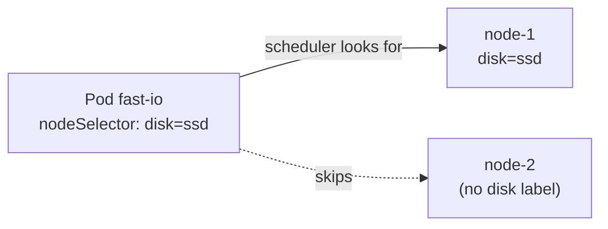

# Chapter 06: Namespaces, labels, selectors, annotations

> **Exams:** KCNA · CKAD · CKA
> **Difficulty:** Beginner
> **Time:** ~40 min reading, ~30 min lab
> **Lab tier:** 1 (kind)
> **Prerequisites:** Chapter 05 (controllers)

## Learning objectives

After this chapter you can:

- Explain what a namespace scopes and what it does not isolate, and tell namespaced from cluster-scoped resources
- Create, label, and delete namespaces, and find an object in any namespace
- Write valid labels, including the recommended `app.kubernetes.io/*` labels
- Use equality-based and set-based selectors on the command line and in manifests (`matchLabels`, `matchExpressions`)
- Explain how controllers own Pods through selectors, and release a Pod from its controller by relabelling it
- Filter objects by field with `--field-selector`, and know which fields allow it
- Decide between a label and an annotation for a piece of metadata
- Steer a Pod to nodes with node labels and `nodeSelector`

## Concepts

Chapter 03 taught the command-line mechanics: `-l` selectors, `kubectl label`
and `annotate`, `--show-labels`. This chapter is about the model behind them:
why the metadata exists, who reads it, and what goes wrong when it is wrong.

### Namespaces

A **namespace** is a scope for names. Two Pods can both be called `web` if they
live in different namespaces. Most of what you create is namespaced: Pods,
Deployments, ConfigMaps, Secrets, Services, ServiceAccounts, Roles. Namespaces
are also the unit that other features hang off: RBAC permissions (Chapter 23),
resource quotas (Chapter 10), and default network policies (Chapter 21) are all
applied per namespace.

Some resources belong to the whole cluster instead: nodes, PersistentVolumes,
StorageClasses, ClusterRoles, and namespaces themselves.
`kubectl api-resources --namespaced=false` lists them.

Every cluster starts with four namespaces:

| Namespace | Holds |
| --- | --- |
| `default` | Whatever you create without `-n`. Avoid using it for real work |
| `kube-system` | The control plane and cluster add-ons (Chapter 02) |
| `kube-public` | Data readable by everyone, including unauthenticated clients; almost empty |
| `kube-node-lease` | One Lease object per node, the kubelet's heartbeat |

Two facts about namespaces cause most surprises:

- **A namespace is not a security boundary by itself.** Pods in different
  namespaces can reach each other over the network unless a NetworkPolicy says
  otherwise, and anyone with cluster-wide permissions sees every namespace.
  Namespaces become isolation only when you combine them with RBAC, quotas, and
  network policies.
- **Deleting a namespace deletes everything in it.** The namespace enters the
  `Terminating` phase, the namespace controller deletes its contents, and the
  namespace disappears when it is empty. This is why every lab in this book owns
  its own namespace: removing it is a complete cleanup.

Use namespaces to separate teams, applications, or environments that share one
cluster. When teams need hard isolation (different security requirements,
different Kubernetes versions), use separate clusters.

### Labels

A **label** is a key/value pair on an object's `metadata.labels`. Labels are
*identifying* metadata: they exist so that objects can be selected.

A label key has an optional **prefix** and a **name**, separated by `/`:

- The name is at most 63 characters: letters, digits, `-`, `_`, and `.`, starting and ending with a letter or digit.
- The prefix, if present, is a DNS subdomain such as `app.kubernetes.io`. Prefixes `kubernetes.io/` and `k8s.io/` are reserved for Kubernetes itself.
- A value is at most 63 characters with the same character rules, or empty.

The API server rejects anything else, so labels cannot hold free text: no
spaces, no long descriptions, no URLs.

Kubernetes recommends a common set of labels so tools can understand any
application:

| Label | Example | Meaning |
| --- | --- | --- |
| `app.kubernetes.io/name` | `mysql` | The application |
| `app.kubernetes.io/instance` | `mysql-orders` | This installation of it |
| `app.kubernetes.io/version` | `8.4.2` | Its version |
| `app.kubernetes.io/component` | `database` | Its role in the architecture |
| `app.kubernetes.io/part-of` | `shop` | The larger system it belongs to |
| `app.kubernetes.io/managed-by` | `helm` | The tool that manages it |

Helm charts and many operators set them for you. Short labels such as
`app=web` remain common, especially in examples and exam tasks.

### Selectors

A **label selector** picks objects by their labels. There are two kinds, and
you can combine them (a comma means AND):

| Kind | Command line | In a manifest |
| --- | --- | --- |
| Equality | `-l app=web`, `-l 'tier!=db'` | `matchLabels: {app: web}` |
| Set-based | `-l 'tier in (web,cache)'`, `-l 'env notin (prod)'`, `-l tier`, `-l '!tier'` | `matchExpressions` with `In`, `NotIn`, `Exists`, `DoesNotExist` |

In a manifest the two forms combine, and every condition must hold:

```yaml
selector:
  matchLabels:
    app: queue
  matchExpressions:
    - {key: tier, operator: In, values: [worker, batch]}
    - {key: canary, operator: DoesNotExist}
```

Selectors are how Kubernetes objects find each other. You already met the
first two users; the others follow in later chapters:

- **ReplicaSets and Deployments** count and own the Pods their selector matches (Chapter 05).
- **Services** send traffic to the Pods their selector matches (Chapter 11).
- **NetworkPolicies** apply to the Pods their selector matches (Chapter 21).
- **`nodeSelector`** on a Pod picks nodes by their labels (below, and Chapter 17).

Because of this, a label change is a behavioural change. When you remove a
Pod's matching label, its ReplicaSet **releases** it: the controller deletes the
Pod's `ownerReference` and creates a replacement to get back to its replica
count, while the released Pod keeps running on its own. That is how you pull a
misbehaving replica out of service for debugging without losing capacity.

Adoption goes the other way, but less often than people expect. A ReplicaSet
adopts an ownerless Pod only if the Pod matches its *whole* selector. A
Deployment adds the label `pod-template-hash` to the selector of every
ReplicaSet it creates, so a Pod you start by hand with `app=web` is not taken
over by the `web` Deployment.

A Deployment's selector is **immutable** after creation, and its Pod template's
labels must match it. If you need a different selector, create a new
Deployment.

### Field selectors

A **field selector** filters by a field of the object rather than a label:
`kubectl get pods --field-selector status.phase=Running`. It supports `=`,
`==`, and `!=`, and commas for AND. Only a few fields are selectable, and which
ones depends on the resource. For Pods the useful ones are `metadata.name`,
`metadata.namespace`, `spec.nodeName`, `spec.restartPolicy`,
`spec.serviceAccountName`, `status.phase`, and `status.podIP`. Asking for any
other field fails with `field label not supported`.

Field selectors shine when you search across namespaces
(`-A --field-selector metadata.name=x`) or across nodes
(`--field-selector spec.nodeName=node-1`).

### Annotations

An **annotation** is also a key/value pair, in `metadata.annotations`, with the
same key rules as labels. Values, however, can be long free text (up to 256 KiB
for all annotations on an object together), and annotations **cannot be
selected**. They are *non-identifying* metadata: information for people and
tools, not for grouping.

Typical annotations you will meet:

- `kubernetes.io/change-cause`: the reason shown by `kubectl rollout history` (Chapter 05).
- `kubectl.kubernetes.io/last-applied-configuration`: what `kubectl apply` last sent, used to compute the next apply. It appears on every object you create with `kubectl apply`.
- Configuration for controllers that run in the cluster, such as an ingress controller's settings (Chapter 12).
- Contact details, ticket numbers, build information.

The rule of thumb: if you will ever select by it, it is a label; otherwise it is
an annotation.

### Node labels and `nodeSelector`

Nodes carry labels too. Every node has well-known ones set by the kubelet:
`kubernetes.io/hostname`, `kubernetes.io/os`, `kubernetes.io/arch`, and on
control plane nodes `node-role.kubernetes.io/control-plane`. You can add your
own, such as `disk=ssd`.

A Pod's `spec.nodeSelector` lists labels that a node must have for the Pod to
be scheduled there. If no node matches, the Pod stays `Pending`, and the
scheduler says why in the Pod's events. `nodeSelector` is the simplest form of
scheduling constraint; Chapter 17 covers node affinity, taints, and
tolerations, which are more expressive.



*Text description: the scheduler places a Pod with `nodeSelector: disk=ssd` only on nodes that carry the label `disk=ssd`, and skips nodes that do not.*

## Guided walkthrough

Start the chapter's lab, which creates several namespaces for you to explore:

```bash
make lab CH=6
```

The main namespace is `ch06-shop`; the lab also creates `ch06-red`,
`ch06-green`, and `ch06-blue`. Use `-n` on each command (or
`make use-namespace CH=6` for `ch06-shop`).

### Look across namespaces

```bash
kubectl get namespaces
kubectl get pods -A -l app=pets
```

```text
NAME                 STATUS   AGE
ch06-blue            Active   3m8s
ch06-green           Active   3m8s
ch06-red             Active   3m8s
ch06-shop            Active   3m9s
default              Active   3m57s
kube-node-lease      Active   3m57s
kube-public          Active   3m57s
kube-system          Active   3m57s
local-path-storage   Active   3m50s

NAMESPACE    NAME       READY   STATUS    RESTARTS   AGE
ch06-blue    binx       1/1     Running   0          3m6s
ch06-blue    luna       1/1     Running   0          3m6s
ch06-green   garfield   1/1     Running   0          3m7s
...
```

`local-path-storage` belongs to kind's storage add-on. `-A` (short for
`--all-namespaces`) adds a `NAMESPACE` column. Your Pods may be spread
differently; one of them, `lost-cat`, moves to a random namespace every time the
lab is set up (Task 1).

Which resources are cluster-scoped?

```bash
kubectl api-resources --namespaced=false -o name
```

```text
componentstatuses
namespaces
nodes
persistentvolumes
mutatingwebhookconfigurations.admissionregistration.k8s.io
...
clusterrolebindings.rbac.authorization.k8s.io
clusterroles.rbac.authorization.k8s.io
...
storageclasses.storage.k8s.io
...
```

### Labels as columns, and selectors

```bash
kubectl -n ch06-shop get pods -L app,tier
```

```text
NAME                     READY   STATUS      RESTARTS   AGE    APP          TIER
import-done              0/1     Completed   0          3m9s   importer
import-failed            0/1     Error       0          3m9s   importer
queue-56f54bdfc5-9w8z8   1/1     Running     0          3m9s   queue
queue-56f54bdfc5-bw9pv   1/1     Running     0          3m9s   queue
queue-56f54bdfc5-qwgl7   1/1     Running     0          3m9s   queue
reports                  0/1     Pending     0          3m9s   reports
storefront               1/1     Running     0          3m9s   storefront   web
```

`-L` turns label keys into columns, which is easier to read than
`--show-labels` once objects carry many labels. Now select:

```bash
kubectl -n ch06-shop get pods -l 'app in (importer, reports)'
kubectl -n ch06-shop get pods -l '!tier'
```

```text
NAME            READY   STATUS      RESTARTS   AGE
import-done     0/1     Completed   0          3m9s
import-failed   0/1     Error       0          3m9s
reports         0/1     Pending     0          3m9s
```

The second command lists every Pod without a `tier` label: all of them except
`storefront`. Quote set-based selectors, or your shell interprets the
parentheses and the `!`.

### Label rules in practice

```bash
kubectl -n ch06-shop label pod storefront app.kubernetes.io/name=storefront app.kubernetes.io/part-of=shop
kubectl -n ch06-shop label pod storefront 'Bad_Key!=x'
```

```text
pod/storefront labeled
The Pod "storefront" is invalid: metadata.labels: Invalid value: "Bad_Key!": name part must consist of alphanumeric characters, '-', '_' or '.', and must start and end with an alphanumeric character ...
```

A value longer than 63 characters is rejected by `kubectl` before it reaches
the server:

```text
error: invalid label value: "app.kubernetes.io/version=this-value-is-far-too-long-...": must be no more than 63 bytes
```

### Annotations hold the free text

```bash
kubectl -n ch06-shop annotate pod storefront description="Main web front end; owner: shop team"
kubectl -n ch06-shop get pod storefront -o jsonpath='{.metadata.annotations.description}{"\n"}'
kubectl -n ch06-shop get pods -l description
```

```text
pod/storefront annotated
Main web front end; owner: shop team
No resources found in ch06-shop namespace.
```

The last command finds nothing: `-l` looks at labels only. Also look at all of
the Pod's annotations with `-o jsonpath='{.metadata.annotations}'`; you will see
`kubectl.kubernetes.io/last-applied-configuration`, because the lab created the
Pod with `kubectl apply`.

### Field selectors

```bash
kubectl -n ch06-shop get pods --field-selector status.phase=Succeeded
kubectl -n ch06-shop get pods --field-selector status.phase!=Running,metadata.name!=reports
kubectl -n ch06-shop get pods --field-selector metadata.labels.app=queue
```

```text
NAME          READY   STATUS      RESTARTS   AGE
import-done   0/1     Completed   0          3m9s

NAME            READY   STATUS      RESTARTS   AGE
import-done     0/1     Completed   0          3m9s
import-failed   0/1     Error       0          3m9s

Error from server (BadRequest): Unable to find "/v1, Resource=pods" that match label selector "", field selector "metadata.labels.app=queue": field label not supported: metadata.labels.app
```

Notice the mapping between `STATUS` and phase: `Completed` is phase
`Succeeded`, `Error` is phase `Failed`. And labels are never field-selectable;
use `-l` for them.

### Why is a Pod Pending?

```bash
kubectl -n ch06-shop describe pod reports
```

```text
...
Node-Selectors:              ch06.kbook.io/zone=nowhere
...
Events:
  Type     Reason            Age    From               Message
  ----     ------            ----   ----               -------
  Warning  FailedScheduling  3m10s  default-scheduler  0/1 nodes are available: 1 node(s) didn't match Pod's node affinity/selector. no new claims to deallocate, preemption: 0/1 nodes are available: 1 Preemption is not helpful for scheduling.
```

No node carries the label `ch06.kbook.io/zone=nowhere`, so the scheduler cannot
place the Pod. It waits, `Pending`, until a node matches. This output comes
from a one-node cluster; on the three-node lab cluster the counts differ, and
the control plane node is usually reported separately, as having a taint the
Pod does not tolerate (Chapter 17 explains taints).

### Release a Pod from its controller

Create a small Deployment, then take one of its Pods out by changing its label:

```bash
kubectl -n ch06-shop create deployment demo --image=busybox:1.36 --replicas=2 -- sleep 3600
kubectl -n ch06-shop get pods -l app=demo
kubectl -n ch06-shop label pod <one-demo-pod> app=demo-debug --overwrite
kubectl -n ch06-shop get pods -L app
```

```text
NAME                     READY   STATUS      RESTARTS   AGE     APP
demo-64c7d8897f-jwq4v    1/1     Running     0          4s      demo
demo-64c7d8897f-lz74s    1/1     Running     0          7s      demo-debug
demo-64c7d8897f-xpxkp    1/1     Running     0          7s      demo
...
```

The relabelled Pod (`lz74s` here) keeps running, and the ReplicaSet created a
new one (`jwq4v`) to get back to two. Ask the released Pod who owns it:

```bash
kubectl -n ch06-shop get pod <the-relabelled-pod> -o jsonpath='{.metadata.ownerReferences}{"\n"}'
```

The output is empty: the ReplicaSet removed its ownership. Clean up:

```bash
kubectl -n ch06-shop delete deployment demo
kubectl -n ch06-shop delete pod <the-relabelled-pod>
```

The Deployment's deletion does not remove the released Pod, because nothing
owns it any more.

### Deleting a namespace

```bash
kubectl create namespace ch06-scratch
kubectl -n ch06-scratch run p --image=busybox:1.36 -- sleep 3600
kubectl delete namespace ch06-scratch --wait=false
kubectl get namespace ch06-scratch
```

```text
namespace/ch06-scratch created
pod/p created
namespace "ch06-scratch" deleted
NAME           STATUS        AGE
ch06-scratch   Terminating   0s
```

A few seconds later (up to 30, because `busybox sleep` ignores the polite
SIGTERM and waits for the grace period), the Pod is gone and so is the
namespace.

## Hands-on lab

The lab works like a KodeKloud lab: one task at a time, a check after each, and
progress that is saved between sessions.

```bash
make lab CH=6        # set up the lab and show task 1
make check CH=6      # check the current task; if it is right, show the next
make question CH=6   # show the current task again
make reset CH=6      # back to the starting state and task 1
make verify CH=6     # check every task at once
```

The lab owns the Namespaces `ch06-shop`, `ch06-red`, `ch06-green`,
`ch06-blue`, and `ch06-payments` (which you create), plus one node label,
`ch06.kbook.io/disk`. `make reset` and `make teardown` remove all of them.
Each task says which Namespace it uses; always pass `-n`. Full solutions are in
[`lab/solutions.md`](lab/solutions.md).

### Task 1: Find a Pod

A Pod named `lost-cat` is running in one of the Namespaces `ch06-red`,
`ch06-green`, or `ch06-blue`. Save the name of its Namespace.

- File: `/tmp/ch06-ns.txt`
- Content: the Namespace name only

### Task 2: A Namespace for a team

Create a Namespace for the payments team, and a Pod in it.

- Namespace: `ch06-payments`, with the label `team=payments`
- Pod name: `ledger`, in that Namespace
- Image: `nginx:1.27` (a single container)
- Pod label: `app=ledger`

### Task 3: Take a Pod out of service

In the Namespace `ch06-shop`, one Pod of the Deployment `queue` misbehaves. It
carries the annotation `status=degraded`. Take it out of the Deployment for
debugging without deleting it, so that the Deployment replaces it.

- Pod: the `queue` Pod annotated `status=degraded` (find it)
- Change its label `app=queue` to `app=queue-debug`
- The Pod keeps running and no longer belongs to the Deployment
- The Deployment `queue` is back to `3` ready Pods

### Task 4: Pods that are not running

Save the names of the Pods in the Namespace `ch06-shop` whose phase is not
`Running`.

- File: `/tmp/ch06-not-running.txt`
- Format: one name per line

### Task 5: Schedule a waiting Pod

The Pod `fast-io` in the Namespace `ch06-blue` is `Pending`. Find out why, and
make it run by labelling a node, not by changing the Pod.

- Pod: `fast-io` (do not delete or recreate it)
- Status: `Running`
- Exactly one node carries the label the Pod needs

Note: in a multi-node cluster, label a worker node. The control plane node does
not accept ordinary Pods.

## Exam tips

> **Exam tip:** Many tasks name a namespace in passing ("in namespace `prod`,
> ..."). Read every task for it and add `-n` to every command; the exam does not
> warn you when you create something in `default`.
>
> **Exam tip:** `kubectl get pods -A --field-selector metadata.name=NAME` finds
> an object when you do not know its namespace. `kubectl get pods -A | grep NAME`
> works too and is faster to type.
>
> **Exam tip:** `kubectl label` refuses to change an existing label without
> `--overwrite`, and a trailing dash removes one: `kubectl label pod p app-`.
>
> **Exam tip:** `kubectl describe pod` on a `Pending` Pod tells you why the
> scheduler skipped every node. Read the `FailedScheduling` event before you
> change anything.

## Common mistakes

- Treating a namespace as a firewall. Without NetworkPolicies, Pods in different namespaces talk freely.
- Forgetting to quote set-based selectors, so the shell mangles `(`, `)`, and `!`.
- Putting free text in a label. Use an annotation; labels are for selecting.
- Expecting `--field-selector` to work on any field. Only a few fields per resource are supported, and labels never are.
- Changing a Pod's labels without thinking of the controllers and Services that select it. Removing a label can take a Pod out of a Deployment and out of a Service's traffic at once.

<!-- QUESTIONS:START -->

## End-of-chapter questions

**1.** `KCNA` `CKA` Which of these resources is cluster-scoped rather than namespaced?

- **A.** ConfigMap
- **B.** ServiceAccount
- **C.** PersistentVolume
- **D.** Deployment

**2.** `KCNA` `CKA` Pods `a` and `b` run in different namespaces, and the cluster has no NetworkPolicies. Can `a` connect to `b`'s IP address?

- **A.** No, namespaces block traffic between them
- **B.** Only if both namespaces carry the same label
- **C.** Yes, namespaces do not isolate network traffic by themselves
- **D.** Only through the API server

**3.** `CKAD` `CKA` Which of these is a valid label?

- **A.** `owner=Jane Doe`
- **B.** `app.kubernetes.io/name=checkout`
- **C.** `-tier=web`
- **D.** `release=` followed by a 100-character string

**4.** `CKAD` `CKA` Which selector matches Pods that have no `tier` label at all?

- **A.** `-l tier=`
- **B.** `-l '!tier'`
- **C.** `-l 'tier notin ()'`
- **D.** `-l tier`

**5.** `CKAD` `CKA` You change the label `app=web` to `app=web-debug` on one Pod of a Deployment whose selector is `app=web`. What happens?

- **A.** The Pod is deleted by its ReplicaSet
- **B.** The API server rejects the change
- **C.** The ReplicaSet releases the Pod, which keeps running without an owner, and creates a replacement
- **D.** The Deployment changes its selector to match

**6.** `CKAD` `CKA` A Deployment `web` (selector `app=web`) runs 3 replicas. You create a bare Pod with the label `app=web`. What does the Deployment's ReplicaSet do with it?

- **A.** It adopts the Pod and deletes one of its own to stay at 3
- **B.** Nothing: the ReplicaSet's selector also requires the `pod-template-hash` label, which the bare Pod lacks
- **C.** It adopts the Pod and runs 4 replicas
- **D.** It deletes the bare Pod immediately

**7.** `CKAD` Which piece of metadata belongs in an annotation rather than a label?

- **A.** `tier=frontend`, used by a Service to pick Pods
- **B.** The ticket number and a one-paragraph description of the last change
- **C.** `env=prod`, used to list all production Pods
- **D.** `app=checkout`, used by a Deployment's selector

**8.** `CKA` `kubectl get pods --field-selector metadata.labels.app=web` fails. Why?

- **A.** Field selectors need `==` instead of `=`
- **B.** Labels are not selectable fields; use `-l app=web`
- **C.** Field selectors only work with `-A`
- **D.** The `app` label does not exist

**9. (Task)** `CKAD` `CKA` Create a namespace `staging` with the labels `env=staging` and `team=web`, without writing a file.

**10. (Task)** `CKAD` `CKA` List the Pods in every namespace that run on the node `kbook-worker2`, with their namespace and name only.

**11. (Task)** `CKAD` `CKA` In namespace `dev`, add the label `release=stable` to every Pod whose `tier` label is `web` or `cache`, and remove the label `temp` from every Pod that has it.

**12. (Task)** `CKA` The Pod `trainer` in namespace `ml` is Pending because it requires a node labelled `gpu=true`. Make it schedulable on node `kbook-worker` without changing the Pod.

**13. (Task)** `CKAD` `CKA` Write the selector of a Deployment that manages Pods labelled `app=queue` whose `tier` is either `worker` or `batch`, and that never manages Pods labelled `canary` (with any value).

<details>
<summary>Answers</summary>

**1. C.** PersistentVolumes, nodes, StorageClasses, ClusterRoles, and namespaces themselves belong to the whole cluster. ConfigMaps, ServiceAccounts, and Deployments live in a namespace. `kubectl api-resources --namespaced=false` lists the cluster-scoped kinds.

**2. C.** A namespace scopes names, RBAC, quotas, and policies, but it is not a network boundary. Pod-to-Pod traffic is allowed across namespaces until a NetworkPolicy restricts it.

**3. B.** A key may have a DNS-subdomain prefix and a name of up to 63 characters that starts and ends with a letter or digit. Values are at most 63 characters and cannot contain spaces, so `Jane Doe` and a 100-character value are rejected, and `-tier` starts with a dash.

**4. B.** `!tier` means the key does not exist (`DoesNotExist` in a manifest). `-l tier` means it exists, and `tier=` matches only Pods whose `tier` label is present with an empty value.

**5. C.** Selectors are the only link between a controller and its Pods. The ReplicaSet no longer counts the Pod, removes its ownerReference, and creates a new Pod to reach its replica count. The released Pod keeps running until you delete it.

**6. B.** A Deployment adds `pod-template-hash` to the selector of each ReplicaSet it creates, so a hand-made Pod does not match the ReplicaSet's whole selector and is left alone. A bare ReplicaSet with only `app=web` in its selector would adopt it.

**7. B.** Labels are for selecting and must be short. Free text that nothing selects on, such as descriptions, contacts, or build information, belongs in annotations, whose values can be long.

**8. B.** Only a few fields per resource support field selectors (for Pods, for example `metadata.name`, `spec.nodeName`, and `status.phase`). Labels are always selected with `-l`.

**9.**

```bash
kubectl create namespace staging
kubectl label namespace staging env=staging team=web
kubectl get namespace staging --show-labels
```

**10.**

```bash
kubectl get pods -A --field-selector spec.nodeName=kbook-worker2 \
  -o custom-columns=NAMESPACE:.metadata.namespace,NAME:.metadata.name
```

`-o wide` with `grep kbook-worker2` works too but also matches Pods whose name contains the node name.

**11.**

```bash
kubectl -n dev label pods -l 'tier in (web,cache)' release=stable --overwrite
kubectl -n dev label pods -l temp temp-
```

`--overwrite` covers Pods that already have a different `release` value.

**12.**

```bash
kubectl -n ml describe pod trainer         # Node-Selectors: gpu=true, FailedScheduling
kubectl label node kbook-worker gpu=true
kubectl -n ml get pod trainer -o wide
```

**13.**

```yaml
selector:
  matchLabels:
    app: queue
  matchExpressions:
    - {key: tier, operator: In, values: [worker, batch]}
    - {key: canary, operator: DoesNotExist}
```

All conditions must hold. The Pod template's labels must satisfy this selector, or the API server rejects the Deployment.

</details>

<!-- QUESTIONS:END -->

## Further reading

- Kubernetes documentation: *Namespaces*, *Labels and Selectors*, *Recommended Labels*, *Field Selectors*, *Annotations*, *Assigning Pods to Nodes*
- `kubectl` reference: `kubectl label`, `kubectl annotate`, `kubectl get --field-selector`
- Chapter 07 next: ConfigMaps, Secrets, environment variables, and the downward API
