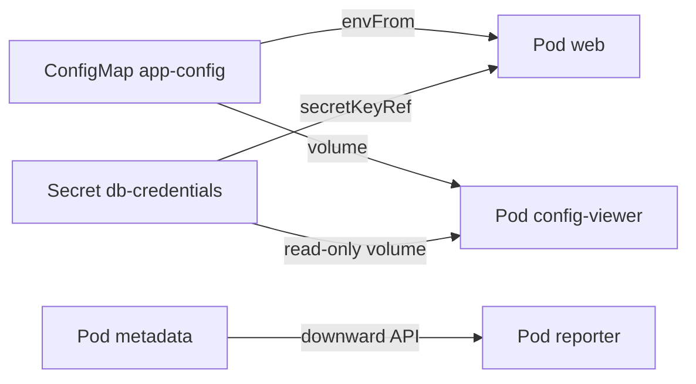

# Chapter 07: ConfigMaps, Secrets, environment variables, and the downward API

> **Exams:** CKAD · CKA
> **Difficulty:** Beginner
> **Time:** ~45 min reading, ~35 min lab
> **Lab tier:** 1 (kind)
> **Prerequisites:** Chapter 04 (Pods in depth), Chapter 05 (Controllers)

## Learning objectives

After this chapter you can:

- Explain why configuration and secrets belong outside the container image, and what that buys you
- Create a ConfigMap and a Secret imperatively, and read their YAML with `--dry-run=client -o yaml`
- Decode a Secret's values, and explain why base64 is not protection
- Pass configuration to a container as environment variables, with `env` and `envFrom`
- Mount a ConfigMap or a Secret as files, read-only when required
- Use the downward API to expose Pod metadata, node name, and resource limits to a container
- Predict which configuration changes reach a running container, and which need a restart

## Concepts

### Why configuration lives outside the image

An image should be the same artifact in every environment. The database host,
the log level, and the password differ between a laptop, a test cluster, and
production, so they must not be baked into the image. If they were, you would
need a different image for each environment, and every change to a setting would
mean a new build.

Kubernetes separates the two. The image holds the code. Configuration is stored
in API objects and injected into the container when it starts. Two objects do
the storing:

- A **ConfigMap** holds non-sensitive configuration: key-value pairs of text.
- A **Secret** holds sensitive values, such as passwords, tokens, and keys.

The Pod refers to them by name. Change the ConfigMap, and the next Pod that uses
it sees the change. The image stays the same.

### ConfigMaps

A ConfigMap has a `data` map of strings. Each key becomes either an environment
variable or a file, depending on how the Pod uses it. A ConfigMap can also carry
a `binaryData` map for non-text content, but most configuration is plain text.



The diagram shows the three ways a Pod receives configuration. Each arrow is a
way to consume one of the objects. `web` reads a ConfigMap and one Secret key
as environment variables. `config-viewer` mounts both as files. `reporter` gets
values from its own metadata through the downward API, not from a stored object.

A ConfigMap can be marked `immutable: true`. Kubernetes then refuses changes to
its data, and the kubelet stops watching it, which reduces load on large
clusters. The trade-off is that you must create a new ConfigMap (with a new
name) to change anything.

### Secrets

A Secret looks like a ConfigMap, with two differences. Its values are stored
base64-encoded, and the `type` field says what kind of secret it is. The most
common type is `Opaque`, which means arbitrary user data. Others, such as
`kubernetes.io/tls` and `kubernetes.io/dockerconfigjson`, have required keys and
are used by specific features.

Base64 is an encoding, not encryption. Anyone who can read the Secret can decode
it in one command, so the protection comes from access control, not from the
encoding. Keep the following in mind:

- By default, Secret values are stored unencrypted in etcd. Encryption at rest is
  an optional API server setting, and Chapter 33 covers secrets management.
- RBAC decides who can `get` a Secret. Give that permission sparingly.
- `kubectl describe secret` shows the keys and the size of each value, not the
  values. `kubectl get secret -o yaml` does show the encoded values, so it is
  just as sensitive.

To write a value into a Secret, `--from-literal` encodes it for you. To read
one, decode it yourself:

```bash
kubectl get secret NAME -o jsonpath='{.data.KEY}' | base64 -d
```

### Consuming configuration: environment variables

Two fields inject values as environment variables:

- `env` lists variables one at a time. Each entry sets a `name` and either a
  literal `value` or a `valueFrom` reference to a ConfigMap key, a Secret key,
  or a field of the Pod.
- `envFrom` imports every key of a ConfigMap or Secret at once, using the key as
  the variable name.

Environment variables are read once, when the container starts. If you change
the ConfigMap afterwards, a running container keeps the old value. The Pod must
be restarted to see the change. Replacing the Pod is the usual way: a Deployment
does that automatically when its template changes, and a bare Pod must be
deleted and created again.

A reference to a missing ConfigMap or Secret keeps the container from starting
and shows `CreateContainerConfigError` in the Pod status. You can mark a
reference `optional: true` to let the container start without it.

### Consuming configuration: volumes

A ConfigMap or Secret can be mounted as a volume. Each key becomes a file in the
mount directory, with the value as its content. This is the right choice for
configuration files, such as a `nginx.conf` or a certificate, and for any value
you want to read at runtime.

Volume-mounted configuration updates without a restart. When the ConfigMap
changes, the kubelet rewrites the files in place, usually within a minute. The
application still has to reload them, so the update is only useful for software
that re-reads its files.

The exception is `subPath`. A volume mounted with `subPath` is a single file
copied into the container at start, and it never receives updates. Use a whole
directory mount if the file must change with the ConfigMap.

Mount a Secret read-only (`readOnly: true` on the `volumeMount`) so that the
application cannot modify it. The mounted files are also created with the
permissions in `defaultMode`, which is the usual place to tighten access.

### The downward API

The downward API exposes information about the Pod itself to its containers.
It works like a `valueFrom` reference, but the source is the Pod instead of a
stored object:

- `fieldRef` reads a field, such as `metadata.name`, `metadata.namespace`,
  `spec.nodeName`, `status.podIP`, or a label or annotation.
- `resourceFieldRef` reads a resource request or limit of a container, such as
  `limits.memory`. The `divisor` sets the unit: without it you get bytes, and
  `divisor: 1Mi` gives mebibytes.

The downward API is useful for logging (tagging every line with the Pod name),
for runtime tuning (sizing a heap to the memory limit), and for applications
that must know where they run. The values are fixed for the life of the Pod,
and they are visible to anyone who can read the Pod spec.

### How the pieces fit

The table below shows which mechanism to use for each need.

| Need | Use | Updates reach a running container? |
| --- | --- | --- |
| A few settings the app reads at start (`LOG_LEVEL`) | `env` or `envFrom` on a ConfigMap | No, restart the Pod |
| A config file the app re-reads | ConfigMap as a volume (whole directory) | Yes, after a delay |
| A password the app reads at start | `env` with `secretKeyRef` | No, restart the Pod |
| A key or certificate file | Secret as a read-only volume | Yes, after a delay |
| The Pod's name, node, or limits | Downward API | Fixed for the Pod's life |

> **Exam tip:** Generate the YAML for a ConfigMap or a Secret with `kubectl create configmap NAME --from-literal=... --dry-run=client -o yaml`, and edit the result. Writing `env` and `volumeMounts` by hand is slow, so start from `kubectl run` or `kubectl create deployment --dry-run=client -o yaml` and add the `envFrom` or `volumes` block.

## Guided walkthrough

The walkthrough works in the Namespace `ch07-config`. The lab later in this
chapter uses that Namespace too, so run `make lab CH=7` before you start, or
run the commands in any Namespace you choose and change `-n` to match. The
outputs below are trimmed: the generated fields (`uid`, `creationTimestamp`,
`resourceVersion`) are left out, and yours will differ.

### Create a ConfigMap and read it back

Create a ConfigMap from two literal values:

```bash
kubectl -n ch07-config create configmap demo-config --from-literal=LOG_LEVEL=info --from-literal=FEATURE_FLAG=on
```

```text
configmap/demo-config created
```

Read it back as YAML:

```bash
kubectl -n ch07-config get configmap demo-config -o yaml
```

```yaml
apiVersion: v1
data:
  FEATURE_FLAG: "on"
  LOG_LEVEL: info
kind: ConfigMap
metadata:
  name: demo-config
  namespace: ch07-config
```

Notice that `on` is quoted in the output. YAML reads an unquoted `on` as the
boolean `true`, so the API server and the tooling quote it to keep the value a
string. Your own manifests must quote such values too.

To see the manifest before creating anything, use a dry run:

```bash
kubectl -n ch07-config create configmap demo-config --from-literal=LOG_LEVEL=info --dry-run=client -o yaml
```

```yaml
apiVersion: v1
data:
  LOG_LEVEL: info
kind: ConfigMap
metadata:
  name: demo-config
  namespace: ch07-config
```

### Decode a Secret

The lab's setup created a Secret named `legacy-db` with one key, `password`.
Look at its encoded value, then decode it:

```bash
kubectl -n ch07-config get secret legacy-db -o jsonpath='{.data.password}' | base64 -d; echo
```

```text
gSpxIt22GKzSNZiw
```

Your value will differ, because the lab generates it. The `echo` adds the
newline that `base64 -d` does not print. To create a Secret from a value, let
`kubectl` do the encoding:

```bash
kubectl -n ch07-config create secret generic demo-secret --from-literal=password=s3cret --dry-run=client -o yaml
```

```yaml
apiVersion: v1
data:
  password: czNjcmV0
kind: Secret
metadata:
  name: demo-secret
  namespace: ch07-config
```

`czNjcmV0` is `s3cret` encoded. You can check it yourself with
`echo -n s3cret | base64`.

### Use the ConfigMap and the Secret as environment variables

Create a Pod that imports every key of `demo-config` with `envFrom`, and reads
`DB_PASSWORD` from one key of `legacy-db` with `env`:

```bash
cat <<'YAML' | kubectl -n ch07-config apply -f -
apiVersion: v1
kind: Pod
metadata:
  name: demo
spec:
  containers:
    - name: app
      image: nginx:1.27
      envFrom:
        - configMapRef:
            name: demo-config
      env:
        - name: DB_PASSWORD
          valueFrom:
            secretKeyRef:
              name: legacy-db
              key: password
YAML
```

```text
pod/demo created
```

Check the variables inside the running container:

```bash
kubectl -n ch07-config exec demo -- env | grep -E 'LOG_LEVEL|FEATURE_FLAG|DB_PASSWORD'
```

```text
FEATURE_FLAG=on
LOG_LEVEL=info
DB_PASSWORD=gSpxIt22GKzSNZiw
```

Now change the ConfigMap, and check again without restarting the Pod:

```bash
kubectl -n ch07-config create configmap demo-config --from-literal=LOG_LEVEL=debug --from-literal=FEATURE_FLAG=on --dry-run=client -o yaml | kubectl -n ch07-config replace -f -
kubectl -n ch07-config exec demo -- env | grep LOG_LEVEL
```

```text
configmap/demo-config replaced
LOG_LEVEL=info
```

The container still says `info`. The variable was read at start, so only a new
Pod sees `debug`. Delete the Pod, and clean up:

```bash
kubectl -n ch07-config delete pod demo
```

### Mount the ConfigMap and the Secret as files

Create a Pod that mounts the ConfigMap as a directory of files, and the Secret
as a read-only directory:

```bash
cat <<'YAML' | kubectl -n ch07-config apply -f -
apiVersion: v1
kind: Pod
metadata:
  name: demo-volume
spec:
  containers:
    - name: app
      image: busybox:1.36
      command: ["sleep", "3600"]
      volumeMounts:
        - name: config
          mountPath: /etc/app
        - name: creds
          mountPath: /etc/creds
          readOnly: true
  volumes:
    - name: config
      configMap:
        name: demo-config
    - name: creds
      secret:
        secretName: legacy-db
YAML
```

```text
pod/demo-volume created
```

List the files, read two of them, and try to write to the read-only mount:

```bash
kubectl -n ch07-config exec demo-volume -- ls /etc/app
kubectl -n ch07-config exec demo-volume -- cat /etc/app/LOG_LEVEL
kubectl -n ch07-config exec demo-volume -- sh -c 'echo x > /etc/creds/new'
```

```text
FEATURE_FLAG
LOG_LEVEL
info
sh: can't create /etc/creds/new: Read-only file system
command terminated with exit code 1
```

Each key became a file, and the read-only mount refused the write. Delete the
Pod before the next section:

```bash
kubectl -n ch07-config delete pod demo-volume
```

### Expose Pod facts with the downward API

Create a Pod that gets its own name, its node, and its memory limit from the
Pod itself:

```bash
cat <<'YAML' | kubectl -n ch07-config apply -f -
apiVersion: v1
kind: Pod
metadata:
  name: demo-downward
spec:
  containers:
    - name: app
      image: busybox:1.36
      command: ["sleep", "3600"]
      resources:
        limits:
          memory: 64Mi
          cpu: 100m
      env:
        - name: POD_NAME
          valueFrom:
            fieldRef:
              fieldPath: metadata.name
        - name: NODE_NAME
          valueFrom:
            fieldRef:
              fieldPath: spec.nodeName
        - name: MEM_LIMIT
          valueFrom:
            resourceFieldRef:
              containerName: app
              resource: limits.memory
              divisor: 1Mi
YAML
```

```text
pod/demo-downward created
```

```bash
kubectl -n ch07-config exec demo-downward -- env | grep -E '^(POD_NAME|NODE_NAME|MEM_LIMIT)='
```

```text
POD_NAME=demo-downward
NODE_NAME=kbook-worker2
MEM_LIMIT=64
```

`MEM_LIMIT` is `64` and not `67108864` only because of `divisor: 1Mi`. The node
name is the one the scheduler chose, so it will differ on your cluster.

## Hands-on lab

The lab works like a KodeKloud lab: one task at a time, a check after each, and
progress that is saved between sessions.

```bash
make lab CH=7        # set up the lab and show task 1
make check CH=7      # check the current task; if it is right, show the next
make question CH=7   # show the current task again
make reset CH=7      # back to the starting state and task 1
make verify CH=7     # check every task at once
```

Everything happens in the Namespace `ch07-config`: use `-n ch07-config` on every
command, or run `make use-namespace CH=7` once. The setup created one Secret,
`legacy-db`, which holds a random password under the key `password`. You will
need that password for Task 2, so decode it from the Secret rather than looking
for it anywhere else. Tasks 3 to 5 depend on the objects from Tasks 1 and 2, so
do those first. Full solutions are in [`lab/solutions.md`](lab/solutions.md).

### Task 1: Create the ConfigMap

Create a ConfigMap with the following specification.

- Name: `app-config`
- Keys: exactly two, `LOG_LEVEL` with the value `info`, and `FEATURE_FLAG` with the value `on`

### Task 2: Create a Secret from an existing one

The application needs its own Secret, so copy the password out of `legacy-db`
into a new one.

- Name: `db-credentials`
- Type: `Opaque`
- Keys: exactly two, `username` with the value `app`, and `password` with the same value as the `password` key of `legacy-db`

### Task 3: Run a Pod with configuration as environment variables

Create a Pod with the following specification. It needs `app-config` and
`db-credentials` from Tasks 1 and 2.

- Name: `web`
- Image: `nginx:1.27` (a single container)
- Every key of `app-config` is an environment variable in the container
- The environment variable `DB_PASSWORD` is read from the `password` key of `db-credentials`, not written as a literal value
- Status: `Running`

### Task 4: Expose Pod facts with the downward API

Create a Pod with the following specification. Its values must come from the Pod
itself, not from literal text.

- Name: `reporter`
- Image: `busybox:1.36`, running `sleep 3600`
- Memory limit: `64Mi`
- Environment variable `POD_NAME` holds the Pod's name
- Environment variable `NODE_NAME` holds the name of the node the Pod runs on
- Environment variable `MEM_LIMIT` holds the container's memory limit in mebibytes (`64`)
- Status: `Running`

### Task 5: Mount the configuration as files

Create a Pod with the following specification. It needs `app-config` and
`db-credentials` from Tasks 1 and 2.

- Name: `config-viewer`
- Image: `busybox:1.36`, running `sleep 3600`
- The ConfigMap `app-config` is mounted at `/etc/app`, with one file per key
- The Secret `db-credentials` is mounted read-only at `/etc/db`
- Status: `Running`

## Exam tips

> **Exam tip:** `kubectl set env deployment/web --from=configmap/app-config` adds configuration to a Deployment without editing YAML. In current `kubectl` it writes one `env` entry per key, each with a `configMapKeyRef`, not an `envFrom` block. Because it changes the Pod template, the Deployment rolls out new Pods, which is what makes the values take effect. Check the result with `kubectl set env deployment/web --list`.
>
> **Exam tip:** A Pod that will not start after you added a reference is almost always a wrong name or key. `kubectl describe pod` shows the reason under Events, such as `Error: couldn't find key pasword in Secret ch07-config/legacy-db` for a misspelled key. Read the Events before you change anything else.
>
> **Exam tip:** Use the same `-o yaml --dry-run=client` habit for Secrets as for every other object. To check a value without printing it into the terminal log, pipe a `jsonpath` read through `base64 -d` and compare it in a shell variable.

## Common mistakes

- Expecting a running container to see a ConfigMap change. Environment variables are read at start, so restart the Pod (or roll the Deployment).
- Mounting a ConfigMap with `subPath` and expecting updates. The file is copied once and never changes.
- Writing a Secret's value with `echo` and forgetting that `echo` adds a newline. Use `--from-literal`, which encodes the value exactly.
- Treating base64 as encryption. Anyone who can read the Secret can decode it.
- Referring to a key that does not exist in the ConfigMap or Secret. The container stops with `CreateContainerConfigError` rather than starting with an empty value.
- Writing `FEATURE_FLAG: on` in YAML without quotes. It becomes the boolean `true`, which is not the string `"on"`.

<!-- QUESTIONS:START -->

## End-of-chapter questions

**1.** `KCNA` `CKAD` A Secret's values appear in `kubectl get secret -o yaml` as text like `czNjcmV0`. What is that encoding?

- **A.** Encryption with a key stored in the cluster, so only the API server can read the value
- **B.** A hash of the value, so the original cannot be recovered
- **C.** Base64 encoding, which anyone who can read the Secret can decode
- **D.** Compression, which the kubelet reverses when it mounts the value

**2.** `CKAD` `CKA` A Deployment's Pods get `LOG_LEVEL` from a ConfigMap through `envFrom`. You change `LOG_LEVEL` in the ConfigMap. What do the running containers see?

- **A.** The new value immediately, because environment variables are re-read on every access
- **B.** The new value after about a minute, as with mounted files
- **C.** The old value until their containers restart, because environment variables are read once at start
- **D.** The new value only if the Deployment's image tag also changes

**3.** `CKAD` `CKA` A ConfigMap is mounted into a Pod with `subPath: app.conf`. You later update the ConfigMap. What happens to the mounted file?

- **A.** It is updated within about a minute, like any mounted ConfigMap file
- **B.** It is never updated; the file is copied into the container when it starts
- **C.** It is updated only after the Pod is deleted and recreated by its controller
- **D.** The Pod fails with an error until the subPath is removed

**4.** `CKAD` Which downward API `fieldPath` gives a container the IP address of its Pod?

- **A.** `spec.podIP`
- **B.** `status.podIP`
- **C.** `metadata.podIP`
- **D.** `status.hostIP`

**5.** `CKAD` `CKA` A Pod's container uses `env` with a `secretKeyRef` to a key that does not exist in the Secret, and the reference is not marked optional. What happens?

- **A.** The container starts with an empty value and a warning event
- **B.** The container does not start, and the Pod status shows CreateContainerConfigError
- **C.** The Pod is evicted by the kubelet within a few minutes
- **D.** The API server rejects the Pod at creation time with a validation error

**6.** `KCNA` `CKA` What does `immutable: true` on a ConfigMap change?

- **A.** The ConfigMap cannot be read by Pods in other namespaces
- **B.** The API server refuses changes to its data, so a new ConfigMap with a new name is needed to change it
- **C.** Its values are encrypted at rest
- **D.** Pods that use it are restarted automatically whenever it is read

**7.** `CKAD` A container needs its memory limit as a number of mebibytes, so it can size a cache. Which downward API setting gives that?

- **A.** `fieldRef` with `fieldPath: limits.memory`
- **B.** `resourceFieldRef` with `resource: limits.memory` and `divisor: 1Mi`
- **C.** `resourceFieldRef` with `resource: requests.memory` and no divisor
- **D.** `fieldRef` with `fieldPath: resources.limits.memory` and a unit suffix

**8. (Task)** `CKAD` `CKA` In namespace `prod`, create a ConfigMap named `web-settings` with two keys: `THEME` with the value `dark`, and `CACHE_TTL` with the value `300`.

**9. (Task)** `CKAD` `CKA` In namespace `prod`, create a Secret named `api-token` of type `Opaque` with one key, `token`, whose value is `s3cr3t-token`. Then show that the stored value decodes to the same text.

**10. (Task)** `CKAD` `CKA` In namespace `prod`, the Deployment `api` runs the container `httpd`. Add the ConfigMap `web-settings` as environment variables for that container, and roll out the change. Then show the environment variables the Deployment now sets.

**11. (Task)** `CKAD` `CKA` In namespace `prod`, create a Pod named `reader` running `busybox:1.36` with the command `sleep 3600`. Mount the Secret `api-token` read-only at `/etc/api`, so that the file `/etc/api/token` holds the token. The Pod must be Running.

<details>
<summary>Answers</summary>

**1. C.** Secret values are base64-encoded so that binary data fits in JSON and YAML. Base64 is reversible without any key, so it protects nothing by itself. Protection comes from RBAC on who can read the Secret and, optionally, from encryption at rest in etcd, which is a separate API server setting.

**2. C.** Environment variables are copied into the container's environment when it starts and never refreshed. Restarting the Pods, for example with kubectl rollout restart deployment/NAME, gives them the new value. Mounted files, by contrast, are rewritten by the kubelet and see the change without a restart.

**3. B.** A subPath mount binds one file into the container once, at start, and the kubelet does not refresh it. To pick up changes, mount the whole directory instead of a single key, or restart the Pod.

**4. B.** The Pod's IP is reported in the status, so the field is `status.podIP`. `status.hostIP` is the IP of the node, and the other two paths do not exist in the Pod API.

**5. B.** The API server accepts the Pod, because it cannot check Secret contents when it validates the spec. The kubelet then fails to build the container's configuration and reports CreateContainerConfigError. `kubectl describe pod` names the missing key in the Events. Setting optional: true on the reference lets the container start without the key.

**6. B.** An immutable ConfigMap or Secret cannot have its data changed. The kubelet also stops watching it, which reduces API load in large clusters. Changing the configuration means creating a new object with a new name and pointing the Pods at it. Immutability is not encryption, and it does not affect who can read the object.

**7. B.** Resource values come from `resourceFieldRef`, not `fieldRef`, and the resource name is `limits.memory`. Without a divisor the value is in bytes. `divisor: 1Mi` returns it in mebibytes, so a 64Mi limit is exposed as 64.

**8.**

```bash
kubectl -n prod create configmap web-settings --from-literal=THEME=dark --from-literal=CACHE_TTL=300
kubectl -n prod get configmap web-settings -o yaml
```

`--from-literal` sets each key exactly. Values such as `300` stay strings in a ConfigMap, which is what the consumer receives.

**9.**

```bash
kubectl -n prod create secret generic api-token --from-literal=token=s3cr3t-token
kubectl -n prod get secret api-token -o jsonpath='{.data.token}' | base64 -d; echo
```

`generic` gives the `Opaque` type. Writing the value with `echo | kubectl` would add a newline to it; `--from-literal` does not.

**10.**

```bash
kubectl -n prod set env deployment/api --from=configmap/web-settings
kubectl -n prod rollout status deployment/api
kubectl -n prod set env deployment/api --list
```

In current `kubectl`, `set env --from` writes one `env` entry per key, each with a `configMapKeyRef`. Changing the Pod template makes the Deployment roll out new Pods, which is when the values reach the containers.

**11.**

```bash
cat <<'YAML' | kubectl -n prod apply -f -
apiVersion: v1
kind: Pod
metadata:
  name: reader
spec:
  containers:
    - name: reader
      image: busybox:1.36
      command: ["sleep", "3600"]
      volumeMounts:
        - name: api
          mountPath: /etc/api
          readOnly: true
  volumes:
    - name: api
      secret:
        secretName: api-token
YAML
kubectl -n prod wait --for=condition=Ready pod/reader --timeout=120s
kubectl -n prod exec reader -- cat /etc/api/token
```

A Secret volume creates one file per key, so the token is at `/etc/api/token`. The `readOnly: true` on the mount stops the container from writing to it.

</details>

<!-- QUESTIONS:END -->

## Further reading

- Kubernetes documentation: *ConfigMaps*, *Secrets*, *Configure a Pod to use a ConfigMap*, *Distribute credentials securely using Secrets*
- Kubernetes documentation: *Expose Pod information to containers through environment variables and files* (the downward API)
- Kubernetes documentation: *Encrypting Confidential Data at Rest* (what the default storage of Secrets does not protect)
- Chapter 08 next: Jobs and CronJobs, workloads that run to completion and then stop
