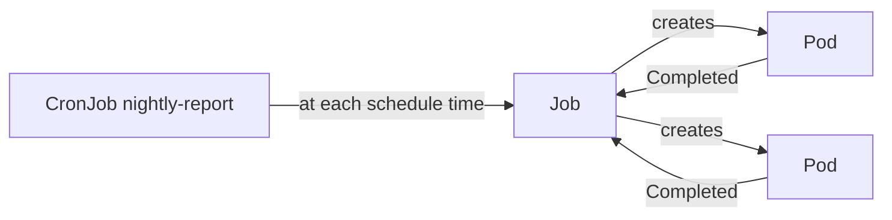

# Chapter 08: Jobs and CronJobs

> **Exams:** CKAD
> **Difficulty:** Beginner
> **Time:** ~40 min reading, ~30 min lab
> **Lab tier:** 1 (kind)
> **Prerequisites:** Chapter 04 (Pods in depth), Chapter 05 (Controllers)

## Learning objectives

After this chapter you can:

- Explain how a Job differs from a Deployment: it runs Pods until they finish, and then it stops
- Set `completions`, `parallelism`, and `backoffLimit` on a Job, and predict how many Pods run and how many retries happen
- Choose between `restartPolicy: Never` and `OnFailure` for a Job's Pods
- Read a Job's status and conditions to tell success from failure
- Create a CronJob with a schedule, and control overlapping runs with `concurrencyPolicy`
- Start a one-off run from a CronJob with `kubectl create job --from`

## Concepts

### Work that has an end

Everything in Chapters 04 and 05 was meant to keep running. A web server, a
worker, or a Deployment has no natural end: if its Pod exits, the controller
starts another. That is the wrong behaviour for a database migration, a report,
or a batch of images to resize. Those tasks should run to completion, report
whether they succeeded, and stop.

A **Job** is the controller for that kind of work. It creates one or more Pods,
watches them, and considers itself finished when enough Pods have succeeded.
Once finished, it leaves the Pods in place (so you can read their logs), and it
creates no new ones. A Job does not repair a Pod that finishes successfully,
because that is the goal.

A **CronJob** is a Job on a schedule. At each scheduled time it creates a new
Job from a template, and the Job does the work. The CronJob itself does no work
and keeps only a short history of finished Jobs.



The diagram shows the chain of ownership. The CronJob creates a Job at each
scheduled time, and the Job creates the Pods. The Pods report success back to
the Job, and the Job reports the outcome.

### Completions and parallelism

A Job has two numbers that control its shape:

- `completions` is how many Pods must succeed for the Job to be complete. The
  default is 1.
- `parallelism` is how many Pods may run at the same time. The default is 1.

With `completions: 6` and `parallelism: 2`, the Job starts two Pods. When one
succeeds, the Job starts the next, and so on, until six have succeeded. The
Job never runs more than two at once, so you can bound the load it puts on the
cluster and on whatever it calls.

A Job whose `completions` is not set is a "one-off" Job: it is complete when a
single Pod succeeds. Jobs with `completions` and no `parallelism` run the
Pods one after another.

### Restart policy and retries

A Job's Pod template must use `restartPolicy: Never` or `restartPolicy:
OnFailure`. The default `Always` is rejected, because the Job would never end.

- With `OnFailure`, a failed container is restarted in the same Pod. The Pod
  stays the same, and its restart count goes up.
- With `Never`, a failed container leaves the Pod in the `Error` state, and the
  Job creates a new Pod instead. Each failed Pod stays until you delete it, so
  you can read its logs.

`backoffLimit` caps the retries. It is the number of failed Pods the Job
tolerates before it gives up. The default is 6. When the number of failures
goes past the limit, the Job fails, and its status shows a `Failed` condition
with the reason `BackoffLimitExceeded`. Retries are spaced out with an
exponential delay, which is why a failing Job takes longer to give up than you
might expect.

`activeDeadlineSeconds` sets a time limit for the whole Job, counted from its
start. When it runs out, the Job is failed with the reason
`DeadlineExceeded`, whatever state its Pods are in.

### Reading a Job's outcome

Use the Job's conditions, not the Pods, to decide whether it worked:

- `Complete` with status `True` means the Job reached its `completions`.
- `Failed` with status `True` means it gave up. The `reason` says why.

`kubectl get job` summarises the same information in the `COMPLETIONS` column,
such as `6/6`. Pods that finished successfully show `Completed`, and a failed
Pod shows `Error`. Delete finished Jobs when you are done with them, or set
`ttlSecondsAfterFinished` so that the cluster cleans them up after a delay.

### CronJobs and their schedules

A CronJob takes a `schedule` in the standard five-field cron format:
minute, hour, day of month, month, and day of week. `30 2 * * *` means 02:30
every day. `*/15 * * * *` means every 15 minutes. The time zone is the
controller manager's, unless you set `timeZone` on the CronJob.

Three fields control the behaviour between runs:

- `concurrencyPolicy` decides what happens when a run is due while the previous
  one is still running. `Allow` (the default) starts another run. `Forbid` skips
  the new run. `Replace` cancels the running one and starts the new one.
- `successfulJobsHistoryLimit` and `failedJobsHistoryLimit` keep a number of
  finished Jobs (3 and 1 by default), so you can read their logs.
- `startingDeadlineSeconds` is how late a run may start after its scheduled
  time. If the controller missed the window, for example while the cluster was
  down, the run is skipped instead of run late.

`suspend: true` pauses a CronJob. No new Jobs are created while it is suspended,
but existing Jobs keep running.

A CronJob's template uses `restartPolicy: OnFailure` when you create it with
`kubectl create cronjob`. That is different from a Job created with `kubectl
create job`, which uses `Never`. Check the template if you change one into the
other.

### Running a CronJob now

You do not need to wait for the schedule to test a CronJob. `kubectl create job
NAME --from=cronjob/CRONJOB` copies the CronJob's Job template into a new Job
and runs it immediately. The new Job is owned by the CronJob, so it shows up in
its history.

## Guided walkthrough

The walkthrough works in the Namespace `ch08-jobs`. The lab later in this
chapter uses that Namespace too, so run `make lab CH=8` before you start, or run
the commands in any Namespace you choose. The outputs below are trimmed:
generated fields and ages differ on your cluster.

### Run a Job to completion

Create a Job that prints one line and exits:

```bash
kubectl -n ch08-jobs create job demo --image=busybox:1.36 -- sh -c 'echo report done'
```

```text
job.batch/demo created
```

Wait for it and read the outcome:

```bash
kubectl -n ch08-jobs wait --for=condition=Complete job/demo --timeout=120s
kubectl -n ch08-jobs get job demo
kubectl -n ch08-jobs logs job/demo
```

```text
job.batch/demo condition met
NAME   STATUS     COMPLETIONS   DURATION   AGE
demo   Complete   1/1           3s         3s
report done
```

The Pod stays behind with the status `Completed`, so its logs remain available.

Before you write a Job by hand, generate its YAML:

```bash
kubectl -n ch08-jobs create job demo --image=busybox:1.36 --dry-run=client -o yaml -- sh -c 'echo report done'
```

```yaml
apiVersion: batch/v1
kind: Job
metadata:
  name: demo
  namespace: ch08-jobs
spec:
  template:
    metadata: {}
    spec:
      containers:
      - command:
        - sh
        - -c
        - echo report done
        image: busybox:1.36
        name: demo
        resources: {}
      restartPolicy: Never
status: {}
```

Look at the `restartPolicy`: a Job created this way uses `Never`. The generated
YAML leaves out `completions` and `parallelism`, because they default to 1.

### Run six completions, two at a time

Create a Job that needs six successful Pods, with at most two running at once:

```bash
cat <<'YAML' | kubectl -n ch08-jobs apply -f -
apiVersion: batch/v1
kind: Job
metadata:
  name: batch
spec:
  completions: 6
  parallelism: 2
  template:
    spec:
      restartPolicy: Never
      containers:
        - name: worker
          image: busybox:1.36
          command: ["sh", "-c", "sleep 2; echo item done"]
YAML
```

```text
job.batch/batch created
```

Wait for the Job, then count its Pods by state:

```bash
kubectl -n ch08-jobs wait --for=condition=Complete job/batch --timeout=180s
kubectl -n ch08-jobs get job batch
kubectl -n ch08-jobs get pods -l job-name=batch --no-headers | awk '{print $3}' | sort | uniq -c
```

```text
job.batch/batch condition met
NAME    STATUS     COMPLETIONS   DURATION   AGE
batch   Complete   6/6           16s        16s
      6 Completed
```

Six Pods completed, and the Job reports `6/6`. With two running at a time and
two seconds per Pod, the Job takes about six seconds of work, plus scheduling
overhead, which is why it shows 16s here.

### Watch a Job give up

Create a Job whose only container always fails, and allow two retries:

```bash
cat <<'YAML' | kubectl -n ch08-jobs apply -f -
apiVersion: batch/v1
kind: Job
metadata:
  name: fragile
spec:
  backoffLimit: 2
  template:
    spec:
      restartPolicy: Never
      containers:
        - name: worker
          image: busybox:1.36
          command: ["sh", "-c", "echo trying; exit 1"]
YAML
```

```text
job.batch/fragile created
```

Wait for the Job to fail, then read its conditions and its Pods:

```bash
kubectl -n ch08-jobs wait --for=condition=Failed job/fragile --timeout=300s
kubectl -n ch08-jobs get job fragile -o jsonpath='{range .status.conditions[*]}{.type}={.status} reason={.reason}{"\n"}{end}'
kubectl -n ch08-jobs get pods -l job-name=fragile --no-headers | awk '{print $3}' | sort | uniq -c
```

```text
job.batch/fragile condition met
FailureTarget=True reason=BackoffLimitExceeded
Failed=True reason=BackoffLimitExceeded
      3 Error
```

`backoffLimit: 2` allowed two retries, so the Job ran three Pods in total before
it failed. The wait took about 30 seconds, because the retries are spaced out.

### Create a CronJob and tune it

Generate a CronJob to see its shape before you create it:

```bash
kubectl -n ch08-jobs create cronjob nightly-report --image=busybox:1.36 --schedule="30 2 * * *" --dry-run=client -o yaml -- sh -c 'echo nightly report'
```

The output is long, so the important fields are these:

```yaml
spec:
  jobTemplate:
    spec:
      template:
        spec:
          containers:
          - command:
            - sh
            - -c
            - echo nightly report
            image: busybox:1.36
          restartPolicy: OnFailure
  schedule: 30 2 * * *
```

Create it, then set the concurrency policy and the history limit with one patch:

```bash
kubectl -n ch08-jobs create cronjob nightly-report --image=busybox:1.36 --schedule="30 2 * * *" -- sh -c 'echo nightly report'
kubectl -n ch08-jobs patch cronjob nightly-report -p '{"spec":{"concurrencyPolicy":"Forbid","successfulJobsHistoryLimit":2}}'
kubectl -n ch08-jobs get cronjob nightly-report
```

```text
cronjob.batch/nightly-report created
cronjob.batch/nightly-report patched
NAME             SCHEDULE     TIMEZONE   SUSPEND   ACTIVE   LAST SCHEDULE   AGE
nightly-report   30 2 * * *   <none>     False     0        <none>          1s
```

`LAST SCHEDULE` is empty, because the schedule (02:30) has not come up yet.

### Run a CronJob now, without waiting

Start a Job from the CronJob, and read its output:

```bash
kubectl -n ch08-jobs create job manual-run --from=cronjob/nightly-report
kubectl -n ch08-jobs wait --for=condition=Complete job/manual-run --timeout=120s
kubectl -n ch08-jobs logs job/manual-run
kubectl -n ch08-jobs get job manual-run -o jsonpath='{.metadata.ownerReferences[0].kind}/{.metadata.ownerReferences[0].name}{"\n"}'
```

```text
job.batch/manual-run created
job.batch/manual-run condition met
nightly report
CronJob/nightly-report
```

The Job copied the CronJob's template, and its owner is the CronJob.

## Hands-on lab

The lab works like a KodeKloud lab: one task at a time, a check after each, and
progress that is saved between sessions.

```bash
make lab CH=8        # set up the lab and show task 1
make check CH=8      # check the current task; if it is right, show the next
make question CH=8   # show the current task again
make reset CH=8      # back to the starting state and task 1
make verify CH=8     # check every task at once
```

Everything happens in the Namespace `ch08-jobs`: use `-n ch08-jobs` on every
command, or run `make use-namespace CH=8` once. The Namespace starts empty.
Task 5 needs the CronJob from Task 4, so do Task 4 first. Task 3 takes about 30
seconds to finish, because its retries are spaced out, so start it early and do
the other tasks while it runs. Full solutions are in
[`lab/solutions.md`](lab/solutions.md).

### Task 1: Run a Job once

Create a Job with the following specification, and wait until it completes.

- Name: `report`
- Image: `busybox:1.36`
- Command: `sh -c 'echo report done'`
- Completions: `1`

### Task 2: Run a batch of Pods, two at a time

Create a Job with the following specification, and wait until all of its Pods have succeeded.

- Name: `batch`
- Image: `busybox:1.36`
- Completions: `6`
- Parallelism: `2`
- Pods must not restart their containers in place (`restartPolicy: Never`)

### Task 3: Give up after two retries

Create a Job with the following specification. Its container always fails, so the
Job must end in failure, not success.

- Name: `fragile`
- Image: `busybox:1.36`
- Command: `sh -c 'echo trying; exit 1'`
- Backoff limit: `2`
- Pods must not restart their containers in place (`restartPolicy: Never`)

Wait until the Job reports its failure. It takes about 30 seconds.

### Task 4: Schedule a CronJob

Create a CronJob with the following specification.

- Name: `nightly-report`
- Schedule: `30 2 * * *`
- Image: `busybox:1.36`
- Concurrency policy: `Forbid`
- Successful Jobs to keep: `2`

### Task 5: Run the CronJob now

Create a Job named `manual-run` from the CronJob `nightly-report`, and wait until
it completes. The Job must be owned by the CronJob, which is what `kubectl create
job --from` does.

## Exam tips

> **Exam tip:** `kubectl create job NAME --image=IMAGE -- COMMAND` is the fastest way to a one-off Job, and `kubectl create cronjob NAME --image=IMAGE --schedule="..." -- COMMAND` is the same for a CronJob. Add `--dry-run=client -o yaml` to get the manifest, then add `completions`, `parallelism`, or `backoffLimit` by hand, because the imperative forms do not set them.
>
> **Exam tip:** `kubectl create job NAME --from=cronjob/NAME` is the quickest way to test a CronJob's Pod template. Use it instead of waiting for the schedule.
>
> **Exam tip:** Read a Job's conditions with `kubectl get job NAME -o jsonpath='{.status.conditions}'` or `kubectl describe job NAME`. The reason in a `Failed` condition says what went wrong, which is usually all you need before you look at the logs.

## Common mistakes

- Setting `restartPolicy: Always` in a Job's Pod template. The API server rejects it, because a Job's Pods must end.
- Expecting `backoffLimit: 2` to mean two attempts. It means two retries, so three Pods run when all of them fail.
- Confusing `parallelism` with `completions`. `parallelism` limits how many Pods run at once; `completions` says how many must succeed.
- Changing a CronJob's schedule and expecting a running Job to pick it up. Schedules only affect new runs.
- Forgetting that `concurrencyPolicy` and the history limits belong to the CronJob, not to the Job inside it.
- Reading `kubectl get pods` to decide whether a Job succeeded. A Job can have failed Pods and still succeed, and its conditions say which.

<!-- QUESTIONS:START -->

## End-of-chapter questions

**1.** `CKAD` You write a Job whose Pod template has `restartPolicy: Always`. What happens?

- **A.** The Job runs the Pods until they fail, then retries forever
- **B.** The API server rejects the Job, because a Job's Pods must end; the allowed values are Never and OnFailure
- **C.** The Job works as normal, because Always is the default for every Pod
- **D.** The Pods are restarted in place, and the Job completes when the first one exits

**2.** `CKAD` A Job has `completions: 5` and `parallelism: 3`. What is the most Pods that run at the same time?

- **A.** Five, one for each completion
- **B.** Three, the value of parallelism
- **C.** Eight, the sum of completions and parallelism
- **D.** One, because Jobs always run their Pods in sequence

**3.** `CKAD` A Job has `backoffLimit: 4` and `restartPolicy: Never`, and every Pod fails. How many failed Pods does it create before it is marked as failed?

- **A.** Four
- **B.** Five
- **C.** Six, the default
- **D.** Infinitely many, because the backoff delay grows

**4.** `CKAD` A CronJob with `concurrencyPolicy: Forbid` is due to start a new run, but the previous run is still active. What happens?

- **A.** The new run starts, and both run side by side
- **B.** The running Job is cancelled and replaced by the new one
- **C.** The new run is skipped; the previous run continues
- **D.** The new run is queued and starts when the previous one finishes

**5.** `CKAD` What does `startingDeadlineSeconds` on a CronJob control?

- **A.** How long a single Job may run before it is killed
- **B.** How late a scheduled run may start after its scheduled time before it is skipped
- **C.** How many seconds to wait between retries of a failed Job
- **D.** How long finished Jobs are kept before they are deleted

**6.** `CKAD` A Job should be killed if it runs for more than 600 seconds, whatever state its Pods are in. Which field sets that?

- **A.** `spec.backoffLimit: 600`
- **B.** `spec.activeDeadlineSeconds: 600`
- **C.** `spec.ttlSecondsAfterFinished: 600`
- **D.** `spec.template.spec.terminationGracePeriodSeconds: 600`

**7.** `CKAD` You want finished Jobs to be deleted automatically, 100 seconds after they finish. Which field does that?

- **A.** `spec.activeDeadlineSeconds: 100`
- **B.** `spec.ttlSecondsAfterFinished: 100`
- **C.** `spec.successfulJobsHistoryLimit: 100`
- **D.** `spec.backoffLimit: 100`

**8. (Task)** `CKAD` In namespace `prod`, create a Job named `ping` that runs the image `busybox:1.36` with the command `sh -c 'echo ping'`. It must complete three times, one Pod at a time. Wait until it completes, then show the number of completions.

**9. (Task)** `CKAD` In namespace `prod`, create a CronJob named `cleanup` that runs `busybox:1.36` with the command `sh -c 'echo cleanup'` every 15 minutes. A new run must never start while the previous one is still running.

**10. (Task)** `CKAD` In namespace `prod`, the CronJob `cleanup` must stop creating new Jobs, but keep the existing ones. Change it so that it is suspended, then show that the field is set.

**11. (Task)** `CKAD` In namespace `prod`, start a one-off Job named `cleanup-now` from the CronJob `cleanup`, even though `cleanup` is suspended. Wait until the Job completes, and show its logs.

<details>
<summary>Answers</summary>

**1. B.** A Job's Pods are meant to finish. `Always` would restart a successful container forever, so the API server refuses it. Only `Never` and `OnFailure` are valid in a Job's Pod template.

**2. B.** `parallelism` caps how many Pods run at once. `completions` says how many must succeed in total. With these values the Job starts three Pods, and starts a new one each time one succeeds, until five have succeeded.

**3. B.** `backoffLimit` is the number of retries, so the Job tolerates four retries and gives up after the fifth failure. The Job's `Failed` condition then has the reason `BackoffLimitExceeded`. Counting from zero is the usual mistake here: the limit is retries, not attempts.

**4. C.** `Forbid` skips the new run while one is active. `Allow` (the default) runs both, and `Replace` cancels the active one and starts the new one. Queuing is not a policy Kubernetes offers.

**5. B.** If the controller misses a scheduled time, for example because the cluster was down, a run that is still within `startingDeadlineSeconds` starts late; a run past that window is skipped. Job runtime is `activeDeadlineSeconds`, retries are `backoffLimit`, and cleanup of finished Jobs is `ttlSecondsAfterFinished` or the history limits.

**6. B.** `activeDeadlineSeconds` is a time limit for the whole Job, counted from its start. When it runs out, the Job fails with the reason `DeadlineExceeded`. `ttlSecondsAfterFinished` deletes a Job after it finishes, and `terminationGracePeriodSeconds` is how long one container gets to stop.

**7. B.** `ttlSecondsAfterFinished` makes the TTL controller delete the Job, and its Pods, that many seconds after it completes or fails. `successfulJobsHistoryLimit` is a CronJob field that keeps a count of finished Jobs rather than a time.

**8.**

```bash
cat <<'YAML' | kubectl -n prod apply -f -
apiVersion: batch/v1
kind: Job
metadata:
  name: ping
spec:
  completions: 3
  parallelism: 1
  template:
    spec:
      restartPolicy: Never
      containers:
        - name: ping
          image: busybox:1.36
          command: ["sh", "-c", "echo ping"]
YAML
kubectl -n prod wait --for=condition=Complete job/ping --timeout=180s
kubectl -n prod get job ping
```

The imperative `kubectl create job` cannot set `completions`, so write the YAML. `parallelism: 1` is the default; it is set here to make the intent explicit.

**9.**

```bash
kubectl -n prod create cronjob cleanup --image=busybox:1.36 --schedule="*/15 * * * *" -- sh -c 'echo cleanup'
kubectl -n prod patch cronjob cleanup -p '{"spec":{"concurrencyPolicy":"Forbid"}}'
kubectl -n prod get cronjob cleanup
```

`kubectl create cronjob` gives the CronJob the schedule and the template; the patch sets `concurrencyPolicy: Forbid`, which the imperative form has no flag for.

**10.**

```bash
kubectl -n prod patch cronjob cleanup -p '{"spec":{"suspend":true}}'
kubectl -n prod get cronjob cleanup -o jsonpath='{.spec.suspend}{"\n"}'
```

`suspend: true` stops new runs only. Jobs that were already running are not affected, and deleting the CronJob would remove the schedule, which is not what was asked.

**11.**

```bash
kubectl -n prod create job cleanup-now --from=cronjob/cleanup
kubectl -n prod wait --for=condition=Complete job/cleanup-now --timeout=180s
kubectl -n prod logs job/cleanup-now
```

`--from` copies the CronJob's template into a new Job, so the suspension does not block it: `suspend` only stops the schedule.

</details>

<!-- QUESTIONS:END -->

## Further reading

- Kubernetes documentation: *Jobs*, *Automatic cleanup for finished Jobs*
- Kubernetes documentation: *CronJob*, including the cron schedule format and the time zone field
- `kubectl` reference: `kubectl create job`, `kubectl create cronjob`, `kubectl wait`
- Chapter 09 next: multi-container Pods, init containers, and sidecars, the patterns a Job's Pod often needs
