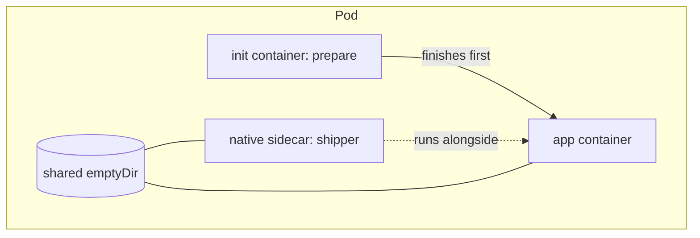

# Chapter 09: Multi-container Pods: init containers, sidecars, and patterns

> **Exams:** CKAD
> **Difficulty:** Intermediate
> **Time:** ~45 min reading, ~35 min lab
> **Lab tier:** 1 (kind)
> **Prerequisites:** Chapter 04 (Pods in depth), Chapter 07 (ConfigMaps, Secrets, and volumes)

## Learning objectives

After this chapter you can:

- Explain why a Pod is the unit of scheduling, and when two containers belong in one Pod rather than in two
- Share files between containers with an `emptyDir` volume, and read one container's logs and files from another
- Use an init container to prepare a Pod's environment, and explain what happens when it fails
- Declare a native sidecar, an init container with `restartPolicy: Always`, and explain how it starts and stops relative to the main containers
- Recognize the sidecar, ambassador, and adapter patterns, and say what each one is for
- Share a process namespace between containers, and use it to inspect a running container from a helper
- Run a node agent as a DaemonSet instead of a sidecar, and make it reach the control plane node with a toleration

## Concepts

### Why put two containers in one Pod

A Pod is the smallest thing Kubernetes schedules, and every container in it
lives on the same node. The containers share the network namespace (they reach
each other on `localhost`), and they can share volumes. They do not share a
filesystem by default: each container has its own root filesystem, and only the
paths you mount are common.

Put two containers in one Pod when they must run together and cooperate
closely: a web server with a helper that reloads its configuration, or an
application with a process that ships its logs. Put them in separate Pods when
they can scale or fail separately. A rule of thumb: if they would need to be
moved together, they belong in one Pod.



The diagram shows one Pod with three kinds of container. The init container
runs first and must succeed. The app container and the native sidecar run
together, and both mount the same `emptyDir` volume. In the Pod, the init
container finishes before the app starts; the sidecar starts before the app and
keeps running.

### Sharing files: `emptyDir`

An `emptyDir` volume is created when the Pod is scheduled and exists as long as
the Pod does. Every container that mounts it sees the same directory. If a
container crashes and restarts, the data survives, because the volume belongs
to the Pod, not to the container. It is deleted when the Pod is deleted.

Use it for scratch space, for files one container produces and another reads,
and for logs that a sidecar forwards. Set `medium: Memory` only when you need
a RAM-backed volume, because it counts against the Pod's memory.

### Init containers

An init container is listed under `spec.initContainers`. Init containers run
one after another, in the order they are listed. Each must exit with code 0
before the next one starts, and none of the app containers starts until all of
them have succeeded. That makes them the right place for setup work that must
happen first: fetching a file, waiting for a dependency, or writing a
configuration file into a shared volume.

If an init container fails, the kubelet retries it with the same back-off as a
crashing container. The Pod's status shows `Init:Error` on the first failure,
then `Init:CrashLoopBackOff` between retries. None of the app containers start.
The `restartPolicy` of the Pod decides what happens after the init container
succeeds: its app containers run, and if they exit, they are restarted under
the same policy.

An init container's spec cannot be changed in place. If its command is wrong,
the Pod must be replaced, which is why a debugging session often ends with
`kubectl replace --force` or a delete and recreate.

### Native sidecars

A sidecar is a helper that runs for the whole life of the Pod, next to the main
application: a log shipper, a proxy, a certificate refresher. Before Kubernetes
1.29 the usual approach was an ordinary container in `spec.containers`, which
had two problems. It might start after the application needed it, and it had
no defined way to stop after the application did.

A **native sidecar** solves both. It is an init container with
`restartPolicy: Always`. The kubelet starts it in the init order, so it is
running before the app containers start. It is not an init container in the
usual sense, because the Pod does not wait for it to exit. It keeps running,
and it is stopped after the app containers have stopped. If it crashes, the
kubelet restarts it.

```yaml
spec:
  initContainers:
    - name: shipper
      image: busybox:1.36
      restartPolicy: Always        # this makes it a native sidecar
      command: ["sh", "-c", "tail -F /var/log/app/app.log"]
  containers:
    - name: app
      image: busybox:1.36
```

Use a native sidecar when the helper must be ready before the application, or
must outlive it. For a helper that only needs to run beside the application,
an ordinary container in `spec.containers` is still correct.

### The multi-container patterns

Three patterns describe most multi-container Pods. Each one is a way of using
the shared namespace and volumes.

- **Sidecar** extends the main container with a helper that does not change its
  code. A log shipper that reads the app's log file is the classic example.
- **Ambassador** is a proxy that the main container talks to on `localhost`. The
  ambassador connects out to the real service, handling discovery, retries, or
  TLS, so the application sees a simple local endpoint.
- **Adapter** converts the main container's output into a format a monitoring
  system expects. For example, it reads an application's custom metrics and
  exposes them in the standard format.

Each pattern is a question of where the helper sits, not of different Kubernetes
objects. In all three, the helper is an ordinary container, or a native sidecar
when it must start first.

### Node agents: a DaemonSet instead of a sidecar

A sidecar serves one Pod. Some helpers serve a whole node instead: a log
collector that reads every container's logs from the node, a monitoring agent,
or a network plugin. Running one per application Pod would waste resources and
miss everything else on the node. These run as a **DaemonSet**: one Pod on every
node, added automatically when a node joins and removed when it leaves.

A DaemonSet has a Pod template and a selector, like a Deployment, but no
`replicas`: the number of nodes decides the number of Pods, and `kubectl scale`
does not apply. It respects taints like any Pod, so it does not run on the
control plane node unless its template tolerates the control plane's taint. Its
Pods often learn which node they run on through the downward API
(`fieldRef: spec.nodeName`, Chapter 07).

### Sharing a process namespace

By default, each container in a Pod has its own process namespace, so a process
in one container cannot see the processes in another. Set
`spec.shareProcessNamespace: true` and all containers share one. A helper
container can then list, signal, or inspect the application's processes. The
Pod's pause container becomes process 1, so the processes you see are the
application's and the helper's.

This is useful for debugging a container that has no shell or no tools. A
helper with the tools attaches to the shared namespace and looks at the
process. The trade-off is that the containers can also see and signal each
other's processes, so use it only for Pods whose containers trust each other.

## Guided walkthrough

The walkthrough works in the Namespace `ch09-multi`. The outputs below are
trimmed: generated fields and timestamps differ on your cluster. The Pods are
named `demo-...` so that they do not clash with the lab. The lab later in this
chapter uses that Namespace too, so run `make lab CH=9` before you start, or run
the commands in any Namespace you choose.

### Share a volume between two containers

Create a Pod whose `writer` container appends to a file on an `emptyDir`, and
whose `reader` container tails the same file:

```bash
cat <<'YAML' | kubectl -n ch09-multi apply -f -
apiVersion: v1
kind: Pod
metadata:
  name: demo-pair
spec:
  volumes:
    - name: shared
      emptyDir: {}
  containers:
    - name: writer
      image: busybox:1.36
      command: ["sh", "-c", "while true; do date >> /shared/out.txt; sleep 1; done"]
      volumeMounts:
        - name: shared
          mountPath: /shared
    - name: reader
      image: busybox:1.36
      command: ["sh", "-c", "sleep 3; tail -f /shared/out.txt"]
      volumeMounts:
        - name: shared
          mountPath: /shared
YAML
```

```text
pod/demo-pair created
```

Wait for both containers, then check that the file is shared:

```bash
kubectl -n ch09-multi wait --for=condition=Ready pod/demo-pair --timeout=120s
kubectl -n ch09-multi get pod demo-pair
kubectl -n ch09-multi logs demo-pair -c reader --tail=2
kubectl -n ch09-multi exec demo-pair -c reader -- sh -c 'wc -l < /shared/out.txt'
```

```text
pod/demo-pair condition met
NAME        READY   STATUS    RESTARTS   AGE
demo-pair   2/2     Running   0          2s
Sun Oct 11 12:42:57 UTC 2026
Sun Oct 11 12:42:58 UTC 2026
7
```

`READY 2/2` means both containers are running. The reader prints the lines the
writer produced, and the line count grows as time passes. The `-c` flag picks
the container: a Pod with two containers needs it for `logs` and `exec`.

### Prepare a file with an init container

Create a Pod whose init container writes a file to a shared volume before the
app container starts:

```bash
cat <<'YAML' | kubectl -n ch09-multi apply -f -
apiVersion: v1
kind: Pod
metadata:
  name: demo-setup
spec:
  volumes:
    - name: work
      emptyDir: {}
  initContainers:
    - name: prepare
      image: busybox:1.36
      command: ["sh", "-c", "echo ready > /work/status.txt"]
      volumeMounts:
        - name: work
          mountPath: /work
  containers:
    - name: app
      image: busybox:1.36
      command: ["sleep", "3600"]
      volumeMounts:
        - name: work
          mountPath: /work
YAML
```

```text
pod/demo-setup created
```

```bash
kubectl -n ch09-multi wait --for=condition=Ready pod/demo-setup --timeout=120s
kubectl -n ch09-multi exec demo-setup -c app -- cat /work/status.txt
kubectl -n ch09-multi get pod demo-setup -o jsonpath='{.status.initContainerStatuses[0].state.terminated.reason}{"\n"}'
```

```text
pod/demo-setup condition met
ready
Completed
```

The app found the file, because the init container finished before the app
started. The init container's state is `Completed`.

### Watch an init container fail

Now create a Pod whose init container exits with an error:

```bash
cat <<'YAML' | kubectl -n ch09-multi apply -f -
apiVersion: v1
kind: Pod
metadata:
  name: demo-broken
spec:
  initContainers:
    - name: check
      image: busybox:1.36
      command: ["sh", "-c", "echo checking the config; exit 1"]
  containers:
    - name: main
      image: busybox:1.36
      command: ["sleep", "3600"]
YAML
```

```text
pod/demo-broken created
```

Give it a little time, then read the status and the failing container's log:

```bash
kubectl -n ch09-multi get pod demo-broken
kubectl -n ch09-multi logs demo-broken -c check
```

```text
NAME          READY   STATUS       RESTARTS      AGE
demo-broken   0/1     Init:Error   2 (24s ago)   25s
checking the config
```

The main container never started. `Init:Error` names the init container that
failed, and `logs -c check` shows what it printed. The Pod stays in this state
until you replace it, because the init container's command cannot be changed in
place.

### Run a native sidecar next to the app

Create a Pod whose log shipper is a native sidecar, an init container with
`restartPolicy: Always`:

```bash
cat <<'YAML' | kubectl -n ch09-multi apply -f -
apiVersion: v1
kind: Pod
metadata:
  name: demo-sidecar
spec:
  volumes:
    - name: logs
      emptyDir: {}
  initContainers:
    - name: shipper
      image: busybox:1.36
      restartPolicy: Always
      command: ["sh", "-c", "touch /var/log/app/app.log; tail -F /var/log/app/app.log"]
      volumeMounts:
        - name: logs
          mountPath: /var/log/app
  containers:
    - name: app
      image: busybox:1.36
      command: ["sh", "-c", "while true; do echo request handled; sleep 2; done >> /var/log/app/app.log"]
      volumeMounts:
        - name: logs
          mountPath: /var/log/app
YAML
```

```text
pod/demo-sidecar created
```

```bash
kubectl -n ch09-multi wait --for=condition=Ready pod/demo-sidecar --timeout=120s
kubectl -n ch09-multi get pod demo-sidecar
kubectl -n ch09-multi logs demo-sidecar -c shipper --tail=2
```

```text
pod/demo-sidecar condition met
NAME           READY   STATUS    RESTARTS   AGE
demo-sidecar   2/2     Running   0          6s
request handled
request handled
```

`READY 2/2` counts the sidecar as a ready container, and the shipper prints the
app's log lines as they are written. The sidecar is stopped only after the app
container has stopped.

### See the app's processes from a helper

Create a Pod with a shared process namespace, and list the processes from its
helper container:

```bash
cat <<'YAML' | kubectl -n ch09-multi apply -f -
apiVersion: v1
kind: Pod
metadata:
  name: demo-debug
spec:
  shareProcessNamespace: true
  containers:
    - name: app
      image: busybox:1.36
      command: ["sleep", "3600"]
    - name: helper
      image: busybox:1.36
      command: ["sleep", "3600"]
YAML
kubectl -n ch09-multi wait --for=condition=Ready pod/demo-debug --timeout=120s
kubectl -n ch09-multi exec demo-debug -c helper -- ps
```

```text
pod/demo-debug created
pod/demo-debug condition met
PID   USER     TIME  COMMAND
    1 65535     0:00 /pause
    7 root      0:00 sleep 3600
   17 root      0:00 sleep 3600
   27 root      0:00 ps
```

The helper sees both `sleep` processes, one from each container. Process 1 is
the pause container that holds the Pod's namespaces. Without
`shareProcessNamespace`, the helper would see only its own `sleep`.

### Run an agent on every node

A DaemonSet whose Pods log the name of their node. Use a Namespace of its own:

```yaml
apiVersion: apps/v1
kind: DaemonSet
metadata:
  name: agent
spec:
  selector:
    matchLabels:
      app: agent
  template:
    metadata:
      labels:
        app: agent
    spec:
      containers:
        - name: agent
          image: busybox:1.36
          command: ["sh", "-c", "echo agent on $NODE_NAME; sleep 3600"]
          env:
            - name: NODE_NAME
              valueFrom:
                fieldRef:
                  fieldPath: spec.nodeName
```

```bash
kubectl create namespace ch09-demo
kubectl -n ch09-demo apply -f agent.yaml
kubectl -n ch09-demo rollout status daemonset/agent --timeout=180s
kubectl -n ch09-demo get daemonset agent
kubectl -n ch09-demo get pods -o wide
```

```text
namespace/ch09-demo created
daemonset.apps/agent created
Waiting for daemon set "agent" rollout to finish: 0 of 2 updated pods are available...
Waiting for daemon set "agent" rollout to finish: 1 of 2 updated pods are available...
daemon set "agent" successfully rolled out
NAME    DESIRED   CURRENT   READY   UP-TO-DATE   AVAILABLE   NODE SELECTOR   AGE
agent   2         2         2       2            2           <none>          5s
NAME          READY   STATUS    RESTARTS   AGE   IP                NODE            NOMINATED NODE   READINESS GATES
agent-8p8tg   1/1     Running   0          5s    192.168.145.197   kbook-worker    <none>           <none>
agent-qbmcb   1/1     Running   0          5s    192.168.29.131    kbook-worker2   <none>           <none>
```

Two Pods for three nodes: the control plane node is tainted, and the template
does not tolerate it:

```bash
kubectl describe node kbook-control-plane | grep Taints
```

```text
Taints:             node-role.kubernetes.io/control-plane:NoSchedule
```

Add the toleration, and the DaemonSet rolls out to every node:

```bash
kubectl -n ch09-demo patch daemonset agent --type=json -p='[{"op":"add","path":"/spec/template/spec/tolerations","value":[{"key":"node-role.kubernetes.io/control-plane","operator":"Exists","effect":"NoSchedule"}]}]'
kubectl -n ch09-demo rollout status daemonset/agent --timeout=180s
kubectl -n ch09-demo get pods -o wide
for p in $(kubectl -n ch09-demo get pods -l app=agent -o name); do kubectl -n ch09-demo logs $p; done
```

```text
daemonset.apps/agent patched
Waiting for daemon set "agent" rollout to finish: 1 out of 3 new pods have been updated...
Waiting for daemon set "agent" rollout to finish: 1 out of 3 new pods have been updated...
Waiting for daemon set "agent" rollout to finish: 2 out of 3 new pods have been updated...
Waiting for daemon set "agent" rollout to finish: 2 out of 3 new pods have been updated...
Waiting for daemon set "agent" rollout to finish: 2 of 3 updated pods are available...
daemon set "agent" successfully rolled out
NAME          READY   STATUS    RESTARTS   AGE   IP                NODE                  NOMINATED NODE   READINESS GATES
agent-4z76c   1/1     Running   0          68s   192.168.153.65    kbook-control-plane   <none>           <none>
agent-cqrj9   1/1     Running   0          2s    192.168.29.132    kbook-worker2         <none>           <none>
agent-z55ft   1/1     Running   0          34s   192.168.145.198   kbook-worker          <none>           <none>
agent on kbook-control-plane
agent on kbook-worker2
agent on kbook-worker
```

The patch changed the Pod template, so the existing Pods were replaced one at a
time, as in a Deployment's rolling update. A DaemonSet has no replica count to
change:

```bash
kubectl -n ch09-demo scale daemonset agent --replicas=5
```

```text
Error from server (NotFound): the server could not find the requested resource
```

Remove the demo: `kubectl delete namespace ch09-demo`.

## Hands-on lab

The lab works like a KodeKloud lab: one task at a time, a check after each, and
progress that is saved between sessions.

```bash
make lab CH=9        # set up the lab and show task 1
make check CH=9      # check the current task; if it is right, show the next
make question CH=9   # show the current task again
make reset CH=9      # back to the starting state and task 1
make verify CH=9     # check every task at once
```

Everything happens in the Namespace `ch09-multi`: use `-n ch09-multi` on every
command, or run `make use-namespace CH=9` once. The setup created one Pod,
`checked`, which does not start. Task 3 is about it. The other tasks create new
objects, and they are independent of each other. Full solutions are in
[`lab/solutions.md`](lab/solutions.md).

### Task 1: Two containers that share a volume

Create a Pod with the following specification.

- Name: `pair`
- Volume: an `emptyDir` named `shared`
- Container `writer`: image `busybox:1.36`, appends the date to `/shared/out.txt` every second
- Container `reader`: image `busybox:1.36`, reads `/shared/out.txt`
- Both containers mount `shared` at `/shared`
- Status: `Running`, with both containers ready

### Task 2: An init container prepares the app's file

Create a Pod with the following specification.

- Name: `setup`
- Init container `prepare`: image `busybox:1.36`, writes the word `ready` to `/work/status.txt`
- Main container `app`: image `busybox:1.36`, runs `sleep 3600`, and sees the file at `/work/status.txt`
- Volume: an `emptyDir` named `work`, mounted in both containers
- Status: `Running`

### Task 3: Make the `checked` Pod start

The Pod `checked` never starts, because its init container `check` exits with an
error. Make it run.

- Name: `checked`
- Init container `check`: image `busybox:1.36`, exits with code 0
- Main container `main`: image `busybox:1.36`, runs `sleep 3600`
- Status: `Running`, with the init container finished successfully

An init container's command cannot change in place, so replace the Pod. Keep its
name.

### Task 4: A native sidecar that ships the app's log

Create a Pod with the following specification.

- Name: `logged`
- Volume: an `emptyDir` named `logs`, mounted at `/var/log/app` in both containers
- Container `app`: image `busybox:1.36`, appends a line to `/var/log/app/app.log` every two seconds
- Native sidecar `shipper`: an init container with image `busybox:1.36` that keeps running and follows `/var/log/app/app.log`. It must be a native sidecar, not a regular container.
- Status: `Running`, with `app` ready

### Task 5: Let a helper see the app's processes

Create a Pod with the following specification.

- Name: `debug`
- Containers `app` and `helper`: image `busybox:1.36`, both run `sleep 3600`
- The two containers share a process namespace
- From `helper`, the processes of both containers are visible
- Status: `Running`

### Task 6: An agent on every node

Run a node agent that the cluster places on every node, including the control
plane node.

- DaemonSet `node-agent`, Pod label `app=node-agent`
- Container `agent`: image `busybox:1.36`, runs `sh -c 'echo "agent on $NODE_NAME"; sleep 3600'`
- `NODE_NAME` comes from the Pod's node name, through the downward API
- A toleration for the control plane taint `node-role.kubernetes.io/control-plane:NoSchedule`
- A Ready Pod on every node it may run on, including the control plane node, and each Pod logs its own node's name

## Exam tips

> **Exam tip:** Generate a Pod with `kubectl run NAME --image=IMAGE --dry-run=client -o yaml`, then add the second container, the volume, and the mounts by hand. Multi-container YAML is easier to get right when you write the volumes first and reference them by name.
>
> **Exam tip:** When a Pod is not Ready, read the init container state first: `kubectl get pod NAME` shows `Init:Error` or `Init:CrashLoopBackOff` when an init container is the problem, and `kubectl logs NAME -c INIT_NAME` shows why.
>
> **Exam tip:** Remember that logs and exec need `-c CONTAINER` in a multi-container Pod. Without it, `kubectl` picks the first container and the answer may be from the wrong one.

## Common mistakes

- Expecting the containers of a Pod to see each other's files. They share only the volumes you mount.
- Writing a sidecar as an ordinary container, then wondering why it starts after the app needs it. A native sidecar is an init container with `restartPolicy: Always`.
- Trying to edit an init container's command in place. The Pod must be replaced.
- Forgetting the `-c` flag on `kubectl logs` or `kubectl exec`, and reading the wrong container's output.
- Mounting an `emptyDir` in one container and naming a different volume in the other. The two containers must refer to the same volume name.
- Using `shareProcessNamespace` without thinking about it. The containers can then see and signal each other's processes.
- Running a node-wide agent as a sidecar in every application Pod. One DaemonSet Pod per node does the job.
- Expecting a DaemonSet on the control plane node without a toleration for its taint.

<!-- QUESTIONS:START -->

## End-of-chapter questions

**1.** `CKAD` A Pod has three init containers and two app containers. Which statement about their start order is correct?

- **A.** All five containers start at the same time, and the init containers only have to start, not finish
- **B.** The init containers run one after another, each must exit with code 0, and only then do the app containers start
- **C.** The app containers start first, and the init containers run afterwards in parallel
- **D.** The init containers run in parallel, and the app containers start as soon as any one of them finishes

**2.** `CKAD` An init container exits with code 1 in a Pod that otherwise has a valid spec. What is the status of the Pod, and do its app containers start?

- **A.** The Pod is Running, and the app containers start with the init container's output as input
- **B.** The Pod shows Init:Error, then Init:CrashLoopBackOff between retries, and the app containers do not start
- **C.** The Pod is evicted, and the app containers start on another node
- **D.** The app containers start, but the init container is marked as skipped

**3.** `CKAD` Which declaration makes a container a native sidecar, one that starts before the app containers and keeps running with them?

- **A.** An entry in `spec.containers` with the annotation `sidecar: true`
- **B.** An entry in `spec.initContainers` with `restartPolicy: Always`
- **C.** An entry in `spec.containers` with `restartPolicy: Always`
- **D.** An entry in `spec.initContainers` with `sidecar: true`

**4.** `CKAD` Two containers in the same Pod want to talk to each other. How do they reach each other?

- **A.** Through the Service of the Pod, which the kubelet creates automatically
- **B.** Over `localhost`, because the containers share the Pod's network namespace
- **C.** Through a shared file in an emptyDir, because they have separate network stacks
- **D.** Only through the Pod IP, by routing to it from inside the Pod

**5.** `CKAD` A Pod with containers `app` and `log-shipper` runs in namespace `prod`. Which command shows the logs of `log-shipper` only?

- **A.** `kubectl -n prod logs POD log-shipper`
- **B.** `kubectl -n prod logs POD -c log-shipper`
- **C.** `kubectl -n prod logs POD --container=app`
- **D.** `kubectl -n prod describe POD log-shipper`

**6.** `CKAD` A Pod sets `shareProcessNamespace: true`. What can a helper container see that it could not see before?

- **A.** The files in the app container's root filesystem
- **B.** The processes of the other containers in the same Pod, since they share one process namespace
- **C.** The environment variables of the app container, which are shared through the pause container
- **D.** The Pod's Secrets, mounted into the helper automatically

**7.** `CKAD` A helper container converts an application's custom metrics into the format a monitoring system scrapes. Which multi-container pattern is this?

- **A.** Ambassador, because the helper proxies connections for the application
- **B.** Adapter, because the helper converts the application's output into a standard format
- **C.** Init container, because the helper runs before the application
- **D.** Sidecar, because the helper shares the application's network namespace

**8. (Task)** `CKAD` In namespace `prod`, create a Pod named `greeter`. Its init container `setup` (image `busybox:1.36`) writes `hello` to `/shared/greeting.txt`. Its main container `greet` (image `busybox:1.36`, command `sleep 3600`) must be able to read that file at the same path. Both containers mount the same `emptyDir` volume at `/shared`. Show the file's contents from `greet`.

**9. (Task)** `CKAD` In namespace `prod`, create a Pod named `logger`. Its main container `app` (image `busybox:1.36`) appends the current date to `/logs/app.log` every second. A native sidecar named `tail` (an init container with image `busybox:1.36` that keeps running) follows `/logs/app.log`. Both use an `emptyDir` named `logs`, mounted at `/logs`. The Pod must be Running, and `tail`'s logs must show the dates.

**10. (Task)** `CKAD` In namespace `prod`, create a Pod named `precheck`. Its init container `precheck-init` (image `busybox:1.36`) must succeed only if the file `/etc/hostname` exists in its filesystem. The main container `main` (image `busybox:1.36`) runs `sleep 3600`. Show that the Pod is Running and that the init container's state is `Completed`.

**11. (Task)** `CKAD` In namespace `prod`, create a Pod named `shared-pid` with two containers, `main` and `debugger`, both running `busybox:1.36` with the command `sleep 3600`. The containers must share a process namespace. Show the processes that `debugger` can see, and check that the `sleep` process of `main` is among them.

**12.** `CKAD` `CKA` A log collector must read the container logs of every Pod on every node. Which workload fits?

- **A.** A sidecar container in every application Pod
- **B.** A DaemonSet, so one collector Pod runs on each node
- **C.** A Deployment with as many replicas as there are nodes
- **D.** A Job that runs once per hour

**13. (Task)** `CKAD` In namespace `ops`, the DaemonSet `collector` runs on the workers but not on the control plane node. Make it run there too, and show one Pod per node.

<details>
<summary>Answers</summary>

**1. B.** Init containers run sequentially, in the order they are listed. Each must exit successfully before the next one starts, and no app container starts until all init containers have succeeded. A native sidecar is the exception: it is an init container that keeps running, see the native sidecar question.

**2. B.** A failing init container is retried with back-off, and its state shows as `Init:Error` or `Init:CrashLoopBackOff`. None of the app containers starts until the init containers all succeed. `kubectl logs POD -c INIT_NAME` shows why it failed.

**3. B.** The native sidecar is an init container with `restartPolicy: Always`. The kubelet starts it in init order, so it is running before the app containers start, and it stops after them. `restartPolicy` is not a valid field on an ordinary container, and no annotation or `sidecar` field makes one a sidecar.

**4. B.** All containers of a Pod share one network namespace, so they reach each other on `localhost` and on the Pod's ports. They do not share a filesystem, and no Service is created for them. Sharing files requires a volume, which is a different mechanism.

**5. B.** `-c` (or `--container`) selects the container. Without it, `kubectl` uses the first container in the Pod, which may not be the one you want. Passing the container name as a positional argument is not valid for `logs`.

**6. B.** With a shared process namespace, every container in the Pod sees the same processes, and the pause container is process 1. The containers do not share their root filesystems, and the environment and Secrets are not shared by this setting.

**7. B.** The adapter pattern normalises another container's output into a format a consumer expects. An ambassador is a proxy that the application connects to on localhost. A sidecar is the broader term for any helper that runs beside the app, and an init container runs before it, so neither name is as precise here.

**8.**

```bash
cat <<'YAML' | kubectl -n prod apply -f -
apiVersion: v1
kind: Pod
metadata:
  name: greeter
spec:
  volumes:
    - name: shared
      emptyDir: {}
  initContainers:
    - name: setup
      image: busybox:1.36
      command: ["sh", "-c", "echo hello > /shared/greeting.txt"]
      volumeMounts:
        - name: shared
          mountPath: /shared
  containers:
    - name: greet
      image: busybox:1.36
      command: ["sleep", "3600"]
      volumeMounts:
        - name: shared
          mountPath: /shared
YAML
kubectl -n prod wait --for=condition=Ready pod/greeter --timeout=120s
kubectl -n prod exec greeter -c greet -- cat /shared/greeting.txt
```

The init container finishes first, so the file exists when `greet` starts. `-c greet` is needed because `exec` on a multi-container Pod would otherwise pick the first container.

**9.**

```bash
cat <<'YAML' | kubectl -n prod apply -f -
apiVersion: v1
kind: Pod
metadata:
  name: logger
spec:
  volumes:
    - name: logs
      emptyDir: {}
  initContainers:
    - name: tail
      image: busybox:1.36
      restartPolicy: Always
      command: ["sh", "-c", "touch /logs/app.log; tail -F /logs/app.log"]
      volumeMounts:
        - name: logs
          mountPath: /logs
  containers:
    - name: app
      image: busybox:1.36
      command: ["sh", "-c", "while true; do date >> /logs/app.log; sleep 1; done"]
      volumeMounts:
        - name: logs
          mountPath: /logs
YAML
kubectl -n prod wait --for=condition=Ready pod/logger --timeout=120s
kubectl -n prod logs logger -c tail --tail=2
```

`restartPolicy: Always` on the init container is what makes it a native sidecar. Without it, `tail` would run once and the Pod would wait on it.

**10.**

```bash
cat <<'YAML' | kubectl -n prod apply -f -
apiVersion: v1
kind: Pod
metadata:
  name: precheck
spec:
  initContainers:
    - name: precheck-init
      image: busybox:1.36
      command: ["sh", "-c", "test -f /etc/hostname"]
  containers:
    - name: main
      image: busybox:1.36
      command: ["sleep", "3600"]
YAML
kubectl -n prod wait --for=condition=Ready pod/precheck --timeout=120s
kubectl -n prod get pod precheck
kubectl -n prod get pod precheck -o jsonpath='{.status.initContainerStatuses[0].state.terminated.reason}{"\n"}'
```

`test -f` exits with 0 only when the file exists, which is the success the init container needs. A failing test would leave the Pod in `Init:Error`.

**11.**

```bash
cat <<'YAML' | kubectl -n prod apply -f -
apiVersion: v1
kind: Pod
metadata:
  name: shared-pid
spec:
  shareProcessNamespace: true
  containers:
    - name: main
      image: busybox:1.36
      command: ["sleep", "3600"]
    - name: debugger
      image: busybox:1.36
      command: ["sleep", "3600"]
YAML
kubectl -n prod wait --for=condition=Ready pod/shared-pid --timeout=120s
kubectl -n prod exec shared-pid -c debugger -- ps
```

The output lists two `sleep 3600` processes, one from each container, because the process namespace is shared. Without `shareProcessNamespace: true`, `debugger` would see only its own.

**12. B.** A DaemonSet runs one Pod per node and adds one when a node joins. A Deployment's replicas can land several on one node and none on another, and a sidecar per application Pod duplicates the work and misses everything else on the node.

**13.**

```bash
kubectl describe node CONTROL_PLANE_NODE | grep Taints
kubectl -n ops patch daemonset collector --type=json \
  -p='[{"op":"add","path":"/spec/template/spec/tolerations","value":[{"key":"node-role.kubernetes.io/control-plane","operator":"Exists","effect":"NoSchedule"}]}]'
kubectl -n ops rollout status daemonset/collector
kubectl -n ops get pods -o wide
```

The control plane node carries the taint `node-role.kubernetes.io/control-plane:NoSchedule`. A toleration in the Pod template lets the DaemonSet place a Pod there; the patch changes the template, so the Pods are replaced one at a time. If the template already has tolerations, `add` to `/spec/template/spec/tolerations/-` instead, or edit the YAML.

</details>

<!-- QUESTIONS:END -->

## Further reading

- Kubernetes documentation: *Init Containers*, *Sidecar containers*, *Share Process Namespace between Containers in a Pod*
- Kubernetes documentation: *Volumes*, *emptyDir*
- Kubernetes documentation: *Multi-container Pods* and the sidecar, ambassador, and adapter patterns
- Chapter 10 next: probes, requests and limits, QoS classes, and `securityContext`
