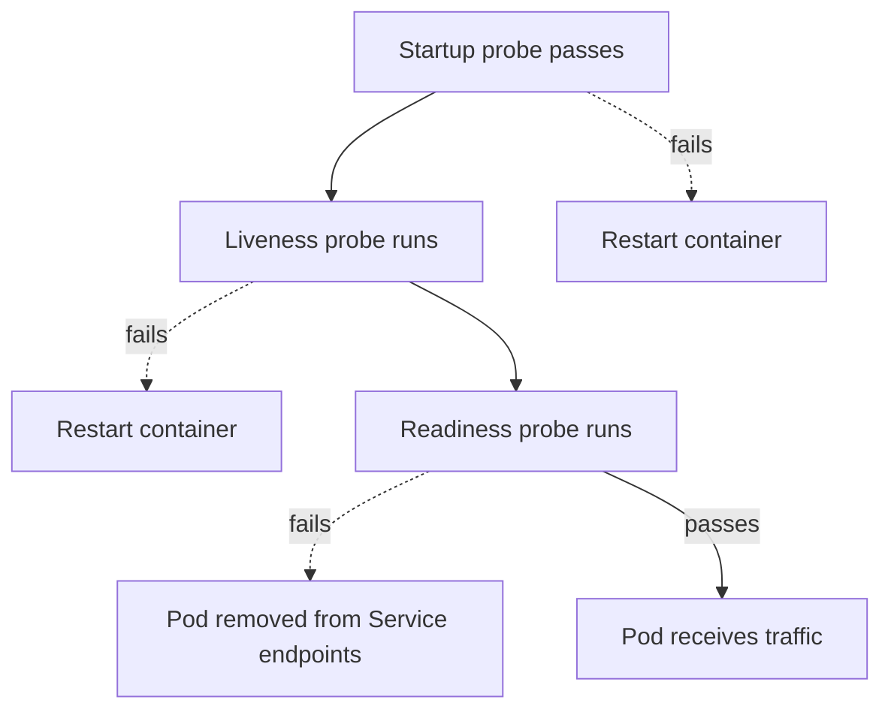

# Chapter 10: Probes, requests and limits, QoS classes, and securityContext

> **Exams:** CKAD · CKA
> **Difficulty:** Intermediate
> **Time:** ~50 min reading, ~35 min lab
> **Lab tier:** 1 (kind)
> **Prerequisites:** Chapter 04 (Pods in depth), Chapter 05 (Controllers)

## Learning objectives

After this chapter you can:

- Tell the three probes apart (startup, liveness, readiness), and say what the kubelet does when each one fails
- Write exec, HTTP, and TCP probes with sensible timing fields
- Set resource requests and limits, and explain how the scheduler and the kubelet each use them
- Predict a Pod's QoS class (Guaranteed, Burstable, or BestEffort) from its resources
- Cap a Namespace's total resources with a ResourceQuota, and give its containers default requests and limits with a LimitRange
- Set pod-level and container-level `securityContext` fields, including running as a non-root user and dropping capabilities
- Verify a running container's identity and capabilities from inside it

## Concepts

### Why a running container is not necessarily a working one

A container's process can be alive and still be useless. A web server may be
running while its database connection is broken, or a worker may be stuck in a
loop. Kubernetes cannot know what "working" means for your application, so you
tell it with **probes**: small checks the kubelet runs against each container
on a schedule.

There are three probes, and each one drives a different decision:

| Probe | Question it answers | What happens on failure |
| --- | --- | --- |
| Readiness | Should this Pod receive traffic now? | The Pod is removed from its Services' endpoints. It is not restarted. |
| Liveness | Is this container stuck and in need of a restart? | The kubelet kills the container, and its restart policy applies. |
| Startup | Has this slow application finished starting? | Until it succeeds, the other two probes do not run. A failure restarts the container. |

Readiness is the probe that keeps traffic away from a Pod that is not ready yet.
Liveness is the probe that restarts a container that has stopped making
progress, and it should be used with care: a liveness check that is too strict
restarts a healthy container under load. Startup is for applications with a
long initialisation, so that the liveness probe does not kill them before they
are up.



The diagram follows the order of probes. Until the startup probe passes, the
other two do not run. After that, a failing liveness probe restarts the
container, and a failing readiness probe only takes the Pod out of rotation.

### Probe types and timing

A probe is one of four kinds of check:

- `exec` runs a command inside the container. It passes when the command exits 0.
- `httpGet` sends an HTTP request. It passes for status codes from 200 to 399.
- `tcpSocket` opens a TCP connection. It passes when the connection is accepted.
- `grpc` calls the gRPC health-checking protocol.

Four timing fields decide how patient the probe is:

- `initialDelaySeconds` is how long to wait after the container starts before the
  first check. The default is 0.
- `periodSeconds` is the interval between checks. The default is 10.
- `timeoutSeconds` is how long one check may take. The default is 1.
- `failureThreshold` is how many consecutive failures count as a failure. The default is 3.

A probe that fails on the first attempt does not restart a container unless
`failureThreshold` is 1. Give liveness probes a `failureThreshold` above 1
unless a single failure really means the container is broken.

### Requests and limits

Each container can declare how much CPU and memory it needs and how much it may
use:

- A **request** is the amount the scheduler reserves on a node. A Pod is placed
  only on a node with enough unreserved capacity for its requests.
- A **limit** is the most the container may use. The kernel enforces it.

CPU and memory differ in what happens at the limit. A container that goes over
its CPU limit is **throttled**: it runs more slowly. A container that goes over
its memory limit is **OOM-killed**, and the kubelet restarts it, with the reason
`OOMKilled` in its status. CPU is measured in millicores (`250m` is a quarter
of a core), and memory in bytes with suffixes (`128Mi` is 128 mebibytes).

A request without a limit is allowed, and so is a limit without a request: when
only a limit is set, Kubernetes uses it as the request too. A limit that is
lower than the request is rejected by the API server.

### QoS classes

From the requests and limits, Kubernetes gives every Pod a **QoS class**. The
class decides the order in which Pods are evicted when a node runs out of
memory:

- **Guaranteed**: every container has a CPU and a memory request equal to its
  limit. These Pods are the last to be evicted.
- **Burstable**: at least one container has a request or a limit, but the Pod
  is not Guaranteed. It may use more than it requested, if the node has room.
- **BestEffort**: no container sets any request or limit. These Pods are the
  first to be evicted.

Check a Pod's class with `kubectl get pod NAME -o jsonpath='{.status.qosClass}'`.
The class is fixed when the Pod is created, from its spec.

### Quotas and LimitRanges

Requests and limits describe one container. Two Namespace-level objects control
them for everyone who deploys into a Namespace:

- A **ResourceQuota** caps the totals of a Namespace: the sum of all CPU and
  memory requests and limits, and counts of objects such as Pods, Services, or
  PersistentVolumeClaims. The API server rejects any new object that would push
  a total over its cap. Once a quota covers CPU or memory, every new Pod must
  state those values, or it is rejected too.
- A **LimitRange** sets per-container rules: **default** requests and limits for
  containers that declare none, and optional minimums and maximums. The
  defaults are filled in when the Pod is created, which is how Pods without
  resources still pass a quota.

Both are checked by admission when an object is created. A quota does not
touch Pods that already exist, and changing a LimitRange does not change
running Pods either. `kubectl describe quota` shows used and hard values side
by side; `kubectl describe limitrange` shows the defaults.

### securityContext

`securityContext` sets the security settings of a Pod or a container. It exists
at two levels, and the container level wins where both are set:

- Pod level (`spec.securityContext`) applies to all containers. The fields you
  will use most are `runAsUser`, `runAsGroup`, `runAsNonRoot`, and `fsGroup`.
- Container level (`spec.containers[].securityContext`) applies to one container.
  The fields include `allowPrivilegeEscalation`, `readOnlyRootFilesystem`,
  `privileged`, and `capabilities`.

**Capabilities** split the powers of root into named parts, such as
`NET_BIND_SERVICE` (bind to ports below 1024) or `NET_ADMIN` (configure the
network). A container running as root has many of them by default. The safe
default is `capabilities: {drop: ["ALL"]}`, followed by adding back only the
ones the application needs.

`runAsNonRoot: true` makes the kubelet refuse to start a container whose user
is root, so an image that runs as root fails visibly instead of quietly. Setting
`runAsUser` alongside it names the user.

You can see the capabilities of a running process in `/proc/PID/status`, as the
`CapEff` line. A value of all zeros means no capabilities. The full treatment of
hardening, including Pod Security Standards, comes later in the book (Chapter
33), but the fields above are what the CKAD and CKA tasks test.

## Guided walkthrough

The walkthrough works in the Namespace `ch10-health`. The outputs below are
trimmed: names, ages, and timestamps differ on your cluster. The Pods are named
`demo-...` so they do not clash with the lab. The lab later in this chapter uses
that Namespace too, so run `make lab CH=10` before you start, or run the commands
in any Namespace you choose.

### Watch a readiness probe gate a Pod

Create a Pod whose readiness probe passes only when the file `/tmp/ready` exists:

```bash
cat <<'YAML' | kubectl -n ch10-health apply -f -
apiVersion: v1
kind: Pod
metadata:
  name: demo-gate
spec:
  containers:
    - name: app
      image: busybox:1.36
      command: ["sleep", "3600"]
      readinessProbe:
        exec:
          command: ["cat", "/tmp/ready"]
        periodSeconds: 2
YAML
```

```text
pod/demo-gate created
```

Look at the Pod a few seconds later:

```bash
kubectl -n ch10-health get pod demo-gate
kubectl -n ch10-health describe pod demo-gate | grep Warning | tail -1
```

```text
NAME        READY   STATUS    RESTARTS   AGE
demo-gate   0/1     Running   0          6s
  Warning  Unhealthy  0s (x4 over 5s)  kubelet  spec.containers{app}: Readiness probe failed: cat: can't open '/tmp/ready': No such file or directory
```

The container is `Running`, but the Pod is not `Ready`. Nothing restarted it.
The probe failed, which only removes the Pod from traffic. Now create the file,
and the next probe passes:

```bash
kubectl -n ch10-health exec demo-gate -- touch /tmp/ready
sleep 6
kubectl -n ch10-health get pod demo-gate
```

```text
NAME        READY   STATUS    RESTARTS   AGE
demo-gate   1/1     Running   0          13s
```

### See a liveness probe restart a container

Create a Pod whose liveness probe checks for a file that the container creates
at startup, then delete the file:

```bash
cat <<'YAML' | kubectl -n ch10-health apply -f -
apiVersion: v1
kind: Pod
metadata:
  name: demo-restart
spec:
  containers:
    - name: app
      image: busybox:1.36
      command: ["sh", "-c", "touch /tmp/alive; sleep 3600"]
      livenessProbe:
        exec:
          command: ["test", "-f", "/tmp/alive"]
        initialDelaySeconds: 2
        periodSeconds: 2
        failureThreshold: 1
YAML
kubectl -n ch10-health exec demo-restart -- rm -f /tmp/alive
```

```text
pod/demo-restart created
```

The kubelet logs the failure and says that it will restart the container:

```bash
kubectl -n ch10-health describe pod demo-restart | grep -E 'Liveness probe failed|failed liveness probe' | tail -2
```

```text
  Warning  Unhealthy  15s   kubelet  spec.containers{app}: Liveness probe failed:
  Normal   Killing    15s   kubelet  spec.containers{app}: Container app failed liveness probe, will be restarted
```

The restart itself is not always immediate. When it happens, the restart count
goes up and the last state explains why the previous container stopped:

```bash
kubectl -n ch10-health get pod demo-restart -o jsonpath='{.status.containerStatuses[0].restartCount} {.status.containerStatuses[0].lastState.terminated.reason} {.status.containerStatuses[0].lastState.terminated.exitCode}{"\n"}'
```

```text
1 Error 137
```

Exit code 137 is SIGKILL, which the kubelet sends when a container fails its
liveness probe. The restarted container runs `touch /tmp/alive` again, so the
probe passes from then on.

### Read the QoS class of three Pods

Create three Pods that differ only in their resources. The first has requests
below its limits, the second has requests equal to its limits, and the third has
no resources at all:

```bash
cat <<'YAML' | kubectl -n ch10-health apply -f -
apiVersion: v1
kind: Pod
metadata:
  name: demo-sized
spec:
  containers:
    - name: app
      image: busybox:1.36
      command: ["sleep", "3600"]
      resources:
        requests:
          cpu: 100m
          memory: 64Mi
        limits:
          cpu: 200m
          memory: 128Mi
YAML
cat <<'YAML' | kubectl -n ch10-health apply -f -
apiVersion: v1
kind: Pod
metadata:
  name: demo-pinned
spec:
  containers:
    - name: app
      image: busybox:1.36
      command: ["sleep", "3600"]
      resources:
        requests:
          cpu: 250m
          memory: 128Mi
        limits:
          cpu: 250m
          memory: 128Mi
YAML
cat <<'YAML' | kubectl -n ch10-health apply -f -
apiVersion: v1
kind: Pod
metadata:
  name: demo-besteffort
spec:
  containers:
    - name: app
      image: busybox:1.36
      command: ["sleep", "3600"]
YAML
```

```text
pod/demo-sized created
pod/demo-pinned created
pod/demo-besteffort created
```

```bash
kubectl -n ch10-health wait --for=condition=Ready pod/demo-sized pod/demo-pinned pod/demo-besteffort --timeout=120s
kubectl -n ch10-health get pods demo-sized demo-pinned demo-besteffort -o custom-columns=NAME:.metadata.name,QOS:.status.qosClass
```

```text
NAME              QOS
demo-sized        Burstable
demo-pinned       Guaranteed
demo-besteffort   BestEffort
```

Only `demo-pinned` is Guaranteed, because it is the only one whose requests equal
its limits in every container. The other two are Burstable and BestEffort, in
that order of eviction priority.

### Limit a Namespace with a quota and defaults

Use a Namespace of its own, so the quota does not affect your other Pods:

```bash
kubectl create namespace ch10-demo
kubectl -n ch10-demo create quota compute --hard=pods=3,requests.cpu=500m,requests.memory=256Mi,limits.cpu=1,limits.memory=512Mi
kubectl -n ch10-demo run plain --image=nginx:1.27
```

```text
namespace/ch10-demo created
resourcequota/compute created
Error from server (Forbidden): pods "plain" is forbidden: failed quota: compute: must specify limits.cpu for: plain; limits.memory for: plain; requests.cpu for: plain; requests.memory for: plain
```

The quota covers CPU and memory, so a Pod without requests and limits is
rejected. A LimitRange gives such containers defaults:

```yaml
apiVersion: v1
kind: LimitRange
metadata:
  name: defaults
spec:
  limits:
    - type: Container
      defaultRequest:
        cpu: 100m
        memory: 64Mi
      default:
        cpu: 200m
        memory: 128Mi
```

```bash
kubectl -n ch10-demo apply -f defaults.yaml
kubectl -n ch10-demo run plain --image=nginx:1.27
kubectl -n ch10-demo get pod plain -o jsonpath='{.spec.containers[0].resources}'; echo
```

```text
limitrange/defaults created
pod/plain created
{"limits":{"cpu":"200m","memory":"128Mi"},"requests":{"cpu":"100m","memory":"64Mi"}}
```

The same `kubectl run` now works, and the Pod carries the defaults. A Pod that
asks for more than the quota has left is rejected with the numbers:

```bash
cat <<YAML | kubectl -n ch10-demo apply -f -
apiVersion: v1
kind: Pod
metadata:
  name: big
spec:
  containers:
    - name: big
      image: nginx:1.27
      resources:
        requests:
          cpu: 800m
        limits:
          cpu: 800m
YAML
```

```text
Error from server (Forbidden): error when creating "STDIN": pods "big" is forbidden: exceeded quota: compute, requested: requests.cpu=800m, used: requests.cpu=100m, limited: requests.cpu=500m
```

```bash
kubectl -n ch10-demo describe quota compute
```

```text
Name:            compute
Namespace:       ch10-demo
Resource         Used   Hard
--------         ----   ----
limits.cpu       200m   1
limits.memory    128Mi  512Mi
pods             1      3
requests.cpu     100m   500m
requests.memory  64Mi   256Mi
```

Remove the demo Namespace when you are done: `kubectl delete namespace ch10-demo`.

### Run as a non-root user without capabilities

Create a Pod that runs as user 1000 and drops every capability:

```bash
cat <<'YAML' | kubectl -n ch10-health apply -f -
apiVersion: v1
kind: Pod
metadata:
  name: demo-hardened
spec:
  securityContext:
    runAsNonRoot: true
    runAsUser: 1000
  containers:
    - name: app
      image: busybox:1.36
      command: ["sleep", "3600"]
      securityContext:
        allowPrivilegeEscalation: false
        capabilities:
          drop: ["ALL"]
YAML
kubectl -n ch10-health wait --for=condition=Ready pod/demo-hardened --timeout=120s
kubectl -n ch10-health exec demo-hardened -- id
kubectl -n ch10-health exec demo-hardened -- grep CapEff /proc/1/status
```

```text
pod/demo-hardened condition met
uid=1000 gid=0(root) groups=0(root)
CapEff:	0000000000000000
```

The process runs as uid 1000, and its effective capabilities are all zero. For
comparison, a container with default settings shows a non-zero `CapEff`, such as
`00000000a80425fb`. The group is still `root` (gid 0), because the spec set only
the user; `runAsGroup` would change it.

## Hands-on lab

The lab works like a KodeKloud lab: one task at a time, a check after each, and
progress that is saved between sessions.

```bash
make lab CH=10       # set up the lab and show task 1
make check CH=10     # check the current task; if it is right, show the next
make question CH=10  # show the current task again
make reset CH=10     # back to the starting state and task 1
make verify CH=10    # check every task at once
```

Everything happens in the Namespace `ch10-health`: use `-n ch10-health` on every
command, or run `make use-namespace CH=10` once. The Namespace starts empty, and
each task creates its own objects. The tasks can be done in any order.

Full solutions are in [`lab/solutions.md`](lab/solutions.md).

### Task 1: A readiness probe that waits for a file

Create a Pod with the following specification. It stays not Ready until its
probe passes, so make the probe pass by creating the file it checks.

- Name: `gate`
- Image: `busybox:1.36`, running `sleep 3600`
- Readiness probe: `exec` running `cat /tmp/ready`, checked every 2 seconds
- The file `/tmp/ready` exists inside the container
- Status: `Running`, and the container is ready

### Task 2: A liveness probe on an HTTP endpoint

Create a Pod with the following specification.

- Name: `healthy`
- Image: `nginx:1.27`
- Liveness probe: `httpGet` on path `/`, port `80`
- Liveness probe starts 5 seconds after the container starts, and runs every 10 seconds
- Status: `Running`, and the container is ready

### Task 3: A Burstable Pod

Create a Pod with the following specification.

- Name: `sized`
- Image: `busybox:1.36`, running `sleep 3600`
- Requests: CPU `100m`, memory `64Mi`
- Limits: CPU `200m`, memory `128Mi`
- Status: `Running`, with the QoS class `Burstable`

### Task 4: A Guaranteed Pod

Create a Pod with the following specification.

- Name: `pinned`
- Image: `busybox:1.36`, running `sleep 3600`
- Requests and limits are equal: CPU `250m`, memory `128Mi`
- Status: `Running`, with the QoS class `Guaranteed`

### Task 5: A hardened Pod

Create a Pod with the following specification.

- Name: `hardened`
- Image: `busybox:1.36`, running `sleep 3600`
- The Pod runs as user `1000`, and the kubelet refuses to start it as root
- Privilege escalation is not allowed
- All Linux capabilities are dropped
- Status: `Running`

### Task 6: Limit the Namespace

Cap the Namespace's resources, and give containers that declare none sensible
defaults, so that a Pod without resources still runs.

- LimitRange `defaults` for containers: default request CPU `100m`, memory `64Mi`; default limit CPU `200m`, memory `128Mi`
- ResourceQuota `compute`: `pods` `10`, `requests.cpu` `2`, `requests.memory` `2Gi`, `limits.cpu` `4`, `limits.memory` `4Gi`
- Pod `plain`: image `nginx:1.27`, no resources in its manifest, `Running` with the LimitRange's defaults

## Exam tips

> **Exam tip:** `kubectl run NAME --image=IMAGE --dry-run=client -o yaml` is the starting point for almost every Pod in this chapter. Add the probe, the resources, or the `securityContext` by hand, because the imperative flags for them are limited. `kubectl run` has no flags for resources, so write them into the YAML. For a Deployment, `kubectl set resources deployment NAME -c=CONTAINER --requests=cpu=100m,memory=64Mi --limits=cpu=200m,memory=128Mi` sets them without editing YAML.
>
> **Exam tip:** A Pod's QoS class is in `kubectl get pod NAME -o jsonpath='{.status.qosClass}'`. Use it to check your reasoning on a Guaranteed or Burstable question, rather than working it out from the spec.
>
> **Exam tip:** For a `securityContext` question, decide first which level the field belongs to. `runAsUser` and `runAsNonRoot` can be set at either level, but `capabilities` and `allowPrivilegeEscalation` exist only on the container. Putting a container-only field at the Pod level is rejected by the API server.

## Common mistakes

- Expecting a failing readiness probe to restart the container. It removes the Pod from traffic; only liveness restarts.
- Setting a liveness probe that is too strict or too early, and watching a healthy container restart under load. Use a startup probe for slow starts, and a larger `failureThreshold`.
- Making a Pod Guaranteed by setting only the limits, or only the requests. Both must be set and equal for every container.
- Setting the CPU limit and expecting the Pod to be killed for overusing CPU. CPU is throttled; memory is the resource that kills.
- Forgetting that the QoS class depends on every container. One container without resources makes the Pod Burstable, even if the others are Guaranteed.
- Setting `capabilities` at the Pod level. It belongs to the container's `securityContext`.
- Expecting `runAsNonRoot: true` to change the user. It only refuses to start a container that would run as root; use `runAsUser` to pick the user.

<!-- QUESTIONS:START -->

## End-of-chapter questions

**1.** `CKAD` `CKA` A container's readiness probe fails for several checks in a row. What does the kubelet do?

- **A.** It restarts the container, following the Pod's restart policy
- **B.** It removes the Pod from the endpoints of its Services, and leaves the container running
- **C.** It deletes the Pod and lets its controller create a new one
- **D.** It stops the Pod's other containers until the probe passes

**2.** `CKAD` `CKA` Which probe field sets how many consecutive failed checks are needed before the kubelet acts on a probe?

- **A.** `timeoutSeconds`
- **B.** `periodSeconds`
- **C.** `failureThreshold`
- **D.** `initialDelaySeconds`

**3.** `CKAD` `CKA` A container uses more CPU than its limit. A second container uses more memory than its limit. What happens to each?

- **A.** Both are killed and restarted
- **B.** The CPU user is throttled and runs more slowly; the memory user is OOM-killed
- **C.** The CPU user is killed; the memory user is throttled
- **D.** Neither is affected, because limits are advisory

**4.** `CKAD` `CKA` A Pod has one container with requests of 100m CPU and 64Mi memory, and no limits. What is its QoS class?

- **A.** Guaranteed, because it has requests
- **B.** Burstable, because it has a request and no matching limit
- **C.** BestEffort, because it has no limits
- **D.** Burstable only if a second container exists

**5.** `CKAD` `CKA` A Pod has two containers. The first has CPU and memory requests equal to its limits. The second has no resources at all. What is the QoS class of the Pod?

- **A.** Guaranteed, because most containers are Guaranteed
- **B.** Burstable, because the Pod is not Guaranteed unless every container is
- **C.** BestEffort, because one container has no resources
- **D.** Guaranteed, because the Pod-level resources are used

**6.** `CKAD` `CKA` Which setting makes the kubelet refuse to start a container whose image would run as root?

- **A.** `spec.securityContext.runAsUser: 0`
- **B.** `spec.securityContext.runAsNonRoot: true`
- **C.** `spec.containers[].securityContext.privileged: false`
- **D.** `spec.securityContext.fsGroup: 1000`

**7.** `CKAD` Where do `capabilities: {drop: ["ALL"]}` belong in a Pod spec?

- **A.** In `spec.securityContext` at the Pod level
- **B.** In `spec.containers[].securityContext` for the container
- **C.** In `spec.initContainers` only
- **D.** In the namespace's LimitRange

**8. (Task)** `CKAD` `CKA` In namespace `prod`, create a Pod named `api-probe` with image `nginx:1.27`. Give it a readiness probe that does an HTTP GET on path `/` and port `80`, every 5 seconds. Wait until the Pod is Ready, and show its readiness status.

**9. (Task)** `CKAD` `CKA` In namespace `prod`, create a Pod named `guaranteed` running `busybox:1.36` with the command `sleep 3600`. Give it CPU and memory requests equal to its limits: CPU `100m`, memory `64Mi`. Show the Pod's QoS class.

**10. (Task)** `CKAD` `CKA` In namespace `prod`, the Deployment `api` runs a container named `httpd`. Set its resources to CPU request `50m`, memory request `32Mi`, CPU limit `100m`, and memory limit `64Mi`. Wait until the rollout finishes, then show the container's resources.

**11. (Task)** `CKAD` In namespace `prod`, create a Pod named `locked` running `busybox:1.36` with the command `sleep 3600`. It must run as user 2000, refuse to start as root, and not allow privilege escalation. Show the user ID the container runs as.

**12.** `CKAD` `CKA` A Namespace has a ResourceQuota that caps `requests.cpu` and `requests.memory`, and no LimitRange. What happens when you create a Pod whose container sets no resources?

- **A.** The Pod is created with no requests and runs as BestEffort
- **B.** The API server rejects the Pod, because the quota requires every Pod to state the resources it caps
- **C.** The Pod is created, but stays Pending until resources are added
- **D.** The quota fills in default requests

**13. (Task)** `CKAD` In namespace `team-a`, make every container that declares no resources get a CPU request of `50m` and a CPU limit of `250m`, and cap the Namespace at 5 Pods. Show both objects.

<details>
<summary>Answers</summary>

**1. B.** A failing readiness probe only takes the Pod out of traffic. Restarting is the liveness probe's job. Use readiness for 'can this Pod serve requests right now?' and liveness for 'is this container stuck?'

**2. C.** `failureThreshold` (default 3) is the number of consecutive failures before the probe counts as failed. `timeoutSeconds` is how long one check may take, `periodSeconds` is the interval between checks, and `initialDelaySeconds` is the wait before the first check.

**3. B.** CPU is a compressible resource: exceeding the limit slows the container down. Memory is not: exceeding the limit gets the container OOM-killed, and the kubelet restarts it with the reason `OOMKilled`.

**4. B.** Guaranteed requires requests equal to limits for every container. A Pod with any request or limit that is not Guaranteed is Burstable. BestEffort is only for Pods with no requests and no limits at all.

**5. B.** Guaranteed applies to the whole Pod and requires every container to have equal CPU and memory requests and limits. The second container has none, so the Pod is not Guaranteed. It is not BestEffort either, because the first container has resources set.

**6. B.** `runAsNonRoot: true` makes the kubelet check the user and refuse root. `runAsUser` picks a user but does not refuse root on its own, `privileged: false` is about device access, and `fsGroup` is about volume group ownership.

**7. B.** Capabilities are a container-level setting, under `spec.containers[].securityContext`. The API server rejects them at the Pod level with an unknown-field error, which you can check with `kubectl apply --dry-run=server`.

**8.**

```bash
cat <<'YAML' | kubectl -n prod apply -f -
apiVersion: v1
kind: Pod
metadata:
  name: api-probe
spec:
  containers:
    - name: api
      image: nginx:1.27
      readinessProbe:
        httpGet:
          path: /
          port: 80
        periodSeconds: 5
YAML
kubectl -n prod wait --for=condition=Ready pod/api-probe --timeout=120s
kubectl -n prod get pod api-probe -o jsonpath='{.status.containerStatuses[0].ready}{"\n"}'
```

The probe is an `httpGet` on `/`, which nginx answers with 200. The readiness field is `periodSeconds`, not `interval`.

**9.**

```bash
cat <<'YAML' | kubectl -n prod apply -f -
apiVersion: v1
kind: Pod
metadata:
  name: guaranteed
spec:
  containers:
    - name: app
      image: busybox:1.36
      command: ["sleep", "3600"]
      resources:
        requests:
          cpu: 100m
          memory: 64Mi
        limits:
          cpu: 100m
          memory: 64Mi
YAML
kubectl -n prod wait --for=condition=Ready pod/guaranteed --timeout=120s
kubectl -n prod get pod guaranteed -o jsonpath='{.status.qosClass}{"\n"}'
```

Guaranteed needs both CPU and memory, with requests equal to limits in every container.

**10.**

```bash
kubectl -n prod set resources deployment api -c=httpd --requests=cpu=50m,memory=32Mi --limits=cpu=100m,memory=64Mi
kubectl -n prod rollout status deployment/api
kubectl -n prod get deployment api -o jsonpath='{.spec.template.spec.containers[0].resources}{"\n"}'
```

`kubectl set resources` changes the Pod template, so the Deployment rolls out new Pods with the new resources. `-c` names the container.

**11.**

```bash
cat <<'YAML' | kubectl -n prod apply -f -
apiVersion: v1
kind: Pod
metadata:
  name: locked
spec:
  securityContext:
    runAsUser: 2000
    runAsNonRoot: true
  containers:
    - name: app
      image: busybox:1.36
      command: ["sleep", "3600"]
      securityContext:
        allowPrivilegeEscalation: false
YAML
kubectl -n prod wait --for=condition=Ready pod/locked --timeout=120s
kubectl -n prod exec locked -- id -u
```

`runAsUser` and `runAsNonRoot` are Pod-level fields here. `allowPrivilegeEscalation` is container-level, so it sits under the container's `securityContext`.

**12. B.** Once a quota covers CPU or memory, new Pods must state those values, or admission rejects them with `must specify ...`. A LimitRange with defaults fills them in at creation time; a quota never does.

**13.**

```bash
cat <<'YAML' | kubectl -n team-a apply -f -
apiVersion: v1
kind: LimitRange
metadata:
  name: cpu-defaults
spec:
  limits:
    - type: Container
      defaultRequest:
        cpu: 50m
      default:
        cpu: 250m
YAML
kubectl -n team-a create quota pod-count --hard=pods=5
kubectl -n team-a describe limitrange cpu-defaults
kubectl -n team-a describe quota pod-count
```

`defaultRequest` sets the request and `default` sets the limit. The defaults apply to Pods created from now on; running Pods keep what they have.

</details>

<!-- QUESTIONS:END -->

## Further reading

- Kubernetes documentation: *Configure Liveness, Readiness and Startup Probes*
- Kubernetes documentation: *Resource Management for Pods and Containers* and *Pod Quality of Service Classes*
- Kubernetes documentation: *Configure a Security Context for a Pod or Container*
- Chapter 11 next: Services and cluster DNS, how traffic reaches a Pod that is Ready
