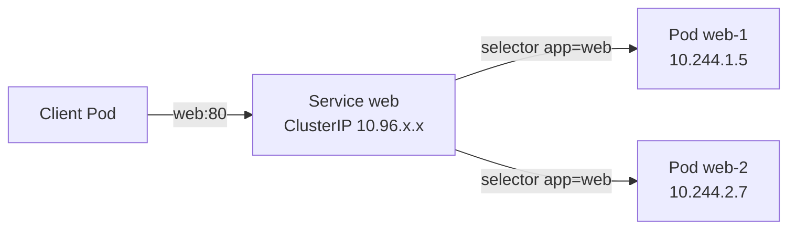

# Chapter 11: Services and cluster DNS

> **Exams:** KCNA · CKAD · CKA
> **Difficulty:** Intermediate
> **Time:** ~50 min reading, ~35 min lab
> **Lab tier:** 1 (kind)
> **Prerequisites:** Chapter 05 (Controllers), Chapter 06 (Labels and selectors), Chapter 10 (Probes)

## Learning objectives

After this chapter you can:

- Explain why Pods need a stable name in front of them, and why their IPs cannot serve that role
- Create a ClusterIP, NodePort, ExternalName, and headless Service, and say what each one does
- Explain how a Service finds its Pods through its label selector, and how endpoints track ready Pods
- Diagnose a Service with no endpoints, and fix it by correcting the selector
- Resolve Service names from inside a Pod, and explain the search path that makes short names work
- Use `kubectl expose` and `kubectl create service` to write Services quickly

## Concepts

### Why Pods need a stable name

A Pod's IP address is assigned when the Pod starts, and it changes whenever the
Pod is replaced. A Deployment that rolls out a new version gives every Pod a new
IP. A client that stored an IP would break on every rollout. Kubernetes solves
this with a **Service**: a stable virtual IP and DNS name in front of a set of
Pods, which the Service finds through labels.

A Service does three things:

1. It gets a stable cluster IP and a DNS name that do not change while the
   Service exists.
2. It selects Pods by label, using `spec.selector`.
3. It forwards traffic arriving at its port to the selected Pods, on their
   `targetPort`.



The client connects to the Service's name and port. The Service sends the
connection to one of the Pods that match its selector and are ready. Pod IPs
change, but the Service name stays the same.

### Selectors and endpoints

The selector is the only link between a Service and its Pods. Any Pod in the
Service's namespace whose labels match the selector is included. A Pod with
labels that do not match is ignored, even if it runs the same image.

Behind the scenes, the control plane keeps a list of **endpoints** for each
Service: the IP and port of every Pod that matches the selector and is
**ready**. Readiness matters here. A Pod that fails its readiness probe (Chapter
10) is removed from the endpoints, so the Service stops sending it traffic. That
is the mechanism behind a rolling update that never serves a half-started Pod.

Endpoints are stored as **EndpointSlices**, the `discovery.k8s.io/v1` API. You
can read them with `kubectl get endpointslices -l kubernetes.io/service-name=NAME`.
The older `kubectl get endpoints` still works, but it prints a deprecation
warning on current clusters.

A Service with no endpoints is a common problem. The Service exists and has an
IP, but nothing answers. Almost always, the selector does not match the Pods'
labels, or the Pods are not ready. Compare the two with `kubectl describe svc`
and `kubectl get pods --show-labels`.

### Service types

The type decides where a Service can be reached from:

- **ClusterIP** (the default) is reachable only from inside the cluster, on the
  Service's cluster IP and DNS name.
- **NodePort** also opens the same port on every node, in the range 30000 to
  32767 by default. A client outside the cluster can reach the Service through
  any node's IP and that port.
- **LoadBalancer** asks the cloud provider for an external load balancer, and
  then behaves like NodePort underneath. On a local kind cluster there is no
  provider, so its external IP stays `<pending>`.
- **ExternalName** adds no proxying at all. The cluster DNS answers a lookup of
  the Service's name with a CNAME to the `externalName` you set. It is a way to
  give an external dependency a name inside the cluster.

A **headless** Service is a ClusterIP Service with `clusterIP: None`. It gets no
virtual IP. Its DNS name resolves directly to the IPs of its ready Pods, one
address per Pod. Headless Services are how StatefulSets give each Pod its own
stable name, and they are also useful when a client must choose which Pod to
talk to.

### Ports: `port`, `targetPort`, and `nodePort`

Three ports appear in a Service spec, and they are easy to confuse:

- `port` is the port the Service listens on, inside the cluster.
- `targetPort` is the port on the Pod that receives the traffic. It can be a
  number, or the name of a container port.
- `nodePort` is the port opened on every node, for NodePort and LoadBalancer
  Services. Leave it out to have one assigned from the range.

A Service with `port: 80` and `targetPort: 8080` accepts connections on 80, and
forwards them to 8080 on the Pods. If the two are the same, you can omit
`targetPort`, and it defaults to `port`.

### Cluster DNS

CoreDNS runs in the cluster and answers DNS queries for Services and Pods. Each
Service gets a name in this form:

```text
SERVICE.NAMESPACE.svc.cluster.local
```

A Pod's `/etc/resolv.conf` lists the search domains that make short names work.
Inside namespace `prod`, the name `web` expands to `web.prod.svc.cluster.local`
first, so a Pod can use just `web` to reach the Service in its own namespace.
To reach a Service in another namespace, use `web.other`. The `ndots:5` option
means that any name with fewer than five dots is tried against the search domains
first, which is why a lookup from a Pod can print several NXDOMAIN lines before
the answer.

For a headless Service, the DNS answer contains every ready Pod's IP. For a
normal Service, the answer is the cluster IP. For an ExternalName Service, the
answer is a CNAME.

### kube-proxy

The Service IP is virtual: no interface holds it. The `kube-proxy` on each node
programs the node's packet filter (iptables or IPVS) so that traffic to the
Service IP is rewritten to one of the Pods. Because this happens in the kernel,
it does not need a process in the path of each connection. You rarely need to
configure kube-proxy directly for the exams, but knowing that it is the component
that turns a Service into forwarding rules explains the behaviour you see.

## Guided walkthrough

The walkthrough works in the Namespace `ch11-svc`. The outputs below are trimmed:
generated fields, names, and IPs differ on your cluster. The walkthrough names
its objects `shop` so that they do not clash with the lab. The lab later in this
chapter uses that Namespace too, so run `make lab CH=11` before you start, or run
the commands in any Namespace you choose.

### Expose a Deployment as a Service

Create a Deployment of two Pods, then expose it:

```bash
kubectl -n ch11-svc create deployment shop --image=nginx:1.27 --replicas=2
kubectl -n ch11-svc rollout status deployment/shop --timeout=180s
kubectl -n ch11-svc expose deployment shop --port=80 --target-port=80
```

```text
deployment.apps/shop created
deployment "shop" successfully rolled out
service/shop exposed
```

`expose` reads the Deployment's labels and makes them the Service's selector, so
you do not have to type them. Look at the Service and at its endpoints:

```bash
kubectl -n ch11-svc get svc shop
kubectl -n ch11-svc get endpointslices -l kubernetes.io/service-name=shop -o jsonpath='{range .items[*].endpoints[*]}{.addresses[0]} {.targetRef.name} {.conditions.ready}{"\n"}{end}'
```

```text
NAME   TYPE        CLUSTER-IP      EXTERNAL-IP   PORT(S)   AGE
shop   ClusterIP   10.96.131.145   <none>        80/TCP    0s
10.244.1.246 shop-69d4647c95-mhwvs true
10.244.2.225 shop-69d4647c95-mzcpn true
```

The endpoints are the two Pod IPs, both ready. The cluster IP `10.96.131.145`
is the stable address.

### Call the Service by its name

From a Pod in the same namespace, the short name is enough. The lab's
`dns-client` Pod is a busybox image that has `nslookup` and `wget`:

```bash
kubectl -n ch11-svc exec dns-client -- nslookup shop
kubectl -n ch11-svc exec dns-client -- cat /etc/resolv.conf
kubectl -n ch11-svc exec dns-client -- wget -qO- -T 3 http://shop
```

```text
Name:	shop.ch11-svc.svc.cluster.local
Address: 10.96.131.145

search ch11-svc.svc.cluster.local svc.cluster.local cluster.local localdomain
nameserver 10.96.0.10
options ndots:5

<!DOCTYPE html>
<html>
<head>
<title>Welcome to nginx!</title>
```

`nslookup` prints several `NXDOMAIN` lines before the answer, because it tries
each search domain in turn. The answer is the full name in the first search
domain. `resolv.conf` shows the search domains and the cluster DNS server
(`10.96.0.10`). `wget` reaches nginx by the short name `shop`.

### A headless Service returns the Pod IPs

Create a headless Service for the same Deployment:

```bash
kubectl -n ch11-svc expose deployment shop --name=shop-headless --cluster-ip=None --port=80 --target-port=80
kubectl -n ch11-svc get svc shop-headless
kubectl -n ch11-svc exec dns-client -- nslookup shop-headless 2>/dev/null | grep -A10 'Name:'
```

```text
NAME            TYPE        CLUSTER-IP   EXTERNAL-IP   PORT(S)   AGE
shop-headless   ClusterIP   None         <none>        80/TCP    0s
Name:	shop-headless.ch11-svc.svc.cluster.local
Address: 10.244.1.246
Name:	shop-headless.ch11-svc.svc.cluster.local
Address: 10.244.2.225
```

`CLUSTER-IP` is `None`, and the DNS answer lists both Pod IPs. A client that
resolves the name chooses one of them, rather than going through a virtual IP.

### Map a name to an external host

Create an ExternalName Service and look it up:

```bash
kubectl -n ch11-svc create service externalname legacy --external-name=db.example.internal
kubectl -n ch11-svc get svc legacy
kubectl -n ch11-svc exec dns-client -- nslookup legacy.ch11-svc.svc.cluster.local
```

```text
NAME     TYPE           CLUSTER-IP   EXTERNAL-IP           PORT(S)   AGE
legacy   ExternalName   <none>       db.example.internal   <none>    0s
legacy.ch11-svc.svc.cluster.local	canonical name = db.example.internal
```

The cluster DNS does not resolve `db.example.internal` itself. It returns a
CNAME, and the client then resolves that name using its own resolver.

### Expose a Service on a node port

Create a NodePort Service and fix its node port to 30080:

```bash
kubectl -n ch11-svc expose deployment shop --name=shop-np --type=NodePort --port=80 --target-port=80
kubectl -n ch11-svc patch svc shop-np -p '{"spec":{"ports":[{"port":80,"targetPort":80,"nodePort":30080}]}}'
kubectl -n ch11-svc get svc shop-np
```

```text
NAME      TYPE       CLUSTER-IP     EXTERNAL-IP   PORT(S)        AGE
shop-np   NodePort   10.96.x.x      <none>        80:30080/TCP   0s
```

`PORT(S)` shows `80:30080`: the Service port and the node port. Without the
patch, Kubernetes would pick a node port from the range.

### See what a wrong selector does

Create a Service whose selector matches no Pods, then look at its endpoints:

```bash
kubectl -n ch11-svc create service clusterip shop-typo --tcp=80:80
kubectl -n ch11-svc patch svc shop-typo -p '{"spec":{"selector":{"app":"shp"}}}'
kubectl -n ch11-svc get endpointslices -l kubernetes.io/service-name=shop-typo
```

```text
NAME              ADDRESSTYPE   PORTS     ENDPOINTS   AGE
shop-typo-2mw2x   IPv4          <unset>   <unset>     0s
```

The Service exists and has a cluster IP, but there are no endpoints. Nothing
answers on it. The fix is to make the selector match the Pods' labels, which is
the task in the lab.

## Hands-on lab

The lab works like a KodeKloud lab: one task at a time, a check after each, and
progress that is saved between sessions.

```bash
make lab CH=11       # set up the lab and show task 1
make check CH=11     # check the current task; if it is right, show the next
make question CH=11  # show the current task again
make reset CH=11     # back to the starting state and task 1
make verify CH=11    # check every task at once
```

Everything happens in the Namespace `ch11-svc`: use `-n ch11-svc` on every
command, or run `make use-namespace CH=11` once. The setup creates two
Deployments, `web` and `api`, each with two Pods, and a Service named `api` with
a wrong selector. It also creates the `dns-client` Pod for lookups. Tasks 1 to 4
are independent of each other. Task 3 can be checked only after the web Pods are
running, which they are from the start. Full solutions are in
[`lab/solutions.md`](lab/solutions.md).

### Task 1: A ClusterIP Service for `web`

Create a Service with the following specification.

- Name: `web`
- Type: `ClusterIP`
- Port `80`, forwarding to target port `80`
- Selector: `app=web`
- Its ready endpoints are the two `web` Pods

### Task 2: A NodePort Service for `web`

Create a Service with the following specification.

- Name: `web-np`
- Type: `NodePort`
- Port `80`, target port `80`
- Node port: `30080`
- Selector: `app=web`
- Its ready endpoints are the two `web` Pods

### Task 3: A headless Service for `web`

Create a Service with the following specification.

- Name: `web-headless`
- No cluster IP (`clusterIP: None`)
- Port `80`, target port `80`
- Selector: `app=web`
- From the `dns-client` Pod, the name `web-headless` resolves to the IP of each `web` Pod

### Task 4: An ExternalName Service

Create a Service with the following specification.

- Name: `legacy`
- Type: `ExternalName`
- External name: `db.example.internal`
- From the `dns-client` Pod, a lookup of `legacy` returns the canonical name `db.example.internal`

### Task 5: Fix the `api` Service

The Service `api` exists, but it has no endpoints. Fix it so that it routes to the
two `api` Pods.

- Name: `api`
- Selector: `app=api`
- Its ready endpoints are the two `api` Pods

Change the Service in place. Deleting and recreating it works too, but it should
end with the same name and the correct selector.

## Exam tips

> **Exam tip:** `kubectl expose deployment NAME --port=80 --target-port=8080` is the fastest way to a Service. It copies the Deployment's labels into the selector, which saves typing and avoids the usual mismatch.
>
> **Exam tip:** For a headless Service, `kubectl expose ... --cluster-ip=None` is the imperative form. For an ExternalName Service, `kubectl create service externalname NAME --external-name=HOST` does it in one command.
>
> **Exam tip:** A Service with no endpoints is a selector problem more often than not. Run `kubectl get endpointslices -l kubernetes.io/service-name=NAME`, compare the output with `kubectl get pods --show-labels`, and fix the selector before you look anywhere else.

## Common mistakes

- Using a Pod IP in an application's config instead of the Service name. The Pod IP changes when the Pod is replaced.
- Putting the target port where the port belongs, or the reverse. `port` is what clients use; `targetPort` is what the container listens on.
- Expecting a Service to work immediately. It takes a moment for endpoints to update after the Pods become ready.
- Assuming a NodePort is reachable on a port you did not choose. Without a `nodePort` field, Kubernetes picks one from the range.
- Expecting `nslookup` to succeed on the first line. The NXDOMAIN lines from the search domains are normal; the answer comes after them.
- Treating an ExternalName Service as a proxy. It only returns a CNAME; the connection goes straight to the external host.
- Writing the selector with the wrong label key or value. `app=web` and `app=Web` are different selectors.

<!-- QUESTIONS:START -->

## End-of-chapter questions

**1.** `KCNA` `CKAD` Why should a client connect to a Service's name rather than to a Pod's IP address?

- **A.** Pod IP addresses are not routable inside the cluster
- **B.** A Service keeps a stable name and IP while the Pods behind it are replaced, and sends traffic only to ready Pods
- **C.** Service names are faster to resolve than IP addresses
- **D.** Pods cannot receive traffic on their own IP, only through a Service

**2.** `CKAD` `CKA` A Service exists and has a cluster IP, but `kubectl get endpointslices` shows no endpoints. What is the most likely cause?

- **A.** The Service is of type ExternalName
- **B.** The Service's selector does not match the labels of any ready Pod
- **C.** The Service's port is above 1024
- **D.** The cluster DNS has not yet learned the Service's name

**3.** `KCNA` `CKAD` `CKA` Which Service type gives a client outside the cluster access through any node's IP address, on a port the cluster opens on every node?

- **A.** ClusterIP
- **B.** NodePort
- **C.** ExternalName
- **D.** Headless

**4.** `CKAD` `CKA` A Service has `port: 80` and `targetPort: 8080`. A client connects to the Service on port 80. Which port does the container receive the connection on?

- **A.** 80, because the Service and the container use the same port
- **B.** 8080, because targetPort is the port on the Pod that receives the traffic
- **C.** Either, chosen at random for each connection
- **D.** It depends on the nodePort, which is always 8080

**5.** `CKAD` `CKA` You create a headless Service for a set of Pods. What does a DNS lookup of the Service's name return?

- **A.** A single cluster IP, which the cluster load-balances across the Pods
- **B.** A CNAME to the first Pod's name
- **C.** One address for each ready Pod behind the Service
- **D.** NXDOMAIN, because headless Services have no DNS name

**6.** `CKAD` `CKA` A Pod in namespace `prod` wants to reach a Service named `web` in the same namespace. Which name works without any extra configuration?

- **A.** `web`, through the search domains in the Pod's resolv.conf
- **B.** `web.prod.internal`, which the cluster DNS creates
- **C.** `web:80`, as the cluster DNS understands ports in names
- **D.** `prod-web`, because Services are named after their namespace

**7.** `CKAD` What does an ExternalName Service do when a Pod looks it up?

- **A.** It proxies every connection to the external host through the node
- **B.** It returns a CNAME record that points to the externalName, and the Pod then connects to that host directly
- **C.** It creates a load balancer that routes to the external host
- **D.** It returns the external host's IP address, read from the Service's endpoints

**8. (Task)** `CKAD` `CKA` In namespace `prod`, the Deployment `shop` runs nginx in two Pods labeled `app=shop`. Create a ClusterIP Service named `shop` that forwards port 80 to port 80 of those Pods. Show its endpoints.

**9. (Task)** `CKAD` `CKA` In namespace `prod`, create a headless Service named `shop-headless` for the Pods labeled `app=shop`, on port 80. Show that its cluster IP is `None`.

**10. (Task)** `CKAD` `CKA` In namespace `prod`, create a Service named `reporting` of type `ExternalName`, pointing at `reports.example.com`. Then show the Service's external name.

**11. (Task)** `CKAD` `CKA` In namespace `prod`, the Service `api` has no endpoints, because its selector is `app=api-v1` and the Pods are labeled `app=api`. Fix the Service so that its selector matches the Pods, then show the selector.

<details>
<summary>Answers</summary>

**1. B.** Pod IPs are assigned at start and change whenever a Pod is replaced, for example during a rollout. A Service gives a stable name and virtual IP, selects Pods by label, and routes only to Pods that are ready. Pod IPs are routable within the cluster, and Pods can receive traffic on their own IP; the Service is about stability and load distribution.

**2. B.** Endpoints are the ready Pods that match the Service's selector. If no Pod matches, or the matching Pods are not ready, the list is empty. Compare the selector with `kubectl get pods --show-labels`. Port numbers and DNS do not decide which Pods are endpoints.

**3. B.** NodePort opens the same port on every node (30000 to 32767 by default) and forwards it to the Service. ClusterIP is reachable only inside the cluster. ExternalName is a DNS CNAME with no proxying. A headless Service is a ClusterIP Service with no virtual IP, so it is not reachable from outside either.

**4. B.** `port` is the port the Service listens on, and `targetPort` is the port the Pod's container receives on. Clients use the Service's port; the container listens on targetPort. The nodePort only matters for NodePort and LoadBalancer Services.

**5. C.** A headless Service has `clusterIP: None`, so no virtual IP is allocated. The cluster DNS returns the IP of each ready Pod, and the client chooses which one to use. A normal ClusterIP Service returns its single cluster IP instead.

**6. A.** The Pod's resolv.conf has the search domain `prod.svc.cluster.local` among others, so `web` expands to `web.prod.svc.cluster.local`. Names with a port, such as `web:80`, are not DNS names, and `prod.internal` is not a cluster domain. Use the port in the client's configuration, not the name.

**7. B.** An ExternalName Service has no proxying and no cluster IP. The cluster DNS answers the lookup with a CNAME for the `externalName`, and the client resolves and connects to that name directly. There are no endpoints for it, because nothing inside the cluster serves the traffic.

**8.**

```bash
kubectl -n prod expose deployment shop --name=shop --port=80 --target-port=80
kubectl -n prod get endpointslices -l kubernetes.io/service-name=shop -o jsonpath='{range .items[*].endpoints[*]}{.addresses[0]}{"\n"}{end}'
```

`expose` reads the Deployment's labels and uses them as the selector. The endpoint list shows the two Pod IPs once the Pods are ready.

**9.**

```bash
kubectl -n prod expose deployment shop --name=shop-headless --cluster-ip=None --port=80 --target-port=80
kubectl -n prod get svc shop-headless -o jsonpath='{.spec.clusterIP}{"\n"}'
```

`--cluster-ip=None` is the imperative way to make a headless Service. The printed value is `None`.

**10.**

```bash
kubectl -n prod create service externalname reporting --external-name=reports.example.com
kubectl -n prod get svc reporting -o jsonpath='{.spec.externalName}{"\n"}'
```

`kubectl create service externalname` sets the type and the external name in one command.

**11.**

```bash
kubectl -n prod patch svc api -p '{"spec":{"selector":{"app":"api"}}}'
kubectl -n prod get svc api -o jsonpath='{.spec.selector}{"\n"}'
kubectl -n prod get endpointslices -l kubernetes.io/service-name=api
```

The patch changes the value of the existing `app` key in place. Afterwards the
endpoint list is no longer empty.

</details>

<!-- QUESTIONS:END -->

## Further reading

- Kubernetes documentation: *Service*, *EndpointSlices*, *DNS for Services and Pods*
- Kubernetes documentation: *Connecting Applications with Services*, *Virtual IPs and Service Proxies*
- `kubectl` reference: `kubectl expose`, `kubectl create service`
- Chapter 12 next: Ingress and the Gateway API, which route HTTP traffic to Services from outside the cluster
