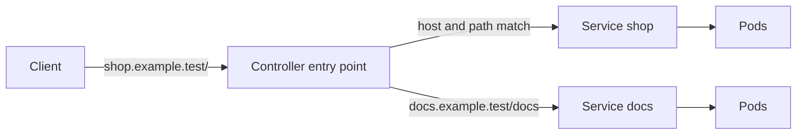

# Chapter 12: Ingress and the Gateway API

> **Exams:** CKAD · CKA
> **Difficulty:** Intermediate
> **Time:** ~50 min reading, ~35 min lab
> **Lab tier:** 1 (kind)
> **Prerequisites:** Chapter 11 (Services and cluster DNS)

## Learning objectives

After this chapter you can:

- Explain why a Service of type `LoadBalancer` per application does not scale, and what routing at HTTP level solves
- Write an Ingress with host and path rules, a backend, and TLS, and select its controller with `ingressClassName`
- Explain `pathType` (`Exact`, `Prefix`, `ImplementationSpecific`) and predict which requests an Ingress rule matches
- Describe the three Gateway API resources (GatewayClass, Gateway, HTTPRoute), and which team owns each one
- Create a TLS Secret from a certificate and key, and reference it from an Ingress or a Gateway
- Read the status conditions that a controller writes, and recognize when no controller is running
- Install an Ingress controller with Helm at a pinned chart version, and send requests through it

## Concepts

### Why route HTTP at all

A Service of type `LoadBalancer` gives one application one external address.
If the cluster runs fifty web applications, that means fifty load balancers,
each with its own cost, its own IP, and its own TLS certificate configuration.
Most of them serve HTTP, and HTTP carries the information needed to share one
entry point: the host name the client asked for, and the path in the URL.

Routing on those two values is what **Ingress** and the **Gateway API** do. A
single external address receives the traffic, and a **controller** inside the
cluster forwards each request to the right Service, based on its host and path.
The same entry point can terminate TLS, so the certificate lives in one place.



The client sends one request to one address. The controller reads the host and
path, picks the rule that matches, and forwards to that Service. The Services
then send the request to their Pods, as in Chapter 11.

### The Ingress resource

An Ingress describes the rules. It is the older of the two APIs, and it is
stable: it will not get new features, but it stays supported.

```yaml
apiVersion: networking.k8s.io/v1
kind: Ingress
metadata:
  name: docs
spec:
  ingressClassName: nginx
  tls:
    - hosts: [docs.example.test]
      secretName: docs-tls
  rules:
    - host: docs.example.test
      http:
        paths:
          - path: /docs
            pathType: Prefix
            backend:
              service:
                name: docs
                port:
                  number: 80
```

Four fields carry the meaning:

- `ingressClassName` names the `IngressClass` whose controller should handle
  this Ingress. It is how several controllers can share one cluster.
- `rules[].host` matches the `Host` header of the request. Without a host, the
  rule matches any name.
- `paths[].pathType` decides how the path is compared. `Prefix` matches the
  path segment by segment, so `/docs` matches `/docs` and `/docs/a`, but not
  `/docsy`. `Exact` matches only the same path. `ImplementationSpecific` leaves
  it to the controller.
- `backend.service` names the Service and the port that receives the request.
  The port can be a number or a name.

`tls` terminates HTTPS at the controller. Each entry lists the hosts it covers
and the name of a Secret of type `kubernetes.io/tls`, with the keys `tls.crt`
(the certificate) and `tls.key` (its private key). Without `tls`, the controller
serves HTTP only.

An Ingress with no matching rule falls through to the controller's default
backend, if one exists. You can also set `spec.defaultBackend` to choose the
backend for unmatched requests in this Ingress.

### The controller, and why it matters

An Ingress object does nothing by itself. A **controller** must be running in
the cluster, watching Ingresses and programming a proxy from them. The
controller is also what gets the external address, through a `LoadBalancer` or
`NodePort` Service of its own.

The first widely used controller was ingress-nginx. Its repository is now
archived, and the Kubernetes project retired it in March 2026, so this book does
not use it. Pick a controller that is still maintained, and check its own
documentation for the `IngressClass` name and its annotations. Controller-specific
features, such as rewriting paths or limiting request sizes, are usually set with
annotations, and those differ between controllers. The Kubernetes fields in this
chapter do not.

Controllers are cluster components, and they are usually installed with Helm
(Chapter 14): a chart from the project's repository, at a pinned version, with a
few values set for the cluster. This chapter uses **Traefik**, which is
maintained, has a Helm chart, and implements both Ingress and the Gateway API.
Its chart creates an IngressClass named `traefik`, by default marked as the
cluster's **default class**: an Ingress without `ingressClassName` is then
handled by Traefik too. Turn that off unless it is what you want.

### The Gateway API

The Gateway API is the newer design, and it is where Kubernetes is heading. It
splits what Ingress does into three objects, and each object belongs to a
different role:

- **GatewayClass** names the controller and is usually created once by whoever
  runs the cluster. It is cluster-scoped.
- **Gateway** declares the listeners: a port, a protocol, a host name, and
  optionally TLS. It is usually created by the platform team, and it says where
  the traffic enters.
- **HTTPRoute** declares the routing: which hosts and paths it matches, and which
  Services get the traffic. It is created by the application team and attaches
  to a Gateway through `parentRefs`.

```yaml
apiVersion: gateway.networking.k8s.io/v1
kind: HTTPRoute
metadata:
  name: shop-route
spec:
  parentRefs:
    - name: edge
  hostnames:
    - shop.example.test
  rules:
    - matches:
        - path:
            type: PathPrefix
            value: /
      backendRefs:
        - name: shop
          port: 80
```

Separating the roles means an application team can change its routes without
touching the listeners. A Gateway's listeners decide which namespaces may attach
routes, through `allowedRoutes`. A `ReferenceGrant` in another namespace is a
different permission: it lets a route refer to a backend Service, or a Secret
for TLS, that lives in that namespace. The Gateway API also has more route kinds,
such as `TCPRoute` and `GRPCRoute`, that Ingress cannot express.

The Gateway API is delivered as CRDs. A cluster that uses it installs the
standard channel of those CRDs first. This chapter's lab pins one release in
`versions.env` (`GATEWAY_API_VERSION`) and applies it.

### Status: what the controller writes back

A controller reports its work in the object's status. For a Gateway, the two
conditions that matter are:

- `Accepted`: the controller understood the configuration.
- `Programmed`: the controller has configured its data plane with it.

A GatewayClass has an `Accepted` condition too. When no controller claims the
class, the condition stays `Unknown`. That is the state you will see in this
chapter's lab, because the cluster runs no Gateway controller. Being `Unknown`
does not mean the YAML is wrong. It means nothing has looked at the object yet.

## Guided walkthrough

The walkthrough works in the Namespace `ch12-edge`. The outputs below are
trimmed: names, ages, and generated fields differ on your cluster. The objects
are named `demo-...` so they do not clash with the lab. The lab later in this
chapter uses that Namespace and creates the GatewayClass `ch12-edge-class`, so run
`make lab CH=12` first. The Gateway API CRDs must be installed too, which the lab's
setup does.

### Create an Ingress from the command line

The `kubectl create ingress` command writes an Ingress from a rule. First, look
at the YAML it would produce, without creating anything:

```bash
kubectl -n ch12-edge create service clusterip demo-web --tcp=80:80
kubectl -n ch12-edge create ingress demo-web --class=nginx --rule="web.example.test/=demo-web:80" --dry-run=client -o yaml
```

```yaml
apiVersion: networking.k8s.io/v1
kind: Ingress
metadata:
  name: demo-web
  namespace: ch12-edge
spec:
  ingressClassName: nginx
  rules:
  - host: web.example.test
    http:
      paths:
      - backend:
          service:
            name: demo-web
            port:
              number: 80
        path: /
        pathType: Exact
```

The path is `/`, and the `pathType` is `Exact`. That is the default for a rule
without a `*`. To get a `Prefix` match, add `*` to the path:

```bash
kubectl -n ch12-edge create ingress demo-prefix --class=nginx --rule="shop.example.test/*=shop:80" --dry-run=client -o jsonpath='{.spec.rules[0].http.paths[0].pathType} {.spec.rules[0].http.paths[0].path}{"\n"}'
```

```text
Prefix /
```

Now create the Ingress and look at its rules:

```bash
kubectl -n ch12-edge create ingress demo-web --class=nginx --rule="web.example.test/=demo-web:80"
kubectl -n ch12-edge get ingress demo-web
kubectl -n ch12-edge describe ingress demo-web | sed -n '/Rules/,/Annotations/p'
```

```text
ingress.networking.k8s.io/demo-web created
NAME       CLASS   HOSTS              ADDRESS   PORTS   AGE
demo-web   nginx   web.example.test             80      0s
  Rules:
  Host              Path  Backends
  ----              ----  --------
  web.example.test
                    /   demo-web:80 ()
```

`ADDRESS` is empty, because no controller is running to assign an external
address. The backend shows `()`, which means the Service has no ready endpoints
yet: there are no Pods behind `demo-web` in this walkthrough.

### Create a TLS Secret

An Ingress or a Gateway that serves HTTPS needs a certificate and its key in a
Secret. For a test, generate a self-signed pair and store it:

```bash
openssl req -x509 -newkey rsa:2048 -nodes -days 30 -subj "/CN=docs.example.test" -keyout tls.key -out tls.crt
kubectl -n ch12-edge create secret tls demo-tls --cert=tls.crt --key=tls.key
kubectl -n ch12-edge get secret demo-tls -o go-template='{{.type}}{{"\n"}}{{range $k, $v := .data}}{{$k}}{{"\n"}}{{end}}'
```

```text
secret/demo-tls created
kubernetes.io/tls
tls.crt
tls.key
```

The Secret type is `kubernetes.io/tls`, and it has the two keys the controller
expects. Delete the local `tls.key` and `tls.crt` files afterwards, because the
key is now in the cluster and in your shell history.

### Create a Gateway and an HTTPRoute

Create a Gateway that uses the GatewayClass from the lab, then attach an
HTTPRoute to it:

```bash
cat <<'YAML' | kubectl -n ch12-edge apply -f -
apiVersion: gateway.networking.k8s.io/v1
kind: Gateway
metadata:
  name: demo-gw
spec:
  gatewayClassName: ch12-edge-class
  listeners:
    - name: http
      protocol: HTTP
      port: 80
      hostname: "*.example.test"
YAML
cat <<'YAML' | kubectl -n ch12-edge apply -f -
apiVersion: gateway.networking.k8s.io/v1
kind: HTTPRoute
metadata:
  name: demo-route
spec:
  parentRefs:
    - name: demo-gw
  hostnames:
    - web.example.test
  rules:
    - matches:
        - path:
            type: PathPrefix
            value: /
      backendRefs:
        - name: demo-web
          port: 80
YAML
```

```text
gateway.gateway.networking.k8s.io/demo-gw created
httproute.gateway.networking.k8s.io/demo-route created
```

Look at the Gateway and the status it reports:

```bash
kubectl -n ch12-edge get gateway demo-gw
kubectl -n ch12-edge get gateway demo-gw -o jsonpath='{range .status.conditions[*]}{.type}={.status} {.reason}{"\n"}{end}'
```

```text
NAME      CLASS             ADDRESS   PROGRAMMED   AGE
demo-gw   ch12-edge-class             Unknown      0s
Accepted=Unknown Pending
Programmed=Unknown Pending
```

Both conditions are `Unknown` with the reason `Pending`. No controller has
accepted the Gateway, so it has no address and is not programmed. The YAML is
valid, because the API server accepted it. With a real controller for the
class, these conditions would move to `True`.

### Install a controller with Helm and route through it

Install Traefik from its chart repository into a Namespace of its own. Pin the
chart version, and check two defaults before you install: the chart creates a
`LoadBalancer` Service, which stays `<pending>` on kind, and it makes its
IngressClass the cluster default:

```bash
helm repo add traefik https://traefik.github.io/charts
helm repo update traefik
helm search repo traefik/traefik --version 41.7.1
helm show values traefik/traefik --version 41.7.1 | grep -n -A3 "^ingressClass:"
```

```text
"traefik" has been added to your repositories
Hang tight while we grab the latest from your chart repositories...
...Successfully got an update from the "traefik" chart repository
Update Complete. ⎈Happy Helming!⎈
NAME           	CHART VERSION	APP VERSION	DESCRIPTION
traefik/traefik	41.7.1       	v3.7.14    	A Traefik based Kubernetes ingress controller
126:ingressClass:  # @schema additionalProperties: false
127-  # -- Create a default IngressClass for Traefik
128-  enabled: true
129-  isDefaultClass: true
```

The Service type is under `service.spec.type` in this chart. A wrong key, such as
`service.type`, is accepted without an error and changes nothing; a first run
of this walkthrough with that key still got a `LoadBalancer` Service. So check
what the release really received with `helm get values`:

```bash
helm install traefik traefik/traefik --version 41.7.1 --namespace ch12-demo-traefik --create-namespace --set service.spec.type=ClusterIP --set ingressClass.isDefaultClass=false
kubectl -n ch12-demo-traefik rollout status deployment/traefik --timeout=180s
helm get values traefik -n ch12-demo-traefik
kubectl -n ch12-demo-traefik get pods,services
kubectl get ingressclass
```

```text
NAME: traefik
LAST DEPLOYED: Fri Oct 23 15:39:29 2026
NAMESPACE: ch12-demo-traefik
STATUS: deployed
REVISION: 1
TEST SUITE: None
NOTES:
traefik with docker.io/traefik:v3.7.14 has been deployed successfully on ch12-demo-traefik namespace!
Waiting for deployment "traefik" rollout to finish: 0 of 1 updated replicas are available...
deployment "traefik" successfully rolled out
USER-SUPPLIED VALUES:
ingressClass:
  isDefaultClass: false
service:
  spec:
    type: ClusterIP
NAME                           READY   STATUS    RESTARTS   AGE
pod/traefik-5df8d67554-4b6n5   1/1     Running   0          4s

NAME              TYPE        CLUSTER-IP     EXTERNAL-IP   PORT(S)          AGE
service/traefik   ClusterIP   10.96.246.77   <none>        80/TCP,443/TCP   4s
NAME      CONTROLLER                      PARAMETERS   AGE
traefik   traefik.io/ingress-controller   <none>       4s
```

To have something to route to, create a Namespace `ch12-demo` with a small web
server, `web`, that answers `hello from web` (a busybox `httpd`, as in Chapter
16's blue/green walkthrough), a Service `web` on port 80, and a Pod `client`
(`kubectl -n ch12-demo run client --image=busybox:1.36 -- sleep 3600`). Then an
Ingress with the class `traefik`, and a request through the controller's
Service with the right `Host` header, and one with a host no rule matches:

```bash
kubectl -n ch12-demo create ingress web --class=traefik --rule="web.example.test/*=web:80"
kubectl -n ch12-demo exec client -- wget -qO- --header "Host: web.example.test" http://traefik.ch12-demo-traefik.svc.cluster.local
kubectl -n ch12-demo exec client -- wget -qO- --header "Host: other.example.test" http://traefik.ch12-demo-traefik.svc.cluster.local
```

```text
ingress.networking.k8s.io/web created
hello from web
wget: server returned error: HTTP/1.1 404 Not Found
command terminated with exit code 1
```

The controller routes by host: a request for a host no rule names gets a 404
from Traefik itself. Uninstall the demo before the lab, because the lab installs
its own release, and two releases cannot both own the IngressClass `traefik`.
`helm uninstall` removes the IngressClass but leaves the chart's CRDs:

```bash
helm uninstall traefik -n ch12-demo-traefik
kubectl get ingressclass
kubectl get crd -o name | grep -c traefik.io
```

```text
release "traefik" uninstalled
No resources found
25
```

Then remove the two demo Namespaces with
`kubectl delete namespace ch12-demo ch12-demo-traefik`.

## Hands-on lab

The lab works like a KodeKloud lab: one task at a time, a check after each, and
progress that is saved between sessions.

```bash
make lab CH=12       # set up the lab and show task 1
make check CH=12     # check the current task; if it is right, show the next
make question CH=12  # show the current task again
make reset CH=12     # back to the starting state and task 1
make verify CH=12    # check every task at once
```

Everything happens in the Namespace `ch12-edge`: use `-n ch12-edge` on every
command, or run `make use-namespace CH=12` once. The setup installs the pinned
Gateway API CRDs, creates three Services (`shop`, `docs`, and `api`), and
creates the GatewayClass `ch12-edge-class`. Tasks 1 to 5 check the objects the
API server stores: no controller runs for them, and the Services `shop`, `docs`,
and `api` have no Pods. Task 6 is different: you install a real controller, and
the check sends requests through it. For that, the setup also creates a Deployment
and Service `web` that answer `hello from web`, and a Pod `client`. Task 6 needs
`helm` (Chapter 14) and access to `https://traefik.github.io/charts`.

Full solutions are in [`lab/solutions.md`](lab/solutions.md).

### Task 1: An Ingress for `shop`

Create an Ingress with the following specification.

- Name: `shop`
- Ingress class: `nginx`
- Host: `shop.example.test`
- Path: `/`, with path type `Prefix`
- Backend: Service `shop`, port `80`

### Task 2: An Ingress for `docs`, served over TLS

First create a Secret named `docs-tls` of type `kubernetes.io/tls`, from a
certificate and key for `docs.example.test`. Use any self-signed pair.

Then create an Ingress with the following specification.

- Name: `docs`
- Ingress class: `nginx`
- Host: `docs.example.test`, served over TLS with the Secret `docs-tls`
- Path: `/docs`, with path type `Prefix`
- Backend: Service `docs`, port `80`

### Task 3: An Ingress for `api` on a non-standard port

Create an Ingress with the following specification.

- Name: `api`
- Host: `api.example.test`
- Path: `/v1`, with path type `Prefix`
- Backend: Service `api`, port `8080`

The Service `api` exposes port `8080`. The Ingress must use that Service port, not
the port the container listens on.

### Task 4: A Gateway with an HTTP listener

Create a Gateway with the following specification.

- Name: `edge`
- GatewayClass: `ch12-edge-class`
- One listener named `http`, protocol `HTTP`, port `80`
- Listener hostname: `*.example.test`

### Task 5: An HTTPRoute attached to `edge`

Create an HTTPRoute with the following specification.

- Name: `shop-route`
- Attached to the Gateway `edge` (its `parentRefs`)
- Hostname: `shop.example.test`
- Match: path prefix `/`
- Backend: Service `shop`, port `80`

### Task 6: Install a controller and route through it

Install the Traefik Ingress controller with Helm, then send `web.example.test`
through it to the Service `web`.

- Helm release `traefik` in a new Namespace `ch12-traefik`, from the chart `traefik/traefik` version `41.7.1` (repository `https://traefik.github.io/charts`)
- The controller's Service is of type `ClusterIP`, and its IngressClass `traefik` is not the cluster default
- Ingress `web` in `ch12-edge`: class `traefik`, host `web.example.test`, path `/` with path type `Prefix`, backend Service `web`, port `80`
- From the Pod `client`, a request to `http://traefik.ch12-traefik.svc.cluster.local` with the header `Host: web.example.test` returns `hello from web`

## Exam tips

> **Exam tip:** `kubectl create ingress NAME --class=CLASS --rule="HOST/PATH=SERVICE:PORT"` writes the whole Ingress for you. Add `*` to the path for a `Prefix` match, and leave it off for `Exact`. The TLS block is not part of that command, so add it to the YAML from `--dry-run=client -o yaml`.
>
> **Exam tip:** `kubectl create secret tls NAME --cert=FILE --key=FILE` creates the Secret with the right type and keys. Use it instead of `generic`, because the Ingress's TLS block needs a `kubernetes.io/tls` Secret.
>
> **Exam tip:** After `helm install`, read `helm get values RELEASE -n NAMESPACE` and the objects themselves. A misspelled value key is usually ignored, not rejected, so the install "works" with the chart's default instead of your setting.
>
> **Exam tip:** If an Ingress or an HTTPRoute does nothing, check the class or the parent first. An Ingress with a class no controller handles, or an HTTPRoute whose `parentRefs` names a missing Gateway, is accepted by the API server and silently ignored.

## Common mistakes

- Writing a path without thinking about `pathType`. `/` with `Exact` matches only the bare root, not `/index.html`.
- Putting the TLS hosts under `rules` instead of `tls`, or referencing a Secret of type `Opaque`. The TLS block needs `kubernetes.io/tls`.
- Expecting `kubectl apply` of an Ingress to fail when no controller exists. The API server accepts it; nothing acts on it.
- Using the container's port in an Ingress backend. The backend names the Service, and the Service's port is the one to use.
- Forgetting that a Gateway's listener holds the hostname and the port. The HTTPRoute only narrows what the Gateway already accepts.
- Reading `Unknown` in a status condition as a failure. It means no controller has evaluated the object yet.
- Installing a controller whose IngressClass is the cluster default without meaning to. Every Ingress without a class is then served by it.

<!-- QUESTIONS:START -->

## End-of-chapter questions

**1.** `KCNA` `CKAD` Why do many clusters route HTTP through one Ingress or Gateway instead of giving each application its own LoadBalancer Service?

- **A.** A LoadBalancer Service cannot receive HTTP traffic
- **B.** One entry point can route by host name and path to many Services, and terminate TLS in one place
- **C.** Ingress is faster than a LoadBalancer, because it skips kube-proxy
- **D.** Each LoadBalancer Service is limited to a single Pod

**2.** `CKAD` `CKA` An Ingress rule has path `/api` with `pathType: Exact`. Which request does the rule match?

- **A.** `/api/users`
- **B.** `/api`, and only `/api`
- **C.** `/apis`
- **D.** Every path that starts with a slash

**3.** `CKAD` `CKA` Which request does an Ingress rule with path `/docs` and `pathType: Prefix` NOT match?

- **A.** `/docs/a/b`
- **B.** `/docs`
- **C.** `/docsy`
- **D.** `/docs/`

**4.** `CKAD` `CKA` You apply an Ingress whose `ingressClassName` names a class that no controller in the cluster handles. What happens?

- **A.** The API server rejects the Ingress
- **B.** The Ingress is accepted and stored, but no controller acts on it, so no traffic is routed
- **C.** The Ingress is automatically assigned to the default controller
- **D.** The Ingress routes traffic through the kube-proxy on each node

**5.** `CKAD` In the Gateway API, which object does an application team usually create to route traffic to its own Services?

- **A.** A GatewayClass
- **B.** A Gateway
- **C.** An HTTPRoute, attached to a Gateway through parentRefs
- **D.** A Secret of type kubernetes.io/tls

**6.** `CKA` Which Secret type and keys does an Ingress's `tls` block expect?

- **A.** `Opaque`, with any keys, as long as the names match the Ingress
- **B.** `kubernetes.io/tls`, with the keys `tls.crt` and `tls.key`
- **C.** `kubernetes.io/dockerconfigjson`, with the key `.dockerconfigjson`
- **D.** `kubernetes.io/basic-auth`, with the keys `username` and `password`

**7.** `CKAD` You list a Gateway and its `Accepted` and `Programmed` conditions are both `Unknown`. What does that most likely mean?

- **A.** The YAML contains a syntax error
- **B.** The Gateway is misconfigured and must be deleted
- **C.** No controller has evaluated the Gateway yet, usually because no controller handles its GatewayClass
- **D.** The Gateway is working, and the conditions are only shown for compatibility

**8. (Task)** `CKAD` `CKA` In namespace `prod`, create an Ingress named `web` with ingress class `nginx`, host `web.prod.example.test`, and path `/app` with path type `Prefix`. Its backend is the Service `web` on port `80`. Show the Ingress's host and path.

**9. (Task)** `CKAD` `CKA` In namespace `prod`, create a Secret named `web-tls` of type `kubernetes.io/tls` from the certificate file `web.crt` and key file `web.key` in your current directory. Then show the Secret's type.

**10. (Task)** `CKAD` In namespace `prod`, create a Gateway named `public` that uses the GatewayClass `standard`. It has one listener named `web`, protocol `HTTP`, port `80`, and hostname `*.prod.example.test`. Show the Gateway's class and listener name.

**11. (Task)** `CKAD` In namespace `prod`, create an HTTPRoute named `web-route` attached to the Gateway `public`. It matches hostname `web.prod.example.test` and path prefix `/app`, and sends the traffic to the Service `web` on port `80`. Show the route's parent and backend.

**12.** `CKA` `CKAD` You install an Ingress controller whose chart makes its IngressClass the cluster default. What happens to an existing Ingress that has no `ingressClassName`?

- **A.** Nothing; Ingresses without a class are never served
- **B.** The new controller starts serving it, because the default class applies to Ingresses that name none
- **C.** The API server rejects the Ingress until a class is set
- **D.** It is served by every controller in the cluster

**13. (Task)** `CKA` Install the chart `traefik/traefik` at version `41.7.1` as the release `edge` in the new Namespace `edge-system`, with a `ClusterIP` Service, and show the values the release received.

<details>
<summary>Answers</summary>

**1. B.** A controller behind one external address reads the Host header and the path, and forwards to the matching Service. That saves one external address per application and keeps TLS certificates in one place. Ingress does not bypass kube-proxy, and LoadBalancer Services can serve any protocol.

**2. B.** `Exact` matches the path as a whole and nothing else. `Prefix` would also match `/api/users`, because it compares path segments. Neither `Exact` nor `Prefix` matches `/apis`, since that is a different segment.

**3. C.** `Prefix` matches whole path segments, so `/docs` matches `/docs`, `/docs/` and `/docs/a/b`. It does not match `/docsy`, because `docsy` is a different segment from `docs`.

**4. B.** The API server validates the shape of the Ingress, not whether a controller exists for its class. An Ingress with an unhandled class is stored and silently ignored. Check the class name and the controller's status when traffic does not arrive.

**5. C.** The application team creates the HTTPRoute, which declares hosts, matches and backends. The platform team creates the GatewayClass and the Gateway, which define the controller and the listeners. A Secret carries TLS material, and it is not a routing object.

**6. B.** The TLS Secret type is `kubernetes.io/tls`, and it has the keys `tls.crt` (the certificate) and `tls.key` (its private key). `kubectl create secret tls` builds it with the right type and keys. The other types exist for other features and do not carry TLS material.

**7. C.** `Accepted` and `Programmed` are written by the controller. If no controller claims the GatewayClass, nothing sets them, so they stay `Unknown`. The API server accepted the YAML, which is why there is no syntax error. Install or check the controller for the class to see the conditions move to `True`.

**8.**

```bash
kubectl -n prod create ingress web --class=nginx --rule="web.prod.example.test/app*=web:80"
kubectl -n prod get ingress web -o jsonpath='{.spec.rules[0].host}{" "}{.spec.rules[0].http.paths[0].path}{" "}{.spec.rules[0].http.paths[0].pathType}{"\n"}'
```

The `*` after `/app` gives `pathType: Prefix`; without it the type would be `Exact`.

**9.**

```bash
kubectl -n prod create secret tls web-tls --cert=web.crt --key=web.key
kubectl -n prod get secret web-tls -o jsonpath='{.type}{"\n"}'
```

`kubectl create secret tls` sets the type and the key names the Ingress expects.

**10.**

```bash
cat <<'YAML' | kubectl -n prod apply -f -
apiVersion: gateway.networking.k8s.io/v1
kind: Gateway
metadata:
  name: public
spec:
  gatewayClassName: standard
  listeners:
    - name: web
      protocol: HTTP
      port: 80
      hostname: "*.prod.example.test"
YAML
kubectl -n prod get gateway public -o jsonpath='{.spec.gatewayClassName}{" "}{.spec.listeners[0].name}{"\n"}'
```

The GatewayClass `standard` is cluster-scoped and must already exist; the Gateway refers to it by name.

**11.**

```bash
cat <<'YAML' | kubectl -n prod apply -f -
apiVersion: gateway.networking.k8s.io/v1
kind: HTTPRoute
metadata:
  name: web-route
spec:
  parentRefs:
    - name: public
  hostnames:
    - web.prod.example.test
  rules:
    - matches:
        - path:
            type: PathPrefix
            value: /app
      backendRefs:
        - name: web
          port: 80
YAML
kubectl -n prod get httproute web-route -o jsonpath='{.spec.parentRefs[0].name}{" "}{.spec.rules[0].backendRefs[0].name}{"\n"}'
```

`parentRefs` names the Gateway the route attaches to. The backend's `port` is the Service port.

**12. B.** An IngressClass annotated `ingressclass.kubernetes.io/is-default-class: "true"` is the class for every Ingress without `ingressClassName`. Turn the default off in the chart's values unless you want that.

**13.**

```bash
helm repo add traefik https://traefik.github.io/charts
helm repo update traefik
helm install edge traefik/traefik --version 41.7.1 -n edge-system --create-namespace \
  --set service.spec.type=ClusterIP
helm get values edge -n edge-system
kubectl -n edge-system get service
```

`helm show values traefik/traefik --version 41.7.1` shows the chart's keys before you install; in this chart the Service type is `service.spec.type`. `helm get values` shows what the release received, and `kubectl get service` shows the result. A misspelled key is ignored, not rejected, so check both.

</details>

<!-- QUESTIONS:END -->

## Further reading

- Kubernetes documentation: *Ingress*, *IngressClass*, *TLS*
- Kubernetes documentation: *Gateway API*, *HTTPRoute*, *ReferenceGrant*
- Kubernetes documentation: *Gateway API conformance* for the list of implementations, and the Gateway API release notes
- Chapter 13 next: storage basics, volumes, persistent volumes, and StorageClasses
