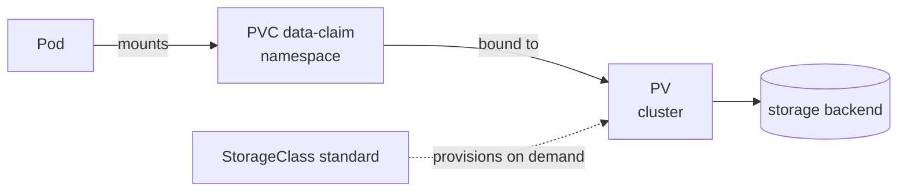

# Chapter 13: Storage basics: volumes, PersistentVolumes, PersistentVolumeClaims, and StorageClasses

> **Exams:** CKAD · CKA
> **Difficulty:** Intermediate
> **Time:** ~50 min reading, ~35 min lab
> **Lab tier:** 1 (kind)
> **Prerequisites:** Chapter 04 (Pods in depth), Chapter 09 (emptyDir volumes)

## Learning objectives

After this chapter you can:

- Explain why a container's own filesystem is not enough for data that must outlive a Pod
- Choose between an `emptyDir`, a `hostPath`, and a PersistentVolumeClaim for a given need
- Create a PersistentVolumeClaim and mount it into a Pod, and show that the data survives the Pod
- Create a static PersistentVolume, and explain how a claim binds to it through the storage class, capacity, and access modes
- Explain the reclaim policies `Retain` and `Delete`, and what a `Released` volume means
- Create a StorageClass, and explain `volumeBindingMode: WaitForFirstConsumer`
- Read the status of PVs and PVCs, and recognize a claim that is waiting for a Pod

## Concepts

### The filesystem of a container is temporary

A container's root filesystem is built from its image, and it is discarded when
the container is replaced. A restart keeps the Pod but gives the container a
fresh writable layer, so anything the application wrote to it is gone. Pods are
also replaced more often than people expect: a rollout, a node drain, or a
failed liveness probe each create a new container, and a deleted Pod's data
goes with it.

Data that must survive has to live in a **volume**. A volume belongs to the Pod,
or to a claim that outlives the Pod, and the container mounts it at a path. The
kinds of volume differ in how long they last and where the bytes are stored:

| Volume type | Lives as long as | Stored on | Typical use |
| --- | --- | --- | --- |
| `emptyDir` | the Pod | the node's disk, or memory with `medium: Memory` | scratch space, sharing files between containers |
| `hostPath` | the node's files, not the Pod | the node itself | node-level agents; avoid for applications |
| `configMap`, `secret` | the object they come from | the API server | configuration, Chapter 07 |
| `persistentVolumeClaim` | the claim, which outlives any Pod | a PersistentVolume | databases, uploads, anything that must survive |

`hostPath` is the easy one to misuse. It ties a Pod to one node, and the Pod
can see every file that node exposes at that path. Use a PersistentVolumeClaim
for application data.

### PersistentVolumes and PersistentVolumeClaims

Storage has two halves, and Kubernetes separates them so that the people who
provide storage and the people who use it can work independently.

- A **PersistentVolume** (PV) is a piece of storage in the cluster. It is
  cluster-scoped, so it belongs to no namespace. It records its capacity, its
  access modes, its reclaim policy, and where the data is kept (an NFS export,
  a disk, a hostPath on a test cluster).
- A **PersistentVolumeClaim** (PVC) is a request for storage from a namespace.
  It asks for a size, access modes, and a storage class. A Pod uses the claim,
  not the volume, so the Pod never names the disk.



A claim is **bound** to one volume, and that binding is exclusive. The Pod
refers to the claim by name, and the claim refers to the volume by name. If the
claim is deleted, the Pod loses its storage, which is why deleting a claim is a
decision with consequences.

### How a claim finds a volume

There are two ways a PVC gets a volume:

- **Static provisioning.** An administrator creates the PV in advance. A claim
  binds to it when the claim matches: the same storage class name, enough
  capacity, and a compatible access mode.
- **Dynamic provisioning.** A claim names a StorageClass, and the class's
  provisioner creates a matching PV when the claim needs one. Most clusters work
  this way, and the lab's kind cluster has a default class (`standard`) that does.

The claim's `storageClassName` is what connects the two sides. A claim with no
`storageClassName` uses the cluster's default class, if it has one. A claim with
`storageClassName: ""` asks for a PV with no class, which is how you bind to a
static PV that has none.

The claim's status tells you where it is. `Pending` means no volume is bound
yet. `Bound` means the claim has its volume. `Lost` means the volume the claim
was bound to has disappeared.

### Access modes

Access modes describe how many nodes and Pods may use a volume at once:

- `ReadWriteOnce` (RWO): mounted read-write by a single node. Several Pods on
  that node may share it, which is a common surprise.
- `ReadOnlyMany` (ROX): mounted read-only by many nodes.
- `ReadWriteMany` (RWX): mounted read-write by many nodes. Not every storage
  backend supports it, and the local storage in kind does not.
- `ReadWriteOncePod` (RWOP): mounted read-write by a single Pod across the whole
  cluster. Use this when two Pods must never write at once.

A PV's access modes must include the claim's, and the storage backend decides
what is actually possible. Asking for `ReadWriteMany` on a backend that cannot
provide it leaves the claim `Pending`.

### Reclaim policies

When a claim is deleted, its volume's **reclaim policy** decides what happens
to the volume:

- `Delete` removes the volume and the data it holds. This is the default for
  dynamically provisioned volumes.
- `Retain` keeps the volume and its data. The volume moves to `Released`: it is
  no longer bound, but nothing else has claimed it, and it will not be reused
  automatically. An administrator must decide what to do with the data, and then
  delete the PV.
- `Recycle` existed for basic scrubbing and is deprecated. Do not use it.

A `Released` volume is not `Available`. A new claim cannot bind to it until
someone clears its `claimRef`, which is a deliberate step.

### StorageClasses and binding modes

A StorageClass describes one kind of storage: the provisioner that creates the
volumes, the parameters the provisioner uses, the reclaim policy for the volumes
it creates, and whether volumes may be expanded.

Its `volumeBindingMode` controls when the volume is created and bound:

- `Immediate` binds the claim as soon as it is created. It may pick a node the
  Pod will never run on.
- `WaitForFirstConsumer` waits until a Pod that uses the claim is scheduled, then
  creates the volume on that Pod's node. Use it with node-local storage, where
  the node matters. A claim with this mode stays `Pending` until a Pod uses it.

A StorageClass marked with the annotation `storageclass.kubernetes.io/is-default-class: "true"`
is the default for claims that name no class.

### Persistence in practice

A Pod that mounts a claim sees the same files every time it runs, even when the
Pod is deleted and a new one is created. The data belongs to the claim, not to
the Pod. This is the property that makes databases and stateful workloads
possible, and it is what the walkthrough below shows.

## Guided walkthrough

The walkthrough works in the Namespace `ch13-storage`. The outputs below are
trimmed: names, ages, and the generated volume names differ on your cluster. The
objects are named `demo-...` where they are not the lab's own. The lab later in
this chapter uses that Namespace too, so run `make lab CH=13` first, or run the
commands in any Namespace you choose.

### Look at the default StorageClass

```bash
kubectl get storageclass
```

```text
NAME                 PROVISIONER             RECLAIMPOLICY   VOLUMEBINDINGMODE      ALLOWVOLUMEEXPANSION   AGE
standard (default)   rancher.io/local-path   Delete          WaitForFirstConsumer   false                  11d
```

The `standard` class is the default. Its provisioner creates a directory on the
node for each volume, and it waits for a consumer, because the data lives on
one particular node.

### Claim storage and watch it bind

Create a claim and look at its status before any Pod uses it:

```bash
cat <<'YAML' | kubectl -n ch13-storage apply -f -
apiVersion: v1
kind: PersistentVolumeClaim
metadata:
  name: demo-claim
spec:
  accessModes: [ReadWriteOnce]
  resources:
    requests:
      storage: 100Mi
YAML
kubectl -n ch13-storage get pvc demo-claim
```

```text
persistentvolumeclaim/demo-claim created
NAME         STATUS    VOLUME   CAPACITY   ACCESS MODES   STORAGECLASS   VOLUMEATTRIBUTESCLASS   AGE
demo-claim   Pending                                      standard       <unset>                 0s
```

The claim is `Pending`, because the class waits for a consumer. Now create a
Pod that mounts it, and write a file:

```bash
cat <<'YAML' | kubectl -n ch13-storage apply -f -
apiVersion: v1
kind: Pod
metadata:
  name: demo-writer
spec:
  containers:
    - name: app
      image: busybox:1.36
      command: ["sleep", "3600"]
      volumeMounts:
        - name: data
          mountPath: /data
  volumes:
    - name: data
      persistentVolumeClaim:
        claimName: demo-claim
YAML
kubectl -n ch13-storage wait --for=condition=Ready pod/demo-writer --timeout=120s
kubectl -n ch13-storage get pvc demo-claim
kubectl -n ch13-storage exec demo-writer -- sh -c 'echo stored > /data/hello.txt && cat /data/hello.txt'
kubectl get pv
```

```text
pod/demo-writer condition met
NAME         STATUS   VOLUME                                     CAPACITY   ACCESS MODES   STORAGECLASS   VOLUMEATTRIBUTESCLASS   AGE
demo-claim   Bound    pvc-ac6d09ce-ec0c-444b-bd5a-ba68020fd799   100Mi      RWO            standard       <unset>                 8s
stored
NAME                                       CAPACITY   ACCESS MODES   RECLAIM POLICY   STATUS   CLAIM                     STORAGECLASS   VOLUMEATTRIBUTESCLASS   REASON   AGE
pvc-ac6d09ce-ec0c-444b-bd5a-ba68020fd799   100Mi      RWO            Delete           Bound    ch13-storage/demo-claim   standard       <unset>                          2s
```

Once the Pod was scheduled, the class created a PV named after the claim's
volume, and the claim became `Bound`. The PV's reclaim policy is `Delete`,
because the class says so. The file was written to `/data`, which is the claim's
volume.

### Show that the data outlives the Pod

Delete the writer, create a new Pod that mounts the same claim, and read the file:

```bash
kubectl -n ch13-storage delete pod demo-writer --wait=true
cat <<'YAML' | kubectl -n ch13-storage apply -f -
apiVersion: v1
kind: Pod
metadata:
  name: demo-reader
spec:
  containers:
    - name: app
      image: busybox:1.36
      command: ["sleep", "3600"]
      volumeMounts:
        - name: data
          mountPath: /data
  volumes:
    - name: data
      persistentVolumeClaim:
        claimName: demo-claim
YAML
kubectl -n ch13-storage wait --for=condition=Ready pod/demo-reader --timeout=120s
kubectl -n ch13-storage exec demo-reader -- cat /data/hello.txt
```

```text
pod "demo-writer" deleted
pod/demo-reader created
pod/demo-reader condition met
stored
```

The new Pod sees the file. The data belongs to the claim, and the Pods were only
ways of reaching it.

### Bind a claim to a static PersistentVolume

Create a PV by hand, with the storage class `manual`, and a claim that asks for
the same class:

```bash
cat <<'YAML' | kubectl apply -f -
apiVersion: v1
kind: PersistentVolume
metadata:
  name: demo-pv
spec:
  capacity:
    storage: 1Gi
  accessModes: [ReadWriteOnce]
  storageClassName: manual
  persistentVolumeReclaimPolicy: Retain
  hostPath:
    path: /mnt/demo-data
    type: DirectoryOrCreate
YAML
cat <<'YAML' | kubectl -n ch13-storage apply -f -
apiVersion: v1
kind: PersistentVolumeClaim
metadata:
  name: manual-claim
spec:
  accessModes: [ReadWriteOnce]
  storageClassName: manual
  resources:
    requests:
      storage: 500Mi
YAML
kubectl get pv demo-pv
kubectl -n ch13-storage get pvc manual-claim
kubectl -n ch13-storage get pvc manual-claim -o jsonpath='{.spec.volumeName}{"\n"}'
```

```text
NAME      CAPACITY   ACCESS MODES   RECLAIM POLICY   STATUS   CLAIM                       STORAGECLASS   VOLUMEATTRIBUTESCLASS   REASON   AGE
demo-pv   1Gi        RWO            Retain           Bound    ch13-storage/manual-claim   manual         <unset>                          0s
NAME           STATUS   VOLUME    CAPACITY   ACCESS MODES   STORAGECLASS   VOLUMEATTRIBUTESCLASS   AGE
manual-claim   Bound    demo-pv   1Gi        RWO            manual         <unset>                 0s
demo-pv
```

The claim bound at once, because the PV already matched it: same class, enough
capacity, compatible access mode. The claim's `VOLUME` is `demo-pv`. A claim
asking for more than the PV holds, or for a different class, would stay
`Pending`.

### Watch a Retain volume after its claim is deleted

Use the StorageClass to create a claim with `reclaimPolicy: Retain`, and a Pod
that uses it. This class does not exist yet, so create it first:

```bash
kubectl create -f - <<'YAML'
apiVersion: storage.k8s.io/v1
kind: StorageClass
metadata:
  name: demo-retain
provisioner: rancher.io/local-path
reclaimPolicy: Retain
volumeBindingMode: WaitForFirstConsumer
YAML
```

```text
storageclass.storage.k8s.io/demo-retain created
```

Create the claim, the consumer Pod, and look at the claim:

```bash
cat <<'YAML' | kubectl -n ch13-storage apply -f -
apiVersion: v1
kind: PersistentVolumeClaim
metadata:
  name: retained
spec:
  accessModes: [ReadWriteOnce]
  storageClassName: demo-retain
  resources:
    requests:
      storage: 50Mi
YAML
kubectl -n ch13-storage get pvc retained
```

```text
NAME       STATUS    VOLUME   CAPACITY   ACCESS MODES   STORAGECLASS   VOLUMEATTRIBUTESCLASS   AGE
retained   Pending                                      demo-retain    <unset>                 0s
```

The claim is `Pending`, as expected for `WaitForFirstConsumer`. Add the consumer:

```bash
cat <<'YAML' | kubectl -n ch13-storage apply -f -
apiVersion: v1
kind: Pod
metadata:
  name: demo-retained-user
spec:
  containers:
    - name: app
      image: busybox:1.36
      command: ["sleep", "3600"]
      volumeMounts:
        - name: data
          mountPath: /data
  volumes:
    - name: data
      persistentVolumeClaim:
        claimName: retained
YAML
kubectl -n ch13-storage wait --for=condition=Ready pod/demo-retained-user --timeout=120s
kubectl -n ch13-storage get pvc retained
```

```text
pod/demo-retained-user condition met
NAME       STATUS   VOLUME                                     CAPACITY   ACCESS MODES   STORAGECLASS   VOLUMEATTRIBUTESCLASS   AGE
retained   Bound    pvc-cd7a51f9-914a-46cd-a7d6-702ab61aa194   50Mi       RWO            demo-retain    <unset>                 8s
```

Now delete the namespace, which deletes the claim and the Pod, and look at the
PVs that remain:

```bash
kubectl delete namespace ch13-storage --wait=true
kubectl get pv
```

```text
NAME                                       CAPACITY   ACCESS MODES   RECLAIM POLICY   STATUS     CLAIM                       STORAGECLASS   VOLUMEATTRIBUTESCLASS   REASON   AGE
demo-pv                                    1Gi        RWO            Retain           Released   ch13-storage/manual-claim   manual         <unset>                          64s
pvc-cd7a51f9-914a-46cd-a7d6-702ab61aa194   50Mi       RWO            Retain           Released   ch13-storage/retained       demo-retain    <unset>                          57s
```

Both volumes are `Released`. Their data is still on the node, and neither can be
claimed again automatically. An administrator must decide: keep the data and
clear the claim reference, or delete the PV. Here we delete them both:

```bash
kubectl delete pv demo-pv pvc-cd7a51f9-914a-46cd-a7d6-702ab61aa194
kubectl delete storageclass demo-retain
```

```text
persistentvolume "demo-pv" deleted
persistentvolume "pvc-cd7a51f9-914a-46cd-a7d6-702ab61aa194" deleted
storageclass.storage.k8s.io "demo-retain" deleted
```

### Use an emptyDir with a size limit

An `emptyDir` lasts as long as the Pod. Give it a size limit so that a runaway
process cannot fill the node's disk:

```bash
cat <<'YAML' | kubectl -n ch13-storage apply -f -
apiVersion: v1
kind: Pod
metadata:
  name: demo-scratch
spec:
  containers:
    - name: app
      image: busybox:1.36
      command: ["sleep", "3600"]
      volumeMounts:
        - name: cache
          mountPath: /cache
  volumes:
    - name: cache
      emptyDir:
        sizeLimit: 10Mi
YAML
kubectl -n ch13-storage get pod demo-scratch -o jsonpath='{.spec.volumes[0].emptyDir}{"\n"}'
```

```text
{"sizeLimit":"10Mi"}
```

The size limit belongs to the volume, not to the container. When the Pod
exceeds it, the kubelet evicts the Pod.

## Hands-on lab

The lab works like a KodeKloud lab: one task at a time, a check after each, and
progress that is saved between sessions.

```bash
make lab CH=13       # set up the lab and show task 1
make check CH=13     # check the current task; if it is right, show the next
make question CH=13  # show the current task again
make reset CH=13     # back to the starting state and task 1
make verify CH=13    # check every task at once
```

Everything happens in the Namespace `ch13-storage`: use `-n ch13-storage` on
every command, or run `make use-namespace CH=13` once. The Namespace starts
empty. The lab creates one cluster-scoped PersistentVolume (`ch13-manual-pv`)
and one StorageClass (`ch13-retain`), and teardown removes both.

Full solutions are in [`lab/solutions.md`](lab/solutions.md).

### Task 1: Write to a claim

Create a PersistentVolumeClaim and a Pod with the following specification.

- Claim name: `data-claim`, requesting `100Mi` with access mode `ReadWriteOnce`, using the default storage class
- Pod name: `writer`, image `busybox:1.36`, running `sleep 3600`
- The Pod mounts `data-claim` at `/data`
- The file `/data/hello.txt` holds the word `stored`
- The claim is `Bound`, and the Pod is `Running`

### Task 2: Move the claim to a new Pod

Delete the Pod `writer`, then create a Pod with the following specification.

- Name: `reader`, image `busybox:1.36`, running `sleep 3600`
- Mounts the same claim `data-claim` at `/data`
- The Pod is `Running`, and it reads `stored` from `/data/hello.txt`

### Task 3: Bind a static PersistentVolume

Create a PersistentVolume and a claim with the following specification.

- PersistentVolume name: `ch13-manual-pv`, capacity `1Gi`, access mode `ReadWriteOnce`
- PV storage class `manual`, reclaim policy `Retain`, hostPath `/mnt/ch13-data`
- Claim name: `manual-claim`, requesting `500Mi`, storage class `manual`, access mode `ReadWriteOnce`
- The PV and the claim are both `Bound` to each other

### Task 4: An emptyDir with a size limit

Create a Pod with the following specification.

- Name: `scratch`, image `busybox:1.36`, running `sleep 3600`
- An `emptyDir` volume named `cache`, with a size limit of `10Mi`
- The volume is mounted at `/cache`
- The Pod is `Running`

### Task 5: A StorageClass that retains data

Create a StorageClass and a claim that uses it, with the following specification.

- StorageClass name: `ch13-retain`, provisioner `rancher.io/local-path`
- Reclaim policy `Retain`, volume binding mode `WaitForFirstConsumer`
- Claim name: `retained`, requesting `50Mi`, using the class `ch13-retain`
- Pod name: `retained-user`, image `busybox:1.36`, running `sleep 3600`, mounts `retained` at `/data`
- The claim is `Bound`, and its volume has the reclaim policy `Retain`

## Exam tips

> **Exam tip:** `kubectl get pv,pvc` in one command shows both sides of a binding. A `Pending` claim is almost always a missing or mismatched storage class, capacity, or access mode, or a `WaitForFirstConsumer` class with no Pod yet.
>
> **Exam tip:** To check what a claim is bound to, read `.spec.volumeName` on the PVC and then `kubectl get pv NAME`. The PV's `CLAIM` column names the namespace and claim it is bound to.
>
> **Exam tip:** A volume mount in a Pod has two parts that must agree: the `volumes` entry (with the `persistentVolumeClaim.claimName`) and the `volumeMounts` entry in the container, linked by the same name. A mismatch is rejected when the Pod is created.

## Common mistakes

- Expecting data to survive when it was written to the container's own filesystem, not to a mounted volume.
- Leaving a claim `Pending` on a `WaitForFirstConsumer` class and waiting for it to bind before creating the Pod that uses it.
- Asking for a size or access mode the PV does not provide, then wondering why the claim never binds.
- Deleting a claim with `Delete` reclaim policy when the data is needed. The volume and its data are removed with it.
- Assuming a `Released` PV can be claimed again. It cannot, until an administrator clears its claim reference.
- Using `hostPath` for application data. The data stays on one node and is not protected by the claim lifecycle.
- Reading `ReadWriteOnce` as "one Pod only". It limits the volume to one node; several Pods on that node may mount it.

<!-- QUESTIONS:START -->

## End-of-chapter questions

**1.** `KCNA` `CKAD` A container writes a file to its own root filesystem, and then the Pod is deleted and recreated. What happens to the file?

- **A.** It survives, because the container's filesystem is stored in etcd
- **B.** It is lost, because the container's filesystem is discarded with the container
- **C.** It survives, if the new Pod runs on the same node
- **D.** It survives, because the kubelet copies root filesystems to a backup volume

**2.** `KCNA` `CKAD` `CKA` What is the difference between a PersistentVolume and a PersistentVolumeClaim?

- **A.** A PV is namespace-scoped and a PVC is cluster-scoped
- **B.** A PV is a piece of storage in the cluster, and a PVC is a request for storage from a namespace
- **C.** A PVC is created by the kubelet, and a PV is created by the user
- **D.** They are two names for the same object

**3.** `CKAD` `CKA` A claim asks for `ReadWriteOnce`. Which description of that access mode is correct?

- **A.** Exactly one Pod in the cluster may mount the volume
- **B.** The volume may be mounted read-write by a single node; several Pods on that node may share it
- **C.** The volume may be mounted read-only by many nodes
- **D.** The volume may be mounted read-write by many nodes at once

**4.** `CKAD` `CKA` A PersistentVolumeClaim has been `Pending` for minutes. Its StorageClass uses `volumeBindingMode: WaitForFirstConsumer`, and no Pod uses it yet. What is the correct next step?

- **A.** Delete the StorageClass and create one with `Immediate` binding
- **B.** Create the Pod that uses the claim, which lets the claim bind on the Pod's node
- **C.** Restart the kubelet on every node
- **D.** Edit the claim's status to `Bound`

**5.** `CKAD` `CKA` You delete a PVC whose PV has the reclaim policy `Retain`. What state does the PV enter, and can a new claim use it immediately?

- **A.** It is deleted along with the claim
- **B.** It becomes `Released`; it is not bound, and a new claim cannot use it until an administrator clears its claim reference
- **C.** It becomes `Available` and is bound to the next claim that asks for its class
- **D.** It is copied to a new PV with the reclaim policy `Delete`

**6.** `CKA` Which StorageClass field decides whether a PV is created when a claim is made, or only when a Pod that uses the claim is scheduled?

- **A.** `reclaimPolicy`
- **B.** `provisioner`
- **C.** `volumeBindingMode`
- **D.** `allowVolumeExpansion`

**7.** `CKAD` A Pod's `emptyDir` volume has `sizeLimit: 10Mi`, and the process writes 20Mi into it. What happens?

- **A.** The write fails at 10Mi, and the process continues without error
- **B.** The Pod is evicted by the kubelet, because the volume exceeded its size limit
- **C.** The volume is automatically expanded to 20Mi
- **D.** The container is killed with the reason `OOMKilled`

**8. (Task)** `CKAD` `CKA` In namespace `prod`, create a PersistentVolumeClaim named `logs` requesting `200Mi` with access mode `ReadWriteOnce`, using the default storage class. Then create a Pod named `logger` running `busybox:1.36` with the command `sleep 3600` that mounts `logs` at `/var/log/app`. Show the claim's status once the Pod is Running.

**9. (Task)** `CKAD` `CKA` In namespace `prod`, create a Pod named `cache` running `busybox:1.36` with the command `sleep 3600`. It mounts an `emptyDir` named `scratch` at `/tmp/cache`, with a size limit of `64Mi`. Show the size limit of the volume.

**10. (Task)** `CKA` Create a StorageClass named `fast-local` with the provisioner `rancher.io/local-path`, reclaim policy `Retain`, and volume binding mode `WaitForFirstConsumer`. Show its reclaim policy and binding mode.

**11. (Task)** `CKAD` `CKA` In namespace `prod`, a PersistentVolumeClaim named `reports` is stuck in `Pending`, because it asks for storage class `slow-disk`, which does not exist. Change the claim so that it uses the default storage class instead. The claim is not yet bound to any volume, so you may delete and recreate it. Show its storage class.

<details>
<summary>Answers</summary>

**1. B.** A container's root filesystem comes from its image and is discarded with the container. Data that must survive belongs in a volume: an emptyDir lasts as long as the Pod, and a PersistentVolumeClaim outlives Pods altogether.

**2. B.** A PersistentVolume is cluster-scoped storage. A PersistentVolumeClaim is namespace-scoped and asks for a size, access modes and a class. A Pod refers to the claim, and the claim binds to a volume.

**3. B.** `ReadWriteOnce` limits the volume to one node, not one Pod. Several Pods on that node may mount it. When exactly one Pod must have write access cluster-wide, use `ReadWriteOncePod`.

**4. B.** `WaitForFirstConsumer` binds the claim only once a Pod that uses it is scheduled, so that the volume is created on the Pod's node. The claim is working as designed. Create the consumer Pod, and the claim binds.

**5. B.** `Retain` keeps the volume and its data after the claim is gone. The volume is `Released`, and it will not be reused automatically, because its data may still matter. An administrator decides whether to keep the data (clearing the claim reference) or to delete the PV.

**6. C.** `volumeBindingMode` is `Immediate` or `WaitForFirstConsumer`. `reclaimPolicy` decides what happens to the volume after its claim is deleted, `provisioner` names the driver that creates volumes, and `allowVolumeExpansion` permits claims to grow.

**7. B.** An emptyDir's `sizeLimit` is enforced by the kubelet, which evicts the Pod when the volume exceeds it. `OOMKilled` is a memory-limit event, which is a different mechanism from storage limits.

**8.**

```bash
cat <<'YAML' | kubectl -n prod apply -f -
apiVersion: v1
kind: PersistentVolumeClaim
metadata:
  name: logs
spec:
  accessModes: [ReadWriteOnce]
  resources:
    requests:
      storage: 200Mi
---
apiVersion: v1
kind: Pod
metadata:
  name: logger
spec:
  containers:
    - name: app
      image: busybox:1.36
      command: ["sleep", "3600"]
      volumeMounts:
        - name: logs
          mountPath: /var/log/app
  volumes:
    - name: logs
      persistentVolumeClaim:
        claimName: logs
YAML
kubectl -n prod wait --for=condition=Ready pod/logger --timeout=120s
kubectl -n prod get pvc logs -o jsonpath='{.status.phase}{"\n"}'
```

The claim stays `Pending` until the Pod is scheduled, because the default class
waits for a consumer. Once the Pod runs, the claim is `Bound`.

**9.**

```bash
cat <<'YAML' | kubectl -n prod apply -f -
apiVersion: v1
kind: Pod
metadata:
  name: cache
spec:
  containers:
    - name: app
      image: busybox:1.36
      command: ["sleep", "3600"]
      volumeMounts:
        - name: scratch
          mountPath: /tmp/cache
  volumes:
    - name: scratch
      emptyDir:
        sizeLimit: 64Mi
YAML
kubectl -n prod get pod cache -o jsonpath='{.spec.volumes[0].emptyDir.sizeLimit}{"\n"}'
```

The size limit is a field of the `emptyDir` volume, so it sits under `volumes`, not under the container.

**10.**

```bash
cat <<'YAML' | kubectl apply -f -
apiVersion: storage.k8s.io/v1
kind: StorageClass
metadata:
  name: fast-local
provisioner: rancher.io/local-path
reclaimPolicy: Retain
volumeBindingMode: WaitForFirstConsumer
YAML
kubectl get storageclass fast-local -o jsonpath='{.reclaimPolicy}{" "}{.volumeBindingMode}{"\n"}'
```

StorageClasses are cluster-scoped, so there is no `-n` flag. Delete the class afterwards if you want to keep the cluster tidy.

**11.**

```bash
kubectl -n prod delete pvc reports
cat <<'YAML' | kubectl -n prod apply -f -
apiVersion: v1
kind: PersistentVolumeClaim
metadata:
  name: reports
spec:
  accessModes: [ReadWriteOnce]
  resources:
    requests:
      storage: 100Mi
YAML
kubectl -n prod get pvc reports -o jsonpath='{.spec.storageClassName}{"\n"}'
```

A claim's `storageClassName` cannot be changed in place, so it must be recreated.
Leaving the field out is enough: the API server fills in the cluster's default
class, so the output is `standard` here. Read the field, not the claim's status.

</details>

<!-- QUESTIONS:END -->

## Further reading

- Kubernetes documentation: *Volumes*, *Persistent Volumes*, *Storage Classes*
- Kubernetes documentation: *Dynamic Volume Provisioning*, *Configure a Pod to Use a PersistentVolume for Storage*
- Kubernetes documentation: *Access Modes* and *Reclaiming* a PersistentVolume
- Chapter 14 next: Helm and Kustomize, two ways to package and template the manifests you have been writing by hand
