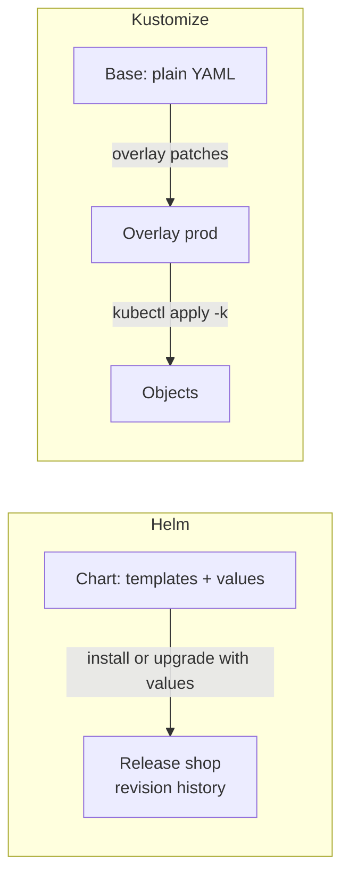

# Chapter 14: Helm and Kustomize

> **Exams:** CKAD · CKA
> **Difficulty:** Intermediate
> **Time:** ~50 min reading, ~35 min lab
> **Lab tier:** 1 (kind)
> **Prerequisites:** Chapter 05 (Controllers), Chapter 07 (ConfigMaps and Secrets), Chapter 11 (Services)

## Learning objectives

After this chapter you can:

- Explain why the same application needs different manifests per environment, and the two ways tools handle that
- Install, upgrade, roll back, and uninstall a Helm release, and read its history
- Set chart values with `--set`, `--reuse-values`, and `-f`, and predict what each one does to a release
- Render a chart without a cluster with `helm template`, and check it with `helm lint`
- Write a Kustomize base and an overlay that changes replicas, images, and labels
- Apply a Kustomize overlay with `kubectl apply -k`, and render it with `kubectl kustomize` before applying

## Concepts

### The problem: one application, many manifests

A real application has more than one manifest, and it runs in more than one
place: a laptop, a test cluster, and production. The Deployment in production
has more replicas, a different image tag, and different labels. Copying the
YAML for each environment works until the first change, when you must edit every
copy and hope they stay in step.

Two tools solve this, with different designs:

- **Helm** packages the manifests as a **chart**: a folder of templates, plus a
  `values.yaml` of defaults. You install a chart as a **release**, and you change
  the values to change the output. Helm also tracks each release's history, so
  you can roll back.
- **Kustomize** keeps plain YAML. A **base** is a complete, valid set of
  manifests. An **overlay** names a base and lists changes (replicas, images,
  labels, name prefixes) to apply on top. Nothing is templated: the base is
  still valid YAML that you can read and apply.



The two tools answer the same question differently. Helm renders the templates
into a manifest and records it as a release. Kustomize applies the base with
patches on top, so the output is never a template.

### Helm: charts, releases, and revisions

A chart has a `Chart.yaml` (its name, version, and app version), a `values.yaml`
(its defaults), and a `templates/` folder. The templates are Go templates that
read values through `.Values`, the release name through `.Release.Name`, and
the other objects through `.Chart`. The chart in this chapter's lab has a
Deployment, a Service, and a ConfigMap, each named after the release.

A **release** is one installed copy of a chart, under a name you choose, in a
namespace. Helm stores each release as a series of **revisions**, one per install
or upgrade. Every revision keeps its rendered manifest and the values that
produced it. That history is what makes rollback possible:

- `helm install NAME CHART` creates revision 1.
- `helm upgrade NAME CHART` creates the next revision.
- `helm rollback NAME REVISION` creates a **new** revision, with the manifest of
  the old one. The history keeps growing; nothing is deleted.
- `helm uninstall NAME` removes the release and its objects.

Values come from three places, and later sources win: the chart's
`values.yaml`, then files given with `-f`, then `--set` flags. `--reuse-values`
keeps the values of the current revision when you upgrade, so a flag such as
`--set image.tag=1.27` changes one value and keeps the rest. Without it, an
upgrade uses only the chart defaults plus what you pass in this command.

To see what a release used, read its values:

```bash
helm get values NAME --revision 2
```

`helm get values` shows the user-supplied values. Add `--all` to see the
defaults as well.

Two commands work without a cluster, which is useful in CI and in exams:
`helm lint CHART` checks the chart for errors, and `helm template NAME CHART`
renders the manifests to standard output.

### Kustomize: bases, overlays, and transformers

A Kustomize **kustomization** is a file named `kustomization.yaml` that lists
resources and transformations. A **base** lists the resources. An **overlay**
lists its base in `resources:` and adds changes. Common transformations are:

- `replicas` sets the replica count of a named Deployment, StatefulSet, or ReplicaSet.
- `images` changes the image name, the tag, or the digest, for every container
  using that name.
- `labels` adds labels. With `includeSelectors: false`, it changes only the
  object's own labels, not the selectors, which are immutable on a Deployment.
- `namePrefix` and `nameSuffix` rename every resource, which is handy for running
  two copies side by side.
- `namespace` sets the namespace of every resource.

```yaml
resources:
  - ../base
replicas:
  - name: api
    count: 3
images:
  - name: nginx
    newTag: "1.27"
```

`kubectl kustomize DIRECTORY` renders the result to standard output without
applying it. `kubectl apply -k DIRECTORY` renders and applies it. Read the
rendered output before you apply it, because a patch that targets the wrong name
silently does nothing.

Kustomize is built into `kubectl`, so there is nothing to install.

### Choosing between them

Helm is the better fit when you install software that other people publish, when
you want release history and one-command rollback, or when the same chart must
take many configurations. Kustomize is the better fit when you own the manifests
and want them to stay plain YAML, with small per-environment changes. Many teams
use both: Helm for third-party software, Kustomize for their own services.

## Guided walkthrough

The walkthrough works in the Namespace `ch14-helm`. The chart is in this
chapter's `manifests/charts/shop`, and the Kustomize overlay is in
`manifests/kustomize/overlay`, so run the commands from the repository root. The
outputs below are trimmed: timestamps and ages differ on your cluster. The
release is named `demo`, so it does not clash with the lab's `shop` release.
The lab later in this chapter uses that Namespace too, so run `make lab CH=14`
first, or run the commands in any Namespace you choose.

### Render a chart without a cluster

Look at the manifests a chart produces before you install it:

```bash
helm template demo chapters/14-helm-kustomize/manifests/charts/shop --set replicaCount=2 | head -20
```

```yaml
# Source: shop/templates/configmap.yaml
apiVersion: v1
kind: ConfigMap
metadata:
  name: demo-config
data:
  greeting: "hello-default"
---
# Source: shop/templates/service.yaml
apiVersion: v1
kind: Service
metadata:
  name: demo
  labels:
    app.kubernetes.io/name: shop
    app.kubernetes.io/instance: demo
spec:
  type: ClusterIP
  selector:
```

Every object is named after the release (`demo`), and each template comments on
its source file. The output is the same manifest `helm install` would apply.

### Install a release and watch it come up

Install the chart as release `demo` with two replicas, and wait for the rollout:

```bash
helm install demo chapters/14-helm-kustomize/manifests/charts/shop -n ch14-helm --set replicaCount=2
helm list -n ch14-helm
kubectl -n ch14-helm rollout status deployment/demo --timeout=120s
```

```text
NAME: demo
LAST DEPLOYED: Sun Oct 11 17:32:20 2026
NAMESPACE: ch14-helm
STATUS: deployed
REVISION: 1
TEST SUITE: None
NAME   	NAMESPACE	REVISION	UPDATED                                 	STATUS  	CHART     	APP VERSION
demo   	ch14-helm	1       	2026-10-11 17:32:20.66008513 +0200 CEST 	deployed	shop-0.1.0	1.26
deployment "demo" successfully rolled out
```

`helm list` shows every release in the namespace, with its current revision.

### Upgrade one value and keep the rest

Change the image tag and keep the replica count with `--reuse-values`, then read the history:

```bash
helm upgrade demo chapters/14-helm-kustomize/manifests/charts/shop -n ch14-helm --reuse-values --set image.tag=1.27
helm history demo -n ch14-helm
kubectl -n ch14-helm get deployment demo -o jsonpath='{.spec.template.spec.containers[0].image}{"\n"}'
```

```text
REVISION	UPDATED                 	STATUS    	CHART     	APP VERSION	DESCRIPTION
1       	Sun Oct 11 17:32:20 2026	superseded	shop-0.1.0	1.26       	Install complete
2       	Sun Oct 11 17:32:23 2026	deployed  	shop-0.1.0	1.26       	Upgrade complete
nginx:1.27
```

The history shows two revisions, and the Deployment runs `nginx:1.27`. The chart's
`APP VERSION` is not the image tag: the chart's default image tag is still `1.26`
in `values.yaml`, and the `--set` flag overrode it for this release.

To see what revision 2 used, read its values:

```bash
helm get values demo -n ch14-helm --revision 2
```

```text
USER-SUPPLIED VALUES:
image:
  tag: "1.27"
replicaCount: 2
```

Both values were stored with the revision. `--reuse-values` kept `replicaCount`,
and `--set` replaced only the tag.

### Roll back to a previous revision

Roll back to revision 1, and read the history again:

```bash
helm rollback demo 1 -n ch14-helm
helm history demo -n ch14-helm | tail -2
kubectl -n ch14-helm get deployment demo -o jsonpath='{.spec.template.spec.containers[0].image} {.spec.replicas}{"\n"}'
```

```text
Rollback was a success! Happy Helming!
2       	Sun Oct 11 17:32:23 2026	superseded	shop-0.1.0	1.26       	Upgrade complete
3       	Sun Oct 11 17:32:24 2026	deployed  	shop-0.1.0	1.26       	Rollback to 1
nginx:1.26 2
```

The rollback is revision 3, and its description says `Rollback to 1`. The history
grows, and the image is back to `nginx:1.26`. Nothing was deleted.

Remove the demo release:

```bash
helm uninstall demo -n ch14-helm
```

```text
release "demo" uninstalled
```

### Render a Kustomize overlay before applying it

Render the overlay in this chapter, without applying anything:

```bash
kubectl kustomize chapters/14-helm-kustomize/manifests/kustomize/overlay
```

```yaml
apiVersion: apps/v1
kind: Deployment
metadata:
  labels:
    env: prod
  name: api
spec:
  replicas: 3
  selector:
    matchLabels:
      app: api
  template:
    metadata:
      labels:
        app: api
    spec:
      containers:
      - image: nginx:1.27
        name: api
        ports:
        - containerPort: 80
```

The overlay took the base's `api` Deployment, set three replicas, changed the
image to `nginx:1.27`, and added the label `env: prod` to the Deployment. The
selector is unchanged, because `includeSelectors: false` kept it. Applying it
would be `kubectl -n NAMESPACE apply -k DIRECTORY`.

## Hands-on lab

The lab works like a KodeKloud lab: one task at a time, a check after each, and
progress that is saved between sessions.

```bash
make lab CH=14       # set up the lab and show task 1
make check CH=14     # check the current task; if it is right, show the next
make question CH=14  # show the current task again
make reset CH=14     # back to the starting state and task 1
make verify CH=14    # check every task at once
```

Everything happens in the Namespace `ch14-helm`. The setup copies the chart to
`lab/.state/charts/shop` and the Kustomize sources to `lab/.state/kustomize`, so
you can point Helm and Kustomize at them. Use `-n ch14-helm` on every command, and
`helm -n ch14-helm` for Helm. Tasks 1 to 3 are one release, and they must be done
in order. Tasks 4 and 5 are independent.

Full solutions are in [`lab/solutions.md`](lab/solutions.md).

### Task 1: Install the `shop` release

Install the chart at `lab/.state/charts/shop` as a release named `shop`, with
`replicaCount` set to `2`.

- Release: `shop`, in namespace `ch14-helm`
- The release's first revision uses `replicaCount: 2`

### Task 2: Upgrade the image tag and keep the replicas

Upgrade the release `shop` so that `image.tag` is `1.27`, and every other value
stays as it was.

- The new revision uses the image tag `1.27`
- The new revision keeps `replicaCount: 2`

### Task 3: Roll back the release

Roll back the release `shop` to revision 1.

- The history has a new revision whose description is `Rollback to 1`
- The Deployment `shop` runs the image `nginx:1.26` again

### Task 4: Apply the Kustomize overlay

Apply the overlay at `lab/.state/kustomize/overlay` to the namespace.

- Deployment `api` has 3 replicas
- Its container runs `nginx:1.27`
- The Deployment has the label `env: prod`

### Task 5: A second release with a value

Install the same chart at `lab/.state/charts/shop` as a release named `greeter`,
with the value `greeting` set to `hello`.

- Release: `greeter`, in namespace `ch14-helm`, deployed
- The ConfigMap `greeter-config` holds `greeting` with the value `hello`

## Exam tips

> **Exam tip:** `helm install NAME CHART --set KEY=VALUE` is the fast path, and `helm upgrade --reuse-values` is how to change one value without restating the rest. Check the result with `helm get values NAME` before you move on.
>
> **Exam tip:** A Helm rollback creates a new revision. If a question asks for "the previous version", read `helm history` and pick the revision by number, not by position.
>
> **Exam tip:** `kubectl kustomize DIR` is the safe way to read an overlay. If a patch does nothing, the name in the patch probably does not match the base's resource name exactly.

## Common mistakes

- Forgetting `--reuse-values` on an upgrade, and losing the values from the last revision, which then fall back to the chart defaults.
- Expecting `helm rollback` to delete the newer revisions. It adds a new revision that copies the old one.
- Confusing the chart's `appVersion` with the image tag. `appVersion` is metadata; the tag is the value the templates use.
- Writing `--set image.tag=1.27` with a value that YAML reads as a number. Quote tags such as `"1.27"` in values files, so `1.10` does not become `1.1`.
- Changing a Deployment's selector in a Kustomize overlay. Selectors are immutable; use `includeSelectors: false` for labels you add.
- Applying an overlay with `kubectl apply -f` instead of `-k`. The `-f` form does not run the transformations.

<!-- QUESTIONS:START -->

## End-of-chapter questions

**1.** `KCNA` `CKAD` What is the core difference between how Helm and Kustomize customize manifests?

- **A.** Helm edits running objects in place, and Kustomize edits the YAML files on disk
- **B.** Helm renders templates with values into a release, and Kustomize applies patches on top of plain, valid YAML
- **C.** Kustomize requires a Tiller server in the cluster, and Helm does not
- **D.** They are interchangeable; both only differ in the file extension they read

**2.** `CKAD` `CKA` A release is at revision 4. You run `helm rollback NAME 2`. What is the revision number after the command?

- **A.** 2, because the release returns to that revision
- **B.** 4, because rollback replaces the current revision
- **C.** 5, because rollback creates a new revision that copies revision 2
- **D.** There is no revision; rollback deletes the newer history

**3.** `CKAD` `CKA` A release was installed with `--set replicaCount=3`. You run `helm upgrade NAME CHART --set image.tag=1.27`, without `--reuse-values`. What is the replica count after the upgrade?

- **A.** 3, because the previous values are always kept
- **B.** The chart's default in values.yaml, because the upgrade uses only the chart defaults plus this command's flags
- **C.** 1, because a missing value is always 1
- **D.** 0, because the upgrade resets the Deployment

**4.** `CKAD` Which command renders the manifests a chart would produce, without a cluster and without installing anything?

- **A.** `helm install --dry-run=none`
- **B.** `helm template NAME CHART`
- **C.** `helm status NAME`
- **D.** `helm history NAME`

**5.** `CKAD` `CKA` A Kustomize overlay sets `labels` with `includeSelectors: false`. What changes, and what stays the same?

- **A.** The labels on the objects change, and the Deployment's selector stays the same
- **B.** The selectors change too, which is required for the new labels to match
- **C.** Nothing changes; labels are ignored unless `includeSelectors` is true
- **D.** The Pods change, but the Deployment's own labels stay the same

**6.** `CKAD` `CKA` Which command renders a Kustomize overlay to standard output, so you can read it before applying?

- **A.** `kubectl apply -k DIR --dry-run=client`
- **B.** `kubectl kustomize DIR`
- **C.** `kubectl create -k DIR`
- **D.** `kubectl get -k DIR`

**7.** `CKAD` Which values file key does a chart's template read to set a Deployment's image tag, in the chart this chapter uses?

- **A.** `appVersion`, from Chart.yaml
- **B.** `image.tag`, from values.yaml
- **C.** `.Release.Revision`
- **D.** `.Chart.Name`

**8. (Task)** `CKAD` `CKA` Install the chart at `./shop-chart` as a Helm release named `web` in namespace `prod`, with `replicaCount` set to `3`. Create the namespace first if it does not exist. Show the release's status.

**9. (Task)** `CKAD` `CKA` In namespace `prod`, the release `web` runs image tag `1.26`. Upgrade it to tag `1.27`, keeping every other value, and show the image of the Deployment `web` afterwards.

**10. (Task)** `CKAD` `CKA` In namespace `prod`, roll back the release `web` to revision 1, and show the revision number of the newest entry in its history.

**11. (Task)** `CKAD` `CKA` Create a Kustomize overlay in `./overlay` that uses the base in `./base`, sets the replica count of the Deployment `api` to `2`, and adds the label `env: staging` to the objects without changing the selectors. Show the rendered replica count and label.

<details>
<summary>Answers</summary>

**1. B.** Helm charts are Go templates that become manifests when rendered with values, and each install or upgrade is recorded as a release revision. Kustomize keeps the base as plain YAML and layers patches (overlays) on top, so the base is always valid and readable. Tiller was Helm 2, and Helm 3 has no server-side component.

**2. C.** A rollback creates a new revision with the manifest of the one you name, and nothing is deleted from the history. The release's current revision is the new one, and the description says `Rollback to 2`.

**3. B.** Without `--reuse-values`, an upgrade does not keep the previous revision's user-supplied values. It starts from the chart's `values.yaml`, adds any `-f` files, and then the `--set` flags. Add `--reuse-values` to keep the old values and change only what you name.

**4. B.** `helm template` renders the chart locally with the values you give it. `helm install --dry-run` also renders, but it contacts the cluster to validate. `helm status` and `helm history` read a release that is already installed.

**5. A.** `includeSelectors: false` adds the labels to the objects' own metadata, and leaves the selectors alone. A Deployment's selector is immutable after creation, so changing it would break an existing Deployment. Use it for labels such as `env`, which the selector does not need.

**6. B.** `kubectl kustomize` renders the overlay and prints the result without touching the cluster. `apply -k --dry-run=client` also renders, but it is the apply command, so it is less direct to read. `create` and `get` do not render the overlay to a file for review.

**7. B.** The Deployment template uses `{{ .Values.image.repository }}:{{ .Values.image.tag }}`, so the tag comes from `image.tag`. `appVersion` is metadata that Helm shows in `helm list`, and the template does not use it for the image.

**8.**

```bash
kubectl create namespace prod --dry-run=client -o yaml | kubectl apply -f -
helm install web ./shop-chart -n prod --set replicaCount=3
helm status web -n prod
```

`helm install` does not create a namespace unless you pass `--create-namespace`.
The `kubectl ... --dry-run | apply` line is an idempotent way to create it first.

**9.**

```bash
helm upgrade web ./shop-chart -n prod --reuse-values --set image.tag=1.27
kubectl -n prod get deployment web -o jsonpath='{.spec.template.spec.containers[0].image}{"\n"}'
```

`--reuse-values` keeps the replica count and anything else set on the last
revision, and `--set` changes only the tag.

**10.**

```bash
helm rollback web 1 -n prod
helm history web -n prod --max 1
```

`helm history --max 1` prints only the newest revision, which is the rollback
itself, so the revision number is one more than the last upgrade.

**11.**

```bash
cat <<'YAML' > overlay/kustomization.yaml
resources:
  - ../base
replicas:
  - name: api
    count: 2
labels:
  - pairs:
      env: staging
    includeSelectors: false
YAML
kubectl kustomize overlay | grep -E 'replicas:|env:'
```

The `replicas` transformer names the Deployment by its base name. `includeSelectors: false`
keeps the selector unchanged, which is what a label change on a live Deployment needs.

</details>

<!-- QUESTIONS:END -->

## Further reading

- Helm documentation: *Charts*, *Values Files*, *Upgrading a Release*, *Rolling Back a Release*
- Kustomize documentation: *Kustomization*, *Overlays*, *Built-in transformations*
- `kubectl` reference: `kubectl apply -k`, `kubectl kustomize`
- Chapter 15 next: developer observability and maintenance, logs, metrics, and API deprecations
