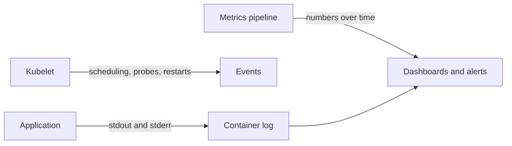

# Chapter 15: Developer observability and maintenance: logs, metrics, debugging, and API deprecations

> **Exams:** KCNA · CKAD
> **Difficulty:** Intermediate
> **Time:** ~50 min reading, ~35 min lab
> **Lab tier:** 1 (kind)
> **Prerequisites:** Chapter 04 (Pods in depth), Chapter 05 (Controllers), Chapter 10 (Probes)

## Learning objectives

After this chapter you can:

- Read a container's logs with `kubectl logs`, selecting by Pod, Deployment, label, container, and time
- Diagnose a crashing Pod from its status, its last termination, its logs, and its events
- Explain the difference between resource metrics (`kubectl top`) and application metrics, and what each needs
- Find which API version a cluster serves for a kind, and recognize a manifest that uses a removed version
- Explain why a Deployment's rollout is the place to change Pod-level metadata such as annotations
- Choose the first command to run for a symptom, instead of guessing

## Concepts

### Observability for developers

An application you deploy is only useful if you can see what it is doing. Three
kinds of signal help you do that, and each answers a different question:

- **Logs** say what the application printed: its requests, its errors, its
  decisions. They answer "what happened?"
- **Metrics** are numbers sampled over time: requests per second, memory used,
  error rates. They answer "how much, and is it getting worse?"
- **Events** are the cluster's own record of what it did to your objects: a
  Pod scheduled, a container started, a probe failed, an image pulled. They
  answer "what did Kubernetes do?"

`kubectl` shows the first and third directly. Metrics need a component that
collects them, and that is covered below.



The application writes to standard output and standard error, and the kubelet
keeps those streams as the container's logs. The kubelet also records events
about the Pod's life cycle. Metrics come from separate collectors, which read the
kubelet, the API server, or the application itself.

### Logs

A container's log is what it wrote to standard output and standard error. The
kubelet stores it on the node, and `kubectl logs` reads it through the API
server. Logs are per container, so a Pod with two containers needs `-c NAME`.

Several selectors cover the common cases:

- `kubectl logs POD` reads one Pod.
- `kubectl logs deployment/NAME` reads one of the Deployment's Pods, chosen for you.
- `kubectl logs -l app=NAME` reads every Pod with that label. Add `--prefix` to
  see which Pod each line came from.
- `--tail=N` shows the last N lines, and `--since=10m` shows the lines from the
  last ten minutes.

Logs are only kept for the container that wrote them. When a container restarts,
the old container's logs are not part of the new container's output. To read them,
add `--previous`, which asks for the last terminated container of the same
Pod. That works only while the kubelet still holds the old container. On some
nodes, including the kind node this book uses, the previous container's log can be
removed within seconds of the restart, and `--previous` then reports
`unable to retrieve container logs`. When that happens, read the current logs,
which repeat the same message if the failure is the same.

Logs are not a database. A busy container writes more than the kubelet keeps,
and a replaced Pod takes its logs with it. For anything you must keep, send logs
to a collector. That is a platform decision, but you should know it exists.

### Debugging a crashing Pod

A Pod that does not stay up has a status that narrows the problem. Read it in
this order:

1. `kubectl get pod NAME`: the `STATUS` column shows `Error`, `CrashLoopBackOff`,
   `ImagePullBackOff`, or `Init:Error`, and `RESTARTS` shows how often it has
   failed.
2. `kubectl get pod NAME -o jsonpath='{.status.containerStatuses[0].lastState.terminated}'`:
   the exit code and reason of the last run. An exit code of 1 or 2 is usually
   the application's own error; 137 is `SIGKILL`, often from a liveness probe or
   the out-of-memory killer; 143 is `SIGTERM`.
3. `kubectl logs NAME`: what the application said before it stopped.
4. `kubectl describe pod NAME`: the Events section, with probe failures, image
   pull errors, and scheduling problems.
5. `kubectl get events --field-selector involvedObject.name=NAME --sort-by=.lastTimestamp`:
   the same events, filtered to one object, in time order.

The order matters because each step narrows the next. A `CrashLoopBackOff`
with exit code 137 points at a probe or memory, not at the application's own
code, so reading the logs first would send you the wrong way.

### Metrics

Metrics need a collector. The Kubernetes **resource metrics** pipeline is
provided by metrics-server. It reads CPU and memory usage from the kubelets and
serves it through the `metrics.k8s.io` API, which is what `kubectl top` uses:

```bash
kubectl top pods
kubectl top nodes
```

On a cluster without metrics-server, `kubectl top` fails with `error: Metrics API
not available`. The lab cluster for this book does not run metrics-server, so
this chapter does not depend on `kubectl top` for its checks.

**Application metrics** are different. They are numbers the application exposes
itself, such as request counts and latency histograms, usually on an HTTP
endpoint in a text format. A Prometheus server scrapes them on an interval. The
common convention is a Pod annotation that tells the scraper where to look, such
as `prometheus.io/scrape: "true"`. The annotation must be on the Pod, not on the
Deployment's metadata, because the scraper finds Pods. That is why you add it to
the Deployment's `spec.template.metadata`, which becomes the Pod's annotations
when the Deployment rolls out.

Changing the template creates new Pods. A change to the Deployment's own
metadata does not, so annotations on the Pods need the template.

### API deprecations

Kubernetes APIs evolve. A beta version is removed after a deprecation period,
and a manifest that uses a removed version is refused by the API server. The
best-known example for this book is `policy/v1beta1` for PodDisruptionBudgets,
which was removed in Kubernetes 1.25.

Three things help you find the version a cluster serves:

- `kubectl api-resources --api-group=GROUP` lists the kinds in a group, with the
  version each one is served at (the `APIVERSION` column).
- `kubectl explain KIND --api-version=VERSION` shows the schema of a version. It
  fails with an error if the version is not served.
- A server-side dry run, `kubectl apply --dry-run=server -f FILE`, asks the API
  server to validate the manifest without storing it. A removed version fails
  here with `no matches for kind`.

When you apply an object at a deprecated but still served version, the API
server returns a warning in the output, so read the output of every command.
Tools that scan manifests and clusters for removed APIs exist as well, and many
teams run one in CI before upgrading. A cluster upgrade is the usual moment when
a removed API breaks a deployment, so check before you upgrade.

## Guided walkthrough

The walkthrough works in the Namespace `ch15-observe`. The outputs below are
trimmed: names, timestamps, and ages differ on your cluster. The objects are named
`demo-...` so they do not clash with the lab. The lab later in this chapter uses
that Namespace too, so run `make lab CH=15` first, or run the commands in any
Namespace you choose.

### Read logs by Deployment, by time, and by container

Create a Deployment whose Pod logs one line every two seconds, then read its logs:

```bash
kubectl -n ch15-observe create deployment demo-app --image=busybox:1.36 --replicas=1 -- sh -c 'while true; do echo "request handled path=/cart"; sleep 2; done'
kubectl -n ch15-observe rollout status deployment/demo-app --timeout=120s
kubectl -n ch15-observe logs deployment/demo-app --tail=2
```

```text
deployment.apps/demo-app created
deployment "demo-app" successfully rolled out
request handled path=/cart
request handled path=/cart
```

`logs deployment/NAME` picked one of the Deployment's Pods for you. Ask for the
last few seconds only:

```bash
kubectl -n ch15-observe logs deployment/demo-app --since=3s
```

```text
request handled path=/cart
request handled path=/cart
```

`--since` filters by time, not by line count. If nothing was logged in that
window, the output is empty and the command still succeeds.

### Diagnose a Pod that exits with an error

Create a Pod whose command prints a message and exits with code 2:

```bash
cat <<'YAML' | kubectl -n ch15-observe apply -f -
apiVersion: v1
kind: Pod
metadata:
  name: demo-crash
spec:
  containers:
    - name: app
      image: busybox:1.36
      command: ["sh", "-c", "echo 'config file /etc/app.yaml not found'; exit 2"]
YAML
```

```text
pod/demo-crash created
```

Wait a little, then follow the steps from the debugging section:

```bash
kubectl -n ch15-observe get pod demo-crash
kubectl -n ch15-observe get pod demo-crash -o jsonpath='exit={.status.containerStatuses[0].lastState.terminated.exitCode}{"\n"}'
kubectl -n ch15-observe logs demo-crash
kubectl -n ch15-observe get events --field-selector involvedObject.name=demo-crash --sort-by=.lastTimestamp
```

```text
NAME         READY   STATUS   RESTARTS      AGE
demo-crash   0/1     Error    2 (19s ago)   20s
exit=2
config file /etc/app.yaml not found
4s          Normal    Created     pod/demo-crash   Container created
4s          Normal    Started     pod/demo-crash   Container started
3s          Warning   BackOff     pod/demo-crash   Back-off restarting failed container app in pod demo-crash_ch15-observe(b9e113f8-...)
```

The status is `Error`, the exit code is 2, and the log names the missing file.
The events confirm that the kubelet is backing off the restarts. Exit code 2
came from the application, so the fix is in the configuration, not in the cluster.

### Try `kubectl top` and see the metrics gap

On the lab cluster, which does not run metrics-server:

```bash
kubectl -n ch15-observe top pods
```

```text
error: Metrics API not available
```

On a cluster with metrics-server installed, the same command prints CPU and memory
per Pod. The error here is expected: the Metrics API is not registered.

### Find the version a cluster serves

List the policy group's kinds with the versions the cluster serves:

```bash
kubectl api-resources --api-group=policy
```

```text
NAME                   SHORTNAMES   APIVERSION   NAMESPACED   KIND
poddisruptionbudgets   pdb          policy/v1    true         PodDisruptionBudget
```

Only `policy/v1` is served for PodDisruptionBudgets. Now try a manifest written
with the removed version, validating on the server without storing it:

```bash
cat <<'YAML' | kubectl -n ch15-observe apply --dry-run=server -f -
apiVersion: policy/v1beta1
kind: PodDisruptionBudget
metadata:
  name: demo-pdb
spec:
  minAvailable: 1
  selector:
    matchLabels:
      app: demo-app
YAML
```

```text
error: resource mapping not found for name: "demo-pdb" namespace: "" from "STDIN": no matches for kind "PodDisruptionBudget" in version "policy/v1beta1"
ensure CRDs are installed first
```

The API server does not know the version, so it refuses the manifest. Change the
`apiVersion` to `policy/v1`, and the same manifest is accepted.

## Hands-on lab

The lab works like a KodeKloud lab: one task at a time, a check after each, and
progress that is saved between sessions.

```bash
make lab CH=15       # set up the lab and show task 1
make check CH=15     # check the current task; if it is right, show the next
make question CH=15  # show the current task again
make reset CH=15     # back to the starting state and task 1
make verify CH=15    # check every task at once
```

Everything happens in the Namespace `ch15-observe`: use `-n ch15-observe` on every
command, or run `make use-namespace CH=15` once. The setup creates two things to
investigate: a Deployment `checkout` with two Pods that log orders, and a Pod
`crasher` that fails because a setting is missing. Tasks write two files,
`/tmp/ch15-crash.txt` and `/tmp/ch15-checkout.log`, which teardown removes.

Full solutions are in [`lab/solutions.md`](lab/solutions.md).

### Task 1: Find the crash message

The Pod `crasher` keeps failing. Find the line it printed when it failed, and save
that line, without any other text, to `/tmp/ch15-crash.txt`.

- File: `/tmp/ch15-crash.txt`, containing exactly the message

### Task 2: Give `crasher` its setting

The application needs the setting `DATABASE_URL`, with the value
`postgres://db:5432/shop`. The environment of a running container cannot change, so
replace the Pod with the same name, keeping the same image and command.

- Pod: `crasher`, running and ready
- Its container's `DATABASE_URL` is `postgres://db:5432/shop`

### Task 3: Save the latest order lines from every Pod

Save the last three log lines of every Pod of the Deployment `checkout`, selected by
its label `app=checkout`, to `/tmp/ch15-checkout.log`.

- File: `/tmp/ch15-checkout.log`, with six lines, each from the order log

### Task 4: Make the Pods advertise a scrape endpoint

Add the annotation `observability.example.com/scrape` with the value `true` to the
Pods of the Deployment `checkout`. Put it where it will reach the Pods, and wait for
the rollout to finish.

- The Deployment's Pod template has the annotation
- Both Pods are ready

### Task 5: A PodDisruptionBudget at the served version

Create a PodDisruptionBudget named `checkout-pdb` that keeps at least one Pod of
`checkout` available. Use the version the cluster serves.

- Name: `checkout-pdb`
- `minAvailable: 1`
- Selector: `app=checkout`

## Exam tips

> **Exam tip:** `kubectl logs -c CONTAINER` and `kubectl logs --previous` answer most debugging questions in one command. Check which container a question means before you read any output.
>
> **Exam tip:** `kubectl get events --sort-by=.lastTimestamp` is the fastest way to see what the cluster did most recently, and `--field-selector involvedObject.name=NAME` narrows it to one object.
>
> **Exam tip:** If a manifest is refused with `no matches for kind`, the `apiVersion` is wrong for this cluster. Run `kubectl api-resources` for the kind before you edit anything else.

## Common mistakes

- Reading a Pod's current logs for a failure that happened in the previous run. Add `--previous`, and if the kubelet has no previous logs, read the current run instead.
- Adding an annotation to the Deployment's metadata and expecting the Pods to change. Put it in `spec.template.metadata`.
- Treating `kubectl top` as always available. It needs metrics-server, and it fails without it.
- Confusing `RESTARTS` with the cause of the restarts. The last termination's exit code and reason say why.
- Applying a manifest at a removed API version and reading `no matches for kind` as a missing CRD.
- Filtering logs with `--tail` when the question asks for a time window. `--since` filters by time.

<!-- QUESTIONS:START -->

## End-of-chapter questions

**1.** `KCNA` `CKAD` Which signal answers the question 'what did the application print?'

- **A.** Metrics, because they are sampled numbers
- **B.** Events, because they record what the cluster did
- **C.** Logs, the output a container wrote to standard output and standard error
- **D.** The Pod's status conditions

**2.** `CKAD` A Pod has two containers, and you want the logs of only the second one. Which command is correct?

- **A.** `kubectl logs POD second`
- **B.** `kubectl logs POD -c SECOND_CONTAINER_NAME`
- **C.** `kubectl describe logs POD --container=second`
- **D.** `kubectl logs -l POD`

**3.** `CKAD` A container restarted and its status shows `lastState.terminated.exitCode: 137`. What does that exit code most likely mean?

- **A.** The application exited normally after an error it logged
- **B.** The process was killed with SIGKILL, often by the out-of-memory killer or a failing liveness probe
- **C.** The image could not be pulled
- **D.** The Pod was deleted by a user

**4.** `CKAD` You want the logs of a container from before its last restart. Which option asks for them?

- **A.** `--since`
- **B.** `--tail`
- **C.** `--previous`
- **D.** `--follow`

**5.** `KCNA` `CKAD` Which component provides the resource metrics that `kubectl top` shows?

- **A.** The kubelet alone, through its own API
- **B.** metrics-server, which serves the metrics.k8s.io API
- **C.** The container runtime, through the CRI
- **D.** etcd, which stores the metrics

**6.** `CKAD` You want a Prometheus scraper to find the Pods of a Deployment through an annotation. Where must the annotation go?

- **A.** On the Deployment's metadata only
- **B.** On the Deployment's `spec.template.metadata`, which becomes the Pods' annotations
- **C.** On the Namespace
- **D.** On the Service's selector

**7.** `CKAD` `KCNA` A manifest uses `apiVersion: policy/v1beta1` for a PodDisruptionBudget, and the server refuses it with `no matches for kind`. What should you do first?

- **A.** Install a CRD named PodDisruptionBudget
- **B.** Run `kubectl api-resources --api-group=policy` to find the served version, and use it
- **C.** Restart the API server, because the version is stored in etcd
- **D.** Add `--force` to the apply command

**8. (Task)** `CKAD` In namespace `prod`, the Pod `api-0` is failing. Save the exit code of its last termination to `/tmp/prod-exit.txt`, and the last 5 lines of its logs to `/tmp/prod-logs.txt`.

**9. (Task)** `CKAD` In namespace `prod`, list the events about the Pod `api-0`, newest last, and save them to `/tmp/prod-events.txt`.

**10. (Task)** `CKAD` In namespace `prod`, the Deployment `api` runs the container `httpd`. Add the annotation `prometheus.io/scrape` with the value `true` to its Pods, and wait for the rollout. Show the annotation on the Pod template.

**11. (Task)** `CKAD` In namespace `prod`, the manifest `./old-pdb.yaml` uses `apiVersion: policy/v1beta1` for a PodDisruptionBudget, and the server rejects it. Find the version the cluster serves, change the file to use it, and apply the file.

<details>
<summary>Answers</summary>

**1. C.** Logs are the output of the container's process. Metrics are numbers over time, events are the cluster's record of its own actions, and status conditions summarise the Pod's state. Each of the other three answers a different question.

**2. B.** `-c` (or `--container`) selects the container. Without it, `kubectl logs` uses the first container in the Pod. `describe` shows configuration and events rather than logs.

**3. B.** Exit code 137 is 128 plus 9, which is SIGKILL. It is commonly sent by the kubelet after a failed liveness probe, or by the kernel when the container exceeds its memory limit. An application's own errors usually produce small codes such as 1 or 2.

**4. C.** `--previous` reads the logs of the last terminated container of the same Pod. `--since` filters by time, `--tail` limits lines, and `--follow` streams new output. Previous logs can be unavailable if the kubelet has already removed the old container.

**5. B.** metrics-server collects CPU and memory from the kubelets and serves them through the `metrics.k8s.io` API, which `kubectl top` uses. Without it, `kubectl top` reports that the Metrics API is not available. Application metrics are a different pipeline, usually scraped by Prometheus.

**6. B.** The scraper looks at Pods, and Pod annotations come from the Deployment's template. A change to the template creates new Pods with the annotation. An annotation on the Deployment's own metadata does not reach the Pods.

**7. B.** `no matches for kind` means the cluster does not serve that version. `kubectl api-resources` shows the versions it does serve. PodDisruptionBudgets are served at `policy/v1`, and `policy/v1beta1` was removed in Kubernetes 1.25. PodDisruptionBudget is a built-in kind, so no CRD is involved.

**8.**

```bash
kubectl -n prod get pod api-0 -o jsonpath='{.status.containerStatuses[0].lastState.terminated.exitCode}' > /tmp/prod-exit.txt
kubectl -n prod logs api-0 --tail=5 > /tmp/prod-logs.txt
```

The exit code is in `lastState`, because the current state is the one in progress.
Logs without `--previous` show the current run, which is the one to read for a
running Pod.

**9.**

```bash
kubectl -n prod get events --field-selector involvedObject.name=api-0 --sort-by=.lastTimestamp > /tmp/prod-events.txt
```

`--field-selector involvedObject.name` narrows the events to one object, and
`--sort-by=.lastTimestamp` puts the most recent last.

**10.**

```bash
kubectl -n prod patch deployment api -p '{"spec":{"template":{"metadata":{"annotations":{"prometheus.io/scrape":"true"}}}}}'
kubectl -n prod rollout status deployment/api
kubectl -n prod get deployment api -o jsonpath='{.spec.template.metadata.annotations.prometheus\.io/scrape}{"\n"}'
```

The template is what becomes the Pods' metadata, so the annotation reaches the Pods
once the rollout creates them. The dot in the annotation name is escaped in the
jsonpath.

**11.**

```bash
kubectl api-resources --api-group=policy
sed -i 's#policy/v1beta1#policy/v1#' old-pdb.yaml
kubectl -n prod apply -f old-pdb.yaml
```

`kubectl api-resources` shows `policy/v1` as the served version. Replace the
`apiVersion` in the file, then apply it.

</details>

<!-- QUESTIONS:END -->

## Further reading

- Kubernetes documentation: *Logging Architecture*, *Debugging Pods*, *Application Introspection and Debugging*
- Kubernetes documentation: *Resource metrics pipeline*, *Metrics-server*, *Tools for Monitoring Compute, Storage, and Network Resources*
- Kubernetes documentation: *Deprecated API Migration Guide*, and the release notes for each version
- Chapter 16 next: container images and application delivery, building and changing images, CI/CD, and deployment strategies
