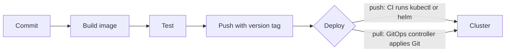

# Chapter 16: Container images and application delivery: building images, CI/CD, GitOps, and deployment strategies

> **Exams:** KCNA · CKAD
> **Difficulty:** Intermediate
> **Time:** ~50 min reading, ~35 min lab
> **Lab tier:** 1 (kind)
> **Prerequisites:** Chapter 05 (Controllers), Chapter 10 (Probes), Chapter 14 (Helm and Kustomize)

## Learning objectives

After this chapter you can:

- Explain what a container image is, and why tags and digests are not the same thing
- Write a small Dockerfile with a pinned base image, and build and load an image into a kind cluster
- Choose an `imagePullPolicy` and explain what it does with a tag that is reused
- Reference a private registry with an image pull secret, and explain why a Pod with a missing image is stuck in `ImagePullBackOff`
- Describe a delivery pipeline in CI and CD terms, and the difference between push and pull (GitOps) deployment
- Configure a `RollingUpdate` with `maxSurge` and `maxUnavailable`, or a `Recreate` strategy, and say which one a change needs

## Concepts

### What a container image is

A container image is a set of read-only layers and a configuration. The layers
are the filesystem changes made by each instruction in the build, and the
configuration names the default command, the user, the exposed ports, and the
environment. A container is a running instance of an image, with a writable
layer on top. Because layers are shared, two images built on the same base
store that base once.

An image is named by three parts:

```text
registry.example.test/team/web:1.4.2@sha256:9f2c...
\_______ registry _______/ \ repo / \tag/ \____ digest ____/
```

- The **repository** is the image's name, such as `team/web`.
- The **tag** is a human-readable label, such as `1.4.2`. A tag can be moved to a
  different image at any time. `latest` is only a tag, and it is moved every time
  someone pushes without a tag.
- The **digest** is a hash of the image's content. It never changes, so an image
  pinned by digest is the same bytes forever.

Tags are for people; digests are for guarantees. A deployment that must run
exactly what was tested pins the digest, and a deployment that should pick up
patch releases pins a tag.

### Building an image with a Dockerfile

A Dockerfile is a list of instructions that produce an image. The ones you use
most are:

- `FROM` names the base image. Pin a version, such as `nginx:1.27-alpine`, and
  never `latest`, because the build then changes without a change in your code.
- `RUN` runs a command during the build, and its changes become a layer.
- `COPY` brings files from the build context into the image.
- `USER` sets the user the container runs as. Choose a non-root user, which
  works with `runAsNonRoot` from Chapter 10.
- `EXPOSE` documents the port the application listens on. It does not publish it.
- `CMD` and `ENTRYPOINT` set the default command.

Order matters for speed. Put the instructions that change least, such as
installing dependencies, before the ones that change most, such as copying your
source, so that Docker can reuse the cached layers. A **multi-stage** build uses
one stage with the full toolchain to compile, and copies only the result into a
small final stage, which keeps build tools out of the runtime image.

Build with `docker build -t NAME:TAG CONTEXT`. The context is the folder whose
files `COPY` can reach. Other tools build OCI images without a Docker daemon,
and the result is the same kind of image.

### Getting an image onto a node

A cluster needs the image on each node that runs its Pods, or a way to fetch it.
On a kind cluster, `kind load docker-image NAME:TAG --name CLUSTER` copies a
local image onto every node, so Pods can use it without a registry. A
registry is the usual route on a real cluster: you push the image there, and the
kubelet pulls it.

The **imagePullPolicy** decides when the kubelet pulls:

- `Always` pulls on every container start, so the newest content behind the tag
  is used. This is the default when the tag is `latest` or omitted.
- `IfNotPresent` pulls only when the node does not have the image. This is what
  you want for images loaded with `kind load`.
- `Never` never pulls, and fails if the image is missing from the node.

A Pod whose image cannot be pulled shows `ErrImagePull`, and then
`ImagePullBackOff` between retries. The Events name the image and the reason.

### Private registries and image pull secrets

A registry that needs credentials is used through a Secret of type
`kubernetes.io/dockerconfigjson`. Create one with
`kubectl create secret docker-registry NAME --docker-server=... --docker-username=... --docker-password=...`,
and reference it from the Pod with `imagePullSecrets`. A Secret can also be
listed on a ServiceAccount, so every Pod that uses that account pulls with it,
without repeating the reference.

Keep the credentials out of images and manifests. A pull secret is a Secret like
any other, with the access rules of Chapter 07.

### Delivery: CI and CD

Delivery is the path from a commit to a running application, and it has two
halves with different jobs:

- **Continuous integration (CI)** builds the image, runs the tests, scans the
  image, and pushes it to a registry with a version tag. It answers "is this
  change good, and what is its artifact?"
- **Continuous delivery or deployment (CD)** puts a tested artifact into an
  environment. It answers "what runs in production right now?"



There are two ways to make the cluster match what should run. In a **push**
deployment, the pipeline has credentials for the cluster and runs `kubectl` or
`helm` against it. In a **pull** deployment, which is what GitOps means, the
desired state lives in a Git repository, and a controller inside the cluster
watches it and applies the changes. **Argo CD** and **Flux** are the two
best-known GitOps controllers, and both are CNCF projects. The cluster never
needs credentials from outside, and every change is a commit that can be
reviewed and reverted.

Whichever you choose, a deployment should record the image by a version tag or a
digest, never by `latest`. Otherwise the cluster's state depends on when someone
last pushed, and a rollback has nothing to go back to.

### Deployment strategies

A Deployment's `strategy` decides how Pods are replaced when its template changes:

- **RollingUpdate** (the default) replaces Pods gradually. `maxSurge` is how many
  extra Pods may exist during the update, and `maxUnavailable` is how many may be
  missing. Both default to 25%. With `maxUnavailable: 0` and `maxSurge: 1`, the
  Deployment starts one new Pod, waits until it is ready, and then removes one old
  one, so capacity never drops. The two values cannot both be 0.
- **Recreate** removes every old Pod, then creates the new ones. There is a gap in
  service, but no two versions run at once. Use it when the application cannot
  share its data with a second version, for example during a schema change.

Two more patterns are built from these pieces, without a special strategy:

- **Blue-green** runs two Deployments, the current one and the new one, and
  switches a Service's selector from one to the other when the new one is ready.
  Switching back is the rollback.
- **Canary** sends a small share of traffic to a new version. With plain
  Kubernetes you can approximate it by running one new Pod beside several old
  ones behind the same Service, so the share is roughly the fraction of Pods. A
  traffic-splitting controller or a Gateway API implementation gives exact weights.

Chapter 05 covers `kubectl rollout undo`, which returns a Deployment to an older
revision after a bad change.

## Guided walkthrough

The walkthrough works in the Namespace `ch16-delivery`. The outputs below are
trimmed: IDs, timestamps, and sizes differ on your cluster. The objects are named
`demo-...` so they do not clash with the lab. The lab later in this chapter uses
that Namespace too, so run `make lab CH=16` first, or run the commands in any
Namespace you choose. You need Docker and the `kind` command for the build and load
steps, because the lab cluster is a kind cluster.

### Build an image and load it into the cluster

Write a small Dockerfile in a folder of its own:

```bash
mkdir -p demo-web && cd demo-web
cat > Dockerfile <<'DOCKER'
FROM nginx:1.27-alpine
RUN echo "hello from demo" > /usr/share/nginx/html/index.html
DOCKER
```

Build it, then load it into the kind cluster and check that a worker has it:

```bash
docker build -q -t demo-web:1.0 .
kind load docker-image demo-web:1.0 --name kbook
docker exec kbook-worker crictl images | grep demo-web
```

```text
sha256:46ed53b2c8a779c30ec36c9a63a4cedf2532bded67c275c8cccee3304da2c482
Image: "demo-web:1.0" with ID "sha256:46ed53b2c8a779c30ec36c9a63a4cedf2532bded67c275c8cccee3304da2c482" not yet present on node "kbook-worker2", loading...
docker.io/library/demo-web                      1.0                                     978a4bd194f25       21MB
```

`docker build -q` prints the image ID. `kind load` copies the image to each node,
and `crictl images` on a node lists what the node's container runtime holds. A Pod
using `demo-web:1.0` with `imagePullPolicy: IfNotPresent` now starts without any
registry.

### Watch a Pod fail to pull its image

Ask for an image that no registry serves:

```bash
kubectl -n ch16-delivery run demo-missing --image=registry.example.test/team/web:9.9 --restart=Never
kubectl -n ch16-delivery get pod demo-missing
kubectl -n ch16-delivery describe pod demo-missing | grep -E 'Warning|Failed' | tail -2
```

```text
pod/demo-missing created
NAME           READY   STATUS             RESTARTS   AGE
demo-missing   0/1     ImagePullBackOff   0          20s
  Warning  Failed     13s   kubelet   spec.containers{demo-missing}: Error: ErrImagePull
  Warning  Failed     13s   kubelet   spec.containers{demo-missing}: Error: ImagePullBackOff
```

The status names the problem, and the events name the image. Check the image
name and the tag first, then the credentials.

### Create a pull secret for a private registry

Create the Secret that a Pod or a ServiceAccount needs to pull from the registry:

```bash
kubectl -n ch16-delivery create secret docker-registry demo-regcred --docker-server=registry.example.test --docker-username=ci --docker-password=not-a-real-token
kubectl -n ch16-delivery get secret demo-regcred -o jsonpath='{.type}{"\n"}'
```

```text
secret/demo-regcred created
kubernetes.io/dockerconfigjson
```

The type is `kubernetes.io/dockerconfigjson`, and the password is stored
base64-encoded inside it, which is not protection (Chapter 07). Reference it with
`imagePullSecrets` in a Pod, or on a ServiceAccount.

### Read the rollout strategy

A new Deployment gets the default `RollingUpdate` settings:

```bash
kubectl -n ch16-delivery create deployment demo-default --image=nginx:1.27
kubectl -n ch16-delivery get deployment demo-default -o jsonpath='{.spec.strategy}{"\n"}'
```

```text
deployment.apps/demo-default created
{"rollingUpdate":{"maxSurge":"25%","maxUnavailable":"25%"},"type":"RollingUpdate"}
```

The percentages are rounded: with four replicas, 25% of surge is one extra Pod,
and 25% unavailable is one missing Pod. Tune them with
`kubectl set` or a patch, as the lab does, or set `type: Recreate` when a gap is
acceptable.

Clean up the demo objects:

```bash
kubectl -n ch16-delivery delete deployment demo-default
kubectl -n ch16-delivery delete pod demo-missing
kubectl -n ch16-delivery delete secret demo-regcred
docker rmi -f demo-web:1.0
```

```text
deployment.apps "demo-default" deleted
pod "demo-missing" deleted
secret "demo-regcred" deleted
```

## Hands-on lab

The lab works like a KodeKloud lab: one task at a time, a check after each, and
progress that is saved between sessions.

```bash
make lab CH=16       # set up the lab and show task 1
make check CH=16     # check the current task; if it is right, show the next
make question CH=16  # show the current task again
make reset CH=16     # back to the starting state and task 1
make verify CH=16    # check every task at once
```

Everything happens in the Namespace `ch16-delivery`: use `-n ch16-delivery` on
every command, or run `make use-namespace CH=16` once. You need Docker and the
`kind` command on your machine. The setup writes a Dockerfile to
`lab/.state/app`, creates a Deployment `legacy`, and removes the image
`ch16-app:1.0` from the cluster and from your Docker, so every reset starts without it.

Full solutions are in [`lab/solutions.md`](lab/solutions.md).

### Task 1: Build the image and load it into the cluster

Build the image in `lab/.state/app` with the tag `ch16-app:1.0`, and load it into the
kind cluster `kbook`, so that the worker node `kbook-worker` has it.

- Image: `ch16-app:1.0`, built from the Dockerfile in `lab/.state/app`
- Loaded on the node `kbook-worker` (check with `docker exec kbook-worker crictl images`)

### Task 2: Run the image in a Deployment

Create a Deployment with the following specification.

- Name: `app`
- Image: `ch16-app:1.0`, with the image pull policy `IfNotPresent`
- Replicas: `2`, and both are ready
- The page `http://localhost/` inside a Pod returns `hello from ch16`

### Task 3: Switch `legacy` to the Recreate strategy

The Deployment `legacy` is in the namespace. Change its strategy to `Recreate`, and
wait until its Pod is ready.

- Deployment `legacy`: strategy type `Recreate`, with one ready replica

### Task 4: Tune the rolling update of `app`

Change the rolling update of the Deployment `app`, so that capacity never drops:

- Strategy type `RollingUpdate`
- `maxUnavailable: 0`
- `maxSurge: 1`

### Task 5: Pull from a private registry

Create a Secret named `regcred` of type `kubernetes.io/dockerconfigjson` for the
registry `registry.example.test`, with any username and password. Then create a Pod
named `private-app` that pulls `registry.example.test/team/app:1.0` with that Secret.

- Secret `regcred`, of type `kubernetes.io/dockerconfigjson`
- Pod `private-app`, image `registry.example.test/team/app:1.0`, with `imagePullSecrets` naming `regcred`

The Pod cannot start, because `registry.example.test` does not exist. That is
expected: the check is about the Pod's specification.

## Exam tips

> **Exam tip:** `kubectl create secret docker-registry` creates the pull secret with the right type. Reference it under `imagePullSecrets` in the Pod spec, not under `env`.
>
> **Exam tip:** A Pod stuck in `ImagePullBackOff` is an image name, tag, or credential problem. Read the image in the spec and the events before you change anything else.
>
> **Exam tip:** To change a Deployment's strategy quickly, `kubectl patch deployment NAME -p '{"spec":{"strategy":{...}}}'` is shorter than editing YAML. Remember that `Recreate` must not carry `rollingUpdate` fields.

## Common mistakes

- Using `latest` in a Dockerfile's `FROM` or in a Pod's image. The image changes without any change in your files.
- Setting `imagePullPolicy: IfNotPresent` on an image pushed under a tag that will be reused. The node keeps the old content.
- Forgetting that `kind load` puts the image on the nodes, not in a registry. A Pod that pulls from the registry will not find it.
- Putting the pull secret in the container's `env` or in `volumes`. It belongs under `imagePullSecrets`.
- Setting both `maxSurge` and `maxUnavailable` to 0. The API server rejects it, because no progress could be made.
- Choosing `Recreate` for a service that must stay up. It has a gap by design.
- Treating a Git commit as a deployment in a push pipeline without checking what the cluster actually runs. A GitOps controller reports this in its status.

<!-- QUESTIONS:START -->

## End-of-chapter questions

**1.** `KCNA` `CKAD` Which statement about image tags and digests is correct?

- **A.** A digest can be moved to a different image by pushing again
- **B.** A tag is a label that can be moved to another image; a digest identifies the exact content and does not change
- **C.** A tag and a digest are the same thing with different names
- **D.** Only `latest` can be moved; other tags are permanent

**2.** `KCNA` `CKAD` Which Dockerfile practice most reduces the risk of a build changing without any change in your code?

- **A.** Using `FROM ubuntu:latest` so that the base stays current
- **B.** Pinning the base image to a specific version, such as `nginx:1.27-alpine`
- **C.** Putting `COPY . .` as the first instruction
- **D.** Running the container as root, so that every file is writable

**3.** `CKAD` You load an image with `kind load docker-image web:1.2` and set `imagePullPolicy: Always`. What happens when the Pod starts?

- **A.** The Pod uses the loaded image, because kind load makes it available everywhere
- **B.** The kubelet tries to pull `web:1.2` from its registry, and fails if no registry serves it
- **C.** The Pod is refused by the API server
- **D.** The kubelet pulls from Docker Hub only, and ignores the loaded image

**4.** `CKAD` A Pod is stuck in `ImagePullBackOff`. Where is the most specific explanation?

- **A.** In the container's logs, which are empty
- **B.** In the Pod's events, which name the image and the pull error
- **C.** In `kubectl get nodes`
- **D.** In the Dockerfile

**5.** `CKAD` Which field of a Pod's spec lets it pull from a private registry with a dockerconfigjson Secret?

- **A.** `spec.containers[].env`
- **B.** `spec.volumes`
- **C.** `spec.imagePullSecrets`
- **D.** `spec.securityContext.runAsUser`

**6.** `CKAD` `KCNA` In a GitOps deployment, which component applies the desired state to the cluster?

- **A.** The CI pipeline, with cluster credentials, after every commit
- **B.** A controller inside the cluster, such as Argo CD or Flux, which pulls the desired state from Git
- **C.** The container runtime, which reads Git on each node
- **D.** A developer's laptop, through a manual `kubectl apply`

**7.** `CKAD` A Deployment has 4 replicas and uses the default RollingUpdate strategy. During an update, how many Pods may be unavailable at once?

- **A.** None, because the default is maxUnavailable 0
- **B.** One, because 25% of 4 is 1 for maxUnavailable
- **C.** Four, because the update replaces every Pod at once
- **D.** Two, half of the replicas

**8. (Task)** `CKAD` In namespace `prod`, create a Secret named `ghcr-pull` of type `kubernetes.io/dockerconfigjson` for the registry `ghcr.io`, with the username `robot` and the password `token-123`. Show the Secret's type.

**9. (Task)** `CKAD` In namespace `prod`, create a Pod named `web` that runs the image `ghcr.io/team/web:2.0` and pulls it with the Secret `ghcr-pull`. Show the name of the image pull secret the Pod refers to.

**10. (Task)** `CKAD` In namespace `prod`, change the Deployment `api` so that no Pod is removed until its replacement is ready, and at most one extra Pod runs during the update. Show the strategy.

**11. (Task)** `CKAD` In namespace `prod`, change the Deployment `worker` to the `Recreate` strategy, because two versions must never run at once. Wait for the rollout, and show the strategy type.

<details>
<summary>Answers</summary>

**1. B.** A tag is a movable label, and pushing a new image under the same tag moves it. A digest is a hash of the image's content, so an image referenced by digest is always the same bytes. That is why a deployment that must run exactly what was tested pins the digest.

**2. B.** A pinned base image produces the same starting layers each time. `latest` changes whenever the publisher pushes, so the build can change with no change to your files. Running as root is a security risk, not a build-stability practice.

**3. B.** `Always` makes the kubelet pull on every start, from the registry named in the image. A kind-loaded image is only on the node, not in a registry, so the pull fails. `IfNotPresent` uses the node's copy when it exists, which is what loaded images need.

**4. B.** The kubelet records the pull failure as an event on the Pod, including the image name and the error. `describe` and `get events` show it. Container logs do not exist yet, because the container never started.

**5. C.** `imagePullSecrets` lists the Secrets the kubelet uses to pull the Pod's images. The other fields are for environment variables, storage and security, and none of them affects image pulls.

**6. B.** In GitOps, the desired state lives in Git, and a controller in the cluster pulls and applies it. The cluster does not need credentials from outside, and each change is a reviewable commit. A pipeline that runs kubectl against the cluster is a push deployment, which is a different model.

**7. B.** The defaults for `maxSurge` and `maxUnavailable` are both 25%. For 4 replicas, `maxUnavailable` rounds down to 1 and `maxSurge` rounds up to 1. The default is not 0, which is a common misreading.

**8.**

```bash
kubectl -n prod create secret docker-registry ghcr-pull --docker-server=ghcr.io --docker-username=robot --docker-password=token-123
kubectl -n prod get secret ghcr-pull -o jsonpath='{.type}{"\n"}'
```

`kubectl create secret docker-registry` creates the dockerconfigjson type, which is
the one `imagePullSecrets` expects.

**9.**

```bash
cat <<'YAML' | kubectl -n prod apply -f -
apiVersion: v1
kind: Pod
metadata:
  name: web
spec:
  imagePullSecrets:
    - name: ghcr-pull
  containers:
    - name: web
      image: ghcr.io/team/web:2.0
YAML
kubectl -n prod get pod web -o jsonpath='{.spec.imagePullSecrets[0].name}{"\n"}'
```

The Pod may not start if the image does not exist; the check is on its specification.
`imagePullSecrets` is a list, which is why the path ends in `[0]`.

**10.**

```bash
kubectl -n prod patch deployment api --type=merge -p '{"spec":{"strategy":{"type":"RollingUpdate","rollingUpdate":{"maxUnavailable":0,"maxSurge":1}}}}'
kubectl -n prod get deployment api -o jsonpath='{.spec.strategy}{"\n"}'
```

`maxUnavailable: 0` means no Pod is removed before its replacement is ready, and
`maxSurge: 1` allows one extra Pod during the update.

**11.**

```bash
kubectl -n prod patch deployment worker --type=merge -p '{"spec":{"strategy":{"type":"Recreate","rollingUpdate":null}}}'
kubectl -n prod rollout status deployment/worker
kubectl -n prod get deployment worker -o jsonpath='{.spec.strategy.type}{"\n"}'
```

`rollingUpdate: null` removes the field, because `Recreate` does not take it.
Expect a gap in service while the old Pods stop and the new ones start.

</details>

<!-- QUESTIONS:END -->

## Further reading

- Kubernetes documentation: *Images*, *Pull an Image from a Private Registry*, *Deployments* (strategy)
- Docker documentation: *Dockerfile reference*, *Best practices for writing Dockerfiles*
- Argo CD and Flux documentation: *Getting started* and *Core concepts*
- Chapter 17 next: scheduling, taints, tolerations, affinity, topology spread, priority, and static pods
