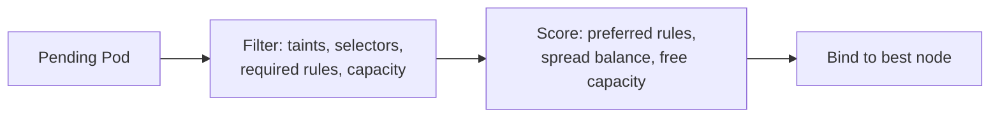

# Chapter 17: Scheduling: node selectors, affinity, taints and tolerations, topology spread, priority, and static Pods

> **Exams:** CKA
> **Difficulty:** Advanced
> **Time:** ~60 min reading, ~40 min lab
> **Lab tier:** 1 (kind)
> **Prerequisites:** Chapter 05 (Controllers), Chapter 06 (Labels and selectors), Chapter 10 (Probes and resources)

## Learning objectives

After this chapter you can:

- Describe how the scheduler chooses a node in two steps: filter, then score
- Place a Pod with `nodeSelector` and with node affinity, and tell required rules from preferred ones
- Use pod affinity and anti-affinity to keep Pods together or apart
- Taint a node and give Pods the matching toleration, and explain the three taint effects
- Spread a workload across nodes or zones with `topologySpreadConstraints`
- Create a PriorityClass and explain when preemption removes a lower-priority Pod
- Recognize a static Pod, find where the kubelet reads it, and say why its mirror Pod shows an owner of `Node`

## Concepts

### How the scheduler chooses a node

A Pod with no `nodeName` waits in the queue until the scheduler places it. The
scheduler works in two steps, and both use the Pod's spec and the nodes'
labels, taints, and free capacity:

1. **Filter.** It removes every node the Pod cannot run on. A node is
   removed if it lacks the requested CPU or memory, does not match the Pod's
   selector or required affinity, has a taint the Pod does not tolerate, or
   would break a required anti-affinity or spread rule.
2. **Score.** Of the nodes left, it ranks the good ones with weights. Preferred
   affinity, spread balance, and the free capacity left after placing the Pod all
   add to a node's score. The highest score wins.



When filtering removes every node, the Pod stays `Pending`, and the scheduler
records the reasons in an event. That event is the first thing to read when a
Pod does not start. The lab's walkthrough shows one.

### Placing a Pod on a node: nodeSelector and node affinity

The simplest rule is `nodeSelector`: a map of labels the node must carry. It is
exact and required.

Node affinity is the richer form. It has two kinds of rule:

- `requiredDuringSchedulingIgnoredDuringExecution` must match, or the Pod is
  not placed. Its name says the rule is checked only at scheduling time: a node
  whose labels change later does not evict the Pod.
- `preferredDuringSchedulingIgnoredDuringExecution` gives a weight to matching
  nodes, so the scheduler prefers them but does not require them.

```yaml
spec:
  affinity:
    nodeAffinity:
      requiredDuringSchedulingIgnoredDuringExecution:
        nodeSelectorTerms:
          - matchExpressions:
              - key: disk
                operator: In
                values: [ssd]
```

The operators are `In`, `NotIn`, `Exists`, `DoesNotExist`, `Gt`, and `Lt`. A
term can hold several expressions, and they must all match. Several terms are
alternatives: any one may match.

### Pod affinity and anti-affinity

Pod affinity places a Pod near other Pods, and anti-affinity places it away from
them. The rule names a label selector and a `topologyKey`, which is the node
label that defines "near". The key `kubernetes.io/hostname` means the same node;
a zone label means the same zone.

- **Anti-affinity on hostname** is the standard way to keep replicas of one
  application on different nodes. `requiredDuringScheduling` makes it a hard rule,
  so a third replica waits when there are only two nodes.
- **Affinity** keeps two Pods that talk heavily on one node, such as an
  application and its cache.

Pod affinity is evaluated against the Pods that already exist, so the order in
which Pods are created changes the result. Use topology spread (below) when you
want even distribution rather than a hard separation.

### Taints and tolerations

A **taint** is set on a node and repels Pods. A **toleration** on a Pod says it may
run on a node with that taint. Taints are the reverse of affinity: affinity
attracts a Pod to nodes; a taint keeps every Pod away unless it tolerates the
taint.

A taint has a key, a value, and an effect:

- `NoSchedule` keeps new Pods off the node. Running Pods stay.
- `PreferNoSchedule` is a soft version: the scheduler avoids the node when it can.
- `NoExecute` also evicts Pods already on the node that do not tolerate it. A
  toleration can set `tolerationSeconds` to allow the Pod to stay for a while.

The control plane node of a kind cluster carries `node-role.kubernetes.io/control-plane:NoSchedule`,
which is why your Pods land on the workers. A toleration matches a taint when the
key matches, the effect matches (or is empty, which matches any effect), and the
operator says so: `Equal` compares the value, and `Exists` ignores it.

Taints are also how a node is taken out of service for maintenance, which
Chapter 19 covers with `kubectl cordon` and `kubectl drain`.

### Spreading Pods: topologySpreadConstraints

Anti-affinity says "not on the same node". Topology spread says "as evenly as
possible". The constraint has four fields:

- `maxSkew` is the largest allowed difference in Pod count between any two
  topology domains (nodes or zones). `1` means as even as possible.
- `topologyKey` names the node label that defines a domain, such as
  `kubernetes.io/hostname` or `topology.kubernetes.io/zone`.
- `whenUnsatisfiable` is `DoNotSchedule` (the Pod waits) or `ScheduleAnyway` (the
  scheduler still places the Pod, but scores against the imbalance).
- `labelSelector` picks the Pods that are counted.

Spread is usually the better tool for a Deployment across zones, because it
allows uneven counts while keeping them close, and it does not fail when one
zone is smaller.

### Priority and preemption

A **PriorityClass** is a cluster-scoped object with a `value`. A Pod names one with
`priorityClassName`. A higher-priority Pod is scheduled first, and when no node has
room for it, the scheduler may **preempt**: it evicts lower-priority Pods from a
node to make room. Two built-in classes, `system-cluster-critical` and
`system-node-critical`, protect the cluster's own components.

One class can be the **global default**, which applies to every Pod that names
none. Set it deliberately: a default that is too high lets ordinary Pods preempt
important ones.

### Static Pods

Most Pods are created through the API server. A **static Pod** is different: the
kubelet on a node runs it from a manifest file in a local directory, with no
API object needed to start it. The directory is `staticPodPath` in the kubelet's
configuration. Kubeadm sets it to `/etc/kubernetes/manifests`, and that is where
the control plane's own components live: `etcd`, `kube-apiserver`,
`kube-controller-manager`, and `kube-scheduler`.

The kubelet creates a **mirror Pod** in the API server for each static Pod, so
you can see it with `kubectl get pods -n kube-system`. The mirror is read-only,
and it has an owner reference of kind `Node`. That owner tells you the Pod is
static: deleting it through the API does not stop it, because the kubelet
recreates it from the file. To change a static Pod, edit the file on the node.

## Guided walkthrough

The walkthrough works in the Namespace `ch17-sched`. The outputs below are
trimmed: IDs, ages, and IPs differ on your cluster. The objects are named
`demo-...` so they do not clash with the lab. The lab later in this chapter uses
that Namespace and changes two nodes, so run `make lab CH=17` first. Its setup
labels `kbook-worker` with `disk=ssd` and taints `kbook-worker2` with
`maintenance=true:NoSchedule`.

### Watch a taint keep a Pod in Pending

Ask for a node that carries the taint, without a toleration:

```bash
kubectl -n ch17-sched run demo-pending --image=busybox:1.36 --restart=Never \
  --overrides='{"spec":{"nodeSelector":{"kubernetes.io/hostname":"kbook-worker2"}}}' -- sleep 3600
kubectl -n ch17-sched get pod demo-pending
kubectl -n ch17-sched describe pod demo-pending | grep -A1 FailedScheduling | tail -2
```

```text
pod/demo-pending created
NAME           READY   STATUS    RESTARTS   AGE
demo-pending   0/1     Pending   0          4s
  Warning  FailedScheduling  5s    default-scheduler  0/3 nodes are available: 1 node(s) didn't match Pod's node affinity/selector, 2 node(s) had untolerated taint(s).
```

The event counts the nodes and gives the reason for each group. Two nodes had an
untolerated taint (the control plane and `kbook-worker2`), and one did not match
the selector. Delete the Pod:

```bash
kubectl -n ch17-sched delete pod demo-pending
```

### Read the events for a placement problem

The event above is the answer to "why is it Pending?". Read it before you change
anything. Each phrase names a filter: `didn't match Pod's node affinity/selector`
for selectors, `had untolerated taint(s)` for taints, and `Insufficient cpu` or
`Insufficient memory` for capacity.

### Place a Pod with a nodeSelector

The worker `kbook-worker` carries the label `disk=ssd`. A `nodeSelector` on that
label sends the Pod there:

```bash
cat <<'YAML' | kubectl -n ch17-sched apply -f -
apiVersion: v1
kind: Pod
metadata:
  name: demo-pinned
spec:
  nodeSelector:
    disk: ssd
  containers:
    - name: app
      image: busybox:1.36
      command: ["sleep", "3600"]
YAML
kubectl -n ch17-sched get pod demo-pinned -o wide
```

```text
pod/demo-pinned created
NAME          READY   STATUS    RESTARTS   AGE   IP             NODE           NOMINATED NODE   READINESS GATES
demo-pinned   1/1     Running   0          4s    10.244.2.99    kbook-worker   <none>           <none>
```

### Tolerate the taint

Add a toleration for `maintenance=true:NoSchedule`, and keep the selector so the
Pod goes to the tainted node on purpose:

```bash
cat <<'YAML' | kubectl -n ch17-sched apply -f -
apiVersion: v1
kind: Pod
metadata:
  name: demo-tolerant
spec:
  nodeSelector:
    kubernetes.io/hostname: kbook-worker2
  tolerations:
    - key: maintenance
      operator: Equal
      value: "true"
      effect: NoSchedule
  containers:
    - name: app
      image: busybox:1.36
      command: ["sleep", "3600"]
YAML
kubectl -n ch17-sched get pod demo-tolerant -o wide
```

```text
pod/demo-tolerant created
NAME           READY   STATUS    RESTARTS   AGE   IP             NODE            NOMINATED NODE   READINESS GATES
demo-tolerant  1/1     Running   0          4s    10.244.1.120   kbook-worker2   <none>           <none>
```

The toleration lets the Pod onto the tainted node. The toleration alone would
not place it there: a Pod that tolerates a taint may still run on any other node.
The selector is what chooses this node.

### Inspect the static Pods

The control plane's components are static Pods, and their owners are the Node:

```bash
kubectl -n kube-system get pods -o jsonpath='{range .items[?(@.metadata.ownerReferences[0].kind=="Node")]}{.metadata.name}{" owner="}{.metadata.ownerReferences[0].kind}{"\n"}{end}'
docker exec kbook-control-plane ls /etc/kubernetes/manifests
```

```text
etcd-kbook-control-plane owner=Node
kube-apiserver-kbook-control-plane owner=Node
kube-controller-manager-kbook-control-plane owner=Node
kube-scheduler-kbook-control-plane owner=Node
etcd.yaml
kube-apiserver.yaml
kube-controller-manager.yaml
kube-scheduler.yaml
```

Each mirror Pod is named after its manifest and the node. The files in
`/etc/kubernetes/manifests` are what the kubelet actually runs. Deleting a mirror
Pod does not stop the component; the kubelet recreates it.

Clean up the walkthrough Pods:

```bash
kubectl -n ch17-sched delete pod demo-pinned demo-tolerant
```

```text
pod "demo-pinned" deleted
pod "demo-tolerant" deleted
```

## Hands-on lab

The lab works like a KodeKloud lab: one task at a time, a check after each, and
progress that is saved between sessions.

```bash
make lab CH=17       # set up the lab and show task 1
make check CH=17     # check the current task; if it is right, show the next
make question CH=17  # show the current task again
make reset CH=17     # back to the starting state and task 1
make verify CH=17    # check every task at once
```

Everything happens in the Namespace `ch17-sched`: use `-n ch17-sched` on every
command, or run `make use-namespace CH=17` once. The setup changes two nodes and
creates nothing else. It labels `kbook-worker` with `disk=ssd`, and taints
`kbook-worker2` with `maintenance=true:NoSchedule`. Teardown and reset put both
back. Task 3 needs a Deployment and Task 4 needs a PriorityClass, and the lab
removes that PriorityClass at reset.

Full solutions are in [`lab/solutions.md`](lab/solutions.md).

### Task 1: Pin a Pod to the SSD node

Create a Pod with the following specification.

- Name: `pinned`
- Image: `busybox:1.36`, running `sleep 3600`
- It runs on the node labelled `disk=ssd`
- Status: `Running`

### Task 2: Run a Pod on the maintenance node

The node `kbook-worker2` carries the taint `maintenance=true:NoSchedule`. Create a
Pod with the following specification.

- Name: `tolerant`
- Image: `busybox:1.36`, running `sleep 3600`
- It tolerates the taint `maintenance=true:NoSchedule`
- It runs on `kbook-worker2`
- Status: `Running`

### Task 3: Keep the replicas on different nodes

Create a Deployment with the following specification.

- Name: `cache`, one replica, image `busybox:1.36`, running `sleep 3600`
- Labels: `app=cache`
- A required pod anti-affinity: no two Pods labelled `app=cache` may run on the same node (`kubernetes.io/hostname`)
- The replica is ready

### Task 4: A PriorityClass and a Pod that uses it

Create a PriorityClass named `ch17-batch` with the value `100000`. Then create a Pod
named `urgent` that uses it.

- PriorityClass: `ch17-batch`, value `100000`
- Pod `urgent`: image `busybox:1.36`, running `sleep 3600`, with `priorityClassName: ch17-batch`
- Status: `Running`

### Task 5: Find the static Pod for the scheduler

The kube-scheduler on the control plane runs as a static Pod. Write its Pod name,
and nothing else, to `/tmp/ch17-static.txt`.

- File: `/tmp/ch17-static.txt`, containing the name of the static Pod that runs the kube-scheduler

## Exam tips

> **Exam tip:** Read the `FailedScheduling` event first. `kubectl describe pod NAME` names each filter that removed nodes, and that tells you which of the four kinds of rule to fix.
>
> **Exam tip:** A toleration does not place a Pod; a selector or affinity does. Use both when a Pod must land on a tainted node.
>
> **Exam tip:** Taints and labels are on the node, so `kubectl describe node NAME` shows both. Check there before you change a Pod's spec.
>
> **Exam tip:** `kubectl get pods -n kube-system -o wide` lists the static Pods alongside the system Pods, and an owner of `Node` identifies them.

## Common mistakes

- Expecting a toleration to attract a Pod to a tainted node. It only allows the Pod to run there.
- Writing `operator: Equal` with a missing `value`, which matches nothing useful; use `Exists` for a key with no value.
- Reading `preferredDuringScheduling` as a requirement. It is a weight; the Pod still goes elsewhere if that is better.
- Setting a hard anti-affinity with more replicas than nodes. The extra replicas stay `Pending` forever.
- Expecting `topologySpreadConstraints` to be as strict as `requiredDuringScheduling` anti-affinity. Its `maxSkew` allows some imbalance.
- Setting a global-default PriorityClass that is higher than your important Pods'. Ordinary Pods can then preempt them.
- Deleting a static Pod's mirror and expecting it to stay gone. Remove or edit the manifest file on the node instead.

<!-- QUESTIONS:START -->

## End-of-chapter questions

**1.** `CKA` What are the two steps the kube-scheduler goes through to choose a node for a Pod?

- **A.** Create, then bind
- **B.** Filter out nodes the Pod cannot run on, then score the rest and pick the best
- **C.** Pull the image, then start the container
- **D.** Check the taints, then delete the Pod

**2.** `CKA` A Pod has `requiredDuringSchedulingIgnoredDuringExecution` node affinity for `disk=ssd`, and no node carries that label. What happens?

- **A.** The Pod is scheduled on any node, and the rule is ignored
- **B.** The Pod stays Pending, because the required rule removes every node
- **C.** The Pod is scheduled, then evicted after five minutes
- **D.** The Pod is scheduled, and the label is added to a node automatically

**3.** `CKA` Which taint effect evicts Pods that are already running on the node, unless they tolerate the taint?

- **A.** `NoSchedule`
- **B.** `PreferNoSchedule`
- **C.** `NoExecute`
- **D.** `NoEvict`

**4.** `CKA` You want no two replicas of one application on the same node, and the Pod should wait if that is impossible. Which rule does that?

- **A.** Pod anti-affinity with `requiredDuringSchedulingIgnoredDuringExecution` and topologyKey `kubernetes.io/hostname`
- **B.** Pod affinity with `preferredDuringScheduling` and topologyKey `zone`
- **C.** A toleration with the effect `PreferNoSchedule`
- **D.** A nodeSelector on the node name

**5.** `CKA` A Deployment has `maxSkew: 1` and `whenUnsatisfiable: DoNotSchedule` with topologyKey `kubernetes.io/hostname`. What does that enforce?

- **A.** No node may run more than one replica
- **B.** The number of matching Pods on any two nodes may differ by at most 1, or the new Pod waits
- **C.** Every node must run exactly the same number of Pods, always
- **D.** Replicas are spread by image version, not by node

**6.** `CKA` A Pod was created with `priorityClassName: high` and no node has room for it. What can the scheduler do?

- **A.** Nothing; priorities only order the queue
- **B.** Preempt lower-priority Pods on a node to make room, if removing them makes the node fit
- **C.** Resize the other Pods' requests
- **D.** Move a Pod from a node with a higher priority

**7.** `CKA` Where do the static Pods of a kubeadm control plane come from, and what does the owner reference `Node` on their mirror Pods tell you?

- **A.** From Deployments in kube-system; the owner says which node runs them
- **B.** From manifest files in the kubelet's staticPodPath directory, so the Pod is static and deleting the mirror does not stop it
- **C.** From the API server's database; the owner is the cluster
- **D.** From DaemonSets; the owner is the node pool

**8. (Task)** `CKA` In namespace `prod`, create a Deployment `web` with 3 replicas of `nginx:1.27`, labelled `app=web`. Spread its Pods across nodes with a maximum skew of 1, using the hostname as the topology, and let the Pods schedule anyway if the spread cannot be met. Show the Pods' nodes.

**9. (Task)** `CKA` Create a PriorityClass named `app-critical` with the value `50000`. In namespace `prod`, create a Pod `api` running `busybox:1.36` with the command `sleep 3600` that uses this class. Show the Pod's priority class.

**10. (Task)** `CKA` On the control plane node, the etcd static Pod runs in namespace `kube-system`. Write its Pod name, and nothing else, to `/tmp/ch17-etcd.txt`. Then show the manifest path the kubelet reads static Pods from.

**11. (Task)** `CKA` In namespace `prod`, create a Pod `flex` running `busybox:1.36` with the command `sleep 3600`. It prefers nodes labelled `disk=ssd` (a preferred node affinity with weight 50), but it may run anywhere else. Show the node the Pod runs on.

<details>
<summary>Answers</summary>

**1. B.** The scheduler filters nodes against the Pod's requirements (selectors, taints, required rules, capacity), then scores the remaining nodes with weights from preferred rules, spread balance and free capacity. The highest score wins. Image pulls and container starts happen later, on the chosen node.

**2. B.** A required rule is a filter: if no node matches, the Pod is not placed. The `IgnoredDuringExecution` part means that a node whose labels change after scheduling does not evict the Pod. A preferred rule would only add score, and the Pod would still be scheduled.

**3. C.** `NoExecute` stops new Pods from being scheduled, and it also evicts running Pods that do not tolerate the taint. `tolerationSeconds` lets a Pod stay for a limited time. `NoSchedule` affects only new Pods, and `PreferNoSchedule` is a soft version of it.

**4. A.** Required pod anti-affinity on the hostname topology key keeps matching Pods on different nodes, and the Pod waits when no such node exists. Preferred rules only add weight, and a nodeSelector pins Pods to nodes rather than separating them.

**5. B.** `maxSkew` is the largest allowed difference in matching Pod counts between any two domains. With `DoNotSchedule`, a Pod that would exceed it waits. Unlike anti-affinity, the rule allows several Pods per node as long as the counts stay close.

**6. B.** Preemption evicts lower-priority Pods from a node so that the higher-priority Pod fits there. Priorities also order the scheduling queue. The scheduler does not resize Pods, and it never removes a Pod of equal or higher priority to place another.

**7. B.** The kubelet runs static Pods from manifest files in the directory set by `staticPodPath`, which kubeadm sets to `/etc/kubernetes/manifests`. Each has a read-only mirror Pod in the API server, and the owner reference of kind `Node` marks it as static. Deleting the mirror does not stop the Pod; the kubelet recreates it from the file.

**8.**

```bash
cat <<'YAML' | kubectl -n prod apply -f -
apiVersion: apps/v1
kind: Deployment
metadata:
  name: web
spec:
  replicas: 3
  selector:
    matchLabels:
      app: web
  template:
    metadata:
      labels:
        app: web
    spec:
      topologySpreadConstraints:
        - maxSkew: 1
          topologyKey: kubernetes.io/hostname
          whenUnsatisfiable: ScheduleAnyway
          labelSelector:
            matchLabels:
              app: web
      containers:
        - name: web
          image: nginx:1.27
YAML
kubectl -n prod rollout status deployment/web
kubectl -n prod get pods -l app=web -o custom-columns=NAME:.metadata.name,NODE:.spec.nodeName
```

The constraint lives in the Pod template, so the Pods carry it. `ScheduleAnyway`
keeps the Pods schedulable when the spread is impossible.

**9.**

```bash
cat <<'YAML' | kubectl apply -f -
apiVersion: scheduling.k8s.io/v1
kind: PriorityClass
metadata:
  name: app-critical
value: 50000
YAML
cat <<'YAML' | kubectl -n prod apply -f -
apiVersion: v1
kind: Pod
metadata:
  name: api
spec:
  priorityClassName: app-critical
  containers:
    - name: api
      image: busybox:1.36
      command: ["sleep", "3600"]
YAML
kubectl -n prod get pod api -o jsonpath='{.spec.priorityClassName}{"\n"}'
```

PriorityClasses are cluster-scoped, so there is no namespace on the first object.

**10.**

```bash
kubectl -n kube-system get pods -o jsonpath='{range .items[?(@.metadata.ownerReferences[0].kind=="Node")]}{.metadata.name}{"\n"}{end}' | grep etcd > /tmp/ch17-etcd.txt
docker exec kbook-control-plane grep staticPodPath /var/lib/kubelet/config.yaml
```

Mirror Pods have a `Node` owner. The kubelet reads static Pod manifests from
`staticPodPath`, which is `/etc/kubernetes/manifests` here. The second command
needs Docker because the kind control plane is a container; on a real cluster, read
the kubelet's configuration file on the node.

**11.**

```bash
cat <<'YAML' | kubectl -n prod apply -f -
apiVersion: v1
kind: Pod
metadata:
  name: flex
spec:
  affinity:
    nodeAffinity:
      preferredDuringSchedulingIgnoredDuringExecution:
        - weight: 50
          preference:
            matchExpressions:
              - key: disk
                operator: In
                values: [ssd]
  containers:
    - name: flex
      image: busybox:1.36
      command: ["sleep", "3600"]
YAML
kubectl -n prod wait --for=condition=Ready pod/flex --timeout=120s
kubectl -n prod get pod flex -o jsonpath='{.spec.nodeName}{"\n"}'
```

A preferred rule is a weight, not a requirement: the Pod runs on an `ssd` node
when one exists, and elsewhere otherwise.

</details>

<!-- QUESTIONS:END -->

## Further reading

- Kubernetes documentation: *Assigning Pods to Nodes*, *Taints and Tolerations*, *Pod Topology Spread Constraints*
- Kubernetes documentation: *Pod Priority and Preemption*, *Static Pods*
- Kubernetes documentation: *Scheduling Framework* for how filter and score plugins fit together
- Chapter 18 next: installing a cluster with kubeadm (a Tier 2 chapter that needs the multi-VM environment)
