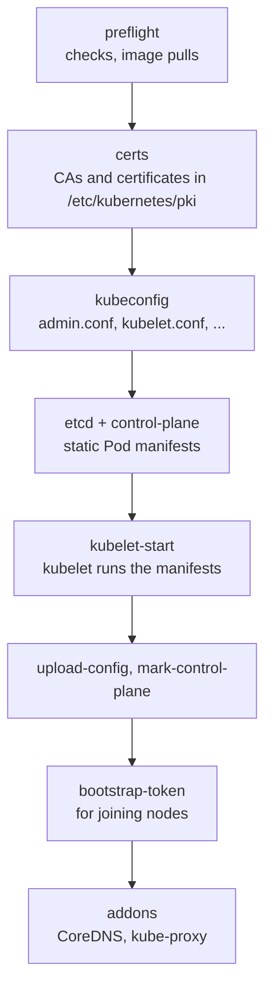
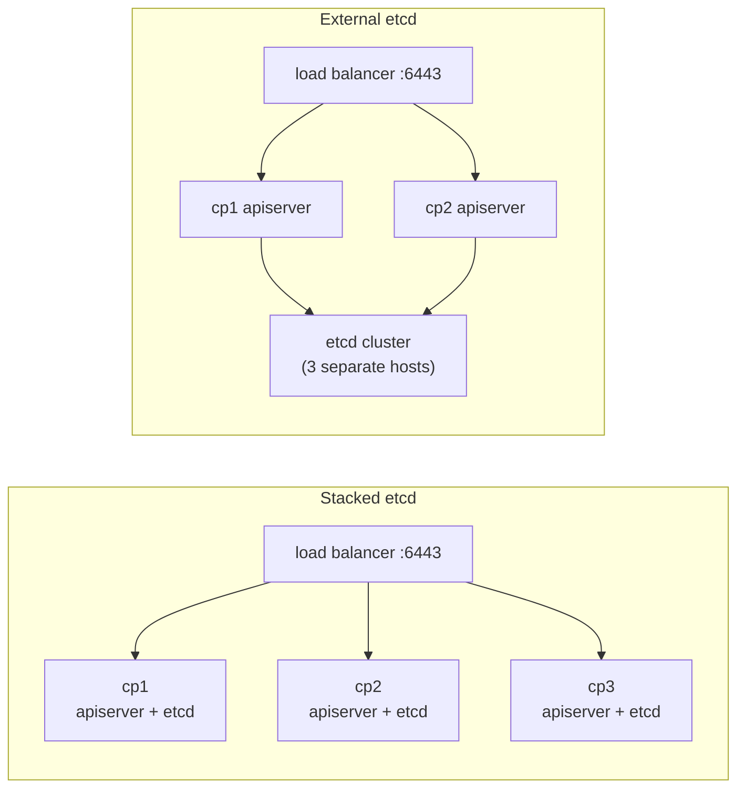

# Chapter 18: Installing a cluster with kubeadm

> **Exams:** CKA (and KCNA background)
> **Difficulty:** Intermediate
> **Time:** ~50 min reading, ~40 min lab
> **Lab tier:** 2 (VirtualBox VMs, `envs/vagrant`)
> **Prerequisites:** Chapter 02 (architecture), Chapter 21 (networking internals) helps but is not required

## Learning objectives

After this chapter you can:

- Explain what kubeadm does when it builds a cluster, and what it leaves to you
- Prepare machines for Kubernetes: container runtime, cgroup driver, swap, kernel modules, sysctls, ports, and package versions
- Initialize a control plane with `kubeadm init`, and read what each phase of its output did
- Give a regular user `kubectl` access through the admin kubeconfig
- Install a CNI plugin with a Pod network that does not overlap the node network
- Join worker nodes with a bootstrap token, and create a new join command when the old one has expired
- Describe a highly available control plane: stacked and external etcd, a load-balanced endpoint, and joining extra control plane nodes

## Concepts

Until now every lab ran on kind, which builds a cluster for you inside Docker
containers. The CKA expects you to build one yourself on real machines, and
`kubeadm` is the tool the exam (and most self-managed clusters) use for it. This
is the first chapter on the book's Tier 2 environment: three VirtualBox VMs
called `cp1`, `node1`, and `node2` (see `envs/vagrant/README.md`).

### What kubeadm does, and what it does not

kubeadm turns a set of prepared machines into a minimum viable, best-practice
cluster. It creates the certificate authorities and certificates, writes
kubeconfig files for the components, starts the control plane as static Pods,
configures etcd, creates bootstrap tokens for joining nodes, and installs two
add-ons every cluster needs: CoreDNS and kube-proxy.

It deliberately does **not**:

- create the machines or their network
- install the container runtime, the kubelet, or kubeadm itself
- install a CNI plugin (the Pod network)
- set up a load balancer in front of several control plane nodes
- install anything else: Ingress controllers, dashboards, storage, monitoring

That split defines the job: prepare the machines, run `kubeadm init` on one,
install a CNI plugin, run `kubeadm join` on the others.

### Preparing the machines

Every node, control plane or worker, needs the same foundation. The lab's
`prereqs` snapshot has already done it (`envs/vagrant/bootstrap-os.sh` and
`bootstrap-tools.sh` are the scripted version); know each step, because a
missing one is a classic exam troubleshooting scenario.

| Requirement | Why |
| --- | --- |
| A supported Linux, at least 2 GB RAM and 2 CPUs on control plane nodes | kubeadm's preflight checks refuse less (the lab VMs have one CPU, so the lab skips that one check) |
| Unique hostname, MAC address, and `product_uuid` per node | Nodes are identified by them; cloned VMs often share them |
| Full network connectivity between nodes | The API server listens on 6443; etcd on 2379-2380; the kubelet on 10250 |
| Swap off (or the kubelet configured to tolerate it) | The kubelet's resource accounting assumes no swap by default |
| Kernel modules `overlay` and `br_netfilter`, and sysctls `net.ipv4.ip_forward=1` and `net.bridge.bridge-nf-call-iptables=1` | Containers' filesystems, and Pod traffic crossing Linux bridges must be visible to iptables |
| A CRI container runtime (containerd here) using the **systemd** cgroup driver | The kubelet defaults to systemd; a runtime on cgroupfs makes Pods crash in odd ways |
| `kubelet`, `kubeadm`, and `kubectl` at the same version, **held** | An unattended `apt upgrade` must not move them; upgrades are deliberate (Chapter 19) |

Kubernetes's **version skew policy** sets the limits: the kubelet may be up to
three minor versions older than the API server, but never newer. That is why the
packages are pinned to an exact version and held.

### What `kubeadm init` does

`kubeadm init` runs a fixed series of **phases**. Its output names each one in
square brackets, so learning the phases lets you read it:



*Text description: kubeadm init checks the machine and pulls images, creates certificates and kubeconfig files, writes static Pod manifests for etcd and the control plane, starts the kubelet to run them, stores its configuration in the cluster, labels and taints the control plane node, creates a bootstrap token, and installs CoreDNS and kube-proxy.*

A few of them matter later:

- **certs**: the cluster CA is valid for 10 years, every other certificate for 1 year. Renewing them is part of Chapters 19 and 27.
- **kubeconfig**: `admin.conf` holds credentials in the `kubeadm:cluster-admins` group; `super-admin.conf` holds `system:masters` credentials that bypass RBAC entirely and should stay on the machine for emergencies.
- **control-plane**: the API server, controller manager, and scheduler are static Pods (Chapter 02), defined by files in `/etc/kubernetes/manifests`. Edit those files and the kubelet restarts the component.
- **mark-control-plane**: the node gets the label `node-role.kubernetes.io/control-plane` and the taint `node-role.kubernetes.io/control-plane:NoSchedule`, so ordinary Pods stay off it (Chapter 17).
- **upload-config**: the configuration kubeadm used is stored in the ConfigMap `kube-system/kubeadm-config`; `kubeadm join` and `kubeadm upgrade` read it from there.

You pass settings either as flags or in a configuration file
(`kubeadm init --config kubeadm.yaml`). `kubeadm config print init-defaults`
prints a complete one to start from. The three flags you will use most:

| Flag | Config file field | What it sets |
| --- | --- | --- |
| `--apiserver-advertise-address` | `InitConfiguration.localAPIEndpoint.advertiseAddress` | The IP the API server announces; on a machine with several interfaces, pick the one the other nodes reach |
| `--pod-network-cidr` | `ClusterConfiguration.networking.podSubnet` | The range Pods get addresses from; must not overlap node or Service networks, and must match the CNI plugin's setting |
| `--kubernetes-version` | `ClusterConfiguration.kubernetesVersion` | The control plane version; without it, kubeadm looks up the newest release online |

### After init: kubectl, then a CNI plugin

kubeadm writes `admin.conf` readable by root only. To use `kubectl` as yourself,
copy it to `~/.kube/config` and make it yours; `kubeadm init` prints the three
commands at the end of its output.

The control plane node then reports `NotReady`, and CoreDNS stays `Pending`.
Nothing is broken: the kubelet reports the node ready only once a CNI plugin is
installed. kubeadm does not pick one for you. This book uses Calico everywhere,
because it enforces NetworkPolicy (Chapter 21). One trap: Calico's manifest
defaults to the Pod network `192.168.0.0/16`, which here would swallow the VMs'
own network, `192.168.56.0/24`. The lab sets Calico's pool to the same
`10.244.0.0/16` that `kubeadm init` was given.

### Joining nodes

A worker joins with a command `kubeadm init` prints at the end:

```text
kubeadm join 192.168.56.10:6443 --token <token> \
    --discovery-token-ca-cert-hash sha256:<hash>
```

The **bootstrap token** authenticates the new node for long enough to send a
certificate signing request; it expires after 24 hours by default. The
**discovery hash** is the hash of the cluster CA's public key, so the new node
can trust the API server it talks to. The kubelet then gets its own client
certificate, approved automatically (TLS bootstrapping), and the node registers
itself.

Lost the command, or the token expired? Create a fresh one on the control plane:

```bash
sudo kubeadm token create --print-join-command
```

`kubeadm reset` undoes `init` or `join` on a machine, which is useful when an
attempt went wrong. It does not clean up the CNI configuration or iptables
rules; its output tells you what is left.

### A highly available control plane

A single control plane node is a single point of failure. A highly available
(HA) cluster runs three (or five) control plane nodes behind a **load
balancer**, and every node and client uses the load balancer's address, never an
individual node's.

There are two topologies:



*Text description: in the stacked topology each control plane node runs its own etcd member, all behind one load balancer; in the external topology the control plane nodes use an etcd cluster on separate hosts.*

- **Stacked etcd** (kubeadm's default): every control plane node runs an etcd member. Fewer machines, but losing a node loses an etcd member too.
- **External etcd**: etcd runs on its own hosts. More machines, but the failure domains are separate.

etcd needs a majority (quorum) to accept writes, so three members survive the
loss of one, and five survive two. Building HA with kubeadm comes down to three
extra pieces:

1. `kubeadm init --control-plane-endpoint "lb.example.com:6443" --upload-certs`: the endpoint goes into every certificate and kubeconfig, and `--upload-certs` stores the control plane certificates encrypted in the cluster so other control plane nodes can fetch them.
2. On each additional control plane node: `kubeadm join lb.example.com:6443 --token ... --discovery-token-ca-cert-hash ... --control-plane --certificate-key ...` (the key is printed by `init`, and is valid for two hours).
3. Workers join through the load balancer's address as usual.

The lab cluster has one control plane node, so you will not build HA here; know
the topologies, the flags, and why the endpoint must be set at `init` time
(adding it later means re-issuing certificates).

## Guided walkthrough

The walkthrough runs on `cp1`, starting from the `prereqs` snapshot: the
machines are prepared, but no cluster exists. On the host, restore it and open a
shell on `cp1`:

```powershell
.\envs\vagrant\kbook-vm.ps1 restore prereqs      # Windows; ./envs/vagrant/kbook-vm.sh on Linux/macOS
.\envs\vagrant\kbook-vm.ps1 ssh
```

Then, on `cp1`:

```bash
cd /kbook
cat /etc/kbook/snapshot
```

```text
prereqs
```

### Check what the snapshot prepared

```bash
kubeadm version -o short
kubectl version --client
systemctl is-active kubelet
```

```text
v1.35.0
Client Version: v1.35.0
Kustomize Version: v5.7.1
inactive
```

The kubelet is installed and enabled but not running: it has no configuration
yet. `kubeadm init` writes one and starts it.

Now the machine preparation from the table above:

```bash
free -m
lsmod | grep -E "^(br_netfilter|overlay)"
sysctl net.ipv4.ip_forward net.bridge.bridge-nf-call-iptables
grep SystemdCgroup /etc/containerd/config.toml
apt-mark showhold
cat /etc/default/kubelet
```

```text
               total        used        free      shared  buff/cache   available
Mem:            1964         189         223           0        1551        1610
Swap:              0           0           0
br_netfilter           32768  0
overlay               151552  0
net.ipv4.ip_forward = 1
net.bridge.bridge-nf-call-iptables = 1
            SystemdCgroup = true
kubeadm
kubectl
kubelet
KUBELET_EXTRA_ARGS=--node-ip=192.168.56.10
```

Swap is zero, both modules are loaded, both sysctls are on, containerd uses the
systemd cgroup driver, the three packages are held, and the kubelet is told to
use the VM's private address rather than its NAT one.

### See what kubeadm would use

```bash
kubeadm config print init-defaults
```

```yaml
apiVersion: kubeadm.k8s.io/v1beta4
bootstrapTokens:
- groups:
  - system:bootstrappers:kubeadm:default-node-token
  token: abcdef.0123456789abcdef
  ttl: 24h0m0s
...
kind: InitConfiguration
localAPIEndpoint:
  advertiseAddress: 1.2.3.4
  bindPort: 6443
...
---
...
certificateValidityPeriod: 8760h0m0s
caCertificateValidityPeriod: 87600h0m0s
...
kind: ClusterConfiguration
kubernetesVersion: 1.35.0
networking:
  dnsDomain: cluster.local
  serviceSubnet: 10.96.0.0/12
...
```

Read it against the concepts: a token with a 24-hour TTL, certificates for one
year (8760 hours) and CAs for ten, a Service network of `10.96.0.0/12`, and no
`podSubnet`, because that depends on your CNI choice.

The control plane runs from these images:

```bash
kubeadm config images list --kubernetes-version v1.35.0
```

```text
registry.k8s.io/kube-apiserver:v1.35.0
registry.k8s.io/kube-controller-manager:v1.35.0
registry.k8s.io/kube-scheduler:v1.35.0
registry.k8s.io/kube-proxy:v1.35.0
registry.k8s.io/coredns/coredns:v1.13.1
registry.k8s.io/pause:3.10.1
registry.k8s.io/etcd:3.6.6-0
```

### Run the preflight checks on their own

Every phase can run alone with `kubeadm init phase <name>`. The preflight phase
checks the machine and pulls the images, without changing anything else:

```bash
sudo kubeadm init phase preflight
```

```text
I1012 19:22:39.798288   10543 version.go:260] remote version is much newer: v1.37.1; falling back to: stable-1.35
[preflight] Running pre-flight checks
[preflight] Some fatal errors occurred:
	[ERROR NumCPU]: the number of available CPUs 1 is less than the required 2
[preflight] If you know what you are doing, you can make a check non-fatal with `--ignore-preflight-errors=...`
error: error execution phase preflight: preflight checks failed
To see the stack trace of this error execute with --v=5 or higher
```

Two things to notice. Without `--kubernetes-version`, kubeadm asked the internet
for the newest release; the first line shows it found a newer one. And the lab
VMs have one CPU each (VirtualBox under Hyper-V hangs with more, see
`envs/vagrant/README.md`), so the CPU check fails. It is safe to downgrade that
one check to a warning:

```bash
sudo kubeadm init phase preflight --ignore-preflight-errors=NumCPU
```

```text
I1012 19:22:40.882438   10563 version.go:260] remote version is much newer: v1.37.1; falling back to: stable-1.35
[preflight] Running pre-flight checks
	[WARNING NumCPU]: the number of available CPUs 1 is less than the required 2
[preflight] Pulling images required for setting up a Kubernetes cluster
[preflight] This might take a minute or two, depending on the speed of your internet connection
[preflight] You can also perform this action beforehand using 'kubeadm config images pull'
```

### Rehearse with a dry run

`--dry-run` walks through every phase and prints what it would do, writing only
to a temporary folder:

```bash
sudo kubeadm init --dry-run --apiserver-advertise-address=192.168.56.10 \
  --pod-network-cidr=10.244.0.0/16 --kubernetes-version=v1.35.0 \
  --ignore-preflight-errors=NumCPU | grep -E "^\[[a-z-]+\]" | cut -c1-110 | awk '!seen[$1]++'
```

```text
W1012 19:23:47.918318   10604 constants.go:621] Using dry-run directory /etc/kubernetes/tmp/kubeadm-init-dryrun227041471. To override it, set the environment variable KUBEADM_INIT_DRYRUN_DIR
	[WARNING NumCPU]: the number of available CPUs 1 is less than the required 2
[init] Using Kubernetes version: v1.35.0
[preflight] Running pre-flight checks
[certs] Using certificateDir folder "/etc/kubernetes/tmp/kubeadm-init-dryrun227041471"
[kubeconfig] Using kubeconfig folder "/etc/kubernetes/tmp/kubeadm-init-dryrun227041471"
[etcd] Would ensure that "/var/lib/etcd" directory is present
[dryrun] Would write file "/etc/kubernetes/manifests/etcd.yaml" with content:
[control-plane] Using manifest folder "/etc/kubernetes/tmp/kubeadm-init-dryrun227041471"
[kubelet-start] Writing kubelet environment file with flags to file "/etc/kubernetes/tmp/kubeadm-init-dryrun22
[patches] Applied patch of type "application/strategic-merge-patch+json" to target "kubeletconfiguration"
[wait-control-plane] Waiting for the kubelet to boot up the control plane as static Pods from directory "/etc/
[upload-config] Storing the configuration used in ConfigMap "kubeadm-config" in the "kube-system" Namespace
[kubelet] Creating a ConfigMap "kubelet-config" in namespace kube-system with the configuration for the kubele
[upload-certs] Skipping phase. Please see --upload-certs
[mark-control-plane] Marking the node cp1 as control-plane by adding the labels: [node-role.kubernetes.io/cont
[bootstrap-token] Using token: 0eblfk.d1hxiym0s2can1w1
[addons] Applied essential addon: CoreDNS
```

(The `grep` and `awk` keep the first line of each phase and `cut` shortens long lines; the first two lines are kubeadm's messages on stderr.)
These are the phases from the diagram, in order. Nothing real was created:
`/etc/kubernetes` now holds only `manifests` and the dry run's `tmp` folder, and
no `admin.conf`. The real installation is the lab.

## Hands-on lab

The lab works like a KodeKloud lab, one task at a time with a check after each,
but on the Tier 2 VMs. You build the cluster yourself, on `cp1`, from the
`prereqs` snapshot. On the host, restore it, then work on `cp1`:

```powershell
.\envs\vagrant\kbook-vm.ps1 restore prereqs
.\envs\vagrant\kbook-vm.ps1 ssh
```

```bash
cd /kbook
make lab CH=18        # checks you are on prereqs, then shows task 1
make check CH=18      # check the current task; if it is right, show the next
make question CH=18   # show the current task again
make verify CH=18     # check every task at once
```

To start over, restore `prereqs` on the host again; `make reset CH=18` prints
that command. Use `sudo` for kubeadm, and `ssh node1` (or `node2`) to run
commands on a worker. The tasks build on each other, so do them in order. The
VMs have one CPU each, so add `--ignore-preflight-errors=NumCPU` to
`kubeadm init`. Full solutions are in [`lab/solutions.md`](lab/solutions.md).

### Task 1: Initialize the control plane

Initialize a control plane on `cp1` with kubeadm.

- Node: `cp1`
- API server advertise address: `192.168.56.10`
- Pod network: `10.244.0.0/16`
- Kubernetes version: `v1.35.0`

### Task 2: kubectl for your user

Make `kubectl` work for the `vagrant` user, without `sudo` and without passing a
kubeconfig file.

- Kubeconfig: `~/.kube/config`, owned by `vagrant`
- Current context name: `kbook-vm`

### Task 3: Install the Pod network

Install Calico, the CNI plugin this book uses, so the nodes become `Ready`.

- Calico version: `v3.32.2` (manifest: `https://raw.githubusercontent.com/projectcalico/calico/v3.32.2/manifests/calico.yaml`)
- Calico IP pool: `10.244.0.0/16` (the manifest's default, `192.168.0.0/16`, would overlap the VM network)
- Calico running on every node, and `cp1` `Ready`

### Task 4: Join the workers

Join both workers to the cluster.

- Nodes: `node1` and `node2`
- All three nodes `Ready`, at version `v1.35.0`

### Task 5: Label the workers

Give the workers the role label that `kubectl get nodes` shows in its `ROLES`
column.

- Nodes: `node1` and `node2`
- Label: `node-role.kubernetes.io/worker=` (empty value)
- `cp1` keeps only its control plane role

## Exam tips

> **Exam tip:** The exam lets you open the Kubernetes documentation. Bookmark
> "Creating a cluster with kubeadm" and "Installing kubeadm": the copy-paste
> commands for the package repository, the kubeconfig, and joining nodes are
> all there.
>
> **Exam tip:** `sudo kubeadm token create --print-join-command` prints a
> complete, fresh join command. Faster and less error-prone than finding the
> one from `kubeadm init`, which expires after 24 hours anyway.
>
> **Exam tip:** A node that stays `NotReady` after joining almost always lacks a
> working CNI on that node, or its kubelet is not running. Check
> `kubectl -n kube-system get pods -o wide` for that node's CNI Pod, then
> `ssh` to it and run `systemctl status kubelet` and `journalctl -u kubelet`.
>
> **Exam tip:** Run kubeadm with `sudo` and kubectl without it. A kubectl that
> only works with `sudo` usually means the kubeconfig was not copied to
> `~/.kube/config` or is still owned by root.

## Common mistakes

- Choosing a Pod network that overlaps the node or Service network, or forgetting to give the CNI plugin the same range as `--pod-network-cidr`.
- Expecting the node to be `Ready` before a CNI plugin is installed.
- Leaving the container runtime on the cgroupfs driver while the kubelet uses systemd; Pods restart for no visible reason.
- Running `kubeadm join` without `sudo`, or with a token that expired.
- Letting a package upgrade move the kubelet past the control plane version; hold the packages.
- On a machine with several network interfaces, letting kubeadm pick the wrong address; set `--apiserver-advertise-address` (and the kubelet's `--node-ip`) explicitly.

<!-- QUESTIONS:START -->

## End-of-chapter questions

**1.** `CKA` Which of these does `kubeadm init` install for you?

- **A.** A CNI plugin such as Calico
- **B.** The container runtime
- **C.** CoreDNS and kube-proxy
- **D.** A load balancer for the API server

**2.** `CKA` Right after `kubeadm init`, `kubectl get nodes` shows the control plane node as `NotReady` and CoreDNS is `Pending`. What is the most likely reason?

- **A.** The certificates have not been signed yet
- **B.** No CNI plugin has been installed
- **C.** The node still has the control plane taint
- **D.** The kubelet is not installed

**3.** `CKA` Which cgroup driver should containerd use on a kubeadm node with systemd as its init system?

- **A.** cgroupfs, because it is containerd's default
- **B.** systemd, matching the kubelet's default
- **C.** Either, as long as swap is off
- **D.** None; the kubelet manages cgroups itself

**4.** `CKA` Why are `kubelet`, `kubeadm`, and `kubectl` held with `apt-mark hold` after installation?

- **A.** Held packages start faster
- **B.** So that a routine package upgrade does not move them to a version the cluster is not ready for
- **C.** kubeadm refuses to run unless they are held
- **D.** Holding them disables automatic certificate rotation

**5.** `CKA` The nodes' own network is `192.168.56.0/24`. Which `--pod-network-cidr` is a safe choice?

- **A.** 192.168.0.0/16
- **B.** 10.96.0.0/12
- **C.** 10.244.0.0/16
- **D.** 192.168.56.0/24

**6.** `CKA` What does `--discovery-token-ca-cert-hash` in a `kubeadm join` command protect against?

- **A.** A joining node with an expired token
- **B.** The joining node trusting an impostor API server
- **C.** Two nodes joining with the same hostname
- **D.** The control plane running out of certificates

**7.** `CKA` How long are the certificates kubeadm creates valid by default?

- **A.** The CAs and all certificates for 1 year
- **B.** The CAs for 10 years, the other certificates for 1 year
- **C.** The CAs for 1 year, the other certificates for 10 years
- **D.** All of them for 90 days

**8.** `CKA` You plan to add two more control plane nodes later. Which flag must you pass to `kubeadm init` now?

- **A.** `--control-plane-endpoint` with the load balancer's address
- **B.** `--apiserver-advertise-address` with the load balancer's address
- **C.** `--pod-network-cidr`
- **D.** `--ignore-preflight-errors=all`

**9.** `CKA` In a stacked etcd topology with three control plane nodes, how many nodes can fail while etcd still accepts writes?

- **A.** 0
- **B.** 1
- **C.** 2
- **D.** 3

**10.** `CKA` `KCNA` Where does kubeadm put the definitions of the API server, controller manager, scheduler, and etcd on the control plane node?

- **A.** In Deployments in the kube-system Namespace
- **B.** In systemd unit files under /etc/systemd/system
- **C.** As static Pod manifests in /etc/kubernetes/manifests
- **D.** In the kubeadm-config ConfigMap

**11. (Task)** `CKA` The `kubeadm join` command printed by `kubeadm init` two days ago no longer works. On the control plane node, produce a working join command and use it to join the worker `node2`.

**12. (Task)** `CKA` On a kubeadm cluster, write the Pod network range the cluster was initialized with into `/tmp/ch18-q12.txt`, and nothing else.

**13. (Task)** `CKA` A worker node `node1` has the container runtime installed but not the Kubernetes tools. Install `kubeadm`, `kubelet`, and `kubectl` at the cluster's exact version (here `1.35.0`) from the pkgs.k8s.io repository, and stop them from being upgraded by `apt upgrade`.

**14. (Task)** `CKA` A worker that joined the cluster stays `NotReady`. Find out why, starting from the control plane node, and name the two places you look first.

<details>
<summary>Answers</summary>

**1. C.** kubeadm installs the two essential add-ons, CoreDNS and kube-proxy. The container runtime and the kubelet must already be on the machine, and the CNI plugin and any load balancer are your choice and your job.

**2. B.** The kubelet reports the node ready only when a CNI plugin is configured, and CoreDNS cannot get a Pod IP without one. Installing the Pod network fixes both. The control plane taint does not make a node `NotReady`.

**3. B.** The kubelet and the container runtime must use the same cgroup driver, and kubeadm configures the kubelet for systemd. In containerd that is `SystemdCgroup = true` in `/etc/containerd/config.toml`.

**4. B.** Kubernetes upgrades follow a fixed order (control plane first, then the kubelets), and the kubelet must never be newer than the API server. Holding the packages keeps `apt upgrade` from breaking that.

**5. C.** The Pod network must not overlap the node network or the Service network. `192.168.0.0/16` contains the node network, and `10.96.0.0/12` is kubeadm's default Service network. `10.244.0.0/16` overlaps neither.

**6. B.** The hash is of the cluster CA's public key. The joining node checks the CA it receives against it before trusting the API server, which prevents a man-in-the-middle from posing as the control plane.

**7. B.** `kubeadm certs check-expiration` shows it: about 364 days on each certificate and about 9 years remaining on each CA. `kubeadm upgrade` renews the certificates, and `kubeadm certs renew` does it on demand.

**8. A.** The control plane endpoint is written into the certificates and every kubeconfig. Without it the cluster is tied to the first node's address, and adding it later means re-issuing certificates. `--upload-certs` is also useful, but it can be redone later.

**9. B.** etcd needs a majority of its members, here 2 of 3, to agree on writes. Losing one node leaves a majority; losing two does not. Five members survive two failures.

**10. C.** The kubelet runs those components as static Pods from `/etc/kubernetes/manifests`. Editing one of the files makes the kubelet restart that component. The `kubeadm-config` ConfigMap stores kubeadm's own settings, not the Pods.

**11.**

```bash
sudo kubeadm token create --print-join-command
ssh node2
sudo kubeadm join 192.168.56.10:6443 --token <token> --discovery-token-ca-cert-hash sha256:<hash>
exit
kubectl get nodes
```

Bootstrap tokens expire after 24 hours by default. `token create --print-join-command` makes a new token and prints the complete command, including the CA hash.

**12.**

```bash
kubectl -n kube-system get configmap kubeadm-config -o jsonpath='{.data.ClusterConfiguration}' | grep podSubnet
kubectl -n kube-system get configmap kubeadm-config -o jsonpath='{.data.ClusterConfiguration}' |
  awk '/podSubnet:/ {print $2}' > /tmp/ch18-q12.txt
cat /tmp/ch18-q12.txt
```

kubeadm stores the ClusterConfiguration it used in the `kubeadm-config` ConfigMap. Another source is the controller manager's `--cluster-cidr` flag in `/etc/kubernetes/manifests/kube-controller-manager.yaml`.

**13.**

```bash
sudo apt-get update
sudo apt-get install -y apt-transport-https ca-certificates curl gpg
sudo mkdir -p -m 755 /etc/apt/keyrings
curl -fsSL https://pkgs.k8s.io/core:/stable:/v1.35/deb/Release.key |
  sudo gpg --dearmor -o /etc/apt/keyrings/kubernetes-apt-keyring.gpg
echo 'deb [signed-by=/etc/apt/keyrings/kubernetes-apt-keyring.gpg] https://pkgs.k8s.io/core:/stable:/v1.35/deb/ /' |
  sudo tee /etc/apt/sources.list.d/kubernetes.list
sudo apt-get update
apt-cache madison kubeadm | head -3
sudo apt-get install -y kubelet=1.35.0-1.1 kubeadm=1.35.0-1.1 kubectl=1.35.0-1.1
sudo apt-mark hold kubelet kubeadm kubectl
sudo systemctl enable kubelet
```

The repository is per minor version (`v1.35`), and `apt-cache madison` shows the exact package versions it offers. The commands come from the "Installing kubeadm" page, which the exam lets you open.

**14.**

```bash
kubectl describe node node2 | grep -A8 Conditions
kubectl -n kube-system get pods -o wide --field-selector spec.nodeName=node2
ssh node2
sudo systemctl status kubelet
sudo journalctl -u kubelet --no-pager | tail -20
```

The node's conditions say whether the network plugin is not ready or the kubelet stopped posting status. The CNI Pod on that node (`calico-node` here) shows whether the network started, and the kubelet's status and logs on the node itself show runtime, certificate, or configuration errors.

</details>

<!-- QUESTIONS:END -->

## Further reading

- Kubernetes documentation: *Installing kubeadm*, *Creating a cluster with kubeadm*, *Options for Highly Available Topology*, *Creating Highly Available Clusters with kubeadm*, *Version Skew Policy*
- `kubeadm` reference: `kubeadm init`, `kubeadm join`, `kubeadm token`, `kubeadm reset`, `kubeadm init phase`
- Chapter 19 next: upgrading this cluster and draining nodes for maintenance
