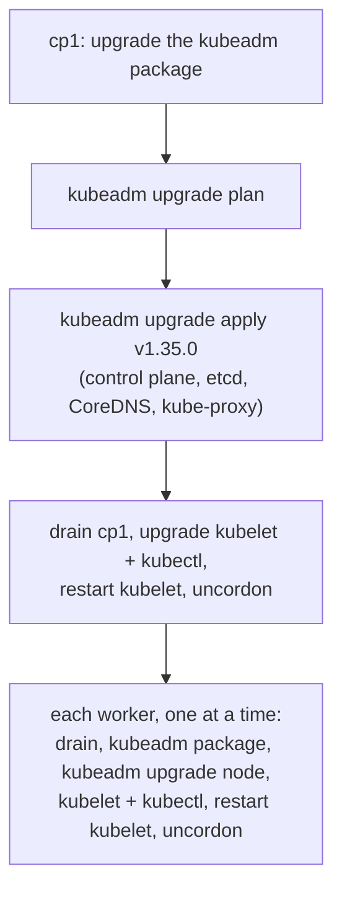

# Chapter 19: Cluster upgrades and node maintenance

> **Exams:** CKA (and CKS: "Upgrade Kubernetes to avoid vulnerabilities")
> **Difficulty:** Intermediate
> **Time:** ~40 min reading, ~45 min lab
> **Lab tier:** 2 (VirtualBox VMs, `envs/vagrant`, snapshot `cluster-prev`)
> **Prerequisites:** Chapter 18 (kubeadm), Chapter 05 (Deployments)

## Learning objectives

After this chapter you can:

- Explain the Kubernetes release cycle and the version skew policy, and why upgrades go one minor version at a time
- Upgrade a kubeadm cluster in the right order: kubeadm, the control plane, then each node's kubelet
- Take a node out of service with `cordon` and `drain`, and bring it back with `uncordon`
- Predict how a drain treats DaemonSet Pods, Pods without a controller, `emptyDir` data, and PodDisruptionBudgets
- Read `kubeadm upgrade plan` and pick the exact version to upgrade to

## Concepts

Kubernetes ships three minor releases a year, and the project maintains the
three newest ones with patch releases (bug and security fixes) for about 14
months each. A cluster that is not upgraded falls out of support within about a
year, and stops receiving security fixes. Upgrading is routine work for an
administrator, which is why the CKA tests it and the CKS lists it as a
hardening measure.

### The version skew policy

The components of a cluster may run different versions for a while, within
limits. Those limits are what make a rolling upgrade possible, and they dictate
its order:

| Component | Allowed relative to the API server |
| --- | --- |
| `kube-apiserver` (several, in an HA control plane) | Within one minor version of each other |
| `kube-controller-manager`, `kube-scheduler` | The same, or up to one minor version older; never newer |
| `kubelet`, `kube-proxy` | The same, or up to three minor versions older; never newer |
| `kubectl` | One minor version newer or older |

Two rules follow. **The control plane is upgraded first**, because no kubelet
may be newer than the API server. And **you cannot skip a minor version**:
from 1.34 you go to 1.35, and only then to 1.36. Patch versions within a minor
version can be skipped (1.35.0 to 1.35.9 is fine).

### The upgrade order with kubeadm



*Text description: on the first control plane node, upgrade the kubeadm package, check the plan, and apply the upgrade; then upgrade that node's kubelet and kubectl while it is drained. Then each worker in turn: drain it, upgrade kubeadm, run kubeadm upgrade node, upgrade the kubelet and kubectl, restart the kubelet, and uncordon it.*

Each step has a reason:

- **kubeadm first.** A kubeadm binary can only upgrade a cluster to its own version, so the new kubeadm has to be installed before anything else.
- **`kubeadm upgrade apply`** runs once, on the first control plane node. It checks the cluster's health, pulls the new images, renews the control plane certificates, rewrites the static Pod manifests for etcd, the API server, the controller manager, and the scheduler (keeping backups under `/etc/kubernetes/tmp`), and upgrades the CoreDNS and kube-proxy add-ons. Further control plane nodes run `kubeadm upgrade node` instead.
- **The kubelet is a package, not a Pod**, so `kubeadm upgrade` does not replace it. It is upgraded with the package manager on every node, then restarted. Until then, `kubectl get nodes` keeps showing the old version, because its `VERSION` column is the kubelet's version.
- **`kubeadm upgrade node`** on a worker rewrites the kubelet's configuration for the new version. It does not touch the kubelet binary.
- **One worker at a time**, so the workloads always have somewhere to run.

The packages come from `pkgs.k8s.io`, which has **one repository per minor
version**. A node set up for 1.34 cannot see the 1.35 packages until its apt
source points at the 1.35 repository. Because the packages are held (Chapter
18), each upgrade unholds them, installs the exact version, and holds them
again.

### Taking a node out of service

Upgrades, kernel patches, and hardware repairs all need a node without
workloads. Three commands manage that:

- **`kubectl cordon NODE`** marks the node unschedulable (`spec.unschedulable: true`; `kubectl get nodes` shows `SchedulingDisabled`). Nothing is moved; new Pods just go elsewhere.
- **`kubectl drain NODE`** cordons the node, then evicts its Pods through the Eviction API, so their controllers recreate them on other nodes.
- **`kubectl uncordon NODE`** makes the node schedulable again. Pods do not move back on their own; new ones will land there over time.

A drain refuses to go ahead in three situations, each with a flag that tells it
you have thought about the consequence:

| Pods on the node | Without the flag | Flag |
| --- | --- | --- |
| Managed by a DaemonSet | Refuses: the DaemonSet would recreate them on the same node | `--ignore-daemonsets` leaves them in place |
| Not managed by any controller | Refuses: nothing would recreate them | `--force` deletes them for good |
| Using `emptyDir` volumes | Refuses: the data is lost with the Pod | `--delete-emptydir-data` |

### PodDisruptionBudgets

A **PodDisruptionBudget** (PDB) limits how many Pods of an application
*voluntary* disruptions, such as evictions, may take down at once. It selects
Pods by label and sets either `minAvailable` or `maxUnavailable`:

```yaml
apiVersion: policy/v1
kind: PodDisruptionBudget
metadata:
  name: web
spec:
  minAvailable: 1
  selector:
    matchLabels:
      app: web
```

When an eviction would break the budget, the API server refuses it with HTTP
429, and `kubectl drain` retries every few seconds until the evicted Pod's
replacement is running elsewhere. That is the point: a drain respects the
budget, at the cost of time. A PDB that can never be satisfied, such as
`minAvailable: 2` for a Deployment with two replicas, blocks a drain forever.
Fix the cause (add a replica, or change the budget); deleting the PDB to force
a drain through defeats the protection it exists for.

PDBs do not protect against involuntary disruptions, such as a node that
crashes.

## Guided walkthrough

The walkthrough and the lab run on `cp1`, starting from the `cluster-prev`
snapshot: a cluster built with kubeadm at v1.34.12, one minor version behind
the book's v1.35.0. On the host:

```powershell
.\envs\vagrant\kbook-vm.ps1 restore cluster-prev      # Windows; ./envs/vagrant/kbook-vm.sh on Linux/macOS
.\envs\vagrant\kbook-vm.ps1 ssh
```

### Where the cluster stands

```bash
cd /kbook
kubectl get nodes
kubeadm version -o short
kubectl version
```

```text
NAME    STATUS   ROLES           AGE   VERSION
cp1     Ready    control-plane   3d    v1.34.12
node1   Ready    <none>          3d    v1.34.12
node2   Ready    <none>          3d    v1.34.12
v1.34.12
Client Version: v1.34.12
Kustomize Version: v5.7.1
Server Version: v1.34.12
```

The packages and the repository they come from:

```bash
cat /etc/apt/sources.list.d/kubernetes.list
apt-cache madison kubeadm | head -5
apt-mark showhold
```

```text
deb [signed-by=/etc/apt/keyrings/kubernetes-apt-keyring.gpg] https://pkgs.k8s.io/core:/stable:/v1.34/deb/ /
   kubeadm | 1.34.12-1.1 | https://pkgs.k8s.io/core:/stable:/v1.34/deb  Packages
   kubeadm | 1.34.11-1.1 | https://pkgs.k8s.io/core:/stable:/v1.34/deb  Packages
   kubeadm | 1.34.10-1.1 | https://pkgs.k8s.io/core:/stable:/v1.34/deb  Packages
   kubeadm | 1.34.9-1.1 | https://pkgs.k8s.io/core:/stable:/v1.34/deb  Packages
   kubeadm | 1.34.8-1.1 | https://pkgs.k8s.io/core:/stable:/v1.34/deb  Packages
kubeadm
kubectl
kubelet
```

The source is the `v1.34` repository, so only 1.34 packages are visible, and
all three packages are held.

### What kubeadm offers

`kubeadm upgrade plan` checks the cluster and lists the versions it can upgrade
to. It changes nothing:

```bash
sudo kubeadm upgrade plan
```

```text
[preflight] Running pre-flight checks.
[upgrade/config] Reading configuration from the "kubeadm-config" ConfigMap in namespace "kube-system"...
[upgrade/config] Use 'kubeadm init phase upload-config kubeadm --config your-config-file' to re-upload it.
[upgrade] Running cluster health checks
[upgrade] Fetching available versions to upgrade to
[upgrade/versions] Cluster version: 1.34.12
[upgrade/versions] kubeadm version: v1.34.12
I1015 18:21:14.493572   17669 version.go:260] remote version is much newer: v1.37.1; falling back to: stable-1.34
[upgrade/versions] Target version: v1.34.12
[upgrade/versions] Latest version in the v1.34 series: v1.34.12
```

Nothing to do: the cluster is already at the newest 1.34 patch, and this
kubeadm cannot go beyond its own minor version. Notice also that kubeadm looked
up the newest release online (v1.37.1) and fell back to its own series; it
never offers to skip a minor version. Moving to 1.35 starts with a 1.35
kubeadm, which is Task 1 of the lab.

### A workload that a careless drain would break

Start the lab, which adds a small workload in the Namespace `ch19-upgrade` and
prints Task 1; you come back to that after the walkthrough:

```bash
make lab CH=19
```

Then look at what it created:

```bash
kubectl -n ch19-upgrade get pods -o wide
kubectl -n ch19-upgrade get pdb
```

```text
NAME                  READY   STATUS    RESTARTS   AGE   IP               NODE    NOMINATED NODE   READINESS GATES
debug                 1/1     Running   0          53s   10.244.166.131   node1   <none>           <none>
web-f4dd7dd4f-28th2   1/1     Running   0          52s   10.244.166.132   node1   <none>           <none>
web-f4dd7dd4f-stbzc   1/1     Running   0          52s   10.244.104.3     node2   <none>           <none>
NAME   MIN AVAILABLE   MAX UNAVAILABLE   ALLOWED DISRUPTIONS   AGE
web    1               N/A               1                     54s
```

(The Pod names, IPs, and their placement differ on every run.) The Deployment
`web` has two replicas and a PDB that keeps at least one available, so one
disruption is allowed at a time. `debug` is a bare Pod, pinned to `node1`.

Try to drain `node1` with only the DaemonSet flag:

```bash
kubectl drain node1 --ignore-daemonsets
```

```text
node/node1 cordoned
error: unable to drain node "node1" due to error: cannot delete cannot delete Pods that declare no controller (use --force to override): ch19-upgrade/debug, continuing command...
There are pending nodes to be drained:
 node1
cannot delete cannot delete Pods that declare no controller (use --force to override): ch19-upgrade/debug
```

The drain stopped, but its first step, the cordon, had already happened:

```bash
kubectl get nodes
```

```text
NAME    STATUS                     ROLES           AGE   VERSION
cp1     Ready                      control-plane   3d    v1.34.12
node1   Ready,SchedulingDisabled   <none>          3d    v1.34.12
node2   Ready                      <none>          3d    v1.34.12
```

A failed drain leaves the node cordoned. Undo it before you start the lab:

```bash
kubectl uncordon node1
```

```text
node/node1 uncordoned
```

## Hands-on lab

The lab works like a KodeKloud lab, one task at a time with a check after each,
on the Tier 2 VMs. You upgrade the whole cluster from v1.34.12 to v1.35.0, on
`cp1`, starting from the `cluster-prev` snapshot (see the walkthrough for the
restore command):

```bash
cd /kbook
make lab CH=19        # checks you are on cluster-prev, adds the workload, shows task 1
make check CH=19      # check the current task; if it is right, show the next
make question CH=19   # show the current task again
make verify CH=19     # check every task at once
```

To start over, restore `cluster-prev` on the host again; `make reset CH=19`
prints that command. Use `sudo` for kubeadm and apt, and `ssh node1` (or
`node2`) to work on a worker. Upgrade to exactly `v1.35.0` (package version
`1.35.0-1.1`), not the newest 1.35 patch release, and do the tasks in order.
The Namespace `ch19-upgrade` holds the Deployment `web`, its
PodDisruptionBudget `web`, and a Pod `debug` that no controller manages. Full
solutions are in [`lab/solutions.md`](lab/solutions.md).

### Task 1: Upgrade the control plane

Upgrade the control plane to the new minor version with kubeadm.

- Node: `cp1`
- Version: `v1.35.0` for the API server, controller manager, and scheduler, and in the `kubeadm-config` ConfigMap

### Task 2: Upgrade cp1's kubelet

Finish the upgrade of `cp1` and put it back in service.

- Packages on `cp1`: `kubeadm`, `kubelet`, and `kubectl` at `1.35.0`, all three held
- `cp1` reports `v1.35.0`
- `cp1` schedulable

### Task 3: Upgrade node1

Upgrade the first worker without taking `web` down, and put it back in service.

- Packages on `node1`: `kubeadm`, `kubelet`, and `kubectl` at `1.35.0`, all three held
- `node1` reports `v1.35.0`
- `node1` schedulable

### Task 4: Upgrade node2

Upgrade the second worker the same way.

- Packages on `node2`: `kubeadm`, `kubelet`, and `kubectl` at `1.35.0`, all three held
- `node2` reports `v1.35.0`

### Task 5: Take node2 out of service

`node2` gets new disks tomorrow. Leave it empty and unschedulable, without
weakening the protection `web` has.

- `node2` cordoned, running only DaemonSet Pods
- Deployment `web` in `ch19-upgrade`: 2 available replicas
- PodDisruptionBudget `web` in `ch19-upgrade`: the original object, still `minAvailable: 1`

## Exam tips

> **Exam tip:** Keep the "Upgrading kubeadm clusters" page of the Kubernetes documentation open while you upgrade. It has the commands for changing the package repository, unholding and holding the packages, and the order of the steps.
>
> **Exam tip:** When a task names an exact version, install exactly that version. `kubeadm upgrade plan` suggests the newest patch release, and `apt-get install kubeadm` without a version installs it too; use `apt-cache madison kubeadm` to find the full package version, such as `1.35.0-1.1`.
>
> **Exam tip:** Read which machine each command belongs on. `kubeadm upgrade apply` runs once, on the first control plane node; `kubeadm upgrade node` runs on every other node; the package upgrades and the kubelet restart run on the node being upgraded; `kubectl drain` and `uncordon` run wherever your kubeconfig works, usually the control plane node.
>
> **Exam tip:** After restarting the kubelet on a control plane node, the new kubelet restarts the static Pods, so the API server can disappear for a minute. If `kubectl` reports `connection refused`, wait and retry instead of moving on: a drain that failed silently means the next node is upgraded with its Pods still on it.

## Common mistakes

- Forgetting to switch the apt repository to the new minor version, and then wondering why `apt-cache madison` shows no new packages.
- Upgrading the kubelet before the control plane, which breaks the version skew policy.
- Running `kubeadm upgrade apply` on a worker, or `kubeadm upgrade node` instead of `apply` on the first control plane node.
- Installing the new packages without restarting the kubelet, so the node keeps reporting the old version.
- Leaving a node cordoned after a failed or finished drain; check `kubectl get nodes` for `SchedulingDisabled`.
- Deleting a PodDisruptionBudget to get a stuck drain through, instead of adding replicas or waiting for the replacement Pods.
- Forgetting to hold the packages again after the upgrade.

<!-- QUESTIONS:START -->

## End-of-chapter questions

**1.** `CKA` A kubeadm cluster runs v1.33.4. You must bring it to v1.35.0. What is the correct path?

- **A.** Upgrade directly from v1.33.4 to v1.35.0
- **B.** Upgrade to a v1.34 release first, then to v1.35.0
- **C.** Upgrade the kubelets to v1.35.0 first, then the control plane
- **D.** Rebuild the cluster; kubeadm cannot upgrade across minor versions

**2.** `CKA` The API server runs v1.35.0. Which kubelet version breaks the version skew policy?

- **A.** v1.32.9
- **B.** v1.34.12
- **C.** v1.35.0
- **D.** v1.36.0

**3.** `CKA` Which command upgrades the control plane on the first control plane node of a kubeadm cluster?

- **A.** `kubeadm upgrade node`
- **B.** `kubeadm upgrade apply v1.35.0`
- **C.** `apt-get upgrade kubelet`
- **D.** `kubeadm init --upgrade`

**4.** `CKA` After `kubeadm upgrade apply v1.35.0` succeeds, `kubectl get nodes` still shows v1.34.12 for every node. Why?

- **A.** The upgrade failed silently
- **B.** The VERSION column shows each node's kubelet version, and the kubelets have not been upgraded yet
- **C.** kubectl caches node versions for an hour
- **D.** The nodes must be rebooted first

**5.** `CKA` On a node set up for 1.34 from pkgs.k8s.io, `apt-cache madison kubeadm` shows no 1.35 packages. What is missing?

- **A.** The node must be drained first
- **B.** The apt source must point at the v1.35 repository, which has its own path per minor version
- **C.** kubeadm 1.35 is only available as a container image
- **D.** The packages are held, which hides newer versions

**6.** `CKA` What does `kubectl cordon node1` do?

- **A.** Evicts every Pod from node1
- **B.** Marks node1 unschedulable; Pods already running there stay
- **C.** Stops the kubelet on node1
- **D.** Removes node1 from the cluster

**7.** `CKA` A drain stops with: cannot delete Pods that declare no controller (use --force to override). What happens to such a Pod if you add `--force`?

- **A.** It is moved to another node
- **B.** It is deleted, and nothing recreates it
- **C.** It stays on the node, which is cordoned
- **D.** It is paused until the node is uncordoned

**8.** `CKA` A Deployment has 2 replicas and a PodDisruptionBudget with `minAvailable: 2`. What happens when you drain a node that runs one of its Pods?

- **A.** The drain evicts the Pod immediately
- **B.** The drain retries the eviction and never finishes, because the budget allows no disruption
- **C.** The PDB is deleted automatically
- **D.** The Deployment scales up to 3 replicas on its own

**9.** `CKA` Why does `kubectl drain` need `--ignore-daemonsets` on almost every node?

- **A.** DaemonSet Pods cannot be deleted
- **B.** Evicting them is pointless, because the DaemonSet controller would put them back on the same node; the flag leaves them running
- **C.** The flag deletes the DaemonSets themselves
- **D.** It makes the drain skip PodDisruptionBudgets

**10.** `CKA` `CKS` Why is keeping a cluster on a supported minor version a security measure?

- **A.** Newer versions disable RBAC by default
- **B.** Only the three newest minor versions receive patch releases, including fixes for vulnerabilities
- **C.** Old versions cannot run NetworkPolicies
- **D.** The API server refuses clients after a year

**11. (Task)** `CKA` Take the worker `node1` out of service for maintenance: no Pods except DaemonSet Pods may remain on it, and no new Pods may be scheduled there. Some Pods on it use `emptyDir` volumes.

**12. (Task)** `CKA` On the worker `node1`, which the control plane at v1.35.0 has already been upgraded for, upgrade the node's kubelet configuration and its kubelet to `1.35.0`, and keep the packages held. The apt source already points at the v1.35 repository, and the node is drained.

**13. (Task)** `CKA` In namespace `shop`, create a PodDisruptionBudget named `api` that keeps at most one Pod labelled `app=api` unavailable during voluntary disruptions, and show how many disruptions it currently allows.

<details>
<summary>Answers</summary>

**1. B.** kubeadm upgrades one minor version at a time, so the cluster goes to 1.34 first and then to 1.35. Patch versions inside a minor version can be skipped.

**2. D.** A kubelet may be up to three minor versions older than the API server, but never newer. That is why the control plane is upgraded before the kubelets.

**3. B.** `kubeadm upgrade apply` runs once, on the first control plane node, and upgrades the static Pods, etcd, and the CoreDNS and kube-proxy add-ons. Other control plane nodes and the workers run `kubeadm upgrade node`.

**4. B.** The kubelet is a package on each node, not a Pod, so `kubeadm upgrade` does not replace it. The column changes once the kubelet package is upgraded and the kubelet is restarted.

**5. B.** pkgs.k8s.io has one repository per minor version. Holding a package stops it from being upgraded, but does not hide versions from `apt-cache madison`.

**6. B.** Cordoning sets `spec.unschedulable: true`, so the scheduler places no new Pods there. `kubectl drain` cordons the node and then also evicts its Pods.

**7. B.** A Pod without a controller has nothing to recreate it elsewhere. `--force` acknowledges that it will be lost.

**8. B.** Evictions that would break the budget are refused with HTTP 429, and drain keeps retrying. Allowed disruptions here is 0, so it never succeeds. Fix the budget or add replicas; do not delete the PDB.

**9. B.** DaemonSets run one Pod per node, ignoring the unschedulable mark for many of their Pods. Most clusters run kube-proxy and the CNI plugin as DaemonSets, so nearly every drain needs the flag.

**10. B.** Each minor version gets patch releases for about 14 months. A cluster on an older minor version gets no fixes for newly found vulnerabilities.

**11.**

```bash
kubectl drain node1 --ignore-daemonsets --delete-emptydir-data
kubectl get nodes node1
kubectl get pods -A -o wide --field-selector spec.nodeName=node1
```

The node shows `Ready,SchedulingDisabled`, and only DaemonSet Pods, such as `kube-proxy` and `calico-node`, remain. Add `--force` only if Pods without a controller are on the node and the task accepts losing them. When the work is done, `kubectl uncordon node1`.

**12.**

```bash
ssh node1
sudo apt-mark unhold kubeadm kubelet kubectl
sudo apt-get update
sudo apt-get install -y kubeadm=1.35.0-1.1
sudo kubeadm upgrade node
sudo apt-get install -y kubelet=1.35.0-1.1 kubectl=1.35.0-1.1
sudo apt-mark hold kubeadm kubelet kubectl
sudo systemctl daemon-reload
sudo systemctl restart kubelet
exit
kubectl uncordon node1
kubectl get nodes node1
```

`kubeadm upgrade node` rewrites the kubelet's configuration for the new version; the kubelet package and the restart replace the running kubelet.

**13.**

```bash
kubectl -n shop create poddisruptionbudget api --selector=app=api --max-unavailable=1
kubectl -n shop get pdb api
```

The `ALLOWED DISRUPTIONS` column shows how many matching Pods may be evicted right now. `--min-available` is the other way to express a budget; a PDB sets one or the other, not both.

</details>

<!-- QUESTIONS:END -->

## Further reading

- Kubernetes documentation: *Upgrading kubeadm clusters*, *Upgrading Linux nodes*, *Version Skew Policy*, *Safely Drain a Node*, *Specifying a Disruption Budget for your Application*, *Releases* (the support period of each minor version)
- `kubeadm` reference: `kubeadm upgrade plan`, `kubeadm upgrade apply`, `kubeadm upgrade node`
- Chapter 20 next: backing up and restoring etcd, the step to take before every upgrade
