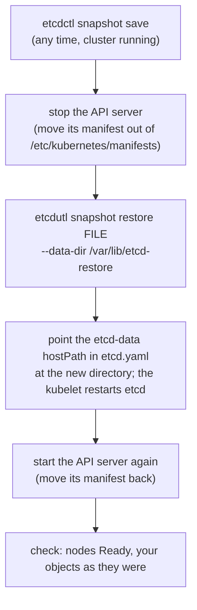

# Chapter 20: etcd backup and restore

> **Exams:** CKA
> **Difficulty:** Intermediate
> **Time:** ~35 min reading, ~35 min lab
> **Lab tier:** 2 (VirtualBox VMs, `envs/vagrant`, snapshot `cluster`)
> **Prerequisites:** Chapter 02 (architecture), Chapter 18 (kubeadm), Chapter 19 (static Pods on the control plane)

## Learning objectives

After this chapter you can:

- Explain what etcd stores for Kubernetes, and what a backup of it does and does not cover
- Find the endpoint and the client certificates of a kubeadm cluster's etcd, and query it with `etcdctl`
- Take a snapshot with `etcdctl snapshot save` and inspect it with `etcdutl snapshot status`
- Restore a snapshot with `etcdutl snapshot restore` into a new data directory, and run the cluster from it
- Restore in the right order, so the API server does not keep serving the old data

## Concepts

Every object you create through the API, every Pod, Secret, Role, and lease,
ends up as a key in etcd. The API server is the only component that talks to
etcd; everything else reads and writes through the API server. That makes etcd
the cluster's single source of truth, and its backup the most important one an
administrator takes: with a snapshot of etcd and the cluster's certificates you
can rebuild the control plane; without it, every object is gone.

### What a backup covers

An etcd snapshot holds the **API objects**: workloads, configuration, RBAC,
Secrets, CRDs and custom resources, node and lease records. It does **not**
hold:

- the data in volumes (PersistentVolumes are storage outside the cluster; back them up separately, for example with Velero or the storage system's snapshots)
- container images (they live in registries)
- the certificates and kubeconfig files in `/etc/kubernetes` (back these up as files; a restored etcd is useless without the CA that signed its clients)

A snapshot contains every Secret, so treat the file like a password: keep it
readable by root only, as `etcdctl` creates it, and encrypt it wherever you
store it.

### etcd in a kubeadm cluster

kubeadm runs etcd as a static Pod on each control plane node
(`/etc/kubernetes/manifests/etcd.yaml`). Three settings in that manifest are
what you need:

| Setting | kubeadm's value | Used for |
| --- | --- | --- |
| `--listen-client-urls` | `https://127.0.0.1:2379,https://<node IP>:2379` | The endpoint for `etcdctl`: `https://127.0.0.1:2379` on the node itself |
| `--trusted-ca-file`, `--cert-file`, `--key-file` | `/etc/kubernetes/pki/etcd/ca.crt`, `server.crt`, `server.key` | etcd only accepts clients with a certificate signed by its CA; these files work for `etcdctl` too |
| `--data-dir`, and the `etcd-data` hostPath volume | `/var/lib/etcd` | Where etcd keeps its data on the node |

The keys are paths such as `/registry/configmaps/<namespace>/<name>`, and the
values are the objects, stored as protobuf.

### etcdctl and etcdutl

Two command-line tools come with etcd:

- **`etcdctl`** is a network client. It talks to a running etcd, so it needs the endpoint and the certificates. It reads and writes keys, lists members, checks health, and takes a snapshot of a running member: `etcdctl snapshot save FILE`.
- **`etcdutl`** works on files, offline. It inspects a snapshot (`etcdutl snapshot status FILE`) and turns one into a new data directory (`etcdutl snapshot restore FILE --data-dir DIR`).

etcd 3.5 moved `snapshot status` and `snapshot restore` from `etcdctl` to
`etcdutl` and kept the old commands as deprecated aliases; etcd 3.6 removed
them, and etcd 3.7, which Kubernetes 1.37 runs, has none of them either. Older guides that use
`etcdctl snapshot restore`, or set `ETCDCTL_API=3`, predate this; version 3 of
the API is the only one left, and current etcd versions warn about the variable.

### What a restore does

`etcdutl snapshot restore` builds a **new** data directory from the snapshot,
with fresh cluster and member IDs. It refuses to write into a directory that is
not empty, so you always restore next to the old data, never over it, and then
point etcd at the new directory. In a kubeadm cluster that means changing the
`etcd-data` hostPath in etcd's manifest; the kubelet notices the change and
restarts etcd.

Order matters, because the API server keeps a cache of everything it has read
from etcd and watches etcd for changes. A restore moves etcd's revision
backwards, which those watches do not expect: an API server that keeps running
through a restore can go on serving the old data from its cache. The
documented procedure is therefore:



*Text description: take a snapshot while the cluster runs. To restore, stop the API server, restore the snapshot into a new directory, change etcd's data hostPath to that directory so the kubelet restarts etcd from it, start the API server again, and check the cluster.*

The Kubernetes documentation also recommends restarting the controller manager,
the scheduler, and the kubelets after a restore, so nothing acts on stale
state; on a lab cluster, restarting the API server is the step you cannot skip.

A cluster with several etcd members restores every member from the **same**
snapshot, each with its own `--name`, `--initial-cluster`, and
`--initial-advertise-peer-urls`, so they form a new cluster together. The lab
cluster has one member.

## Guided walkthrough

The walkthrough and the lab run on `cp1`, starting from the `cluster` snapshot.
On the host:

```powershell
.\envs\vagrant\kbook-vm.ps1 restore cluster      # Windows; ./envs/vagrant/kbook-vm.sh on Linux/macOS
.\envs\vagrant\kbook-vm.ps1 ssh
```

### Install etcdctl and etcdutl

The VMs do not have the etcd tools. They come in etcd's release tarball, and
the version should match the etcd the cluster runs (the image tag in the
manifest is `3.7.0-0`). Download it with its checksum file, and check it before
installing:

```bash
V=v3.7.0
cd /tmp
curl -fsSLO "https://github.com/etcd-io/etcd/releases/download/${V}/etcd-${V}-linux-amd64.tar.gz"
curl -fsSL "https://github.com/etcd-io/etcd/releases/download/${V}/SHA256SUMS" -o etcd-SHA256SUMS
grep " etcd-${V}-linux-amd64.tar.gz$" etcd-SHA256SUMS | sha256sum -c -
```

```text
etcd-v3.7.0-linux-amd64.tar.gz: OK
```

```bash
tar xzf "etcd-${V}-linux-amd64.tar.gz"
sudo install -m 0755 "etcd-${V}-linux-amd64/etcdctl" "etcd-${V}-linux-amd64/etcdutl" /usr/local/bin/
cd /kbook
etcdctl version
etcdutl version
```

```text
etcdctl version: 3.7.0
API version: 3.7
etcdutl version: 3.7.0
API version: 3.7
```

(`make lab CH=20` installs them the same way if they are missing.)

### Find the endpoint and the certificates

```bash
kubectl -n kube-system get pods -l component=etcd -o wide
sudo grep -E "^\s+- --(advertise-client-urls|cert-file|key-file|trusted-ca-file|data-dir|listen-client-urls)" /etc/kubernetes/manifests/etcd.yaml
```

```text
NAME       READY   STATUS    RESTARTS   AGE    IP              NODE   NOMINATED NODE   READINESS GATES
etcd-cp1   1/1     Running   0          3d1h   192.168.56.10   cp1    <none>           <none>
    - --advertise-client-urls=https://192.168.56.10:2379
    - --cert-file=/etc/kubernetes/pki/etcd/server.crt
    - --data-dir=/var/lib/etcd
    - --key-file=/etc/kubernetes/pki/etcd/server.key
    - --listen-client-urls=https://127.0.0.1:2379,https://192.168.56.10:2379
    - --trusted-ca-file=/etc/kubernetes/pki/etcd/ca.crt
```

And where the data directory lives on the node:

```bash
sudo grep -A3 "hostPath:" /etc/kubernetes/manifests/etcd.yaml
```

```text
  - hostPath:
      path: /etc/kubernetes/pki/etcd
      type: DirectoryOrCreate
    name: etcd-certs
  - hostPath:
      path: /var/lib/etcd
      type: DirectoryOrCreate
    name: etcd-data
```

### Talk to etcd

Without the certificates, `etcdctl` gets nowhere:

```bash
etcdctl member list
```

```text
{"level":"warn","ts":"2026-10-23T17:38:34.876636Z","logger":"etcd-client","caller":"v3/retry_interceptor.go:68","msg":"retrying of unary invoker failed","target":"etcd-endpoints://0x1b823610ce00/127.0.0.1:2379","peer":"Peer{Addr: <nil>, LocalAddr: <nil>, AuthInfo: <nil>}","method":"/etcdserverpb.Cluster/MemberList","attempt":0,"error":"rpc error: code = DeadlineExceeded desc = latest balancer error: connection error: desc = \"error reading server preface: EOF\""}
Error: context deadline exceeded
```

It tried plain HTTP to `127.0.0.1:2379`, which etcd does not serve. Pass the
endpoint and the three files from the manifest, with `sudo` because the key is
readable by root only. The variable that older guides set is no longer needed:

```bash
sudo ETCDCTL_API=3 etcdctl --endpoints=https://127.0.0.1:2379 \
  --cacert=/etc/kubernetes/pki/etcd/ca.crt \
  --cert=/etc/kubernetes/pki/etcd/server.crt \
  --key=/etc/kubernetes/pki/etcd/server.key \
  member list -w table
```

```text
{"level":"warn","ts":"2026-10-23T17:38:34.905232Z","caller":"flags/flag.go:94","msg":"unrecognized environment variable","environment-variable":"ETCDCTL_API=3"}
┌──────────────────┬─────────┬──────┬────────────────────────────┬────────────────────────────┬────────────┐
│        ID        │ STATUS  │ NAME │         PEER ADDRS         │        CLIENT ADDRS        │ IS LEARNER │
├──────────────────┼─────────┼──────┼────────────────────────────┼────────────────────────────┼────────────┤
│ f0e4577804b51494 │ started │  cp1 │ https://192.168.56.10:2380 │ https://192.168.56.10:2379 │      false │
└──────────────────┴─────────┴──────┴────────────────────────────┴────────────────────────────┴────────────┘
```

The rest of the walkthrough uses the same four flags; only the command at the
end changes. `endpoint status` shows the member's version, the size of its
database, and whether it leads:

```bash
sudo etcdctl --endpoints=https://127.0.0.1:2379 --cacert=/etc/kubernetes/pki/etcd/ca.crt \
  --cert=/etc/kubernetes/pki/etcd/server.crt --key=/etc/kubernetes/pki/etcd/server.key \
  endpoint status -w table
```

```text
┌────────────────────────┬──────────────────┬─────────┬─────────────────┬─────────┬────────┬───────────────────────┬────────┬───────────┬────────────┬───────────┬────────────┬────────────────────┬────────┬──────────────────────────┬───────────────────┐
│        ENDPOINT        │        ID        │ VERSION │ STORAGE VERSION │ DB SIZE │ IN USE │ PERCENTAGE NOT IN USE │ QUOTA  │ IS LEADER │ IS LEARNER │ RAFT TERM │ RAFT INDEX │ RAFT APPLIED INDEX │ ERRORS │ DOWNGRADE TARGET VERSION │ DOWNGRADE ENABLED │
├────────────────────────┼──────────────────┼─────────┼─────────────────┼─────────┼────────┼───────────────────────┼────────┼───────────┼────────────┼───────────┼────────────┼────────────────────┼────────┼──────────────────────────┼───────────────────┤
│ https://127.0.0.1:2379 │ f0e4577804b51494 │   3.7.0 │           3.7.0 │  6.8 MB │ 6.8 MB │                    1% │ 2.1 GB │      true │      false │         2 │       2232 │               2232 │        │                          │             false │
└────────────────────────┴──────────────────┴─────────┴─────────────────┴─────────┴────────┴───────────────────────┴────────┴───────────┴────────────┴───────────┴────────────┴────────────────────┴────────┴──────────────────────────┴───────────────────┘
```

The keys Kubernetes keeps, for example the Namespaces:

```bash
sudo etcdctl --endpoints=https://127.0.0.1:2379 --cacert=/etc/kubernetes/pki/etcd/ca.crt \
  --cert=/etc/kubernetes/pki/etcd/server.crt --key=/etc/kubernetes/pki/etcd/server.key \
  get /registry/namespaces --prefix --keys-only
```

```text
/registry/namespaces/default

/registry/namespaces/kube-node-lease

/registry/namespaces/kube-public

/registry/namespaces/kube-system
```

Create an object and find it in etcd:

```bash
kubectl create namespace ch20-demo
kubectl -n ch20-demo create configmap greeting --from-literal=msg=hello
sudo etcdctl --endpoints=https://127.0.0.1:2379 --cacert=/etc/kubernetes/pki/etcd/ca.crt \
  --cert=/etc/kubernetes/pki/etcd/server.crt --key=/etc/kubernetes/pki/etcd/server.key \
  get /registry/configmaps/ch20-demo/greeting -w json | head -c 400
```

```text
namespace/ch20-demo created
configmap/greeting created
{"header":{"cluster_id":2110508821268288304,"member_id":17358095036779402388,"revision":1856,"raft_term":2},"kvs":[{"key":"L3JlZ2lzdHJ5L2NvbmZpZ21hcHMvY2gyMC1kZW1vL2dyZWV0aW5n","create_revision":1854,"mod_revision":1854,"version":1,"value":"azhzAAoPCgJ2MRIJQ29uZmlnTWFwErUBCqQBCghncmVldGluZxIAGgljaDIwLWRlbW8iACokZjQ5YTFlMmMtOTMyZC00OTlmLWFlMDItZmNjYjMzMDc1ZGJjMgA4AEIICJu37tYGEACKAVQKDmt1YmVjdGwtY3J
```

The key and value are base64 in JSON output. Two numbers matter. The
`mod_revision`, 1854 here, is the revision at which this key last changed; the
`revision` in the header, 1856, is etcd's global counter at the time of the
read, already moved on by two other writes in the cluster. Every write
increases the counter. The ConfigMap's `resourceVersion` in Kubernetes is its
`mod_revision`:

```bash
kubectl -n ch20-demo get configmap greeting -o jsonpath="{.metadata.resourceVersion}"; echo
```

```text
1854
```

### Take a snapshot and inspect it

```bash
sudo mkdir -p /opt/kbook
sudo etcdctl --endpoints=https://127.0.0.1:2379 --cacert=/etc/kubernetes/pki/etcd/ca.crt \
  --cert=/etc/kubernetes/pki/etcd/server.crt --key=/etc/kubernetes/pki/etcd/server.key \
  snapshot save /opt/kbook/demo.db
```

```text
{"level":"info","ts":"2026-10-23T17:38:35.604702Z","caller":"snapshot/v3_snapshot.go:83","msg":"created temporary db file","path":"/opt/kbook/demo.db.part"}
{"level":"info","ts":"2026-10-23T17:38:35.627682Z","logger":"client","caller":"v3/maintenance.go:236","msg":"opened snapshot stream; downloading"}
{"level":"info","ts":"2026-10-23T17:38:35.648793Z","caller":"snapshot/v3_snapshot.go:96","msg":"fetching snapshot","endpoint":"https://127.0.0.1:2379"}
{"level":"info","ts":"2026-10-23T17:38:36.359598Z","logger":"client","caller":"v3/maintenance.go:302","msg":"completed snapshot read; closing"}
{"level":"info","ts":"2026-10-23T17:38:36.398859Z","caller":"snapshot/v3_snapshot.go:111","msg":"fetched snapshot","endpoint":"https://127.0.0.1:2379","size":"6.8 MB","took":"790.398367ms","etcd-version":"3.7.0"}
{"level":"info","ts":"2026-10-23T17:38:36.399369Z","caller":"snapshot/v3_snapshot.go:121","msg":"saved","path":"/opt/kbook/demo.db"}
Snapshot saved at /opt/kbook/demo.db
Server version 3.7.0
```

```bash
sudo ls -l /opt/kbook/demo.db
sudo etcdutl snapshot status /opt/kbook/demo.db -w table
```

```text
-rw------- 1 root root 6828064 Oct 23 17:38 /opt/kbook/demo.db
┌──────────┬──────────┬────────────┬────────────┬─────────┐
│   HASH   │ REVISION │ TOTAL KEYS │ TOTAL SIZE │ VERSION │
├──────────┼──────────┼────────────┼────────────┼─────────┤
│ c47731af │     1856 │        579 │     6.8 MB │   3.7.0 │
└──────────┴──────────┴────────────┴────────────┴─────────┘
```

The file is readable by root only, and its revision, 1856, is the revision at
which it was taken: it contains every change up to then, including the
`greeting` ConfigMap (1854). Try the same with
`etcdctl`:

```bash
sudo etcdctl snapshot status /opt/kbook/demo.db
```

```text
Manages etcd node snapshots

Usage:
  etcdctl snapshot [command]
...
Available Commands:
  save        Stores an etcd node backend snapshot to a given file
...
```

`etcdctl snapshot` has only `save` left; an `etcdctl snapshot restore` from an
older guide fails the same way, with `Error: unknown flag: --data-dir`. Remove
the demo before you start the lab:

```bash
kubectl delete namespace ch20-demo
sudo rm /opt/kbook/demo.db
```

The restore is the lab.

## Hands-on lab

The lab works like a KodeKloud lab, one task at a time with a check after each,
on the Tier 2 VMs, from the `cluster` snapshot:

```bash
cd /kbook
make lab CH=20        # checks you are on cluster, installs etcdctl/etcdutl if missing, shows task 1
make check CH=20      # check the current task; if it is right, show the next
make question CH=20   # show the current task again
make verify CH=20     # check every task at once
```

To start over, restore `cluster` on the host again; `make reset CH=20` prints
that command. Work on `cp1`, with `sudo` for etcdctl, etcdutl, and the
manifests. `make lab` leaves an older backup, `/opt/kbook/etcd-before.db`,
taken while the Namespace `ch20-etcd` held a ConfigMap `legacy`; since then,
`legacy` was deleted and a ConfigMap `current` was created. Do the tasks in
order. Full solutions are in [`lab/solutions.md`](lab/solutions.md).

### Task 1: Back up etcd

Take a snapshot of the cluster's etcd.

- File: `/opt/kbook/etcd-backup.db`
- A snapshot of the running cluster, taken after the lab started

### Task 2: Record the backup's revision

Inspect your backup and record the revision it was taken at.

- File: `/tmp/ch20-revision.txt`
- Content: the revision of `/opt/kbook/etcd-backup.db`, digits only

### Task 3: Restore the older backup

Restore `/opt/kbook/etcd-before.db` and run the cluster's etcd from the result.

- Backup: `/opt/kbook/etcd-before.db`
- Restored data directory: `/var/lib/etcd-restore`
- etcd's data volume (the `etcd-data` hostPath in its manifest): `/var/lib/etcd-restore`
- etcd healthy

### Task 4: Bring the cluster back on the restored data

Make the whole cluster use the restored data.

- Namespace `ch20-etcd`: ConfigMap `legacy` exists and ConfigMap `current` does not, both when you get them by name and when you list ConfigMaps
- All three nodes `Ready`

## Exam tips

> **Exam tip:** You do not have to remember the certificate paths. Read them from `/etc/kubernetes/manifests/etcd.yaml` (or `kubectl -n kube-system describe pod etcd-<node>`): `--trusted-ca-file` goes to `--cacert`, `--cert-file` to `--cert`, `--key-file` to `--key`, and the first of `--listen-client-urls` to `--endpoints`.
>
> **Exam tip:** Check which tools are installed and their versions before you start. With etcd 3.6 and later, `snapshot status` and `snapshot restore` are `etcdutl` commands; on a machine that only has `etcdctl` 3.5, the old `etcdctl snapshot restore` still works there, with a deprecation warning.
>
> **Exam tip:** Restore into a new directory and point the manifest's hostPath at it. Restoring over `/var/lib/etcd` fails with `data-dir ... not empty`, and deleting the live data directory to make room is how a recoverable mistake becomes an outage.
>
> **Exam tip:** After any change to a static Pod manifest, watch the component come back (`sudo crictl ps`, or `kubectl -n kube-system get pods` once the API answers) before you move on. An edit with a typo means the Pod never starts, and nothing tells you unless you look.

## Common mistakes

- Running `etcdctl` without `--endpoints`, `--cacert`, `--cert`, and `--key`, and reading the timeout as "etcd is down".
- Forgetting `sudo`: the etcd key in `/etc/kubernetes/pki/etcd` is readable by root only.
- Restoring into the data directory etcd is still using.
- Changing `--data-dir` in the manifest but not the `etcd-data` hostPath (or the other way round), so etcd inside the container looks at an empty directory.
- Leaving the API server running through a restore, then trusting `kubectl get` lists that still show the old data.
- Keeping backups on the control plane node only; a backup is for the day that node is gone.

<!-- QUESTIONS:START -->

## End-of-chapter questions

**1.** `CKA` Which of these does an etcd snapshot of a Kubernetes cluster contain?

- **A.** The data written to PersistentVolumes
- **B.** The container images the Pods run
- **C.** The API objects, including Secrets
- **D.** The certificates in /etc/kubernetes/pki

**2.** `CKA` Where do you find the client certificate settings for `etcdctl` on a kubeadm control plane node?

- **A.** In ~/.kube/config
- **B.** In the etcd static Pod manifest, /etc/kubernetes/manifests/etcd.yaml
- **C.** In the kubeadm-config ConfigMap only
- **D.** etcd does not use TLS in a kubeadm cluster

**3.** `CKA` With etcd 3.6 or later, which command restores a snapshot into a new data directory?

- **A.** `etcdctl snapshot restore FILE --data-dir DIR`
- **B.** `etcdutl snapshot restore FILE --data-dir DIR`
- **C.** `kubeadm etcd restore FILE`
- **D.** `etcdctl restore --from FILE`

**4.** `CKA` `etcdutl snapshot restore backup.db --data-dir /var/lib/etcd` fails with: data-dir "/var/lib/etcd" not empty. What is the right fix?

- **A.** Delete /var/lib/etcd and run the restore again
- **B.** Restore into a new directory, such as /var/lib/etcd-restore, and point etcd's data hostPath at it
- **C.** Add --force to the restore
- **D.** Stop the kubelet permanently

**5.** `CKA` After a restore, `kubectl get configmap a` finds the restored ConfigMap, but `kubectl get configmaps` still lists the objects from before the restore. What was skipped?

- **A.** Running kubeadm upgrade
- **B.** Stopping the API server before the restore and starting it again afterwards
- **C.** Restarting CoreDNS
- **D.** Deleting the old snapshot file

**6.** `CKA` What is the revision shown by `etcdutl snapshot status`?

- **A.** The etcd version that created the file
- **B.** The number of keys in the snapshot
- **C.** etcd's global write counter at the moment the snapshot was taken
- **D.** The number of times the snapshot was restored

**7.** `CKA` How does etcd pick up a new data directory in a kubeadm cluster after you edit /etc/kubernetes/manifests/etcd.yaml?

- **A.** You run kubectl apply -f etcd.yaml
- **B.** The kubelet notices the changed static Pod manifest and recreates the etcd Pod
- **C.** You run kubeadm init again
- **D.** You restart containerd

**8.** `CKA` Why should an etcd snapshot file be protected like a password?

- **A.** It contains the etcd root password
- **B.** It contains every Secret in the cluster
- **C.** It can be used to log in to the API server
- **D.** It is executable

**9.** `CKA` A cluster has three etcd members. How is it restored from a snapshot?

- **A.** Restore one member; the others copy its data automatically
- **B.** Restore every member from the same snapshot, each with its own name and the full initial cluster list, so they form a new cluster
- **C.** Restore each member from its own latest snapshot
- **D.** A multi-member cluster cannot be restored

**10. (Task)** `CKA` On the control plane node of a kubeadm cluster, save a snapshot of etcd to `/srv/backup/etcd.db`, then show its revision and the number of keys it holds.

**11. (Task)** `CKA` Restore the snapshot `/srv/backup/etcd.db` on a kubeadm control plane node with one etcd member, so that the cluster runs from the restored data in `/var/lib/etcd-from-backup`.

**12. (Task)** `CKA` Using `etcdctl` on the control plane node, list the keys etcd holds for the ConfigMaps in the Namespace `kube-system`.

<details>
<summary>Answers</summary>

**1. C.** etcd stores the API objects, Secrets included. Volume data lives in the storage system, images in registries, and the certificates are files on the control plane nodes; each needs its own backup.

**2. B.** The manifest lists `--trusted-ca-file`, `--cert-file`, and `--key-file` (under /etc/kubernetes/pki/etcd) and `--listen-client-urls`. Those become `--cacert`, `--cert`, `--key`, and `--endpoints` for `etcdctl`.

**3. B.** etcd 3.5 moved `snapshot restore` and `snapshot status` to `etcdutl`, which works on files offline, and 3.6 removed them from `etcdctl`; 3.7 keeps it that way. `etcdctl` keeps `snapshot save`, which needs a running member.

**4. B.** A restore always builds a new data directory. Restoring next to the live data keeps the old data as a fallback; deleting it first turns a mistake into an outage.

**5. B.** The API server caches what it reads from etcd and follows it with watches. A restore moves etcd's revision backwards, and a running API server can keep serving lists from its stale cache. Restarting it makes it read the restored data from scratch.

**6. C.** Every write to etcd increases the revision, and an object's resourceVersion in Kubernetes is the revision of its last change. A snapshot contains every change up to its revision.

**7. B.** etcd is a static Pod. The kubelet watches the manifests directory and recreates the Pod when a file changes, which takes up to a minute or so. kubectl cannot change static Pods.

**8. B.** Secrets are stored in etcd, base64-encoded but not encrypted unless encryption at rest is configured. Anyone with the snapshot can read them. `etcdctl snapshot save` creates the file readable by its owner only.

**9. B.** A restore creates a new cluster. Every member is restored from the same file with `--name`, `--initial-cluster`, and `--initial-advertise-peer-urls`, so the members agree on the data and on each other.

**10.**

```bash
sudo mkdir -p /srv/backup
sudo etcdctl --endpoints=https://127.0.0.1:2379 \
  --cacert=/etc/kubernetes/pki/etcd/ca.crt \
  --cert=/etc/kubernetes/pki/etcd/server.crt \
  --key=/etc/kubernetes/pki/etcd/server.key \
  snapshot save /srv/backup/etcd.db
sudo etcdutl snapshot status /srv/backup/etcd.db -w table
```

Read the certificate paths from `/etc/kubernetes/manifests/etcd.yaml` if they differ. The table's `REVISION` and `TOTAL KEYS` columns answer the question.

**11.**

```bash
sudo mv /etc/kubernetes/manifests/kube-apiserver.yaml /etc/kubernetes/
sudo etcdutl snapshot restore /srv/backup/etcd.db --data-dir /var/lib/etcd-from-backup
sudo vim /etc/kubernetes/manifests/etcd.yaml      # etcd-data hostPath: path: /var/lib/etcd-from-backup
sudo crictl ps --name etcd                        # wait until the new etcd container runs
sudo mv /etc/kubernetes/kube-apiserver.yaml /etc/kubernetes/manifests/
kubectl get nodes
```

Changing only the hostPath is enough: inside the container, etcd keeps reading `--data-dir=/var/lib/etcd`, which is now the restored directory on the node. If you change `--data-dir` instead, change the volume's `mountPath` to match.

**12.**

```bash
sudo etcdctl --endpoints=https://127.0.0.1:2379 \
  --cacert=/etc/kubernetes/pki/etcd/ca.crt \
  --cert=/etc/kubernetes/pki/etcd/server.crt \
  --key=/etc/kubernetes/pki/etcd/server.key \
  get /registry/configmaps/kube-system --prefix --keys-only
```

Kubernetes stores objects under `/registry/<resource>/<namespace>/<name>`. `--keys-only` skips the values, which are protobuf.

</details>

<!-- QUESTIONS:END -->

## Further reading

- Kubernetes documentation: *Operating etcd clusters for Kubernetes* (backing up and restoring an etcd cluster), *Encrypting Confidential Data at Rest*
- etcd documentation: *Disaster recovery*, `etcdctl` and `etcdutl` references
- Velero, for backing up API objects and volume data together
- Chapter 27 next in Part III: troubleshooting nodes, the kubelet, the control plane, and certificates
