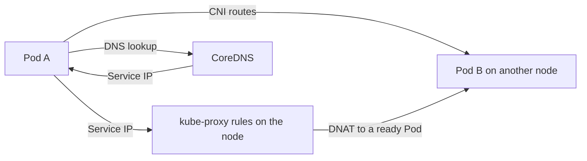

# Chapter 21: Networking internals: the CNI, kube-proxy, NetworkPolicy, and CoreDNS

> **Exams:** KCNA · CKA
> **Difficulty:** Advanced
> **Time:** ~60 min reading, ~40 min lab
> **Lab tier:** 1 (kind, with Calico as the CNI)
> **Prerequisites:** Chapter 06 (Labels and selectors), Chapter 11 (Services and cluster DNS), Chapter 12 (Ingress)

## Learning objectives

After this chapter you can:

- Explain what a CNI plugin does, and how the cluster gives every Pod an IP address that is routable from every other Pod
- Explain how kube-proxy turns a Service into forwarding rules on each node, and name its modes
- Read a node's pod CIDR and find which network plugin the cluster uses
- Write a NetworkPolicy that denies ingress by default and then allows one client, and say what a policy does to Pods it does not select
- Explain why a NetworkPolicy does nothing unless the CNI enforces it
- Describe how CoreDNS answers a Service name, and where its configuration lives

## Concepts

### What the network model asks of the cluster

Kubernetes gives every Pod its own IP address. Pods can reach every other Pod by
that address without network address translation, whether they run on the same
node or on different nodes. Containers in one Pod share that address, as Chapter
04 showed. This is the **network model**, and the components below are the parts
that make it true.

The model says what must happen. It does not say how. The how is split between
three things:

- The **CNI plugin** (container network interface) gives each Pod its address,
  creates the Pod's network interface, and sets up routes so that packets reach
  Pods on other nodes.
- **kube-proxy** makes Service addresses work, by programming forwarding rules
  on each node.
- **CoreDNS** answers name lookups for Services and Pods.



The first arrow is the CNI's job: Pod-to-Pod traffic needs no proxy. The second
and third arrows are kube-proxy's: a Service IP is rewritten to a Pod's address.
The DNS arrows are CoreDNS's.

### The CNI plugin

The CNI plugin is installed as a DaemonSet, and it writes a configuration file
into `/etc/cni/net.d` on each node. The kubelet reads that file when it creates a
Pod's sandbox, and the plugin does the rest. Each node gets a range of Pod
addresses, its **pod CIDR**, which the control plane assigns when the node joins.
You can read it on any node:

```bash
kubectl get node NAME -o jsonpath='{.spec.podCIDR}'
```

Plugins differ in how they connect the nodes. Some encapsulate Pod traffic in a
tunnel between nodes, some route it with BGP, and some use the cloud's own
routing. Which one a cluster uses is a choice made when it is built, and it
decides two things that matter in the exam:

- **Whether NetworkPolicy is enforced.** Not every plugin enforces it. A cluster
  whose plugin ignores NetworkPolicy accepts the objects but does nothing with
  them. Calico, Cilium, and Antrea enforce it. Flannel does not.
- **Which features exist.** Some plugins add their own policy and observability
  resources, but the Kubernetes objects in this chapter work the same way on
  every enforcing plugin.

The lab cluster of this book uses Calico, because kindnet, the default plugin
of kind, does not enforce NetworkPolicy. Calico's pinned version is in
`versions.env`.

### kube-proxy and Service forwarding

A Service IP is virtual: no interface holds it. `kube-proxy` runs on every node,
watches Services and their EndpointSlices, and programs the node's packet filter
so that traffic to a Service IP and port is rewritten to one of the ready Pods.
That rewriting is called destination NAT (DNAT), and it happens in the kernel.

kube-proxy has modes, set in its ConfigMap in `kube-system`:

- `iptables` (the default in many clusters) writes chains of rules, one per
  Service and one per endpoint, and picks a Pod at random for each new connection.
- `ipvs` uses the kernel's IP virtual server, which scales better with many
  Services and offers more load-balancing algorithms.
- `nftables` uses the newer packet filter framework, in the same role.

Find the mode of a running cluster in the ConfigMap:

```bash
kubectl -n kube-system get configmap kube-proxy -o yaml | grep mode
```

You rarely need to configure kube-proxy in an exam. You do need to know that it
is the component turning a Service into rules, because a Service with no endpoints
has no rules that forward anywhere.

### NetworkPolicy: a firewall for Pods

A NetworkPolicy selects Pods with a label selector and says which traffic may
reach them (`ingress`) or leave them (`egress`). Three rules define how policies
behave:

1. **A Pod with no policy selecting it accepts all traffic.** Policies are
   allow-lists, and the default is open.
2. **Once any policy selects a Pod for a direction, only the traffic that some
   policy allows is accepted in that direction.** Policies add up: each one
   allows more traffic, and none takes away what another allows.
3. **A policy with an empty `podSelector` selects every Pod in its namespace.**
   A policy with `policyTypes: [Ingress]` and no `ingress` rules is therefore a
   default deny for all inbound traffic in the namespace.

Each `from` or `to` entry matches Pods by label, by namespace label, or by an IP
block. A `ports` list narrows the policy to TCP or UDP ports. Traffic that a
policy allows and that matches no rule is dropped.

```yaml
apiVersion: networking.k8s.io/v1
kind: NetworkPolicy
metadata:
  name: allow-client
spec:
  podSelector:
    matchLabels:
      app: backend
  policyTypes:
    - Ingress
  ingress:
    - from:
        - podSelector:
            matchLabels:
              app: client
      ports:
        - protocol: TCP
          port: 80
```

This policy selects the `backend` Pods and allows ingress from Pods labelled
`app=client` on TCP port 80. Combined with a default deny in the same namespace,
the `intruder` Pod (which has no matching label) is blocked.

The most important fact about NetworkPolicy is the one the lab depends on: **the
API server stores a policy whether or not the CNI enforces it.** A policy that
the plugin ignores produces no error. Test a policy by sending traffic, not by
reading the object.

### CoreDNS: names for Services and Pods

CoreDNS runs as a Deployment in `kube-system`, and it answers the cluster's DNS
names. Its configuration is a Corefile in a ConfigMap. The part that serves the
cluster is the `kubernetes` plugin, which answers names in the cluster domain
(`cluster.local` by default). A Service is found at:

```text
SERVICE.NAMESPACE.svc.cluster.local
```

Every Pod's `/etc/resolv.conf` points at the CoreDNS Service, with search domains
for its own namespace and the cluster domain, as Chapter 11 described. Names
outside the cluster domain are forwarded to the upstream resolver in the
Corefile.

A headless Service returns one address per ready Pod. A normal Service returns its
cluster IP, which kube-proxy then forwards.

## Guided walkthrough

The walkthrough works in the Namespace `ch21-demo`. The outputs below are trimmed:
IPs, names, and ages differ on your cluster. The lab uses the namespace `ch21-net`,
and that namespace has its own policies. The walkthrough does not use it, so that
its objects do not interact with the lab's policies. Create the demo namespace with
`kubectl create namespace ch21-demo`.

### Read the pod CIDR of each node

Each node is given its own range of Pod addresses:

```bash
kubectl get nodes -o custom-columns=NAME:.metadata.name,CIDR:.spec.podCIDR
```

```text
NAME                  CIDR
kbook-control-plane   192.168.0.0/24
kbook-worker          192.168.1.0/24
kbook-worker2         192.168.2.0/24
```

Each node's range is part of the cluster's pod network (`192.168.0.0/16` here,
the subnet the kind configuration sets). Calico allocates Pod addresses from that
pool in blocks, so the IP of a Pod is not always inside its node's CIDR; that
is normal.

### See which network plugin is running

```bash
kubectl -n kube-system get pods -l k8s-app=calico-node -o wide
docker exec kbook-worker ls /etc/cni/net.d
```

```text
NAME                READY   STATUS    RESTARTS   AGE    IP           NODE
calico-node-dkshv   1/1     Running   0          4m20s  172.18.0.2   kbook-control-plane
calico-node-dphmh   1/1     Running   0          4m20s  172.18.0.3   kbook-worker
calico-node-gnzn6   1/1     Running   0          4m20s  172.18.0.4   kbook-worker2
10-calico.conflist
calico-kubeconfig
```

One `calico-node` runs on each node, and the CNI configuration file is
`10-calico.conflist`. This is the plugin that gives Pods their addresses and
enforces their policies.

### Find the Service rule kube-proxy wrote

Create a Deployment and expose it, then find the rule for its cluster IP on a node:

```bash
kubectl -n ch21-demo create deployment demo-web --image=nginx:1.27 --replicas=1
kubectl -n ch21-demo expose deployment demo-web --port=80
kubectl -n ch21-demo rollout status deployment/demo-web --timeout=120s
SVC=$(kubectl -n ch21-demo get svc demo-web -o jsonpath='{.spec.clusterIP}')
docker exec kbook-worker sh -c "iptables -t nat -S KUBE-SERVICES | grep $SVC"
```

```text
clusterIP 10.96.157.140
-A KUBE-SERVICES -d 10.96.157.140/32 -p tcp -m comment --comment "ch21-demo/demo-web cluster IP" -m tcp --dport 80 -j KUBE-SVC-ESHCGM6JGBI7TE6Z
```

The rule matches the Service's cluster IP and port, and it jumps to a chain for
the Service's endpoints. That chain is what picks a Pod. The comment names the
Service, which helps when you read the rules.

### Resolve the Service name from a client

Start a client Pod, then look up the Service by name:

```bash
kubectl -n ch21-demo run demo-client --image=busybox:1.36 --labels=app=demo-client --restart=Never -- sleep 3600
kubectl -n ch21-demo wait --for=condition=Ready pod/demo-client --timeout=120s
kubectl -n ch21-demo exec demo-client -- nslookup demo-web
```

```text
Name:	demo-web.ch21-demo.svc.cluster.local
Address: 10.96.157.140
```

CoreDNS answers with the cluster IP. The client then sends its traffic to that IP,
and the rule above forwards it to a Pod.

### Deny ingress, then allow the client

With no policy selecting `demo-web`, the client reaches it. Add a default deny for
the Pods labelled `app=demo-web`, then check again:

```bash
kubectl -n ch21-demo exec demo-client -- wget -T 5 -qO- http://demo-web
cat <<'YAML' | kubectl -n ch21-demo apply -f -
apiVersion: networking.k8s.io/v1
kind: NetworkPolicy
metadata:
  name: demo-deny
spec:
  podSelector:
    matchLabels:
      app: demo-web
  policyTypes:
    - Ingress
YAML
sleep 3
kubectl -n ch21-demo exec demo-client -- wget -T 5 -qO- http://demo-web || echo "blocked: wget exit $?"
```

```text
<!DOCTYPE html>
<html>
...
blocked: wget exit 1
```

The first request succeeds, and the second times out, because the policy selects
`demo-web` and allows no ingress. Now allow the client by its label:

```bash
cat <<'YAML' | kubectl -n ch21-demo apply -f -
apiVersion: networking.k8s.io/v1
kind: NetworkPolicy
metadata:
  name: demo-allow
spec:
  podSelector:
    matchLabels:
      app: demo-web
  policyTypes:
    - Ingress
  ingress:
    - from:
        - podSelector:
            matchLabels:
              app: demo-client
      ports:
        - protocol: TCP
          port: 80
YAML
sleep 3
kubectl -n ch21-demo exec demo-client -- wget -T 5 -qO- http://demo-web >/dev/null && echo "allowed: reachable"
```

```text
allowed: reachable
```

Policies add up. `demo-allow` opens a path that `demo-deny` closed, and removing
`demo-allow` would close it again.

Clean up:

```bash
kubectl delete namespace ch21-demo
```

## Hands-on lab

The lab works like a KodeKloud lab: one task at a time, a check after each, and
progress that is saved between sessions.

```bash
make lab CH=21       # set up the lab and show task 1
make check CH=21     # check the current task; if it is right, show the next
make question CH=21  # show the current task again
make reset CH=21     # back to the starting state and task 1
make verify CH=21    # check every task at once
```

Everything happens in the Namespace `ch21-net`: use `-n ch21-net` on every
command, or run `make use-namespace CH=21` once. The setup creates a Deployment
`backend` with two Pods behind the Service `backend`, and two client Pods:
`client` (labelled `app=client`) and `intruder` (labelled `app=intruder`). The
answers go to three files, `/tmp/ch21-cidr.txt`, `/tmp/ch21-ip.txt`, and
`/tmp/ch21-proxy.txt`, which teardown removes.

Full solutions are in [`lab/solutions.md`](lab/solutions.md).

### Task 1: The pod CIDR of a worker

Write the pod CIDR of the node `kbook-worker` to `/tmp/ch21-cidr.txt`, and nothing else.

- File: `/tmp/ch21-cidr.txt`, containing the node's `.spec.podCIDR`

### Task 2: The Service's IP, as DNS returns it

Write the cluster IP of the Service `backend` to `/tmp/ch21-ip.txt`, and nothing else.
You can check it from the `client` Pod with `nslookup backend`.

- File: `/tmp/ch21-ip.txt`, containing the Service's cluster IP

### Task 3: A default deny for ingress

Create a NetworkPolicy named `deny-all` that selects every Pod in the namespace and
denies ingress. After it is applied, the `intruder` Pod must not reach `backend`.

- NetworkPolicy `deny-all`: empty pod selector, `policyTypes: [Ingress]`

### Task 4: Allow the client

Create a NetworkPolicy named `allow-client` that selects the `backend` Pods and allows
ingress from Pods labelled `app=client` on TCP port 80. The `client` Pod must reach
`backend`.

- NetworkPolicy `allow-client`: selects `app=backend`, allows `app=client`, TCP port 80

### Task 5: The kube-proxy mode

Write the kube-proxy mode from its ConfigMap in `kube-system` to `/tmp/ch21-proxy.txt`,
for example `iptables`.

- File: `/tmp/ch21-proxy.txt`, containing the mode from the ConfigMap

## Exam tips

> **Exam tip:** Test a NetworkPolicy by sending traffic, from a Pod that should be allowed and one that should not. Reading the object only tells you what was stored.
>
> **Exam tip:** `kubectl get networkpolicy -n NAMESPACE` lists the policies, and `kubectl describe networkpolicy NAME` shows the selected Pods and the allowed sources. Check both, because an empty selector affects every Pod.
>
> **Exam tip:** A Service with no endpoints has no kube-proxy rule that forwards anywhere. Look at the endpoints first, then at the Pods' labels, before you look at the network.

## Common mistakes

- Assuming a NetworkPolicy works on any cluster. The CNI must enforce it; on a plugin that does not, the policy is stored and ignored.
- Writing a deny policy with an empty `podSelector` and forgetting it selects every Pod in the namespace.
- Expecting policies to subtract. Each policy only adds allowed traffic, and the union decides.
- Forgetting that a policy with `policyTypes: [Ingress]` does not restrict egress. Egress needs its own policy type.
- Using a Pod IP in a policy's `ipBlock` and expecting it to follow the Pod. Select Pods by label instead.
- Looking up a Service name from another namespace without the namespace part. The short name only resolves inside its own namespace.
- Reading a node's pod CIDR and expecting every Pod on that node to be inside it. Calico allocates Pod addresses from a shared pool in blocks.

<!-- QUESTIONS:START -->

## End-of-chapter questions

**1.** `KCNA` `CKA` Which component gives each Pod its IP address and sets up the routes that let Pods on different nodes reach each other?

- **A.** kube-proxy
- **B.** CoreDNS
- **C.** The CNI plugin
- **D.** The kubelet alone, without any plugin

**2.** `CKA` Which component programs the rules that forward traffic sent to a Service's cluster IP to one of its Pods?

- **A.** The CNI plugin, through its DaemonSet
- **B.** kube-proxy, on every node
- **C.** The API server, which rewrites the packets
- **D.** CoreDNS, by returning the Pod IP

**3.** `CKA` A Pod is not selected by any NetworkPolicy in its namespace. What traffic does it accept?

- **A.** Only traffic from Pods in the same namespace
- **B.** All ingress traffic, because no policy restricts it
- **C.** No ingress traffic, because the default is deny
- **D.** Only traffic on the ports the Service exposes

**4.** `CKA` A NetworkPolicy has `podSelector: {}`, `policyTypes: [Ingress]`, and no `ingress` rules. What does it do in its namespace?

- **A.** Denies all ingress to every Pod in the namespace
- **B.** Denies all egress from every Pod in the namespace
- **C.** Allows all ingress, because it has no rules
- **D.** Denies ingress only to Pods without labels

**5.** `CKA` You create a NetworkPolicy on a cluster whose CNI plugin does not enforce NetworkPolicy. What happens?

- **A.** The API server rejects the policy with an error
- **B.** The policy is stored and listed, but traffic is not restricted
- **C.** The policy is applied to the nodes' firewalls and works
- **D.** The policy takes effect after the next node restart

**6.** `CKA` Two NetworkPolicies select the same Pod for ingress. Policy A allows TCP 80 from label `app=web`. Policy B allows TCP 443 from label `app=admin`. Which traffic is accepted?

- **A.** Only traffic that both policies allow
- **B.** TCP 80 from app=web, and TCP 443 from app=admin
- **C.** Traffic from every Pod, because two policies conflict
- **D.** Only TCP 80 from app=web, because the first policy wins

**7.** `CKA` Which DNS name, inside the cluster, does a Service `web` in namespace `prod` have?

- **A.** web.prod.cluster.local
- **B.** web.prod.svc.cluster.local
- **C.** prod.web.svc.cluster.local
- **D.** web.svc.prod.cluster.local

**8. (Task)** `CKA` In namespace `prod`, create a NetworkPolicy named `db-only` that selects the Pods labelled `app=db`, and allows ingress to them only from Pods labelled `app=api`, on TCP port 5432. Show the policy's selected label.

**9. (Task)** `CKA` In namespace `prod`, create a NetworkPolicy named `no-egress` that selects every Pod and blocks all outbound traffic. Show its policy types.

**10. (Task)** `CKA` Find the kube-proxy mode in the ConfigMap `kube-proxy` in namespace `kube-system`. Write that mode, and nothing else, to `/tmp/ch21-q10-mode.txt`.

**11. (Task)** `CKA` In namespace `prod`, the Service `web` exists. From the Pod `client` (image `busybox:1.36`, running `sleep 3600`), look up `web` with DNS. Write the IP address it returns to `/tmp/ch21-q11-ip.txt`, and nothing else.

<details>
<summary>Answers</summary>

**1. C.** The CNI plugin allocates Pod addresses from the node's range, creates the Pod's network interface, and routes traffic between nodes. kube-proxy handles Service forwarding, and CoreDNS answers name lookups. The kubelet calls the plugin but does not do the networking itself.

**2. B.** kube-proxy watches Services and EndpointSlices and programs each node's packet filter (iptables, IPVS or nftables) to rewrite Service traffic to a ready Pod. CoreDNS returns the Service IP and does not forward packets.

**3. B.** NetworkPolicy is an allow-list that applies only to the Pods it selects. A Pod with no selecting policy accepts all traffic in that direction. A default deny requires a policy that selects the Pod and allows nothing.

**4. A.** An empty pod selector selects every Pod in the namespace. Naming `Ingress` in `policyTypes` with no allowing rules makes it a default deny for inbound traffic. It does not affect egress, which needs its own policy type.

**5. B.** The API server validates and stores the object whether or not the CNI enforces it. Only an enforcing plugin turns the policy into packet rules. Test a policy by sending traffic, because reading the object cannot tell you whether it is enforced.

**6. B.** Policies add up as allow-lists: the union of what each one allows is accepted. Neither policy takes away what the other allows, and the order of creation does not matter.

**7. B.** A Service's DNS name is SERVICE.NAMESPACE.svc.cluster.local, with the cluster domain (cluster.local by default) at the end. The `svc` label sits between the namespace and the cluster domain.

**8.**

```bash
cat <<'YAML' | kubectl -n prod apply -f -
apiVersion: networking.k8s.io/v1
kind: NetworkPolicy
metadata:
  name: db-only
spec:
  podSelector:
    matchLabels:
      app: db
  policyTypes:
    - Ingress
  ingress:
    - from:
        - podSelector:
            matchLabels:
              app: api
      ports:
        - protocol: TCP
          port: 5432
YAML
kubectl -n prod get networkpolicy db-only -o jsonpath='{.spec.podSelector.matchLabels.app}{"\n"}'
```

The policy selects the database and allows only the API on the database port.
Other traffic to `app=db` is denied, because `Ingress` is in `policyTypes`.

**9.**

```bash
cat <<'YAML' | kubectl -n prod apply -f -
apiVersion: networking.k8s.io/v1
kind: NetworkPolicy
metadata:
  name: no-egress
spec:
  podSelector: {}
  policyTypes:
    - Egress
YAML
kubectl -n prod get networkpolicy no-egress -o jsonpath='{.spec.policyTypes}{"\n"}'
```

`Egress` in `policyTypes` with no `egress` rules denies all outbound traffic. That
includes DNS, so Pods in the namespace cannot resolve names afterwards.

**10.**

```bash
kubectl -n kube-system get configmap kube-proxy -o jsonpath='{.data.config\.conf}' | sed -n 's/^mode: *"\{0,1\}\([a-z]*\)"\{0,1\}$/\1/p' > /tmp/ch21-q10-mode.txt
cat /tmp/ch21-q10-mode.txt
```

The mode is a line inside the embedded `config.conf`, which is why the command reads
that key and extracts the value.

**11.**

```bash
kubectl -n prod exec client -- nslookup web.prod.svc.cluster.local | awk '/^Address/ && !/10\.96\.0\.10|:53/ {print $NF}' | head -1 > /tmp/ch21-q11-ip.txt
cat /tmp/ch21-q11-ip.txt
```

`nslookup` prints the DNS server's own address first, so the command skips the lines
for the server and takes the Service's address. The simpler and safer method is to
read `kubectl -n prod get svc web -o jsonpath='{.spec.clusterIP}'`, which gives the
same address.

</details>

<!-- QUESTIONS:END -->

## Further reading

- Kubernetes documentation: *Cluster Networking*, *Network Policies*, *Virtual IPs and Service Proxies*, *DNS for Services and Pods*
- Kubernetes documentation: *Debugging DNS Resolution*, and the CNI plugin documentation for your cluster
- Calico documentation: *NetworkPolicy*, for the Calico-specific policy resources
- Chapter 22 next: storage internals, CSI, dynamic provisioning, and access modes
