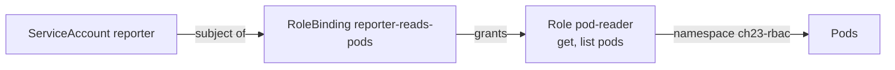

# Chapter 23: RBAC and ServiceAccounts

> **Exams:** CKA · CKS
> **Difficulty:** Intermediate
> **Time:** ~50 min reading, ~35 min lab
> **Lab tier:** 1 (kind)
> **Prerequisites:** Chapter 06 (Labels and selectors), Chapter 07 (Secrets), Chapter 08 (Jobs)

## Learning objectives

After this chapter you can:

- Separate authentication (who you are) from authorization (what you may do), and say which one RBAC handles
- Write a Role and bind it with a RoleBinding, and explain why a Role is namespaced and a ClusterRole is not
- Name the verbs, resources, and API groups in a rule, and predict whether a request is allowed
- Give a Pod an identity with a ServiceAccount, and explain what a Pod does with its token by default
- Turn off automatic token mounting, on the ServiceAccount or on the Pod, and verify that the token is gone
- Use `kubectl auth can-i` and `--as` to test permissions without running a Pod

## Concepts

### Authentication and authorization

Every request to the API server goes through two checks, in this order:

1. **Authentication** establishes who is asking: a user with a client certificate,
   a token from an identity provider, or a ServiceAccount token from inside a Pod.
2. **Authorization** decides whether that identity may perform the request. RBAC
   (role-based access control) is the authorization mode that most clusters use.
   The kind cluster of this book has it on.

A request that authenticates but has no matching permission gets `403 Forbidden`.
A request with no valid identity gets `401 Unauthorized`. This chapter is about the
second step, and about ServiceAccounts, which give Pods an identity.

### Roles and bindings

RBAC has four objects, and they split into two pairs:

| Object | Scope | What it holds |
| --- | --- | --- |
| `Role` | one namespace | A list of rules: which verbs on which resources |
| `RoleBinding` | one namespace | Who gets a Role or ClusterRole in that namespace |
| `ClusterRole` | the whole cluster | Rules for cluster-scoped resources, or for any namespace |
| `ClusterRoleBinding` | the whole cluster | Who gets a ClusterRole everywhere |

A rule has three parts:

- **apiGroups**: the API group, such as `""` for the core group (Pods, Services, Secrets), `apps` for Deployments, `batch` for Jobs.
- **resources**: the resource names, such as `pods`, `pods/log`, or `deployments`.
- **verbs**: the actions, such as `get`, `list`, `watch`, `create`, `update`, `patch`, `delete`.

A Role grants nothing by itself. A binding names a subject (a user, a group, or a
ServiceAccount) and the role it receives. A RoleBinding can point at a ClusterRole,
which limits that ClusterRole's rules to the binding's namespace. That is a common
way to reuse one set of rules across namespaces without granting them cluster-wide.



The subject is bound to the role inside one namespace. The Role's rules
apply only to objects in that namespace.

### Permissions are additive

RBAC has no deny rules. A request is allowed if some binding grants it, and denied
otherwise. Giving a subject a second role adds permissions and never removes any.
To take a permission away, remove the binding that gives it.

### ServiceAccounts and their tokens

A ServiceAccount is an identity for Pods, namespaced like any other object. Every
namespace has a `default` ServiceAccount, which Pods use unless told otherwise. It
has no permissions of its own, so a Pod that uses it can do nothing beyond what
the API server allows anonymously, which is little.

A Pod uses a ServiceAccount through `spec.serviceAccountName`. When the Pod starts,
the kubelet mounts a token, a short-lived JWT, into the container at
`/var/run/secrets/kubernetes.io/serviceaccount/token`, along with the cluster's CA
certificate and the namespace name. The application uses the token as a bearer
token when it calls the API server.

Two fields decide whether the token is mounted:

- `automountServiceAccountToken` on the ServiceAccount sets the default for every Pod that uses it.
- The same field on the Pod overrides that default.

A Pod that does not call the API should not have a token. Setting the field to
`false` removes the mount, and the container cannot talk to the API as its identity.

Tokens are issued by the TokenRequest API and have a limited lifetime. You can ask
for one yourself with `kubectl create token NAME --duration=10m`, which is useful for
testing a ServiceAccount's permissions from outside a Pod.

### Testing permissions with auth can-i

`kubectl auth can-i VERB RESOURCE` answers whether you may do something. With
`--as`, it answers for another identity, which is the fastest way to check RBAC:

```bash
kubectl auth can-i list pods --as=system:serviceaccount:NAMESPACE:NAME -n NAMESPACE
kubectl auth can-i --list --as=system:serviceaccount:NAMESPACE:NAME -n NAMESPACE
```

`system:serviceaccount:NAMESPACE:NAME` is how a ServiceAccount is named in an
identity. `--list` shows every rule that applies to the identity.

## Guided walkthrough

The walkthrough works in the Namespace `ch23-demo`. The outputs below are trimmed:
tokens, names, and ages differ on your cluster. The objects are named `demo-...`, and the
lab later in this chapter uses its own namespace, `ch23-rbac`. Create the demo namespace with
`kubectl create namespace ch23-demo`.

### See what the default ServiceAccount may do

Ask whether the default ServiceAccount in the demo namespace can list Pods:

```bash
kubectl auth can-i list pods --as=system:serviceaccount:ch23-demo:default -n ch23-demo
```

```text
no
```

A new namespace's default ServiceAccount has no permissions, so the answer is `no`.

### Grant a role to a ServiceAccount

Create a ServiceAccount, a Role that reads Pods, and a RoleBinding that gives the
Role to the ServiceAccount:

```bash
kubectl -n ch23-demo create serviceaccount demo-sa
kubectl -n ch23-demo create role demo-reader --verb=get,list --resource=pods
kubectl -n ch23-demo create rolebinding demo-reads --role=demo-reader --serviceaccount=ch23-demo:demo-sa
kubectl auth can-i list pods --as=system:serviceaccount:ch23-demo:demo-sa -n ch23-demo
kubectl auth can-i delete pods --as=system:serviceaccount:ch23-demo:demo-sa -n ch23-demo
```

```text
serviceaccount/demo-sa created
role.rbac.authorization.k8s.io/demo-reader created
rolebinding.rbac.authorization.k8s.io/demo-reads created
yes
no
```

The ServiceAccount may list Pods but not delete them, because the Role's verbs are
only `get` and `list`. Read the rules that the Role grants:

```bash
kubectl -n ch23-demo describe role demo-reader
kubectl -n ch23-demo get rolebinding demo-reads -o jsonpath='{.roleRef.kind}/{.roleRef.name} -> {.subjects[0].kind}:{.subjects[0].namespace}/{.subjects[0].name}{"\n"}'
```

```text
PolicyRule:
  Resources  Non-Resource URLs  Resource Names  Verbs
  ---------  -----------------  --------------  -----
  pods       []                 []              [get list]
Role/demo-reader -> ServiceAccount:ch23-demo/demo-sa
```

### Get a token for the ServiceAccount

Ask the TokenRequest API for a short-lived token. Print only its first characters,
because a token is a credential:

```bash
kubectl -n ch23-demo create token demo-sa --duration=10m | cut -c1-12
```

```text
eyJhbGciOiJS
```

Every JWT starts with the same header, so the first characters only show that it is
a token. Do not paste a whole token into a log, a chat, or a file in the project.

### See the token mounted into a Pod

Create a Pod that runs as `demo-sa`, and list the files the kubelet mounted:

```bash
cat <<'YAML' | kubectl -n ch23-demo apply -f -
apiVersion: v1
kind: Pod
metadata:
  name: demo-pod
spec:
  serviceAccountName: demo-sa
  containers:
    - name: app
      image: busybox:1.36
      command: ["sleep", "3600"]
YAML
kubectl -n ch23-demo wait --for=condition=Ready pod/demo-pod --timeout=120s
kubectl -n ch23-demo get pod demo-pod -o jsonpath='{.spec.volumes[*].name}{"\n"}'
kubectl -n ch23-demo exec demo-pod -- ls /var/run/secrets/kubernetes.io/serviceaccount
```

```text
pod/demo-pod condition met
kube-api-access-ndldv
ca.crt
namespace
token
```

The volume is named `kube-api-access-` followed by a suffix. It holds the token,
the CA certificate of the API server, and the namespace. A process in the container
can call the API with that identity. The Role above is the only thing it can do.

Clean up the demo namespace:

```bash
kubectl delete namespace ch23-demo
```

```text
namespace "ch23-demo" deleted
```

## Hands-on lab

The lab works like a KodeKloud lab: one task at a time, a check after each, and
progress that is saved between sessions.

```bash
make lab CH=23       # set up the lab and show task 1
make check CH=23     # check the current task; if it is right, show the next
make question CH=23  # show the current task again
make reset CH=23     # back to the starting state and task 1
make verify CH=23    # check every task at once
```

Everything happens in the Namespace `ch23-rbac`: use `-n ch23-rbac` on every command,
or run `make use-namespace CH=23` once. The setup creates a ServiceAccount `builder`.
The ServiceAccount `reporter` does not exist yet, and Task 1 creates it. Tasks 1 and 2
are independent, and Task 3 needs the permissions from Tasks 1 and 2. The lab
removes its ClusterRole and ClusterRoleBinding at reset and teardown.

Full solutions are in [`lab/solutions.md`](lab/solutions.md).

### Task 1: A namespaced reader for pods

Create a ServiceAccount named `reporter`. In the namespace, create a Role named
`pod-reader` that allows `get` and `list` on Pods, and a RoleBinding named
`reporter-reads-pods` that gives the Role to `reporter`.

- ServiceAccount `reporter`, Role `pod-reader` with verbs `get` and `list` on `pods`, RoleBinding `reporter-reads-pods` to `reporter`
- `reporter` may list and get Pods, but may not delete them

### Task 2: Read nodes across the cluster

Create a ClusterRole named `ch23-node-viewer` that allows `get` and `list` on `nodes`.
Bind it to `reporter` with a ClusterRoleBinding named `ch23-reporter-nodes`.

- ClusterRole `ch23-node-viewer`: verbs `get` and `list` on `nodes`
- ClusterRoleBinding `ch23-reporter-nodes` to the ServiceAccount `reporter`
- `reporter` may list nodes

### Task 3: A Pod that uses the reader's identity

Create a Pod named `probe` that runs as the ServiceAccount `reporter`. It runs the image
`curlimages/curl:8.11.1` with the command `sleep 3600`. From inside the Pod, the
API must return `200` when it lists Pods in the namespace, and `403` when it deletes
the Pod `probe`. Use the token and the CA certificate in
`/var/run/secrets/kubernetes.io/serviceaccount`.

- Pod `probe`, serviceAccountName `reporter`, Running
- Listing pods in `ch23-rbac` returns `200`; deleting the Pod `probe` returns `403`

### Task 4: A ServiceAccount whose token is not mounted

Set `automountServiceAccountToken` to `false` on the ServiceAccount `builder`. Create a
Pod named `quiet` that runs `busybox:1.36` with the command `sleep 3600` and uses
`builder`. The Pod must have no service account token file.

- ServiceAccount `builder`: `automountServiceAccountToken: false`
- Pod `quiet`, serviceAccountName `builder`, Running, with no file at `/var/run/secrets/kubernetes.io/serviceaccount/token`

### Task 5: Record a permission answer

Write the answer of `kubectl auth can-i delete pods` for the ServiceAccount `reporter`,
in the namespace `ch23-rbac`, into `/tmp/ch23-can-delete.txt`. The answer is `yes` or
`no`, and nothing else.

- File `/tmp/ch23-can-delete.txt` holds the answer of `kubectl auth can-i`

## Exam tips

> **Exam tip:** `kubectl auth can-i VERB RESOURCE --as=system:serviceaccount:NS:NAME -n NS` answers most RBAC questions in one line. Use it to check your Role before you move on, and `--list` to see every rule that applies.
>
> **Exam tip:** `kubectl create role NAME --verb=... --resource=...` and `kubectl create rolebinding NAME --role=... --user=...` or `--serviceaccount=NS:NAME` write the objects for you. The binding's subject must name the namespace of a ServiceAccount, not only its name.
>
> **Exam tip:** A Pod that needs no API access should set `automountServiceAccountToken: false`. The field can go on the Pod or on the ServiceAccount, and the Pod's setting wins when both are present.

## Common mistakes

- Giving a Role a `resources` entry that the apiGroups do not cover. `deployments` is in `apps`, not in the core group.
- Expecting a RoleBinding to grant a ClusterRole's rules across the cluster. It only grants them in the binding's namespace.
- Writing `--serviceaccount=NAME` without the namespace, so the binding names a subject that does not exist.
- Treating `403` and `401` as the same. `401` means the identity is missing or invalid; `403` means the identity is known and not allowed.
- Printing a whole token into a file or a chat. Use `kubectl create token` with `cut`, and treat tokens as passwords.
- Expecting a Pod to lose its token when its Role changes. The token is the identity; the permissions come from the bindings.
- Forgetting that a Pod's token mount can be disabled both on the ServiceAccount and on the Pod, and that the Pod's setting wins.

<!-- QUESTIONS:START -->

## End-of-chapter questions

**1.** `CKA` `CKS` A request to the API server comes from a valid identity, but that identity has no permission for the action. Which HTTP status does the client see?

- **A.** 401 Unauthorized
- **B.** 403 Forbidden
- **C.** 404 Not Found
- **D.** 500 Internal Server Error

**2.** `CKA` `CKS` Which object grants permissions in one namespace to a subject, and can point at a ClusterRole?

- **A.** A ClusterRoleBinding
- **B.** A RoleBinding
- **C.** A ServiceAccount
- **D.** A Role

**3.** `CKA` `CKS` A rule lists `apiGroups: [""]`, `resources: [pods]`, `verbs: [get, list]`. Which request is allowed by this rule alone?

- **A.** Deleting a Pod
- **B.** Listing Pods in the namespace
- **C.** Creating a Deployment in the apps group
- **D.** Reading a Secret

**4.** `CKA` `CKS` A subject has two bindings: one gives `get` on Pods, and another gives `list` on Pods. What can the subject do?

- **A.** Only get, because the first binding wins
- **B.** Both get and list, because RBAC permissions add up
- **C.** Neither, because the bindings conflict
- **D.** Only list, because it was granted last

**5.** `CKA` `CKS` Which field stops the kubelet from mounting a ServiceAccount token into a Pod that does not need the API?

- **A.** `spec.serviceAccountName: none`
- **B.** `automountServiceAccountToken: false` on the Pod or the ServiceAccount
- **C.** `spec.securityContext.readOnlyRootFilesystem: true`
- **D.** `spec.volumes` with an empty secret

**6.** `CKA` `CKS` You want to check whether the ServiceAccount `app` in namespace `shop` can list Secrets in namespace `shop`, without running a Pod. Which command does that?

- **A.** `kubectl auth can-i list secrets --as=system:serviceaccount:shop:app -n shop`
- **B.** `kubectl get secrets --as=app`
- **C.** `kubectl describe serviceaccount app`
- **D.** `kubectl auth whoami`

**7.** `CKA` `CKS` A Role lives in namespace `prod`. Which of these can it grant permissions on?

- **A.** Pods in namespace `prod` only
- **B.** Nodes, because nodes are the most important resource
- **C.** Pods in every namespace, when bound with a RoleBinding
- **D.** Only Secrets, because a Role is for secrets

**8. (Task)** `CKA` In namespace `prod`, create a ServiceAccount named `deployer`. Give it a Role named `deploy-manager` that allows `get`, `list`, `create` and `update` on Deployments in the `apps` group, and bind it with a RoleBinding named `deployer-manages`. Show whether `deployer` may delete Deployments.

**9. (Task)** `CKA` Create a ClusterRole named `ns-lister` that allows `list` on namespaces. Bind it to the user `auditor` with a ClusterRoleBinding named `auditor-lists-ns`. Show whether `auditor` may list namespaces.

**10. (Task)** `CKA` In namespace `prod`, a Pod named `batch-run` must not receive an API token, and it runs the image `busybox:1.36` with the command `sleep 3600`. Create it so that its service account token is not mounted, then show the value of `automountServiceAccountToken` on the Pod.

**11. (Task)** `CKA` Print the rules that apply to the ServiceAccount `deployer` in namespace `prod` (see question 8) with `kubectl auth can-i --list`, and save the output to `/tmp/ch23-q11.txt`.

<details>
<summary>Answers</summary>

**1. B.** 401 means the identity is missing or invalid, which is an authentication failure. 403 means the identity is known and the authorization check denied it. RBAC decides 403; the identity itself came from authentication.

**2. B.** A RoleBinding grants a Role or a ClusterRole to subjects within its own namespace. A ClusterRoleBinding grants a ClusterRole across the whole cluster. A Role and a ServiceAccount do not grant anything on their own.

**3. B.** The empty API group is the core group, where Pods live. The verbs `get` and `list` allow reading Pods. Deleting, creating a Deployment, and reading Secrets each need a different verb, group or resource.

**4. B.** RBAC has no deny rules, and every binding adds permissions. The subject can get and list Pods. To remove a permission, remove the binding that grants it.

**5. B.** `automountServiceAccountToken: false` on the ServiceAccount sets the default for its Pods, and the Pod's own field overrides it. The other options do not control the token mount, and `serviceAccountName` does not accept `none`.

**6. A.** `kubectl auth can-i` with `--as` evaluates the RBAC rules for another identity, and the ServiceAccount name is written as `system:serviceaccount:NAMESPACE:NAME`. `--as=app` names no real identity, and the other two commands do not evaluate permissions.

**7. A.** A Role's rules apply to objects in its own namespace. Nodes are cluster-scoped, so granting them needs a ClusterRole and a ClusterRoleBinding. A RoleBinding cannot widen a Role beyond its namespace.

**8.**

```bash
kubectl -n prod create serviceaccount deployer
kubectl -n prod create role deploy-manager --verb=get,list,create,update --resource=deployments.apps
kubectl -n prod create rolebinding deployer-manages --role=deploy-manager --serviceaccount=prod:deployer
kubectl auth can-i delete deployments --as=system:serviceaccount:prod:deployer -n prod
```

The `--resource` flag accepts `deployments.apps` to name the group. The last command
prints `no`, because no verb `delete` was granted.

**9.**

```bash
kubectl create clusterrole ns-lister --verb=list --resource=namespaces
kubectl create clusterrolebinding auditor-lists-ns --clusterrole=ns-lister --user=auditor
kubectl auth can-i list namespaces --as=auditor
```

Namespaces are cluster-scoped, so the rule needs a ClusterRole, and the binding needs
a ClusterRoleBinding. The answer is `yes`.

**10.**

```bash
cat <<'YAML' | kubectl -n prod apply -f -
apiVersion: v1
kind: Pod
metadata:
  name: batch-run
spec:
  automountServiceAccountToken: false
  containers:
    - name: batch-run
      image: busybox:1.36
      command: ["sleep", "3600"]
YAML
kubectl -n prod get pod batch-run -o jsonpath='{.spec.automountServiceAccountToken}{"\n"}'
```

The Pod's own field is used here. It overrides the ServiceAccount's setting, which
is why it works even when the ServiceAccount itself mounts tokens.

**11.**

```bash
kubectl auth can-i --list --as=system:serviceaccount:prod:deployer -n prod > /tmp/ch23-q11.txt
cat /tmp/ch23-q11.txt
```

The output lists the resources and verbs granted by every binding for that identity,
including the Deployment rule from question 8.

</details>

<!-- QUESTIONS:END -->

## Further reading

- Kubernetes documentation: *Using RBAC Authorization*, *Role and ClusterRole*, *RoleBinding and ClusterRoleBinding*
- Kubernetes documentation: *Configure Service Accounts for Pods*, *Managing Service Accounts*
- Kubernetes documentation: *Authorization Overview* and *Authenticating*
- Chapter 24 next: CRDs, operators, and the extension interfaces (CRI, CNI, CSI)
