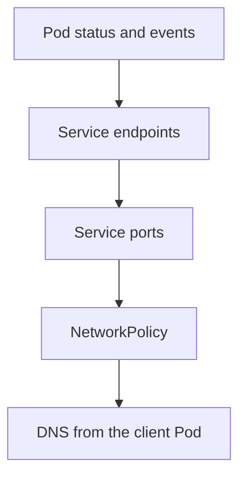

# Chapter 26: Troubleshooting I: applications and networking

> **Exams:** CKA
> **Difficulty:** Advanced
> **Time:** ~60 min reading, ~40 min lab
> **Lab tier:** 1 (kind)
> **Prerequisites:** Chapters 04 to 11 and 21 to 23 (Pods, Services, DNS, NetworkPolicy, RBAC)

## Learning objectives

After this chapter you can:

- Follow one order of checks for a broken application: status, events, endpoints, policies, DNS
- Read a Pod's state and its events to name the fault: an image that cannot be pulled, a crash, a failing probe
- Find a Service that routes nowhere, and tell a wrong selector from a wrong port
- Test a NetworkPolicy by sending traffic, and find the rule that blocks it
- Find a DNS problem from inside a Pod, using its `resolv.conf` and `nslookup`
- Attach an ephemeral debug container to a running Pod that has no tools in its image

## Concepts

### An order of checks

A broken application is usually a chain: a Pod, a Service in front of it, a policy
around it, and a name that finds the Service. Each link has its own evidence, and
the cheapest checks come first. A good order:

1. **The Pod's status**: is it `Running`, and is it `Ready`? `kubectl get pods` answers this in one line.
2. **The events**: `kubectl describe pod NAME`, at the bottom. Events name image pull errors, failed probes, and scheduling problems.
3. **The logs**: what the application itself says, with `kubectl logs`.
4. **The Service's endpoints**: are any ready Pods behind the Service? An empty list means the selector or the readiness is wrong.
5. **The ports**: does the Service's `targetPort` match the port the container listens on?
6. **The policies**: is traffic allowed? Test it with a Pod that should be allowed.
7. **The name**: does the Pod resolve the Service's name, and through which nameserver?



Each step narrows the next. A Service with no endpoints makes the port and the
policy irrelevant, and a DNS failure makes every name check look broken at once.
Checking the chain in this order avoids chasing the wrong link.

### Pod faults

A Pod that does not run shows its fault in its status, and the reason is in its events:

- `ImagePullBackOff` or `ErrImagePull`: the image name, tag, or registry is wrong, or the pull secret is missing. The event names the image.
- `CrashLoopBackOff`: the container starts and exits. Read `kubectl logs --previous`, and the exit code in `lastState`.
- `Running` but not `Ready`: a readiness probe fails. The events show the probe's output, and the Pod is removed from its Services' endpoints.
- `Pending`: no node can take it. The events name the reason, such as a missing node label or an untolerated taint (Chapter 17).

### Services that route nowhere

A Service has two things that must agree with its Pods:

- **The selector** decides which Pods are endpoints. A typo in a label value leaves the endpoint list empty. `kubectl get endpointslices -l kubernetes.io/service-name=NAME` shows the list. An empty list is the first thing to look for.
- **The target port** decides which port on the Pod receives the traffic. If the container listens on 8080 and the Service's `targetPort` is 80, the connection is refused, even though the endpoints exist.

Compare the two sides: the Service's `spec.selector` with the Pods' labels, and the
Service's `targetPort` with the container's real port. A Pod's ready endpoint with
a refused connection is a port problem; no endpoint at all is a selector problem.

### NetworkPolicy from the client's side

A NetworkPolicy that blocks traffic produces no error. The client waits and times out.
Find the policy with `kubectl get networkpolicy` and read which Pods it selects and
which sources it admits. Test with a client Pod that should be allowed: a request that
times out with `curl -m 5` is a policy, while a `connection refused` means something
answered and refused. Test with the Pod's IP as well as the Service's name, to tell a
policy problem from a Service problem.

### Name resolution from inside a Pod

A Pod's `/etc/resolv.conf` sets its nameserver and its search domains. The cluster's
DNS service, `kube-dns` in `kube-system`, is normally the nameserver, with the search
path of Chapter 11. A Pod with `dnsPolicy: None` or a custom `dnsConfig` uses whatever
it was given. A wrong nameserver makes every name fail, while IP addresses still work.

Test resolution from inside the Pod, with `nslookup` on a fully qualified name such as
`kubernetes.default.svc.cluster.local`. Compare the nameserver in `/etc/resolv.conf`
with `kubectl -n kube-system get service kube-dns`.

### Debugging without tools in the image

Many images have no shell and no `ps`, `curl`, or `nslookup`. An **ephemeral debug
container** is added to a running Pod and shares its process namespace, so it sees
the application's processes and files without changing the application's image. The
Pod itself is not restarted.

```bash
kubectl debug POD -it --image=busybox:1.36 --target=CONTAINER --profile=general
```

`--target` names the container whose processes the debug container joins. Ephemeral
containers cannot be removed from a Pod, so the Pod is replaced to clear them.

## Guided walkthrough

The walkthrough works in the Namespace `ch26-demo`. The outputs below are trimmed:
ages, IDs, and timestamps differ on your cluster. The objects are named `demo-...`.
The lab later in this chapter uses its own namespace, `ch26-broken`. Create the
demo namespace with `kubectl create namespace ch26-demo`.

### Read the status, then the events

A Pod with a misspelled image tag:

```bash
kubectl -n ch26-demo run demo-pod --image=nginx:1.27-typo
kubectl -n ch26-demo get pod demo-pod
kubectl -n ch26-demo describe pod demo-pod | sed -n '/Events:/,$p' | tail -4
```

```text
NAME       READY   STATUS             RESTARTS   AGE
demo-pod   0/1     ImagePullBackOff   0          20s
  Warning  Failed     17s (x2 over 18s)  kubelet  spec.containers{demo-pod}: Error: ImagePullBackOff
  Normal   Pulling    2s (x2 over 19s)   kubelet  spec.containers{demo-pod}: Pulling image "nginx:1.27-typo"
  Warning  Failed     2s (x2 over 19s)   kubelet  spec.containers{demo-pod}: Failed to pull image "nginx:1.27-typo": rpc error: code = NotFound
```

The status says `ImagePullBackOff`, and the event names the image. The fault is
the tag, not the cluster, so the fix goes in the spec.

### Find a Service with no endpoints

A Service whose selector has a typo, serving a Pod that is running and ready:

```bash
kubectl -n ch26-demo run demo-web --image=nginx:1.27 --labels=app=web --port=80
kubectl -n ch26-demo expose pod demo-web --name=demo-svc --port=80
kubectl -n ch26-demo patch svc demo-svc -p '{"spec":{"selector":{"app":"wbe"}}}'
kubectl -n ch26-demo get endpointslices -l kubernetes.io/service-name=demo-svc -o jsonpath='endpoints={range .items[*].endpoints[*]}{.addresses[0]} {end}{"\n"}'
kubectl -n ch26-demo get pods --show-labels | grep demo-web
```

```text
endpoints=
demo-web   1/1     Running   0     1s    app=web
```

The Pod is ready, the Service exists, and the endpoint list is empty. The selector
asks for `app=wbe`, while the Pod is labelled `app=web`. Correcting the selector
puts the Pod back behind the Service.

### Use a debug container on a Pod with no tools

The application image here has no `ps`, so attach a debug container that shares
its process namespace:

```bash
kubectl -n ch26-demo run demo-app --image=busybox:1.36 --command -- sh -c 'sleep 3600'
kubectl -n ch26-demo wait --for=condition=Ready pod/demo-app --timeout=120s
kubectl -n ch26-demo debug pod/demo-app --image=busybox:1.36 --target=demo-app -c dbg --profile=general -- sleep 600
kubectl -n ch26-demo get pod demo-app -o jsonpath='ephemeral={.spec.ephemeralContainers[*].name} state={.status.ephemeralContainerStatuses[0].state}{"\n"}'
kubectl -n ch26-demo exec demo-app -c dbg -- ps
```

```text
ephemeral=dbg state={"running":{"startedAt":"2026-10-13T11:00:52Z"}}
PID   USER     TIME  COMMAND
    1 root      0:00 sh -c sleep 3600
   11 root      0:00 sleep 600
   21 root      0:00 ps
```

The debug container sees PID 1 of the application's container, so the process
namespace is shared. The `--profile=general` flag gives the container the
permissions that process inspection needs.

Clean up the demo:

```bash
kubectl delete namespace ch26-demo
```

```text
namespace "ch26-demo" deleted
```

## Hands-on lab

The lab works like a KodeKloud lab: one task at a time, a check after each, and
progress that is saved between sessions.

```bash
make lab CH=26       # set up the lab and show task 1
make check CH=26     # check the current task; if it is right, show the next
make question CH=26  # show the current task again
make reset CH=26     # back to the starting state and task 1
make verify CH=26    # check every task at once
```

Everything happens in the Namespace `ch26-broken`: use `-n ch26-broken` on every command,
or run `make use-namespace CH=26` once. The setup creates five independent faults,
one for each task. Each task fixes its own fault, and no task depends on another.
Find each fault with the order of checks above; the events, the endpoints, the
policy and the name lookup each point at one of them.

Full solutions are in [`lab/solutions.md`](lab/solutions.md).

### Task 1: The Deployment that cannot pull its image

The Deployment `api` is not ready. Fix it so that it runs the image `nginx:1.27`, and
it is ready.

- Deployment `api`: image `nginx:1.27`, ready replicas `1`

### Task 2: The Service with no endpoints

The Service `web` routes to no Pod. Fix it so that its ready endpoints are the Pods of
the Deployment `web`.

- Service `web`: its ready endpoints are the Pods labelled `app=web`

### Task 3: The Service on the wrong port

The Service `app` sends traffic to the port 80, but the application listens on 8080.
Fix the Service so that its target port is 8080, and that the Pod of `app` is an endpoint.

- Service `app`: target port `8080`, and the Pod labelled `app=app` is a ready endpoint

### Task 4: The policy that cuts off the client

The NetworkPolicy `lock` blocks the Pod `client`, which is labelled `role=client`. Change
the policy so that it admits `role=client` on TCP port 8080. The client must reach the
application's Pod directly, on its IP and port 8080.

- NetworkPolicy `lock`: admits `role=client` on TCP port 8080
- From the Pod `client`, the application's Pod answers on port 8080

### Task 5: The Pod with the wrong nameserver

The Pod `resolver` cannot resolve names, because its DNS configuration points at a
nameserver that does not answer. Recreate it, with the same name and image, using the
cluster's DNS service as its nameserver. Its name lookup of
`kubernetes.default.svc.cluster.local` must succeed.

- Pod `resolver`: running, and resolves `kubernetes.default.svc.cluster.local`

## Exam tips

> **Exam tip:** `kubectl describe` shows the events at the bottom, and most Pod faults are named there. Read them before you read the spec.
>
> **Exam tip:** `kubectl get endpointslices -l kubernetes.io/service-name=NAME` is the quickest check for a Service. An empty list means the selector is wrong, and no port check helps until it is fixed.
>
> **Exam tip:** A NetworkPolicy fault has no error message. Test it by sending traffic from a Pod that should be allowed, and look at the policy's `podSelector` and `from` fields.
>
> **Exam tip:** `kubectl debug POD -it --image=busybox:1.36 --target=CONTAINER --profile=general` is the way to inspect a Pod whose image has no tools. Remember that it cannot be removed, so the Pod is replaced to clear it.

## Common mistakes

- Looking at logs first. A Pod that never started has no logs, and its events are the evidence.
- Fixing the Service's port when its endpoints are empty. An empty endpoint list is a selector problem, and the port does not matter yet.
- Reading `connection timed out` as a Service problem. A timeout from a client usually means a NetworkPolicy, while `connection refused` means something answered.
- Editing a Pod's `dnsConfig` in place. It is immutable, so the Pod is replaced.
- Testing a name with `ping`. Many images do not have it, and `nslookup` shows the resolver's answer directly.
- Assuming a debug container is free. It shares the Pod's process namespace, so it sees everything the application's container sees.

<!-- QUESTIONS:START -->

## End-of-chapter questions

**1.** `CKA` A Pod shows `ImagePullBackOff`. Where is the most specific evidence of what went wrong?

- **A.** In the container's logs, which are empty
- **B.** In the Pod's events, which name the image and the pull error
- **C.** In the node's kubelet configuration file
- **D.** In the Service that routes to the Pod

**2.** `CKA` A Service has a cluster IP and its Pods are ready, but its EndpointSlice list is empty. What is the most likely fault?

- **A.** The Service's targetPort is wrong
- **B.** The Service's selector does not match the labels of the ready Pods
- **C.** CoreDNS is down
- **D.** The container image is missing

**3.** `CKA` A client's request to a Service times out after a few seconds, and nothing answers. Which fault is most likely?

- **A.** A NetworkPolicy that does not admit the client
- **B.** A container that exited with code 0
- **C.** A missing ServiceAccount
- **D.** A wrong image tag

**4.** `CKA` A container listens on port 8080, but its Service's targetPort is 80. Which symptom do you expect from a client?

- **A.** The Service has no endpoints
- **B.** Connections to the Service are refused, while the endpoints still exist
- **C.** The Pod is not scheduled
- **D.** DNS cannot resolve the Service's name

**5.** `CKA` A Pod is Running but not Ready. What happens to its traffic?

- **A.** It keeps receiving traffic, because it is Running
- **B.** It is removed from the endpoints of its Services until its readiness probe passes
- **C.** It is restarted immediately
- **D.** It is deleted by the scheduler

**6.** `CKA` A Pod has `dnsPolicy: None` and a `dnsConfig` that names a nameserver that does not answer. Which lookups fail?

- **A.** Only lookups of external names
- **B.** Name lookups of every kind, while IP addresses still work
- **C.** Only lookups of Services in other namespaces
- **D.** None, because dnsPolicy None uses the node's resolver

**7.** `CKA` Why is an ephemeral debug container useful for a Pod whose image has no shell or `ps`?

- **A.** It restarts the Pod with the debug tools built in
- **B.** It shares the Pod's process namespace and runs beside the application without changing its image
- **C.** It copies the application's image and runs it as root
- **D.** It replaces the application's container

**8. (Task)** `CKA` In namespace `prod`, the Service `cart` has no ready endpoints. Its Deployment `cart` runs Pods labelled `app=cart`, and the Service's selector reads `app=carts`. Fix the Service so that its ready endpoints are the Deployment's Pods. Show the Service's selector.

**9. (Task)** `CKA` In namespace `prod`, the Pod `broken` cannot start, because its image cannot be pulled. Write the image name that the Pod is configured to use into `/tmp/ch26-q09.txt`, and nothing else.

**10. (Task)** `CKA` In namespace `prod`, the Pod `app` runs a container named `app` with no shell. Attach an ephemeral debug container named `dbg` that uses the image `busybox:1.36`, and targets the container `app`. Then write the number of ephemeral containers in the Pod to `/tmp/ch26-q10.txt`, and nothing else.

**11. (Task)** `CKA` In namespace `prod`, the Service `app` forwards traffic to a target port. Write that target port's number into `/tmp/ch26-q11.txt`, and nothing else.

<details>
<summary>Answers</summary>

**1. B.** The kubelet records each failed pull as an event on the Pod, with the image name and the error. Container logs do not exist yet, because the container never started. The node configuration and the Service are unrelated to the pull.

**2. B.** Endpoints are the ready Pods that match the Service's selector. An empty list means no ready Pod matches. A wrong targetPort still leaves the endpoints in place, and a DNS fault affects names, not endpoints.

**3. A.** A NetworkPolicy that blocks a source makes the packets disappear, so the client times out. A refused connection, by contrast, means something answered and rejected it. A missing ServiceAccount or a wrong image tag does not affect network traffic that reaches a running Pod.

**4. B.** The endpoints are correct, because the selector matches the ready Pods. The traffic is sent to port 80 on the Pod, where nothing listens, so the connection is refused. A selector problem would leave the endpoints empty.

**5. B.** Readiness decides whether a Pod is an endpoint. A Pod that is Running but not Ready is removed from its Services' endpoints, and the kubelet keeps it running. A failing liveness probe is what restarts a container.

**6. B.** With `dnsPolicy: None`, the Pod uses exactly the nameservers in its dnsConfig. If none of them answers, every name lookup fails. Connections to IP addresses do not need DNS, so they still work.

**7. B.** An ephemeral container is added to a running Pod, and with `--target` it can see the application's processes. The Pod is not restarted, and the application's image is unchanged. Ephemeral containers cannot be removed from the Pod, so the Pod is replaced to clear them.

**8.**

```bash
kubectl -n prod patch service cart -p '{"spec":{"selector":{"app":"cart"}}}'
kubectl -n prod get service cart -o jsonpath='{.spec.selector.app}{"\n"}'
```

The selector is the only link between the Service and its Pods. The value `carts`
matched no Pod, and `cart` matches the Deployment's labels.

**9.**

```bash
kubectl -n prod run broken --image=nginx:1.27-missing --restart=Never
kubectl -n prod get pod broken -o jsonpath='{.spec.containers[0].image}' > /tmp/ch26-q09.txt
cat /tmp/ch26-q09.txt
```

The image name is in the Pod's spec, and the event that says why it failed names the
same image. The answer comes from the spec, because the question asks what the Pod is configured to use.

**10.**

```bash
kubectl -n prod run app --image=busybox:1.36 --command -- sh -c 'sleep 3600'
kubectl -n prod wait --for=condition=Ready pod/app --timeout=120s
kubectl -n prod debug pod/app --image=busybox:1.36 --target=app -c dbg --profile=general -- sleep 600
sleep 5
kubectl -n prod get pod app -o jsonpath='{.spec.ephemeralContainers[*].name}' | wc -w | tr -d '[:space:]' > /tmp/ch26-q10.txt
cat /tmp/ch26-q10.txt
```

The debug container is added to the spec, so the count is one. `--target` makes it
share the process namespace of the application's container.

**11.**

```bash
kubectl -n prod expose pod app --name=app --port=80 --target-port=8080
kubectl -n prod get service app -o jsonpath='{.spec.ports[0].targetPort}' > /tmp/ch26-q11.txt
cat /tmp/ch26-q11.txt
```

The Service's `targetPort` is the port on the Pod that receives the traffic. The
answer comes from the spec, not from the container's image.

</details>

<!-- QUESTIONS:END -->

## Further reading

- Kubernetes documentation: *Debugging Pods*, *Debugging Services*, *Debugging DNS Resolution*
- Kubernetes documentation: *Ephemeral Containers*, *Debug Running Pods*
- Kubernetes documentation: *Troubleshooting Clusters* (the sections on applications and networking)
- Chapter 27 next: troubleshooting II, nodes, the kubelet, the control plane and certificates
