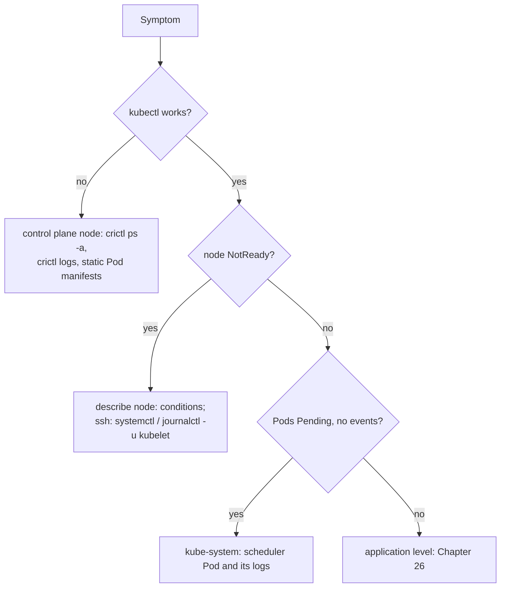

# Chapter 27: Troubleshooting II: nodes, the kubelet, the control plane, and certificates

> **Exams:** CKA
> **Difficulty:** Advanced
> **Time:** ~45 min reading, ~45 min lab
> **Lab tier:** 2 (VirtualBox VMs, `envs/vagrant`, snapshot `cluster`)
> **Prerequisites:** Chapter 18 (kubeadm), Chapter 26 (troubleshooting applications), Chapter 02 (static Pods)

## Learning objectives

After this chapter you can:

- Read a node's conditions and taints, and tell a node whose kubelet stopped from one that is under pressure
- Find the kubelet's configuration on a kubeadm node: its systemd unit, drop-in, flags, config file, and kubeconfig
- Debug the kubelet with `systemctl` and `journalctl`, and containers with `crictl` when the API server cannot help
- Find a broken control plane component, read its logs even when `kubectl` cannot, and fix its static Pod manifest
- Check certificate expiry with `kubeadm` and `openssl`, renew a certificate, and confirm that the new one is in use

## Concepts

Chapter 26 started from a broken application and worked down. This chapter
starts lower: the nodes and the control plane that everything else depends on.
When these break, the symptoms appear far away, in Pods that stay `Pending` or
nodes that go `NotReady`, so the skill is following the symptom back to the
component.

### Node conditions and the node controller

Every kubelet reports its node's **conditions** to the API server: `Ready`,
plus `MemoryPressure`, `DiskPressure`, and `PIDPressure`, which turn `True`
when the node runs short. It also renews a Lease in `kube-node-lease` as a
heartbeat. The node controller in the controller manager watches those
heartbeats; when they stop for 40 seconds, it sets every condition to
`Unknown` with the message `Kubelet stopped posting node status.` and adds two
taints:

- `node.kubernetes.io/unreachable:NoSchedule`, so nothing new is scheduled there
- `node.kubernetes.io/unreachable:NoExecute`, which evicts the node's Pods after their toleration runs out (300 seconds by default)

So the conditions tell you where to look. `Unknown` means the control plane
cannot hear the kubelet: the kubelet stopped, cannot reach the API server, or
the node is down. `False` for `Ready` with the kubelet still reporting means
the kubelet is running but unhappy, for example because no CNI plugin is
ready; its message says why.

### The kubelet on a kubeadm node

The kubelet is not a Pod. It is a systemd service, configured in layers:

| File | What it holds |
| --- | --- |
| `/lib/systemd/system/kubelet.service` | The unit: `ExecStart=/usr/bin/kubelet` |
| `/usr/lib/systemd/system/kubelet.service.d/10-kubeadm.conf` | kubeadm's drop-in: the real `ExecStart` with the flags below |
| `/var/lib/kubelet/kubeadm-flags.env` | Flags kubeadm writes at `init` and `join` |
| `/etc/default/kubelet` | Your extra flags (`KUBELET_EXTRA_ARGS`) |
| `/var/lib/kubelet/config.yaml` | The KubeletConfiguration: cgroup driver, static Pod path, runtime endpoint |
| `/etc/kubernetes/kubelet.conf` | The kubelet's kubeconfig: the API server's address, and its client certificate |

`systemctl status kubelet` says whether it runs, `systemctl cat kubelet` shows
the unit with its drop-ins, and `journalctl -u kubelet` holds its log. After
editing a unit or drop-in, run `systemctl daemon-reload` before restarting; a
change to `config.yaml` or `kubelet.conf` needs only a restart.

Below the kubelet sits the container runtime. If the kubelet is fine but
containers do not start, check `systemctl status containerd`, and talk to the
runtime directly with `crictl`, which lists containers and prints their logs
without going through the API server.

### The control plane

On a kubeadm control plane node, etcd, the API server, the controller manager,
and the scheduler are static Pods: the kubelet runs whatever manifests it finds
in `/etc/kubernetes/manifests`, and recreates a Pod when its file changes.
Each component fails with its own symptom:

| Component down | Symptom |
| --- | --- |
| kube-apiserver | `kubectl` fails with `connection refused` |
| etcd | The API server fails too, and its log fills with etcd errors |
| kube-scheduler | New Pods stay `Pending` with no events at all |
| kube-controller-manager | Deployments create no ReplicaSets or Pods; nodes are never marked `NotReady` |

When the API server is up, `kubectl -n kube-system get pods` and
`kubectl logs` work for the others. When it is not, go one layer down:
`sudo crictl ps -a` lists the containers, including exited ones,
`sudo crictl logs CONTAINER` prints their output, and the kubelet keeps copies
under `/var/log/pods`. The fix is almost always in the component's manifest: a
wrong path, flag, or port, which its log names.

The API server reports its own health on `/livez` and `/readyz`
(`kubectl get --raw '/readyz?verbose'`). `kubectl get componentstatuses` still
answers, but it is deprecated.

### Certificates

kubeadm creates a CA valid for ten years and certificates valid for one year
(Chapter 18): for the API server, its clients (to etcd and to the kubelets),
the front proxy, and the kubeconfig files of the admin, the controller manager,
and the scheduler. `sudo kubeadm certs check-expiration` lists them all;
`openssl x509 -in FILE -noout -enddate` (or `-text`) inspects a single file.

They are renewed in three ways:

- **`kubeadm upgrade`** renews them on every upgrade, so a cluster upgraded at least once a year rarely sees one expire.
- **`kubeadm certs renew <name>`** (or `all`) renews them on demand, signed by the existing CA.
- **The kubelets' client certificates** rotate by themselves, before they expire (`/var/lib/kubelet/pki/kubelet-client-current.pem`).

A renewed file does not help until the component using it reads it. In this
book's cluster, the API server picked up its renewed serving certificate on its
own. Components that read certificates embedded in a kubeconfig file, such as
the controller manager and the scheduler, read them at start. The kubeadm
documentation therefore says to restart the control plane Pods after a
renewal; for a static Pod, moving its manifest out of the directory and back
does that. Either way, check what is served, not only what is on disk.



*Text description: if kubectl fails, debug the control plane node with crictl and the static Pod manifests. If a node is NotReady, read its conditions and then its kubelet's status and log. If Pods stay Pending without events, check the scheduler. Otherwise, continue with the application checks from Chapter 26.*

## Guided walkthrough

The walkthrough and the lab run on `cp1`, starting from the `cluster` snapshot.
On the host:

```powershell
.\envs\vagrant\kbook-vm.ps1 restore cluster      # Windows; ./envs/vagrant/kbook-vm.sh on Linux/macOS
.\envs\vagrant\kbook-vm.ps1 ssh
```

### A healthy kubelet

```bash
systemctl status kubelet --no-pager | head -12
```

```text
● kubelet.service - kubelet: The Kubernetes Node Agent
     Loaded: loaded (/lib/systemd/system/kubelet.service; enabled; vendor preset: enabled)
    Drop-In: /usr/lib/systemd/system/kubelet.service.d
             └─10-kubeadm.conf
     Active: active (running) since Fri 2026-10-23 16:57:55 UTC; 34min ago
       Docs: https://kubernetes.io/docs/
   Main PID: 10942 (kubelet)
      Tasks: 10 (limit: 2221)
     Memory: 47.7M
        CPU: 40.612s
     CGroup: /system.slice/kubelet.service
             └─10942 /usr/bin/kubelet --bootstrap-kubeconfig=/etc/kubernetes/bootstrap-kubelet.conf --kubeconfig=/etc/kubernetes/kubelet.conf --config=/var/lib/kubelet/config.yaml --node-ip=192.168.56.10
```

Three things to read: `enabled` (it starts at boot), `active (running)`, and
the full command line at the bottom. That command line is assembled from the
unit and its drop-in:

```bash
systemctl cat kubelet --no-pager | grep -E "^(# /|ExecStart|Environment|EnvironmentFile)"
```

```text
# /lib/systemd/system/kubelet.service
ExecStart=/usr/bin/kubelet
# /usr/lib/systemd/system/kubelet.service.d/10-kubeadm.conf
Environment="KUBELET_KUBECONFIG_ARGS=--bootstrap-kubeconfig=/etc/kubernetes/bootstrap-kubelet.conf --kubeconfig=/etc/kubernetes/kubelet.conf"
Environment="KUBELET_CONFIG_ARGS=--config=/var/lib/kubelet/config.yaml"
EnvironmentFile=-/var/lib/kubelet/kubeadm-flags.env
EnvironmentFile=-/etc/default/kubelet
ExecStart=
ExecStart=/usr/bin/kubelet $KUBELET_KUBECONFIG_ARGS $KUBELET_CONFIG_ARGS $KUBELET_KUBEADM_ARGS $KUBELET_EXTRA_ARGS
```

The empty `ExecStart=` clears the unit's own line before the drop-in sets the
real one. The files it names:

```bash
sudo cat /var/lib/kubelet/kubeadm-flags.env
sudo grep -E "^(staticPodPath|clientCAFile|cgroupDriver|containerRuntimeEndpoint):" /var/lib/kubelet/config.yaml
sudo grep -E "server:|client-certificate:" /etc/kubernetes/kubelet.conf
```

```text
KUBELET_KUBEADM_ARGS=""
cgroupDriver: systemd
containerRuntimeEndpoint: unix:///var/run/containerd/containerd.sock
staticPodPath: /etc/kubernetes/manifests
    server: https://192.168.56.10:6443
    client-certificate: /var/lib/kubelet/pki/kubelet-client-current.pem
```

### The containers, without the API server

`crictl` asks containerd directly:

```bash
sudo crictl ps
```

```text
CONTAINER           IMAGE               CREATED             STATE               NAME                      ATTEMPT             POD ID              POD                                        NAMESPACE
26f3ca7c1c222       1fabf80a1273a       6 minutes ago       Running             kube-scheduler            1                   85605aca775cb       kube-scheduler-cp1                         kube-system
371b998bb7566       364b3c3d9ec19       7 minutes ago       Running             kube-controller-manager   1                   7de7fe686cb63       kube-controller-manager-cp1                kube-system
9468807bda593       4ad92d437c956       31 minutes ago      Running             calico-kube-controllers   0                   7fb42c8a4fe3e       calico-kube-controllers-846669895c-lg87b   kube-system
d5be5f630b01b       520212b8b0fcd       31 minutes ago      Running             coredns                   0                   f54c19efdcc25       coredns-559f6c778d-fh82h                   kube-system
d1d95b9b66aa8       93e6f0b640645       31 minutes ago      Running             calico-node               0                   06e664156707f       calico-node-lr28v                          kube-system
f3948f75ee96a       d6a28daf3e6b0       33 minutes ago      Running             kube-proxy                0                   99e3a80d7f70f       kube-proxy-b9vhr                           kube-system
f97f2044d2f07       bec5f0e1e2eeb       34 minutes ago      Running             kube-apiserver            0                   1e6ad7efed8d9       kube-apiserver-cp1                         kube-system
ca78408174b05       270fbeb697171       34 minutes ago      Running             etcd                      0                   1420389898a37       etcd-cp1                                   kube-system
```

`crictl` comes from the `cri-tools` package. Since Kubernetes 1.37 the kubeadm
package no longer installs it, so the lab VMs install it explicitly, with
`/etc/crictl.yaml` pointing it at containerd's socket. Without that file,
`crictl` guesses the socket and prints a few warnings each time; pass
`--runtime-endpoint unix:///run/containerd/containerd.sock` to silence them.

### The control plane's own health

```bash
kubectl get --raw "/readyz?verbose" | tail -8
kubectl get componentstatuses
```

```text
[+]poststarthook/apiservice-registration-controller ok
[+]poststarthook/apiservice-discovery-controller ok
[+]poststarthook/kube-apiserver-autoregistration ok
[+]autoregister-completion ok
[+]poststarthook/apiservice-openapi-controller ok
[+]poststarthook/apiservice-openapiv3-controller ok
[+]shutdown ok
readyz check passed
Warning: v1 ComponentStatus is deprecated in v1.19+
NAME                 STATUS    MESSAGE   ERROR
controller-manager   Healthy   ok
scheduler            Healthy   ok
etcd-0               Healthy   ok
```

### Certificates

```bash
sudo kubeadm certs check-expiration
```

```text
[check-expiration] Reading configuration from the "kubeadm-config" ConfigMap in namespace "kube-system"...
[check-expiration] Use 'kubeadm init phase upload-config kubeadm --config your-config-file' to re-upload it.

CERTIFICATE                EXPIRES                  RESIDUAL TIME   CERTIFICATE AUTHORITY   EXTERNALLY MANAGED
admin.conf                 Oct 23, 2027 16:56 UTC   364d            ca                      no
apiserver                  Oct 23, 2027 16:56 UTC   364d            ca                      no
apiserver-etcd-client      Oct 23, 2027 16:56 UTC   364d            etcd-ca                 no
apiserver-kubelet-client   Oct 23, 2027 16:56 UTC   364d            ca                      no
controller-manager.conf    Oct 23, 2027 16:56 UTC   364d            ca                      no
etcd-healthcheck-client    Oct 23, 2027 16:56 UTC   364d            etcd-ca                 no
etcd-peer                  Oct 23, 2027 16:56 UTC   364d            etcd-ca                 no
etcd-server                Oct 23, 2027 16:56 UTC   364d            etcd-ca                 no
front-proxy-client         Oct 23, 2027 16:56 UTC   364d            front-proxy-ca          no
scheduler.conf             Oct 23, 2027 16:56 UTC   364d            ca                      no
super-admin.conf           Oct 23, 2027 16:56 UTC   364d            ca                      no

CERTIFICATE AUTHORITY   EXPIRES                  RESIDUAL TIME   EXTERNALLY MANAGED
ca                      Oct 20, 2036 16:56 UTC   9y              no
etcd-ca                 Oct 20, 2036 16:56 UTC   9y              no
front-proxy-ca          Oct 20, 2036 16:56 UTC   9y              no
```

One certificate in detail:

```bash
sudo openssl x509 -in /etc/kubernetes/pki/apiserver.crt -noout -subject -issuer -enddate
sudo openssl x509 -in /etc/kubernetes/pki/apiserver.crt -noout -ext subjectAltName
```

```text
subject=CN = kube-apiserver
issuer=CN = kubernetes
notAfter=Oct 23 16:56:39 2027 GMT
X509v3 Subject Alternative Name:
    DNS:cp1, DNS:kubernetes, DNS:kubernetes.default, DNS:kubernetes.default.svc, DNS:kubernetes.default.svc.cluster.local, IP Address:10.96.0.1, IP Address:192.168.56.10
```

The subject alternative names are every name clients may use for the API
server, including the Service IP `10.96.0.1` that Pods use. A client that
connects by any other name gets a certificate error.

### What a stopped kubelet looks like

Stop the kubelet on `node1` and watch the node controller react:

```bash
ssh node1 sudo systemctl stop kubelet
kubectl get nodes          # repeat for about a minute
```

```text
NAME    STATUS     ROLES           AGE   VERSION
cp1     Ready      control-plane   35m   v1.37.0
node1   NotReady   <none>          31m   v1.37.0
node2   Ready      <none>          31m   v1.37.0
```

It took about 50 seconds: the 40-second grace period, plus the controller's
polling. The conditions and taints say why:

```bash
kubectl describe node node1 | sed -n "/^Conditions:/,/^Addresses:/p"
kubectl describe node node1 | grep -A3 "^Taints:"
```

```text
Conditions:
  Type                 Status    LastHeartbeatTime                 LastTransitionTime                Reason              Message
  ----                 ------    -----------------                 ------------------                ------              -------
  NetworkUnavailable   False     Fri, 23 Oct 2026 17:04:19 +0000   Fri, 23 Oct 2026 17:04:19 +0000   CalicoIsUp          Calico is running on this node
  MemoryPressure       Unknown   Fri, 23 Oct 2026 17:31:19 +0000   Fri, 23 Oct 2026 17:32:56 +0000   NodeStatusUnknown   Kubelet stopped posting node status.
  DiskPressure         Unknown   Fri, 23 Oct 2026 17:31:19 +0000   Fri, 23 Oct 2026 17:32:56 +0000   NodeStatusUnknown   Kubelet stopped posting node status.
  PIDPressure          Unknown   Fri, 23 Oct 2026 17:31:19 +0000   Fri, 23 Oct 2026 17:32:56 +0000   NodeStatusUnknown   Kubelet stopped posting node status.
  Ready                Unknown   Fri, 23 Oct 2026 17:31:19 +0000   Fri, 23 Oct 2026 17:32:56 +0000   NodeStatusUnknown   Kubelet stopped posting node status.
Addresses:
Taints:             node.kubernetes.io/unreachable:NoSchedule
Unschedulable:      false
Lease:
  HolderIdentity:  node1
```

(The heartbeat times are older than the transition: they are from the kubelet's
last report before the snapshot was taken.) Start it
again; the node is `Ready` within seconds:

```bash
ssh node1 sudo systemctl start kubelet
```

## Hands-on lab

The lab works like a KodeKloud lab, one task at a time with a check after each,
on the Tier 2 VMs, from the `cluster` snapshot:

```bash
cd /kbook
make lab CH=27        # breaks the cluster (this takes a few minutes), shows task 1
make check CH=27      # check the current task; if it is right, show the next
make question CH=27   # show the current task again
make verify CH=27     # check every task at once
```

To start over, restore `cluster` on the host again; `make reset CH=27` prints
that command. `make lab` breaks the cluster in three places without telling you
how; find each fault from its symptoms. Work on `cp1`, with `sudo` for system
files, and `ssh node1` or `ssh node2` for the workers. The Namespace
`ch27-trouble` holds a Deployment `web` with two replicas. Do the tasks in
order: later ones need the nodes from earlier ones. Full solutions are in
[`lab/solutions.md`](lab/solutions.md).

### Task 1: Bring node1 back

`node1` is `NotReady`. Find out why and fix it, so that it also survives a reboot.

- `node1` `Ready`
- The kubelet on `node1` running, and enabled at boot

### Task 2: Bring node2 back

`node2` is `NotReady` too, for a different reason. Fix it.

- `node2` `Ready`
- The kubelet on `node2` connects to the API server at `https://192.168.56.10:6443`

### Task 3: Get web scheduled

The Pods of the Deployment `web` in `ch27-trouble` stay `Pending`. Fix the
cause in the cluster, not in the Deployment.

- Pod `kube-scheduler-cp1` `Ready`
- Deployment `web`: 2 available replicas, placed by the scheduler (no `nodeName` in its template)

### Task 4: When does the cluster CA expire?

Record when the cluster's CA certificate expires.

- File: `/tmp/ch27-ca-expiry.txt`
- Content: the `notAfter` date of `/etc/kubernetes/pki/ca.crt` as `openssl` prints it, for example `Oct  9 17:43:57 2036 GMT`

### Task 5: Renew the API server certificate

Renew the API server's serving certificate, and make sure clients get the new one.

- `/etc/kubernetes/pki/apiserver.crt` renewed (a later expiry date than before the lab)
- The API server serves the renewed certificate

## Exam tips

> **Exam tip:** On a `NotReady` node, `ssh` there and run `sudo systemctl status kubelet` before anything else. `inactive (dead)` and `disabled` mean the fix is `systemctl enable --now kubelet`; `active (running)` means the answer is in `journalctl -u kubelet`.
>
> **Exam tip:** `journalctl -u kubelet` is long and repetitive. Narrow it: `journalctl -u kubelet --no-pager -n 50`, or `grep -iE "error|fail|refused"`. The first distinct error usually names a file, a port, or a certificate.
>
> **Exam tip:** When a static Pod is broken, compare its manifest with a working one, or with the files that exist. A wrong path (`scheduler.config` for `scheduler.conf`) or port is the usual cause, and the component's log names it.
>
> **Exam tip:** Keep a copy before you edit a manifest, outside `/etc/kubernetes/manifests` (`sudo cp FILE /root/`). A backup file left inside that directory is a second static Pod for the kubelet to run.

## Common mistakes

- Restarting the kubelet without reading why it stopped, or starting it without enabling it, so the fault returns at the next reboot.
- Editing a systemd drop-in and forgetting `systemctl daemon-reload`.
- Running `kubectl apply` on a static Pod manifest: the kubelet manages those files, not the API server.
- Looking for a control plane Pod's logs with `kubectl` while the API server is down, instead of `crictl` or `/var/log/pods`.
- Confusing `/var/lib/kubelet/config.yaml` (how the kubelet behaves) with `/etc/kubernetes/kubelet.conf` (how it reaches the API server).
- Renewing a certificate and checking only the file, not what the component serves.

<!-- QUESTIONS:START -->

## End-of-chapter questions

**1.** `CKA` A node shows `NotReady`, and `kubectl describe node` reports every condition as `Unknown` with the message "Kubelet stopped posting node status." Where do you look first?

- **A.** The scheduler's logs
- **B.** The kubelet on that node: `systemctl status kubelet` and `journalctl -u kubelet`
- **C.** The CoreDNS Pods
- **D.** The Deployment that runs on the node

**2.** `CKA` The kubelet on a node is stopped. Which command starts it now and also makes it start at boot?

- **A.** `systemctl start kubelet`
- **B.** `systemctl enable kubelet`
- **C.** `systemctl enable --now kubelet`
- **D.** `kubectl uncordon NODE`

**3.** `CKA` Which file tells a kubeadm node's kubelet the address of the API server and the client certificate to use?

- **A.** /var/lib/kubelet/config.yaml
- **B.** /etc/kubernetes/kubelet.conf
- **C.** /etc/kubernetes/manifests/kube-apiserver.yaml
- **D.** /etc/default/kubelet

**4.** `CKA` New Pods stay `Pending` with no events at all, and every node is Ready. Which component is the most likely cause?

- **A.** The kubelet on each node
- **B.** The scheduler
- **C.** kube-proxy
- **D.** etcd

**5.** `CKA` The kube-apiserver static Pod is down, so `kubectl` gets connection refused. How do you see its containers and logs?

- **A.** `kubectl logs` with `--force`
- **B.** `crictl ps -a` and `crictl logs CONTAINER` on the control plane node, or the files under /var/log/pods
- **C.** Only by rebooting the node
- **D.** `kubeadm logs apiserver`

**6.** `CKA` You fixed a typo in /etc/kubernetes/manifests/kube-controller-manager.yaml. What do you do to apply the change?

- **A.** `kubectl apply -f` the file
- **B.** Nothing; the kubelet sees the changed file and recreates the static Pod
- **C.** Run kubeadm init phase control-plane all
- **D.** Reboot the node

**7.** `CKA` How long are the certificates that kubeadm creates for the API server, the kubelet clients, and the admin kubeconfig valid by default?

- **A.** 90 days
- **B.** One year; the CAs are valid for ten
- **C.** Ten years, like the CAs
- **D.** Until the next upgrade

**8.** `CKA` You ran `kubeadm certs renew apiserver`. How do you confirm that the API server actually serves the renewed certificate?

- **A.** `kubectl get csr`
- **B.** Compare the serial or expiry of /etc/kubernetes/pki/apiserver.crt with what `openssl s_client -connect <IP>:6443` receives
- **C.** `kubeadm certs check-expiration` alone proves it
- **D.** Look for a new Secret in kube-system

**9.** `CKA` Which command shows the expiry date of the certificate in /etc/kubernetes/pki/apiserver.crt?

- **A.** `openssl x509 -in /etc/kubernetes/pki/apiserver.crt -noout -enddate`
- **B.** `openssl rsa -in /etc/kubernetes/pki/apiserver.crt -check`
- **C.** `kubectl get csr`
- **D.** `cat /etc/kubernetes/pki/apiserver.crt`

**10. (Task)** `CKA` The worker `node3` is `NotReady`. Find the cause on the node and fix it so the node becomes Ready and stays that way after a reboot.

**11. (Task)** `CKA` List the expiry dates of every certificate kubeadm manages in the cluster, and save the residual time of the `apiserver` certificate, as kubeadm shows it, to `/tmp/ch27-q11.txt`.

**12. (Task)** `CKA` On the control plane node, the kube-scheduler Pod is in `CrashLoopBackOff`. Find out why from its logs, without relying on `kubectl logs`, and fix it.

<details>
<summary>Answers</summary>

**1. B.** Conditions turn `Unknown` when the node controller stops hearing from the kubelet. The cause is on the node: a stopped kubelet, a kubelet that cannot reach the API server, or a node that is down.

**2. C.** `start` alone does not survive a reboot, and `enable` alone does not start it now. `enable --now` does both. Uncordoning only changes scheduling, not the kubelet.

**3. B.** `kubelet.conf` is the kubelet's kubeconfig: server address and credentials. `/var/lib/kubelet/config.yaml` is its KubeletConfiguration (cgroup driver, static Pod path, and so on); `/etc/default/kubelet` adds extra flags.

**4. B.** A Pod that the scheduler has looked at gets an event, even a `FailedScheduling` one. No events and no node assignment mean nothing is scheduling: check the kube-scheduler Pod in kube-system.

**5. B.** `kubectl` needs the API server. The container runtime does not: `crictl` lists the exited containers and prints their logs, and the kubelet also writes them under /var/log/pods.

**6. B.** The kubelet watches the static Pod directory. Wait for the new container to start and check it; a manifest with invalid YAML may not start at all, so always look.

**7. B.** `kubeadm certs check-expiration` lists them. `kubeadm upgrade apply` and `upgrade node` renew them as a side effect, so a cluster upgraded at least yearly rarely sees one expire.

**8. B.** `check-expiration` reads the files, not what the running server presents. `openssl s_client` shows the certificate the API server serves. The API server reloads its serving certificate from disk, but components that read certificates from kubeconfig files only at start need a restart; for a static Pod, move its manifest out of /etc/kubernetes/manifests and back.

**9. A.** `openssl x509 -noout -enddate` prints `notAfter=...`. `-text` shows everything, including the subject alternative names. `kubeadm certs check-expiration` shows all of the cluster's certificates at once.

**10.**

```bash
kubectl describe node node3 | sed -n '/^Conditions:/,/^Addresses:/p'
ssh node3
sudo systemctl status kubelet
sudo journalctl -u kubelet --no-pager | tail -30
# fix what the log names, for example a stopped service:
sudo systemctl enable --now kubelet
exit
kubectl get nodes node3
```

Common causes, in the order to check: the kubelet stopped or disabled; a wrong path or flag in its systemd drop-in or `/var/lib/kubelet/config.yaml`; a wrong server or certificate in `/etc/kubernetes/kubelet.conf`; the container runtime stopped (`systemctl status containerd`). After editing a unit file, run `systemctl daemon-reload`.

**11.**

```bash
sudo kubeadm certs check-expiration
sudo kubeadm certs check-expiration | awk '$1 == "apiserver" {print $7}' > /tmp/ch27-q11.txt
cat /tmp/ch27-q11.txt
```

The `RESIDUAL TIME` column (for example `364d`) is the seventh field of the `apiserver` row, after the four words of the date.

**12.**

```bash
sudo crictl ps -a --name kube-scheduler
sudo crictl logs CONTAINER_ID          # the newest exited container
sudo vim /etc/kubernetes/manifests/kube-scheduler.yaml
sudo crictl ps --name kube-scheduler   # running again?
kubectl -n kube-system get pod kube-scheduler-cp1
```

The log names the problem, for example a kubeconfig file that does not exist or an unknown flag. Compare the manifest with the files that do exist (`ls /etc/kubernetes`), fix it, and let the kubelet restart the Pod.

</details>

<!-- QUESTIONS:END -->

## Further reading

- Kubernetes documentation: *Troubleshooting Clusters*, *Debugging Kubernetes nodes with crictl*, *Certificate Management with kubeadm*, *Node Status*, *Taints and Tolerations* (taint-based evictions)
- `kubeadm certs` reference
- Chapter 30 later: hardening the same components against the CIS benchmark
