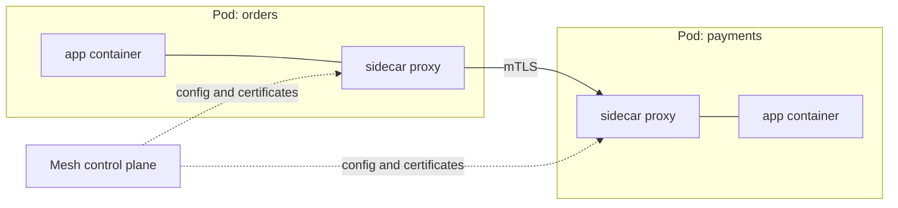

# Chapter 28: Cloud-native architecture: service mesh, serverless, personas, community and governance

> **Exams:** KCNA
> **Difficulty:** Intermediate
> **Time:** ~60 min reading, ~30 min exploration exercise
> **Lab tier:** none (no cluster needed)
> **Prerequisites:** Chapter 01 (the landscape and the CNCF), Chapter 02 (architecture), Chapter 12 (Services and Ingress)

## Learning objectives

After this chapter you can:

- Explain what a service mesh adds to a cluster, and which problems it solves that a Service does not
- Contrast the sidecar model with the ambient (sidecar-less) model, and name the trade-offs of each
- Describe serverless and event-driven workloads on Kubernetes, including scale to zero
- Recognize the personas in a cloud-native organization and the responsibilities of each
- Explain how the CNCF, Kubernetes SIGs, KEPs, and release cadence fit together, and how the deprecation policy protects users

## 1. Why a service mesh exists

A Kubernetes Service gives a stable name and load balancing to a set of Pods. It does not answer several questions that every microservice system eventually has:

- Is the traffic between two services encrypted, and does each side know who it is talking to?
- Can I send 10% of requests to a new version, or retry failed calls, without changing the application code?
- Which service called which, how often, and how slowly?

A **service mesh** answers these questions with a layer of network proxies that sits between services. The application keeps making plain calls. The mesh intercepts them and applies policy. Its responsibilities cluster into three groups:

| Responsibility | Examples |
| --- | --- |
| **Security** | Mutual TLS (mTLS) between workloads, workload identity, authorization policy |
| **Traffic management** | Retries, timeouts, load balancing, canary splits, circuit breaking |
| **Observability** | Request metrics, traces, and access logs for every hop |

Two parts make up a mesh. The **data plane** is the set of proxies that carry the traffic. The **control plane** distributes configuration and certificates to those proxies. Envoy is a common data-plane proxy. Istio and Linkerd are the best-known mesh projects in the CNCF; Istio has graduated and Linkerd has graduated too.

> **Exam tip:** A mesh works at the network layer of the application. It does not change the application's code, and it does not replace Kubernetes Services. It adds policy on top of them.

## 2. Sidecar and ambient modes

There are two broad ways to place the data-plane proxies.

### The sidecar model

In the **sidecar** model, a proxy container runs in every Pod, next to the application container. All traffic in and out of the application passes through that proxy. The mesh control plane injects the sidecar, usually when the namespace is labeled for injection.

The diagram shows two Pods, each with an application container and a sidecar proxy. Calls from `orders` go through its sidecar, travel over mTLS to the sidecar of `payments`, and reach the application there. The control plane pushes configuration and certificates to every sidecar.

The sidecar model gives every Pod its own proxy, so policy is close to the workload and it is easy to reason about. The costs are real. Each Pod carries extra CPU and memory. A sidecar must start before the application and stop after it, and that lifecycle has to be handled. Upgrading the mesh means restarting the Pods that carry the old sidecar.

### The ambient model

The **ambient** model splits the proxy work into two layers, so applications do not need a sidecar in each Pod:

- A **node-level** component handles the basic layer: secure transport (mTLS) and identity for traffic on each node.
- Optional **waypoint** proxies, deployed per namespace or per service account, handle the richer layer-7 features: HTTP routing, retries, and authorization on request attributes.

Istio's ambient mode uses a per-node component named `ztunnel` for layer 4, and waypoint proxies for layer 7. An application that needs only mTLS and basic access control never needs a waypoint, so it runs with no extra container at all.

The ambient model reduces per-Pod overhead and removes the sidecar lifecycle problem. Its trade-offs are a more complex topology to understand, and a layer-7 hop for workloads that opt in to waypoints.

> **Exam tip:** Be ready to name the two models and say where the proxy runs. Sidecar: one proxy container in every Pod. Ambient: a node-level component for mTLS and optional waypoint proxies for HTTP-level policy.

### Choosing between them

No model is right for every cluster. A small cluster with a few services may prefer the simpler sidecar model. A large cluster with many services and tight resource limits may prefer ambient. In both cases, the mesh adds operational work: certificates must rotate, the control plane must be upgraded, and teams must understand which policy applies where. Adopt a mesh for a concrete need, such as mTLS everywhere or a canary rollout, and not because it is fashionable.

## 3. Serverless and event-driven workloads

A **serverless** platform lets developers run code without managing the servers, the scaling, or much of the runtime configuration. The developer provides a container or a function, and the platform decides when to run it. On Kubernetes, that is usually built from ordinary Deployments and Services, with extra controllers on top.

The defining features are:

- **Scale to zero.** When there are no requests or events, no workload runs. When one arrives, the platform starts the workload. This saves cost for services that are idle most of the time, at the price of a cold-start delay on the first request.
- **Scale with demand.** Replicas follow traffic or queue depth, often far beyond what a fixed Deployment would use.
- **Event-driven triggers.** The workload runs in response to an HTTP request, a message on a queue, a schedule, or an event from another system.

Two CNCF projects appear often in this area:

- **Knative** adds a serving layer (request-driven services that scale to zero, with revisions and traffic splitting) and an eventing layer (routing events from sources to consumers) on top of Kubernetes.
- **KEDA** (Kubernetes Event-driven Autoscaling) scales ordinary workloads based on event sources such as queues, streams, and database counts. It feeds those counts into the autoscaling machinery you met in Chapter 25, and it can scale a workload to zero when the source is empty.

Function-style platforms such as OpenFaaS also run on Kubernetes. The common idea is the same: the developer deploys units of work, and the platform scales them.

### Event-driven architecture

In an **event-driven** design, a producer publishes an event describing something that happened, such as "order placed", and one or more consumers react to it. The producer does not know who consumes the event, and it does not wait for them. That loose coupling lets teams add consumers without changing the producer, and it lets each consumer scale on its own queue.

The trade-offs are that flows are harder to follow than a direct call, events can arrive more than once or out of order, and failures must be handled by retries and dead-letter queues rather than by an error returned to the caller.

> **Exam tip:** Scale to zero is the feature that most separates serverless from a plain Deployment with an autoscaler. Expect a question that asks which platform can drop the replica count to zero when idle.

## 4. Personas in a cloud-native organization

Cloud-native work is split across roles. The same person can hold several roles in a small team, but the responsibilities are distinct and the exam expects you to recognize them.

| Persona | Typical responsibilities |
| --- | --- |
| **Application developer** | Writes the application, its container image, and its manifests or chart; uses the platform to deploy and debug |
| **Platform engineer** | Builds the internal platform that developers deploy to: golden paths, templates, CI/CD, shared services, and guardrails |
| **Cluster administrator (operator)** | Runs and upgrades clusters, nodes, and the control plane; manages capacity, access, and backups |
| **SRE (Site Reliability Engineer)** | Owns reliability: service-level objectives, monitoring, alerting, incident response, and capacity planning |
| **Security engineer** | Sets policy for identity, admission, network segmentation, supply-chain checks, and audit |
| **FinOps practitioner** | Tracks and reduces cloud and cluster cost, and connects spending to teams and services |

The roles interact through interfaces. Developers consume a platform's self-service options. Platform engineers depend on the cluster operators' upgrades. SREs rely on the observability that developers and platform teams provide. A healthy organization makes these handoffs explicit, with clear ownership of each Namespace, dashboard, and policy.

Platform engineering has become a discipline of its own: the goal is to make the secure, supported path the easy path for developers, so that they can ship without learning every Kubernetes detail. Chapter 16 (delivery) and Chapter 14 (packaging) show two of the building blocks such a platform uses.

## 5. Community and governance

The Kubernetes project is governed in the open, and its structure explains why it changes at the pace it does.

### The CNCF

The Cloud Native Computing Foundation is part of the Linux Foundation. It hosts open source projects, including Kubernetes, and it runs their governance, legal, and marketing support. Projects move through three levels:

- **Sandbox** projects are early. They are accepted for experimentation and community building.
- **Incubating** projects have shown growing adoption and a healthy contributor base.
- **Graduated** projects have wide production use, a mature governance model, and a sustained community.

Graduation reflects adoption and governance maturity, not a claim that a project is perfect. The CNCF landscape lists projects by category, and the maturity level is shown beside each one.

### The Kubernetes community

The community is organized into several kinds of groups:

- **SIGs (Special Interest Groups)** own areas of the codebase over the long term, such as SIG Node, SIG Network, and SIG Auth. Each SIG has leads, a charter, and public meetings.
- **Working groups** are formed for a cross-cutting goal and disband when it is done.
- **The Steering Committee** governs the project as a whole, and the **Code of Conduct** sets expectations for participation.
- **Release teams** coordinate each release: schedule, communication, documentation, and release quality.

Significant changes go through a **KEP** (Kubernetes Enhancement Proposal). A KEP sets out the problem, the design, the risks, and the graduation criteria, and it is reviewed in public before most of the work lands. Each feature in a KEP moves through the stages you met in Chapter 01: alpha (off by default), beta (on by default for many features, with the design mostly settled), and stable (GA).

### Release cadence and the deprecation policy

Kubernetes ships **three minor releases per year**. Each minor release receives patch releases for a limited period, so operators must upgrade regularly to stay supported. Chapter 33 covers upgrades in practice.

The **deprecation policy** tells users how long an API stays available after it is deprecated. In outline:

- A GA (stable) API version that is deprecated remains served for at least **12 months or 3 releases, whichever is longer**.
- A beta API version remains served for a shorter period, as set by the policy.
- An alpha API can change or disappear without notice, which is why it is off by default.

The policy protects cluster users from surprise. It is also the reason you check a manifest's `apiVersion` against the cluster before you upgrade. Chapter 26 shows what a deprecated API looks like when it breaks.

## 6. Putting it together

A typical cloud-native platform for a company combines these parts:

- Developers ship containers through a pipeline. Argo CD or Flux keeps the cluster in sync with Git (Chapter 16).
- Services talk to each other through Services and Ingress or Gateway API (Chapters 11 and 12), with a mesh adding mTLS and traffic policy when the need is real.
- Event-heavy or bursty workloads use KEDA or Knative to scale with demand, including to zero.
- Platform engineers provide templates and guardrails. Cluster administrators upgrade the platform on the three-releases-per-year cadence. SREs watch the metrics and alerts that tell them when something is wrong.

None of these pieces is mandatory on its own. The architecture is the set of choices a team makes about which pieces to adopt, and why.

## Exploration exercise (no cluster required)

You need a browser. Work through these and note the answers.

1. Open the CNCF landscape and find one service mesh project and one serverless or event-driven project. For each, record its **category**, its **maturity level**, and the one problem it says it solves.
2. Read the Istio documentation page on ambient mode. Write down which functions run in the node-level component and which need a waypoint proxy. Then describe one workload that would not need a waypoint.
3. Read the Kubernetes deprecation policy on kubernetes.io. For a GA API version that is deprecated in release 1.35, work out the earliest release in which it may be removed, using the rule "12 months or 3 releases, whichever is longer".
4. Find the Kubernetes SIG that owns networking and read its charter. Name two areas of the project it owns, and one open KEP it is currently reviewing. Record that KEP's stage.
5. Write one paragraph describing the persona you would hire first at a company with ten developers and one shared cluster. Justify the choice in terms of the responsibilities in this chapter.

There are no automated checks for this exercise. Compare your answers with a study partner or the community documentation.

## Exam tips

> **Exam tip:** KCNA questions on this chapter are about vocabulary and recognition. Know the sidecar and ambient models, what Knative and KEDA are for, and which persona owns which responsibility.
>
> **Exam tip:** Remember the release cadence (three minor releases per year) and the GA deprecation rule (12 months or 3 releases, whichever is longer). Both appear as plain facts in multiple-choice questions.
>
> **Exam tip:** Separate the governance terms. SIGs own areas long term, working groups are temporary, KEPs are design proposals, and the Steering Committee governs the project. Questions often swap them.

## Common misconceptions

- "A service mesh replaces Kubernetes Services." It adds policy on top of Services and relies on them.
- "Ambient mode has no proxies." It moves the proxies out of the application Pods and onto the node and into optional waypoints.
- "Serverless means there are no servers." Servers still exist; the developer just does not manage them.
- "Scale to zero is free." Idle workloads cost nothing to run, but the first request after idle pays a cold-start delay.
- "Graduated means the project is finished." It means the project has wide adoption and mature governance. Development continues.
- "A beta API is safe to rely on forever." Beta APIs have shorter deprecation windows than GA APIs.

<!-- QUESTIONS:START -->

## End-of-chapter questions

**1.** `KCNA` What is the main problem a service mesh addresses that a Kubernetes Service does not?

- **A.** Choosing which node a Pod runs on
- **B.** Applying mTLS, traffic policy, and telemetry between services without changing application code
- **C.** Storing cluster state durably
- **D.** Building container images from source

**2.** `KCNA` In the sidecar model of a service mesh, where does the data-plane proxy run?

- **A.** On a dedicated proxy node outside the cluster
- **B.** In the same Pod as the application container, as a separate container
- **C.** Inside etcd, next to the API server
- **D.** In the kubelet on each node

**3.** `KCNA` How does Istio's ambient mode split the proxy work?

- **A.** A node-level component for secure transport (mTLS) and optional waypoint proxies for layer-7 policy
- **B.** A kernel module only, with no proxy at any layer
- **C.** A required sidecar in every Pod, plus a separate control plane per Namespace
- **D.** A single proxy for the whole cluster that handles every request in one process

**4.** `KCNA` Which is the most characteristic cost of running a sidecar proxy in every Pod?

- **A.** Each Pod carries extra CPU and memory, and the proxy's lifecycle must be handled
- **B.** Pods can no longer communicate with a Service
- **C.** The cluster can no longer run more than one replica
- **D.** Container images must be built without a Dockerfile

**5.** `KCNA` What does scale to zero mean in a serverless platform on Kubernetes?

- **A.** The cluster shuts down when no one is using it
- **B.** No workload runs when there are no requests or events, and one starts again when a request or event arrives
- **C.** Pods keep running but receive no CPU
- **D.** The nodes are removed permanently and never added back

**6.** `KCNA` Which statement best describes Knative?

- **A.** A container runtime that replaces containerd
- **B.** A CNI plugin that provides pod networking
- **C.** A layer on Kubernetes that adds request-driven serving, including scale to zero, and eventing
- **D.** A metrics database that stores time series

**7.** `KCNA` What is KEDA used for?

- **A.** Scaling workloads based on event sources such as queues, including scaling to zero when the source is empty
- **B.** Storing and rotating Secrets
- **C.** Issuing TLS certificates to Services
- **D.** Building container images in a pipeline

**8.** `KCNA` Which statement about event-driven architecture is correct?

- **A.** A producer waits for every consumer to finish before it continues
- **B.** Producers must know every consumer by name in advance
- **C.** Producers and consumers are loosely coupled: a producer publishes an event and does not depend on who consumes it
- **D.** Events can never arrive more than once

**9.** `KCNA` Which persona typically builds the internal platform, with golden paths and guardrails, that application developers deploy to?

- **A.** Platform engineer
- **B.** Security auditor
- **C.** Product manager
- **D.** FinOps practitioner

**10.** `KCNA` Which persona most often owns cluster upgrades, node capacity, and control plane health?

- **A.** Application developer
- **B.** Cluster administrator (operator)
- **C.** Marketing lead
- **D.** Container image author

**11.** `KCNA` What does a CNCF project reaching the graduated level indicate?

- **A.** The project becomes a Kubernetes SIG
- **B.** The project has wide production adoption and a mature governance model
- **C.** The project is removed from the landscape
- **D.** The project is the newest in the landscape

**12.** `KCNA` Which Kubernetes community group owns an area of the codebase over the long term, such as SIG Node?

- **A.** A Special Interest Group (SIG)
- **B.** A working group
- **C.** A Kubernetes Enhancement Proposal (KEP)
- **D.** A release team

**13.** `KCNA` What does KEP stand for in the Kubernetes project?

- **A.** Kubernetes Extension Plan
- **B.** Kubernetes Enhancement Proposal
- **C.** Kernel Event Protocol
- **D.** Kubelet Endpoint Proposal

**14.** `KCNA` How many minor releases does Kubernetes ship per year?

- **A.** One
- **B.** Two
- **C.** Three
- **D.** Four

**15.** `KCNA` Under the Kubernetes deprecation policy, how long must a deprecated GA API version remain served?

- **A.** Three months
- **B.** One release
- **C.** At least 12 months or 3 releases, whichever is longer
- **D.** Until the next major version of Kubernetes

Answers

**1. B.** A Service gives a stable name and basic load balancing. A mesh adds security, traffic management, and observability between workloads, using proxies, and the application code stays the same. Scheduling is the scheduler's job, state is etcd's, and image builds are a CI concern.

**2. B.** In sidecar mode, the mesh injects a proxy container into each Pod. Application traffic passes through that proxy. The other options place the proxy somewhere the sidecar model does not use.

**3. A.** Ambient mode moves basic mTLS to a per-node component (ztunnel) and adds waypoint proxies only where HTTP-level features are needed. Applications that need only mTLS run without a sidecar.

**4. A.** Sidecars add per-Pod resource use and a lifecycle to manage: the proxy must start before the application and stop after it. This is the main reason ambient mode exists. The other options describe failures that a sidecar does not cause.

**5. B.** Scale to zero means the replica count drops to zero when idle, and the platform starts the workload on demand. The first request after idle pays a cold-start delay. The cluster itself is not affected.

**6. C.** Knative adds a serving layer (request-driven services that can scale to zero, with revisions and traffic splitting) and an eventing layer on top of Kubernetes. The other options name different kinds of components.

**7. A.** KEDA (Kubernetes Event-driven Autoscaling) reads counts from event sources and drives the autoscaling of ordinary workloads, including to zero. The other tasks belong to different tools.

**8. C.** In event-driven designs the producer publishes events without knowing the consumers, which lets teams add consumers without changing the producer. Delivery semantics, such as duplicates and reordering, must be handled by the consumers.

**9. A.** Platform engineers build the shared platform: templates, CI/CD, shared services, and guardrails. Security, product, and cost roles matter, but they do not usually build the deployment platform itself.

**10. B.** Cluster administrators run and upgrade clusters, nodes, and the control plane. Developers consume the platform, and the other two roles are not infrastructure owners.

**11. B.** Graduation reflects adoption and governance maturity. It does not mean the project is finished or perfect, and it does not turn the project into a SIG. The other options misstate what the level means.

**12. A.** SIGs own areas of the project over the long term and have charters and public meetings. Working groups are formed for a time-limited cross-cutting goal, a KEP is a design proposal, and release teams coordinate one release.

**13. B.** A KEP is a Kubernetes Enhancement Proposal. It describes the motivation, design, risks, and graduation criteria for a significant change, and it is reviewed in public.

**14. C.** Kubernetes ships three minor releases per year. Each minor release receives patch releases for a limited time, so operators must upgrade regularly.

**15. C.** A deprecated GA API version remains served for at least 12 months or 3 releases, whichever is longer. Alpha APIs carry no such guarantee, which is why they are off by default.

<!-- QUESTIONS:END -->

## Further reading

- The CNCF landscape (landscape.cncf.io) and the CNCF project pages, for maturity levels
- Istio documentation: *Ambient mode* and *Sidecar mode*
- Linkerd documentation: *Architecture*
- Knative documentation: *Serving* and *Eventing*
- KEDA documentation: *Concepts* and *Scalers*
- Kubernetes documentation: *Deprecated API migration guide*, *Kubernetes Deprecation Policy*, and *Release cycle*
- The Kubernetes community repository: the SIG list, the Steering Committee, and the enhancements (KEP) repository
- Chapter 29 next: the security model that the platform roles depend on
