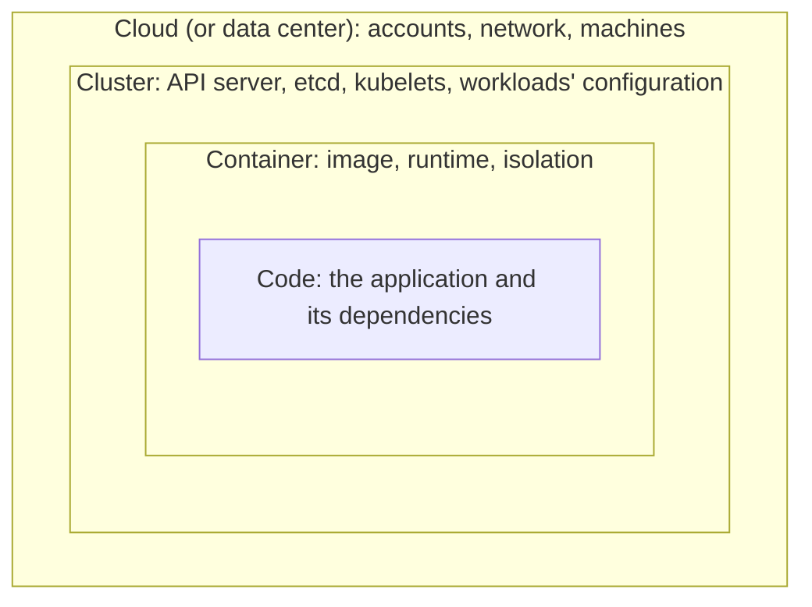
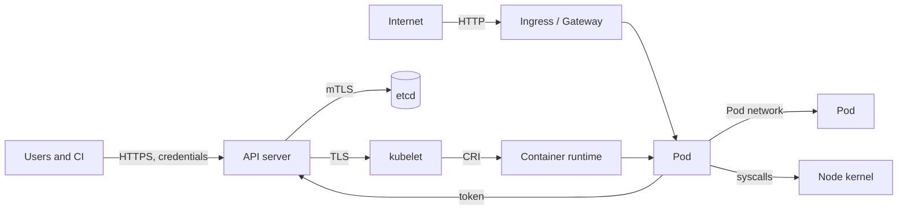

# Chapter 29: The cloud-native security model: the 4Cs, threat modeling, and compliance frameworks

> **Exams:** KCNA · KCSA · CKS
> **Difficulty:** Intermediate
> **Time:** ~60 min reading, ~30 min exploration exercise
> **Lab tier:** none (a cluster helps for the first part of the exercise)
> **Prerequisites:** Chapter 02 (architecture), Chapter 23 (RBAC and ServiceAccounts)

## Learning objectives

After this chapter you can:

- Name the four layers of the 4Cs model, say what each protects, and explain why an inner layer cannot make up for a weak outer one
- Map the 4Cs onto the four lifecycle phases the Kubernetes documentation now uses (develop, distribute, deploy, runtime)
- Say what a cloud provider secures, what you secure, and how workloads should reach cloud APIs
- Draw the trust boundaries of a Kubernetes cluster and name what crosses each one
- Explain the six threats of the Kubernetes threat model, each with an example attack and the control that stops it
- Tell threat modeling frameworks (STRIDE, MITRE ATT&CK, attack trees) from control frameworks (CIS Benchmark, NSA/CISA guide, NIST) and from compliance frameworks (PCI DSS, SOC 2, ISO 27001)

## 1. Why a security model

A Kubernetes cluster is not one thing to secure. It is a cloud account, a set of
machines, a distributed control plane, container images, and the code inside them,
each built and run by different people. A security model gives that pile a
structure: it names the layers, says what can go wrong at each, and says which
control belongs where.

The idea underneath every model in this chapter is **defense in depth**. No single
control is trusted to hold. If an attacker gets through one layer (a vulnerable web
app, say), the next layer (a restricted container, a NetworkPolicy, a ServiceAccount
with no rights) limits what they can do with it. The rest of Part IV builds those
layers one by one; this chapter is the map.

## 2. The 4Cs: Cloud, Cluster, Container, Code

The **4Cs model** describes cloud-native security as four nested layers. Each layer
depends on the one outside it:



| Layer | What it covers | Example controls | In this book |
| --- | --- | --- | --- |
| **Cloud** | The account, the network, the machines the nodes run on | Least-privilege cloud IAM, private API endpoint, firewalled node ports, encrypted disks, a blocked metadata endpoint | 29, 30 |
| **Cluster** | The control plane and everything configured through the API | TLS everywhere, RBAC, admission control, Pod Security, NetworkPolicies, Secrets encrypted at rest, audit logs | 23, 30, 31, 33, 35, 36 |
| **Container** | The image and how it runs | Minimal and scanned images, signatures, no root, dropped capabilities, seccomp, AppArmor, sandboxed runtimes | 10, 32, 33, 34 |
| **Code** | The application itself | Secure coding, dependency scanning, TLS between services, secrets that are not in the code, input validation | 16, 34, 36 |

The point of the nesting: **an inner layer cannot fix a weak outer one.** Perfect
application code does not help if anyone on the internet can reach the kubelet's
port, or if a cloud credential with full rights sits on every node. Work from the
outside in.

> **Exam tip:** Know the order (Cloud, Cluster, Container, Code, from the outside in) and be able to place a control in its layer. "Which layer does a NetworkPolicy belong to?" Cluster. "Image scanning?" Container. "Firewalling the nodes?" Cloud.

### The lifecycle view

The Kubernetes documentation no longer presents the 4Cs. Its page on cloud-native
security follows the **CNCF Cloud Native Security Whitepaper** instead, which sorts
controls by when they apply:

| Phase | Question it answers | Examples |
| --- | --- | --- |
| **Develop** | Is what we write safe? | Threat modeling, code review, dependency checks |
| **Distribute** | Is what we ship the thing we built? | Image scanning, signing, SBOMs, private registries |
| **Deploy** | May this run here, and like this? | Admission policies, signature verification, Pod Security |
| **Runtime** | Is what runs behaving, and contained? | RBAC, NetworkPolicies, seccomp, AppArmor, audit logs, Falco |

The two views are not competitors. The 4Cs say **where** a control sits; the
lifecycle says **when** it acts. An image signature is created at *distribute*,
checked at *deploy*, and protects the *container* layer. The KCSA curriculum names
the 4Cs, so learn them; the documentation and the whitepaper use the lifecycle, so
recognize it too.

## 3. Cloud provider and infrastructure security

Cloud security starts with the **shared responsibility model**: the provider secures
what it runs, and you secure what you configure.

| | Self-managed (kubeadm on VMs) | Managed control plane (EKS, GKE, AKS, ...) |
| --- | --- | --- |
| Data centers, hardware, hypervisor | Provider | Provider |
| Control plane machines, etcd, their patches | **You** | Provider |
| Control plane configuration (flags, audit, encryption) | **You** | Mostly provider; you choose options |
| Worker nodes, their OS and patches | **You** | **You** (or provider, with managed node pools) |
| Workloads, RBAC, NetworkPolicies, images | **You** | **You** |
| Cloud account, IAM, network rules | **You** | **You** |

Whatever the split, the infrastructure controls are the same:

- **Network.** Only what must be public is public. The API server (6443) is reachable from known networks or a private endpoint; the kubelet (10250) and etcd (2379, 2380) are never reachable from outside the cluster's network. Firewall rules or security groups enforce that, not hope.
- **Machines.** Minimal node images, patched, with SSH restricted. Chapter 32 hardens the host itself.
- **Identity for workloads.** The **instance metadata endpoint** (`169.254.169.254` on the major clouds) hands out the node's cloud credentials to anything that asks from the node, including every Pod on it. Block Pods from reaching it (an egress NetworkPolicy, Chapter 36), and give workloads their own narrowly scoped cloud identity through the provider's workload identity feature, instead of the node's role.
- **Data.** Encrypted disks and backups. etcd holds every Secret, so its backups are as sensitive as the cluster itself (Chapter 20).
- **The account.** Least-privilege IAM for people and automation, multi-factor authentication, and the cloud's own audit log.

> **Exam tip:** The metadata endpoint is a favorite exam topic. Remember the address `169.254.169.254`, why it is dangerous (node credentials available to any Pod), and the two fixes: block it with egress NetworkPolicies, and use per-workload cloud identity.

## 4. Trust boundaries and data flow

A **trust boundary** is a line where data or requests pass from a less trusted party
to a more trusted one. Threat modeling starts by drawing them, because attacks
happen at the crossings.



| Boundary | What crosses it | What protects it |
| --- | --- | --- |
| Outside to the API server | kubectl, CI pipelines, controllers | TLS, authentication, RBAC, admission (Chapter 31) |
| API server to etcd | Every object, including Secrets | Mutual TLS, encryption at rest, network isolation (Chapter 30) |
| API server to kubelet | Pod specs, `exec`, `logs` | TLS, kubelet authentication and authorization (Chapter 30) |
| Internet to workloads | User traffic | Ingress or Gateway with TLS, NetworkPolicies (Chapters 12, 36) |
| Pod to Pod | Service traffic | NetworkPolicies, mTLS in a mesh (Chapter 36) |
| Container to node | System calls, mounts, devices | Non-root, capabilities, seccomp, AppArmor, sandboxed runtimes (Chapters 32, 33) |
| Pod to the API server | Requests with the Pod's ServiceAccount token | Least-privilege RBAC, no token where none is needed (Chapter 23) |

The last two rows are the ones people forget. A container is a process on a shared
kernel, not a machine; and every Pod gets an identity for the API server unless you
say otherwise.

### Look at your own cluster

On the book's kind cluster, three commands show where the boundaries are today.
Who holds full rights through `cluster-admin`?

```bash
kubectl get clusterrolebindings -o jsonpath='{range .items[?(@.roleRef.name=="cluster-admin")]}{.metadata.name}{"\t"}{.subjects[*].kind}{"\t"}{.subjects[*].name}{"\n"}{end}'
```

```text
cluster-admin	Group	system:masters
kubeadm:cluster-admins	Group	kubeadm:cluster-admins
```

Two groups, no ServiceAccounts: good. Any
certificate whose organization is `system:masters` is cluster admin, and RBAC cannot
take that away. What can a Pod's default identity do?

```bash
kubectl auth can-i --list --as=system:serviceaccount:default:default
```

```text
Resources                                       Non-Resource URLs                      Resource Names   Verbs
selfsubjectreviews.authentication.k8s.io        []                                     []               [create]
selfsubjectaccessreviews.authorization.k8s.io   []                                     []               [create]
selfsubjectrulesreviews.authorization.k8s.io    []                                     []               [create]
clustertrustbundles.certificates.k8s.io         []                                     []               [get list watch]
                                                [/.well-known/openid-configuration/]   []               [get]
...
```

Only discovery and self-checks. And which Namespaces enforce a Pod Security level?

```bash
kubectl get namespaces -L pod-security.kubernetes.io/enforce
```

```text
NAME                 STATUS   AGE   ENFORCE
default              Active   22h
kube-node-lease      Active   22h
kube-public          Active   22h
kube-system          Active   22h
local-path-storage   Active   22h
```

None: on a fresh cluster, any Pod may run privileged. Chapter 33 changes that.

## 5. The Kubernetes threat model

The KCSA curriculum lists six threats. For each, know one attack and the controls
that stop or contain it:

| Threat | Example attack | Controls |
| --- | --- | --- |
| **Persistence** | After a break-in, the attacker adds a static Pod manifest on a node, a DaemonSet, a CronJob, a mutating webhook, or a long-lived token, so that access survives a restart | RBAC limits on who creates these; audit logs and Falco to notice them; short-lived tokens; immutable nodes |
| **Denial of service** | A Pod without limits eats a node's memory; a client floods the API server | Requests and limits, ResourceQuotas and LimitRanges (Chapter 10), API Priority and Fairness, rate limits at the edge |
| **Malicious code execution and compromised applications** | A remote code execution bug in a web app gives a shell in the container; a poisoned image runs a miner | Scanned and signed images, read-only root, no shell in the image, seccomp and AppArmor, runtime detection |
| **Attacker on the network** | From a compromised Pod, the attacker scans other Pods, the kubelet, or the metadata endpoint, or reads unencrypted traffic | Default-deny NetworkPolicies, mTLS, the kubelet and etcd closed to Pods, the metadata endpoint blocked |
| **Access to sensitive data** | Secrets read from environment variables, from etcd or its backups, or with a ServiceAccount allowed to `get secrets` | RBAC on Secrets, encryption at rest, secrets as files, external secret stores, protected backups |
| **Privilege escalation** | A privileged container or a `hostPath` mount of `/` takes over the node; an RBAC user with `escalate`, `bind`, or `impersonate`, or one who can create Pods in a Namespace and so use any of its ServiceAccounts | Pod Security `restricted`, no `privileged` or host namespaces, careful RBAC (Chapters 23, 31, 33) |

Two facts from the table are worth remembering on their own. Anyone who may **create
Pods** in a Namespace can run them as any ServiceAccount in it, and so has all their
rights, Secrets included. And a client certificate issued through a
CertificateSigningRequest **cannot be revoked**: it stays valid until it expires or
the cluster CA is replaced. Both are classic paths to privilege escalation and
persistence.

> **Exam tip:** Persistence questions describe what an attacker leaves behind; privilege escalation questions describe how they gain more than they were given. A DaemonSet created after a break-in is persistence; a Pod that mounts the node's root file system is escalation.

## 6. Threat modeling frameworks

A **threat modeling framework** is a method for finding threats in a design before
an attacker does. Three are worth knowing:

- **STRIDE** (from Microsoft) checks each component and data flow for six kinds of threat: **S**poofing (an attacker poses as a Pod or user), **T**ampering (changing an image or an object in etcd), **R**epudiation (acting without a trace: no audit log), **I**nformation disclosure (reading Secrets), **D**enial of service, and **E**levation of privilege. Walk the trust boundaries of section 4 and ask all six questions at each one.
- **MITRE ATT&CK** is a public catalog of real attacker tactics (initial access, execution, persistence, privilege escalation, and so on) and the techniques used for each. It has a matrix for containers; Microsoft's *Threat Matrix for Kubernetes* applies the same structure to clusters. It answers "what do attackers actually do?", which makes it good for checking detection coverage.
- **Attack trees** put an attacker's goal at the root ("read the payment Secret") and the ways to reach it as branches, down to concrete steps. The Kubernetes threat model published by the CNCF's financial services user group is built from attack trees.

> **Exam tip:** STRIDE is a checklist of threat types; ATT&CK is a catalog of observed attacker behavior; an attack tree decomposes one goal. Questions often describe one and ask for its name.

## 7. Controls frameworks and compliance

Threat models find problems; **control frameworks** say what a secure configuration
looks like. The ones that come up most often for Kubernetes:

| Framework | From | What it is |
| --- | --- | --- |
| **CIS Kubernetes Benchmark** | Center for Internet Security | Hundreds of concrete checks for the control plane, etcd, kubelets, and policies, each with an audit and a remediation. `kube-bench` runs them (Chapter 30). |
| **Kubernetes Hardening Guide** | NSA and CISA | Guidance on Pod security, network separation, authentication, audit logging, and upgrades |
| **NIST SP 800-190** | US National Institute of Standards and Technology | *Application Container Security Guide*: risks and countermeasures for images, registries, orchestrators, containers, and hosts |
| **Pod Security Standards** | Kubernetes | Three built-in levels (privileged, baseline, restricted) for Pod settings (Chapters 31, 33) |
| **SLSA** | OpenSSF | Levels of supply chain integrity for how artifacts are built (Chapter 34) |

**Compliance frameworks** are different again: they are obligations, from law,
contracts, or industry, that an organization must show it meets. **PCI DSS** for
card payments, **HIPAA** for US health data, **SOC 2** for service providers'
controls, **ISO/IEC 27001** for an information security management system,
**FedRAMP** for US government cloud services, and **GDPR** for personal data in the
EU. None of them mentions Kubernetes settings directly. Meeting them means mapping
their requirements onto controls (often from the control frameworks above) and
producing evidence that the controls work.

That evidence is where **automation and tooling** come in: `kube-bench` for the CIS
checks, scanners such as Trivy and Kubescape for images and configuration, policy
engines (Kyverno, OPA Gatekeeper) that enforce the rules at admission, and audit
logs and Falco that record what happened. Continuous checks beat a yearly audit:
configuration drifts.

> **Exam tip:** Keep the three kinds apart. A threat modeling framework finds threats (STRIDE), a control framework prescribes settings (CIS Benchmark), and a compliance framework is an obligation you must prove you meet (PCI DSS). "Which one does kube-bench check?" The CIS Benchmark.

## 8. Putting it together

Follow one attack through the layers. A web application has a remote code execution
bug, and an attacker gets a shell in its container:

1. **Code** failed: the bug was there. A scanner might have flagged the vulnerable dependency (*distribute*).
2. **Container** limits the damage: no shell in the image, a read-only root, no root user, and seccomp make the foothold hard to use.
3. **Cluster** limits the reach: the Pod's ServiceAccount has no rights and no mounted token, a NetworkPolicy lets it talk only to its database, and Pod Security stopped it from being privileged in the first place.
4. **Cloud** limits the blast radius: the metadata endpoint is blocked, so there are no node credentials to steal, and the node cannot reach the internet freely.
5. **Runtime** detection notices: Falco flags a shell spawned in a container, and the audit log shows what the ServiceAccount tried (Chapter 35).

Every later chapter of Part IV adds one of those controls.

## Exploration exercise

The first part uses the book's kind cluster; the rest needs a browser.

1. On your cluster, run the three commands of section 4. Then list every ClusterRoleBinding and RoleBinding that grants a ServiceAccount the `cluster-admin` role, and name one change that would remove the need for it.
2. Pick one Pod in `kube-system` and place it on the trust boundary diagram: which boundaries does it cross, and with what identity?
3. Open the CIS Kubernetes Benchmark's table of contents (from the Center for Internet Security's website). Name its main sections and find the recommendation that covers the API server's anonymous authentication.
4. Open the MITRE ATT&CK containers matrix. For the tactic *Privilege Escalation*, pick one technique and write which control from section 5 stops it.
5. Apply STRIDE to one boundary: the API server to the kubelet. Write one threat of each of the six types, and the control that addresses it.

There are no automated checks for this exercise. The questions at the end of the
chapter test the same ideas.

## Exam tips

> **Exam tip:** The KCSA asks about models and vocabulary more than commands. Know the 4Cs in order, the four lifecycle phases, the six threats of the threat model, and the difference between threat modeling, control, and compliance frameworks.
>
> **Exam tip:** When a question asks for the *first* or *most important* step, prefer the outer layer and the least privilege: close the network path, remove the right, then harden what is left.
>
> **Exam tip:** Learn which tool belongs to which framework: kube-bench to the CIS Benchmark, Pod Security Admission to the Pod Security Standards, Falco to runtime detection, Trivy and Kubescape to scanning.

## Common misconceptions

- "Containers are a security boundary like virtual machines." They share the node's kernel. Isolation comes from configuration (users, capabilities, seccomp, AppArmor) or from a sandboxed runtime.
- "A managed Kubernetes service is secure by default." The provider secures the control plane; RBAC, NetworkPolicies, Pod settings, images, and the cloud account are still yours.
- "Secrets are encrypted." By default they are base64-encoded and stored unencrypted in etcd, unless encryption at rest is configured.
- "RBAC is enough." RBAC decides who may create an object, not whether the object is safe. A user allowed to create Pods can create a privileged one unless admission control stops it.
- "Being compliant means being secure." Compliance shows that required controls exist at audit time; threats and configurations change in between.
- "The 4Cs and the lifecycle phases are rival models." One sorts controls by layer, the other by time; most controls have a place in both.

<!-- QUESTIONS:START -->

## End-of-chapter questions

**1.** `KCNA` `KCSA` What are the four layers of the 4Cs model of cloud-native security, from the outside in?

- **A.** Code, Container, Cluster, Cloud
- **B.** Cloud, Cluster, Container, Code
- **C.** Cluster, Cloud, Code, Container
- **D.** Container, Code, Cloud, Cluster

**2.** `KCNA` `KCSA` In the 4Cs model, which layer does a NetworkPolicy belong to?

- **A.** Cloud
- **B.** Container
- **C.** Code
- **D.** Cluster

**3.** `KCSA` The CNCF Cloud Native Security Whitepaper sorts controls by lifecycle phase. Which list is in the right order?

- **A.** Develop, distribute, deploy, runtime
- **B.** Build, test, release, monitor
- **C.** Plan, code, deploy, operate
- **D.** Distribute, develop, runtime, deploy

**4.** `KCSA` `CKS` Why should Pods be prevented from reaching 169.254.169.254 on a cloud provider's nodes?

- **A.** It is the API server's internal address
- **B.** It is the cluster DNS service
- **C.** It is the instance metadata endpoint, which hands out the node's cloud credentials to anything on the node
- **D.** It is the kubelet's read-only port

**5.** `KCSA` With a managed Kubernetes service, which of these is still your responsibility?

- **A.** Patching the etcd servers
- **B.** The physical security of the data center
- **C.** The control plane machines' operating system
- **D.** RBAC rules, NetworkPolicies, and the images your workloads run

**6.** `KCSA` After breaking into a cluster, an attacker creates a DaemonSet that starts a reverse shell on every node, so that access survives Pod restarts. Which threat from the Kubernetes threat model is this?

- **A.** Persistence
- **B.** Denial of service
- **C.** Attacker on the network
- **D.** Access to sensitive data

**7.** `KCSA` `CKS` A user may only create Pods in the Namespace payments. Why is that a privilege escalation risk?

- **A.** Pods can change their own Namespace
- **B.** A Pod can run as any ServiceAccount in the Namespace, so the user gets every right those ServiceAccounts have, including Secrets they may read
- **C.** Creating Pods implies the right to delete Nodes
- **D.** It is not a risk; Pods have no permissions

**8.** `KCSA` Why is a client certificate issued through a CertificateSigningRequest a persistence risk?

- **A.** It never expires
- **B.** It grants cluster-admin automatically
- **C.** Kubernetes cannot revoke it; it stays valid until it expires or the cluster CA is replaced
- **D.** It is stored unencrypted on every node

**9.** `KCSA` Which threat modeling method checks each component for Spoofing, Tampering, Repudiation, Information disclosure, Denial of service, and Elevation of privilege?

- **A.** MITRE ATT&CK
- **B.** An attack tree
- **C.** The CIS Benchmark
- **D.** STRIDE

**10.** `KCSA` `CKS` Which framework does kube-bench check a cluster against?

- **A.** The CIS Kubernetes Benchmark
- **B.** PCI DSS
- **C.** MITRE ATT&CK
- **D.** SLSA

**11.** `KCSA` Which of these is a compliance framework rather than a control framework or a threat model?

- **A.** The NSA/CISA Kubernetes Hardening Guide
- **B.** STRIDE
- **C.** PCI DSS
- **D.** The Pod Security Standards

**12.** `KCNA` `KCSA` `CKS` Which statement about container isolation is true?

- **A.** Containers on a node share its kernel, so their isolation depends on how they are configured or on a sandboxed runtime
- **B.** Each container has its own kernel, like a virtual machine
- **C.** Containers cannot make system calls to the node
- **D.** A container running as root is still harmless to the node

**13. (Task)** `KCSA` `CKS` On your cluster, find every subject that holds the cluster-admin ClusterRole cluster-wide, and check whether the default ServiceAccount of the Namespace default may read Secrets.

<details>
<summary>Answers</summary>

**1. B.** Cloud (or data center) is outermost, then the Cluster, then the Container, and the Code in the middle. Each layer depends on the security of the layers outside it, so a strong inner layer cannot make up for a weak outer one.

**2. D.** NetworkPolicies are Kubernetes objects configured through the API, like RBAC, admission control, and Pod Security, so they belong to the Cluster layer. Firewalling the nodes would be Cloud; image scanning, Container.

**3. A.** Develop (writing safe code), distribute (shipping what was built: scanning, signing), deploy (deciding what may run: admission), and runtime (containing and watching what runs). The Kubernetes documentation now uses these phases rather than the 4Cs.

**4. C.** The metadata endpoint serves the node's identity and credentials. A compromised Pod that can reach it can act with the node's cloud permissions. Block it with egress NetworkPolicies, and give workloads their own narrow cloud identity.

**5. D.** Under the shared responsibility model, the provider runs and patches the control plane and the infrastructure. What you configure through the API and what you deploy (RBAC, policies, images, Pod settings) stays yours, as does the cloud account.

**6. A.** Persistence means keeping access after the first foothold is gone: static Pods, DaemonSets, CronJobs, webhooks, or long-lived credentials. RBAC limits on who may create them, and audit logs or runtime detection to notice them, are the controls.

**7. B.** The Pod's serviceAccountName can name any ServiceAccount in its Namespace, and the user can then use that identity from inside the Pod. Pods can also mount any Secret in the Namespace. Treat the right to create Pods as access to everything the Namespace's ServiceAccounts and Secrets hold.

**8. C.** Kubernetes has no certificate revocation list for client certificates. An attacker who gets one keeps that identity until expiry, so keep expirationSeconds short, restrict who may approve CSRs, and remove the RBAC bindings of a compromised identity.

**9. D.** STRIDE is named after those six threat types. MITRE ATT&CK catalogs observed attacker tactics and techniques, an attack tree breaks one attacker goal into steps, and the CIS Benchmark is a control framework, not a threat model.

**10. A.** kube-bench runs the CIS Kubernetes Benchmark's checks on the control plane, etcd, and the nodes, and reports each as pass, fail, or warn with a remediation. Chapter 30 uses it.

**11. C.** PCI DSS is an obligation for organizations that handle card payments, which they must show they meet. The hardening guide and the Pod Security Standards prescribe settings (control frameworks), and STRIDE finds threats.

**12. A.** A container is a process on the node's kernel, isolated by namespaces and cgroups. Non-root users, dropped capabilities, seccomp, and AppArmor narrow what it can do; sandboxed runtimes such as gVisor or Kata Containers add a separate kernel boundary.

**13.**

```bash
kubectl get clusterrolebindings -o jsonpath='{range .items[?(@.roleRef.name=="cluster-admin")]}{.metadata.name}{"\t"}{.subjects[*].kind}{"\t"}{.subjects[*].name}{"\n"}{end}'
kubectl auth can-i get secrets -n default --as=system:serviceaccount:default:default
```

On the book's kind cluster, only the groups `system:masters` and `kubeadm:cluster-admins` hold cluster-admin, and the default ServiceAccount gets `no`. A ServiceAccount in the first list, or a `yes` in the second, would be the first thing to remove.

</details>

<!-- QUESTIONS:END -->

## Further reading

- Kubernetes documentation: *Cloud Native Security and Kubernetes*, and the *Security Checklist* (kubernetes.io/docs/concepts/security/)
- CNCF TAG Security: *Cloud Native Security Whitepaper*, version 2
- NSA and CISA: *Kubernetes Hardening Guide*
- NIST SP 800-190: *Application Container Security Guide*
- MITRE ATT&CK: the containers matrix; Microsoft: *Threat Matrix for Kubernetes*
- CNCF Financial Services User Group: *Kubernetes Threat Model* (attack trees)
