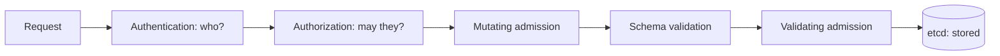

# Chapter 31: Authentication, authorization, and admission control

> **Exams:** KCSA · CKS
> **Difficulty:** Advanced
> **Time:** ~60 min reading, ~40 min lab
> **Lab tier:** 1 (kind)
> **Prerequisites:** Chapter 10 (securityContext), Chapter 23 (RBAC and ServiceAccounts)

## Learning objectives

After this chapter you can:

- Walk a request through the API server's stages (authentication, authorization, mutating and validating admission) and say which stage rejects it
- Name the authentication methods a cluster can use, and say which identity a ServiceAccount token produces
- Explain how authorization modes combine, and why RBAC alone cannot stop a bad object from being stored
- Write a ValidatingAdmissionPolicy and bind it to one Namespace, using CEL expressions
- Label a Namespace to enforce a Pod Security level, and say what each level allows
- Compare OPA Gatekeeper and Kyverno with the built-in mechanisms, and choose between them

## Concepts

### The request path

Every request to the API server passes through the same stages, in order. A rejection
at one stage means the later stages never see the request.



The diagram shows the stages as a line. A request with no valid identity stops at
authentication. A request that the identity may not make stops at authorization. Both
mutating and validating admission can change the outcome of a request that passed
authorization, and only then is the object written to etcd.

The status codes tell you which stage refused the request. `401 Unauthorized` means
the identity was missing or invalid. `403 Forbidden` means the identity is known, and
the request was refused by authorization or by an admission controller. An admission
refusal is a `403` too, so read the message: a policy's name in the message points
at admission.

### Authentication: who is asking

The API server accepts several kinds of identity. A cluster can enable more than one.

| Method | Identity it produces | Typical use |
| --- | --- | --- |
| Client certificate | The certificate's common name is the user, and its organization is the group | kubeadm admin kubeconfig, component certificates |
| ServiceAccount token | `system:serviceaccount:<namespace>:<name>` | Pods, and automation outside the cluster that uses `kubectl create token` |
| OpenID Connect (OIDC) | The claim the API server is configured to read, such as the email | Human users through an identity provider |
| Webhook token authentication | Whatever the external webhook returns | Custom identity systems |
| Anonymous | `system:anonymous`, in the `system:unauthenticated` group | Only what an admin explicitly allows; keep it closed |

Token authentication is what you use in the lab. `kubectl create token` asks the
TokenRequest API for a short-lived token bound to a ServiceAccount. It expires, so a
leaked token does not stay valid forever. The older long-lived tokens from Secrets
are discouraged.

> **Exam tip:** `kubectl auth whoami` shows the identity the API server sees for your current kubeconfig. Use it first when a request fails with `401` or when you are unsure which user you are.

### Authorization: what they may do

The API server can run several authorization modes, and it asks each one in the order
given by `--authorization-mode`. The first mode that allows the request wins. If no
mode allows it, the request is forbidden. Modes do not subtract permissions from each
other.

On the kind cluster of this book the flag is `--authorization-mode=Node,RBAC`:

- **Node** authorizes the kubelets for the objects on their own node, such as their Pods and Secrets.
- **RBAC** is what you practised in Chapter 23: Roles, ClusterRoles, and their bindings.

Other modes exist, such as `Webhook`, which asks an external service, and `ABAC`, which
is deprecated. `AlwaysAllow` and `AlwaysDeny` are for testing only.

Authorization answers only one question: may this identity perform this verb on this
resource? It cannot inspect the object. A Deployment with privileged containers passes
RBAC if the user may create Deployments. Admission is the stage that inspects the object.

### Admission control: is this object acceptable

After authorization, the request goes through admission controllers, first mutating
ones and then validating ones. A mutating controller may change the object, such as
adding a default. A validating controller may only accept or reject it.

Several admission controllers are built into the API server. Among the ones you will
meet most often:

- **NamespaceLifecycle** refuses objects in a Namespace that is being deleted.
- **ServiceAccount** adds the default ServiceAccount and its token volume to Pods.
- **ResourceQuota** and **LimitRanger** enforce quotas and defaults.
- **PodSecurity** enforces the Pod Security levels, described below.
- **NodeRestriction** limits what a kubelet may change.

The API server also calls admission webhooks that you register: `MutatingWebhookConfiguration`
and `ValidatingWebhookConfiguration`. Those are external services, and they are the
classic way to add policy. They work, but they add a network call and an availability
dependency to every matching request.

### ValidatingAdmissionPolicy

A **ValidatingAdmissionPolicy** (GA since Kubernetes 1.30) performs validation inside
the API server, with no webhook. You write the rule as a **CEL** expression (Common
Expression Language), and the server evaluates it. It has two parts:

- The **policy** says what to check: the resources it matches (`matchConstraints`) and
  the expressions that must hold (`validations`).
- The **binding** says where the policy applies and what to do on failure: the
  `validationActions` (`Deny`, `Warn`, or `Audit`) and the `matchResources` selector, such
  as a Namespace.

A policy with no binding applies to nothing. That makes it a safe way to stage
a rule: write the policy, bind it with `Warn` first, and switch to `Deny` once the
existing workloads comply.

```yaml
apiVersion: admissionregistration.k8s.io/v1
kind: ValidatingAdmissionPolicy
metadata:
  name: require-team
spec:
  failurePolicy: Fail
  matchConstraints:
    resourceRules:
      - apiGroups: ["apps"]
        apiVersions: ["v1"]
        operations: ["CREATE", "UPDATE"]
        resources: ["deployments"]
  validations:
    - expression: "has(object.metadata.labels) && 'team' in object.metadata.labels"
      message: "Deployments need a team label"
```

The `has(...)` guard matters. If the Deployment has no labels at all, reading
`object.metadata.labels` would be an error, and the guard turns that case into a clean
`false`.

### Pod Security admission

The **Pod Security admission** controller enforces three fixed levels, set per
Namespace with labels:

| Level | What it allows |
| --- | --- |
| `privileged` | Everything. No restrictions. |
| `baseline` | Blocks the known privilege escalations, such as privileged containers and host namespaces |
| `restricted` | Also requires non-root users, `allowPrivilegeEscalation: false`, dropped capabilities, and the `RuntimeDefault` seccomp profile |

Each level can be applied in three modes: `enforce` refuses the Pod, `audit` records a
violation in the audit log, and `warn` returns a warning to the client. The labels look like
this:

```yaml
apiVersion: v1
kind: Namespace
metadata:
  name: payments
  labels:
    pod-security.kubernetes.io/enforce: restricted
    pod-security.kubernetes.io/warn: restricted
```

Pod Security checks Pods. A Deployment is accepted even when its Pod template would
violate the level: the Deployment gets a warning, and its ReplicaSet cannot create the
Pods. Chapter 33 covers the levels in more depth, with securityContext.

### Policy engines: Gatekeeper and Kyverno

A ValidatingAdmissionPolicy covers many rules, but it has limits: CEL expressions, no
mutation (in the stable form), and no reporting over existing objects. Policy engines
fill those gaps:

| | OPA Gatekeeper | Kyverno |
| --- | --- | --- |
| Policy language | Rego, through a `ConstraintTemplate` and a `Constraint` | YAML `ClusterPolicy` rules |
| Mutation | Yes | Yes |
| Generation and reports | Audit of existing objects | Generate resources, policy reports |
| Image verification | Through external data providers | Built-in image verification |

Both are CNCF projects, and both run as controllers in the cluster. Both add a
webhook-based dependency, so they need care during an upgrade. In the exam context,
you are expected to recognize what they do and how they plug into admission. You are
not expected to write a Rego policy from memory.

> **Exam tip:** When a question asks how to enforce a rule without installing anything, the answer is usually a ValidatingAdmissionPolicy or Pod Security labels. Policy engines are the answer when the rule needs mutation, reports, or features CEL does not cover.

## Guided walkthrough

These steps only read the cluster or run server-side dry runs. They store nothing,
so you can run them at any time without a lab.

### See who you are

```bash
kubectl auth whoami
```

```text
ATTRIBUTE                                           VALUE
Username                                            kubernetes-admin
Groups                                              [kubeadm:cluster-admins system:authenticated]
Extra: authentication.kubernetes.io/credential-id   [X509SHA256=d93f3185451c69ad6779782f17a19453f270b76487ec9fefbd6b0ce4e25e00c7]
```

Your kubeconfig authenticates with a client certificate, so the username is the
certificate's common name. The group `kubeadm:cluster-admins` comes from the
certificate's organization. The `credential-id` line is different on your cluster.

### See which authorization modes run

```bash
kubectl -n kube-system get pod -l component=kube-apiserver \
  -o jsonpath='{.items[0].spec.containers[0].command}' \
  | grep -o -- '--authorization-mode=[^"]*'
```

```text
--authorization-mode=Node,RBAC
```

The API server asks `Node` first, then `RBAC`. The flag is set on the static Pod, as in
Chapter 02.

### Authenticate with a token of your own

`kubectl --token` does not replace the client certificate in your kubeconfig, so you
need a kubeconfig of its own. Copy the cluster settings, then add a user that has only
a token.

```bash
cfg="$(mktemp)"
kubectl config view --minify --raw > "$cfg"
kubectl --kubeconfig "$cfg" config set-credentials sa-check \
  --token="$(kubectl create token default -n default --duration=10m)" >/dev/null
kubectl --kubeconfig "$cfg" --user=sa-check auth whoami
rm -f "$cfg"
```

```text
ATTRIBUTE                                           VALUE
Username                                            system:serviceaccount:default:default
UID                                                 6efa53f9-3749-441a-b5c4-f1791b5a5450
Groups                                              [system:serviceaccounts system:serviceaccounts:default system:authenticated]
Extra: authentication.kubernetes.io/credential-id   [JTI=bea2d1f0-32d0-4dbf-b35a-6a7f7651dea1]
```

The token authenticates as the ServiceAccount `default` in `default`, and its groups
come from that ServiceAccount. The UID and JTI values differ on every run.

### See which admission policy resources the server serves

```bash
kubectl api-resources --api-group=admissionregistration.k8s.io
```

```text
NAME                                SHORTNAMES   APIVERSION                        NAMESPACED   KIND
mutatingwebhookconfigurations                    admissionregistration.k8s.io/v1   false        MutatingWebhookConfiguration
validatingadmissionpolicies                      admissionregistration.k8s.io/v1   false        ValidatingAdmissionPolicy
validatingadmissionpolicybindings                admissionregistration.k8s.io/v1   false        ValidatingAdmissionPolicyBinding
validatingwebhookconfigurations                  admissionregistration.k8s.io/v1   false        ValidatingWebhookConfiguration
```

All four are cluster-scoped (`NAMESPACED false`). A policy and its binding apply to the
whole cluster unless the binding's selector narrows them, which is why the lab binds
its policy to one Namespace.

## Hands-on lab

The lab works like a KodeKloud lab: one task at a time, a check after each, and
progress that is saved between sessions.

```bash
make lab CH=31       # set up the lab and show task 1
make check CH=31     # check the current task; if it is right, show the next
make question CH=31  # show the current task again
make reset CH=31     # back to the starting state and task 1
make verify CH=31    # check every task at once
```

The lab uses two Namespaces: `ch31-apps`, where the ServiceAccount `ci-bot` already exists,
and `ch31-restricted`, which Task 2 uses. Its checks send server-side dry runs, which
run admission and store nothing. The policy and binding are cluster-scoped, so the lab
removes them at reset and teardown, together with the token file `/tmp/ch31-token.txt`.

Full solutions are in [`lab/solutions.md`](lab/solutions.md).

### Task 1: Require a team label on Deployments in one Namespace

Create a ValidatingAdmissionPolicy that requires every Deployment to carry a `team`
label, and bind it so that it applies only in Namespace `ch31-apps`.

- ValidatingAdmissionPolicy `ch31-require-team`: checks Deployments in the group `apps`, on create and update, for a `team` label
- ValidatingAdmissionPolicyBinding `ch31-require-team-binding`: refers to `ch31-require-team`, uses the validation action `Deny`, and matches only Namespace `ch31-apps`
- A Deployment without a `team` label is refused in `ch31-apps`; one with the label is accepted
- A Deployment without the label is accepted in `ch31-restricted`

### Task 2: Enforce the restricted Pod Security level

Label Namespace `ch31-restricted` so that Pod Security admission enforces the
`restricted` level.

- Namespace `ch31-restricted`: label `pod-security.kubernetes.io/enforce` with the value `restricted`
- A Pod that sets `privileged: true` is refused in this Namespace
- A Pod that runs as a non-root user, has seccomp profile `RuntimeDefault`, disallows privilege escalation, and drops all capabilities is accepted

### Task 3: A token for the ServiceAccount ci-bot

Create a token for the ServiceAccount `ci-bot` in `ch31-apps`, and save it to
`/tmp/ch31-token.txt`. The token must authenticate as that ServiceAccount.

- File `/tmp/ch31-token.txt` holds one token
- Authenticating with it reports the username `system:serviceaccount:ch31-apps:ci-bot`

Note: the check authenticates with a kubeconfig of its own, as in the walkthrough.

### Task 4: Let ci-bot create Deployments, and see admission still apply

Give `ci-bot` permission to create, get, and list Deployments in `ch31-apps`, but not to
delete them, and nothing in `ch31-restricted`. Then check how admission treats its requests.

- Role `deployer` in `ch31-apps`: verbs `create`, `get`, and `list` on Deployments in the `apps` group
- RoleBinding `ci-bot-deploys` in `ch31-apps`, to the ServiceAccount `ci-bot`
- `ci-bot` may not delete Deployments in `ch31-apps`, and may not create them in `ch31-restricted`
- A Deployment from `ci-bot` without a `team` label is refused by the policy from Task 1, even though RBAC allows the create; with the label it is accepted

## Exam tips

> **Exam tip:** Read the status and the message together. `401` means the identity failed; `403` means RBAC or admission refused it. The message names the admission policy or the Pod Security level when admission is the cause.
>
> **Exam tip:** Test admission with `kubectl apply --dry-run=server -f file.yaml`. It runs authentication, authorization, and admission, and stores nothing, which makes it the fastest way to see whether a policy would refuse an object.
>
> **Exam tip:** Pod Security levels are set with labels on the Namespace, named `pod-security.kubernetes.io/<mode>`. Remember the three modes (`enforce`, `audit`, `warn`) and the three levels (`privileged`, `baseline`, `restricted`).

## Common mistakes

- Expecting RBAC to reject an insecure object. RBAC decides who may create a Deployment, not what the Deployment contains. Admission inspects the object.
- Creating a ValidatingAdmissionPolicy without a binding, then wondering why nothing is enforced. A policy with no binding applies to nothing.
- Binding a policy to the whole cluster while testing. Narrow the binding with `matchResources` so other workloads are not refused.
- Expecting `kubectl --token` to replace the client certificate in your kubeconfig. Use a separate kubeconfig user, as in the walkthrough.
- Writing `pod-security.kubernetes.io/enforce: restricted` on a Namespace and expecting its Deployments to be refused. The Deployment is accepted with a warning, and the Pods are refused when the ReplicaSet creates them.
- Reading `object.metadata.labels` without a `has(...)` guard, so a Deployment without labels produces an error instead of a clean result.

<!-- QUESTIONS:START -->

## End-of-chapter questions

**1.** `KCSA` A request reaches the API server with valid credentials. Which stage runs first?

- **A.** Authentication
- **B.** Authorization
- **C.** Validating admission
- **D.** Mutating admission

**2.** `KCSA` An identity is known and valid, but no authorization mode allows the request. Which HTTP status does the client receive?

- **A.** 401 Unauthorized
- **B.** 403 Forbidden
- **C.** 404 Not Found
- **D.** 422 Unprocessable Entity

**3.** `KCSA` The API server runs with --authorization-mode=Node,RBAC. How are the two modes combined?

- **A.** A request must be allowed by both modes
- **B.** The first mode that allows the request wins; if none allows it, the request is forbidden
- **C.** Each mode can remove permissions granted by the other
- **D.** Only RBAC is consulted; Node is used for logging

**4.** `KCSA` Which kind of check does RBAC perform?

- **A.** It inspects the contents of an object, such as whether a container is privileged
- **B.** It decides whether an identity may perform a verb on a resource
- **C.** It verifies the signature of a container image
- **D.** It validates the certificate chain of the API server

**5.** `KCSA` Which statement about admission controllers is correct?

- **A.** Validating admission runs before mutating admission
- **B.** Mutating admission runs first, and validating admission runs after the object has been mutated
- **C.** Admission controllers run before authentication
- **D.** Admission controllers can only read objects, never reject them

**6.** `KCSA` A ValidatingAdmissionPolicy exists in the cluster, but no ValidatingAdmissionPolicyBinding refers to it. What happens to Deployments?

- **A.** They are all refused until a binding is created
- **B.** The policy is not enforced anywhere, because a policy applies only through a binding
- **C.** The policy is enforced cluster-wide by default
- **D.** The policy is enforced in the default Namespace only

**7.** `CKS` A binding for a ValidatingAdmissionPolicy sets validationActions to [Warn] only. What happens to a request that fails the policy?

- **A.** The request is refused with a 403
- **B.** The request is accepted, and the client receives a warning
- **C.** The request is accepted silently, and the failure is only in the audit log
- **D.** The request is queued until the policy passes

**8.** `KCSA` Which Pod Security level requires non-root users, the RuntimeDefault seccomp profile, dropped capabilities, and no privilege escalation?

- **A.** privileged
- **B.** baseline
- **C.** restricted
- **D.** unconfined

**9.** `CKS` A Namespace is labeled pod-security.kubernetes.io/audit=baseline. A Pod that is not allowed at the baseline level is created in it. What happens?

- **A.** The Pod is refused
- **B.** The Pod is created, and the violation is recorded in the audit log
- **C.** The Pod is created, and the client is warned
- **D.** The Namespace label is rejected

**10.** `KCSA` What does kubectl create token ci-bot -n payments produce?

- **A.** A long-lived token stored in a Secret of type kubernetes.io/service-account-token
- **B.** A short-lived token, bound to the ServiceAccount through the TokenRequest API, that expires
- **C.** A client certificate for the user ci-bot
- **D.** A kubeconfig file with the cluster's admin credentials

**11.** `CKS` Which of these is the best fit for a rule that must mutate Pods, such as adding a default label to every one, and that needs reports on existing objects?

- **A.** A ValidatingAdmissionPolicy, which can mutate objects
- **B.** A policy engine such as Kyverno or OPA Gatekeeper
- **C.** A NetworkPolicy
- **D.** An RBAC Role with the verb mutate

**12. (Task)** `CKS` Label the Namespace `payments` so that Pod Security admission enforces the `baseline` level and warns on `restricted`. Show the labels on the Namespace.

**13. (Task)** `CKS` Show whether a ServiceAccount `ci-bot` in Namespace `payments` may delete Pods in `payments`, and then show the identity a token of `ci-bot` authenticates as, using a kubeconfig of its own. Assume the token is in the file `/tmp/token.txt`.

<details>
<summary>Answers</summary>

**1. A.** The API server always authenticates the identity first. Authorization, mutating admission, and validating admission only run for an identified request, in that order.

**2. B.** 401 means the identity is missing or invalid. When the identity is known and not allowed, the API server returns 403 Forbidden.

**3. B.** Authorization modes are asked in order, and any one of them can allow a request. A mode cannot subtract a permission that another mode grants.

**4. B.** Authorization decides who may do what to which resource. Inspecting an object's contents is the job of admission, so a Deployment with privileged containers can pass RBAC and still be refused by a policy.

**5. B.** Mutating admission can change an object, such as adding defaults. Validating admission then checks the object as it will be stored, and it can only accept or reject it.

**6. B.** A policy says what to check, and a binding says where it applies and what action to take. Without a binding, the policy has no effect.

**7. B.** Warn accepts the request and returns the failure as a warning to the client. Deny refuses it. Audit records the failure in the audit log without warning the client.

**8. C.** The restricted level adds those requirements on top of baseline. Baseline blocks the known privilege escalations but does not require non-root users or dropped capabilities.

**9. B.** The audit mode records a violation in the audit log and does not affect the request. Enforce refuses the Pod, and warn returns a warning to the client.

**10. B.** kubectl create token asks the TokenRequest API for a token with a limited lifetime. Long-lived tokens in Secrets are discouraged, and the command never creates a certificate or copies the admin credentials.

**11. B.** ValidatingAdmissionPolicy only validates, so it cannot mutate. Policy engines add mutation and reporting. NetworkPolicy controls traffic, and RBAC has no mutate verb.

**12.**

```bash
kubectl label namespace payments pod-security.kubernetes.io/enforce=baseline pod-security.kubernetes.io/warn=restricted --overwrite
kubectl get namespace payments --show-labels
```

The `enforce` label refuses Pods that break the baseline level. The `warn` label
returns a warning for Pods that break the restricted level, without refusing them.
`--overwrite` lets the command replace labels that already exist with those names.

**13.**

```bash
kubectl auth can-i delete pods --as=system:serviceaccount:payments:ci-bot -n payments
cfg="$(mktemp)"
kubectl config view --minify --raw > "$cfg"
kubectl --kubeconfig "$cfg" config set-credentials ci-check --token="$(cat /tmp/token.txt)"
kubectl --kubeconfig "$cfg" --user=ci-check auth whoami
rm -f "$cfg"
```

`kubectl --token` alone does not replace the client certificate in the
kubeconfig, so the answer uses a copy of the kubeconfig that has only the token
user. `auth whoami` then reports `system:serviceaccount:payments:ci-bot`.

</details>

<!-- QUESTIONS:END -->

## Further reading

- Kubernetes documentation: *Controlling Access to the Kubernetes API*, *Authenticating*, and *Using Authorization*
- Kubernetes documentation: *Admission Control in Kubernetes* and *Validating Admission Policy*
- Kubernetes documentation: *Pod Security Admission* and *Pod Security Standards*
- The CEL specification, for the expression language used by admission policies
- Open Policy Agent Gatekeeper documentation, and the Kyverno documentation
- Chapter 23 for RBAC in depth; Chapter 33 for securityContext and Pod hardening
