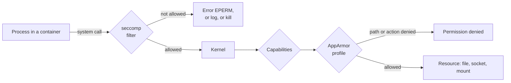

# Chapter 32: System hardening: the host OS, least privilege, AppArmor, and seccomp

> **Exams:** KCSA · CKS
> **Difficulty:** Advanced
> **Time:** ~60 min reading, ~45 min lab
> **Lab tier:** 2 (VirtualBox VMs, `envs/vagrant`, snapshot `cluster`)
> **Prerequisites:** Chapter 10 (securityContext and capabilities), Chapter 18 (the nodes kubeadm builds), Chapter 29 (the security model), Chapter 30 (the control plane's ports and files)

## Learning objectives

After this chapter you can:

- Find what runs and listens on a node, and remove the services, packages, and kernel modules it does not need
- Apply least privilege to the people and programs on a node: login accounts, `sudo`, and the files that hold cluster credentials
- Say which ports a control plane node and a worker must expose, and keep every other one closed
- Explain how seccomp and AppArmor confine a container, and how they differ from capabilities and from each other
- Run a Pod under the runtime's default seccomp profile, under a custom seccomp profile, and under a custom AppArmor profile
- Make RuntimeDefault the default for every Pod on a node with the kubelet's `seccompDefault`

## Concepts

Chapter 29 drew the node as the layer under every container: they all share its
kernel, and whoever controls the node controls every Pod on it. Chapter 30
hardened what kubeadm installs on the node. This chapter hardens the rest: the
operating system around the kubelet, the people who can log in to it, and the
kernel's own tools for confining a container's processes. All output below comes
from the Tier 2 VMs (Ubuntu 22.04, containerd, Kubernetes v1.37.0).

### Minimize the host OS footprint

Everything installed on a node is something an attacker who reaches it can use:
a service with a vulnerability, a compiler to build an exploit, a kernel module
with a bug. A node's job is narrow, to run the kubelet, the container runtime,
and the CNI plugin, so most of a general-purpose distribution is attack surface
with no benefit. **Minimizing the footprint** means keeping only what that job
needs.

Start with what runs. On `node1`:

```bash
ssh node1 systemctl list-units --type=service --state=running --no-pager --no-legend
```

```text
  containerd.service             loaded active running containerd container runtime
  cron.service                   loaded active running Regular background program processing daemon
  dbus.service                   loaded active running D-Bus System Message Bus
  getty@tty1.service             loaded active running Getty on tty1
  haveged.service                loaded active running Entropy Daemon based on the HAVEGE algorithm
  ifplugd.service                loaded active running LSB: Brings up/down network automatically
  kubelet.service                loaded active running kubelet: The Kubernetes Node Agent
  ModemManager.service           loaded active running Modem Manager
  multipathd.service             loaded active running Device-Mapper Multipath Device Controller
  networkd-dispatcher.service    loaded active running Dispatcher daemon for systemd-networkd
  packagekit.service             loaded active running PackageKit Daemon
  polkit.service                 loaded active running Authorization Manager
  rsyslog.service                loaded active running System Logging Service
  snapd.service                  loaded active running Snap Daemon
  ssh.service                    loaded active running OpenBSD Secure Shell server
  systemd-journald.service       loaded active running Journal Service
  systemd-logind.service         loaded active running User Login Management
  systemd-networkd.service       loaded active running Network Configuration
  systemd-resolved.service       loaded active running Network Name Resolution
  systemd-udevd.service          loaded active running Rule-based Manager for Device Events and Files
  udisks2.service                loaded active running Disk Manager
  user@1000.service              loaded active running User Manager for UID 1000
  virtualbox-guest-utils.service loaded active running Virtualbox guest utils
```

The kubelet and containerd are the node's job; systemd's own services, `ssh`,
and logging keep it manageable. A modem manager (`ModemManager`), a desktop
package updater (`packagekit`), disk automounting (`udisks2`), multipath storage
(`multipathd`), and the snap store (`snapd`) are general-purpose leftovers of the
image that a Kubernetes node does not need. Then what listens on the network,
with the process behind each socket:

```bash
ssh node1 sudo ss -tlnp
```

```text
State  Recv-Q Send-Q Local Address:Port  Peer Address:PortProcess
LISTEN 0      8            0.0.0.0:179        0.0.0.0:*    users:(("bird",pid=10413,fd=7))
LISTEN 0      4096   127.0.0.53%lo:53         0.0.0.0:*    users:(("systemd-resolve",pid=3163,fd=14))
LISTEN 0      128          0.0.0.0:22         0.0.0.0:*    users:(("sshd",pid=1487,fd=3))
LISTEN 0      4096       127.0.0.1:10248      0.0.0.0:*    users:(("kubelet",pid=9783,fd=22))
LISTEN 0      4096       127.0.0.1:10249      0.0.0.0:*    users:(("kube-proxy",pid=9971,fd=13))
LISTEN 0      4096       127.0.0.1:38057      0.0.0.0:*    users:(("containerd",pid=8876,fd=15))
LISTEN 0      4096       127.0.0.1:9099       0.0.0.0:*    users:(("calico",pid=10337,fd=7))
LISTEN 0      4096               *:10256            *:*    users:(("kube-proxy",pid=9971,fd=11))
LISTEN 0      128             [::]:22            [::]:*    users:(("sshd",pid=1487,fd=4))
LISTEN 0      4096               *:10250            *:*    users:(("kubelet",pid=9783,fd=23))
```

Every line should be explainable. Reachable from other machines: `sshd` (22),
the kubelet's API (10250), kube-proxy's health check (10256), and Calico's BGP
daemon `bird` (179). On `127.0.0.1` only: the kubelet's health endpoint (10248),
kube-proxy's metrics (10249), Calico's health (9099), containerd's streaming
server, and the local DNS resolver. Anything else needs a reason to exist. To stop a
service and keep it from starting at boot, `systemctl disable --now <unit>`.
`stop` alone lasts until the next reboot, and killing the process is undone by
`Restart=always`. `systemctl mask` goes one step further and makes the unit
impossible to start, even as another unit's dependency. When `ss` shows a process
but not its service, systemd can tell you which unit started the PID:

```bash
ps -o unit= -p <pid>
```

Packages work the same way: `apt list --installed` lists them, `apt purge`
removes a package with its configuration. A minimal node has no compilers, no
network scanners, and no editors beyond what an administrator needs in an
emergency; tools for debugging come in when needed (for example with
`kubectl debug node/...`) instead of waiting on every node.

The kernel loads modules on demand, so a module for a rarely used protocol can be
loaded by an unprivileged program that opens such a socket. The CIS benchmarks
list several to disable (`dccp`, `sctp`, `rds`, `tipc`, and old file systems such
as `cramfs`). A file in `/etc/modprobe.d` turns a module off: `install <module>
/bin/false` makes every load run `/bin/false` instead, and `blacklist <module>`
also stops automatic loading by alias:

```bash
ssh node1 "printf 'install dccp /bin/false\nblacklist dccp\n' | sudo tee /etc/modprobe.d/dccp.conf"
ssh node1 sudo modprobe dccp
```

```text
modprobe: ERROR: ../libkmod/libkmod-module.c:990 command_do() Error running install command '/bin/false' for module dccp: retcode 1
modprobe: ERROR: could not insert 'dccp': Invalid argument
```

`lsmod` lists the modules that are loaded now; a module already loaded stays until
`modprobe -r` or a reboot.

The furthest step is a **minimal OS** built for containers: Bottlerocket, Flatcar
Container Linux, or Talos Linux have no package manager, a read-only root file
system, and often no shell or SSH at all. Managed Kubernetes offerings use similar
images for their nodes.

> **Exam tip:** "Reduce the attack surface of this node" means: `ss -tlnp` for listeners, `systemctl list-units --type=service --state=running` for services, then `systemctl disable --now` (or `apt purge`) for what is not needed. Check afterwards that the port is closed.

### Least privilege on the node

RBAC (Chapter 23) decides what an identity may do through the API server. On the
node itself, Linux decides, and the same rule applies: every account and program
gets the least it needs.

- **Login accounts.** Only administrators should have an account with a login shell. List the accounts that have one:

  ```bash
  ssh node1 "awk -F: '\$7 !~ /(nologin|false)\$/' /etc/passwd"
  ```

  ```text
  root:x:0:0:root:/root:/bin/bash
  sync:x:4:65534:sync:/bin:/bin/sync
  vagrant:x:1000:1000::/home/vagrant:/bin/bash
  ```

  Service accounts belong on `/usr/sbin/nologin` (`sync` is a historical exception whose "shell" only runs `sync`). Remove accounts nobody uses (`userdel -r`), and lock those that must stay but should not log in (`usermod -L`).
- **`sudo`.** On Ubuntu, `/etc/sudoers` gives the group `sudo` every command (`%sudo ALL=(ALL:ALL) ALL`), and files in `/etc/sudoers.d` add rules of their own. On the VMs the group is empty, and `vagrant` gets root from a file of its own:

  ```bash
  ssh node1 "getent group sudo; sudo ls -l /etc/sudoers.d"
  ```

  ```text
  sudo:x:27:
  total 8
  -r--r----- 1 root root 1096 Aug  3  2022 README
  -r--r----- 1 root root   84 Jan 11  2024 vagrant
  ```

  `sudo -l -U <user>` shows the result of both sources. A user in the `sudo` group, before and after `gpasswd -d demo-ops sudo`:

  ```text
  User demo-ops may run the following commands on node1:
      (ALL : ALL) ALL
  ```

  ```text
  User demo-ops is not allowed to run sudo on node1.
  ```

  To take root away from a user, remove both: the user's rules in `/etc/sudoers.d` and the membership in `sudo`. Edit sudoers files with `visudo`, which refuses a file with a syntax error; a broken sudoers file can lock every administrator out.
- **Credentials on disk.** The node holds keys to the cluster. On the control plane node, `admin.conf` and `super-admin.conf` (Chapter 30) are `cluster-admin`, and `/etc/kubernetes/pki` holds the CA keys; on a worker, `kubelet.conf` and `/var/lib/kubelet/pki` hold the kubelet's identity. kubeadm creates the kubeconfig files and every private key readable by root only:

  ```bash
  sudo ls -l /etc/kubernetes
  ```

  ```text
  total 44
  -rw------- 1 root root 5641 Nov  9 20:09 admin.conf
  -rw------- 1 root root 5661 Nov  9 20:09 controller-manager.conf
  -rw------- 1 root root 1941 Nov  9 20:09 kubelet.conf
  drwxrwxr-x 2 root root 4096 Nov  9 20:09 manifests
  drwxr-xr-x 3 root root 4096 Nov  9 20:09 pki
  -rw------- 1 root root 5613 Nov  9 20:09 scheduler.conf
  -rw------- 1 root root 5661 Nov  9 20:09 super-admin.conf
  ```

  Keep them that way, and never copy `admin.conf` to a node or a laptop where it is not needed.
- **Containers.** A container that runs as root, privileged, or with a `hostPath` mount of `/` is root on the node (Chapters 10 and 33). The node's least privilege depends on the Pods' too.
- **Cloud identity.** In a cloud, each node has an identity of its own (an instance role or service account), and every Pod that reaches the metadata endpoint can use it (Chapter 30). Give it only what the kubelet and the cloud integration need, never an administrator role.

### Minimize external access to the network

A node should accept connections only on the ports its role needs, and only from
the machines that need them. The Kubernetes documentation lists them:

| Node | Port | Component | Who connects |
| --- | --- | --- | --- |
| Control plane | 6443 | API server | Everyone who uses the cluster |
| Control plane | 2379-2380 | etcd | The API server, other etcd members |
| Control plane | 10250 | kubelet | The API server |
| Control plane | 10257, 10259 | controller manager, scheduler | Itself (they listen on `127.0.0.1`) |
| Worker | 10250 | kubelet | The API server |
| Worker | 10256 | kube-proxy health check | Load balancers |
| Worker | 30000-32767 | NodePort Services | Clients of those Services |

The CNI plugin adds its own: Calico uses BGP (TCP 179) between nodes, and VXLAN or
IP-in-IP for Pod traffic. On `cp1`:

```bash
sudo ss -tlnp
```

```text
State  Recv-Q Send-Q Local Address:Port  Peer Address:PortProcess
LISTEN 0      4096       127.0.0.1:2381       0.0.0.0:*    users:(("etcd",pid=10158,fd=13))
LISTEN 0      4096       127.0.0.1:10257      0.0.0.0:*    users:(("kube-controller",pid=10180,fd=4))
LISTEN 0      8            0.0.0.0:179        0.0.0.0:*    users:(("bird",pid=11070,fd=7))
LISTEN 0      4096       127.0.0.1:10259      0.0.0.0:*    users:(("kube-scheduler",pid=10089,fd=4))
LISTEN 0      4096       127.0.0.1:37397      0.0.0.0:*    users:(("containerd",pid=8945,fd=15))
LISTEN 0      4096   127.0.0.53%lo:53         0.0.0.0:*    users:(("systemd-resolve",pid=3232,fd=14))
LISTEN 0      128          0.0.0.0:22         0.0.0.0:*    users:(("sshd",pid=1511,fd=3))
LISTEN 0      4096       127.0.0.1:10248      0.0.0.0:*    users:(("kubelet",pid=10250,fd=26))
LISTEN 0      4096       127.0.0.1:10249      0.0.0.0:*    users:(("kube-proxy",pid=10395,fd=11))
LISTEN 0      4096       127.0.0.1:9099       0.0.0.0:*    users:(("calico",pid=10918,fd=7))
LISTEN 0      4096   192.168.56.10:2379       0.0.0.0:*    users:(("etcd",pid=10158,fd=8))
LISTEN 0      4096       127.0.0.1:2379       0.0.0.0:*    users:(("etcd",pid=10158,fd=7))
LISTEN 0      4096   192.168.56.10:2380       0.0.0.0:*    users:(("etcd",pid=10158,fd=4))
LISTEN 0      4096               *:10256            *:*    users:(("kube-proxy",pid=10395,fd=9))
LISTEN 0      128             [::]:22            [::]:*    users:(("sshd",pid=1511,fd=4))
LISTEN 0      4096               *:10250            *:*    users:(("kubelet",pid=10250,fd=19))
LISTEN 0      4096               *:6443             *:*    users:(("kube-apiserver",pid=10150,fd=4))
```

The scheduler, the controller manager, and etcd's metrics (2381) listen on
`127.0.0.1` only. etcd's client port (2379) listens on `127.0.0.1` and on the
node's own address, and its peer port (2380) on the node's address, for other
etcd members. The API server listens on every address (`*:6443`). Everything
that listens beyond `127.0.0.1` can be reached from other machines, which is
why a firewall must decide *who* may reach it.

Two layers do that. The **cloud** layer (security groups, firewall rules) filters
traffic before it reaches the node and is where most clusters restrict access: the
API server open to the administrators' networks, etcd to the control plane nodes
only, SSH to a bastion host. The **host** layer is the node's own packet filter:
`ufw` on Ubuntu, `firewalld` on Red Hat, or nftables rules directly. The VMs run
none:

```bash
sudo ufw status
```

```text
Status: inactive
```

A host firewall on a Kubernetes node must leave room for the CNI plugin, which
programs its own rules, and for the Pod and Service networks; a default-deny
`ufw` set up without them breaks Pod traffic in ways that look like CNI bugs. The
safer moves are to close what should not listen
(previous sections), bind what only the node uses to `127.0.0.1`, and filter in
the cloud. Traffic between Pods is a separate layer, NetworkPolicies (Chapters
21 and 36).

### Kernel hardening: seccomp and AppArmor

A container is a group of processes on the node's kernel. Chapter 10 took away
root and capabilities; the kernel offers two more filters, and a container runtime
applies both:



A process asks the kernel for something by making a **system call** (`openat`,
`mkdir`, `mount`, `chmod`). **seccomp** checks the system call itself, before the
kernel does any work, against a list. Then the kernel's normal checks run
(file permissions, capabilities), and a **Linux Security Module** such as
**AppArmor** checks the request against the program's profile, in terms of paths,
capabilities, and network access. **SELinux** fills the same role on Red Hat
systems, with labels instead of paths (`securityContext.seLinuxOptions`).

### seccomp

A seccomp profile lists system calls and an action for each, with a default action
for the rest:

| Action | Effect |
| --- | --- |
| `SCMP_ACT_ALLOW` | The system call runs |
| `SCMP_ACT_ERRNO` | It fails with an error (`EPERM`, "Operation not permitted") |
| `SCMP_ACT_LOG` | It runs, and the kernel logs it |
| `SCMP_ACT_KILL_PROCESS` | The process is killed |

A Pod or container chooses its profile with `securityContext.seccompProfile`:

| `type` | Profile |
| --- | --- |
| `RuntimeDefault` | The container runtime's default: blocks a few dozen rarely needed and dangerous system calls (`reboot`, `kexec_load`, and, without the matching capability, `mount`, `unshare`, `bpf`), allows the rest |
| `Localhost` | A file on the node, named by `localhostProfile` |
| `Unconfined` | No filter |

**Without a profile, a container runs `Unconfined`.** The `Seccomp` line in a
process's `/proc/<pid>/status` shows it: `0` for none, `2` for a filter. Two
Pods on `node2`, one without a profile and one with `RuntimeDefault`:

```bash
kubectl -n ch32-demo exec nosec -- grep Seccomp /proc/1/status
kubectl -n ch32-demo exec rtdefault -- grep Seccomp /proc/1/status
```

```text
Seccomp:	0
Seccomp_filters:	0
Seccomp:	2
Seccomp_filters:	1
```

The difference shows as soon as a process tries something the default profile
blocks, such as creating a user namespace (a frequent first step of container
escapes):

```bash
kubectl -n ch32-demo exec nosec -- unshare -r true
kubectl -n ch32-demo exec rtdefault -- unshare -r true
```

```text
unshare: unshare(0x10000000): Operation not permitted
command terminated with exit code 1
```

The unconfined Pod succeeds silently; the confined one gets `EPERM`. That is why
Pod Security `restricted` (Chapter 33) requires a profile.
Two ways to make `RuntimeDefault` the rule rather than the exception: set it in
every Pod spec, or set **`seccompDefault: true`** in a node's kubelet
configuration (`/var/lib/kubelet/config.yaml`, then restart the kubelet). The
kubelet then gives `RuntimeDefault` to every container that asks for no profile.
A profile is fixed when a container is created, so Pods already running keep
theirs until they are recreated, and a Pod that asks for `Unconfined` still gets
it.

A **`Localhost`** profile is a JSON file under the kubelet's seccomp directory,
`/var/lib/kubelet/seccomp`, on the node that runs the Pod; `localhostProfile` is
the path relative to that directory. This profile allows everything except
creating directories:

```json
{
  "defaultAction": "SCMP_ACT_ALLOW",
  "architectures": ["SCMP_ARCH_X86_64"],
  "syscalls": [
    {"names": ["mkdir", "mkdirat"], "action": "SCMP_ACT_ERRNO"}
  ]
}
```

```yaml
spec:
  securityContext:
    seccompProfile:
      type: Localhost
      localhostProfile: profiles/no-mkdir.json
```

Kubernetes does not copy profiles to nodes. A Pod that names a file the node
does not have never starts:

```bash
kubectl -n ch32-demo get pod nomkdir
```

```text
NAME      READY   STATUS                 RESTARTS   AGE
nomkdir   0/1     CreateContainerError   0          3s
```

The event names the path the kubelet looked for:

```bash
kubectl -n ch32-demo get events --field-selector involvedObject.name=nomkdir,reason=Failed -o custom-columns=MESSAGE:.message
```

```text
MESSAGE
Error: failed to create containerd container: cannot load seccomp profile "/var/lib/kubelet/seccomp/profiles/no-mkdir.json": open /var/lib/kubelet/seccomp/profiles/no-mkdir.json: no such file or directory
```

Once the file is in place on `node2`, the kubelet's next retry starts the
container, and the filter does its job:

```bash
scp no-mkdir.json node2:/tmp/
ssh node2 sudo install -D -m 0644 /tmp/no-mkdir.json /var/lib/kubelet/seccomp/profiles/no-mkdir.json
kubectl -n ch32-demo exec nomkdir -- mkdir /tmp/x
kubectl -n ch32-demo exec nomkdir -- touch /tmp/y
```

```text
mkdir: can't create directory '/tmp/x': Operation not permitted
command terminated with exit code 1
```

`mkdir` fails; `touch`, a different system call, works. A real profile turns the
idea around: `defaultAction: SCMP_ACT_ERRNO` and a list of what the application
needs. To find that list, run the application under a profile whose default
action is `SCMP_ACT_LOG` (`{"defaultAction": "SCMP_ACT_LOG"}` is a complete
profile) and read the kernel's audit records, `type=1326`, on the node:

```bash
ssh node2 "sudo journalctl -k --no-pager | grep type=1326 | tail -2"
```

```text
Nov 09 20:26:44 node2 kernel: audit: type=1326 audit(1794256004.414:107): auid=4294967295 uid=0 gid=0 ses=4294967295 subj=unconfined pid=12945 comm="runc:[2:INIT]" exe="/runc" sig=0 arch=c000003e syscall=233 compat=0 ip=0x4131ce code=0x7ffc0000
Nov 09 20:26:44 node2 kernel: audit: type=1326 audit(1794256004.414:108): auid=4294967295 uid=0 gid=0 ses=4294967295 subj=unconfined pid=12945 comm="runc:[2:INIT]" exe="/runc" sig=0 arch=c000003e syscall=72 compat=0 ip=0x4131ce code=0x7ffc0000
```

`syscall=` is the system call's number on that architecture (`arch=c000003e` is
x86-64; `ausyscall`, from the `auditd` package, translates numbers to names: 233
is `epoll_ctl`, 72 `fcntl`). These two come from runc as it starts the
container, already under the filter. On the VMs only ten such records reached the
kernel log for a whole container start: without the audit daemon, the kernel
passes them on through its rate-limited log. Install `auditd`, which collects
them all in `/var/log/audit/audit.log`, before you record a real profile. Tools
such as the Security Profiles Operator automate both steps: recording profiles
and distributing them to the nodes.

> **Exam tip:** `localhostProfile` is relative to `/var/lib/kubelet/seccomp/`, on the node where the Pod runs. Copy the file to that node (or every node, if the Pod is not pinned), then check `Seccomp: 2` in `/proc/1/status`.

### AppArmor

AppArmor is a Linux Security Module enabled by default on Ubuntu and Debian. A
**profile** confines a program: the files it may read, write, or execute, its
capabilities, and its network access. Each profile is loaded into the kernel in
one of two modes, **enforce** (violations are denied and logged) or **complain**
(only logged, useful while writing a profile). `aa-status` lists what is loaded:

```bash
ssh node1 sudo aa-status | head -6
```

```text
apparmor module is loaded.
31 profiles are loaded.
31 profiles are in enforce mode.
   /snap/snapd/19457/usr/lib/snapd/snap-confine
   /snap/snapd/19457/usr/lib/snapd/snap-confine//mount-namespace-capture-helper
   /usr/bin/man
```

containerd confines every container with its own default profile,
`cri-containerd.apparmor.d`, unless the Pod asks for another. A process's
profile and mode are in `/proc/<pid>/attr/current`:

```bash
kubectl -n ch32-demo exec nosec -- cat /proc/1/attr/current
```

```text
cri-containerd.apparmor.d (enforce)
```

A custom profile is a text file, usually in `/etc/apparmor.d/`. This one allows
file access in general (`file,`) but denies writes below `/tmp`:

```text
#include <tunables/global>

profile kbook-demo-deny-tmp flags=(attach_disconnected) {
  #include <abstractions/base>

  file,

  deny /tmp/** w,
}
```

The name after `profile` is what Pods refer to, not the file name. A Pod asks for
it with **`securityContext.appArmorProfile`** (generally available since v1.30;
the older annotation `container.apparmor.security.beta.kubernetes.io/<container>`
is deprecated), at the Pod level or for one container:

```yaml
    securityContext:
      appArmorProfile:
        type: Localhost
        localhostProfile: kbook-demo-deny-tmp
```

The other types are `RuntimeDefault` (the runtime's profile, as without the field)
and `Unconfined`. Like seccomp profiles, AppArmor profiles are not distributed by
Kubernetes: the profile must be **loaded on the node** that runs the container.
Here the file exists on `node1`, but nobody has loaded it:

```bash
kubectl -n ch32-demo get pod notmp
kubectl -n ch32-demo describe pod notmp | sed -n '/^Events/,$p'
```

```text
NAME    READY   STATUS                 RESTARTS   AGE
notmp   0/1     CreateContainerError   0          3s
Events:
  Type     Reason     Age              From               Message
  ----     ------     ----             ----               -------
  Normal   Scheduled  2s               default-scheduler  Successfully assigned ch32-demo/notmp to node1
  Normal   Pulled     0s (x2 over 1s)  kubelet            spec.containers{c}: Container image "busybox:1.36" already present on machine and can be accessed by the pod
  Warning  Failed     0s (x2 over 1s)  kubelet            spec.containers{c}: Error: failed to get container spec opts: failed to generate apparmor spec opts: apparmor profile not found kbook-demo-deny-tmp
```

`apparmor_parser` loads a profile (and replaces it if it is loaded already); `-C`
loads it in complain mode, `-R` removes it. Profiles in `/etc/apparmor.d` are
loaded again at boot by the `apparmor` service.

```bash
ssh node1 "sudo apparmor_parser /etc/apparmor.d/kbook-demo-deny-tmp; sudo aa-status | grep kbook"
```

```text
   kbook-demo-deny-tmp
```

The kubelet's next retry starts the container under the profile:

```bash
kubectl -n ch32-demo exec notmp -- cat /proc/1/attr/current
kubectl -n ch32-demo exec notmp -- touch /tmp/x
kubectl -n ch32-demo exec notmp -- touch /root/x
```

```text
kbook-demo-deny-tmp (enforce)
touch: /tmp/x: Permission denied
command terminated with exit code 1
```

The process runs as root, and the file permissions on `/tmp` allow the write, but
AppArmor denies it; outside `/tmp` the profile allows it, so the second `touch`
succeeds. An explicit `deny` rule is silent. An access the profile simply does not
allow is denied and logged (`apparmor="DENIED"` in `journalctl -k` on the node),
which is where to look when a confined application fails in ways its own logs do
not explain; write `audit deny` to log an explicit denial too.

> **Exam tip:** For an AppArmor task: find the profile's name inside the file (`profile <name>`), load it on the right node with `apparmor_parser`, confirm with `aa-status`, then set `appArmorProfile` with `type: Localhost` and pin the Pod to that node if the profile is not on every node. Prove it with `cat /proc/1/attr/current` in the container.

### Which control for which threat

| Control | Stops | Chapter |
| --- | --- | --- |
| Non-root user, no capabilities | Actions that need root's powers | 10 |
| seccomp | Whole classes of system calls, such as `mount`, `unshare`, `bpf`, often used in container escapes | this chapter |
| AppArmor or SELinux | Access to specific files, capabilities, and network for a program | this chapter |
| Pod Security `restricted` | Pods that ask for host access, root, or no seccomp profile | 33 |
| Sandboxed runtime | Direct use of the host kernel at all | 33 |
| Minimal, patched host | What an attacker finds after reaching the node | this chapter |

None of them replaces another; together they make a foothold in one container hard
to turn into control of the node.

## Hands-on lab

The lab works like a KodeKloud lab, one task at a time with a check after each,
on the Tier 2 VMs, from the `cluster` snapshot:

```bash
cd /kbook
make lab CH=32        # checks you are on cluster, prepares node1 and node2, shows task 1
make check CH=32      # check the current task; if it is right, show the next
make question CH=32   # show the current task again
make verify CH=32     # check every task at once
```

Work on `cp1`, and on the workers with `ssh node1` and `ssh node2` (use `sudo`
there). The Pods go in the Namespace `ch32-hardening`. The files the tasks need
are in [`manifests/`](manifests/), on `cp1` at `/kbook/chapters/32-system-hardening/manifests`;
copy a file to a worker with `scp <file> node1:/tmp/`. The tasks are independent.
`make teardown CH=32` removes the lab and undoes its changes on the nodes; `make
lab CH=32` starts it over. Full solutions are in
[`lab/solutions.md`](lab/solutions.md).

### Task 1: Remove a service nobody needs

Something on `node1` listens on TCP port 8081. Nobody needs it. Find the systemd
service that runs it, stop it, and make sure it does not start again at boot.

- File on `cp1`: `/tmp/ch32-service.txt`, the unit's name with its suffix (for example `name.service`), nothing else
- The unit is not active, and is disabled (or masked)
- Nothing listens on TCP port 8081 on `node1`

### Task 2: Take sudo away from ops

The user `ops` on `node1` can run any command as root. It needs no root at all.

- User `ops` still exists on `node1`
- `ops` may not run any command with `sudo` (`sudo -l -U ops` says so)

### Task 3: Run a Pod under an AppArmor profile

The profile file `/etc/apparmor.d/kbook-deny-write` exists on `node1` (a copy is in
[`manifests/kbook-deny-write`](manifests/kbook-deny-write)), but the profile is not
loaded. Load it, and run a Pod under it.

- Pod `guarded` in `ch32-hardening`: image `busybox:1.36`, command `sleep infinity`, on `node1`, Running
- Its container runs under the AppArmor profile `kbook-deny-write`, in enforce mode

### Task 4: Run a Pod under a custom seccomp profile

[`manifests/no-chmod.json`](manifests/no-chmod.json) is a seccomp profile that
makes `chmod` fail. Install it on `node1`, and run a Pod under it.

- The profile on `node1`: `/var/lib/kubelet/seccomp/profiles/no-chmod.json`
- Pod `locked` in `ch32-hardening`: image `busybox:1.36`, command `sleep infinity`, on `node1`, Running
- Its seccomp profile: type `Localhost`, `localhostProfile: profiles/no-chmod.json`; `chmod` in the container fails with "Operation not permitted"

### Task 5: Make RuntimeDefault the default on node2

The Pod `plain` in `ch32-hardening` runs on `node2` without any seccomp filter.
Change `node2` so that every container without a seccomp profile gets the
runtime's default profile, and get `plain` running under it, without adding a
profile to its spec.

- Pod `plain` in `ch32-hardening`: image `busybox:1.36`, on `node2`, Running
- No `seccompProfile` in its spec, at the Pod or the container level
- Its container runs under a seccomp filter (`Seccomp: 2` in `/proc/1/status`)

## Exam tips

> **Exam tip:** Profiles live on nodes, not in the API. Before you write the Pod spec, ask which node it will run on, and put the AppArmor or seccomp profile there (or on every node that may run it).
>
> **Exam tip:** When a Pod with a profile is stuck in `CreateContainerError`, read its events: they name the missing profile or file. Fix the node, and the kubelet retries on its own.
>
> **Exam tip:** After changing the kubelet's configuration on a node, `sudo systemctl restart kubelet` and check `kubectl get nodes`. A typo in `config.yaml` leaves the node `NotReady`; `journalctl -u kubelet` says why.

## Common misconceptions

- "Pods run under seccomp by default." Without a profile they run `Unconfined`, unless the kubelet's `seccompDefault` is on.
- "Kubernetes distributes AppArmor and seccomp profiles to the nodes." It only refers to them by name or path. Getting them onto the nodes is your job.
- "`localhostProfile` is an absolute path." It is relative to the kubelet's seccomp directory, `/var/lib/kubelet/seccomp`.
- "The AppArmor profile's name is its file name." It is the name after the `profile` keyword in the file; they often match, but need not.
- "Removing a user's file in `/etc/sudoers.d` takes away root." Membership in the `sudo` group grants it too.
- "`systemctl stop` removes a service." It comes back at the next boot; `disable --now` (or `mask`) keeps it off.
- "A host firewall replaces NetworkPolicies." It filters traffic to the node; traffic between Pods needs NetworkPolicies.

<!-- QUESTIONS:START -->

## End-of-chapter questions

**1.** `KCSA` `CKS` What does a seccomp profile control?

- **A.** Which files and paths a program may read, write, or execute
- **B.** Which system calls a process may make, and what happens when it makes another one
- **C.** Which Linux capabilities the container starts with
- **D.** Which users may log in to the node

**2.** `CKS` A Pod sets no seccompProfile, and its node's kubelet runs with the default settings. Under which seccomp profile do its containers run?

- **A.** RuntimeDefault
- **B.** The profile of the Pod's ServiceAccount
- **C.** Unconfined: no seccomp filter at all
- **D.** Localhost, with the node's default profile

**3.** `CKS` A Pod sets seccompProfile type Localhost with localhostProfile: profiles/audit.json. Where must the profile be?

- **A.** In /var/lib/kubelet/seccomp/profiles/audit.json on the node that runs the Pod
- **B.** In a ConfigMap named audit.json in the Pod's Namespace
- **C.** In /etc/seccomp/profiles/audit.json on the control plane node
- **D.** Inside the container image, at /profiles/audit.json

**4.** `CKS` You set seccompDefault: true in a node's kubelet configuration and restart the kubelet. What changes for the Pods on that node?

- **A.** Every running container is restarted under RuntimeDefault at once
- **B.** Pods that set no seccomp profile are rejected
- **C.** Nothing until the API server is restarted
- **D.** Containers started from now on without a seccomp profile run under RuntimeDefault; running ones keep their profile until they are recreated

**5.** `KCSA` `CKS` How does AppArmor differ from seccomp?

- **A.** AppArmor confines a program by the files, capabilities, and network access its profile allows; seccomp filters the system calls it may make
- **B.** AppArmor works only on Red Hat systems; seccomp only on Ubuntu
- **C.** AppArmor replaces Linux capabilities; seccomp replaces users
- **D.** They are the same mechanism with two names

**6.** `CKS` A Pod asks for the AppArmor profile k8s-deny-write, which is loaded on node1 but not on node2. The scheduler places it on node2. What happens?

- **A.** The container runs unconfined on node2
- **B.** The kubelet on node2 loads the profile from node1
- **C.** The container fails to start on node2 (CreateContainerError), because the runtime cannot find the profile
- **D.** The scheduler moves the Pod to node1 by itself

**7.** `CKS` On Kubernetes v1.37, how does a container ask for the AppArmor profile k8s-deny-write that is loaded on its node?

- **A.** The annotation apparmor.kubernetes.io/profile: k8s-deny-write on the Namespace
- **B.** securityContext.appArmorProfile with type: Localhost and localhostProfile: k8s-deny-write
- **C.** securityContext.seccompProfile with type: AppArmor
- **D.** runtimeClassName: k8s-deny-write

**8.** `KCSA` `CKS` Which of these does NOT reduce a node's host OS footprint?

- **A.** Removing packages and stopping services the node does not need
- **B.** Preventing unneeded kernel modules from loading
- **C.** Using a minimal, container-optimized OS image for the nodes
- **D.** Installing a full set of debugging tools on every node, in case they are needed

**9.** `CKS` Something on a node listens on TCP port 8081, and you want to stop it for good. Which steps find and stop it?

- **A.** kubectl get services -A, then delete the Service with port 8081
- **B.** sudo ss -tlnp to find the listening process, ps -o unit= -p PID (or systemctl status PID) to find its unit, then systemctl disable --now UNIT
- **C.** sudo kill the process; it will not start again
- **D.** sudo ufw deny 8081, which also stops the process

**10.** `KCSA` `CKS` Which port on a worker node must the control plane be able to reach?

- **A.** 10250, the kubelet's API, which the API server uses for logs, exec, and port-forward
- **B.** 2379, etcd's client port
- **C.** 6443, the API server's port
- **D.** 10259, the scheduler's port

**11.** `KCSA` `CKS` You remove /etc/sudoers.d/ops on an Ubuntu node, but sudo -l -U ops still lists (ALL : ALL) ALL. Why?

- **A.** sudo caches its rules until the next reboot
- **B.** The file must also be removed from /etc/sudoers.d.bak
- **C.** ops is a member of the sudo group, and /etc/sudoers grants that group every command
- **D.** Removing a sudoers file has no effect while the user is logged in

**12. (Task)** `CKS` Run a Pod web (nginx:1.27) under the container runtime's default seccomp profile, and show from inside the container that a seccomp filter is active.

**13. (Task)** `CKS` The AppArmor profile file /etc/apparmor.d/deny-etc-write exists on node2 but is not loaded. Load it, and run a Pod editor (busybox:1.36, sleep infinity) on node2 under it.

**14. (Task)** `CKS` Make the kubelet on node1 run every container that sets no seccomp profile under RuntimeDefault, and prove it with a new Pod.

<details>
<summary>Answers</summary>

**1. B.** seccomp (secure computing mode) filters system calls in the kernel: a profile lists system calls and an action for each (allow, return an error, log, kill). Paths are AppArmor's domain (or SELinux labels'), and capabilities are set in the container's securityContext.

**2. C.** Unless the kubelet's seccompDefault is on, a container without a profile runs Unconfined, and /proc/1/status in it shows Seccomp: 0. RuntimeDefault has to be asked for, per Pod or container, or made the node's default with seccompDefault: true. Pod Security restricted requires it.

**3. A.** localhostProfile is a path relative to the kubelet's seccomp directory, /var/lib/kubelet/seccomp by default, on the node where the Pod runs. Kubernetes does not distribute profiles: put the file on every node that may run the Pod. Without it, the container fails to start with CreateContainerError.

**4. D.** seccompDefault changes the kubelet's default from Unconfined to RuntimeDefault for containers that ask for no profile. The profile is fixed when a container is created, so running containers keep running unconfined until their Pod is recreated. Pods that ask for Unconfined explicitly still get it.

**5. A.** AppArmor is a Linux Security Module with per-program profiles written in terms of paths (deny /** w), capabilities, and network rules. seccomp works one level lower, on system call numbers. They complement each other: a container usually runs under both, the runtime's default AppArmor profile and a seccomp filter. SELinux, not AppArmor, is the label-based module of Red Hat systems.

**6. C.** The scheduler knows nothing about AppArmor profiles. The kubelet and the runtime refuse to start a container whose profile is not loaded, rather than run it unprotected. Load the profile on every node that may run the Pod (a DaemonSet or configuration management does this in practice), or restrict the Pod to the nodes that have it.

**7. B.** The appArmorProfile field (generally available since v1.30) sits in the Pod's or the container's securityContext; the container's setting wins. Its types are RuntimeDefault, Localhost (with localhostProfile, the name of a profile loaded on the node), and Unconfined. The older annotation container.apparmor.security.beta.kubernetes.io/CONTAINER is deprecated.

**8. D.** Every package, service, and kernel module on a node is something an attacker who reaches the node can use or attack. A minimal node keeps only what the kubelet, the container runtime, and the CNI plugin need; debugging tools come in when needed (for example kubectl debug node/...), not by default.

**9. B.** ss -tlnp shows the process behind each listening port, and systemd can name the unit that started a PID. disable --now stops the unit and removes it from the boot targets; a killed process under Restart=always comes back, and a firewall rule only hides a service that should not run at all.

**10. A.** A worker needs 10250 (the kubelet) open to the control plane, plus whatever the CNI plugin uses between nodes and the NodePort range if NodePort Services must be reachable. 2379, 6443, 10257, and 10259 are control plane ports. Every other port should be closed by the host's or the cloud's firewall.

**11. C.** Ubuntu's /etc/sudoers contains %sudo ALL=(ALL:ALL) ALL, so membership in the sudo group grants root on its own. Take ops out of the group (gpasswd -d ops sudo) as well; sudo -l -U ops then reports that the user is not allowed to run sudo. sudo reads its rules on every call; nothing is cached.

**12.**

```yaml
apiVersion: v1
kind: Pod
metadata:
  name: web
spec:
  securityContext:
    seccompProfile:
      type: RuntimeDefault
  containers:
    - name: web
      image: nginx:1.27
```

```bash
kubectl exec web -- grep Seccomp /proc/1/status
```

Seccomp: 2 means filter mode (0 means none). Setting the profile at the Pod level covers every container; a container's own seccompProfile overrides it.

**13.**

On node2:

```bash
sudo apparmor_parser /etc/apparmor.d/deny-etc-write
sudo aa-status | grep deny-etc-write
```

Then, assuming the profile in the file is named deny-etc-write (the name after the profile keyword, not the file name):

```yaml
apiVersion: v1
kind: Pod
metadata:
  name: editor
spec:
  nodeSelector:
    kubernetes.io/hostname: node2
  securityContext:
    appArmorProfile:
      type: Localhost
      localhostProfile: deny-etc-write
  containers:
    - name: editor
      image: busybox:1.36
      command: ["sleep", "infinity"]
```

kubectl exec editor -- cat /proc/1/attr/current prints deny-etc-write (enforce). Without the nodeSelector the Pod could land on a node without the profile and fail to start there.

**14.**

On node1, add the setting to the kubelet's configuration file and restart the kubelet:

```bash
echo 'seccompDefault: true' | sudo tee -a /var/lib/kubelet/config.yaml
sudo systemctl restart kubelet
```

(If the file already has a seccompDefault line, change it instead of adding a second one.) Then start a Pod without a profile on node1 and look at its seccomp mode:

```bash
kubectl run probe --image=busybox:1.36 --overrides='{"spec":{"nodeSelector":{"kubernetes.io/hostname":"node1"}}}' -- sleep infinity
kubectl exec probe -- grep Seccomp /proc/1/status
```

Seccomp: 2. Pods that were already running keep Seccomp: 0 until they are recreated.

</details>

<!-- QUESTIONS:END -->

## Further reading

- [Restrict a Container's Syscalls with seccomp](https://kubernetes.io/docs/tutorials/security/seccomp/)
- [Restrict a Container's Access to Resources with AppArmor](https://kubernetes.io/docs/tutorials/security/apparmor/)
- [Kubelet configuration: seccompDefault](https://kubernetes.io/docs/reference/config-api/kubelet-config.v1beta1/)
- [Ports and Protocols](https://kubernetes.io/docs/reference/networking/ports-and-protocols/)
- [Linux kernel security constraints for Pods and containers](https://kubernetes.io/docs/concepts/security/linux-kernel-security-constraints/)
- [Security Profiles Operator](https://github.com/kubernetes-sigs/security-profiles-operator)
