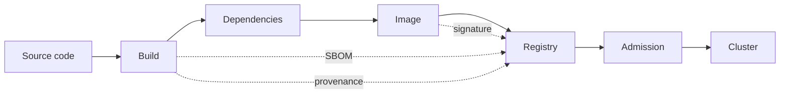

# Chapter 34: Supply chain security: scanning, signing, SBOMs, and image admission

> **Exams:** KCSA · CKS
> **Difficulty:** Advanced
> **Time:** ~75 min reading, ~60 min lab
> **Lab tier:** 1 (kind)
> **Prerequisites:** Chapter 16 (images and delivery), Chapter 31 (admission control)

## Learning objectives

After this chapter you can:

- Describe the stages of a software supply chain, and name where a container image can be trusted, checked, or replaced
- Explain what an image scan finds, what it cannot find, and why a scan result is only as good as its time stamp
- Explain what an SBOM is, and what a signature and a provenance attestation each prove
- Pin an image by digest, and say why a tag can change under you
- Write a ValidatingAdmissionPolicy that allows only images from a trusted registry and only by digest, in containers and in init containers
- Choose between an admission policy that checks the reference and one that checks a signature, and know which policy engines verify signatures
- Shrink an image's attack surface with a multi-stage build on a minimal or empty base image
- Scan images for vulnerabilities and manifests for misconfigurations with Trivy, and act on the findings
- Generate an SBOM for an image, read it, and scan the SBOM instead of the image
- Sign an image with a cosign key pair and verify the signature

## Concepts

### The supply chain

Software reaches a cluster through a chain of steps. Each step is a place where code or a
binary can be swapped, so each one needs a trust decision:



The solid arrows are the path of an image from code to a running Pod. The dotted arrows
are metadata that travels with the image: the SBOM lists what went into it, the signature
says who made it, and provenance describes how it was built. Admission is the last
checkpoint, and it is the only one that every Pod passes, whatever pipeline produced it.

### Images: tags move, digests do not

An image reference has three parts: the registry and repository, a tag, and a digest. The
tag, such as `nginx:1.27`, is a name that the publisher can move to a different image at any
time. The digest, such as `nginx@sha256:...`, is the hash of the image's manifest, and it
identifies exactly one set of bytes.

Pinning an image by digest means a Pod runs the same bytes every time it starts, and it
means a re-pushed tag cannot change what you run. A digest also tells you which exact image
a scan or a signature refers to. The price is that you must update the digest deliberately
when you want a new version.

The `imageID` in a Pod's status shows the digest the node actually pulled, so you can
compare what runs with what you pinned.

### Minimize the base image

Everything in an image ships to production: the application, and everything the base
image brought along. A compiler, a package manager, a shell, and hundreds of system
libraries the application never calls are still files an attacker can use and packages a
scanner will report. **Minimizing the base image** is the cheapest way to shrink both.

A **multi-stage build** separates building from running. The first stage has the full
toolchain; the last stage starts from a small base and copies in only the result:

```dockerfile
FROM golang:1.27 AS build
WORKDIR /src
COPY . .
RUN CGO_ENABLED=0 go build -ldflags="-s -w" -o /hello .

FROM scratch
COPY --from=build /hello /hello
USER 65532
ENTRYPOINT ["/hello"]
```

The choice of the last stage's base is a trade-off:

| Base | Contains | Use it when |
| --- | --- | --- |
| A full distribution (`debian`, `ubuntu`, the language's default image) | Shell, package manager, many libraries | Building; rarely for running |
| `-slim` variants | A reduced distribution | The application needs a few system packages |
| `alpine` | musl libc, busybox, `apk` | You want a shell for debugging, in a few MB |
| Distroless (`gcr.io/distroless/...`) | The language runtime and its libraries; no shell, no package manager | Java, Python, Node, or dynamically linked programs |
| `scratch` | Nothing at all | A statically linked binary (Go with `CGO_ENABLED=0`, Rust with musl) |

Other habits that keep images lean: install packages without recommendations and clean
the package cache in the same `RUN` instruction, copy only what the application needs
(a `.dockerignore`), run as a non-root `USER`, and pin the base image by tag or digest
instead of `latest`. A minimal image is also harder to debug, because there is no shell
to `exec` into; Kubernetes' answer is an ephemeral debug container (`kubectl debug`), not
a fatter image.

### Scanning finds known vulnerabilities

An **image scanner** reads the packages inside an image, such as the OS packages and the
language libraries, and compares their versions with vulnerability databases. It reports the
CVE identifiers that match, with a severity. Scanners run in CI, and many registries scan on
push.

A scan has limits you must keep in mind:

- It only knows the packages it can identify. A binary copied in by hand, or a library
  vendored with no metadata, may be invisible.
- It is a snapshot against the database on the day it ran. A clean scan today can become a
  finding tomorrow without any change to the image.
- A finding is not a verdict. Its severity depends on whether the vulnerable code is
  reachable in your deployment.

The answer to a finding is usually a new base image or a new library version, then a new
digest, then a new scan.

**Trivy** is a widely used open source scanner. `trivy image` scans an image, from a
registry or the local Docker daemon, against a vulnerability database it downloads and
caches. `--severity` limits the report, and `--exit-code 1` makes it fail when it finds
something, which is how a CI pipeline blocks a build.

**Static analysis** looks at what you are about to deploy rather than what is inside the
image. Scanners read Kubernetes manifests (and Dockerfiles, Helm charts, and Terraform)
and flag risky settings: privileged containers, host namespaces, a writable root file
system, root users, missing resource limits. `trivy config` does this, as do **kubesec**
(which scores a manifest) and **KubeLinter**. They run in CI on the YAML before it reaches
the cluster, and catch the same problems Pod Security would reject later, and more.

### SBOMs list what is inside

A **software bill of materials (SBOM)** is a machine-readable list of the components in an
image, with their versions and sources. The two common formats are SPDX and CycloneDX.
An SBOM does not say whether a component is safe. It lets you answer the question "are we
affected?" in seconds when a new vulnerability is published, instead of rescanning every
image.

Generate the SBOM when you build the image, and attach it to the image in the registry, so
it travels with it.

### Signatures prove who made the image

A **signature** proves that a particular identity signed a particular digest. The image
itself is unchanged; the signature is a separate artifact that names the digest. Sigstore
tools such as cosign sign and verify images, either with a key pair or "keyless", where the
signing identity comes from an OpenID Connect login recorded in a transparency log.

A signature proves origin and integrity. It does not prove the image is free of
vulnerabilities, and it does not prove the signer's build process was sound.

With a key pair, `cosign generate-key-pair` writes `cosign.key` (the private key,
encrypted with a password) and `cosign.pub`. `cosign sign --key cosign.key IMAGE` signs
the image's digest and stores the signature in the same registry, next to the image;
`cosign verify --key cosign.pub IMAGE` checks it. By default cosign also records each
signature in Sigstore's public transparency log, Rekor, which makes signing auditable but
also publishes the signature's metadata. For a private registry and a private key, keep
it out of the public log, as the walkthrough does.

A **provenance attestation** records how an artifact was built: the source commit, the
builder, and the build steps. The SLSA framework grades builds by how strongly that record
is protected. An attestation answers "was this built from the code we reviewed, by the
pipeline we trust?"

### Admission: the last check

Admission is where a policy meets every Pod, and it does not depend on the pipeline that
produced the image. Three checks are common, from simplest to strongest:

| Check | What it enforces | Built in? |
| --- | --- | --- |
| Trusted registry | The image starts with an approved registry or path | ValidatingAdmissionPolicy (CEL) |
| Digest pinning | The image contains `@sha256:` | ValidatingAdmissionPolicy (CEL) |
| Signature and attestation | A valid signature, or a provenance attestation, exists for the digest | Policy engines such as Kyverno (`verifyImages`) or Gatekeeper with an external data provider |

The first two are plain string rules, so a ValidatingAdmissionPolicy can express them.
Checking a signature needs network access to the registry and the signing trust roots, so it
belongs in a policy engine.

A rule on the reference must cover every container, and every init container. An init
container runs before the app and can carry an image just as well, so a policy that checks
only `containers` leaves a gap.

> **Exam tip:** Know what each supply chain artifact proves. A scan lists known vulnerabilities at one moment. An SBOM lists components. A signature proves who signed a digest. A provenance attestation proves how it was built. A question that asks "which proves the image came from this pipeline?" is about provenance or a signature, not a scan.

### Registries

Use a private registry or an approved set of repositories for the images you run. Set the
policy to name that registry, and keep it separate from the images you build locally for
testing. A registry that also serves public images should have rules that keep the public
images out of production namespaces.

## Guided walkthrough

These steps only read the cluster, so you can run them at any time.

### See the tag a Pod asked for, and the digest it runs

```bash
kubectl -n kube-system get pods -l k8s-app=kube-dns \
  -o jsonpath='{range .items[*]}{.spec.containers[0].image}{"  "}{.status.containerStatuses[0].imageID}{"\n"}{end}'
```

```text
registry.k8s.io/coredns/coredns:v1.14.6  sha256:520212b8b0fcd9309d7362d592f513b72880fa5a4e9e8b91442e7ee3b622c6a9
registry.k8s.io/coredns/coredns:v1.14.6  sha256:520212b8b0fcd9309d7362d592f513b72880fa5a4e9e8b91442e7ee3b622c6a9
```

The first column is the tag the Pod asked for. The second is the digest the node pulled.
Both Pods show the same digest, and the digest is the one that does not move.

### Write a manifest that pins by digest

`kubectl create deployment` accepts a digest in place of a tag. A client-side dry run prints
the image it would use, without creating anything:

```bash
kubectl create deployment pinned \
  --image=registry.k8s.io/coredns/coredns@sha256:aa5e3ebc0dfed0566805186b9e47110d8f9122291d8bad1497e78873ad291139 \
  --dry-run=client -o jsonpath='{.spec.template.spec.containers[0].image}{"\n"}'
```

```text
registry.k8s.io/coredns/coredns@sha256:aa5e3ebc0dfed0566805186b9e47110d8f9122291d8bad1497e78873ad291139
```

The reference now contains `@sha256:`, which is the form the admission policy in the lab
checks for.

The remaining steps run on your machine, not in the cluster. They need Docker, and Trivy
and cosign at the versions in `versions.env`; the lab section shows how to install them.

### Compare three base images

[`manifests/hello/`](manifests/hello/) holds a ten-line Go web server and three
Dockerfiles for it: one stage on `golang:1.27`, two stages ending on `alpine:3.20`, and
two stages ending on `scratch`. Build all three and compare:

```bash
cd chapters/34-supply-chain-security/manifests/hello
for v in single alpine scratch; do docker build -q -f Dockerfile.$v -t hello:$v . ; done
docker images hello --format "table {{.Repository}}:{{.Tag}}\t{{.Size}}"
```

```text
REPOSITORY:TAG   SIZE
hello:scratch    8.37MB
hello:alpine     25.6MB
hello:single     1.43GB
```

The program is the same in all three. The difference is everything around it: the
single-stage image carries the Go toolchain and a full Debian. The `scratch` image holds
one file, so there is nothing else to run in it, not even a shell:

```bash
docker run --rm --entrypoint sh hello:scratch -c id
```

```text
docker: Error response from daemon: failed to create task for container: failed to create shim task: OCI runtime create failed: runc create failed: unable to start container process: error during container init: exec: "sh": executable file not found in $PATH
```

### Scan images

Scan the single-stage image and the `scratch` image (the first run downloads Trivy's
database):

```bash
trivy image --quiet hello:single | grep -E '^(hello|usr|Total)'
trivy image --quiet hello:scratch | grep -E '^(hello|usr|Total)'
```

```text
hello:single (debian 13.7)
Total: 2319 (UNKNOWN: 14, LOW: 1036, MEDIUM: 1033, HIGH: 233, CRITICAL: 3)
hello (gobinary)
Total: 1 (UNKNOWN: 1, LOW: 0, MEDIUM: 0, HIGH: 0, CRITICAL: 0)
usr/local/go/bin/go (gobinary)
Total: 1 (UNKNOWN: 1, LOW: 0, MEDIUM: 0, HIGH: 0, CRITICAL: 0)
hello (gobinary)
Total: 1 (UNKNOWN: 1, LOW: 0, MEDIUM: 0, HIGH: 0, CRITICAL: 0)
```

The single-stage image reports 2,319 findings in its Debian packages, and one each in the
program and the Go toolchain it carries; the `scratch` image reports only the program's
one. Same program: what a scanner reports lives almost entirely in the base image. A widely used tag is no guarantee either. Only the CRITICAL findings for
`nginx:1.27`:

```bash
trivy image --quiet --severity CRITICAL nginx:1.27
```

The report starts with a summary per target, then a table per target. The first rows of
the table:

```text
nginx:1.27 (debian 12.11)
=========================
Total: 12 (CRITICAL: 12)

┌─────────────┬─────────────────┬──────────┬──────────────┬─────────────────────────┬─────────────────────────┬────────────────────────────────────────────────────────────┐
│   Library   │  Vulnerability  │ Severity │    Status    │    Installed Version    │      Fixed Version      │                           Title                            │
├─────────────┼─────────────────┼──────────┼──────────────┼─────────────────────────┼─────────────────────────┼────────────────────────────────────────────────────────────┤
│ libaom3     │ CVE-2023-6879   │ CRITICAL │ affected     │ 3.6.0-1+deb12u1         │                         │ aom: heap-buffer-overflow on frame size change             │
│             │                 │          │              │                         │                         │ https://avd.aquasec.com/nvd/cve-2023-6879                  │
├─────────────┼─────────────────┤          ├──────────────┼─────────────────────────┼─────────────────────────┼────────────────────────────────────────────────────────────┤
│ libbrotli1  │ CVE-2026-111497 │          │ fixed        │ 1.0.9-2+b6              │ 1.0.9-2+deb12u1         │ brotli: Out-of-Bounds Write in Google Brotli Decoder       │
│             │                 │          │              │                         │                         │ https://avd.aquasec.com/nvd/cve-2026-111497                │
```

Each row names the package, the CVE, the installed version, and the version that fixes
it. `affected` means no fix exists yet; `fixed` means a newer package does, so a rebuild
on an updated base image removes the finding. In CI, `--exit-code 1` turns findings into a failed build:

```bash
trivy image --quiet --severity CRITICAL --exit-code 1 nginx:1.27 >/dev/null; echo "exit code $?"
```

```text
exit code 1
```

### Scan a manifest

`trivy config` reads YAML instead of an image. [`manifests/web.yaml`](manifests/web.yaml) is a
Deployment with host networking and a privileged container (scanned from that folder):

```bash
trivy config --quiet --severity HIGH,CRITICAL web.yaml | grep -E '^(Failures|KSV)'
```

```text
Failures: 4 (HIGH: 4, CRITICAL: 0)
KSV-0009 (HIGH): Deployment 'web' should not set 'spec.template.spec.hostNetwork' to true
KSV-0014 (HIGH): Container 'web' of Deployment 'web' should set 'securityContext.readOnlyRootFilesystem' to true
KSV-0017 (HIGH): Container 'web' of Deployment 'web' should set 'securityContext.privileged' to false
KSV-0118 (HIGH): deployment web in default namespace is using the default security context, which allows root privileges
```

Each check (`KSV-...`) names the setting to change; without `--severity`, the same scan
also lists 14 lower-severity findings, such as missing resource limits.

### Generate and use an SBOM

The same scanner writes an SBOM instead of a report. For the Alpine image of the
walkthrough above, in CycloneDX format:

```bash
trivy image --quiet --format cyclonedx --output hello.cdx.json hello:alpine
jq -r '.bomFormat, .specVersion, (.components | length)' hello.cdx.json
jq -r '.components[] | [.type, .name, .version] | @tsv' hello.cdx.json | column -t
```

```text
CycloneDX
1.7
18
operating-system  alpine                  3.20.10
application       hello
library           alpine-baselayout-data  3.6.5-r0
library           alpine-baselayout       3.6.5-r0
library           alpine-keys             2.4-r1
library           apk-tools               2.14.4-r1
library           busybox-binsh           1.36.1-r31
library           busybox                 1.36.1-r31
library           ca-certificates-bundle  20260413-r0
library           libcrypto3              3.3.7-r0
library           libssl3                 3.3.7-r0
library           musl-utils              1.2.5-r3
library           musl                    1.2.5-r3
library           scanelf                 1.3.7-r2
library           ssl_client              1.36.1-r31
library           zlib                    1.3.2-r0
library           hello
library           stdlib                  v1.27.3
```

Eighteen components: the Alpine release, its packages, the Go program, and the Go
standard library compiled into it. Each one carries a **package URL** (purl), a
standard name that tools across ecosystems understand:

```bash
jq -r '.components[] | select(.name=="busybox") | .purl' hello.cdx.json
```

```text
pkg:apk/alpine/busybox@1.36.1-r31?arch=x86_64&distro=3.20.10
```

`--format spdx-json` writes the other standard, SPDX (here an `SPDX-2.3` document with
19 packages). The point of an SBOM is that you can work with it without the image:
when a new vulnerability is published, scan the stored SBOMs instead of pulling and
unpacking every image again:

```bash
trivy sbom --quiet hello.cdx.json
```

```text
hello.cdx.json (alpine 3.20.10)
===============================
Total: 2 (UNKNOWN: 0, LOW: 0, MEDIUM: 0, HIGH: 2, CRITICAL: 0)

┌────────────┬─────────────────┬──────────┬────────┬───────────────────┬───────────────┬──────────────────────────────────────────────────────────────┐
│  Library   │  Vulnerability  │ Severity │ Status │ Installed Version │ Fixed Version │                            Title                             │
├────────────┼─────────────────┼──────────┼────────┼───────────────────┼───────────────┼──────────────────────────────────────────────────────────────┤
│ musl       │ CVE-2026-107891 │ HIGH     │ fixed  │ 1.2.5-r3          │ 1.2.5-r4      │ musl: musl: Arbitrary code execution via integer overflow in │
│            │                 │          │        │                   │               │ regcomp                                                      │
│            │                 │          │        │                   │               │ https://avd.aquasec.com/nvd/cve-2026-107891                  │
├────────────┤                 │          │        │                   │               │                                                              │
│ musl-utils │                 │          │        │                   │               │                                                              │
```

The findings are the image's own (the report also lists one for the Go standard
library), found from 28 KB of JSON. In a pipeline, the SBOM is generated at build
time and stored with the image, for example as an attestation that cosign signs
(`cosign attest --type cyclonedx`), so that it, too, is tied to the digest.

### Sign and verify an image

A throwaway registry on your machine is enough to try signing. Push the `scratch` image
to it, create a key pair, and sign:

```bash
docker run -d --name demo-registry -p 127.0.0.1:5035:5000 registry:2.8.3
docker tag hello:scratch localhost:5035/demo/hello:1.0
docker push localhost:5035/demo/hello:1.0
COSIGN_PASSWORD= cosign generate-key-pair --output-key-prefix demo
COSIGN_PASSWORD= cosign sign --yes --key demo.key --use-signing-config=false --tlog-upload=false localhost:5035/demo/hello:1.0
```

```text
Private key written to demo.key
Public key written to demo.pub
Flag --use-signing-config has been deprecated, an offline signing flag will be added in the future; TUF will continue to provide a signing config by default if one is not provided manually
Flag --tlog-upload has been deprecated, prefer using a --signing-config file with no transparency log services
WARNING: Image reference localhost:5035/demo/hello:1.0 uses a tag, not a digest, to identify the image to sign.
    This can lead you to sign a different image than the intended one. Please use a
    digest (example.com/ubuntu@sha256:abc123...) rather than tag
    (example.com/ubuntu:latest) for the input to cosign. The ability to refer to
    images by tag will be removed in a future release.

Signing artifact...
Pushing signature to: localhost:5035/demo/hello
```

An empty `COSIGN_PASSWORD` creates and uses a key without a password, fine for a test and
nothing else. `--use-signing-config=false --tlog-upload=false` keeps the signature out of
the public transparency log; cosign v3 warns that both flags are deprecated in favour of a
signing configuration without a log, and still honours them. Its other warning is the
lesson of this chapter again: signing a tag signs whatever digest the tag points to right
now, so sign by digest in a pipeline. Verify it:

```bash
cosign verify --key demo.pub --insecure-ignore-tlog=true localhost:5035/demo/hello:1.0
```

```text
WARNING: Skipping tlog verification is an insecure practice that lacks transparency and auditability verification for the signature.

Verification for localhost:5035/demo/hello:1.0 --
The following checks were performed on each of these signatures:
```

`--insecure-ignore-tlog=true` matches the signing: there is no log entry to check. The
signature is an artifact of its own in the registry, attached to the image's digest:

```bash
cosign tree localhost:5035/demo/hello:1.0
```

```text
📦 Supply Chain Security Related artifacts for an image: localhost:5035/demo/hello:1.0
└── 🔗 https://sigstore.dev/cosign/sign/v1 artifacts via OCI referrer: localhost:5035/demo/hello@sha256:5f18a3fc8835145d79387832088bb008525e944893f5071274092a1eff00d195
   └── 🍒 sha256:78813608b7cac3d033cac1c74f79f3503bf0c772211a2be6e65a1efd14554df9
```

A second image, pushed but never signed, fails the same check:

```bash
cosign verify --key demo.pub --insecure-ignore-tlog=true localhost:5035/demo/hello:1.1
```

```text
Error: no signatures found
error during command execution: no signatures found
```

`docker rm -f demo-registry` removes the registry again. In a cluster, an admission
controller does this verification for every Pod (Kyverno's `verifyImages`, or Sigstore's
policy-controller), so unsigned images never start.

## Hands-on lab

The lab works like a KodeKloud lab: one task at a time, a check after each, and
progress that is saved between sessions.

```bash
make lab CH=34       # set up the lab and show task 1
make check CH=34     # check the current task; if it is right, show the next
make question CH=34  # show the current task again
make reset CH=34     # back to the starting state and task 1
make verify CH=34    # check every task at once
```

The lab uses the Namespace `ch34-supply`. The setup starts one Pod, `runner`, from
`busybox:1.36`, before any policy exists. No registry is available in the lab, so the
checks use server-side dry runs: admission runs on a Pod, and nothing is stored. The
trusted registry in the lab is `registry.kbook.example`. Its images do not need to exist,
because a dry run never pulls them.

Tasks 1 and 2 are one policy, written in two steps. The checks test behaviour, so each one
passes only when the policy refuses or accepts the right Pods, whichever step you have done.

Tasks 4 to 6 need Docker, Trivy, and cosign on your machine. `make lab` refuses to start
without them. Install the pinned versions, checked against the sums in `versions.env`:

```bash
source versions.env
curl -fsSLO "https://github.com/aquasecurity/trivy/releases/download/${TRIVY_VERSION}/trivy_${TRIVY_VERSION#v}_Linux-64bit.tar.gz"
echo "${TRIVY_SHA256}  trivy_${TRIVY_VERSION#v}_Linux-64bit.tar.gz" | sha256sum -c -
tar -xzf "trivy_${TRIVY_VERSION#v}_Linux-64bit.tar.gz" trivy && sudo install -m 0755 trivy /usr/local/bin/
curl -fsSLO "https://github.com/sigstore/cosign/releases/download/${COSIGN_VERSION}/cosign-linux-amd64"
echo "${COSIGN_SHA256}  cosign-linux-amd64" | sha256sum -c -
sudo install -m 0755 cosign-linux-amd64 /usr/local/bin/cosign
```

Tasks 4 and 5 use a second Namespace, `ch34-scan`, which the image policy of Tasks 1 and 2
does not cover. Setup also downloads Trivy's vulnerability database and starts a local
registry at `localhost:5034` with two images, `ch34/app:1.0` and `ch34/app:1.1`, for Task 6;
`make teardown CH=34` removes the registry.

Full solutions are in [`lab/solutions.md`](lab/solutions.md).

### Task 1: Only images from the trusted registry

Create a ValidatingAdmissionPolicy named `ch34-trusted-images` that checks Pods on create
and update, and a ValidatingAdmissionPolicyBinding named `ch34-trusted-images-binding` that
denies a violation and applies only in Namespace `ch34-supply`. The policy allows an image
only if it starts with `registry.kbook.example/`, in containers and in init containers.

- ValidatingAdmissionPolicy `ch34-trusted-images`: every container and every init container image starts with `registry.kbook.example/`
- ValidatingAdmissionPolicyBinding `ch34-trusted-images-binding`: refers to the policy, uses the validation action `Deny`, and matches only Namespace `ch34-supply`
- A Pod with a trusted image is accepted, and a Pod with `nginx:1.27` in its containers, or with a Docker Hub image as an init container, is refused

### Task 2: Only images pinned by digest

Add a second validation to the same policy: every container and every init container image
must contain `@sha256:`. A trusted image given only with a tag is refused, in containers and
in init containers.

- ValidatingAdmissionPolicy `ch34-trusted-images`: a second validation requiring `@sha256:` in every container and init container image
- A trusted image pinned by digest is accepted; `registry.kbook.example/app:1.0` in containers, and `registry.kbook.example/init:1.0` in init containers, are refused

### Task 3: Record the digest the runner Pod runs

Pod `runner` runs `busybox:1.36`. Write the digest of the image that the Pod's container
actually runs to `/tmp/ch34-digest.txt`, and nothing else. Read it from the Pod's status,
not from the tag.

- File `/tmp/ch34-digest.txt`: the digest, in the form `sha256:` followed by 64 hex characters, matching the Pod's `imageID`

### Task 4: Fix what static analysis finds

The Deployment `report` in `ch34-scan` runs `busybox:1.36` with `sleep infinity`. Scan it
with `trivy config`, and change it until the scan reports no HIGH or CRITICAL
misconfiguration.

- Deployment `report` in `ch34-scan`: image `busybox:1.36`, 2 ready replicas
- `trivy config --severity HIGH,CRITICAL` on the Deployment as the cluster stores it (`kubectl get deployment report -o yaml`) finds nothing

### Task 5: Remove the Pods with critical vulnerabilities

Four Pods in `ch34-scan` carry the label `scan=me`. Scan each Pod's image with Trivy,
delete every Pod whose image has at least one CRITICAL vulnerability, and list the deleted
Pods.

- File `/tmp/ch34-critical.txt`: the names of the deleted Pods, one per line, sorted alphabetically, nothing else
- Those Pods are deleted; the other Pods labelled `scan=me` still run, unchanged

Use the database setup downloaded (`--skip-db-update`), so that your scans and the check
agree.

### Task 6: Sign one image

Create a cosign key pair without a password, and sign `localhost:5034/ch34/app:1.0` with
it. Do not sign `localhost:5034/ch34/app:1.1`. Keep the signature out of the public
transparency log.

- Key pair: `/tmp/ch34-cosign.key` and `/tmp/ch34-cosign.pub`
- `cosign verify --key /tmp/ch34-cosign.pub --insecure-ignore-tlog=true` succeeds for `app:1.0` and fails for `app:1.1`

## Exam tips

> **Exam tip:** A tag is not a pin. If a question asks how to make a Pod run exactly the same image every time, the answer is the digest, not a newer or more specific tag.
>
> **Exam tip:** Admission policies on images must cover init containers. A rule that checks only `containers` is the classic gap.
>
> **Exam tip:** Match the artifact to the claim. Scan results list known CVEs at a moment; an SBOM lists components; a signature proves the signer of a digest; a provenance attestation proves the build.
>
> **Exam tip:** For "which images have critical vulnerabilities?", collect the images first (`kubectl get pods -o jsonpath='{range .items[*]}{.metadata.name}{" "}{.spec.containers[*].image}{"\n"}{end}'`), then run `trivy image --severity CRITICAL` on each. Answer about the image the Pod runs, not the one you think it runs.
>
> **Exam tip:** Static analysis findings map to `securityContext` fields: `privileged: false`, `allowPrivilegeEscalation: false`, `readOnlyRootFilesystem: true`, `runAsNonRoot: true`, `capabilities.drop: ["ALL"]`, and no host namespaces.

## Common mistakes

- Pinning the base image by tag in a Dockerfile and believing the deployed image is fixed. Pin by digest in the manifest that the cluster runs.
- Treating a clean scan as a permanent result. Scan again on a schedule, and when the base image changes.
- Writing an admission rule that checks `containers` but not `initContainers`.
- Confusing a signature with a scan. A signed image can still carry known vulnerabilities.
- Writing a prefix rule such as `startsWith('registry.kbook.example')` without the slash, which also matches `registry.kbook.example.evil.test/...`.
- Expecting a ValidatingAdmissionPolicy to verify signatures. It can check strings; verifying a signature needs a policy engine that reaches the registry.
- Shipping the build toolchain. A single-stage build puts the compiler and a full distribution into production; a multi-stage build ships only the result.
- Treating the base image as someone else's problem. Most scanner findings are in the base image, not in your code; changing the base is often the fix.
- Assuming a signature follows a tag. cosign signs the digest the tag points to when you sign; after a re-push, the tag points to a digest nobody signed.

<!-- QUESTIONS:START -->

## End-of-chapter questions

**1.** `KCSA` Which property makes a digest a better pin than a tag?

- **A.** A digest is shorter and easier to read
- **B.** A digest identifies one exact set of bytes, while a tag can be moved to a different image
- **C.** A digest is automatically scanned for vulnerabilities
- **D.** A digest is accepted by every registry, and tags are not

**2.** `KCSA` A scanner reports no known vulnerabilities for an image today. Which statement is correct?

- **A.** The image will never have a vulnerability
- **B.** The image has no vulnerabilities in any package the scanner can identify, measured against the database at scan time
- **C.** The image is signed and therefore safe
- **D.** The image has a provenance attestation

**3.** `KCSA` What does an SBOM provide?

- **A.** A proof that the image was built by an approved pipeline
- **B.** A machine-readable list of the components in an image, with versions
- **C.** A cryptographic signature over the image digest
- **D.** A list of the open ports the container exposes

**4.** `CKS` Which artifact proves who signed a particular image digest?

- **A.** An SBOM
- **B.** A vulnerability scan report
- **C.** A signature, such as one made with cosign
- **D.** The image's tag

**5.** `CKS` Which artifact records how an image was built, such as the source commit and the builder?

- **A.** A provenance attestation
- **B.** A ValidatingAdmissionPolicy
- **C.** A NetworkPolicy
- **D.** A Secret of type kubernetes.io/tls

**6.** `CKS` An admission policy rejects Pods whose containers use images from Docker Hub, but it checks only spec.containers. A Pod has an init container from Docker Hub. What happens?

- **A.** The Pod is refused, because init containers are always checked
- **B.** The Pod is accepted, because the policy does not check init containers
- **C.** The Pod is refused with a warning
- **D.** The init container is replaced with a trusted image

**7.** `CKS` Which admission check can a ValidatingAdmissionPolicy perform by itself, without a policy engine?

- **A.** Verify a cosign signature against the registry
- **B.** Check that every image starts with an approved registry prefix
- **C.** Confirm that an image has no CVEs
- **D.** Fetch the image's provenance attestation from the registry

**8.** `KCSA` A container image has a valid signature, and its scan lists several high-severity CVEs. What does the signature establish?

- **A.** That the image has no vulnerabilities
- **B.** That a particular identity signed this digest, so the image was not changed after signing
- **C.** That the image was built from the reviewed source with a trusted builder
- **D.** That the image is a minimal image

**9.** `CKS` Which practice makes a Pod run the same image every time it is started?

- **A.** Using the image tag latest
- **B.** Pinning the image by digest in the Pod's spec
- **C.** Setting imagePullPolicy to Always
- **D.** Adding a label to the Pod

**10.** `CKS` Which prefix rule is safest for allowing only images from registry.example.com?

- **A.** image.startsWith('registry.example.com')
- **B.** image.contains('registry.example.com')
- **C.** image.startsWith('registry.example.com/')
- **D.** image.endsWith('.example.com')

**11. (Task)** `CKS` Show the image digest that the Pod `web` in Namespace `shop` is running, using its status. Save only the digest, in the form `sha256:` followed by 64 hex characters, to `/tmp/web-digest.txt`.

**12. (Task)** `CKS` Show a manifest for a Deployment `api` in Namespace `shop` that runs `registry.example.com/shop/api` pinned to the digest `sha256:` followed by 64 `a` characters. Print only the image line from the manifest.

**13.** `KCSA` `CKS` A Go service is built with one Dockerfile stage on golang:1.27, and the image is over 1 GB with thousands of scanner findings. What shrinks it most, without changing the program?

- **A.** A newer golang tag
- **B.** A multi-stage build: compile in a golang stage, then copy only the static binary into a scratch or distroless final stage
- **C.** Adding a .dockerignore file
- **D.** Running the container with readOnlyRootFilesystem

**14.** `KCSA` `CKS` Which tool finds a privileged container and a missing readOnlyRootFilesystem in a Deployment manifest before it is applied?

- **A.** trivy image
- **B.** cosign verify
- **C.** A static analysis tool such as trivy config, kubesec, or KubeLinter
- **D.** An SBOM generator

**15. (Task)** `CKS` Create a cosign key pair, sign the image registry.example.com/shop/api:2.1 with it without using the public transparency log, and verify the signature.

<details>
<summary>Answers</summary>

**1. B.** A digest is the hash of the image manifest, so it names exactly one image. A tag is a name the publisher can point at a different image later.

**2. B.** A scan is a snapshot against a vulnerability database on the day it ran. It only sees the packages it can identify, and new CVEs can appear later without any change to the image.

**3. B.** An SBOM lists components such as OS and language packages with their versions. It helps answer whether you are affected by a new vulnerability, but it does not prove how the image was built or who signed it.

**4. C.** A signature binds a signing identity to a digest. An SBOM lists components, a scan lists known vulnerabilities, and a tag is a mutable name.

**5. A.** A provenance attestation records the build: the source, the builder, and the steps. SLSA grades how strongly that record is protected.

**6. B.** An init container runs before the app and can use any image. A policy that only iterates over spec.containers leaves init containers unchecked, which is a common gap.

**7. B.** A ValidatingAdmissionPolicy evaluates CEL over the object, so it can check strings such as the registry prefix or the presence of @sha256:. Signature and attestation checks need network access to the registry and trust roots, which a policy engine provides.

**8. B.** A signature proves origin and integrity of a digest, not safety. The CVEs remain a separate finding. Provenance, not the signature, is what describes the build.

**9. B.** latest and other tags can point to a new image at any time. imagePullPolicy controls when the node pulls, not which bytes it gets. A digest pins the exact image.

**10. C.** The trailing slash stops registry.example.com.evil.test/app from passing the check. Without it, a prefix match also accepts a longer hostname. contains and endsWith are looser still.

**11.**

```bash
id="$(kubectl -n shop get pod web -o jsonpath='{.status.containerStatuses[0].imageID}')"
printf '%s\n' "${id##*@}" > /tmp/web-digest.txt
cat /tmp/web-digest.txt
```

The `imageID` in the status is the digest the node pulled. Its part after `@` is the
digest, and `${id##*@}` keeps only that part. If the imageID has no `@`, the whole value is
the digest, and this command still works.

**12.**

```bash
kubectl -n shop create deployment api --image=registry.example.com/shop/api@sha256:aaaaaaaaaaaaaaaaaaaaaaaaaaaaaaaaaaaaaaaaaaaaaaaaaaaaaaaaaaaaaaaa --dry-run=client -o yaml | grep 'image:'
```

`--dry-run=client -o yaml` prints the manifest without creating the Deployment. The
image reference keeps the `@sha256:` form, so the Pod runs that exact digest.

**13. B.** The single-stage image ships the whole toolchain and a full distribution. A multi-stage build keeps them in the build stage and ships only the binary; for a static Go binary (CGO_ENABLED=0), scratch holds nothing else, so the image drops to a few MB and nearly all findings go with the base. .dockerignore and runtime settings help, but do not remove the base image.

**14. C.** Static analysis reads the YAML and flags risky settings; it runs in CI before anything reaches the cluster. trivy image looks for vulnerable packages inside an image, cosign verify checks signatures, and an SBOM lists components.

**15.**

```bash
cosign generate-key-pair
cosign sign --key cosign.key --use-signing-config=false --tlog-upload=false registry.example.com/shop/api:2.1
cosign verify --key cosign.pub --insecure-ignore-tlog=true registry.example.com/shop/api:2.1
```

generate-key-pair asks for a password to encrypt cosign.key (or reads COSIGN_PASSWORD). sign resolves the tag to its digest, signs the digest, and pushes the signature to the same repository, so you need push access to it. Without the two flags, cosign records the signature in Sigstore's public log, Rekor; verify then checks that entry too, which --insecure-ignore-tlog=true skips. Verification prints the signed digest; an image signed by another key, or not at all, fails.

</details>

<!-- QUESTIONS:END -->

## Further reading

- Kubernetes documentation: *Images* (image digests and pull policy) and *Validating Admission Policy*
- Sigstore documentation: *cosign*, and the Rekor transparency log
- The SLSA framework: build levels and provenance
- SPDX and CycloneDX specifications for SBOM formats
- Kyverno documentation: *verifyImages*, and the Gatekeeper external data documentation
- Chapter 16 for building and delivering images; Chapter 31 for admission control in general
