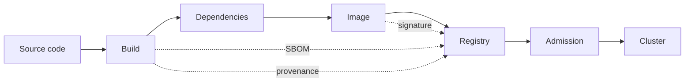

# Chapter 34: Supply chain security: scanning, signing, SBOMs, and image admission

> **Exams:** KCSA · CKS
> **Difficulty:** Advanced
> **Time:** ~60 min reading, ~35 min lab
> **Lab tier:** 1 (kind)
> **Prerequisites:** Chapter 16 (images and delivery), Chapter 31 (admission control)

## Learning objectives

After this chapter you can:

- Describe the stages of a software supply chain, and name where a container image can be trusted, checked, or replaced
- Explain what an image scan finds, what it cannot find, and why a scan result is only as good as its time stamp
- Explain what an SBOM is, and what a signature and a provenance attestation each prove
- Pin an image by digest, and say why a tag can change under you
- Write a ValidatingAdmissionPolicy that allows only images from a trusted registry and only by digest, in containers and in init containers
- Choose between an admission policy that checks the reference and one that checks a signature, and know which policy engines verify signatures

## Concepts

### The supply chain

Software reaches a cluster through a chain of steps. Each step is a place where code or a
binary can be swapped, so each one needs a trust decision:



The solid arrows are the path of an image from code to a running Pod. The dotted arrows
are metadata that travels with the image: the SBOM lists what went into it, the signature
says who made it, and provenance describes how it was built. Admission is the last
checkpoint, and it is the only one that every Pod passes, whatever pipeline produced it.

### Images: tags move, digests do not

An image reference has three parts: the registry and repository, a tag, and a digest. The
tag, such as `nginx:1.27`, is a name that the publisher can move to a different image at any
time. The digest, such as `nginx@sha256:...`, is the hash of the image's manifest, and it
identifies exactly one set of bytes.

Pinning an image by digest means a Pod runs the same bytes every time it starts, and it
means a re-pushed tag cannot change what you run. A digest also tells you which exact image
a scan or a signature refers to. The price is that you must update the digest deliberately
when you want a new version.

The `imageID` in a Pod's status shows the digest the node actually pulled, so you can
compare what runs with what you pinned.

### Scanning finds known vulnerabilities

An **image scanner** reads the packages inside an image, such as the OS packages and the
language libraries, and compares their versions with vulnerability databases. It reports the
CVE identifiers that match, with a severity. Scanners run in CI, and many registries scan on
push.

A scan has limits you must keep in mind:

- It only knows the packages it can identify. A binary copied in by hand, or a library
  vendored with no metadata, may be invisible.
- It is a snapshot against the database on the day it ran. A clean scan today can become a
  finding tomorrow without any change to the image.
- A finding is not a verdict. Its severity depends on whether the vulnerable code is
  reachable in your deployment.

The answer to a finding is usually a new base image or a new library version, then a new
digest, then a new scan.

### SBOMs list what is inside

A **software bill of materials (SBOM)** is a machine-readable list of the components in an
image, with their versions and sources. The two common formats are SPDX and CycloneDX.
An SBOM does not say whether a component is safe. It lets you answer the question "are we
affected?" in seconds when a new vulnerability is published, instead of rescanning every
image.

Generate the SBOM when you build the image, and attach it to the image in the registry, so
it travels with it.

### Signatures prove who made the image

A **signature** proves that a particular identity signed a particular digest. The image
itself is unchanged; the signature is a separate artifact that names the digest. Sigstore
tools such as cosign sign and verify images, either with a key pair or "keyless", where the
signing identity comes from an OpenID Connect login recorded in a transparency log.

A signature proves origin and integrity. It does not prove the image is free of
vulnerabilities, and it does not prove the signer's build process was sound.

A **provenance attestation** records how an artifact was built: the source commit, the
builder, and the build steps. The SLSA framework grades builds by how strongly that record
is protected. An attestation answers "was this built from the code we reviewed, by the
pipeline we trust?"

### Admission: the last check

Admission is where a policy meets every Pod, and it does not depend on the pipeline that
produced the image. Three checks are common, from simplest to strongest:

| Check | What it enforces | Built in? |
| --- | --- | --- |
| Trusted registry | The image starts with an approved registry or path | ValidatingAdmissionPolicy (CEL) |
| Digest pinning | The image contains `@sha256:` | ValidatingAdmissionPolicy (CEL) |
| Signature and attestation | A valid signature, or a provenance attestation, exists for the digest | Policy engines such as Kyverno (`verifyImages`) or Gatekeeper with an external data provider |

The first two are plain string rules, so a ValidatingAdmissionPolicy can express them.
Checking a signature needs network access to the registry and the signing trust roots, so it
belongs in a policy engine.

A rule on the reference must cover every container, and every init container. An init
container runs before the app and can carry an image just as well, so a policy that checks
only `containers` leaves a gap.

> **Exam tip:** Know what each supply chain artifact proves. A scan lists known vulnerabilities at one moment. An SBOM lists components. A signature proves who signed a digest. A provenance attestation proves how it was built. A question that asks "which proves the image came from this pipeline?" is about provenance or a signature, not a scan.

### Registries

Use a private registry or an approved set of repositories for the images you run. Set the
policy to name that registry, and keep it separate from the images you build locally for
testing. A registry that also serves public images should have rules that keep the public
images out of production namespaces.

## Guided walkthrough

These steps only read the cluster, so you can run them at any time.

### See the tag a Pod asked for, and the digest it runs

```bash
kubectl -n kube-system get pods -l k8s-app=kube-dns \
  -o jsonpath='{range .items[*]}{.spec.containers[0].image}{"  "}{.status.containerStatuses[0].imageID}{"\n"}{end}'
```

```text
registry.k8s.io/coredns/coredns:v1.14.6  sha256:520212b8b0fcd9309d7362d592f513b72880fa5a4e9e8b91442e7ee3b622c6a9
registry.k8s.io/coredns/coredns:v1.14.6  sha256:520212b8b0fcd9309d7362d592f513b72880fa5a4e9e8b91442e7ee3b622c6a9
```

The first column is the tag the Pod asked for. The second is the digest the node pulled.
Both Pods show the same digest, and the digest is the one that does not move.

### Write a manifest that pins by digest

`kubectl create deployment` accepts a digest in place of a tag. A client-side dry run prints
the image it would use, without creating anything:

```bash
kubectl create deployment pinned \
  --image=registry.k8s.io/coredns/coredns@sha256:aa5e3ebc0dfed0566805186b9e47110d8f9122291d8bad1497e78873ad291139 \
  --dry-run=client -o jsonpath='{.spec.template.spec.containers[0].image}{"\n"}'
```

```text
registry.k8s.io/coredns/coredns@sha256:aa5e3ebc0dfed0566805186b9e47110d8f9122291d8bad1497e78873ad291139
```

The reference now contains `@sha256:`, which is the form the admission policy in the lab
checks for.

## Hands-on lab

The lab works like a KodeKloud lab: one task at a time, a check after each, and
progress that is saved between sessions.

```bash
make lab CH=34       # set up the lab and show task 1
make check CH=34     # check the current task; if it is right, show the next
make question CH=34  # show the current task again
make reset CH=34     # back to the starting state and task 1
make verify CH=34    # check every task at once
```

The lab uses the Namespace `ch34-supply`. The setup starts one Pod, `runner`, from
`busybox:1.36`, before any policy exists. No registry is available in the lab, so the
checks use server-side dry runs: admission runs on a Pod, and nothing is stored. The
trusted registry in the lab is `registry.kbook.example`. Its images do not need to exist,
because a dry run never pulls them.

Tasks 1 and 2 are one policy, written in two steps. The checks test behaviour, so each one
passes only when the policy refuses or accepts the right Pods, whichever step you have done.

Full solutions are in [`lab/solutions.md`](lab/solutions.md).

### Task 1: Only images from the trusted registry

Create a ValidatingAdmissionPolicy named `ch34-trusted-images` that checks Pods on create
and update, and a ValidatingAdmissionPolicyBinding named `ch34-trusted-images-binding` that
denies a violation and applies only in Namespace `ch34-supply`. The policy allows an image
only if it starts with `registry.kbook.example/`, in containers and in init containers.

- ValidatingAdmissionPolicy `ch34-trusted-images`: every container and every init container image starts with `registry.kbook.example/`
- ValidatingAdmissionPolicyBinding `ch34-trusted-images-binding`: refers to the policy, uses the validation action `Deny`, and matches only Namespace `ch34-supply`
- A Pod with a trusted image is accepted, and a Pod with `nginx:1.27` in its containers, or with a Docker Hub image as an init container, is refused

### Task 2: Only images pinned by digest

Add a second validation to the same policy: every container and every init container image
must contain `@sha256:`. A trusted image given only with a tag is refused, in containers and
in init containers.

- ValidatingAdmissionPolicy `ch34-trusted-images`: a second validation requiring `@sha256:` in every container and init container image
- A trusted image pinned by digest is accepted; `registry.kbook.example/app:1.0` in containers, and `registry.kbook.example/init:1.0` in init containers, are refused

### Task 3: Record the digest the runner Pod runs

Pod `runner` runs `busybox:1.36`. Write the digest of the image that the Pod's container
actually runs to `/tmp/ch34-digest.txt`, and nothing else. Read it from the Pod's status,
not from the tag.

- File `/tmp/ch34-digest.txt`: the digest, in the form `sha256:` followed by 64 hex characters, matching the Pod's `imageID`

## Exam tips

> **Exam tip:** A tag is not a pin. If a question asks how to make a Pod run exactly the same image every time, the answer is the digest, not a newer or more specific tag.
>
> **Exam tip:** Admission policies on images must cover init containers. A rule that checks only `containers` is the classic gap.
>
> **Exam tip:** Match the artifact to the claim. Scan results list known CVEs at a moment; an SBOM lists components; a signature proves the signer of a digest; a provenance attestation proves the build.

## Common mistakes

- Pinning the base image by tag in a Dockerfile and believing the deployed image is fixed. Pin by digest in the manifest that the cluster runs.
- Treating a clean scan as a permanent result. Scan again on a schedule, and when the base image changes.
- Writing an admission rule that checks `containers` but not `initContainers`.
- Confusing a signature with a scan. A signed image can still carry known vulnerabilities.
- Writing a prefix rule such as `startsWith('registry.kbook.example')` without the slash, which also matches `registry.kbook.example.evil.test/...`.
- Expecting a ValidatingAdmissionPolicy to verify signatures. It can check strings; verifying a signature needs a policy engine that reaches the registry.

<!-- QUESTIONS:START -->

## End-of-chapter questions

**1.** `KCSA` Which property makes a digest a better pin than a tag?

- **A.** A digest is shorter and easier to read
- **B.** A digest identifies one exact set of bytes, while a tag can be moved to a different image
- **C.** A digest is automatically scanned for vulnerabilities
- **D.** A digest is accepted by every registry, and tags are not

**2.** `KCSA` A scanner reports no known vulnerabilities for an image today. Which statement is correct?

- **A.** The image will never have a vulnerability
- **B.** The image has no vulnerabilities in any package the scanner can identify, measured against the database at scan time
- **C.** The image is signed and therefore safe
- **D.** The image has a provenance attestation

**3.** `KCSA` What does an SBOM provide?

- **A.** A proof that the image was built by an approved pipeline
- **B.** A machine-readable list of the components in an image, with versions
- **C.** A cryptographic signature over the image digest
- **D.** A list of the open ports the container exposes

**4.** `CKS` Which artifact proves who signed a particular image digest?

- **A.** An SBOM
- **B.** A vulnerability scan report
- **C.** A signature, such as one made with cosign
- **D.** The image's tag

**5.** `CKS` Which artifact records how an image was built, such as the source commit and the builder?

- **A.** A provenance attestation
- **B.** A ValidatingAdmissionPolicy
- **C.** A NetworkPolicy
- **D.** A Secret of type kubernetes.io/tls

**6.** `CKS` An admission policy rejects Pods whose containers use images from Docker Hub, but it checks only spec.containers. A Pod has an init container from Docker Hub. What happens?

- **A.** The Pod is refused, because init containers are always checked
- **B.** The Pod is accepted, because the policy does not check init containers
- **C.** The Pod is refused with a warning
- **D.** The init container is replaced with a trusted image

**7.** `CKS` Which admission check can a ValidatingAdmissionPolicy perform by itself, without a policy engine?

- **A.** Verify a cosign signature against the registry
- **B.** Check that every image starts with an approved registry prefix
- **C.** Confirm that an image has no CVEs
- **D.** Fetch the image's provenance attestation from the registry

**8.** `KCSA` A container image has a valid signature, and its scan lists several high-severity CVEs. What does the signature establish?

- **A.** That the image has no vulnerabilities
- **B.** That a particular identity signed this digest, so the image was not changed after signing
- **C.** That the image was built from the reviewed source with a trusted builder
- **D.** That the image is a minimal image

**9.** `CKS` Which practice makes a Pod run the same image every time it is started?

- **A.** Using the image tag latest
- **B.** Pinning the image by digest in the Pod's spec
- **C.** Setting imagePullPolicy to Always
- **D.** Adding a label to the Pod

**10.** `CKS` Which prefix rule is safest for allowing only images from registry.example.com?

- **A.** image.startsWith('registry.example.com')
- **B.** image.contains('registry.example.com')
- **C.** image.startsWith('registry.example.com/')
- **D.** image.endsWith('.example.com')

**11. (Task)** `CKS` Show the image digest that the Pod `web` in Namespace `shop` is running, using its status. Save only the digest, in the form `sha256:` followed by 64 hex characters, to `/tmp/web-digest.txt`.

**12. (Task)** `CKS` Show a manifest for a Deployment `api` in Namespace `shop` that runs `registry.example.com/shop/api` pinned to the digest `sha256:` followed by 64 `a` characters. Print only the image line from the manifest.

<details>
<summary>Answers</summary>

**1. B.** A digest is the hash of the image manifest, so it names exactly one image. A tag is a name the publisher can point at a different image later.

**2. B.** A scan is a snapshot against a vulnerability database on the day it ran. It only sees the packages it can identify, and new CVEs can appear later without any change to the image.

**3. B.** An SBOM lists components such as OS and language packages with their versions. It helps answer whether you are affected by a new vulnerability, but it does not prove how the image was built or who signed it.

**4. C.** A signature binds a signing identity to a digest. An SBOM lists components, a scan lists known vulnerabilities, and a tag is a mutable name.

**5. A.** A provenance attestation records the build: the source, the builder, and the steps. SLSA grades how strongly that record is protected.

**6. B.** An init container runs before the app and can use any image. A policy that only iterates over spec.containers leaves init containers unchecked, which is a common gap.

**7. B.** A ValidatingAdmissionPolicy evaluates CEL over the object, so it can check strings such as the registry prefix or the presence of @sha256:. Signature and attestation checks need network access to the registry and trust roots, which a policy engine provides.

**8. B.** A signature proves origin and integrity of a digest, not safety. The CVEs remain a separate finding. Provenance, not the signature, is what describes the build.

**9. B.** latest and other tags can point to a new image at any time. imagePullPolicy controls when the node pulls, not which bytes it gets. A digest pins the exact image.

**10. C.** The trailing slash stops registry.example.com.evil.test/app from passing the check. Without it, a prefix match also accepts a longer hostname. contains and endsWith are looser still.

**11.**

```bash
id="$(kubectl -n shop get pod web -o jsonpath='{.status.containerStatuses[0].imageID}')"
printf '%s\n' "${id##*@}" > /tmp/web-digest.txt
cat /tmp/web-digest.txt
```

The `imageID` in the status is the digest the node pulled. Its part after `@` is the
digest, and `${id##*@}` keeps only that part. If the imageID has no `@`, the whole value is
the digest, and this command still works.

**12.**

```bash
kubectl -n shop create deployment api --image=registry.example.com/shop/api@sha256:aaaaaaaaaaaaaaaaaaaaaaaaaaaaaaaaaaaaaaaaaaaaaaaaaaaaaaaaaaaaaaaa --dry-run=client -o yaml | grep 'image:'
```

`--dry-run=client -o yaml` prints the manifest without creating the Deployment. The
image reference keeps the `@sha256:` form, so the Pod runs that exact digest.

</details>

<!-- QUESTIONS:END -->

## Further reading

- Kubernetes documentation: *Images* (image digests and pull policy) and *Validating Admission Policy*
- Sigstore documentation: *cosign*, and the Rekor transparency log
- The SLSA framework: build levels and provenance
- SPDX and CycloneDX specifications for SBOM formats
- Kyverno documentation: *verifyImages*, and the Gatekeeper external data documentation
- Chapter 16 for building and delivering images; Chapter 31 for admission control in general
