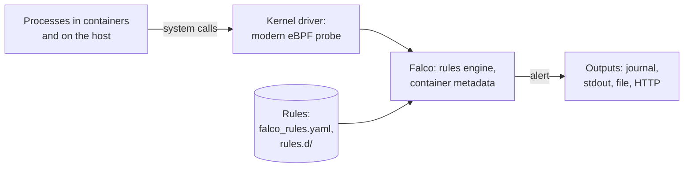

# Chapter 35: Runtime security: Falco, audit logs, immutable containers, and incident response

> **Exams:** KCSA · CKS
> **Difficulty:** Advanced
> **Time:** ~60 min reading, ~50 min lab
> **Lab tier:** 2 (VirtualBox VMs, `envs/vagrant`, snapshot `cluster`)
> **Prerequisites:** Chapter 21 (NetworkPolicies), Chapter 23 (RBAC), Chapter 29 (the security model), Chapter 32 (system calls, seccomp, AppArmor), Chapter 33 (editing the API server's manifest)

## Learning objectives

After this chapter you can:

- Explain behavioral detection: what runtime signals exist and which tool watches which
- Read Falco's alerts, find the Pod behind one, and write a custom Falco rule with a condition, an output, and a priority
- Turn on Kubernetes audit logging with a policy, and choose the level for each kind of request
- Investigate the audit log: who did what, to which object, when, and with what result
- Map what you see to the phases of an attack
- Make a container immutable at runtime with a read-only root file system and `emptyDir` volumes for what must be written
- Contain a compromised Pod without destroying the evidence

## Concepts

Chapters 29 to 34 were about **prevention**: keep attackers out, and limit what they
can do. This chapter assumes prevention will sometimes fail, and is about
**detection and response**: noticing that something is wrong while it happens,
finding out what happened, and stopping it. All output below comes from the Tier
2 VMs at Kubernetes v1.37.0, with Falco 0.45.2.

### Behavioral detection

A container should be boring. A web server reads its files, listens on its port,
and writes logs; it does not read `/etc/shadow`, start a shell, download a binary,
or talk to the API server. **Behavioral analytics** is the practice of describing
the expected behavior and alerting on everything else. Three kinds of signals
cover most of a cluster:

| Signal | Where it comes from | What it shows | Tools |
| --- | --- | --- | --- |
| System calls | The kernel of every node | What processes in containers and on the host do: files, processes, network connections | Falco, Tetragon, Tracee |
| API requests | The API server's audit log | Who did what to which Kubernetes object | Kubernetes auditing, Falco's audit plugin |
| Network flows | The CNI plugin or a service mesh | Which Pod talks to which, on which port | Cilium Hubble, Calico flow logs |

Together they let you detect threats where the curriculum looks for them: on the
nodes (*physical infrastructure*), in workloads and apps (system calls), on the
network (flows), in data (who read which Secret), and by users (the audit log).

### Falco

**Falco**, a graduated CNCF project, watches system calls on a node and compares
each one against **rules**. It runs on every node, as a systemd service or a
DaemonSet, and gets its events from a kernel driver; on the VMs that is the
**modern eBPF probe**, which needs no kernel module. On `node1`:

```bash
ssh node1 "falco --version | grep -E '^(Falco|Libs|Engine)'; systemctl is-active falco-modern-bpf"
```

```text
Falco version: 0.45.2
Libs version:  0.26.1
Engine:        0.65.0
active
```



System calls go from the kernel to Falco, which adds the container's and the
Pod's metadata, checks them against the loaded rules, and sends an alert to its
outputs for each rule that matches.

#### Rules, macros, and lists

Falco's rules live in YAML files: `/etc/falco/falco_rules.yaml` holds the default
rules of the release, and `/etc/falco/falco_rules.local.yaml` and the directory
`/etc/falco/rules.d/` are for your own. Never edit the default file; an upgrade
replaces it. A file holds three kinds of items:

- A **rule** has a `condition` that selects events, an `output` that formats the alert, a `priority`, and optional `tags`.
- A **macro** is a named condition fragment that rules reuse, such as `container`.
- A **list** is a named set of values, such as file names.

The default file holds 25 rules, 88 macros, and 49 lists. One of the rules:

```yaml
- rule: Read sensitive file untrusted
  condition: >
    open_read
    and sensitive_files
    and proc_name_exists
    and not proc.name in (user_mgmt_binaries, userexec_binaries, package_mgmt_binaries,
     ...)
    and not user_known_read_sensitive_files_activities
    ...
  output: Sensitive file opened for reading by non-trusted program | file=%fd.name ... process=%proc.name ... command=%proc.cmdline terminal=%proc.tty
  priority: WARNING
  tags: [maturity_stable, host, container, filesystem, mitre_credential_access, T1555]
```

(shortened; the condition excludes over a dozen kinds of trusted programs). The
macros and the list it builds on:

```yaml
- macro: open_read
  condition: (evt.type in (open,openat,openat2) and evt.is_open_read=true and fd.typechar='f' and fd.num>=0)

- macro: open_write
  condition: (evt.type in (open,openat,openat2) and evt.is_open_write=true and fd.typechar='f' and fd.num>=0)

- list: sensitive_file_names
  items: [/etc/shadow, /etc/sudoers, /etc/pam.conf, /etc/security/pwquality.conf]

- macro: container
  condition: (container.id != host)
```

Conditions combine **fields** with operators: `evt.type` is the system call,
`fd.name` the file or socket, `proc.name` and `proc.cmdline` the process,
`user.name` the user, `container.image.repository` the image, `k8s.pod.name` and
`k8s.ns.name` the Pod. `falco --list` prints all of them. Operators include `=`,
`!=`, `in`, `startswith`, `endswith`, `contains`, `glob`, and `and`, `or`, `not`.
In `output`, `%field` inserts a field's value.

#### Reading an alert

A container that reads `/etc/shadow` matches the rule above:

```bash
kubectl -n ch35-demo exec app -- cat /etc/shadow >/dev/null
ssh node1 sudo journalctl -u falco-modern-bpf --no-pager -o cat --since -1min
```

```text
19:28:26.093259902: Warning Sensitive file opened for reading by non-trusted program | file=/etc/shadow gparent=systemd ggparent=<NA> gggparent=<NA> evt_type=openat user=root user_uid=0 user_loginuid=-1 process=cat proc_exepath=/bin/cat parent=containerd-shim command=cat /etc/shadow terminal=0 container_id=7fd0a7332c6e container_name=app container_image_repository=docker.io/library/busybox container_image_tag=1.36 k8s_pod_name=app k8s_ns_name=ch35-demo
```

The line has the time, the priority (`Warning`), and the rule's output. Falco
appends the container's and the Pod's fields to every alert (`container_id` to
`k8s_ns_name`): this release loads the `container` plugin, which asks the
container runtime for them. From `k8s_pod_name` and `k8s_ns_name`, `kubectl`
takes you to the owner: `kubectl get pod app -o jsonpath='{.metadata.ownerReferences}'`.

As a service, Falco writes alerts to its standard output (the systemd journal)
and to syslog. `falco.yaml` turns on more outputs: a file, an HTTP endpoint, a
program, and `json_output: true` for one JSON object per alert, which log
collectors parse more reliably. **Falcosidekick** forwards alerts to chat, SIEM,
and other systems.

> **Exam tip:** To find "the Pod that does X", search Falco's output on the node for the behavior (`journalctl -u falco-modern-bpf | grep shadow`, or the file Falco writes to), then read `k8s_pod_name` and `k8s_ns_name`. Where Falco runs as a DaemonSet, the alerts are in `kubectl logs` of the Falco Pod on that node.

#### A custom rule

Your own rules go in `/etc/falco/rules.d/`, loaded after the default file, so
they can use its macros and lists. This rule reports when a process in a
container reads the ServiceAccount token mounted into it, which an application
that never calls the API server has no reason to do:

```yaml
- rule: Read service account token
  desc: A process in a container read the ServiceAccount token mounted into it
  condition: >
    open_read and container
    and fd.name startswith /var/run/secrets/kubernetes.io/serviceaccount/
  output: ServiceAccount token read (file=%fd.name process=%proc.name command=%proc.cmdline)
  priority: NOTICE
  tags: [credential_access]
```

`falco -V` validates a rules file without starting Falco. Validate it together
with the default rules, or its macros are unknown:

```bash
ssh node1 sudo falco -V /etc/falco/rules.d/demo-rules.yaml
ssh node1 sudo falco -V /etc/falco/falco_rules.yaml -V /etc/falco/rules.d/demo-rules.yaml
```

```text
LOAD_ERR_VALIDATE (Error validating rule/macro/list/exception objects): Undefined macro 'open_read' used in filter.
/etc/falco/falco_rules.yaml: Ok
/etc/falco/rules.d/demo-rules.yaml: Ok
```

Restart Falco to load it (`sudo systemctl restart falco-modern-bpf`), give it a
few seconds to attach to the kernel again, and the rule fires:

```text
19:28:55.133698509: Notice ServiceAccount token read (file=/var/run/secrets/kubernetes.io/serviceaccount/token process=cat command=cat /var/run/secrets/kubernetes.io/serviceaccount/token) container_id=7fd0a7332c6e container_name=app container_image_repository=docker.io/library/busybox container_image_tag=1.36 k8s_pod_name=app k8s_ns_name=ch35-demo
```

Priorities, from the highest: `EMERGENCY`, `ALERT`, `CRITICAL`, `ERROR`,
`WARNING`, `NOTICE`, `INFORMATIONAL`, `DEBUG`; the `priority` setting in
`falco.yaml` drops alerts below a level. To silence a default rule for a known,
harmless case, add an `exceptions` entry or override a list in your own file,
rather than editing the default file.

> **Exam tip:** A Falco task usually means: find the rule (or write one in `rules.d`), change its `output` or `priority`, validate with `falco -V` together with the default rules, restart Falco, trigger the behavior, and read the journal.

### Kubernetes audit logs

Falco sees what processes do on a node. The API server's **audit log** sees every
request to the cluster: who sent it, what it asked for, and how it ended. kubeadm
does not turn it on.

Each request passes through **stages**, and the API server can write an event at
each one: `RequestReceived` (before anything is done), `ResponseStarted` (only for
long-running requests such as `watch`), `ResponseComplete`, and `Panic`. Each
event is written at a **level**:

| Level | The event contains |
| --- | --- |
| `None` | Nothing; the request is not logged |
| `Metadata` | User, verb, resource, namespace, name, source IP, user agent, result; no body |
| `Request` | Metadata and the request body |
| `RequestResponse` | Metadata, the request body, and the response body |

An **audit Policy** chooses the level per request. Its rules are checked in order,
and the **first rule that matches** decides; a request that matches none is not
logged. Rules match on `users`, `userGroups`, `verbs`, `resources` (with their API
`group`), `namespaces`, and `nonResourceURLs`. A policy that logs Secrets without
their content, Deployment changes in full, the control plane's own requests not
at all, and everything else at `Metadata`:

```yaml
apiVersion: audit.k8s.io/v1
kind: Policy
omitStages:
  - RequestReceived
rules:
  # Secrets: who touched which one, never their content.
  - level: Metadata
    resources:
      - group: ""
        resources: ["secrets"]
  # Changes to Deployments, with the request and the response.
  - level: RequestResponse
    verbs: ["create", "update", "patch", "delete"]
    resources:
      - group: "apps"
        resources: ["deployments"]
  # The control plane's own routine requests: nothing.
  - level: None
    users: ["system:kube-controller-manager", "system:kube-scheduler", "system:apiserver"]
  # Everything else: who did what.
  - level: Metadata
```

The Secrets rule comes first on purpose: a later catch-all at `Request` or
`RequestResponse` would otherwise write Secret values into the log, which is
then as sensitive as etcd. `omitStages: [RequestReceived]` halves the number of
events, since `ResponseComplete` repeats everything `RequestReceived` holds.

The API server reads the policy and writes the log through flags. As with
encryption at rest (Chapter 33), it runs in a container, so the policy file and
the log directory also need a volume and a mount each:

```bash
sudo diff /tmp/kube-apiserver.yaml.orig /etc/kubernetes/manifests/kube-apiserver.yaml
```

```text
14a15,19
>     - --audit-policy-file=/etc/kubernetes/audit/policy.yaml
>     - --audit-log-path=/var/log/kubernetes/audit/audit.log
>     - --audit-log-maxage=7
>     - --audit-log-maxbackup=2
>     - --audit-log-maxsize=50
81a87,91
>     - mountPath: /etc/kubernetes/audit/policy.yaml
>       name: audit-policy
>       readOnly: true
>     - mountPath: /var/log/kubernetes/audit
>       name: audit-log
103a114,121
>   - hostPath:
>       path: /etc/kubernetes/audit/policy.yaml
>       type: File
>     name: audit-policy
>   - hostPath:
>       path: /var/log/kubernetes/audit
>       type: DirectoryOrCreate
>     name: audit-log
```

| Flag | Meaning |
| --- | --- |
| `--audit-policy-file` | The policy; without it, nothing is logged |
| `--audit-log-path` | The log file (`-` for the API server's standard output) |
| `--audit-log-maxage` | Days to keep rotated files |
| `--audit-log-maxbackup` | Number of rotated files to keep |
| `--audit-log-maxsize` | Megabytes before the file is rotated |

The **log backend** writes JSON lines to a file; the **webhook backend**
(`--audit-webhook-config-file`) sends events to an external service, which keeps
them away from anyone who gains root on the control plane node. Once the API
server is back, each request is one line. A `get` of a Secret, formatted with
`python3 -m json.tool`:

```json
{
    "kind": "Event",
    "apiVersion": "audit.k8s.io/v1",
    "level": "Metadata",
    "auditID": "b8572484-778a-439e-9e6a-e47bf71eb259",
    "stage": "ResponseComplete",
    "requestURI": "/api/v1/namespaces/ch35-demo/secrets/db-creds",
    "verb": "get",
    "user": {
        "username": "kubernetes-admin",
        "groups": [
            "kubeadm:cluster-admins",
            "system:authenticated"
        ],
        "extra": {
            "authentication.kubernetes.io/credential-id": [
                "X509SHA256=35bccc325840d73cc1831a7119bab3242aabcded961dff2b904d7873806da1c1"
            ]
        }
    },
    "sourceIPs": [
        "192.168.56.10"
    ],
    "userAgent": "kubectl/v1.37.0 (linux/amd64) kubernetes/f54c212",
    "objectRef": {
        "resource": "secrets",
        "namespace": "ch35-demo",
        "name": "db-creds",
        "apiVersion": "v1"
    },
    "responseStatus": {
        "metadata": {},
        "code": 200
    },
    "requestReceivedTimestamp": "2026-11-13T19:30:16.705550Z",
    "stageTimestamp": "2026-11-13T19:30:16.794367Z",
    "annotations": {
        "authorization.k8s.io/decision": "allow",
        "authorization.k8s.io/reason": "RBAC: allowed by ClusterRoleBinding \"kubeadm:cluster-admins\" of ClusterRole \"cluster-admin\" to Group \"kubeadm:cluster-admins\""
    }
}
```

`Metadata` says who (`user`, `sourceIPs`, `userAgent`), what (`verb`,
`objectRef`), when, the result (`responseStatus.code`), and why RBAC allowed it,
without the Secret's value.

#### Investigating with the audit log

Suppose the Secret `db-creds` has disappeared. Every audit event is one line, so
`grep` narrows the log down and a few lines of Python (on the VMs there is no
`jq`) print the fields that matter:

```bash
sudo grep '"resource":"secrets"' /var/log/kubernetes/audit/audit.log | grep ch35-demo | python3 -c '
import json, sys
for line in sys.stdin:
    e = json.loads(line)
    print(e["requestReceivedTimestamp"], e["user"]["username"],
          e.get("impersonatedUser", {}).get("username", "-"), e["verb"],
          e["objectRef"].get("name", "*"), e["responseStatus"]["code"])'
```

```text
2026-11-13T19:30:15.157403Z kubernetes-admin - create db-creds 201
2026-11-13T19:30:16.705550Z kubernetes-admin - get db-creds 200
2026-11-13T19:30:17.482438Z kubernetes-admin system:serviceaccount:ch35-demo:cleaner list * 200
2026-11-13T19:30:17.973310Z kubernetes-admin system:serviceaccount:ch35-demo:cleaner delete db-creds 200
2026-11-13T19:30:18.117738Z kubernetes-admin system:serviceaccount:ch35-demo:cleaner get db-creds 404
```

The story is in five lines: the administrator created the Secret and read it;
then the ServiceAccount `cleaner`, impersonated by `kubernetes-admin`, listed the
Secrets, deleted `db-creds`, and checked that it was gone. The full delete event
also names the RoleBinding that allowed it:

```text
"annotations":{"authorization.k8s.io/decision":"allow","authorization.k8s.io/reason":"RBAC: allowed by RoleBinding \"cleaner/ch35-demo\" of Role \"secret-admin\" to ServiceAccount \"cleaner/ch35-demo\""}
```

The next step is clear: who else can act as `cleaner`, and does it need `delete`
on Secrets? Useful filters: `"verb":"delete"`, `"code":403` (someone probing for
permissions they lack), a user name, a source IP, or `"resource":"pods/exec"`.

> **Exam tip:** Audit questions come in two kinds: write or change the policy (order matters; first match wins), or answer from the log (`grep` for the resource, verb, and name, then read `user.username`, `impersonatedUser`, `sourceIPs`, and `responseStatus.code`). The API server reads the policy file only when it starts: after changing the policy alone, restart it, for example by moving its manifest out of `/etc/kubernetes/manifests` and back.

### The phases of an attack

To investigate is to reconstruct a sequence. **MITRE ATT&CK**, a public
knowledge base of attacker behavior, names the phases (*tactics*); its
*Containers* matrix covers Kubernetes. Falco's default rules carry the matching
tags (`mitre_credential_access` above). The phases, and where they show:

| Phase | In a cluster | Where you see it |
| --- | --- | --- |
| Initial access | An exploited web app, a leaked kubeconfig, a public dashboard | Application logs, audit log (unknown user or source IP) |
| Execution | A shell in a container, `kubectl exec`, a new Pod | Falco (shell, unexpected process), audit log (`pods/exec`, `create pods`) |
| Persistence | A new ServiceAccount, RoleBinding, CronJob, or static Pod | Audit log (`create` on RBAC objects, CronJobs) |
| Privilege escalation | A privileged Pod, a `hostPath` of `/`, an RBAC `bind` or `escalate` | Audit log, Pod Security warnings, Falco |
| Defense evasion | Deleting logs or events, a binary dropped in `/tmp` | Falco (`Clear Log Activities`, `Drop and execute new binary in container`) |
| Credential access | Reading Secrets, tokens, `/etc/shadow` | Audit log (`get`/`list` on Secrets), Falco |
| Discovery | Listing Pods, Secrets, nodes; scanning the network | Audit log (many `list` and `403`s), network flows |
| Lateral movement | Using a stolen token from another Pod; reaching other Services | Audit log (a ServiceAccount used from an unexpected IP), flows |
| Impact | Crypto mining, deleted data, denial of service | Metrics (CPU), audit log (`delete`), Falco |

The bad actor is whoever the evidence points to: a user name or ServiceAccount in
the audit log, the Pod and image in Falco's alerts, the source IP in both.

### Immutable containers

A container that cannot change cannot be changed by an attacker either: no
dropped binaries, no edited configuration, no installed tools. **Immutability at
runtime** means:

- A **read-only root file system** (`securityContext.readOnlyRootFilesystem: true`), with `emptyDir` volumes only where the application must write (caches, PID files, `/tmp`).
- **Nothing to change with**: no shell, no package manager in the image (distroless or `scratch` images, Chapter 34).
- **No runtime changes by hand**: a fix is a new image and a rollout, never `kubectl exec` and an edit. Images are referenced by digest (Chapter 34).
- **Detection of drift**: Falco's `Drop and execute new binary in container` reports executables that were not in the image.

Applications must be prepared for it. nginx with a read-only root file system and
nothing else fails at once:

```bash
kubectl -n ch35-demo logs ro --previous | tail -2
```

```text
2026/11/13 19:31:45 [emerg] 1#1: mkdir() "/var/cache/nginx/client_temp" failed (30: Read-only file system)
nginx: [emerg] mkdir() "/var/cache/nginx/client_temp" failed (30: Read-only file system)
```

The error names the directory. nginx writes to `/var/cache/nginx` and its PID file
to `/var/run`; give it an `emptyDir` for each:

```yaml
spec:
  volumes:
    - name: cache
      emptyDir: {}
    - name: run
      emptyDir: {}
  containers:
    - name: nginx
      image: nginx:1.27
      securityContext:
        readOnlyRootFilesystem: true
      volumeMounts:
        - name: cache
          mountPath: /var/cache/nginx
        - name: run
          mountPath: /var/run
```

It starts, and its entrypoint notes the one change it could not make, which is
harmless:

```text
10-listen-on-ipv6-by-default.sh: info: can not modify /etc/nginx/conf.d/default.conf (read-only file system?)
```

The content it serves can no longer be replaced, but its cache still works:

```bash
kubectl -n ch35-demo exec ro -- touch /usr/share/nginx/html/index.html
kubectl -n ch35-demo exec ro -- touch /var/cache/nginx/ok
```

```text
touch: cannot touch '/usr/share/nginx/html/index.html': Read-only file system
command terminated with exit code 1
```

Pod Security `restricted` (Chapter 33) does not require a read-only root file
system; enforce it with an admission policy (Chapter 31) where you want it
everywhere.

> **Exam tip:** For "make this Deployment immutable": set `readOnlyRootFilesystem: true`, then read `kubectl logs` (or `--previous`) for "Read-only file system" errors and add an `emptyDir` for each directory named, until the Pods are ready.

### Incident response

When an alert turns out to be real, the order of work is: **contain** the damage,
**preserve** the evidence, **eradicate** the cause, **recover**, and **learn**.
Deleting the Pod is the instinct and the mistake: it ends the attack in that
Pod, but it also destroys the evidence (processes, files in the container,
network connections), and the controller starts a fresh copy that is just as
vulnerable.

**Contain** without deleting:

- **Isolate the Pod's network.** A NetworkPolicy that selects it, with both policy types and no rules, cuts every connection in and out. Select it by a label you add, `status=quarantined`, not by its app label, so that the healthy replicas keep working:

  ```yaml
  apiVersion: networking.k8s.io/v1
  kind: NetworkPolicy
  metadata:
    name: quarantine
  spec:
    podSelector:
      matchLabels:
        status: quarantined
    policyTypes:
      - Ingress
      - Egress
  ```

  Before and after, on the VMs (Calico enforces it within a second or two):

  ```bash
  kubectl -n ch35-demo exec app -- wget -q -T 3 -O /dev/null http://10.244.166.132 && echo reachable
  kubectl -n ch35-demo exec victim -- curl -s -m 3 -o /dev/null -w '%{http_code}\n' http://10.244.104.5
  ```

  ```text
  reachable
  200
  ```

  ```text
  wget: download timed out
  command terminated with exit code 1
  000
  command terminated with exit code 28
  ```

- **Take it out of its Service and its controller.** Changing the label the Service and the ReplicaSet select (for example `app=web` to `app=web-quarantined`) removes the Pod from the Service's endpoints and makes the ReplicaSet start a healthy replacement, while the quarantined Pod keeps running.
- **Keep it on its node, and keep new Pods off the node**: `kubectl cordon <node>` if the node itself may be compromised.
- **Revoke what it could use**: the ServiceAccount's RoleBindings, and any credentials the Pod could read.

**Preserve** the evidence: `kubectl get pod -o yaml`, `kubectl logs` (and
`--previous`), `kubectl describe`, Falco's alerts and the audit log for the time
window, and on the node `crictl inspect` and a copy of the container's file
system. The kubelet's checkpoint API can also save a running container to a file
for later analysis.

**Eradicate and recover**: find the root cause (a vulnerable image, an exposed
credential, an RBAC rule too wide), fix it in the image or the configuration,
roll out, rotate every credential the attacker could have seen, and only then
delete the quarantined Pod. **Learn**: turn what you found into a Falco rule, an
audit filter, or an admission policy, so the next attempt is caught earlier.

## Hands-on lab

The lab works like a KodeKloud lab, one task at a time with a check after each,
on the Tier 2 VMs, from the `cluster` snapshot:

```bash
cd /kbook
make lab CH=35        # checks you are on cluster, installs Falco on node1, shows task 1
make check CH=35      # check the current task; if it is right, show the next
make question CH=35   # show the current task again
make verify CH=35     # check every task at once
```

`make lab` installs Falco on `node1` (its alerts are in `sudo journalctl -u
falco-modern-bpf` there) and creates the Namespace `ch35-apps`. Work on `cp1`,
with `sudo` for the API server's files, and on `node1` with `ssh node1`. The
tasks are independent. Task 1 changes the API server: to start over after it,
restore `cluster` on the host (`make reset CH=35` prints the command). Full
solutions are in [`lab/solutions.md`](lab/solutions.md).

### Task 1: Turn on audit logging

Make the API server write an audit log, with a policy that records access to
Secrets and ConfigMaps without their content, and the Pods of `ch35-apps` in full.

- Policy file: `/etc/kubernetes/audit/policy.yaml`
- Log file: `/var/log/kubernetes/audit/audit.log`; rotated files kept for at most 7 days, at most 2 of them, rotated at 50 MB
- Secrets and ConfigMaps, in every Namespace: level `Metadata`
- Pods in `ch35-apps`: level `RequestResponse`
- Every other request: not logged
- No event for the `RequestReceived` stage (one event per request)

### Task 2: Find the Pod that reads /etc/shadow

One of the Deployments `inventory`, `billing`, and `search` in `ch35-apps` runs a
Pod that reads `/etc/shadow`. Falco on `node1` has noticed. Stop it, and leave the
other two running.

- File on `cp1`: `/tmp/ch35-falco.txt`, the name of that Deployment, nothing else
- That Deployment: scaled to 0 replicas
- The other two: 1 ready replica each

### Task 3: Write a Falco rule

Add a rule to Falco on `node1` that reports when a process in a container opens a
file below `/etc` for writing.

- Rule file: `/etc/falco/rules.d/ch35-rules.yaml`
- Rule name: `Write below etc in container`, priority `WARNING`
- Its output includes `file=` followed by the file's name (`%fd.name`)
- Falco runs and reports it: opening `/etc/group` for appending in the Pod `canary` of `ch35-apps` raises the alert

### Task 4: Make web immutable

The Deployment `web` in `ch35-apps` runs nginx with a writable root file system.
Make the containers' root file system read-only, and keep nginx running.

- Deployment `web`: image `nginx:1.27`, 2 ready replicas
- Its container's root file system is read-only
- Volumes, if any, are `emptyDir`

### Task 5: Quarantine miner

The Pod `miner` in `ch35-apps` is compromised. Cut it off from the network for the
investigation, without deleting it.

- Pod `miner`: the same Pod (not deleted and recreated), Running, with the label `status=quarantined`
- NetworkPolicy `quarantine` in `ch35-apps`: selects exactly the Pods labelled `status=quarantined`, and allows no traffic in or out (both policy types, no rules)

## Exam tips

> **Exam tip:** Falco runs either as a systemd service on the node (alerts in `journalctl -u falco*`) or as a DaemonSet (alerts in `kubectl logs` of the Falco Pod on that node). Find out which before you look for alerts.
>
> **Exam tip:** Edits to the API server's manifest: copy it out of `/etc/kubernetes/manifests` first, add the flag, the volume, and the mount, and watch `crictl ps` until the API server is back. If it does not come back, `crictl logs` of the exited container or `/var/log/pods/kube-system_kube-apiserver-*` says why.
>
> **Exam tip:** In an audit policy, the first matching rule wins. Put the narrow rules (Secrets at `Metadata`) before the broad ones, and end with a catch-all for "everything else".

## Common misconceptions

- "Falco blocks attacks." It detects and reports them. Blocking is the job of seccomp, AppArmor, admission control, and NetworkPolicies; response tools can act on Falco's alerts.
- "Audit logging is on by default." kubeadm's API server has no audit policy, and without one nothing is logged.
- "A higher audit level is always better." `RequestResponse` on Secrets writes their values into the log, and on everything it fills the disk quickly. Choose the level per resource.
- "The first rule in a policy is a default." Rules are checked in order and the first match decides; a broad rule placed first shadows every rule after it.
- "Delete a compromised Pod at once." Contain it first and keep the evidence; its controller would start an identical, equally vulnerable copy anyway.
- "`readOnlyRootFilesystem` breaks most applications." Most need only a few writable directories, which `emptyDir` volumes provide; the error messages name them.

<!-- QUESTIONS:START -->

## End-of-chapter questions

**1.** `KCSA` `CKS` What does Falco do when a container matches one of its rules?

- **A.** It kills the container
- **B.** It blocks the system call, like seccomp
- **C.** It reports an alert to its outputs, such as the journal, a file, or an HTTP endpoint
- **D.** It deletes the Pod through the API server

**2.** `CKS` Where do you add your own Falco rules so that an upgrade does not overwrite them?

- **A.** In /etc/falco/rules.d/ or /etc/falco/falco_rules.local.yaml
- **B.** At the end of /etc/falco/falco_rules.yaml
- **C.** In a ConfigMap in kube-system
- **D.** In /var/lib/kubelet/falco/

**3.** `CKS` A Falco alert ends with k8s_pod_name=billing-6d8f9c7b5-x2lqp k8s_ns_name=shop. How do you find the Deployment it belongs to?

- **A.** Falco's output always names the Deployment
- **B.** Follow the Pod's ownerReferences to its ReplicaSet, and the ReplicaSet's to the Deployment
- **C.** Look up the container ID in etcd
- **D.** Read the node's /etc/hosts

**4.** `CKS` You validate a custom rule with falco -V /etc/falco/rules.d/my.yaml and get "Undefined macro 'open_read'". What is wrong?

- **A.** open_read does not exist in this Falco version
- **B.** Custom rules may not use macros
- **C.** The file must be named falco_rules.local.yaml
- **D.** The macro is defined in the default rules file, which was not loaded; validate both, with -V /etc/falco/falco_rules.yaml first

**5.** `KCSA` `CKS` Which audit level records who read a Secret, without writing the Secret's value into the log?

- **A.** Metadata
- **B.** Request
- **C.** RequestResponse
- **D.** None

**6.** `CKS` An audit policy has two rules: first level: RequestResponse with no other fields, then level: Metadata for secrets. At which level is a get on a Secret logged?

- **A.** Metadata, because the secrets rule is more specific
- **B.** RequestResponse, because the first rule that matches decides, and it matches every request
- **C.** Both: one event per matching rule
- **D.** None, because the rules conflict

**7.** `CKS` You add --audit-policy-file and --audit-log-path to the API server's static Pod manifest, and the API server does not come back. What is the most likely missing piece?

- **A.** The kubelet must be restarted for every manifest change
- **B.** Audit logging needs a webhook backend
- **C.** A volume and a mount for the policy file and the log directory: the API server runs in a container and cannot see the host's files otherwise
- **D.** etcd must be restarted first

**8.** `CKS` What does omitStages: [RequestReceived] in an audit policy change?

- **A.** Requests are no longer authenticated
- **B.** No event is written when a request arrives; ResponseComplete still records it, so each request is logged once instead of twice
- **C.** Only failed requests are logged
- **D.** Request bodies are removed from every event

**9.** `KCSA` `CKS` In the audit log you find a delete of the Secret db-creds whose user.username is kubernetes-admin and whose impersonatedUser.username is system:serviceaccount:shop:cleaner. Who did it, and how?

- **A.** kubernetes-admin, without impersonation; the second field is decoration
- **B.** The kubelet, on behalf of a Pod
- **C.** The ServiceAccount cleaner, which has the admin's rights
- **D.** kubernetes-admin, acting as the ServiceAccount cleaner; the ServiceAccount's RBAC rules allowed the delete

**10.** `KCSA` `CKS` An attacker creates a CronJob that starts a Pod every hour with a reverse shell. Which phase of an attack is that?

- **A.** Persistence
- **B.** Initial access
- **C.** Discovery
- **D.** Impact

**11.** `CKS` Falco reports a Pod of a Deployment running a crypto miner. What should you do first?

- **A.** Delete the Pod at once
- **B.** Scale the Deployment to 10, so the miner has to share
- **C.** Isolate the Pod (a NetworkPolicy selecting a quarantine label, with no rules) and keep it for investigation; then find and fix the cause
- **D.** Restart the node

**12. (Task)** `CKS` Make the Deployment api (image nginx:1.27) run with a read-only root file system, without breaking it.

**13. (Task)** `CKS` Write an audit policy that logs nothing for the system:kube-proxy user, records Secrets at Metadata, records changes to ConfigMaps in the Namespace prod with their bodies, and everything else at Metadata. Write no RequestReceived events.

**14. (Task)** `CKS` Change Falco on a node so that a shell started in any container raises a NOTICE alert that includes the container's image.

<details>
<summary>Answers</summary>

**1. C.** Falco is a detection tool: it watches system calls through its kernel driver, matches them against rules, and sends alerts. Blocking is the job of seccomp, AppArmor, admission control, and NetworkPolicies; other tools can act on Falco's alerts.

**2. A.** falco_rules.yaml holds the release's default rules and is replaced by upgrades. falco.yaml loads falco_rules.local.yaml and the files in rules.d after it, so your rules can use its macros and lists, and can override them.

**3. B.** A Deployment's Pod is owned by a ReplicaSet, which is owned by the Deployment: kubectl get pod ... -o jsonpath='{.metadata.ownerReferences[0].name}' gives the ReplicaSet, and the same on the ReplicaSet gives the Deployment. The Pod name's prefix usually tells you too, but the owner references are certain.

**4. D.** falco -V loads only the files you name. The default macros and lists live in falco_rules.yaml, so validate it together with your file. The running Falco loads all configured rules files in order, so the rule works there.

**5. A.** Metadata records the user, verb, object, source IP, time, and result, but no bodies. Request and RequestResponse add the request and response bodies, which for Secrets means their values. None records nothing.

**6. B.** Audit policy rules are checked in order and the first match wins. A catch-all placed first shadows every rule after it, and here it writes Secret values into the log. Put narrow rules first and the catch-all last.

**7. C.** The API server reads its flags inside its container. Without hostPath volumes and volumeMounts for the policy file and the log directory, it cannot open the policy and exits. crictl logs of the exited container, or the files in /var/log/pods, show the error.

**8. B.** Without it, the API server writes an event when the request arrives and another when the response is complete, with the same metadata. Omitting RequestReceived halves the log with no loss for completed requests.

**9. D.** user is who authenticated; impersonatedUser is the identity that request was authorized as (kubectl --as). RBAC checked the impersonated identity, and the event's annotations name the RoleBinding that allowed it. Both identities matter for the investigation.

**10. A.** Persistence is how an attacker keeps access after the first foothold is gone: a CronJob, a new ServiceAccount and RoleBinding, a static Pod, or a backdoored image. The audit log's create events on such objects are where it shows.

**11. C.** Deleting the Pod destroys the evidence, and its ReplicaSet starts an identical, equally vulnerable Pod. Contain first: isolate its network, take it out of the Service, revoke its credentials; then preserve logs and state, fix the root cause in the image or configuration, rotate secrets, and only then remove it.

**12.**

Set readOnlyRootFilesystem, then give nginx emptyDir volumes for the two directories it writes to:

```yaml
spec:
  template:
    spec:
      volumes:
        - name: cache
          emptyDir: {}
        - name: run
          emptyDir: {}
      containers:
        - name: nginx
          image: nginx:1.27
          securityContext:
            readOnlyRootFilesystem: true
          volumeMounts:
            - name: cache
              mountPath: /var/cache/nginx
            - name: run
              mountPath: /var/run
```

With readOnlyRootFilesystem alone, kubectl logs --previous shows mkdir() "/var/cache/nginx/client_temp" failed (30: Read-only file system); each such message names a directory that needs an emptyDir. Check the result with kubectl exec ... -- touch /usr/share/nginx/html/x, which must fail with "Read-only file system".

**13.**

```yaml
apiVersion: audit.k8s.io/v1
kind: Policy
omitStages:
  - RequestReceived
rules:
  - level: None
    users: ["system:kube-proxy"]
  - level: Metadata
    resources:
      - group: ""
        resources: ["secrets"]
  - level: RequestResponse
    verbs: ["create", "update", "patch", "delete"]
    namespaces: ["prod"]
    resources:
      - group: ""
        resources: ["configmaps"]
  - level: Metadata
```

The order matters: the first matching rule decides, so the narrow rules come first and the catch-all last. Request would also record the bodies of the changes; RequestResponse adds the stored object. Point --audit-policy-file at the file, with a volume and a mount, and restart the API server.

**14.**

In /etc/falco/rules.d/shell.yaml:

```yaml
- rule: Shell in container
  desc: A shell was started in a container
  condition: spawned_process and container and proc.name in (shell_binaries)
  output: Shell started in a container (command=%proc.cmdline image=%container.image.repository)
  priority: NOTICE
```

spawned_process, container, and shell_binaries come from the default rules file. Validate with sudo falco -V /etc/falco/falco_rules.yaml -V /etc/falco/rules.d/shell.yaml, restart Falco, run kubectl exec POD -- sh -c true, and read the alert in the journal (journalctl -u falco-modern-bpf) or the Falco Pod's log.

</details>

<!-- QUESTIONS:END -->

## Further reading

- [Falco documentation: rules](https://falco.org/docs/concepts/rules/)
- [Falco: supported fields for conditions and outputs](https://falco.org/docs/reference/rules/supported-fields/)
- [Kubernetes: Auditing](https://kubernetes.io/docs/tasks/debug/debug-cluster/audit/)
- [Audit Policy configuration (v1)](https://kubernetes.io/docs/reference/config-api/apiserver-audit.v1/)
- [MITRE ATT&CK: Containers matrix](https://attack.mitre.org/matrices/enterprise/containers/)
- [Configure a Security Context: readOnlyRootFilesystem](https://kubernetes.io/docs/tasks/configure-pod-container/security-context/)
