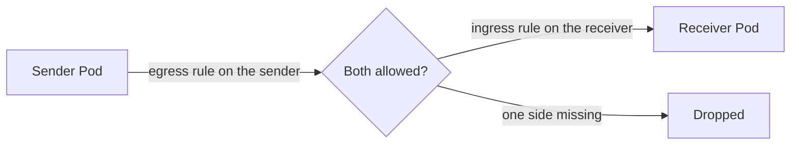

# Chapter 36: Network security in depth: default deny, mTLS, and encryption in transit

> **Exams:** KCSA · CKS
> **Difficulty:** Advanced
> **Time:** ~60 min reading, ~40 min lab
> **Lab tier:** 1 (kind, with Calico as the CNI)
> **Prerequisites:** Chapter 11 (Services and cluster DNS), Chapter 21 (NetworkPolicy basics), Chapter 28 (service meshes)

## Learning objectives

After this chapter you can:

- Explain how NetworkPolicies isolate Pods, and why a Pod selected by any policy is closed to everything that policy does not allow
- Write a default-deny policy for ingress and for egress, and add the DNS exception that makes names resolve again
- Allow a flow of traffic by writing both halves of it: an egress rule on the sender and an ingress rule on the receiver
- Distinguish server-side TLS, mutual TLS (mTLS), and encryption of the network path, and say which one each tool provides
- Create a TLS Secret from a certificate and key, and say what a TLS Secret is used for
- Say what the API server, etcd, and Secrets at rest protect, and which of those a NetworkPolicy does not cover

## Concepts

### Isolation starts when a policy selects a Pod

By default, every Pod in a cluster accepts traffic from every other Pod, and sends
traffic to any destination. NetworkPolicies change that, with one rule to remember:

- A Pod that no policy selects is **not isolated**. Everything is allowed for it.
- A Pod that at least one policy selects is **isolated for the directions that policy names**
  (`policyTypes: [Ingress]`, `[Egress]`, or both). It then accepts or sends only the traffic
  some selecting policy allows.
- Policies are **additive**. Allowing one flow never removes another policy's allowance,
  and there is no "deny" rule in the standard API. The way to deny is to select the Pod
  and allow nothing.



The diagram shows a flow that needs two rules. An egress rule on the sender lets the
packet out, and an ingress rule on the receiver lets it in. If either policy is
missing, the packet is dropped, even if the other is in place.

### The default deny, and the DNS exception

A **default deny** is a policy with an empty `podSelector`, which selects every Pod in
the Namespace, and no allow rules:

```yaml
apiVersion: networking.k8s.io/v1
kind: NetworkPolicy
metadata:
  name: default-deny
spec:
  podSelector: {}
  policyTypes: ["Ingress", "Egress"]
```

Once that applies, a Pod cannot even resolve a Service name, because the DNS query
is egress traffic to the cluster DNS Pods in `kube-system`. Add the exception as its
own policy:

```yaml
apiVersion: networking.k8s.io/v1
kind: NetworkPolicy
metadata:
  name: allow-dns
spec:
  podSelector: {}
  policyTypes: ["Egress"]
  egress:
    - to:
        - namespaceSelector:
            matchLabels:
              kubernetes.io/metadata.name: kube-system
      ports:
        - port: 53
          protocol: UDP
        - port: 53
          protocol: TCP
```

The `kubernetes.io/metadata.name` label is set on every Namespace automatically, so it
is a reliable selector. Port 53 on both UDP and TCP covers ordinary lookups and large
answers.

> **Exam tip:** A default deny that forgets DNS breaks every application in the Namespace in a confusing way: the Services exist, but names do not resolve. Always pair `default-deny` with an `allow-dns` egress rule.

### Writing a flow: both ends

To let the `frontend` Pods call the `api` Pods on port 8080, write two policies:

- An **egress** rule on the frontend: a policy whose `podSelector` is `app: frontend`, with `egress` to `app: api` on port 8080.
- An **ingress** rule on the api: a policy whose `podSelector` is `app: api`, with `ingress` from `app: frontend` on port 8080.

Forgetting one side is the most common NetworkPolicy mistake. The traffic times out, and
the message gives no hint about which policy is missing.

A `from` or `to` entry can name a Pod selector, a Namespace selector, or both. Use both
together to match Pods with a label in a Namespace with a label; put them in the same
list item, because two separate items are an OR.

```yaml
ingress:
  - from:
      - namespaceSelector:
          matchLabels:
            kubernetes.io/metadata.name: monitoring
        podSelector:
          matchLabels:
            app: prometheus
```

This allows Pods labeled `app: prometheus` in the Namespace `monitoring`. The version
with two list items would allow every Pod in `monitoring` and every `app: prometheus`
Pod in any Namespace.

### What a policy cannot do

NetworkPolicy works at IP, port, and label level. It cannot:

- Allow a flow by DNS name, such as `api.example.com`. Egress to an external name needs a CIDR, a proxy, or a Gateway.
- Inspect content. It cannot see that a request is `DELETE /orders`.
- Encrypt anything. A policy decides whether a packet is delivered, and the packet is still plain on the wire.

The CNI enforces NetworkPolicy. Calico, which this book's cluster uses, enforces it. The
default kindnet CNI does not, so a policy there silently does nothing. Chapter 21
covers the CNI in detail.

### Encryption in transit: three different things

"Encrypted traffic" can mean three different protections, and each is provided by a different layer.

| Protection | What it covers | Where it comes from |
| --- | --- | --- |
| **Server TLS** | A client checks the server's certificate and encrypts the connection | The application, or the Ingress or Gateway that terminates TLS (Chapter 12) |
| **Mutual TLS (mTLS)** | Both sides present a certificate, so each knows who the other is | A service mesh (Chapter 28), or the application itself |
| **Encrypted network path** | Pod-to-Pod packets are encrypted between nodes, whatever the application does | The CNI, such as Calico's WireGuard mode or Cilium's encryption |

Server TLS protects the client from a fake server. mTLS also protects the server from
a fake client, and it gives each workload an identity you can authorize. The network
path encryption protects the wire between nodes, and does nothing about a caller that
is inside the cluster and allowed by policy.

A **TLS Secret** holds a certificate and its private key, as `tls.crt` and `tls.key`.
Ingress and Gateway resources reference it to terminate TLS:

```bash
kubectl -n shop create secret tls api-tls --cert=api.crt --key=api.key
```

The Secret type is `kubernetes.io/tls`, which is how the API server knows the keys are
present. The private key is sensitive, so limit who can read Secrets in the Namespace
(Chapter 23).

### The rest of the control plane

Three more protections belong to the cluster itself, and they are outside NetworkPolicy:

- **API server and etcd TLS.** The API server serves HTTPS, and it talks to etcd over TLS
  with client certificates. kubeadm creates these certificates, and Chapter 30 shows how
  to check them.
- **Secrets at rest.** By default, Secrets are stored in etcd base64-encoded, which is not
  encryption. An `EncryptionConfiguration` passed to the API server encrypts them before
  they are written. Chapter 33 covers Secrets management.
- **Kubelet and control plane connections** use TLS with certificates that Chapter 27 covers
  when they expire.

## Guided walkthrough

These steps use a throwaway Namespace, `ch36-walk`, and remove it at the end.

### Apply a default deny and read it back

```bash
kubectl create namespace ch36-walk
kubectl -n ch36-walk apply -f - <<'YAML'
apiVersion: networking.k8s.io/v1
kind: NetworkPolicy
metadata:
  name: default-deny
spec:
  podSelector: {}
  policyTypes:
  - Ingress
  - Egress
YAML
kubectl -n ch36-walk get networkpolicy
```

```text
networkpolicy.networking.k8s.io/default-deny created
NAME           POD-SELECTOR   AGE
default-deny   <none>         0s
```

The POD-SELECTOR column shows `<none>` for an empty selector, which means every Pod
in the Namespace. The `describe` command says the same thing in words:

```bash
kubectl -n ch36-walk describe networkpolicy default-deny
```

```text
Name:         default-deny
Namespace:    ch36-walk
Created on:   2026-10-13 15:56:53 +0200 CEST
Labels:       <none>
Annotations:  <none>
Spec:
  PodSelector:     <none> (Allowing the specific traffic to all pods in this namespace)
  Allowing ingress traffic:
    <none> (Selected pods are isolated for ingress connectivity)
  Allowing egress traffic:
    <none> (Selected pods are isolated for egress connectivity)
  Policy Types: Ingress, Egress
```

"Selected pods are isolated" is the sentence to remember: every Pod in the Namespace
is now closed to everything that no other policy allows. Remove the walkthrough:

```bash
kubectl delete namespace ch36-walk
```

### Read a certificate before you make a TLS Secret

A TLS Secret is only useful if the certificate matches its key and is for the right
name. Create a throwaway self-signed certificate and read its subject and expiry:

```bash
d="$(mktemp -d)"
openssl req -x509 -newkey rsa:2048 -nodes -days 1 -subj "/CN=api.ch36.example" \
  -keyout "$d/api.key" -out "$d/api.crt" >/dev/null 2>&1
openssl x509 -in "$d/api.crt" -noout -subject -issuer -enddate
rm -rf "$d"
```

```text
subject=CN=api.ch36.example
issuer=CN=api.ch36.example
notAfter=Oct 14 13:56:59 2026 GMT
```

A self-signed certificate has the same subject and issuer. The expiry date differs on
every run. A certificate issued by a real authority has a different issuer.

## Hands-on lab

The lab works like a KodeKloud lab: one task at a time, a check after each, and
progress that is saved between sessions.

```bash
make lab CH=36       # set up the lab and show task 1
make check CH=36     # check the current task; if it is right, show the next
make question CH=36  # show the current task again
make reset CH=36     # back to the starting state and task 1
make verify CH=36    # check every task at once
```

Everything happens in the Namespace `ch36-shop`, where the setup starts four Pods, each
with a Service: `frontend` (label `app=frontend`), `api` (`app=api`, port 8080), `db`
(`app=db`, port 5432), and `stranger` (`app=other`, with no Service of its own). Each
server is a small HTTP server that answers `ok`. Nothing is restricted yet, so every
Pod can reach every other.

The setup also writes a self-signed certificate and key to `/tmp/ch36/api.crt` and
`/tmp/ch36/api.key` for Task 4. The checks test traffic from the Pods with `kubectl exec`,
so you can see the result of each policy at once. Tasks 2 and 3 do not depend on Task 1, but
the checks expect the policies in the names given.

Full solutions are in [`lab/solutions.md`](lab/solutions.md).

### Task 1: Deny everything, and allow DNS

Create a NetworkPolicy `default-deny` that selects every Pod in the Namespace and
denies both ingress and egress. Then create a NetworkPolicy `allow-dns` that lets every
Pod send DNS queries to the cluster DNS in `kube-system`, on port 53 over UDP and TCP.

- NetworkPolicy `default-deny`: empty pod selector, `policyTypes` `Ingress` and `Egress`
- NetworkPolicy `allow-dns`: `policyTypes` `Egress`, with port 53 over UDP and TCP to Pods in Namespace `kube-system`
- The `stranger` Pod cannot reach `api` on port 8080
- The `stranger` Pod can still resolve the Service name `api`

### Task 2: The frontend may call the api, and nothing else may

Create the NetworkPolicy `frontend-to-api`, which lets the `frontend` Pods send TCP to the
`api` Pods on port 8080. Create `api-from-frontend`, which lets the `api` Pods receive TCP
on port 8080 from the `frontend` Pods.

- NetworkPolicy `frontend-to-api`: selects `app=frontend`, egress to `app=api` on port 8080
- NetworkPolicy `api-from-frontend`: selects `app=api`, ingress from `app=frontend` on port 8080
- The `frontend` Pod gets `ok` from `http://api:8080/`
- The `stranger` Pod still cannot reach `http://api:8080/`

### Task 3: The api may reach the db, and the frontend may not

Create the NetworkPolicy `api-to-db`, which lets the `api` Pods send TCP to the `db` Pods on
port 5432. Create `db-from-api`, which lets the `db` Pods receive TCP on port 5432 from the
`api` Pods.

- NetworkPolicy `api-to-db`: selects `app=api`, egress to `app=db` on port 5432
- NetworkPolicy `db-from-api`: selects `app=db`, ingress from `app=api` on port 5432
- The `api` Pod gets `ok` from `http://db:5432/`
- The `frontend` Pod cannot reach `http://db:5432/`

### Task 4: A TLS Secret for the api

Create a Secret named `api-tls` of type `kubernetes.io/tls`, from the certificate in
`/tmp/ch36/api.crt` and the key in `/tmp/ch36/api.key`. Its contents must be exactly
those two files.

- Secret `api-tls` in `ch36-shop`: type `kubernetes.io/tls`
- Key `tls.crt` holds the contents of `/tmp/ch36/api.crt`, and key `tls.key` holds the contents of `/tmp/ch36/api.key`

## Exam tips

> **Exam tip:** For any NetworkPolicy question, write down both halves of the flow before you type anything: the egress on the sender and the ingress on the receiver. Missing one half is the most common reason a correct-looking policy fails.
>
> **Exam tip:** `kubectl describe networkpolicy NAME` states which directions a policy isolates in plain words. Use it to check a policy's effect before you test traffic.
>
> **Exam tip:** Know the three encryption layers and which one a question means: server TLS, mTLS, or the encrypted network path. "Authenticate both sides" means mTLS; "protect traffic between nodes" means the CNI or a mesh.

## Common mistakes

- Writing a default deny without DNS. Names stop resolving, and applications fail with "unknown host" errors that look unrelated.
- Writing only the ingress half of a flow and expecting it to work. Under a default-deny egress policy, the sender also needs an allowance.
- Putting `podSelector` and `namespaceSelector` in separate list items. They are an OR, so the rule allows far more than intended.
- Assuming a NetworkPolicy encrypts traffic. It decides delivery only.
- Forgetting that a NetworkPolicy has no effect in a cluster whose CNI does not enforce it.
- Creating a TLS Secret from the wrong pair of files. The certificate must match the key, and the Secret's type must be `kubernetes.io/tls`.

<!-- QUESTIONS:START -->

## End-of-chapter questions

**1.** `CKS` A Pod is not selected by any NetworkPolicy. What traffic may it send and receive?

- **A.** None, until a policy allows it
- **B.** All of it, because no policy isolates it
- **C.** Only DNS
- **D.** Only traffic from its own Namespace

**2.** `CKS` A policy selects a Pod and has policyTypes: [Ingress] with no ingress rules. What happens to the Pod?

- **A.** It accepts all ingress traffic
- **B.** It accepts no ingress traffic, while its egress is unaffected
- **C.** It loses its network interface
- **D.** It can only receive traffic from the kube-system Namespace

**3.** `CKS` Under a default-deny egress policy, which rule must exist for Pods to resolve Service names?

- **A.** An egress rule to the kube-system Namespace on port 53 over UDP and TCP
- **B.** An ingress rule on every Service
- **C.** A rule that allows port 443 to the API server
- **D.** A rule that allows all traffic from the node IP

**4.** `CKS` To let Pods labeled app=frontend call Pods labeled app=api on port 8080, which set of rules is required?

- **A.** Only an ingress rule on the app=api Pods
- **B.** Only an egress rule on the app=frontend Pods
- **C.** An egress rule on the app=frontend Pods and an ingress rule on the app=api Pods
- **D.** A ClusterRole that grants the frontend Pods access to the api Pods

**5.** `CKS` A rule has a from entry with a namespaceSelector and a podSelector in the same list item. What does it allow?

- **A.** Pods matching the podSelector in Namespaces matching the namespaceSelector
- **B.** Every Pod in the matching Namespaces, plus every matching Pod in any Namespace
- **C.** Pods matching the podSelector in any Namespace
- **D.** Nothing, because the two selectors cannot be combined

**6.** `CKS` Which statement about NetworkPolicy is correct?

- **A.** It encrypts traffic between Pods
- **B.** It decides whether packets are delivered, and it does not encrypt them
- **C.** It authenticates the identity of each Pod with a certificate
- **D.** It filters requests by HTTP path

**7.** `CKS` Which protection requires both the client and the server to present a certificate?

- **A.** Server TLS
- **B.** Mutual TLS (mTLS)
- **C.** Encryption of the network path between nodes
- **D.** Secrets encryption at rest

**8.** `CKS` Which Secret type is used to hold a certificate and private key for an Ingress to terminate TLS?

- **A.** Opaque
- **B.** kubernetes.io/service-account-token
- **C.** kubernetes.io/tls
- **D.** kubernetes.io/dockerconfigjson

**9.** `CKS` By default, how are Secrets stored in etcd?

- **A.** Encrypted with the node's private key
- **B.** Base64-encoded, which is not encryption
- **C.** Hashed, so they cannot be read back
- **D.** Encrypted with the API server's TLS certificate

**10.** `CKS` A NetworkPolicy is applied correctly, but traffic is not blocked. Which cause is most likely?

- **A.** The policy's name is longer than 20 characters
- **B.** The cluster's CNI does not enforce NetworkPolicy
- **C.** NetworkPolicies only apply to Pods that have a Service
- **D.** The policy must be applied to the kube-system Namespace

**11. (Task)** `CKS` In Namespace `shop`, create a NetworkPolicy named `deny-all` that selects every Pod and denies both ingress and egress. Then show the policy's description, as kubectl describe prints it.

**12. (Task)** `CKS` Create a TLS Secret named `web-tls` in Namespace `shop` from the files `web.crt` and `web.key` in the current directory. Show the Secret's type.

<details>
<summary>Answers</summary>

**1. B.** A Pod is isolated only when a policy selects it. Without a selecting policy, it accepts and sends any traffic the CNI allows.

**2. B.** Selecting a Pod for Ingress isolates it for ingress, and with no allow rules nothing is accepted. Egress is not named in policyTypes, so it stays open.

**3. A.** DNS queries are egress traffic to the cluster DNS Pods in kube-system on port 53. Without an allow rule, the default deny blocks them and names stop resolving.

**4. C.** Both halves of a flow need a policy. The sender needs egress allowed, and the receiver needs ingress allowed. A missing half drops the traffic.

**5. A.** Selectors in one list item are combined with AND. Separate list items are combined with OR, so the same two selectors split into two items would allow much more.

**6. B.** NetworkPolicy works at IP, port, and label level. It decides delivery only. Encryption needs TLS or an encrypted network path, and identity needs mTLS. HTTP filtering needs a proxy or a mesh.

**7. B.** In mTLS each side presents a certificate, so each knows the other's identity. Server TLS verifies only the server. Network path encryption and encryption at rest protect different things.

**8. C.** A TLS Secret has the type kubernetes.io/tls and the keys tls.crt and tls.key. Ingress and Gateway resources reference it to terminate TLS.

**9. B.** Without an EncryptionConfiguration, Secret values are only base64-encoded in etcd. Anyone who can read the etcd data can decode them, so encryption at rest must be enabled explicitly.

**10. B.** NetworkPolicy objects are stored, but only a CNI that enforces them acts on them. The default kindnet CNI does not, so the policy has no effect. Calico and Cilium do enforce it.

**11.**

```bash
kubectl -n shop apply -f - <<'YAML'
apiVersion: networking.k8s.io/v1
kind: NetworkPolicy
metadata:
  name: deny-all
spec:
  podSelector: {}
  policyTypes: ["Ingress", "Egress"]
YAML
kubectl -n shop describe networkpolicy deny-all
```

The empty `podSelector` selects every Pod in the Namespace, and listing both
policy types with no rules denies both directions. `describe` prints "Selected
pods are isolated" for each direction.

**12.**

```bash
kubectl -n shop create secret tls web-tls --cert=web.crt --key=web.key
kubectl -n shop get secret web-tls -o jsonpath='{.type}'
```

The `tls` subcommand sets the type to `kubernetes.io/tls`, and stores the files
under the keys `tls.crt` and `tls.key`. The last command prints
`kubernetes.io/tls`.

</details>

<!-- QUESTIONS:END -->

## Further reading

- Kubernetes documentation: *Network Policies*, including the examples for default deny and DNS
- Kubernetes documentation: *Encrypting Confidential Data at Rest*
- Kubernetes documentation: *TLS Secrets* and *Ingress TLS*
- Calico documentation: *Encrypt in-cluster pod traffic*, and the policy tutorial
- Chapter 21 for CNI and NetworkPolicy internals; Chapter 28 for service meshes; Chapter 33 for Secrets management
