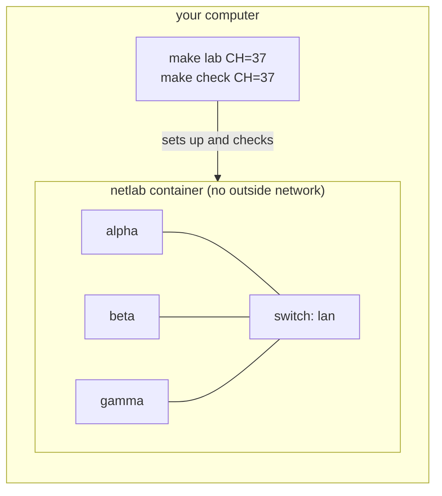

# Chapter 37: The CKNE, and a network lab in a container

> **Exams:** CKNE · Foundations (Part V)
> **Difficulty:** Beginner
> **Time:** ~30 min reading, ~30 min setup and lab
> **Lab tier:** 0 (netlab)
> **Prerequisites:** Chapter 03 (the lab loop); a computer with Docker

## Learning objectives

After this chapter you can:

- Describe what the CKNE exam tests and how Parts V to X are organized around it
- Build the Part V lab environment, the netlab
- Open a shell in the lab and run commands "on" different simulated hosts
- Use the lab loop with netlab labs, which reset by starting a new container
- Recognize the networking conventions Parts V to X add to the book's style

## Concepts

### Parts V to X: the sixth exam

The **Certified Kubernetes Network Engineer (CKNE)** is the newest exam from
the Linux Foundation and the Cloud Native Computing Foundation (CNCF), and the
sixth exam of the Kubestronaut program. Parts I to IV gave you the Kubernetes
side: Pods, Services, Ingress and the Gateway API, NetworkPolicy, and a service
mesh, at the depth the CKA and CKS need. The CKNE goes much deeper into the
network itself: how a packet leaves a Pod, which rules rewrite it, how it
crosses nodes and clusters, and how you prove where it was dropped.

Parts V to X assume **no networking background**. You do not need to know what
a subnet, a route, or a TCP handshake is. Part V teaches all of that from the
ground up, and every networking word is defined in bold the first time it
appears. If you forget one, the glossary (`appendices/glossary.md`) has it,
with the chapter that introduces it. If you already know networking well, skim
Part V, do its labs, and take its quiz (`make quiz EXAM=part5`): a high score
means you can move on to Part VI.

The exam assumes you can operate a Kubernetes cluster at roughly the level of
the Certified Kubernetes Administrator (CKA). Parts VI to X build on Parts I to
IV and link back to them; where a chapter needs Pods, Services, or labels, it
names the earlier chapter that teaches them.

### What the exam tests

The CKNE is a **performance-based** exam: there are no multiple-choice
questions. You get a remote Linux desktop with access to several Kubernetes
clusters and about two hours to complete hands-on tasks, such as "pods in
namespace `shop` cannot resolve service names; fix it" or "only the
`frontend` pods may talk to the database". The tasks are graded by checking the
end state of the cluster.

The curriculum has five **domains**, each with a weight:

| Weight | Domain | This book |
| --- | --- | --- |
| 15% | Core Infrastructure and CNI | Part VI |
| 25% | Service Networking and DNS | Part VII |
| 20% | Advanced Traffic Management | Part VIII |
| 25% | Network Security and Policy | Part IX |
| 15% | Observability | Part X |

Chapter 74 covers the exam logistics: price, retakes, the exam environment,
and a study plan, and Chapter 73 the documentation you may use. Check the
Linux Foundation's exam page for the current details before you book; new
exams change.

### How Parts V to X are organized

- **Part V: Networking from zero** (Chapters 37 to 47). How computers talk to
  each other: addresses, switches, routers, ports, names, encryption, and the
  Linux tools that let you see it all happen. Nothing here is Kubernetes yet,
  but almost everything here comes back in Kubernetes form later.
- **Parts VI to X** (Chapters 48 to 71) follow the five exam domains, one Part
  per domain.
- **Part XI** (Chapters 72 to 74) is exam preparation for all six exams, and
  the full CKNE simulators (`mock-exams/ckne`, `ckne2`) close the book.

Each Part ends with a **mock exam** that covers only that Part: a quiz for
Part V, and killer.sh-style simulators for Parts VI to X.

### Why a lab in every chapter

You cannot learn networking by reading about it. You learn it by sending a
packet, watching where it goes, breaking something, and fixing it. The labs
work exactly like the ones you know from Chapter 03: one task at a time,
`make check` after each, `make reset` when you break something, and solutions
in a separate file.

### The lab environments

Parts V to X use two lab environments, called **tiers**:

| Tier | What it is | Used in |
| --- | --- | --- |
| 0 | **netlab**: one Docker container in which you build small networks | Part V |
| 1 | **kind**: the book's Kubernetes cluster, built from a **profile** | Parts VI to X |

Tier 1 is the kind cluster from Chapter 03, with one difference: Parts I to
IV always run it with Calico as the network plugin (the profile `calico`),
while Parts VI to X need clusters with no network plugin at all, or with
Cilium. Each lab names the profile it needs, and its setup rebuilds the
cluster when the running one is different, which takes a minute or two.
`make cluster-status` shows the current profile, and `make cluster` puts the
default one back. Chapter 48 explains the profiles. For now you only need
Tier 0.

The netlab is a single container, but inside it you will build networks with
several "computers" in them. It does this with a Linux kernel feature called
**network namespaces**. A network namespace is a separate copy of the
operating system's networking: its own network connections, its own
addresses, its own rules. A program running inside a namespace sees only that
namespace's network, as if it ran on a different computer. Chapter 45 shows
you how to build these by hand. Until then, think of each namespace as one
computer in the lab.

The netlab container is started with no network connection to your machine or
to the internet. Nothing you do inside it can break your own computer's
networking, and every reader sees exactly the same addresses as this book.



*Text description: on your computer, make commands set up and check a lab inside the netlab container, where three simulated hosts (alpha, beta, gamma) are connected to one simulated switch.*

## Guided walkthrough

### Step 1: Check the prerequisites

You already have Docker, `make`, `git`, and `bash` from Chapter 03, and the
book's repository. The netlab needs nothing else: every networking tool it
uses (`ip`, `tcpdump`, `iptables`, `dig`, `openssl`, and more) is installed
inside its image. It needs about 1 GB of free memory and 1 GB of disk space.
If the kind cluster is running, you can leave it running; on a machine with
little memory, `make cluster-pause` frees its memory while you work on Part V.

### Step 2: Build the netlab

Build the lab image and start the container. The first build downloads a
Debian base image and installs the tools, which takes a minute or two. After
that, starting the lab takes seconds.

```bash
make netlab
make netlab-status
```

```text
image:     kbook-netlab:1 (built)
container: kbook-netlab (running)
```

As always, every `make` command runs from the top folder of the repository.
`make help` lists all of them, including the netlab ones.

### Step 3: Start the Chapter 37 lab

```bash
make lab CH=37
```

The lab setup builds a small network inside the container and prints the first
task. Leave that terminal where it is: it is your "lab control" terminal,
where you will type `make check`.

### Step 4: Open a shell in the lab

Open a **second** terminal, go to the repository folder, and run:

```bash
make shell
```

Your prompt changes to `netlab:~#`. You are now inside the netlab container,
as `root`. This is your "work" terminal. Ask it what this lab looks like:

```bash
topo
```

```text
Chapter 37 lab: three hosts plugged into one switch

        alpha             beta              gamma
     10.0.1.1          10.0.1.2          10.0.1.3
        |eth0             |eth0             |eth0 (DOWN)
   +----+-----------------+-----------------+----+
   |                  switch "lan"               |
   +---------------------------------------------+
```

Three hosts, `alpha`, `beta`, and `gamma`, are plugged into a switch named
`lan`. The numbers like `10.0.1.1` are **IP addresses**: the number by which
other computers find a host, much like a street address. Chapter 40 explains
how they work. Each host's connection to the network is called a **network
interface**, and the interfaces here are named `eth0`. An interface is to a
host what a network socket in the wall is to a room: the point where the
cable plugs in.

The `netmap` command lists every interface in the lab with its state and
address:

```bash
netmap
```

```text
NAMESPACE  INTERFACE      STATE    ADDRESSES
alpha      eth0           UP       10.0.1.1/24
beta       eth0           UP       10.0.1.2/24
gamma      eth0           DOWN     10.0.1.3/24
lan        br0            UP
lan        alpha-eth0     UP
lan        beta-eth0      UP
lan        gamma-eth0     DOWN
```

The `/24` after each address is part of the address's configuration; Chapter
40 explains it, so ignore it for now. The `lan` namespace is the switch: its
`br0` is the switch itself, and the other three are its ports, one per cable.

### Step 5: Run a command "on" a host

`topo` and `netmap` are helpers this book provides. The real tool for looking
at interfaces is `ip`, and you will use it in every chapter. To run a command
inside a namespace, which is to say "on" one of the simulated hosts, put
`ip netns exec <name>` in front of it:

```bash
ip netns exec alpha ip address show
```

```text
1: lo: <LOOPBACK,UP,LOWER_UP> mtu 65536 qdisc noqueue state UNKNOWN group default qlen 1000
    link/loopback 00:00:00:00:00:00 brd 00:00:00:00:00:00
    inet 127.0.0.1/8 scope host lo
       valid_lft forever preferred_lft forever
2: tunl0@NONE: <NOARP> mtu 1480 qdisc noop state DOWN group default qlen 1000
    link/ipip 0.0.0.0 brd 0.0.0.0
4: eth0@if4: <BROADCAST,MULTICAST,UP,LOWER_UP> mtu 1500 qdisc noqueue state UP group default qlen 1000
    link/ether c2:f7:81:f6:a2:93 brd ff:ff:ff:ff:ff:ff link-netns lan
    inet 10.0.1.1/24 scope global eth0
       valid_lft forever preferred_lft forever
```

That is a lot of output, and by the end of Chapter 41 you will be able to read
every field. For now, find three things: the interface `eth0`, the word `UP`
in its first line, and its address after `inet`. The `lo` interface is the
**loopback** interface, a host's connection to itself, which every host has.

> **Note:** on some machines (Windows with WSL2 and many cloud servers) you also see
> `tunl0@NONE` in every namespace, as above. The kernel adds this unused
> tunnel device to every namespace when a certain kernel module is loaded. It is always
> `DOWN`. Ignore it; `netmap` hides it.

Typing `ip netns exec` gets old fast, so the netlab has a shortcut, `on`:

```bash
on beta ip -br address
```

```text
lo               UNKNOWN        127.0.0.1/8
tunl0@NONE       DOWN
eth0@if5         UP             10.0.1.2/24
```

`-br` (brief) prints one line per interface. `on beta` with no command opens a
shell *on* beta; the prompt shows where you are, and `exit` brings you back:

```bash
on beta
```

```text
[beta] netlab:~# exit
netlab:~#
```

`on` exists only in the netlab. On a real server, and in the exam, you use
`ip netns exec` (or tools built on it), so make sure you can read both forms.

### Step 6: The lab loop

The lab loop is the one from Chapter 03, always typed in the lab control
terminal, always with the chapter number:

| Command | What it does |
| --- | --- |
| `make lab CH=37` | Build the lab from scratch and show task 1 |
| `make check CH=37` | Check the current task; if it passes, show the next one |
| `make question CH=37` | Show the current task again |
| `make skip CH=37` | Move to the next task without checking |
| `make verify CH=37` | Check all tasks at once |
| `make reset CH=37` | Throw the lab away, rebuild it, and go back to task 1 |
| `make solve CH=37` | Apply the reference solution (spoilers!) |
| `make teardown CH=37` | Remove the lab when you are done |

`make lab` and `make reset` always start a **brand-new netlab container**.
That is what makes the reset reliable, but it also closes any `make shell`
session you had open. After a reset, run `make shell` again in your work
terminal.

Written solutions for every lab are in the chapter's `lab/solutions.md`.

### Conventions Parts V to X add

Commands and their output follow the book's usual style. In Part V most
commands run in the lab shell, often through `on`:

```bash
on alpha ping -c 1 10.0.1.2
```

```text
PING 10.0.1.2 (10.0.1.2) 56(84) bytes of data.
64 bytes from 10.0.1.2: icmp_seq=1 ttl=64 time=0.061 ms
```

Some values (timings, and the hardware addresses you meet in Chapter 39) will
differ on your screen. Addresses like `10.0.1.2` always match, because the lab
creates them.

Next to the familiar exam tips, Parts V to X add one more callout, and two
habits:

> **Why this matters for Kubernetes:** connects a Part V idea to what you will
> do with it in a cluster.

- Every chapter's Concepts section has a **packet walk**: a sequence diagram
  that follows one packet hop by hop, followed by a text description.
- Every networking term is in bold where it is defined, and in the glossary.

## Hands-on lab

Start the lab from the repository folder, then open a lab shell in a second terminal:

```bash
make lab CH=37
make shell
```

Do the tasks in the lab shell; type `make check CH=37` in the first terminal after each one. All answer files go in `/root/answers/37/`, which already exists. Solutions: `chapters/37-ckne-and-the-netlab/lab/solutions.md`.

### Task 1: Find a host's address

Find the IP address of host `beta` and write it, without the `/24`, into an answer file.

- File: `/root/answers/37/beta-ip`
- Content: `beta`'s address on `eth0`

### Task 2: Create a namespace

Create a new, empty network namespace, as if you were adding a computer to the lab.

- Network namespace name: `hello`

### Task 3: Bring gamma online

Host `gamma`'s network interface is down, so it cannot talk to anyone. Bring it up.

- `gamma`'s `eth0` is up
- `gamma` can ping `alpha` (`10.0.1.1`)

## Exam tips

> **Exam tip:** In the exam, as in these labs, a task is graded on the end state, not
> on how you got there. Check your own work before moving on, the way
> `make check` does for you here.

> **Exam tip:** Get used to the `ip` command now. `ip address`, `ip link`, and
> `ip route` are the first things you type when debugging a node, and the
> exam environment has no `netmap` or `on` shortcuts.

## Common mistakes

- **Running a command in the wrong place.** `ip link set eth0 up` typed in the
  container itself fails with `Cannot find device "eth0"`, because only the
  hosts have an `eth0`. Check the prompt: `[gamma] netlab:~#` means you are on
  gamma.
- **Using an old shell after a reset.** `make reset` replaces the container.
  A shell you opened before the reset is gone; open a new one with `make shell`.
- **Typing `make check` inside the lab shell.** `make` commands run on your
  own machine, in the repository folder, not inside the netlab.

<!-- QUESTIONS:START -->

## End-of-chapter questions

**1.** What kind of exam is the CKNE?

- **A.** Multiple choice, taken in a browser
- **B.** Performance-based: hands-on tasks on real clusters, graded by their end state
- **C.** An oral interview with a network engineer
- **D.** A written essay about Kubernetes architecture

**2.** Which two CKNE domains carry the most weight (25% each)?

- **A.** Core Infrastructure and CNI, and Observability
- **B.** Service Networking and DNS, and Network Security and Policy
- **C.** Advanced Traffic Management, and Observability
- **D.** Core Infrastructure and CNI, and Advanced Traffic Management

**3.** What is a network namespace?

- **A.** A DNS domain such as example.com
- **B.** A Kubernetes object that groups Pods
- **C.** A separate copy of the operating system's networking (interfaces, addresses, rules) that programs inside it see as their whole network
- **D.** A Docker image that contains networking tools

**4.** You are in the lab shell at the prompt `netlab:~#`. Which command runs `ip address show` on host `beta`?

- **A.** ip address show beta
- **B.** ip netns exec beta ip address show
- **C.** ssh beta ip address show
- **D.** docker exec beta ip address show

**5.** You ran `make reset CH=37`, and now your lab shell prints errors or has frozen. Why?

- **A.** The reset failed and the lab is broken
- **B.** make reset replaced the netlab container, so the old shell's container is gone; open a new one with make shell
- **C.** You must run make teardown before make reset
- **D.** The reset changed your computer's network settings

**6.** Where do you type `make check CH=37`?

- **A.** In the lab shell, at the netlab:~# prompt
- **B.** In a terminal on your own machine, in the repository's top folder
- **C.** Inside host gamma, after on gamma
- **D.** Anywhere; make works in every folder

**7.** Why does the netlab container run with no network connection to your computer or the internet?

- **A.** To make the labs harder
- **B.** Because Docker cannot give a privileged container a network
- **C.** So nothing you do in a lab can affect your own machine's networking, and every reader sees the same addresses
- **D.** To save memory

**8.** In `ip address show` output, what is the `lo` interface?

- **A.** A broken interface that should be deleted
- **B.** The loopback interface: the host's connection to itself, present on every host
- **C.** The interface that connects to the switch
- **D.** A tunnel to the internet

**9.** You type `ip link set eth0 up` at the `netlab:~#` prompt and get `Cannot find device "eth0"`. What is the most likely reason?

- **A.** eth0 has been deleted by the lab
- **B.** The command ran in the container itself, which has no eth0; it must run inside a host, for example with `on gamma`
- **C.** You need sudo
- **D.** eth0 is already up

**10.** Which statement about the lab checks is true?

- **A.** They check which commands you typed
- **B.** They check the end state, for example whether gamma can now ping alpha, no matter how you got there
- **C.** They only check that you read the chapter
- **D.** They change your lab to the solution if you fail

<details>
<summary>Answers</summary>

**1. B.** The CKNE gives you a remote Linux environment and clusters to work on. Each task is graded by checking the resulting state, which is why every chapter of this book has a hands-on lab.

**2. B.** Service Networking and DNS (Part VII) and Network Security and Policy (Part IX) are 25% each. Advanced Traffic Management is 20%; Core Infrastructure and CNI, and Observability, are 15% each.

**3. C.** A network namespace gives a process its own interfaces, addresses, routes, and firewall rules. The netlab uses one namespace per simulated computer. Do not confuse it with a Kubernetes Namespace, which only groups API objects and does not isolate networking.

**4. B.** `ip netns exec <namespace> <command>` runs a command inside a network namespace. The netlab's `on beta ip address show` is a shortcut for the same thing. There is no SSH server, and beta is not a separate container.

**5. B.** make lab and make reset always start a brand-new container, which is what makes a reset reliable. Shells opened in the old container end with it.

**6. B.** The make commands run on your machine, from the repository folder, and reach into the netlab container. The netlab itself does not contain the book's Makefile.

**7. C.** Every network in Part V is built inside the container out of namespaces. Keeping the container disconnected makes the labs safe to break and identical for every reader.

**8. B.** Every host has a loopback interface, lo, with the address 127.0.0.1. Traffic sent to it never leaves the host. Chapter 38 uses it again.

**9. B.** Only the namespaces that play hosts have an eth0. Commands typed at netlab:~# run in the container's own namespace. Prefix them with `on <host>` or `ip netns exec <host>`.

**10. B.** Like the exam, the checks test the result. Any correct way to reach it passes. make solve is the only command that applies the solution for you.

</details>

<!-- QUESTIONS:END -->

## Further reading

- The CKNE program page at the Linux Foundation: domains and competencies
- `man ip-netns`: the manual page for network namespaces (try `man ip-netns` in the lab shell)
- Docker's documentation on installing Docker Engine, Docker Desktop, and WSL2 integration
