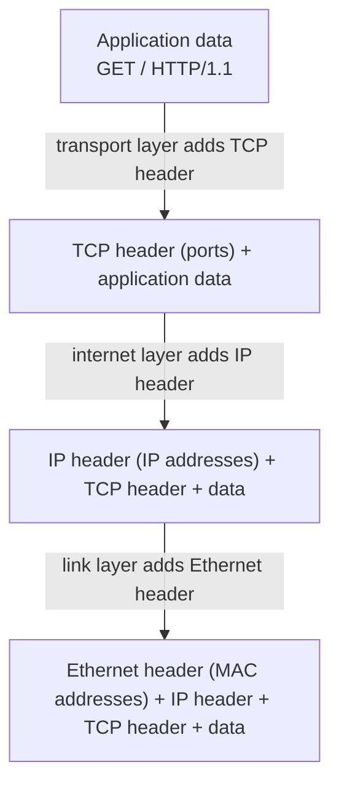
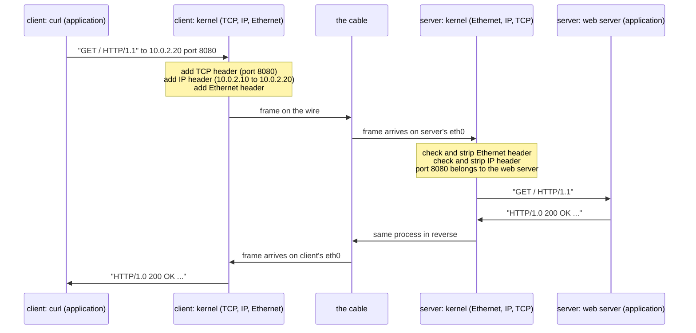

# Chapter 38: How networks work

> **Exams:** CKNE · Foundations (Part V), supports D1 (Using Linux Tools (iptables, ip, tcpdump) for Packet-level Issues)
> **Difficulty:** Beginner
> **Time:** ~60 min reading, ~30 min lab
> **Lab tier:** 0 (netlab)
> **Prerequisites:** Chapter 37 (the netlab is built and you can use `make lab` and `make shell`)

## Learning objectives

After this chapter you can:

- Explain what a network, a host, a link, and a packet are
- Explain why data is sent in packets rather than in one piece
- Name the four layers of the TCP/IP model, and map the "L2, L3, L4, L7" vocabulary of the OSI model onto them
- Describe encapsulation: how each layer wraps the data of the layer above in its own header
- Test basic connectivity with `ping` and read its output
- Capture traffic with `tcpdump`, filter it, save it to a file, and read a saved capture

## Concepts

### What a network is

A **network** is a set of devices that can send data to each other. Each device
that sends and receives data is a **host**: your laptop, a server, a phone, and,
later in this book, a Kubernetes Pod. The physical or virtual connection
between two devices is a **link**: a cable, a Wi-Fi radio connection, or, in the
netlab, a virtual cable.

Small networks connect to bigger ones, and the biggest network of networks is
the internet. But every network, from two laptops on one cable to a cluster of
thousands of servers, runs on the same few ideas. This chapter introduces them;
the rest of Part V takes them apart one at a time.

### Packets: data in envelopes

When you download a web page, the data does not travel as one long stream that
occupies the cable until it is done. It is chopped into small pieces, usually
up to about 1,500 bytes each, called **packets**. Each packet travels on its
own, and the receiver puts them back together.

Why bother?

- **Sharing.** A link carries packets from many conversations, one after
  another. Your download and your video call share the same cable by taking
  turns, packet by packet, instead of one waiting for the other to finish.
- **Recovery.** If something goes wrong on the way, only the damaged packet
  needs to be sent again, not the whole file.
- **Independence.** Each packet carries everything needed to deliver it,
  so different packets can even take different paths.

Think of a packet as a letter in an **envelope**. The letter is the
**payload**: the actual data you want to deliver. The envelope is the
**header**: a small block of information in front of the payload that says
where the packet comes from, where it is going, and how to handle it. Network
devices read the header and never need to open the letter.

### Protocols

For two hosts to understand each other, they must agree on the format of those
headers and on the rules of the conversation: who speaks first, what an answer
looks like, what to do when something is lost. Such an agreement is a
**protocol**. You already know some names: HTTP (the web), IP, TCP, DNS. Each
is a protocol, and each solves one specific problem.

No single protocol does everything. Instead, protocols are stacked in
**layers**, where each layer solves one problem and relies on the layer below
for everything else.

### The four layers of the TCP/IP model

The internet's design, the **TCP/IP model**, has four layers. Read the table
from the bottom up: each layer uses the one below it.

| Layer | Name | Problem it solves | Example protocols | Its address |
| --- | --- | --- | --- | --- |
| 4 | **Application** | What the programs say to each other | HTTP, DNS, TLS, SSH | URL, name |
| 3 | **Transport** | Which program on the host gets the data, and (optionally) reliable delivery | TCP, UDP | **port** number |
| 2 | **Internet** | Getting a packet from one host to another, across many networks | IP, ICMP | IP address |
| 1 | **Link** | Getting a packet across one link to the next device | Ethernet, Wi-Fi | MAC address |

A postal analogy helps:

- The **link** layer is the van that carries mail from one post office to the
  next. It only knows the next stop.
- The **internet** layer is the address on the envelope. Every post office
  reads it and decides which van to put the letter in next, until it reaches
  the right building.
- The **transport** layer is the apartment number. The building (host) has many
  residents (programs); a number called a **port** says which one gets the letter.
  A web server typically waits on port 80, for example.
- The **application** layer is the letter itself, written in a language both
  residents understand.

Chapters 39 to 44 cover these layers bottom-up: Ethernet (39), IP addressing
(40), routing (41), TCP and UDP (42), DNS (43), and HTTP with TLS (44).

### The OSI model and the "L-numbers"

You will often hear people (and Kubernetes documentation) talk about "L4 load
balancing" or "L7 policies". Those numbers come from an older, more detailed
model called the **OSI model**, which has seven layers. Nobody builds networks
on the OSI model any more, but its numbering stuck. Here is how it maps to
TCP/IP:

| OSI layer | OSI name | TCP/IP layer | What people mean when they say it |
| --- | --- | --- | --- |
| L7 | Application | Application | Understands HTTP: paths, headers, methods |
| L6 | Presentation | Application | (rarely used on its own) |
| L5 | Session | Application | (rarely used on its own) |
| L4 | Transport | Transport | Sees IP addresses and ports, but not HTTP |
| L3 | Network | Internet | Sees IP addresses only |
| L2 | Data link | Link | Sees MAC addresses: one local network |
| L1 | Physical | Link | Cables, radio, voltages |

In practice you need four of these numbers: **L2, L3, L4, and L7**.

> **Why this matters for Kubernetes:** the CKNE curriculum uses this vocabulary
> directly. A Kubernetes Service is an **L4** load balancer: it forwards
> connections by IP address and port without looking inside them. The Gateway
> API's HTTPRoute works at **L7**: it can route by URL path or header. A
> standard NetworkPolicy filters at L3 and L4; Cilium can add L7 rules. When a
> task says "L4", you now know what it can and cannot see.

### Encapsulation: envelopes inside envelopes

When a program sends data, each layer wraps what it gets from the layer above
in its own header, like putting an envelope inside a bigger envelope. This is
called **encapsulation**:



*Text description: application data gets a TCP header added, then an IP header in front of that, then an Ethernet header in front of everything; the result is what goes on the wire.*

On the receiving host, the process runs in reverse (**decapsulation**): the
link layer removes the Ethernet header and hands the rest up, the internet
layer removes the IP header, and so on, until the web server receives exactly
the `GET / HTTP/1.1` text that the client's program wrote.

Strictly speaking, the unit at each layer has its own name: a **frame** at the
link layer, a **packet** at the internet layer, a **segment** (TCP) or
**datagram** (UDP) at the transport layer. "Packet" is the everyday word for
all of them, and this book uses it that way until Chapter 39, where the
difference between a frame and a packet starts to matter.

> **Why this matters for Kubernetes:** Pods on different nodes often talk
> through an **overlay network**, which wraps the whole packet in *another*
> set of headers to carry it between nodes (Chapter 45 builds one by hand).
> When a cross-node connection fails mysteriously, the cause is often this
> extra envelope making the packet too big for the link.

### Packet walk: one web request

Here is what happens when the client in this chapter's lab asks the server for
its home page, layer by layer:



*Text description: curl hands its request to the client's kernel, which adds TCP, IP, and Ethernet headers and sends the frame over the cable. The server's kernel strips the headers one by one and gives the request to the web server listening on port 8080; the reply travels back the same way.*

Notice that the programs (curl and the web server) only ever see the
application data. Everything else is done by the operating system's
**kernel**, the core of Linux that owns the network interfaces. That is why
`tcpdump`, which listens at the interface, can see all the headers that the
programs never see.

### Two tools to start with

**`ping`** sends a tiny packet to a host and asks it to answer. It uses
**ICMP** (Internet Control Message Protocol), a helper protocol that lives
next to IP and is used for tests and error messages. A ping that comes back
proves that the two hosts can reach each other at the internet layer. It does
not prove that a particular program on the other side is working. ping has no
port; it never reaches a program at all.

**`tcpdump`** listens on an interface and prints a line for every packet that
passes, decoding the headers for you. It can also save the raw packets to a
**capture file** (a `.pcap` file) to read later, on the same machine or another
one, with `tcpdump` or with Wireshark's graphical interface. Learning to read
`tcpdump` output is one of the most valuable skills in this book: when
something does not work, it shows you what is *actually* on the wire instead
of what should be there.

## Guided walkthrough

Start the lab and open a lab shell in a second terminal:

```bash
make lab CH=38
make shell
```

```bash
topo
```

```text
Chapter 38 lab: one cable between two hosts

     client                                server
   10.0.2.10  eth0 ==================== eth0  10.0.2.20
                                         (web server on a TCP port
                                          you have to find)
```

The walkthrough below fixes the lab's first problem so that you can see
`ping` and `tcpdump` working. The lab tasks then ask you to do it yourself,
after `make reset`, so read along now and repeat it in the lab later.

### Step 1: A ping that fails

```bash
on client ping -c 2 -W 1 10.0.2.20
```

```text
PING 10.0.2.20 (10.0.2.20) 56(84) bytes of data.

--- 10.0.2.20 ping statistics ---
2 packets transmitted, 0 received, 100% packet loss, time 1030ms
```

`-c 2` sends two pings and stops (without `-c`, ping runs until you press
Ctrl+C). `-W 1` waits at most one second for each answer. Two sent, zero
received: nothing comes back.

### Step 2: Look at the link on both ends

Start at the bottom layer. Is the cable even connected?

```bash
on client ip -br link
on server ip -br link
```

```text
lo               UNKNOWN        00:00:00:00:00:00 <LOOPBACK,UP,LOWER_UP>
tunl0@NONE       DOWN           0.0.0.0 <NOARP>
eth0@if3         DOWN           6a:e5:2f:f4:55:b5 <NO-CARRIER,BROADCAST,MULTICAST,UP>
lo               UNKNOWN        00:00:00:00:00:00 <LOOPBACK,UP,LOWER_UP>
tunl0@NONE       DOWN           0.0.0.0 <NOARP>
eth0@if4         DOWN           7a:a5:67:7e:6a:93 <BROADCAST,MULTICAST>
```

Both `eth0` interfaces say `DOWN`, but for different reasons. Look at the
flags between `< >`:

- On the client, `UP` means the interface is switched on, but `NO-CARRIER`
  means it detects nothing at the other end of the cable, like a network
  cable plugged into your laptop with the other end loose.
- On the server, `UP` is missing: someone switched the interface off.

So the fault is at the server's end. Switch it on:

```bash
on server ip link set eth0 up
on client ping -c 3 10.0.2.20
```

```text
PING 10.0.2.20 (10.0.2.20) 56(84) bytes of data.
64 bytes from 10.0.2.20: icmp_seq=1 ttl=64 time=0.011 ms
64 bytes from 10.0.2.20: icmp_seq=2 ttl=64 time=0.039 ms
64 bytes from 10.0.2.20: icmp_seq=3 ttl=64 time=0.042 ms

--- 10.0.2.20 ping statistics ---
3 packets transmitted, 3 received, 0% packet loss, time 2042ms
rtt min/avg/max/mdev = 0.011/0.030/0.042/0.013 ms
```

Each reply line shows:

- `icmp_seq`: the number of the ping, so you can spot gaps where one was lost
- `ttl`: "time to live", a counter that Chapter 41 explains (it reveals how many routers a packet crossed)
- `time`: the **round-trip time**, from sending the ping to getting the answer.
  On a virtual cable it is a few hundredths of a millisecond. Across the
  internet, tens of milliseconds are normal.

### Step 3: Find the program and its port

ping works, so the hosts can reach each other. But is there a web server, and
which port does it use? `ss` ("socket statistics") lists the network
connections of a host. `-l` shows only programs that are **listening** (waiting
for connections), `-t` shows TCP, and `-n` prints numbers instead of names:

```bash
on server ss -ltn
```

```text
State  Recv-Q Send-Q Local Address:Port Peer Address:Port
LISTEN 0      5          10.0.2.20:8080      0.0.0.0:*
```

A program is listening on address `10.0.2.20`, port `8080`. Chapter 42 covers
ports and `ss` in depth.

### Step 4: Talk to the program

`curl` is a command-line web client. Give it the address and the port:

```bash
on client curl http://10.0.2.20:8080/
```

```text
Welcome to the Chapter 38 server
```

`-v` (verbose) shows the conversation: lines starting with `>` are what curl
sent, lines starting with `<` are what came back:

```bash
on client curl -v http://10.0.2.20:8080/
```

```text
*   Trying 10.0.2.20:8080...
* Connected to 10.0.2.20 (10.0.2.20) port 8080
> GET / HTTP/1.1
> Host: 10.0.2.20:8080
> User-Agent: curl/8.14.1
> Accept: */*
>
< HTTP/1.0 200 OK
< Server: SimpleHTTP/0.6 Python/3.13.5
< Content-type: text/html
< Content-Length: 33
<
Welcome to the Chapter 38 server
```

That is the application layer: plain text that both programs understand.
Chapter 44 explains HTTP.

### Step 5: Your first capture

Now watch the packets. You need two shells: one to capture, one to send
traffic. Open another terminal, run `make shell` in it, and start `tcpdump` on
the server's interface:

```bash
on server tcpdump -i eth0 -n icmp
```

- `-i eth0` chooses the interface to listen on.
- `-n` prints addresses as numbers instead of trying to look up names.
  Always use it; name lookups slow tcpdump down and, in this lab, fail anyway.
- `icmp` is a **filter**: show only ICMP packets.

In your other shell, ping twice:

```bash
on client ping -c 2 10.0.2.20
```

The capture shell prints:

```text
listening on eth0, link-type EN10MB (Ethernet), snapshot length 262144 bytes
12:04:29.772083 IP 10.0.2.10 > 10.0.2.20: ICMP echo request, id 96, seq 1, length 64
12:04:29.772098 IP 10.0.2.20 > 10.0.2.10: ICMP echo reply, id 96, seq 1, length 64
12:04:30.775174 IP 10.0.2.10 > 10.0.2.20: ICMP echo request, id 96, seq 2, length 64
12:04:30.775204 IP 10.0.2.20 > 10.0.2.10: ICMP echo reply, id 96, seq 2, length 64
```

Read a line left to right: the time, the protocol (`IP`), **source** `>`
**destination**, and what kind of packet it is. Each ping is a request from
client to server and a reply back. Press Ctrl+C to stop tcpdump.

### Step 6: See the link layer header

`-e` adds the link-layer (Ethernet) header to each line:

```bash
on server tcpdump -i eth0 -n -e -c 2 icmp
```

```text
12:04:33.824075 6a:e5:2f:f4:55:b5 > 7a:a5:67:7e:6a:93, ethertype IPv4 (0x0800), length 98: 10.0.2.10 > 10.0.2.20: ICMP echo request, id 103, seq 1, length 64
12:04:33.824093 7a:a5:67:7e:6a:93 > 6a:e5:2f:f4:55:b5, ethertype IPv4 (0x0800), length 98: 10.0.2.20 > 10.0.2.10: ICMP echo reply, id 103, seq 1, length 64
```

Before the IP addresses there is now a second pair of addresses, written as six
pairs of hexadecimal digits. These are **MAC addresses**, the link-layer
addresses of the two interfaces (compare them with the `ip -br link` output in
Step 2). `ethertype IPv4` says what is inside the Ethernet envelope: an IP
packet. This is encapsulation, printed on one line. `-c 2` makes tcpdump stop
by itself after two packets. Chapter 39 is all about this layer.

### Step 7: Capture a web request

Change the filter to the web server's port and fetch the page from the other shell:

```bash
on server tcpdump -i eth0 -n tcp port 8080
```

```bash
on client curl -s http://10.0.2.20:8080/
```

```text
12:04:35.863913 IP 10.0.2.10.59826 > 10.0.2.20.8080: Flags [S], seq 3807292113, win 64240, options [mss 1460,sackOK,TS val 3817755451 ecr 0,nop,wscale 10], length 0
12:04:35.863938 IP 10.0.2.20.8080 > 10.0.2.10.59826: Flags [S.], seq 1996981404, ack 3807292114, win 65160, options [mss 1460,sackOK,TS val 1304055420 ecr 3817755451,nop,wscale 10], length 0
12:04:35.863951 IP 10.0.2.10.59826 > 10.0.2.20.8080: Flags [.], ack 1, win 63, options [nop,nop,TS val 3817755451 ecr 1304055420], length 0
12:04:35.864026 IP 10.0.2.10.59826 > 10.0.2.20.8080: Flags [P.], seq 1:79, ack 1, win 63, options [nop,nop,TS val 3817755451 ecr 1304055420], length 78: HTTP: GET / HTTP/1.1
12:04:35.864031 IP 10.0.2.20.8080 > 10.0.2.10.59826: Flags [.], ack 79, win 64, options [nop,nop,TS val 1304055420 ecr 3817755451], length 0
12:04:35.864918 IP 10.0.2.20.8080 > 10.0.2.10.59826: Flags [P.], seq 1:186, ack 79, win 64, options [nop,nop,TS val 1304055421 ecr 3817755451], length 185: HTTP: HTTP/1.0 200 OK
...
```

There is much more here than for ping, because a web request runs over TCP.
For now, notice three things:

- Each address now has a fifth number after it: `10.0.2.10.59826` means
  address `10.0.2.10`, port `59826`. The server side is port `8080`, the
  client side a random high port that curl's kernel picked for this one
  conversation.
- The first three packets carry no data (`length 0`). They are TCP's
  **handshake**, which sets up the connection before any data flows (`[S]`,
  `[S.]`, `[.]`). Chapter 42 explains them.
- The fourth packet carries 78 bytes of data, and tcpdump recognizes them:
  `HTTP: GET / HTTP/1.1`. The sixth carries the answer, `HTTP/1.0 200 OK`.

### Step 8: Look inside the packets

`-A` prints each packet's contents as text after its header line. Binary
header bytes show as dots and noise; the HTTP text is readable:

```bash
on server tcpdump -i eth0 -n -A tcp port 8080
```

```text
12:04:39.909710 IP 10.0.2.10.59832 > 10.0.2.20.8080: Flags [P.], seq 3729817706:3729817784, ack 538933103, win 63, options [nop,nop,TS val 4148748616 ecr 2027502913], length 78: HTTP: GET / HTTP/1.1
E...$.@.@...
.H.Hx.=AGET / HTTP/1.1
Host: 10.0.2.20:8080
User-Agent: curl/8.14.1
Accept: */*
```

Anyone who can capture these packets can read them. That is why Chapter 44's
TLS encryption matters, and why Part IX encrypts traffic between Pods.

### Step 9: Save a capture and read it later

`-w <file>` writes the raw packets to a file instead of printing them, and
`-r <file>` reads them back. Run the capture on the server and fetch the page
from the client as before, then stop tcpdump with Ctrl+C:

```bash
on server tcpdump -i eth0 -n -w /tmp/web.pcap tcp port 8080
```

```text
tcpdump: listening on eth0, link-type EN10MB (Ethernet), snapshot length 262144 bytes
^C12 packets captured
12 packets received by filter
0 packets dropped by kernel
```

```bash
tcpdump -n -r /tmp/web.pcap
```

Reading a file needs no interface and no namespace: the packets are in the
file. You can add a filter when reading, too: `tcpdump -n -r /tmp/web.pcap 'tcp dst port 8080'`
shows only the packets going *to* the server.

### Filters you will use all the time

tcpdump's filter language is called **BPF syntax** (after the Berkeley Packet
Filter that runs it). The basics:

| Filter | Shows |
| --- | --- |
| `icmp` | only ICMP (ping) |
| `host 10.0.2.20` | packets from or to that address |
| `src host 10.0.2.10` | packets from that address |
| `port 8080` | TCP or UDP packets from or to port 8080 |
| `tcp port 8080` | only TCP on port 8080 |
| `dst port 8080` | packets going to port 8080 |
| `host 10.0.2.20 and port 8080` | combine with `and`, `or`, `not` |
| `not port 22` | everything except port 22 (useful when you are logged in over SSH) |

Put filters with special characters in single quotes: `'tcp dst port 8080'`.

## Hands-on lab

Start (or restart) the lab and open a lab shell:

```bash
make reset CH=38
make shell
```

`make reset` undoes anything you did during the walkthrough. Run all commands in the lab shell; type `make check CH=38` on your machine after each task. Answer files go in `/root/answers/38/`. Some tasks need two lab shells at once: run `make shell` in a second terminal. Solutions: `chapters/38-how-networks-work/lab/solutions.md`.

### Task 1: Connect the hosts

The client cannot ping the server. Find which end of the cable is broken and fix it.

- `client` can ping `10.0.2.20`
- Both `eth0` interfaces are up

### Task 2: Find the web server's port

A web server runs on the server host. Find the TCP port it listens on.

- File: `/root/answers/38/web-port`
- Content: the port number only

### Task 3: Capture a web request

Save a capture of the client fetching the server's home page (`/`).

- File: `/root/answers/38/web.pcap`
- It contains the HTTP request `GET /` from `10.0.2.10` to `10.0.2.20`

### Task 4: Read someone else's capture

The file `/root/answers/38/mystery.pcap` holds a capture made earlier. In it, the client asked the server for a page you have not seen. Find the page's path.

- File: `/root/answers/38/secret-page`
- Content: the full path requested, starting with `/` (for example `/docs/index.html`)

## Exam tips

> **Exam tip:** When something does not connect, work from the bottom layer
> up: is the link up, can the hosts ping each other, is the program listening,
> does the application answer? Chapter 47 turns this into a method.

> **Exam tip:** Always run `tcpdump` with `-n`. On a cluster node, also limit it
> with a filter (`host`, `port`) and `-c`, or the output scrolls faster than you
> can read it.

> **Exam tip:** `ping` failing does not always mean the network is broken.
> Firewalls and network policies often block ICMP while allowing TCP. Test
> the real thing (`curl`, `nc`) before concluding.

## Common mistakes

- **Capturing on the wrong host or interface.** tcpdump only sees packets that
  pass through the interface it listens on. If you capture on the server and
  the packet never leaves the client, you see nothing, which is itself a
  useful clue.
- **Forgetting the filter quotes.** `tcpdump tcp dst port 8080` works, but
  filters with brackets or `&` must be quoted, or the shell eats them.
- **Writing `-w` and expecting output.** With `-w`, tcpdump prints nothing per
  packet; it writes to the file. Stop it with Ctrl+C, then read the file with `-r`.
- **Confusing "ping works" with "the service works".** ping proves IP
  connectivity, nothing more.

<!-- QUESTIONS:START -->

## End-of-chapter questions

**1.** Why is data sent across a network in small packets instead of one continuous stream?

- **A.** Because cables can only carry 1,500 bytes in total
- **B.** So that many conversations can share a link, and a lost piece can be resent on its own
- **C.** Because encryption only works on small pieces
- **D.** Because the receiver can only store one packet at a time

**2.** What is a packet's header?

- **A.** The first line of the HTTP response
- **B.** A small block of information in front of the payload saying where the packet comes from, where it goes, and how to handle it
- **C.** The part of the packet that contains the user's data
- **D.** A checksum at the end of the packet

**3.** In the TCP/IP model, which layer uses port numbers to decide which program on a host receives the data?

- **A.** Link
- **B.** Internet
- **C.** Transport
- **D.** Application

**4.** `CKNE` A colleague says a Kubernetes Service is an "L4 load balancer". What does that tell you?

- **A.** It can route requests based on the URL path
- **B.** It forwards traffic by IP address and port, without looking at HTTP paths or headers
- **C.** It only works with MAC addresses on one local network
- **D.** It encrypts traffic between Pods

**5.** Which order shows encapsulation correctly, from the innermost part to the outermost, for a web request on Ethernet?

- **A.** Ethernet header, IP header, TCP header, HTTP data
- **B.** HTTP data, TCP header, IP header, Ethernet header
- **C.** IP header, HTTP data, Ethernet header, TCP header
- **D.** TCP header, HTTP data, IP header, Ethernet header

**6.** `ping 10.0.2.20` succeeds, but `curl http://10.0.2.20:8080/` fails. What can you conclude?

- **A.** The cable is broken
- **B.** The two hosts can reach each other at the IP layer; the problem is higher up, for example nothing is listening on port 8080
- **C.** ping is broken
- **D.** The client has no IP address

**7.** `ip -br link` shows `eth0 DOWN ... <NO-CARRIER,BROADCAST,MULTICAST,UP>`. What does it mean?

- **A.** The interface has been switched off with ip link set eth0 down
- **B.** The interface is switched on, but nothing is detected at the other end of the link
- **C.** The interface has no IP address
- **D.** The interface is working normally

**8.** `CKNE` Which tcpdump command shows only TCP traffic to or from port 8080 on interface eth0, without trying to resolve names?

- **A.** tcpdump -i eth0 port 8080 -resolve=false
- **B.** tcpdump -i eth0 -n tcp port 8080
- **C.** tcpdump -n eth0 8080
- **D.** tcpdump -A -i any

**9.** `CKNE` What does `tcpdump -w web.pcap` do?

- **A.** Prints every packet in a wider format
- **B.** Writes the raw packets to the file web.pcap instead of printing them; read it later with tcpdump -r
- **C.** Waits until a packet arrives, then exits
- **D.** Shows only web (HTTP) traffic

**10.** In the tcpdump line `IP 10.0.2.10.59826 > 10.0.2.20.8080: Flags [S]`, what is 59826?

- **A.** The packet's sequence number
- **B.** The client's port number for this connection
- **C.** The length of the packet
- **D.** The process ID of curl

**11.** tcpdump with `-e` adds a pair of addresses such as `6a:e5:2f:f4:55:b5 > 7a:a5:67:7e:6a:93` to each line. What are they?

- **A.** IPv6 addresses
- **B.** MAC addresses from the Ethernet (link layer) header
- **C.** Port numbers in hexadecimal
- **D.** Encryption keys

**12.** Why can tcpdump see TCP and IP headers that programs like curl never see?

- **A.** tcpdump decrypts the traffic
- **B.** Headers are added and removed by the kernel; tcpdump listens at the interface, below the programs
- **C.** curl hides headers on purpose
- **D.** tcpdump talks to the remote host to ask for them

<details>
<summary>Answers</summary>

**1. B.** Packets let many conversations take turns on the same link, and if one packet is damaged or lost, only that packet is sent again. Each packet also carries its own addressing, so it can be delivered independently.

**2. B.** The header is the envelope: addressing and handling information. The payload is the letter inside. Network devices read headers without needing to look at the payload.

**3. C.** The transport layer (TCP and UDP) carries port numbers. The internet layer (IP) only gets the packet to the right host; the port picks the program on that host.

**4. B.** L4 is the transport layer: addresses and ports. Routing by URL path or header needs an L7 (application layer) component, such as a Gateway API HTTPRoute.

**5. B.** Each layer wraps what it receives from the layer above. The HTTP data is wrapped by TCP, the TCP segment by IP, and the IP packet by Ethernet. On the wire, the Ethernet header comes first because it is the outermost envelope.

**6. B.** ping (ICMP) proves IP connectivity only. It does not use ports and never reaches a program. A curl failure with working ping points at the transport or application layer: no listener, a firewall rule for that port, or a broken application.

**7. B.** UP in the flags means the interface is administratively on. NO-CARRIER means there is no signal from the other end, such as a loose cable or, with a virtual cable, the other end being down.

**8. B.** -i picks the interface, -n turns off name resolution, and the filter tcp port 8080 matches TCP packets with 8080 as the source or destination port.

**9. B.** -w writes a capture file. It prints nothing per packet. Read the file with tcpdump -r web.pcap (optionally with a filter) or open it in Wireshark.

**10. B.** tcpdump prints address.port. The client's kernel picks a random high port for each new connection; 8080 is the server's port.

**11. B.** -e prints the link-layer header. On Ethernet, that header holds the source and destination MAC addresses of the two interfaces on the link. Chapter 39 covers them.

**12. B.** The kernel's network stack does the encapsulation and decapsulation. Programs hand data to the kernel and receive data from it. tcpdump captures at the interface, where the full frame with every header is visible.

</details>

<!-- QUESTIONS:END -->

## Further reading

- `man tcpdump` and `man pcap-filter` (the filter syntax) in the lab shell
- RFC 1122, *Requirements for Internet Hosts*, section 1.1.3: the original description of the internet's layers
- Wireshark's documentation, for reading `.pcap` files in a graphical tool
