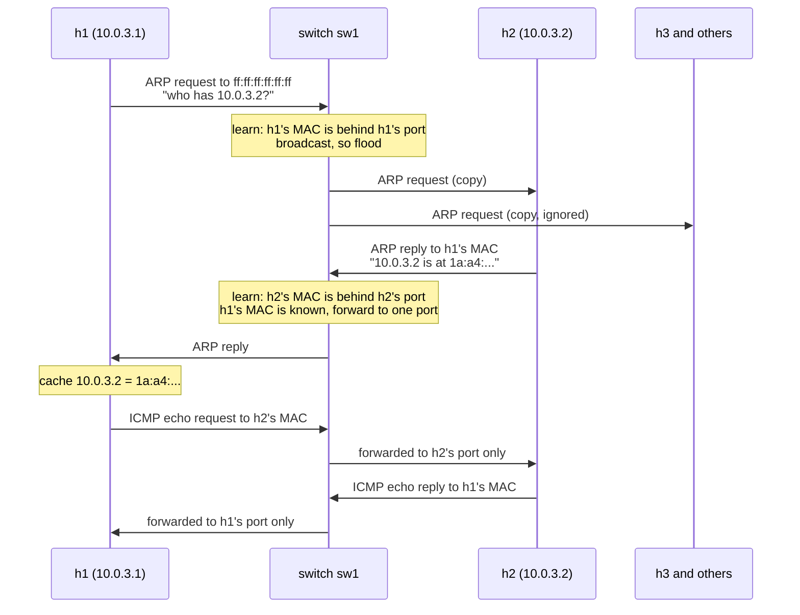

# Chapter 39: Ethernet and switching

> **Exams:** CKNE · Foundations (Part V), supports D1 Core Infrastructure and CNI
> **Difficulty:** Beginner
> **Time:** ~60 min reading, ~40 min lab
> **Lab tier:** 0 (netlab)
> **Prerequisites:** Chapter 38 (layers, encapsulation, `tcpdump`)

## Learning objectives

After this chapter you can:

- Explain what a MAC address is, read one, and tell a broadcast address from a unicast one
- Describe the fields of an Ethernet frame and what the MTU limits
- Explain how a switch learns where hosts are, and when it floods a frame to every port
- Explain how ARP finds the MAC address that belongs to an IP address, and read a host's ARP cache
- Build and inspect a Linux bridge (a software switch) with `ip link` and `bridge`
- Diagnose a host that is cabled but not switched, and an MTU mismatch

## Concepts

### The problem: one link, many hosts

Chapter 38's lab had two hosts on one cable. Real networks have many hosts,
and running a cable from every host to every other host is impossible: ten
hosts would need 45 cables. Instead, every host gets one cable to a central
device, the **switch**, and the switch passes each frame on to the right
host.

For that to work, the switch must know which host is plugged into which of
its sockets (**ports**), and every frame must say which host it is for. Both
problems are solved at the link layer (layer 2), and on almost every wired
network, and inside every Kubernetes node, the link layer is **Ethernet**.

### MAC addresses

Every Ethernet interface has a **MAC address** (Media Access Control address),
also called a hardware address. It is 48 bits long and written as six bytes in
hexadecimal (base 16, digits `0-9` and `a-f`), separated by colons:

```text
86:07:80:6b:c9:d1
```

- On physical network cards, the MAC address is burned in at the factory, and
  the first three bytes identify the manufacturer.
- Virtual interfaces, like the ones in the netlab and the ones Kubernetes
  creates for every Pod, get a random MAC address when they are created. That
  is why your lab shows different MAC addresses from this book, and why they
  change after every `make reset`.
- MAC addresses only matter on the local link. A MAC address never leaves the
  local network: when a packet is passed on to another network (Chapter 41),
  it gets a new Ethernet header with new MAC addresses.

One MAC address is special: **`ff:ff:ff:ff:ff:ff`**, the **broadcast address**.
A frame sent to it is delivered to every host on the local network. A frame
sent to one specific MAC address is called **unicast**.

> **Why the netlab's MAC addresses look the way they do:** the second hex digit
> of a randomly generated MAC address is always 2, 6, a, or e. That bit pattern
> marks the address as "locally administered", meaning it was made up by
> software rather than burned in by a manufacturer.

### The Ethernet frame

At the link layer, the unit of data is called a **frame**. From this chapter
on, the book is strict about the words: a **frame** is what travels on a link
(layer 2), a **packet** is what the internet layer handles (layer 3). A frame
carries a packet inside it.

An Ethernet frame looks like this:

| Field | Size | Contents |
| --- | --- | --- |
| Destination MAC | 6 bytes | Who the frame is for (or `ff:ff:ff:ff:ff:ff` for everyone) |
| Source MAC | 6 bytes | Who sent it |
| EtherType | 2 bytes | What is inside: `0x0800` = IPv4, `0x0806` = ARP, `0x86dd` = IPv6 |
| Payload | 46 to 1500 bytes | The packet being carried |
| Checksum (FCS) | 4 bytes | Lets the receiver detect damaged frames (never shown by tcpdump) |

Destination comes first so a switch can start deciding where to send the frame
as soon as the first six bytes arrive. You saw these fields in Chapter 38,
when `tcpdump -e` printed `6a:e5:2f:f4:55:b5 > 7a:a5:67:7e:6a:93, ethertype IPv4 (0x0800)`.

### The MTU

The payload of an Ethernet frame is at most 1500 bytes. This limit is called
the **MTU** (Maximum Transmission Unit): the largest packet an interface
will send or accept in one frame. Every interface has an MTU setting, which
`ip link show` prints as `mtu 1500`.

The MTU must agree on both ends of a link. If one end allows 1500 bytes and the
other only 1400, small packets get through but large ones are silently
dropped: the receiving end refuses frames bigger than its own MTU. Small tests
like `ping` succeed, while big transfers stall. This makes MTU problems
confusing to debug, and they are common. You will see one in this chapter's lab.

> **Why this matters for Kubernetes:** overlay networks (Chapter 45 and Part VI)
> wrap every Pod packet in an extra set of headers, about 50 bytes for VXLAN,
> to carry it between nodes. If a Pod's interface keeps MTU 1500, the wrapped
> packet becomes 1550 bytes and does not fit the node's 1500-byte link. CNI
> plugins therefore set Pod interfaces to a smaller MTU, such as 1450. When
> they get it wrong, large requests between Pods on different nodes hang
> while small ones work.

### How a switch works

A switch has many ports and one job: deliver each frame out of the port where
its destination lives. It learns where hosts are by watching traffic.

1. **Learn.** When a frame arrives on a port, the switch notes "the source MAC
   address of this frame lives behind this port" in its **MAC address table**
   (also called the forwarding database, **FDB**). Entries expire after a few
   minutes without traffic.
2. **Forward.** If the destination MAC is in the table, the switch sends the
   frame out of that one port only.
3. **Flood.** If the destination is unknown, or is the broadcast address, the
   switch sends a copy out of **every** port except the one it came in on.

Hosts do not need to know the switch exists. They send frames to MAC addresses,
and the switch is transparent.

All the hosts that receive each other's broadcasts form one **broadcast
domain**, also called one **layer 2 network** or **LAN** (local area network).
Every host on a switch is in the same broadcast domain. Chapter 41 shows how
routers connect separate broadcast domains.

### The Linux bridge: a switch in software

Linux has a switch built into the kernel, called a **bridge**. You create one
like any other interface, then attach other interfaces to it as its ports:

```bash
ip link add br0 type bridge        # create the switch
ip link set br0 up
ip link set port1 master br0       # make interface port1 a port of br0
```

An interface attached to a bridge shows `master br0` in `ip link` output.
Once attached, it stops being an ordinary interface: frames arriving on it go
to the bridge, which learns, forwards, and floods exactly like a hardware
switch. The `bridge` command inspects it:

- `bridge link` lists the ports and their state
- `bridge fdb show` prints the MAC address table

The netlab's switches are bridges named `br0`, each in its own namespace.

> **Why this matters for Kubernetes:** many CNI plugins (the bridge plugin,
> Flannel, kindnet in some modes) put a bridge such as `cni0` on every node and
> attach each Pod's interface to it. All Pods on that node then share a
> broadcast domain, exactly like the hosts in this chapter's lab.

### ARP: from IP address to MAC address

There is a gap between the layers. Programs send data to an **IP address**
(`ping 10.0.3.2`), but Ethernet delivers frames to **MAC addresses**. Before a
host can send the first frame to `10.0.3.2`, it must find out which MAC address
belongs to it.

The **Address Resolution Protocol (ARP)** does this:

1. Host h1 broadcasts an **ARP request** to `ff:ff:ff:ff:ff:ff`: "Who has
   10.0.3.2? Tell 10.0.3.1."
2. The switch floods the broadcast to every port. Every host receives it.
3. Only the host that owns `10.0.3.2` answers, with a unicast **ARP reply**:
   "10.0.3.2 is at `1a:a4:c2:5c:e7:39`."
4. h1 stores the answer in its **ARP cache** (Linux calls it the **neighbour
   table**) and sends the waiting packet.

The cache entry is reused for the following packets and expires after a while
if unused, so ARP does not run for every packet. `ip neigh` shows the cache.
Common states are `REACHABLE` (recently confirmed), `STALE` (still usable,
will be checked again on next use), and `FAILED` (nobody answered).

ARP only works within one broadcast domain, because it relies on broadcasts.
For a host on another network, a host ARPs for its **router** instead
(Chapter 41).

### Packet walk: the first ping on a switch

Here is everything that happens when h1 pings h2 for the first time, with an
empty ARP cache and an empty switch table:



*Text description: h1 broadcasts an ARP request; the switch learns h1's port and floods the request to all hosts. Only h2 replies; the switch learns h2's port and forwards the reply to h1 alone. From then on, the ping request and reply are forwarded to one port each.*

## Guided walkthrough

Start the lab and open a lab shell:

```bash
make lab CH=39
make shell
topo
```

```text
Chapter 39 lab: four hosts on one switch (sw1, bridge br0)

     h1            h2            h3          mystery
  10.0.3.1      10.0.3.2      10.0.3.3     10.0.3.99
     |eth0         |eth0         |eth0         |eth0
  +--+-------------+-------------+-------------+--+
  |  switch sw1: ports port1..port4 (which host   |
  |  is on which port? ask the switch)            |
  +-----------------------------------------------+
```

Port numbers are shuffled every time the lab is set up, so your port numbers
will not match the ones below. That is on purpose: Task 2 asks you to find out
which port a host is on, and the answer is different for everyone.

### Step 1: Read a MAC address and the MTU

```bash
on h1 ip link show dev eth0
```

```text
4: eth0@if4: <BROADCAST,MULTICAST,UP,LOWER_UP> mtu 1500 qdisc noqueue state UP mode DEFAULT group default qlen 1000
    link/ether 86:07:80:6b:c9:d1 brd ff:ff:ff:ff:ff:ff link-netns sw1
```

- `mtu 1500`: the largest packet this interface sends or accepts.
- `link/ether 86:07:80:6b:c9:d1`: the interface's MAC address.
- `brd ff:ff:ff:ff:ff:ff`: the broadcast address on this link.
- `eth0@if4` and `link-netns sw1`: this is one end of a virtual cable whose
  other end is interface number 4 in namespace `sw1`, the switch. You can
  follow every cable in the netlab this way.

### Step 2: Look at the switch

The switch is the namespace `sw1`. List its interfaces, then its bridge ports:

```bash
ip -n sw1 -br link
bridge -n sw1 link
```

```text
lo               UNKNOWN        00:00:00:00:00:00 <LOOPBACK,UP,LOWER_UP>
br0              UP             d6:93:a4:d1:9d:c8 <BROADCAST,MULTICAST,UP,LOWER_UP>
port3@if4        UP             e6:24:5f:6f:0e:b6 <BROADCAST,MULTICAST,UP,LOWER_UP>
port2@if6        UP             d6:93:a4:d1:9d:c8 <BROADCAST,MULTICAST,UP,LOWER_UP>
port4@if8        UP             22:ba:e5:14:6e:4f <BROADCAST,MULTICAST,UP,LOWER_UP>
port1@if10       UP             fa:6f:b8:88:a4:ff <BROADCAST,MULTICAST,UP,LOWER_UP>
4: port3: <BROADCAST,MULTICAST,UP,LOWER_UP> mtu 1500 master br0 state forwarding priority 32 cost 2
5: port2@if6: <BROADCAST,MULTICAST,UP,LOWER_UP> mtu 1500 master br0 state forwarding priority 32 cost 2
9: port1@if10: <BROADCAST,MULTICAST,UP,LOWER_UP> mtu 1500 master br0 state forwarding priority 32 cost 2
```

The `-n sw1` option is another way to run `ip` (and `bridge`) in a namespace,
the short form of `ip netns exec sw1 ip ...`.

The switch has four port interfaces, all `UP`, but `bridge link` lists only
three of them as `master br0`. One port has a cable plugged in, but the
interface is not attached to the bridge: frames arriving on it go nowhere.
That is Task 1.

### Step 3: Watch ARP happen

Open a second lab shell (`make shell` in another terminal) and capture on h2,
showing link-layer headers. The filter `arp or icmp` shows ARP and ping:

```bash
on h2 tcpdump -i eth0 -n -e arp or icmp
```

In the first shell, ping h2 once from h1:

```bash
on h1 ping -c 1 10.0.3.2
```

```text
12:10:18.295628 86:07:80:6b:c9:d1 > ff:ff:ff:ff:ff:ff, ethertype ARP (0x0806), length 42: Request who-has 10.0.3.2 tell 10.0.3.1, length 28
12:10:18.295635 1a:a4:c2:5c:e7:39 > 86:07:80:6b:c9:d1, ethertype ARP (0x0806), length 42: Reply 10.0.3.2 is-at 1a:a4:c2:5c:e7:39, length 28
12:10:18.295644 86:07:80:6b:c9:d1 > 1a:a4:c2:5c:e7:39, ethertype IPv4 (0x0800), length 98: 10.0.3.1 > 10.0.3.2: ICMP echo request, id 85, seq 1, length 64
12:10:18.296075 1a:a4:c2:5c:e7:39 > 86:07:80:6b:c9:d1, ethertype IPv4 (0x0800), length 98: 10.0.3.2 > 10.0.3.1: ICMP echo reply, id 85, seq 1, length 64
```

This is the packet walk above, on the wire:

1. h1 (`86:07:...`) sends an ARP request to `ff:ff:ff:ff:ff:ff`, the broadcast
   address, with EtherType ARP.
2. h2 (`1a:a4:...`) replies directly to h1's MAC: `10.0.3.2 is-at 1a:a4:c2:5c:e7:39`.
3. Only then does the ping itself go out, as an IPv4 packet in a frame
   addressed to h2's MAC.

If you ping again within a few seconds, no ARP appears: h1 has the answer cached.

### Step 4: Read the ARP cache

```bash
on h1 ip neigh
```

```text
10.0.3.2 dev eth0 lladdr 1a:a4:c2:5c:e7:39 REACHABLE
```

`lladdr` is the link-layer address, the MAC. To force a fresh ARP exchange,
empty the cache with `on h1 ip neigh flush dev eth0`.

### Step 5: Read the switch's MAC table

The switch learned two addresses from that exchange. `bridge fdb show` prints
the whole table, including many `permanent` entries the kernel adds for the
bridge's own ports. Filter them out to see what the switch learned from traffic:

```bash
bridge -n sw1 fdb show br br0 | grep -v permanent
```

```text
86:07:80:6b:c9:d1 dev port3 master br0
1a:a4:c2:5c:e7:39 dev port2 master br0
```

Read each line as "MAC address `86:07:80:6b:c9:d1` lives behind port `port3`".
Compare the MAC addresses with Step 1 and Step 3: h1 is on `port3` and h2 on
`port2` in this run. A host that has not sent anything yet is not in the
table. The switch only learns from frames it receives.

### Step 6: Find the MTU problem

Small pings work, but what about the largest possible packet? `ping -s 1472`
sends 1472 bytes of data. Add the 8-byte ICMP header and the 20-byte IP header
and the packet is exactly 1500 bytes, the full MTU. `-M do` sets the "don't
fragment" flag, which forbids splitting the packet into smaller pieces on the
way (Chapter 41 explains fragmentation):

```bash
on h1 ping -c 2 -W 1 -M do -s 1472 10.0.3.2
```

```text
PING 10.0.3.2 (10.0.3.2) 1472(1500) bytes of data.

--- 10.0.3.2 ping statistics ---
2 packets transmitted, 0 received, 100% packet loss, time 1023ms
```

The small ping in Step 3 worked; the full-size one is lost. One byte more and
h1 refuses to send it at all, because it no longer fits h1's own MTU:

```bash
on h1 ping -c 1 -M do -s 1473 10.0.3.2
```

```text
PING 10.0.3.2 (10.0.3.2) 1473(1501) bytes of data.
ping: sendmsg: Message too long
```

So h1 can send 1500 bytes, but the packets do not arrive. Compare the MTU on
every host:

```bash
for h in h1 h2 h3; do on $h ip link show dev eth0 | head -1; done
```

```text
4: eth0@if4: <BROADCAST,MULTICAST,UP,LOWER_UP> mtu 1500 qdisc noqueue state UP mode DEFAULT group default qlen 1000
6: eth0@if5: <BROADCAST,MULTICAST,UP,LOWER_UP> mtu 1400 qdisc noqueue state UP mode DEFAULT group default qlen 1000
8: eth0@if7: <BROADCAST,MULTICAST,UP,LOWER_UP> mtu 1500 qdisc noqueue state UP mode DEFAULT group default qlen 1000
```

h2 is the odd one out. Fixing it is Task 4. The command is `ip link set dev
<interface> mtu <size>`, run on the right host.

### Useful commands from this chapter

| Command | Shows or does |
| --- | --- |
| `ip link show dev eth0` | MAC address (`link/ether`), MTU, state |
| `ip link set dev eth0 mtu 1500` | change the MTU |
| `ip neigh` | the ARP cache (neighbour table) |
| `ip neigh flush dev eth0` | empty the ARP cache |
| `ip link set port1 master br0` | attach an interface to a bridge |
| `ip link set port1 nomaster` | detach it |
| `bridge link` | a bridge's ports |
| `bridge fdb show br br0` | the bridge's MAC address table |
| `tcpdump -n -e arp` | capture ARP with link-layer headers |
| `arping -I eth0 10.0.3.2` | send ARP requests directly (no IP packet needed) |

## Hands-on lab

Start (or restart) the lab and open a lab shell:

```bash
make reset CH=39
make shell
```

Run all commands in the lab shell; type `make check CH=39` on your machine after each task. Answer files go in `/root/answers/39/`. Do not change any host's IP address. Solutions: `chapters/39-ethernet-and-switching/lab/solutions.md`.

### Task 1: Connect h3 to the switch

Host `h3` is cabled to the switch, but it cannot reach anyone. Fix the switch so h3 can talk to the other hosts.

- `h3` can ping `h1` (`10.0.3.1`)

### Task 2: Find h2's switch port

Find out which switch port host `h2` is connected to.

- File: `/root/answers/39/h2-port`
- Content: the port's name, for example `port3`

### Task 3: Who is 10.0.3.99?

A host with the address `10.0.3.99` is somewhere on the switch. Find its MAC address.

- File: `/root/answers/39/mac-99`
- Content: the MAC address, in the usual form `aa:bb:cc:dd:ee:ff`

### Task 4: Fix the big packets

Full-size packets between `h1` and `h2` are lost, while small ones get through. Fix the cause.

- A 1500-byte packet with the "don't fragment" flag set gets from `h1` to `h2`
- The same works from `h2` to `h1`

## Exam tips

> **Exam tip:** On a Kubernetes node, `ip -br link` and `ip link show type veth`
> list the virtual cables to the node's Pods, and `ip link show master cni0`
> (or whatever the bridge is called) lists the ones attached to the bridge.
> The `@ifN` suffix tells you the interface index of the other end, which
> is how you find the Pod a veth belongs to.

> **Exam tip:** When small requests work and large ones hang, check the MTU
> before anything else. Test with `ping -M do -s <size>`: on a 1500-byte link,
> `-s 1472` is the largest that should pass.

## Common mistakes

- **Fixing the host when the problem is the switch.** A host whose interface is
  up and whose cable shows `LOWER_UP` can still be cut off if its switch port
  is not attached to the bridge. Check the switch side with `bridge link`.
- **Reading a stale MAC table.** The switch only knows hosts that have sent a
  frame recently. Make the host send something (a ping) before reading
  `bridge fdb show`.
- **Changing the MTU on the wrong end.** The MTU must match on every interface
  in the broadcast domain. Find the odd one out rather than changing the ones
  that are already right.
- **Calling a frame a packet in a capture.** `tcpdump -e` lines describe
  frames: link-layer header first, then the packet inside.

<!-- QUESTIONS:START -->

## End-of-chapter questions

**1.** Which of these is a valid MAC address?

- **A.** 10.0.3.2
- **B.** 86:07:80:6b:c9:d1
- **C.** 86:07:80:6b:c9
- **D.** fe80::1

**2.** A frame is sent to `ff:ff:ff:ff:ff:ff`. Who receives it?

- **A.** Only the switch
- **B.** Only the default router
- **C.** Every host in the same broadcast domain
- **D.** Nobody; it is an invalid address

**3.** A switch receives a frame whose destination MAC address is not in its MAC address table. What does it do?

- **A.** Drops the frame
- **B.** Sends it back to the sender
- **C.** Floods it out of every port except the one it arrived on
- **D.** Sends an ARP request for it

**4.** How does a switch fill its MAC address table?

- **A.** An administrator types every entry
- **B.** It reads the source MAC address of every frame it receives and records the port it arrived on
- **C.** It asks every host with ARP
- **D.** It reads the destination MAC address of every frame

**5.** What problem does ARP solve?

- **A.** Translating a host name into an IP address
- **B.** Finding the MAC address that belongs to an IP address on the local network
- **C.** Choosing which router to send a packet to
- **D.** Encrypting frames on a switch

**6.** Which command shows a Linux host's ARP cache?

- **A.** ip route
- **B.** ip neigh
- **C.** bridge fdb show
- **D.** ss -ltn

**7.** In a capture you see `Request who-has 10.0.3.2 tell 10.0.3.1` sent to `ff:ff:ff:ff:ff:ff`, repeated every second, with no reply. What is the most likely explanation?

- **A.** 10.0.3.2 is up but blocks ping
- **B.** No host that owns 10.0.3.2 is reachable on this broadcast domain (it is down, disconnected, or on another network)
- **C.** The switch's MAC table is full
- **D.** The MTU is too small

**8.** `CKNE` Small pings between two Pods work, but large HTTP responses between them hang. Which cause should you check first?

- **A.** The ARP cache is too small
- **B.** An MTU mismatch somewhere on the path
- **C.** The Pods have the same MAC address
- **D.** DNS is misconfigured

**9.** `ping -M do -s 1472 10.0.3.2` sends a packet of what total size, and why that number?

- **A.** 1472 bytes; -s sets the total size
- **B.** 1500 bytes: 1472 bytes of data plus an 8-byte ICMP header plus a 20-byte IP header
- **C.** 1518 bytes, a full Ethernet frame
- **D.** 1480 bytes: 1472 plus an 8-byte ICMP header

**10.** `CKNE` On a Linux switch (bridge), an interface is up and has a cable connected, but frames arriving on it go nowhere. What is the most likely cause?

- **A.** The interface has no IP address
- **B.** The interface is not attached to the bridge (no master br0)
- **C.** The bridge needs an ARP entry for it
- **D.** The interface's MAC address is wrong

**11.** Which statement about the difference between a frame and a packet is correct?

- **A.** They are two words for exactly the same thing
- **B.** A frame is the link-layer unit (with MAC addresses); it carries a packet, the internet-layer unit (with IP addresses)
- **C.** A packet carries a frame inside it
- **D.** Frames are only used on Wi-Fi

**12.** Why does a packet crossing the internet keep its IP addresses but not its MAC addresses?

- **A.** MAC addresses are encrypted after the first hop
- **B.** MAC addresses only identify interfaces on one local link; each hop puts the packet in a new frame with new MAC addresses
- **C.** Routers do not support Ethernet
- **D.** MAC addresses are removed to save space

<details>
<summary>Answers</summary>

**1. B.** A MAC address is 48 bits, written as six bytes in hexadecimal separated by colons. 10.0.3.2 is an IPv4 address, the third choice has only five bytes, and fe80::1 is an IPv6 address.

**2. C.** ff:ff:ff:ff:ff:ff is the Ethernet broadcast address. Switches flood broadcast frames out of every port, so every host on the local network receives a copy.

**3. C.** An unknown destination is flooded. When the destination host answers, the switch learns which port it is on and forwards later frames to that port only. Switches do not use ARP; ARP is how hosts map IP addresses to MAC addresses.

**4. B.** Switches learn from source addresses: if a frame from MAC X arrives on port 3, MAC X lives behind port 3. Entries expire when a host stops sending.

**5. B.** Programs address packets to IP addresses, but Ethernet delivers frames to MAC addresses. ARP broadcasts "who has this IP?" and the owner replies with its MAC. Name-to-address translation is DNS (Chapter 43).

**6. B.** ip neigh (the neighbour table) lists IP-to-MAC mappings the host has learned. bridge fdb show is the switch's MAC-to-port table, a different thing.

**7. B.** ARP requests are broadcast to everyone in the broadcast domain. If nobody answers, no host with that address is reachable at layer 2. A firewall that blocks ping would still let ARP through, because ARP happens before any IP packet is sent.

**8. B.** When small packets pass and full-size ones disappear, an MTU mismatch is the classic cause. Overlay networks make it common in Kubernetes, because encapsulation adds headers to every packet.

**9. B.** -s sets only the ICMP data size. Adding the ICMP header (8 bytes) and the IPv4 header (20 bytes) gives 1500, exactly the standard Ethernet MTU. -M do forbids fragmentation, so the packet either fits or fails.

**10. B.** Only interfaces attached to the bridge with `ip link set <if> master br0` become switch ports. Bridge ports do not need IP addresses; they work at layer 2.

**11. B.** Encapsulation: the IP packet is the payload of the Ethernet frame. Switches look at frames; routers look at packets (Chapter 41).

**12. B.** A frame only travels one link. When a router passes a packet on, it builds a new frame for the next link, with its own MAC as the source and the next hop's MAC as the destination. The IP addresses inside stay the same end to end.

</details>

<!-- QUESTIONS:END -->

## Further reading

- `man ip-link`, `man ip-neighbour`, and `man bridge` in the lab shell
- RFC 826, *An Ethernet Address Resolution Protocol*: the original ARP specification, three pages long
- IEEE 802.1Q, for **VLANs**: a tag in the Ethernet header that splits one switch into several separate broadcast domains (it returns with Multus in Chapter 51)
