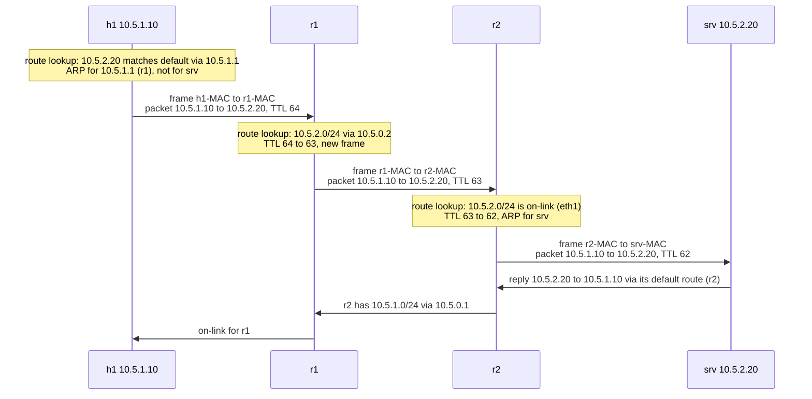
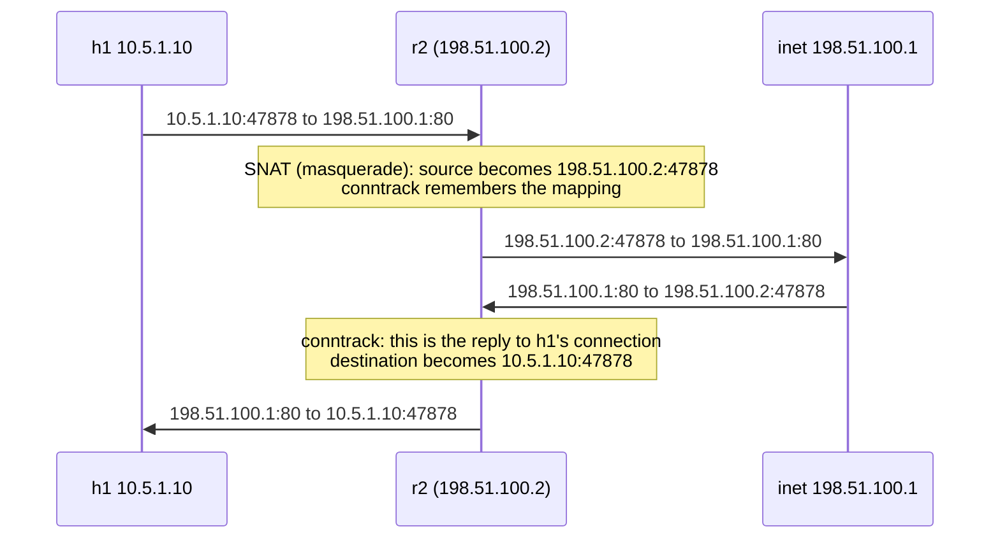

# Chapter 41: Routing and NAT

> **Exams:** CKNE · Foundations (Part V), supports D1 Core Infrastructure and CNI and D3 (Implementing Routing to Expose Networks; Configuring Egress Gateways for Cluster Exit Traffic)
> **Difficulty:** Beginner to intermediate
> **Time:** ~75 min reading, ~45 min lab
> **Lab tier:** 0 (netlab)
> **Prerequisites:** Chapter 40 (subnets, prefixes, connected routes)

## Learning objectives

After this chapter you can:

- Explain what a router does and how it differs from a switch
- Read a routing table and predict which route a packet takes (longest prefix match)
- Configure a default gateway and static routes with `ip route`
- Turn IP forwarding on, and explain why a route is needed in both directions
- Use `ping`, `ip route get`, and `traceroute` to find where a path breaks, and read the TTL
- Explain NAT: source NAT (masquerade) for outgoing traffic and destination NAT (port forwarding) for incoming traffic
- Configure both with `iptables` and inspect translated connections with `conntrack`

## Concepts

### Why routers exist

A switch (Chapter 39) connects hosts inside one broadcast domain. That cannot
scale to the whole internet: broadcasts would reach billions of hosts, and every
switch would have to learn every MAC address in the world.

So networks are kept small, one subnet each, and joined by **routers**. A
**router** is a device with interfaces on two or more networks that passes
packets from one to the next. Where a switch looks at MAC addresses inside one
network, a router looks at **IP addresses** to move packets *between* networks.
Switches work at layer 2, routers at layer 3.

Back to the postal analogy: the switch is the mail carrier on one street, who
knows every house. The router is the sorting office, which reads the city on
the envelope and puts the letter on the right truck.

Any Linux host can be a router: it only needs interfaces on several networks
and IP forwarding switched on. Every Kubernetes node is one, routing packets
between its Pods and the rest of the network.

### The routing table

Every host, not just routers, has a **routing table**: a list of rules that
says, for each destination, where to send the packet. You saw the simplest
entry in Chapter 40, the connected route that is created with an address:

```text
10.5.1.0/24 dev eth0 proto kernel scope link src 10.5.1.10
```

A route has a **destination** (a subnet) and tells the host one of two things:

- **On-link** (`dev eth0`, no `via`): the destination is directly on that
  interface. ARP for the destination itself and send the frame to it.
- **Via a gateway** (`via 10.5.1.1 dev eth0`): send the packet to that router,
  which is on-link, and let it take care of the rest. The host ARPs for the
  *router's* MAC address, not for the final destination.

A **gateway** (or **next hop**) is simply the router a route points to.

### Longest prefix match

A routing table can have several routes that match one destination. With
these routes:

```text
default via 10.5.0.2 dev eth1
10.5.0.0/24 dev eth1 proto kernel scope link src 10.5.0.1
10.5.1.0/24 dev eth0 proto kernel scope link src 10.5.1.1
10.5.2.0/24 via 10.5.0.2 dev eth1
```

a packet for `10.5.2.20` matches both `10.5.2.0/24` and `default`. The rule is:
**the most specific route wins**, the one with the longest prefix. `/24` is
longer than `/0`, so the packet goes via the `10.5.2.0/24` route. This is
called **longest prefix match**, and it is how every router on the internet
decides.

### The default route

`default` is shorthand for `0.0.0.0/0`, the route that matches every
address with a prefix of zero bits. Because it is the least specific route
possible, it is used only when nothing else matches: "if you don't know where
it goes, send it here". The router it points to is called the **default
gateway**.

Most hosts have exactly two routes: the connected route for their own subnet
and a default route to their router. Routers have more: routes to the subnets
behind other routers, plus a default route toward the internet.

### Forwarding

When a packet arrives at a Linux host that is not addressed to the host, the
host can either drop it or **forward** it, sending it out of another interface
according to its routing table. Linux drops by default. To make a host a
router, switch forwarding on:

```bash
sysctl -w net.ipv4.ip_forward=1
```

`sysctl` reads and writes kernel settings. A router with forwarding switched
off answers packets for its own addresses but silently drops everything else.
That is a nasty fault to debug, because nothing reports an error.

> **Why this matters for Kubernetes:** every node forwards packets between its
> Pods and the outside, so `net.ipv4.ip_forward` must be 1 on every node.
> kubeadm's preflight checks refuse to set up a node where it is not, and
> CNI plugins set it themselves.

### Routes must work in both directions

A conversation has two directions. For h1 to talk to srv, h1's packets must
find a way to srv, **and** srv's replies must find a way back to h1. Each
router along the way decides independently, based only on its own routing
table. A route on the way there does nothing for the way back.

The most common routing mistake is to fix one direction and forget the other.
The symptom: the request arrives (a capture on the destination shows it), but
no reply ever reaches the sender.

### TTL and traceroute

Every IP packet carries a **TTL** (time to live) field. The sender sets it,
usually to 64, and every router that forwards the packet subtracts one. A
router that receives a packet with TTL 1 drops it and sends an ICMP **time
exceeded** message back to the sender. This stops packets from circling
forever when routes form a loop.

You can read the TTL in `ping` replies. A reply with `ttl=62` started at 64
and crossed two routers on its way back.

`traceroute` turns this mechanism into a map. It sends packets with TTL 1,
then 2, then 3, and so on. Each router that drops one reveals itself by
sending "time exceeded", so the output lists every router (each **hop**) on
the path in order:

```text
traceroute to 10.5.2.20 (10.5.2.20), 30 hops max, 60 byte packets
 1  10.5.1.1  0.284 ms  0.251 ms  0.239 ms
 2  10.5.0.2  0.228 ms  0.206 ms  0.230 ms
 3  10.5.2.20  0.219 ms  0.200 ms  0.188 ms
```

Three probes are sent per hop, so each line has three times. A `*` instead of a
time means no answer came back for that probe.

### ICMP errors tell you who gave up

When a packet cannot be delivered, the device that gave up often says so with
an ICMP error. Reading who sent it tells you where the path broke:

| Message | Sent by | Meaning |
| --- | --- | --- |
| `connect: Network is unreachable` (printed locally) | your own host | Your host has no route at all |
| `From <router> Destination Net Unreachable` | a router on the way | That router has no route for the destination |
| `From <host> Destination Host Unreachable` | the last router (or your host) | The destination's subnet was reached, but nobody answered ARP |
| `Time to live exceeded` | a router | The TTL ran out: a routing loop, or traceroute |
| silence | nobody | Dropped somewhere quietly: forwarding off, a firewall, or no route back |

### Packet walk: through two routers

Here is a ping from h1 to srv in this chapter's lab, once all the routes are in
place. Watch which addresses change at each hop and which stay the same:



*Text description: h1 sends the packet to its default gateway r1. Each router looks up the destination in its own table, lowers the TTL by one, and puts the packet in a new frame with new source and destination MAC addresses. The IP addresses stay the same end to end. srv's reply travels back using srv's, r2's, and r1's own routes.*

This is the promise from Chapter 39 kept: the IP addresses stay the same end
to end, while the MAC addresses change at every hop, because each frame only
crosses one link.

### NAT: when private addresses meet the internet

Chapter 40 introduced private addresses. Private ranges are not routed on
the internet, and thousands of organizations use the same ones. A server on
the internet that receives a packet from `10.5.1.10` has no idea where to send
the answer, and should not: that address could be anyone's.

**Network Address Translation (NAT)** solves this by rewriting addresses
in packets as they pass through a router.

**Source NAT (SNAT)** rewrites the *source* address of outgoing packets. The
edge router replaces the private source `10.5.1.10` with its own public
address `198.51.100.2`. The internet server sees a packet from
`198.51.100.2`, which it can answer. When the reply comes back to the
router, the router reverses the translation and forwards it to `10.5.1.10`.
**Masquerade** is the common form of SNAT that uses whatever address the
outgoing interface has, so you do not have to type it.

This is how your home network reaches the internet: every device behind your
home router shares the router's one public address.

**Destination NAT (DNAT)** rewrites the *destination* address of incoming
packets. It publishes an internal server on the router's public address: "send
connections that arrive for `198.51.100.2` port 8080 to `10.5.2.20` port 80".
This is also called **port forwarding**.

To reverse a translation, the router has to remember it. Linux's **connection
tracking** (**conntrack**) records every connection that passes through: its
original addresses and ports, and what they were translated to. The
`conntrack -L` command lists the table. Chapter 46 covers conntrack and the
firewall machinery behind NAT in depth.



*Text description: h1's packet leaves r2 with r2's public address as its source. inet replies to that public address, and r2 uses its connection-tracking table to translate the reply's destination back to h1.*

### iptables in two rules

Linux configures NAT through its packet filtering framework, **netfilter**,
most often with the `iptables` command. Chapter 46 explains it properly; for
now, two rules are enough:

```bash
# SNAT: packets leaving through eth2 get eth2's address as their source
iptables -t nat -A POSTROUTING -o eth2 -j MASQUERADE

# DNAT: TCP packets arriving on eth2 for port 8080 go to 10.5.2.20, port 80
iptables -t nat -A PREROUTING -i eth2 -p tcp --dport 8080 -j DNAT --to-destination 10.5.2.20:80
```

- `-t nat` works on the NAT table.
- `-A POSTROUTING` adds the rule to the chain that runs just before a packet
  leaves the host, after the routing decision, which is where the source is changed.
- `-A PREROUTING` adds the rule to the chain that runs as soon as a packet
  arrives, before routing, which is where the destination must be changed
  so that routing sends the packet to its new destination.
- `-o eth2` / `-i eth2` limit the rule to packets leaving or arriving on `eth2`.
- `-j` ("jump") says what to do with a matching packet.

Only the first packet of each connection goes through these rules. conntrack
applies the same translation to every later packet of that connection.

> **Why this matters for Kubernetes:** NAT is everywhere in Kubernetes.
> A Service's virtual IP is DNAT: kube-proxy rewrites packets for the Service
> address to the address of one of its Pods (Chapter 54). Pods reach the
> internet through SNAT on their node. An **egress gateway** (Chapter 60) is a
> deliberately chosen SNAT point, so that traffic leaving the cluster comes
> from a known, fixed address. When Pods on different nodes talk *without*
> NAT, routes must exist in both directions, which is the CKNE competency
> "implementing routing to expose networks" (Chapter 59).

## Guided walkthrough

Start the lab and open a lab shell:

```bash
make lab CH=41
make shell
topo
```

```text
Chapter 41 lab: two private LANs, two routers, and "the internet"

  office LAN 10.5.1.0/24    transit 10.5.0.0/24    server LAN 10.5.2.0/24
  h1 ----------------- r1 ------------------- r2 ------------------ srv
  .10            eth0  .1   eth1 .1      eth0 .2   eth1 .1            .20
                                                  |eth2 198.51.100.2
                                                  |   "the internet"
                                                  |   198.51.100.0/24
                                                 inet 198.51.100.1
  Web servers on port 80: srv and inet.
  inet only knows its own subnet: it has no routes to any 10.x network.
```

(`198.51.100.0/24` is a range reserved for documentation, used here to
play a public internet address.)

This walkthrough fixes the first two lab tasks, so you can see each kind of
failure. The lab then asks you to do it all again from a fresh start.

### Step 1: Read the routing tables

```bash
on h1 ip route
on r1 ip route
```

```text
10.5.1.0/24 dev eth0 proto kernel scope link src 10.5.1.10
10.5.0.0/24 dev eth1 proto kernel scope link src 10.5.0.1
10.5.1.0/24 dev eth0 proto kernel scope link src 10.5.1.1
```

h1 knows only its own subnet. r1 knows its two connected subnets and nothing
beyond them. Compare r2, which is already configured:

```bash
on r2 ip route
```

```text
default via 198.51.100.1 dev eth2
10.5.0.0/24 dev eth0 proto kernel scope link src 10.5.0.2
10.5.1.0/24 via 10.5.0.1 dev eth0
10.5.2.0/24 dev eth1 proto kernel scope link src 10.5.2.1
198.51.100.0/24 dev eth2 proto kernel scope link src 198.51.100.2
```

### Step 2: Give h1 a default gateway

```bash
on h1 ping -c 1 10.5.0.1
```

```text
ping: connect: Network is unreachable
```

h1's own kernel refuses: no route matches `10.5.0.1`. h1's router is r1, at
`10.5.1.1` on h1's subnet:

```bash
on h1 ip route add default via 10.5.1.1
on h1 ip route
on h1 ping -c 1 10.5.0.1
```

```text
default via 10.5.1.1 dev eth0
10.5.1.0/24 dev eth0 proto kernel scope link src 10.5.1.10
64 bytes from 10.5.0.1: icmp_seq=1 ttl=64 time=0.633 ms
```

`10.5.0.1` is r1's own address, so r1 answers without forwarding anything.

### Step 3: Find a router that does not forward

```bash
on h1 ping -c 2 -W 1 10.5.2.20
```

```text
PING 10.5.2.20 (10.5.2.20) 56(84) bytes of data.

--- 10.5.2.20 ping statistics ---
2 packets transmitted, 0 received, 100% packet loss, time 1012ms
```

Silence: no error from anyone. The packet reaches r1 (h1's default gateway),
and r1 drops it without a word. Check r1's forwarding setting:

```bash
on r1 sysctl net.ipv4.ip_forward
on r1 sysctl -w net.ipv4.ip_forward=1
```

```text
net.ipv4.ip_forward = 0
net.ipv4.ip_forward = 1
```

### Step 4: Find a missing route

```bash
on h1 ping -c 2 -W 1 10.5.2.20
```

```text
From 10.5.1.1 icmp_seq=1 Destination Net Unreachable
From 10.5.1.1 icmp_seq=2 Destination Net Unreachable
```

Progress: now r1 forwards, and it tells you (`From 10.5.1.1`) that it has no
route for the destination's network. The next router toward `10.5.2.0/24` is
r2, at `10.5.0.2`:

```bash
on r1 ip route add 10.5.2.0/24 via 10.5.0.2
on h1 ping -c 2 10.5.2.20
```

```text
64 bytes from 10.5.2.20: icmp_seq=1 ttl=62 time=0.060 ms
64 bytes from 10.5.2.20: icmp_seq=2 ttl=62 time=0.082 ms
```

`ttl=62`: srv's reply started at 64 and crossed two routers. The way back
worked without any change, because srv's default route points to r2, and r2
already has a route to `10.5.1.0/24` via r1.

### Step 5: Ask the routing table directly

`ip route get <address>` asks a host's routing table which route it would
use, without sending anything:

```bash
on h1 ip route get 10.5.2.20
on r1 ip route get 10.5.2.20
```

```text
10.5.2.20 via 10.5.1.1 dev eth0 src 10.5.1.10 uid 0
    cache
10.5.2.20 via 10.5.0.2 dev eth1 src 10.5.0.1 uid 0
    cache
```

Asking each hop in turn like this is the fastest way to find a missing or
wrong route.

### Step 6: Trace the path

```bash
on h1 traceroute -n 10.5.2.20
```

```text
traceroute to 10.5.2.20 (10.5.2.20), 30 hops max, 60 byte packets
 1  10.5.1.1  0.284 ms  0.251 ms  0.239 ms
 2  10.5.0.2  0.228 ms  0.206 ms  0.230 ms
 3  10.5.2.20  0.219 ms  0.200 ms  0.188 ms
```

Two routers, then the destination. `-n` skips name lookups, as with `tcpdump`.
`curl http://10.5.2.20/` from h1 now returns srv's page.

### Step 7: Why private addresses cannot reach the internet

The rest is for the lab, but look at the problem first. Suppose r1 had a
default route to r2, so h1's packets could reach inet. inet would receive
something like this (a capture on inet):

```text
12:20:40.043275 IP 10.5.1.10.47878 > 198.51.100.1.80: Flags [S], seq 2602331658, win 64240, length 0
12:20:41.047160 IP 10.5.1.10.47878 > 198.51.100.1.80: Flags [S], seq 2602331658, win 64240, length 0
```

The connection request arrives from `10.5.1.10` and is repeated, but never
answered: inet has no route to a private address. After the masquerade rule
on r2 (Task 3), the same capture shows:

```text
12:20:45.588404 IP 198.51.100.2.34294 > 198.51.100.1.80: Flags [S], seq 2404542888, win 64240, length 0
12:20:45.588437 IP 198.51.100.1.80 > 198.51.100.2.34294: Flags [S.], seq 1841196711, ack 2404542889, win 65160, length 0
12:20:45.588482 IP 198.51.100.2.34294 > 198.51.100.1.80: Flags [.], ack 1, win 63, length 0
```

The source is now r2's public address, and inet answers. On r2,
`conntrack -L` shows each translation, original direction first:

```text
tcp      6 117 TIME_WAIT src=10.5.1.10 dst=198.51.100.1 sport=34294 dport=80 src=198.51.100.1 dst=198.51.100.2 sport=80 dport=34294 [ASSURED] mark=0 use=1
```

Read it as two halves: the connection as h1 sent it
(`src=10.5.1.10 dst=198.51.100.1`), and the reply r2 expects
(`src=198.51.100.1 dst=198.51.100.2`). The difference between the two is the
translation.

### Useful commands from this chapter

| Command | Shows or does |
| --- | --- |
| `ip route` | the routing table |
| `ip route add default via <gw>` | set the default gateway |
| `ip route add <subnet> via <gw>` | add a static route |
| `ip route del <subnet>` | remove a route |
| `ip route get <address>` | which route would be used |
| `sysctl net.ipv4.ip_forward` | is forwarding on (1) or off (0) |
| `traceroute -n <address>` | list the routers on the path |
| `iptables -t nat -L -n -v` | list NAT rules with packet counters |
| `iptables -t nat -A POSTROUTING -o <if> -j MASQUERADE` | SNAT leaving through `<if>` |
| `conntrack -L` | the connection-tracking table |

## Hands-on lab

Start (or restart) the lab and open a lab shell:

```bash
make reset CH=41
make shell
```

Run all commands in the lab shell; type `make check CH=41` on your machine after each task. Do not change any IP address, and do not add routes on `inet`: the internet never learns your private networks. Solutions: `chapters/41-routing-and-nat/lab/solutions.md`.

### Task 1: Give h1 a way out

`h1` can only reach its own subnet. Fix that, so it can reach the rest of the network through its router.

- `h1` can ping `10.5.0.1` (r1's interface on the transit network)

### Task 2: Reach the server LAN

Make the web server on `srv` reachable from `h1`.

- `h1` can fetch `http://10.5.2.20/`

### Task 3: Reach the internet

Make the web server on `inet` reachable from both private LANs.

- `h1` can fetch `http://198.51.100.1/`
- `srv` can fetch `http://198.51.100.1/`
- `inet` has no routes to any `10.x` network

### Task 4: Publish srv on the internet

Make srv's web server reachable from the internet at r2's public address, on port 8080.

- `inet` gets srv's page from `http://198.51.100.2:8080/`
- `inet` has no routes to any `10.x` network

## Exam tips

> **Exam tip:** When a path is broken, `ip route get <destination>` on each
> hop, starting from the source, finds the bad hop in a few commands. Then
> check the same in the reverse direction from the destination.

> **Exam tip:** Read ICMP errors for *who* sent them. `From 10.5.1.1 ...
> Destination Net Unreachable` points straight at the router at `10.5.1.1`.
> Silence means look for forwarding switched off, a firewall, or a missing
> route back.

> **Exam tip:** On a Kubernetes node, `ip route` shows how Pods are reached:
> a route per Pod (`10.244.1.5 dev lxc...` with Cilium), a route per remote
> node's Pod subnet (`10.244.2.0/24 via <node-ip>` in routed mode), or one
> route into a tunnel device in overlay mode.

## Common mistakes

- **Pointing a route at an address that is not on-link.** The `via` address
  must be in one of the host's own connected subnets. h1 cannot use
  `via 10.5.0.2`, because h1 cannot ARP for it.
- **Forgetting the way back.** Every router on the return path needs a route
  to the source's subnet too.
- **Forgetting forwarding.** A Linux router with `ip_forward=0` drops transit
  packets silently.
- **NAT on the wrong interface.** Masquerade on the *outgoing* interface toward
  the internet (`-o eth2`). Masquerading on an internal interface rewrites
  traffic that should keep its real source address.
- **Fixing the internet instead of the edge.** Adding a route on `inet` makes
  the lab work and teaches the wrong lesson. Real internet routers never learn
  your private ranges.

<!-- QUESTIONS:START -->

## End-of-chapter questions

**1.** What is the main difference between a switch and a router?

- **A.** A switch is hardware, a router is software
- **B.** A switch forwards frames by MAC address inside one network; a router forwards packets by IP address between networks
- **C.** A router only works with Wi-Fi
- **D.** A switch can connect to the internet, a router cannot

**2.** A host has the routes `default via 10.5.0.2`, `10.5.0.0/16 via 10.5.0.3`, and `10.5.2.0/24 via 10.5.0.4`. Which gateway does a packet for `10.5.2.20` use?

- **A.** 10.5.0.2
- **B.** 10.5.0.3
- **C.** 10.5.0.4
- **D.** It is sent to all three

**3.** What does the route `default via 10.5.1.1 dev eth0` mean?

- **A.** Only traffic for 10.5.1.1 goes out of eth0
- **B.** Any destination that matches no other route is sent to the router 10.5.1.1 on eth0
- **C.** 10.5.1.1 is the host's own address
- **D.** eth0 is disabled by default

**4.** h1 pings srv through router r1. The ping gets no answer and no error message. On r1, `sysctl net.ipv4.ip_forward` prints 0. What is happening?

- **A.** r1 is forwarding, but srv is down
- **B.** r1 drops every packet that is not addressed to r1 itself, without reporting an error
- **C.** r1 has no IP address
- **D.** h1 has no default route

**5.** `ping` prints `From 10.5.1.1 icmp_seq=1 Destination Net Unreachable`. What does that tell you?

- **A.** Your own host has no route
- **B.** The router 10.5.1.1 received the packet but has no route to the destination's network
- **C.** The destination host is down
- **D.** The packet's TTL ran out

**6.** A capture on srv shows ping requests from h1 arriving, but h1 never receives a reply. Which is the most likely cause?

- **A.** h1 has no default route
- **B.** A router on the return path has no route back to h1's subnet
- **C.** srv's MTU is too large
- **D.** The switch is not learning MAC addresses

**7.** A ping reply shows `ttl=61`. If the replying host started with TTL 64, how many routers did the reply cross?

- **A.** 1
- **B.** 3
- **C.** 61
- **D.** 64

**8.** How does traceroute discover the routers on a path?

- **A.** It asks each router for its routing table
- **B.** It sends packets with TTL 1, 2, 3, ...; each router that drops one because its TTL ran out replies with ICMP time exceeded, revealing itself
- **C.** It reads the MAC addresses of every hop
- **D.** It uses DNS to look up each router

**9.** As a packet travels from h1 through two routers to srv, which addresses change at every hop?

- **A.** The source and destination IP addresses
- **B.** The source and destination MAC addresses
- **C.** Both the IP and MAC addresses
- **D.** Nothing changes

**10.** `CKNE` Hosts with private addresses reach an internet server through an edge router. What does masquerade (source NAT) on the router's internet interface do?

- **A.** It encrypts the packets
- **B.** It replaces the private source address with the router's public address, and translates replies back using connection tracking
- **C.** It adds a route for the private network on the internet server
- **D.** It changes the destination address of incoming connections

**11.** `CKNE` Why are DNAT rules placed in the PREROUTING chain?

- **A.** Because PREROUTING runs after the packet has left the host
- **B.** Because the destination must be changed before the routing decision, so that routing sends the packet toward its new destination
- **C.** Because only PREROUTING can match TCP ports
- **D.** It is an arbitrary convention

**12.** `CKNE` Which Kubernetes mechanism is an example of destination NAT?

- **A.** A Pod reaching the internet through its node's address
- **B.** kube-proxy rewriting packets sent to a Service's virtual IP so they go to one of the Service's Pods
- **C.** CoreDNS answering a query
- **D.** A NetworkPolicy blocking traffic

**13.** Which command shows which route a host would use for `10.5.2.20`, without sending a packet?

- **A.** ip route show 10.5.2.20
- **B.** ip route get 10.5.2.20
- **C.** traceroute 10.5.2.20
- **D.** ip neigh 10.5.2.20

<details>
<summary>Answers</summary>

**1. B.** Switches work at layer 2 within one broadcast domain. Routers work at layer 3 and connect different subnets. Any Linux host with interfaces on several networks and forwarding switched on is a router.

**2. C.** All three routes match, and the longest prefix wins: /24 beats /16, which beats /0 (default).

**3. B.** default is 0.0.0.0/0: it matches every address but has the shortest possible prefix, so it is used only when nothing more specific matches. 10.5.1.1 is the default gateway and must be on-link.

**4. B.** With forwarding off, a Linux host answers packets for its own addresses but silently drops transit packets. h1 does have a route (otherwise it would print Network is unreachable locally).

**5. B.** The From address says which device gave up. Net Unreachable from a router means that router's routing table has no match for the destination. A missing local route is printed as connect: Network is unreachable without a From line.

**6. B.** The request got there, so the forward path works. Each router decides independently, so the reply needs its own route back. Missing return routes are the most common routing mistake.

**7. B.** Every router lowers the TTL by one: 64 - 61 = 3 routers.

**8. B.** A router that receives a packet with TTL 1 drops it and sends time exceeded back. Increasing the starting TTL by one each round makes each hop in turn reveal itself.

**9. B.** Each frame crosses only one link, so each router builds a new frame with new MAC addresses. Without NAT, the IP addresses stay the same end to end (only the TTL goes down).

**10. B.** SNAT rewrites the source of outgoing packets so that the server can reply to a reachable address. conntrack remembers each mapping to reverse it for the reply. Changing the destination of incoming traffic is DNAT.

**11. B.** Routing decides where a packet goes from its destination address. If DNAT ran after routing, the packet would already be headed to the old destination. SNAT goes in POSTROUTING, after routing has chosen the outgoing interface.

**12. B.** A Service's ClusterIP is not assigned to any interface. kube-proxy (or an eBPF replacement) DNATs connections for it to a Pod's address and port. Pods reaching the internet through their node is SNAT.

**13. B.** ip route get performs the routing lookup and prints the result: gateway, interface, and source address. ip route show only lists routes; traceroute sends probes.

</details>

<!-- QUESTIONS:END -->

## Further reading

- `man ip-route` and `man iptables-extensions` (MASQUERADE, DNAT) in the lab shell
- RFC 1812, *Requirements for IP Version 4 Routers*: what a router must do with TTL and ICMP
- RFC 5737, *IPv4 Address Blocks Reserved for Documentation* (the `198.51.100.0/24` used in this lab)
