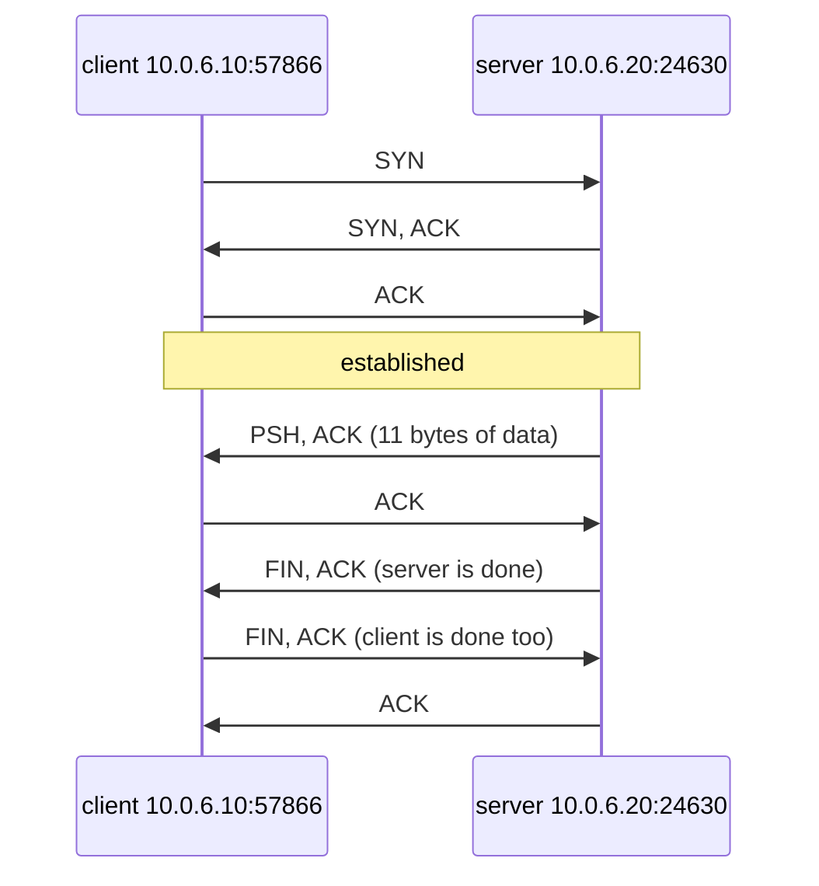

# Chapter 42: TCP, UDP, ports, and sockets

> **Exams:** CKNE · Foundations (Part V), supports D2 (Configuring L4 Services; Troubleshooting Service Network Traffic)
> **Difficulty:** Beginner to intermediate
> **Time:** ~60 min reading, ~40 min lab
> **Lab tier:** 0 (netlab)
> **Prerequisites:** Chapter 41 (routing; the idea of a connection in conntrack)

## Learning objectives

After this chapter you can:

- Explain what ports are for and what a socket is
- Compare TCP and UDP and say which applications use which
- Describe the TCP three-way handshake and the way a connection closes, and recognize both in a capture
- Read TCP flags (`S`, `S.`, `.`, `P.`, `F.`, `R`) in `tcpdump` output
- List listening and connected sockets with `ss`, including the process that owns them
- Tell "connection refused" from "connection timed out", and explain what causes each
- Connect to TCP and UDP services by hand with `nc`

## Concepts

### Ports: which program gets the data

IP gets a packet to the right host. But a host runs many programs that use
the network at the same time: a web server, an SSH server, a database, a
browser with twenty tabs. When a packet arrives, the kernel has to decide which
program it is for.

That is the job of the transport layer (layer 4) and its **port numbers**. A
port is a 16-bit number, from 0 to 65535, carried in the transport header of
every packet. Each packet has two: a **source port** and a **destination port**.

- A server program asks the kernel to **listen** on a fixed, agreed port,
  such as 80 for HTTP or 22 for SSH, so clients know where to find it.
- A client program does not care which port it uses. The kernel gives it a
  random free port from the **ephemeral port range** (32768 to 60999 on Linux)
  for each new connection. You saw this in Chapter 38: curl used port 59826.

Ports below 1024 are **well-known ports**. On Linux, only root can listen on
them by default. Some you will meet often:

| Port | Protocol | Service |
| --- | --- | --- |
| 22 | TCP | SSH |
| 53 | UDP and TCP | DNS |
| 80 | TCP | HTTP |
| 443 | TCP (and UDP for HTTP/3) | HTTPS |
| 2379-2380 | TCP | etcd (Kubernetes' database) |
| 6443 | TCP | Kubernetes API server |
| 10250 | TCP | kubelet |
| 4789 | UDP | VXLAN overlays (Chapter 45) |
| 30000-32767 | TCP and UDP | Kubernetes NodePort Services (Chapter 53) |

### Sockets

A **socket** is the kernel's handle for one end of network communication.
Programs never touch packets; they open a socket, and read from and write to it
like a file, while the kernel does the rest.

A socket is identified by an address and a port: `10.0.6.20:8080`. A TCP
connection is identified by both ends, four values in total, called the
**4-tuple**: source address, source port, destination address, destination
port. That is why one web server on port 80 can serve thousands of clients at
once: every connection has a different client address or client port, so every
4-tuple is unique. (Add the protocol, TCP or UDP, and you get the
**5-tuple** that conntrack and many load balancers use.)

The address a server listens on matters:

- **`0.0.0.0:80`** means "port 80 on every address this host has". This is
  what you usually want. (`[::]:80` is the IPv6 equivalent.)
- **`10.0.6.20:80`** means "only on this one address".
- **`127.0.0.1:80`** means "only on the loopback address". Only programs on the
  same host can connect; to everyone else, nothing is listening.

### Two transport protocols

The internet has two main transport protocols, and they make opposite choices.

**TCP** (Transmission Control Protocol) provides a reliable, ordered stream of
bytes:

- It sets up a **connection** before any data flows, and tears it down at the end.
- It numbers every byte (**sequence numbers**). The receiver confirms what it
  got (**acknowledgements**), and the sender resends anything that is not
  confirmed in time.
- It delivers the data in order, without gaps or duplicates.
- It slows down when the network is congested.

**UDP** (User Datagram Protocol) is almost nothing on top of IP: ports and a
checksum. Each message (**datagram**) is sent on its own, with no connection,
no acknowledgements, no resending, and no ordering. If a datagram is lost, it is
gone, and only the application can notice.

Why would anyone choose UDP? Because it is fast and simple. A DNS query is one
small question and one small answer. Setting up a TCP connection first would
take longer than the query itself, and if the answer is lost, the client asks
again. Video calls and games prefer a late packet to be lost rather than
delivered late. And newer protocols, such as QUIC under HTTP/3, build their own
reliability on top of UDP.

| | TCP | UDP |
| --- | --- | --- |
| Connection | yes (handshake) | no |
| Reliable, ordered | yes | no |
| Unit | byte stream | separate datagrams |
| Typical uses | HTTP, HTTPS, SSH, databases, Kubernetes API | DNS, VXLAN, video, games, QUIC |

### The three-way handshake

Before a TCP connection carries data, the two sides exchange three packets,
using **flags** in the TCP header:

1. **SYN** (synchronize): the client says "I want to connect; my sequence numbers start here".
2. **SYN-ACK**: the server says "OK; I acknowledge yours, and mine start here".
3. **ACK**: the client acknowledges the server's numbers. The connection is
   now **established**, and either side may send data.

Closing takes a **FIN** (finish) from each side, each acknowledged by the
other. A side that wants to abort a connection, or refuse one, sends a
**RST** (reset) instead.



*Text description: the client sends SYN, the server answers SYN-ACK, and the client ACKs; the connection is established. The server sends data, the client acknowledges it, and then each side sends a FIN, which the other acknowledges.*

`tcpdump` prints the flags in brackets, with a dot meaning ACK:

| tcpdump | Flags | Meaning |
| --- | --- | --- |
| `[S]` | SYN | connection request |
| `[S.]` | SYN + ACK | connection accepted |
| `[.]` | ACK | acknowledgement (often with no data) |
| `[P.]` | PSH + ACK | data, "push it to the application now" |
| `[F.]` | FIN + ACK | "I am done sending" |
| `[R]` or `[R.]` | RST | refused or aborted |

### Refused versus timed out

When a TCP connection fails, *how* it fails tells you where to look.

- **Connection refused**: the SYN reached the host, and the host answered
  with a RST. Either nothing listens on that address and port, or a
  firewall rule actively rejects it. You get the answer instantly.
- **Connection timed out**: no answer came back at all. The client resends
  the SYN a few times and gives up after seconds or minutes. The SYN, or the
  answer, was lost on the way: a missing route, a host that is down, or a
  firewall rule that silently **drops** packets.

`curl` shows the difference in its exit code and message: exit code 7
("Failed to connect ... Could not connect to server") for refused, exit code 28
("Connection timed out") for a timeout.

Firewalls can be configured either way. A **DROP** rule discards packets
without a word; a **REJECT** rule answers them. Dropping makes a host look
dead to scanners but leaves legitimate clients hanging. Rejecting gives clients
a quick, clear answer.

### Socket states

`ss` shows each TCP socket's state. The ones you will see most:

| State | Meaning |
| --- | --- |
| `LISTEN` | a server waiting for connections |
| `SYN-SENT` | a client has sent SYN and waits for an answer (stuck here means no answer) |
| `ESTAB` | an established connection |
| `FIN-WAIT-1`, `FIN-WAIT-2` | this side has closed and waits for the other |
| `CLOSE-WAIT` | the other side has closed; this side has not yet |
| `TIME-WAIT` | closed; kept for about a minute so late packets are not mistaken for a new connection |

UDP sockets have no connections, so a bound UDP socket shows as `UNCONN`.

> **Why this matters for Kubernetes:** a Kubernetes Service (Chapter 53) is an
> **L4** load balancer: it works on these 5-tuples, sending each new TCP
> connection or UDP flow to one backend Pod. Its `port`, `targetPort`, and
> `protocol` fields are exactly this chapter's concepts. And the classic
> Kubernetes networking bug is in this chapter's lab: an application that
> listens on `127.0.0.1` inside its Pod, so its Service gets "connection
> refused" while `curl localhost` inside the Pod works perfectly.

## Guided walkthrough

Start the lab and open a lab shell:

```bash
make lab CH=42
make shell
topo
```

```text
Chapter 42 lab: a client and a busy server

     client                                   server
   10.0.6.10  eth0 ======================= eth0  10.0.6.20
                                  services: a TCP greeter (port ?)
                                            a UDP pinger  (port ?)
                                            an app on 9090
                                            an old web service on 8081
```

The greeter and pinger ports are random each time the lab is set up, so yours
differ from the ones below.

### Step 1: List listening sockets

```bash
on server ss -ltn
```

```text
State  Recv-Q Send-Q Local Address:Port  Peer Address:Port
LISTEN 0      5            0.0.0.0:24630      0.0.0.0:*
LISTEN 0      5          127.0.0.1:9090       0.0.0.0:*
LISTEN 0      5            0.0.0.0:8081       0.0.0.0:*
```

- `-l`: only listening sockets; `-t`: TCP; `-n`: numbers, not names.
- `Local Address:Port` is where the server listens. Two sockets listen on every
  address (`0.0.0.0`); one listens only on loopback (`127.0.0.1:9090`).
- `Peer Address:Port` is `*` for a listener: it accepts anyone.

Add `-p` to see which program owns each socket:

```bash
on server ss -ltnp
```

```text
State  Recv-Q Send-Q Local Address:Port  Peer Address:PortProcess
LISTEN 0      5            0.0.0.0:24630      0.0.0.0:*    users:(("socat",pid=29,fd=5))
LISTEN 0      5          127.0.0.1:9090       0.0.0.0:*    users:(("python3",pid=32,fd=3))
LISTEN 0      5            0.0.0.0:8081       0.0.0.0:*    users:(("python3",pid=34,fd=3))
```

`-u` instead of `-t` lists UDP sockets:

```bash
on server ss -lun
```

```text
State  Recv-Q Send-Q Local Address:Port  Peer Address:Port
UNCONN 0      0            0.0.0.0:47687      0.0.0.0:*
```

`ss -ltunp` lists both at once. On older systems, `netstat -tulpn` does the
same job; `ss` is its modern replacement.

### Step 2: Talk to a TCP service by hand

`nc` (netcat) opens a connection and connects your terminal to it: what you
type is sent, and what comes back is printed. It is the universal tool for
testing a port.

```bash
on client nc -w 2 10.0.6.20 24630
```

```text
tcp-a5mkal
```

The greeter sends a code word and closes the connection. `-w 2` gives up after
two seconds of silence. To only test whether a port accepts connections,
without sending anything, use `nc -z -v`:

```bash
on client nc -z -v -w 2 10.0.6.20 24630
```

### Step 3: Talk to a UDP service

Add `-u` for UDP. Since UDP has no connection, nothing happens until you send
a datagram:

```bash
echo hi | on client nc -u -w 1 10.0.6.20 47687
```

```text
pong
```

If nothing listens on a UDP port, there is no RST to send. The host may send
an ICMP "port unreachable" message instead, or nothing at all, so a UDP test
that gets no answer proves less than a TCP test does.

### Step 4: Watch a connection from start to end

In a second lab shell, capture the greeter's traffic (use your port number):

```bash
on server tcpdump -i eth0 -n tcp port 24630
```

Connect again from the first shell with `nc`. The capture shows the whole life
of a connection:

```text
12:25:43.695508 IP 10.0.6.10.57866 > 10.0.6.20.24630: Flags [S], seq 701008772, win 64240, length 0
12:25:43.695538 IP 10.0.6.20.24630 > 10.0.6.10.57866: Flags [S.], seq 3278265693, ack 701008773, win 65160, length 0
12:25:43.695549 IP 10.0.6.10.57866 > 10.0.6.20.24630: Flags [.], ack 1, win 63, length 0
12:25:43.696928 IP 10.0.6.20.24630 > 10.0.6.10.57866: Flags [P.], seq 1:12, ack 1, win 64, length 11
12:25:43.696988 IP 10.0.6.10.57866 > 10.0.6.20.24630: Flags [.], ack 12, win 63, length 0
12:25:43.697248 IP 10.0.6.20.24630 > 10.0.6.10.57866: Flags [F.], seq 12, ack 1, win 64, length 0
12:25:43.697314 IP 10.0.6.10.57866 > 10.0.6.20.24630: Flags [F.], seq 1, ack 13, win 63, length 0
12:25:43.697346 IP 10.0.6.20.24630 > 10.0.6.10.57866: Flags [.], ack 2, win 64, length 0
```

(The `options [...]` part of each line is trimmed here.)

- Lines 1 to 3: the handshake, `[S]`, `[S.]`, `[.]`.
- Line 4: 11 bytes of data from the server (`length 11`): the code word and a
  newline. `seq 1:12` numbers those bytes (tcpdump shows sequence numbers
  relative to the start of the connection).
- Line 5: the client acknowledges them: `ack 12`, "I have everything up to byte 12".
- Lines 6 to 8: each side sends a FIN, and the other acknowledges it.

### Step 5: See a connection refused

The app on port 9090 works from the server itself:

```bash
on server curl http://127.0.0.1:9090/
```

```text
hello from app
```

But not from the client:

```bash
on client curl http://10.0.6.20:9090/
```

```text
curl: (7) Failed to connect to 10.0.6.20 port 9090 after 0 ms: Could not connect to server
```

A capture on the server shows why:

```text
12:25:40.479555 IP 10.0.6.10.35500 > 10.0.6.20.9090: Flags [S], seq 3918576719, win 64240, length 0
12:25:40.479585 IP 10.0.6.20.9090 > 10.0.6.10.35500: Flags [R.], seq 0, ack 3918576720, win 0, length 0
```

The SYN arrives at `10.0.6.20:9090`, but the app listens only on
`127.0.0.1:9090`, so the kernel finds no socket for that address and answers
with a reset `[R.]`. Fast and clear: refused.

### Step 6: See a connection time out

```bash
time on client curl --max-time 5 http://10.0.6.20:8081/
```

```text
curl: (28) Connection timed out after 5002 milliseconds

real	0m5.022s
```

A service listens on 8081 (Step 1 showed it), yet nothing comes back. Look at
the server's firewall rules:

```bash
on server iptables -L INPUT -n -v
```

```text
Chain INPUT (policy ACCEPT 42 packets, 3730 bytes)
 pkts bytes target     prot opt in     out     source               destination
    5   300 DROP       tcp  --  *      *       0.0.0.0/0            0.0.0.0/0            tcp dpt:8081
```

A DROP rule for TCP port 8081 discards every SYN; the `pkts` counter shows how
many it has eaten. Chapter 46 covers firewall rules. For Task 4, you only need
to know that `-R INPUT 1` replaces rule number 1 and `-D INPUT 1` deletes it.

### Step 7: Read socket states

With a connection open, `ss -tn` (without `-l`) lists connected sockets. For an
`nc` connection from the client to a listener on port 7000:

```text
State Recv-Q Send-Q Local Address:Port  Peer Address:Port
ESTAB 0      0          10.0.6.10:34440    10.0.6.20:7000
```

After connections close, the side that closed first keeps them in `TIME-WAIT`
for a minute (`ss -tan` shows all states):

```text
TIME-WAIT 0      0          10.0.6.20:24630    10.0.6.10:57866
```

`ss` can also filter: `ss -tn state established '( dport = :443 )'` shows
only established connections to port 443.

## Hands-on lab

Start (or restart) the lab and open a lab shell:

```bash
make reset CH=42
make shell
```

Run all commands in the lab shell; type `make check CH=42` on your machine after each task. Answer files go in `/root/answers/42/`. Solutions: `chapters/42-tcp-udp-ports/lab/solutions.md`.

### Task 1: Find the greeter

The server runs a TCP service on a port nobody wrote down. When you connect, it greets you with a code word. Find it.

- File: `/root/answers/42/greeting`
- Content: the code word the service sends

### Task 2: Find the UDP service

The server also runs a UDP service. Find its port.

- File: `/root/answers/42/udp-port`
- Content: the port number only

### Task 3: Make the app reachable

The app on port 9090 works on the server itself, but the client gets "connection refused". Make it reachable from the client.

- The client can fetch `http://10.0.6.20:9090/` and gets the app's page (`hello from app`)

Note: the app is a Python web server serving `/srv/app`. A process you start in the lab shell with `nohup <command> &` keeps running after you close the shell.

### Task 4: Fail fast

The old service on port 8081 is retired, but clients that still try it hang until they time out. Make the server refuse those connections immediately instead.

- A connection from the client to `10.0.6.20:8081` is refused at once (curl exit code 7), not timed out

## Exam tips

> **Exam tip:** "Connection refused" means you reached the host: check that
> the process is running and listening on the right address and port
> (`ss -ltnp`). "Timed out" means packets are lost on the way: check routes,
> firewall rules, and network policies.

> **Exam tip:** Many container images ship without `ss` or `netstat`. On a
> Kubernetes node you can run `ss` inside a Pod's network namespace without
> entering the container, with `nsenter -t <pid> -n ss -ltnp` (Chapter 52).

> **Exam tip:** When a Service gets "connection refused" but the Pod looks
> healthy, check what address the application inside listens on.
> `127.0.0.1` is reachable only from inside the Pod.

## Common mistakes

- **Testing a UDP service like a TCP one.** No answer from a UDP port does not
  prove it is closed, and an open UDP port may answer nothing until it gets
  the request it expects.
- **Confusing the client's port with the server's.** In
  `10.0.6.10.57866 > 10.0.6.20.24630`, the server's port is 24630; 57866 is
  the client's random ephemeral port, different for every connection.
- **Restarting a service on the same port without stopping the old one.**
  The new process fails with "Address already in use". Find the old one with
  `ss -ltnp` first.
- **Starting a background process that dies with the shell.** A plain
  `command &` may be killed when you close the terminal; use `nohup` (or a
  service manager on real servers).

<!-- QUESTIONS:START -->

## End-of-chapter questions

**1.** What does a port number identify?

- **A.** Which host on the network receives a packet
- **B.** Which program (socket) on a host receives the data
- **C.** Which interface the packet leaves through
- **D.** Which router forwards the packet

**2.** A web server on port 80 serves thousands of clients at once. How does the kernel keep their connections apart?

- **A.** Each client gets a different server port
- **B.** Each connection is identified by its 4-tuple (source address, source port, destination address, destination port), which is unique per connection
- **C.** Only one client can connect at a time
- **D.** By the clients' MAC addresses

**3.** Why does DNS normally use UDP rather than TCP?

- **A.** UDP is encrypted
- **B.** A query is one small question and one small answer; setting up a TCP connection would cost more than the query, and the client can simply ask again if the answer is lost
- **C.** TCP cannot carry names
- **D.** UDP guarantees delivery

**4.** In tcpdump output, what is the order of the flags in a TCP three-way handshake?

- **A.** [S], [S.], [.]
- **B.** [S], [.], [S.]
- **C.** [P.], [S], [F.]
- **D.** [S], [R.], [.]

**5.** `CKNE` curl prints `Failed to connect ... Could not connect to server` instantly (exit code 7). In a capture you see `[S]` followed by `[R.]`. What does this mean?

- **A.** The packet was lost on the way
- **B.** The host was reached, but nothing listens on that address and port (or a firewall rejected it)
- **C.** DNS failed
- **D.** The server is overloaded

**6.** `CKNE` A client's connection attempts to a server hang for a long time and then fail with "Connection timed out". Which of these is a likely cause?

- **A.** Nothing listens on the port
- **B.** A firewall rule on the way silently drops the packets
- **C.** The server's application returned HTTP 500
- **D.** The client's ephemeral port range is too large

**7.** `CKNE` `ss -ltn` inside a Pod shows `LISTEN 0 128 127.0.0.1:8080`. The Pod's Service gets "connection refused". What is wrong?

- **A.** The Service's selector is wrong
- **B.** The application listens only on the loopback address, so connections to the Pod's IP find no listener
- **C.** Port 8080 is a privileged port
- **D.** The Pod has no IP address

**8.** Which command lists listening TCP and UDP sockets with numeric ports and the processes that own them?

- **A.** ss -ltunp
- **B.** ip route show
- **C.** tcpdump -n
- **D.** ss -s

**9.** What is the difference between a DROP rule and a REJECT rule in a firewall?

- **A.** DROP blocks TCP, REJECT blocks UDP
- **B.** DROP discards packets silently, so clients time out; REJECT answers with an error (such as a TCP reset), so clients fail immediately
- **C.** REJECT is temporary, DROP is permanent
- **D.** There is no difference

**10.** `ss -tan` shows many sockets in `TIME-WAIT`. What does that mean?

- **A.** The connections are stuck and the application is broken
- **B.** Those connections are closed; the kernel keeps them for about a minute so that late packets are not mistaken for a new connection
- **C.** The server is waiting for clients to connect
- **D.** The firewall is blocking them

**11.** Why does `ss -lun` show UDP sockets as `UNCONN` rather than `LISTEN`?

- **A.** The UDP service is broken
- **B.** UDP has no connections, so there is no listening state; the socket is simply bound to a port
- **C.** UDP sockets are always unconnected until a firewall allows them
- **D.** UNCONN means the port is closed

**12.** `CKNE` A Kubernetes Service is described as an L4 load balancer. Based on this chapter, what does it balance?

- **A.** Individual HTTP requests, by URL path
- **B.** Connections (TCP) and flows (UDP), identified by addresses and ports
- **C.** Ethernet frames, by MAC address
- **D.** DNS names

<details>
<summary>Answers</summary>

**1. B.** IP addresses identify hosts; ports identify sockets, and so programs, on a host. Each packet carries a source port and a destination port in its TCP or UDP header.

**2. B.** All connections share the server's address and port 80, but each client has a different address or ephemeral port, so every 4-tuple is different.

**3. B.** UDP has no handshake, so a lookup takes one round trip. UDP does not guarantee delivery; the DNS client retries. DNS falls back to TCP for large answers.

**4. A.** The client sends SYN ([S]), the server answers SYN-ACK ([S.]), and the client acknowledges ([.]). After that, data packets ([P.]) can flow.

**5. B.** A reset in answer to a SYN means the host received it and refused. Packets lost on the way produce a timeout instead.

**6. B.** A timeout means no answer came back at all: dropped packets, a missing route, or a dead host. A missing listener produces an immediate refusal.

**7. B.** 127.0.0.1 is reachable only from inside the Pod's own network namespace. The application must listen on 0.0.0.0 (or the Pod's IP) to accept traffic from the Service.

**8. A.** -l listening, -t TCP, -u UDP, -n numeric, -p processes. ss -s prints only summary counters.

**9. B.** Both block the traffic. DROP gives no answer, which makes clients wait and retry; REJECT tells them at once that the connection is refused.

**10. B.** TIME-WAIT is a normal state after a TCP connection closes, on the side that closed first. It disappears by itself.

**11. B.** LISTEN is a TCP state for accepting connections. A UDP socket just receives datagrams sent to its port.

**12. B.** At layer 4, a load balancer sees 5-tuples, not HTTP. Each new connection or flow goes to one backend, and stays there. Request-level (L7) balancing needs a proxy such as a Gateway API implementation.

</details>

<!-- QUESTIONS:END -->

## Further reading

- RFC 9293, *Transmission Control Protocol (TCP)*: the current TCP standard, section 3.5 for the handshake
- RFC 768, *User Datagram Protocol*: the whole of UDP, three pages
- `man ss` and `man nc` in the lab shell
- IANA's *Service Name and Transport Protocol Port Number Registry*, the official list of well-known ports
