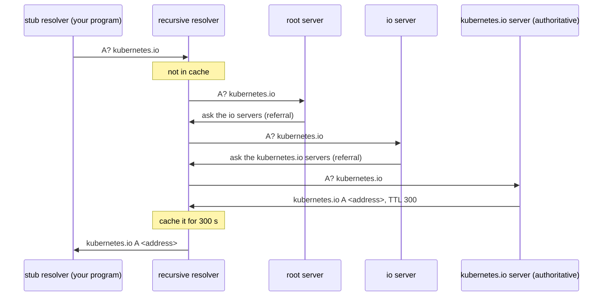

# Chapter 43: DNS

> **Exams:** CKNE · Foundations (Part V), supports D1 (Troubleshooting Pod Connectivity (DNS, pod-to-pod)) and D2 (Customizing coreDNS for Services)
> **Difficulty:** Beginner to intermediate
> **Time:** ~60 min reading, ~40 min lab
> **Lab tier:** 0 (netlab)
> **Prerequisites:** Chapter 42 (UDP, ports)

## Learning objectives

After this chapter you can:

- Explain what DNS does and how names are organized in a hierarchy
- Name the common record types (A, AAAA, CNAME, PTR, SRV, TXT) and say what each is for
- Describe the roles of stub resolvers, recursive resolvers, and authoritative servers, and how caching and TTLs work
- Configure a Linux host's resolver in `/etc/resolv.conf`: `nameserver`, `search`, and `options ndots`
- Predict which queries a resolver sends for a short name, and why `ndots` matters in Kubernetes
- Query DNS with `dig`, `getent`, and `host`, and read the answers, including `NXDOMAIN`
- Add a record to a DNS server and make it reload

## Concepts

### Why names

You have typed many IP addresses in the last few chapters. People are bad at
remembering numbers, and numbers change: a server moves, a Pod restarts with
a new address. So hosts have **names**, and the **Domain Name System (DNS)**
turns names into addresses. When you open `https://kubernetes.io`, your
computer first asks DNS for the address of `kubernetes.io`, and only then
connects to that address.

DNS is so central that "it's always DNS" is a running joke among network
engineers. In Kubernetes it is even more central: every Service is found by
name, and broken DNS looks like a broken cluster.

### The name hierarchy

DNS names are read from right to left, from the general to the specific, and
each part is separated by a dot:

```text
web.lab.internal.
 |   |    |     |
 |   |    |     the root (the final, usually invisible dot)
 |   |    top-level domain (TLD): internal
 |   domain: lab.internal
 host: web
```

- The **root** is at the top. Below it are **top-level domains** such as `com`,
  `org`, `io`, and country codes like `de`.
- Below those are domains that organizations own, such as `kubernetes.io`,
  and inside those, any names the owner wants: `www.kubernetes.io`,
  `docs.example.com`.
- Each part is a **label**. A **domain** is a label plus everything to its
  right. `lab.internal` is a domain; `web.lab.internal` is a name in it.

The responsibility for a part of the tree is a **zone**. The owner of a zone
runs (or rents) **authoritative servers** for it: servers that hold the
zone's records and give the official answers. In this chapter's lab, a server
called `dns` is authoritative for the zone `lab.internal`. (`.internal` is a
top-level domain reserved for private use, so it never collides with a real one.)

A name written with its final dot, `web.lab.internal.`, is a **fully qualified
domain name (FQDN)**: complete, with nothing to add. Without the dot, a
resolver may try adding suffixes to it, as you will see below.

### Records

A zone is a set of **resource records**. Each record has a name, a type, a
**TTL** (time to live, in seconds), and data. The types you need:

| Type | Maps | Example |
| --- | --- | --- |
| `A` | name to IPv4 address | `web.lab.internal. 60 IN A 10.0.7.80` |
| `AAAA` | name to IPv6 address | `web.lab.internal. 60 IN AAAA fd00:7::80` |
| `CNAME` | name to another name (an alias) | `www.lab.internal. 60 IN CNAME web.lab.internal.` |
| `PTR` | address to name (reverse lookup) | `80.7.0.10.in-addr.arpa. 60 IN PTR web.lab.internal.` |
| `SRV` | service to host and port | `_https._tcp.lab.internal. 60 IN SRV 0 0 443 web.lab.internal.` |
| `TXT` | name to free text | `lab.internal. 60 IN TXT "Chapter 43 lab zone"` |
| `NS` | zone to its authoritative servers | `lab.internal. 60 IN NS dns.lab.internal.` |

`IN` stands for "internet", the only class you will see in practice.

A **CNAME** says "this name is an alias; ask about that other name instead".
A resolver that finds a CNAME follows it automatically. A **PTR** record
lives in a special zone under `in-addr.arpa`, where the address is written
backwards: the PTR for `10.0.7.80` is at `80.7.0.10.in-addr.arpa`. Asking
"which name has this address?" is a **reverse lookup**. An **SRV** record
names the host *and port* of a service. Kubernetes publishes SRV records for
named Service ports.

### Who asks whom

Three kinds of DNS software work together:

- The **stub resolver** is the small piece of code in every program's system
  library (glibc on most Linux systems). It does not find answers itself; it
  sends the question to a recursive resolver and waits.
- A **recursive resolver** does the real work. It asks other servers, starting
  at the root if it must, until it has the answer, and **caches** what it
  learns. Your internet provider runs one, public ones exist (such as
  `1.1.1.1` and `8.8.8.8`), and in Kubernetes, CoreDNS plays this role for Pods.
- **Authoritative servers** hold the zones and answer questions about them.
  They do not chase answers for anyone.



*Text description: the program's stub resolver asks a recursive resolver. With an empty cache, the recursive resolver asks a root server, which refers it to the io servers, which refer it to kubernetes.io's authoritative server, which gives the answer. The resolver caches it for its TTL and returns it to the stub.*

### Caching and TTL

Walking the tree for every lookup would be slow, so resolvers cache answers
for as long as the record's **TTL** allows. While an answer is cached, a change
to the record is not seen. Short TTLs make changes visible quickly but cause
more queries. Kubernetes' CoreDNS gives Service records a TTL of 5 seconds by
default, because Pods come and go.

Answers that say "no such name" are cached too (**negative caching**), so a
lookup that failed because a record was missing can keep failing for a while
after you add it.

### Two kinds of "no"

DNS answers carry a **status**. Two outcomes look similar but mean different
things:

- **`NXDOMAIN`** ("non-existent domain"): the name does not exist at all.
- **`NOERROR` with no answers**: the name exists, but has no record of the
  type you asked for. For example, an `AAAA` query for a name that has only an
  `A` record. People call this "NODATA".

A third, **`SERVFAIL`**, means the server could not get an answer, for example
because it could not reach the authoritative servers. It points at a broken
resolver, not a missing record.

### The resolver on a Linux host

The stub resolver reads its configuration from **`/etc/resolv.conf`**:

```text
nameserver 10.0.7.53
search lab.internal
options ndots:1
```

- **`nameserver`**: the address of a recursive resolver to ask. Up to three
  lines; later ones are used only if earlier ones do not answer.
- **`search`**: a list of domains to try appending to names that are not fully
  qualified. With `search lab.internal`, asking for `web` makes the resolver
  try `web.lab.internal`.
- **`options ndots:N`**: how many dots a name needs before the resolver tries
  it as-is *first*. With the default, `ndots:1`, any name with at least one dot
  is tried as-is before the search list is used. A name with fewer dots than
  `N` goes through the search list first.

Before DNS is asked at all, most programs check **`/etc/hosts`**, a local file
of `address name` lines. The order of sources is set in `/etc/nsswitch.conf`
(`hosts: files dns` means "/etc/hosts first, then DNS").

The two common lookup commands behave differently:

- **`getent hosts <name>`** uses the system's normal lookup, exactly as
  programs like `curl` do: `/etc/hosts`, then DNS with the search list.
- **`dig <name>`** talks DNS directly. It ignores `/etc/hosts` and, unless you
  add `+search`, the search list. It shows everything about the answer.

When `getent` and `dig` disagree, the difference is in `/etc/hosts`, the search
list, or `ndots`.

### ndots and the Kubernetes search list

Every Pod in Kubernetes gets a `resolv.conf` like this (for a Pod in the
namespace `shop`):

```text
nameserver 10.96.0.10
search shop.svc.cluster.local svc.cluster.local cluster.local
options ndots:5
```

The search list lets a Pod reach a Service in its own namespace by its short
name (`db`) and a Service in another namespace as `db.other`. The high `ndots`
makes those names work even though `db.other` contains a dot.

The price: any name with fewer than five dots, including `api.github.com`,
goes through the whole search list *before* being tried as-is. Each attempt
is a separate query, for both `A` and `AAAA` records. You will see this
multiplication in this chapter's walkthrough. Writing external names with a
trailing dot (`api.github.com.`) skips the search list completely.

> **Why this matters for Kubernetes:** "Customizing coreDNS for Services" and
> "Troubleshooting Pod Connectivity (DNS, pod-to-pod)" are CKNE competencies.
> Every Kubernetes DNS problem is one of this chapter's concepts in disguise:
> a wrong `nameserver`, a missing record, a search list or `ndots` surprise, a
> cached negative answer, or the resolver itself not answering. Chapter 56
> configures CoreDNS, which is configured much like this chapter's dnsmasq.

### DNS on the wire

DNS queries normally use **UDP port 53**: one datagram with the question, one
with the answer. Large answers, and transfers of whole zones, use **TCP port
53**. A firewall or NetworkPolicy that allows UDP 53 but not TCP 53 breaks large
answers in odd ways, so always allow both.

## Guided walkthrough

Start the lab and open a lab shell:

```bash
make lab CH=43
make shell
topo
```

```text
Chapter 43 lab: one LAN, one DNS server for the zone lab.internal

    client          dns              web              api
  10.0.7.10     10.0.7.53        10.0.7.80        10.0.7.81
     |eth0         |eth0            |eth0            |eth0
  +--+-------------+----------------+----------------+--+
  |                   switch "lan"                     |
  +----------------------------------------------------+
  DNS server: dnsmasq on 10.0.7.53, data in /etc/dns/
  Web servers on port 80: web and api.
```

The DNS server runs **dnsmasq**, a small DNS server popular for labs and home
routers. Its settings are in `/etc/dns/dnsmasq.conf`, and the zone's address
records in `/etc/dns/hosts.lab`. Have a look at both with `cat`.

### Step 1: A client with no resolver

```bash
on client cat /etc/resolv.conf
on client dig web.lab.internal
```

```text
;; no servers could be reached
```

The client's `resolv.conf` is empty: it has no DNS server to ask. Inside a
namespace, `/etc/resolv.conf` is actually `/etc/netns/client/resolv.conf`, which
`ip netns exec` puts in its place. Task 1 fixes it.

### Step 2: Ask a server directly

`dig @<server>` sends the query to a server of your choice, ignoring
`resolv.conf`:

```bash
on client dig @10.0.7.53 web.lab.internal
```

```text
;; ->>HEADER<<- opcode: QUERY, status: NOERROR, id: 39792
;; flags: qr aa rd ra; QUERY: 1, ANSWER: 1, AUTHORITY: 0, ADDITIONAL: 1

;; QUESTION SECTION:
;web.lab.internal.		IN	A

;; ANSWER SECTION:
web.lab.internal.	60	IN	A	10.0.7.80

;; Query time: 0 msec
;; SERVER: 10.0.7.53#53(10.0.7.53) (UDP)
```

Read the answer from top to bottom:

- `status: NOERROR`: the query succeeded.
- `flags: ... aa`: an **authoritative answer**, straight from the zone's own
  server rather than from a cache.
- `QUESTION SECTION`: what was asked, an `A` record for `web.lab.internal.`
  (dig adds the final dot).
- `ANSWER SECTION`: the record, with its TTL of 60 seconds.
- `SERVER`: who answered, and over UDP.

`+short` prints only the data:

```bash
on client dig @10.0.7.53 +short web.lab.internal
```

```text
10.0.7.80
```

### Step 3: Other record types

Add the type after the name. A CNAME is followed automatically:

```bash
on client dig @10.0.7.53 www.lab.internal
```

```text
;; ANSWER SECTION:
www.lab.internal.	60	IN	CNAME	web.lab.internal.
web.lab.internal.	60	IN	A	10.0.7.80
```

```bash
on client dig @10.0.7.53 +short TXT lab.internal
```

```text
"Chapter 43 lab zone"
```

A reverse lookup uses `-x` and an address; dig builds the `in-addr.arpa` name
for you:

```bash
on client dig @10.0.7.53 -x 10.0.7.80
```

```text
;; QUESTION SECTION:
;80.7.0.10.in-addr.arpa.		IN	PTR

;; ANSWER SECTION:
80.7.0.10.in-addr.arpa.	60	IN	PTR	web.lab.internal.
```

### Step 4: A name that does not exist

```bash
on client dig @10.0.7.53 api.lab.internal
```

```text
;; ->>HEADER<<- opcode: QUERY, status: NXDOMAIN, id: 63994
```

`NXDOMAIN`: the server is authoritative for `lab.internal` and has no
`api` in it. Look at the server's log, which records every query:

```bash
tail -n 3 /var/log/netlab/dns-queries.log
```

```text
Nov 17 12:29:40 dnsmasq[71]: query[A] api.lab.internal from 10.0.7.10
Nov 17 12:29:40 dnsmasq[71]: config api.lab.internal is NXDOMAIN
```

Adding the record is Task 2: append a line to `/etc/dns/hosts.lab` and send
dnsmasq a HUP signal (`pkill -HUP dnsmasq`), which makes it reread the file.

### Step 5: Watch the search list multiply queries

This step borrows the client for a moment. Give it a resolver configured like a
Kubernetes Pod's, with two search domains and `ndots:5`:

```bash
printf 'nameserver 10.0.7.53\nsearch apps.lab.internal lab.internal\noptions ndots:5\n' > /etc/netns/client/resolv.conf
```

In a second lab shell, capture DNS on the server:

```bash
on dns tcpdump -i eth0 -n udp port 53
```

Then look up a fully written name from the first shell:

```bash
on client getent hosts web.lab.internal
```

```text
12:29:41.171870 IP 10.0.7.10.48230 > 10.0.7.53.53: 14265+ AAAA? web.lab.internal.apps.lab.internal. (52)
12:29:41.172096 IP 10.0.7.53.53 > 10.0.7.10.48230: 14265 NXDomain 0/0/0 (52)
12:29:41.172209 IP 10.0.7.10.59821 > 10.0.7.53.53: 18644+ AAAA? web.lab.internal.lab.internal. (47)
12:29:41.172319 IP 10.0.7.53.53 > 10.0.7.10.59821: 18644 NXDomain 0/0/0 (47)
12:29:41.172422 IP 10.0.7.10.59252 > 10.0.7.53.53: 13728+ AAAA? web.lab.internal. (34)
12:29:41.172496 IP 10.0.7.53.53 > 10.0.7.10.59252: 13728 0/0/0 (34)
12:29:41.172608 IP 10.0.7.10.49591 > 10.0.7.53.53: 3756+ A? web.lab.internal.apps.lab.internal. (52)
12:29:41.172707 IP 10.0.7.53.53 > 10.0.7.10.49591: 3756 NXDomain 0/0/0 (52)
12:29:41.172815 IP 10.0.7.10.56042 > 10.0.7.53.53: 30360+ A? web.lab.internal.lab.internal. (47)
12:29:41.172891 IP 10.0.7.53.53 > 10.0.7.10.56042: 30360 NXDomain 0/0/0 (47)
12:29:41.172981 IP 10.0.7.10.32785 > 10.0.7.53.53: 46810+ A? web.lab.internal. (34)
12:29:41.173044 IP 10.0.7.53.53 > 10.0.7.10.32785: 46810* 1/0/0 A 10.0.7.80 (50)
10.0.7.80       web.lab.internal
```

`web.lab.internal` has two dots, fewer than `ndots:5`, so the resolver tries
the search list first: `web.lab.internal.apps.lab.internal`, then
`web.lab.internal.lab.internal`, both `NXDomain`, and only then the name
as written. It does all of that twice, for `AAAA` and for `A`. Six queries for
one lookup. In tcpdump's DNS lines, `A?` is a question, `NXDomain` a "no such
name", `0/0/0` "no records", and `1/0/0 A 10.0.7.80` one answer record. The
`*` marks an authoritative answer.

Try `on client getent hosts web.lab.internal.` with a trailing dot: one query
per type, no search list.

Now empty the file again, so the lab starts from where Task 1 expects it:

```bash
: > /etc/netns/client/resolv.conf
```

### Useful commands from this chapter

| Command | Shows or does |
| --- | --- |
| `dig <name>` | query DNS for an `A` record using `resolv.conf` |
| `dig @<server> <name> <type>` | query a chosen server for a chosen type |
| `dig +short <name>` | only the answer data |
| `dig +search <name>` | apply the search list, as programs do |
| `dig -x <address>` | reverse lookup (PTR) |
| `getent hosts <name>` | look up a name the way programs do (`/etc/hosts`, then DNS) |
| `host <name>` | a short, readable lookup |
| `cat /etc/resolv.conf` | which servers, search domains, and options are used |

## Hands-on lab

Start (or restart) the lab and open a lab shell:

```bash
make reset CH=43
make shell
```

Run all commands in the lab shell; type `make check CH=43` on your machine after each task. Answer files go in `/root/answers/43/`. Edit files with `nano` or `vi`, or write them with `echo` and `printf`. Do not change any host's `/etc/hosts` (`/etc/netns/<name>/hosts`): the tasks are about DNS. Solutions: `chapters/43-dns/lab/solutions.md`.

### Task 1: Give the client a DNS server

The client cannot resolve any name. Configure its resolver to use the lab's DNS server.

- From the client, `dig web.lab.internal` (no `@server`) returns `10.0.7.80`

### Task 2: Add a missing record

The host `api` at `10.0.7.81` has no DNS name yet. Add one.

- The DNS server answers `api.lab.internal` with `10.0.7.81`
- It still answers `web.lab.internal` with `10.0.7.80`

### Task 3: Short names

People on the client want to type `curl http://web/` instead of the full name. Make the client complete short names in the `lab.internal` domain.

- From the client, the short name `web` resolves to `10.0.7.80`
- From the client, `curl http://web/` returns web's page

### Task 4: Who is 10.0.7.99?

Someone registered the address `10.0.7.99` in DNS under a name nobody remembers. Find it.

- File: `/root/answers/43/mystery-name`
- Content: the name, without a trailing dot (for example `something.lab.internal`)

## Exam tips

> **Exam tip:** When a Pod cannot reach a Service by name, check DNS before
> anything else: `kubectl exec <pod> -- cat /etc/resolv.conf` and
> `kubectl exec <pod> -- nslookup <service>`. If the name fails but the
> Service's IP works, it is DNS. If both fail, it is not.

> **Exam tip:** `dig @<CoreDNS-Service-IP> <name>.<namespace>.svc.cluster.local`
> from a debug Pod tells you whether CoreDNS itself answers, independent of
> the Pod's `resolv.conf`.

> **Exam tip:** Read the status line of every `dig` answer. `NXDOMAIN` means a
> missing record (or a typo in the name); `SERVFAIL` means the resolver is
> broken; a timeout means it is unreachable.

## Common mistakes

- **Testing with `dig` and concluding the program sees the same.** `dig` skips
  `/etc/hosts` and the search list. Use `getent hosts` to see what programs see.
- **Forgetting that answers are cached.** After changing a record, a resolver
  may serve the old answer, or the old `NXDOMAIN`, until its TTL runs out.
- **Forgetting the reload.** Many DNS servers only read their data at startup or
  on a signal. dnsmasq rereads its hosts files on HUP; CoreDNS reloads its
  Corefile when the `reload` plugin is enabled.
- **Allowing only UDP 53.** DNS needs TCP 53 too, for large answers.
- **Looking for `/etc/resolv.conf` changes in the wrong place.** In a network
  namespace created with `ip netns`, the file is `/etc/netns/<name>/resolv.conf`.
  In a Kubernetes Pod, the kubelet writes it from the Pod's `dnsPolicy` and `dnsConfig`.

<!-- QUESTIONS:START -->

## End-of-chapter questions

**1.** Which DNS record type maps a name to an IPv4 address?

- **A.** AAAA
- **B.** A
- **C.** PTR
- **D.** CNAME

**2.** What is the role of a recursive resolver?

- **A.** It holds the official records of a zone
- **B.** It takes a question from a client and does the work of finding the answer, asking other servers if needed, and caches the result
- **C.** It is the library inside every program that reads /etc/resolv.conf
- **D.** It translates private addresses to public ones

**3.** A record has a TTL of 300. What does that mean?

- **A.** The record will be deleted after 300 seconds
- **B.** Resolvers may cache the answer for up to 300 seconds before asking again
- **C.** The query must be answered within 300 milliseconds
- **D.** The record can be used by 300 clients

**4.** `dig api.lab.internal` returns `status: NXDOMAIN`. What does it mean?

- **A.** The DNS server is unreachable
- **B.** The name does not exist in DNS
- **C.** The name exists but has no A record
- **D.** The server failed to contact other servers

**5.** `/etc/resolv.conf` contains `search lab.internal`. A program looks up `web`. What does the resolver do?

- **A.** It fails, because web is not a full name
- **B.** It tries web.lab.internal
- **C.** It looks up web only in /etc/hosts
- **D.** It sends web to the root servers

**6.** `CKNE` A Pod has `options ndots:5` and the search list `shop.svc.cluster.local svc.cluster.local cluster.local`. It looks up `api.github.com`. Which query is sent first?

- **A.** api.github.com
- **B.** api.github.com.shop.svc.cluster.local
- **C.** api.github.com.cluster.local
- **D.** github.com

**7.** `CKNE` `getent hosts db` returns an address, but `dig db` returns nothing. Which explanation fits?

- **A.** The DNS server is down
- **B.** getent uses /etc/hosts and the search list; dig ignores both unless told otherwise (+search), so the name is probably in /etc/hosts or only resolvable via the search list
- **C.** dig only supports IPv6
- **D.** getent uses a different DNS server than dig

**8.** Which command finds the name that belongs to the address 10.0.7.99?

- **A.** dig 10.0.7.99
- **B.** dig -x 10.0.7.99
- **C.** dig PTR 10.0.7.99.lab.internal
- **D.** getent hosts -r 10.0.7.99

**9.** What does a CNAME record do?

- **A.** It gives a name a second IP address
- **B.** It makes one name an alias for another name; resolvers follow it to the target's records
- **C.** It names the authoritative servers of a zone
- **D.** It encrypts DNS answers

**10.** `CKNE` A NetworkPolicy allows Pods to send UDP to port 53 on CoreDNS, but nothing else. Most lookups work, but a few names with large answers fail. Why?

- **A.** DNS only uses UDP, so this cannot happen
- **B.** Large DNS answers are retried over TCP port 53, which the policy blocks
- **C.** CoreDNS cannot answer large queries
- **D.** The search list is too long

**11.** In a network namespace created with `ip netns`, which file does `ip netns exec client cat /etc/resolv.conf` show?

- **A.** The container's own /etc/resolv.conf
- **B.** /etc/netns/client/resolv.conf, which ip netns exec mounts over /etc/resolv.conf
- **C.** A file generated by the DNS server
- **D.** Nothing; namespaces cannot use DNS

**12.** You added a record to a DNS server, but a client still gets NXDOMAIN for the name a minute later. What are two likely causes?

- **A.** The client's MTU is wrong, or its default route is missing
- **B.** The DNS server has not reloaded its data, or a resolver is still serving a cached negative answer
- **C.** The name is too long, or it has a trailing dot
- **D.** DNS changes take 24 hours to reach any client

<details>
<summary>Answers</summary>

**1. B.** A records hold IPv4 addresses, AAAA records IPv6 addresses. PTR maps an address back to a name, and CNAME makes a name an alias of another name.

**2. B.** Stub resolvers (in programs) ask recursive resolvers, which walk the DNS tree to authoritative servers and cache answers for their TTL. CoreDNS plays this role for Kubernetes Pods.

**3. B.** TTL controls caching. A change to the record may not be seen by clients of a resolver that cached the old answer until the TTL expires.

**4. B.** NXDOMAIN means non-existent domain. A name that exists without a record of the requested type gives NOERROR with an empty answer; an unreachable server gives a timeout; a broken resolver gives SERVFAIL.

**5. B.** The search list supplies domains to append to names that are not fully qualified. With ndots:1 (the default), web has zero dots, so the search list is tried first.

**6. B.** api.github.com has two dots, fewer than five, so the resolver goes through the search list first, starting with the first domain. Only after all of those fail does it try the name as written. A trailing dot (api.github.com.) avoids this.

**7. B.** getent follows nsswitch.conf like real programs do (files, then DNS with the search list). dig is a pure DNS tool and asks exactly the name you typed.

**8. B.** dig -x builds the reverse name 99.7.0.10.in-addr.arpa and asks for its PTR record.

**9. B.** `www.lab.internal CNAME web.lab.internal` means: for www, look up web instead. dig shows both the CNAME and the target's A record.

**10. B.** When an answer is too big for a UDP response, the server marks it truncated and the client retries over TCP. Policies and firewalls must allow both UDP 53 and TCP 53.

**11. B.** `ip netns exec` bind-mounts every file in `/etc/netns/<name>/` over the matching file in `/etc`. That is how each host in the netlab has its own resolver configuration.

**12. B.** Servers often need a reload or restart to see new data, and resolvers cache NXDOMAIN answers too (negative caching). Check the server directly with dig @server first.

</details>

<!-- QUESTIONS:END -->

## Further reading

- RFC 1034, *Domain Names: Concepts and Facilities*: the original design, still the best overview
- `man resolv.conf` (search, ndots) and `man dig` in the lab shell
- The Kubernetes documentation page *DNS for Services and Pods*, which you will use in Part VII
- dnsmasq's manual page (`man dnsmasq` is not installed in the netlab; read it on the dnsmasq website)
