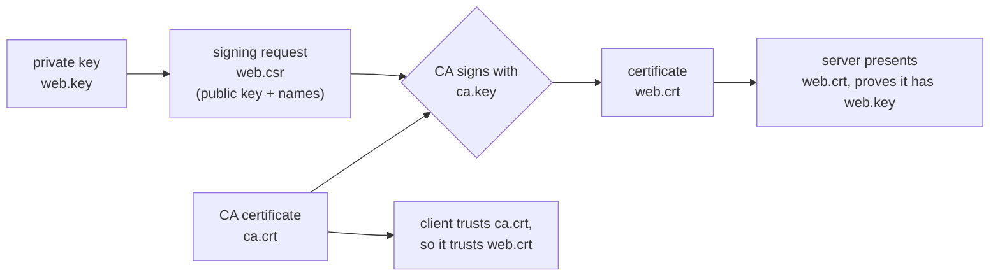

# Chapter 44: HTTP and TLS

> **Exams:** CKNE · Foundations (Part V), supports D2 (Managing Traffic with the Gateway API) and D4 (Managing TLS Certificates for Gateway API; Implementing Pod-level Authentication and Authorization)
> **Difficulty:** Intermediate
> **Time:** ~75 min reading, ~45 min lab
> **Lab tier:** 0 (netlab)
> **Prerequisites:** Chapter 42 (TCP connections), Chapter 43 (names)

## Learning objectives

After this chapter you can:

- Describe an HTTP request and response: method, path, headers, status code, body
- Explain how the `Host` header lets one server serve many sites, and send requests with any host name using `curl`
- Explain what TLS protects, and what a certificate, a certificate authority, and a chain of trust are
- Describe the TLS handshake, including SNI, and what stays visible on the wire
- Create a certificate authority, issue server and client certificates with `openssl`, and inspect them
- Serve HTTPS, and diagnose the common certificate errors from `curl` and `openssl s_client`
- Explain mutual TLS and why service meshes use it

## Concepts

### HTTP: the language of the web

**HTTP** (Hypertext Transfer Protocol) is the application protocol of the web,
and of almost every API you will meet, including the Kubernetes API. It is a
**request-response** protocol: the client sends a request, the server sends
back a response, both over a TCP connection.

A request is plain text (in HTTP/1.1):

```text
GET /headers HTTP/1.1
Host: web.lab.internal
User-Agent: curl/8.14.1
Accept: */*
```

- The first line holds the **method** (`GET`), the **path** (`/headers`), and
  the protocol version.
- Then come **headers**, `Name: value` lines that add information. `Host` says
  which site the client wants.
- A blank line ends the headers. A request with data (`POST`, `PUT`) carries it
  after the blank line, in the **body**.

A response looks the same, with a **status line** first:

```text
HTTP/1.0 404 Not Found
Server: labhttp/1.0
Content-Type: text/plain; charset=utf-8
Content-Length: 11

status 404
```

### Methods and status codes

The methods you will see:

| Method | Meaning |
| --- | --- |
| `GET` | read a resource |
| `HEAD` | like GET, but headers only |
| `POST` | send data, create something |
| `PUT` / `PATCH` | replace / modify a resource |
| `DELETE` | remove a resource |

The **status code** says how it went. The first digit is the class:

| Class | Meaning | Common codes |
| --- | --- | --- |
| 2xx | success | `200 OK`, `201 Created`, `204 No Content` |
| 3xx | go elsewhere | `301 Moved Permanently`, `302 Found`, `304 Not Modified` |
| 4xx | the client did something wrong | `400 Bad Request`, `401 Unauthorized`, `403 Forbidden`, `404 Not Found`, `429 Too Many Requests` |
| 5xx | the server failed | `500 Internal Server Error`, `502 Bad Gateway`, `503 Service Unavailable`, `504 Gateway Timeout` |

Learn to tell 502, 503, and 504 apart, because proxies and gateways produce
them: **502** means the proxy got a bad (or no) answer from the backend, **503**
means there is no healthy backend to send to, and **504** means the backend did
not answer in time. In Kubernetes they point at the Pods behind a Gateway or
Ingress, not at the gateway itself.

### One server, many sites: the Host header

A server at one IP address and port can host many websites. It tells them
apart by the `Host` header: `Host: web.lab.internal` and `Host: api.lab.internal`
can get completely different answers from the same server. These sites are
called **virtual hosts**.

Since the host name is just a header, you can send any host name to any
address, without DNS, which is handy for testing a site before its DNS record
exists:

```bash
curl -H 'Host: api.lab.internal' http://10.0.8.80/
curl --resolve api.lab.internal:80:10.0.8.80 http://api.lab.internal/
```

The second form makes curl itself pretend that `api.lab.internal` resolves to
`10.0.8.80`. It is better for HTTPS, because it also gets TLS's name checks right.

> **Why this matters for Kubernetes:** routing by host name and path is exactly
> what the Gateway API's **HTTPRoute** does (Chapter 57): `hostnames:
> [api.example.com]` and `path: /v2` decide which Service gets each request. That
> is **L7** routing: it needs to read the HTTP request, which an L4 Service
> cannot do.

### HTTP versions

- **HTTP/1.1** sends one request at a time per connection, as plain text.
- **HTTP/2** sends many requests at once over one connection, in a binary
  format. **gRPC**, the protocol many microservices use (and the Gateway API's
  `GRPCRoute` handles), runs on HTTP/2.
- **HTTP/3** runs HTTP/2's ideas over QUIC, on UDP.

Clients and servers agree on HTTP/2 during the TLS handshake, using an
extension called **ALPN**: the client offers `h2,http/1.1`, and the server
picks one.

### Why TLS

Everything above travels as plain text. Chapter 38 showed that anyone who can
capture the packets can read them, including passwords and tokens. Worse, they
could change them, or pretend to be the server.

**TLS** (Transport Layer Security; its predecessor was called SSL) adds three
things on top of TCP:

1. **Confidentiality**: the data is encrypted, so eavesdroppers see noise.
2. **Integrity**: any change on the way is detected.
3. **Authentication**: the client can check that it is talking to the real
   server, and not an impostor.

HTTP over TLS is **HTTPS**, on port 443 by default. The HTTP inside is
unchanged; TLS wraps it.

### Keys and certificates

TLS uses **public-key cryptography**. Each server has a pair of keys:

- a **private key**, which never leaves the server, and
- a **public key**, which anyone may have.

Data encrypted with one key can only be decrypted with the other, and the
private key can produce **signatures** that anyone can check with the public key.

But how does a client know that a public key really belongs to
`web.lab.internal`, and not to an attacker? That is what a **certificate** is
for. A certificate is a small document that says "this public key belongs to
this name, until this date", **signed** by someone the client already trusts.
It contains:

- the **subject**: who it belongs to (for example `CN=web.lab.internal`; CN is "common name")
- the **Subject Alternative Names (SANs)**: the host names (and IP addresses)
  it is valid for. Clients check the name they connected to against the SANs,
  not the CN.
- the **public key**
- the **validity period**: not before, not after
- the **issuer**: who signed it, and the signature

### Certificate authorities and the chain of trust

The signer is a **certificate authority (CA)**. A CA has its own key pair and a
certificate for itself. A client trusts a server's certificate if:

1. it is signed by a CA the client trusts (directly, or through intermediate
   CAs, forming a **chain**),
2. it has not expired, and
3. one of its SANs matches the name the client connected to.

Every operating system and browser ships a list of trusted public CAs (on
Debian, in `/etc/ssl/certs`). For internal systems, organizations, and
Kubernetes itself, run their own **private CA**, and clients must be told
to trust it. With `curl`, that is `--cacert ca.crt`.

The usual way to get a certificate is:

1. generate a private key,
2. create a **certificate signing request (CSR)** that contains the public key and the wanted names,
3. have the CA sign it, which produces the certificate.



*Text description: a private key produces a signing request with the public key and names; the CA signs it with its own key, producing the certificate. The server presents the certificate and proves it holds the private key; the client trusts the certificate because it trusts the CA's certificate.*

### The TLS handshake

Before any HTTP is sent, client and server run a handshake on the fresh TCP
connection. In TLS 1.3, the current version:

1. **ClientHello**: the client sends the TLS versions and ciphers it supports,
   its share of a key exchange, the **SNI** (Server Name Indication: the host
   name it wants), and ALPN (`h2,http/1.1`).
2. **ServerHello**: the server picks the parameters and sends its key share. From
   here on, everything is encrypted.
3. The server sends its **certificate** and a signature that proves it holds
   the matching private key.
4. The client checks the certificate (chain, dates, name). If anything is
   wrong, it aborts.
5. Both sides derive the same session keys and send **Finished**. HTTP flows,
   encrypted.

SNI matters because many HTTPS sites share one address, just like virtual hosts
in HTTP. The server needs to know which site's certificate to present *before*
it can decrypt anything, so the name in SNI is sent **unencrypted**. Anyone
watching can see which host name you connect to, but not the path, the
headers, or the data.

> **Why this matters for Kubernetes:** a Gateway terminates TLS for many host
> names on one address, choosing the certificate by SNI. "Managing TLS
> Certificates for Gateway API" (Chapter 67) means creating exactly these
> certificates (usually with cert-manager), storing them in Secrets, and
> referencing them from a Gateway's listeners. A `TLSRoute` can even route
> encrypted traffic by SNI alone, without decrypting it.

### Mutual TLS

In ordinary TLS, only the server proves who it is. The client stays anonymous
at the TLS level (it may log in later with a password or token).

In **mutual TLS (mTLS)**, the client *also* presents a certificate, and the
server checks it against a CA it trusts. A client without a valid certificate
cannot even finish the handshake. The certificate's subject then tells the
server *who* is connecting, which can be used for authorization.

> **Why this matters for Kubernetes:** this is how service meshes such as Istio
> secure Pod-to-Pod traffic (Chapters 66 and 68). Every workload gets a
> certificate that names its identity (its service account), the mesh's own
> CA signs them, and every connection between Pods is mTLS. Authorization
> policies then say "only the identity `frontend` may call `payments`".
> Kubernetes components themselves (API server, kubelet, etcd) also talk to
> each other over mTLS, with certificates from the cluster CA.

## Guided walkthrough

Start the lab and open a lab shell:

```bash
make lab CH=44
make shell
topo
```

```text
Chapter 44 lab: a client and a web server

     client                                   web
   10.0.8.10  eth0 ======================= eth0  10.0.8.80
                                   http  :80    sites web.lab.internal
                                                and api.lab.internal
                                   https :8443  (yours to start)
                                   https :9443  requires a client certificate
  Lab CA: /root/ca/ca.crt and /root/ca/ca.key
  Server program: labhttp (labhttp --help)
```

The client resolves `web.lab.internal` through its hosts file
(`/etc/netns/client/hosts`). `api.lab.internal` is deliberately missing.

### Step 1: Look at HTTP with curl

`-i` includes the response's status line and headers in the output:

```bash
on client curl -i http://web.lab.internal/status/404
```

```text
HTTP/1.0 404 Not Found
Server: labhttp/1.0
Date: Tue, 17 Nov 2026 12:34:21 GMT
Content-Type: text/plain; charset=utf-8
Content-Length: 11
X-Served-By: web

status 404
```

The lab's server, `labhttp`, has a few useful paths. `/headers` sends back the
request it received, so you can see exactly what curl sent:

```bash
on client curl http://web.lab.internal/headers
```

```text
GET /headers HTTP/1.1
Host: web.lab.internal
User-Agent: curl/8.14.1
Accept: */*
```

Other curl options you will use all the time:

| Option | Does |
| --- | --- |
| `-i` | show response headers |
| `-v` | show the whole conversation, including TLS |
| `-s` | silent: no progress bar |
| `-o /dev/null -w '%{http_code}\n'` | print only the status code |
| `-L` | follow redirects (3xx) |
| `-X POST -d 'data'` | send a POST with a body |
| `-H 'Name: value'` | add or replace a header |
| `--resolve host:port:address` | use this address for this host name |
| `--cacert ca.crt` | trust this CA for HTTPS |
| `--cert c.crt --key c.key` | present a client certificate |
| `-k` | skip certificate checks (for testing only; never as a "fix") |

### Step 2: Virtual hosts

Changing only the `Host` header changes the answer from the same server:

```bash
on client curl http://web.lab.internal/
on client curl -H 'Host: example.lab.internal' http://10.0.8.80/
```

```text
hello from web
hello from web
```

`example.lab.internal` is not a site this server knows, so it gets the default
page. The server does know one other site, `api.lab.internal`, and finding its
page is Task 1.

### Step 3: Create a certificate authority

The lab already has a CA in `/root/ca`, but making one is a single command, so
look at how it is done (in `/tmp`, to keep the lab's files intact):

```bash
cd /tmp
openssl req -x509 -newkey rsa:2048 -nodes -keyout demo-ca.key -out demo-ca.crt -days 365 -subj "/CN=Demo CA"
```

- `req -x509` creates a **self-signed** certificate: signed with its own key,
  which is what a root CA is.
- `-newkey rsa:2048 -nodes` creates a new 2048-bit RSA key without a passphrase.
- `-subj` sets the subject without asking questions interactively.

(openssl prints a row of dots and plus signs while it generates the key.)

### Step 4: Issue a server certificate

First a key and a signing request with the name in a SAN, then the CA signs it:

```bash
openssl req -newkey rsa:2048 -nodes -keyout demo.key -out demo.csr -subj "/CN=demo.lab.internal" -addext "subjectAltName=DNS:demo.lab.internal"
openssl x509 -req -in demo.csr -CA demo-ca.crt -CAkey demo-ca.key -out demo.crt -days 90 -copy_extensions copy
```

```text
Certificate request self-signature ok
subject=CN=demo.lab.internal
```

`-copy_extensions copy` carries the SAN from the request into the
certificate. Without it, the certificate has no SAN, and clients reject it.

### Step 5: Inspect a certificate

```bash
openssl verify -CAfile demo-ca.crt demo.crt
openssl x509 -in demo.crt -noout -subject -issuer -dates -ext subjectAltName
```

```text
demo.crt: OK
subject=CN=demo.lab.internal
issuer=CN=Demo CA
notBefore=Nov 17 12:34:03 2026 GMT
notAfter=Feb 15 12:34:03 2027 GMT
X509v3 Subject Alternative Name:
    DNS:demo.lab.internal
```

`openssl x509 -text -noout -in demo.crt` prints everything. To check that a
key and a certificate belong together, compare their public keys:
`openssl pkey -in demo.key -pubout` and `openssl x509 -in demo.crt -noout -pubkey`
must print the same.

### Step 6: Read certificate errors

This step uses the HTTPS server you will start in Task 3, so come back to it
then. The errors are worth knowing in advance. Without the CA, curl refuses:

```text
curl: (60) SSL certificate problem: unable to get local issuer certificate
```

"I do not trust whoever signed this." The fix is `--cacert /root/ca/ca.crt`, not `-k`.

Connecting by IP address with a certificate that only names `web.lab.internal`:

```text
curl: (60) SSL: no alternative certificate subject name matches target ipv4 address '10.0.8.80'
```

"The certificate is fine, but not for this name." The other errors you will
meet: `certificate has expired` (check `-dates`) and
`self-signed certificate` (the server presents its CA instead of its own
certificate, or a certificate nobody signed).

With `-v`, curl shows the handshake and what it checked:

```text
* SSL connection using TLSv1.3 / TLS_AES_256_GCM_SHA384 / X25519MLKEM768 / RSASSA-PSS
* Server certificate:
*  subject: CN=web.lab.internal
*  start date: Nov 17 12:34:03 2026 GMT
*  expire date: Feb 15 12:34:03 2027 GMT
*  subjectAltName: host "web.lab.internal" matched cert's "web.lab.internal"
*  issuer: CN=Lab CA
*  SSL certificate verify ok.
```

`openssl s_client` is the lower-level tool. It shows the chain the server sends:

```bash
on client openssl s_client -connect web.lab.internal:8443 -servername web.lab.internal -CAfile /root/ca/ca.crt </dev/null
```

```text
Certificate chain
 0 s:CN=web.lab.internal
   i:CN=Lab CA
...
    Verify return code: 0 (ok)
```

`s:` is the subject and `i:` the issuer of each certificate in the chain.
`-servername` sets the SNI.

### Step 7: What an eavesdropper sees

Captured with `tcpdump -A`, the ClientHello of an HTTPS request is mostly
noise, except for one readable string:

```text
...9.	...3.....=.<.5./..................web.lab.internal.........
...........................h2.http/1.1.........1.....6.4	.	.	......
```

That is SNI (`web.lab.internal`) and ALPN (`h2.http/1.1`), sent in the clear.
Nothing of the HTTP request, not even the path, is readable.

## Hands-on lab

Start (or restart) the lab and open a lab shell:

```bash
make reset CH=44
make shell
```

Run all commands in the lab shell; type `make check CH=44` on your machine after each task. Answer files go in `/root/answers/44/`; certificates and keys go in `/root/tls/`, which already exists. The lab CA is `/root/ca/ca.crt` with its key `/root/ca/ca.key`. Start servers with `nohup ... &` so they keep running after you close the shell. Solutions: `chapters/44-http-and-tls/lab/solutions.md`.

### Task 1: Visit a site without DNS

The web server at `10.0.8.80` also serves a site called `api.lab.internal`, which has no DNS name or hosts entry yet. Fetch that site's home page, and note the code it shows.

- File: `/root/answers/44/api-code`
- Content: the code from the page (it starts with `api-`)

Note: do not add `api.lab.internal` to any hosts file.

### Task 2: Issue a server certificate

Create a private key and a certificate for `web.lab.internal`, signed by the lab CA.

- Key: `/root/tls/web.key`
- Certificate: `/root/tls/web.crt`, signed by `/root/ca/ca.crt`
- The certificate's Subject Alternative Names include `DNS:web.lab.internal`
- The certificate matches the key

### Task 3: Serve HTTPS

Start an HTTPS server on host `web`, port 8443, using your certificate. `labhttp --help` shows its options.

- From the client, `https://web.lab.internal:8443/` works with the lab CA trusted (`--cacert /root/ca/ca.crt`)
- The certificate the server presents is `/root/tls/web.crt`

### Task 4: Mutual TLS

The service on port 9443 only talks to clients that present a certificate signed by the lab CA. Create one and get through.

- Key: `/root/tls/client.key`
- Certificate: `/root/tls/client.crt`, signed by the lab CA, with the subject `CN=client`
- From the client, `https://web.lab.internal:9443/` answers with a greeting that names your certificate

## Exam tips

> **Exam tip:** A Kubernetes TLS Secret holds two keys, `tls.crt` and `tls.key`.
> `kubectl create secret tls <name> --cert=web.crt --key=web.key` builds one
> from the files you made in this chapter. To read a certificate stored in a
> Secret: `kubectl get secret <name> -o jsonpath='{.data.tls\.crt}' | base64 -d | openssl x509 -noout -subject -dates -ext subjectAltName`.

> **Exam tip:** To test a Gateway listener before DNS exists, use
> `curl --resolve host:443:<gateway-address> https://host/`. It sends the right
> SNI and Host header, so both TLS and routing behave as they will in production.

> **Exam tip:** Read curl's TLS error literally: "unable to get local issuer"
> is about trust (the CA), "no alternative certificate subject name matches" is
> about the name (the SANs), and "certificate has expired" is about the dates.

## Common mistakes

- **Using `-k` as a fix.** It hides the error instead of solving it. Fix the
  trust (`--cacert`), the name (SANs), or the dates.
- **Putting the name only in the CN.** Clients check SANs. A certificate without
  a matching SAN is rejected even if the CN is right.
- **Losing the SAN while signing.** With `openssl x509 -req`, extensions from
  the CSR are dropped unless you add `-copy_extensions copy`.
- **Mixing up which file goes where.** The server needs its own certificate and
  private key; the client needs the CA certificate. Nobody but the CA needs
  `ca.key`.
- **Confusing 401 and 403.** 401 means "I don't know who you are"; 403 means "I
  know who you are, and the answer is no".

<!-- QUESTIONS:START -->

## End-of-chapter questions

**1.** One web server at 10.0.8.80 serves two sites. How does it know which site a request is for?

- **A.** From the client's IP address
- **B.** From the Host header in the HTTP request (and, for HTTPS, the SNI in the TLS handshake)
- **C.** From the TCP port the client uses
- **D.** From the MAC address

**2.** `CKNE` A Gateway returns `503 Service Unavailable`. What does that most likely mean?

- **A.** The client sent a malformed request
- **B.** The gateway has no healthy backend to send the request to
- **C.** The client is not authenticated
- **D.** The page does not exist

**3.** Which curl command fetches the site `api.lab.internal` from the server at 10.0.8.80 without any DNS or hosts entry, in a way that also works for HTTPS name checks?

- **A.** `curl http://10.0.8.80/api.lab.internal`
- **B.** `curl --resolve api.lab.internal:443:10.0.8.80 https://api.lab.internal/`
- **C.** `curl -k https://10.0.8.80/`
- **D.** `curl --host api.lab.internal 10.0.8.80`

**4.** Which three things does TLS add on top of TCP?

- **A.** Speed, compression, and caching
- **B.** Confidentiality (encryption), integrity (tamper detection), and authentication of the server
- **C.** Routing, NAT, and load balancing
- **D.** Name resolution, retries, and ordering

**5.** `CKNE` curl reports `SSL certificate problem: unable to get local issuer certificate`. What is the right fix?

- **A.** Add -k to the curl command
- **B.** Tell the client to trust the CA that signed the server's certificate, for example with --cacert ca.crt
- **C.** Regenerate the server's private key
- **D.** Use HTTP instead

**6.** `CKNE` A certificate's subject is `CN=web.lab.internal`, but it has no Subject Alternative Name. Clients connecting to `web.lab.internal` reject it. Why?

- **A.** CN must be lowercase
- **B.** Modern clients check the name against the SANs, not the CN
- **C.** Certificates cannot contain host names
- **D.** The CA must be in the SAN

**7.** What is a certificate signing request (CSR)?

- **A.** A request to a CA to revoke a certificate
- **B.** A file containing a public key and the requested names, which a CA signs to produce a certificate
- **C.** The CA's private key
- **D.** A TLS handshake message

**8.** What can an eavesdropper read in an HTTPS connection to `https://web.lab.internal/admin`?

- **A.** Everything, including the path /admin
- **B.** Nothing at all, not even the server's address
- **C.** The IP addresses and ports, and the host name web.lab.internal (from SNI), but not the path, headers, or body
- **D.** Only the response body

**9.** `CKNE` What is different about mutual TLS (mTLS) compared to ordinary TLS?

- **A.** Both sides use the same private key
- **B.** The client also presents a certificate, which the server verifies against a trusted CA
- **C.** The connection is encrypted twice
- **D.** No certificates are needed

**10.** How can you check that a private key and a certificate belong together?

- **A.** Compare their file sizes
- **B.** Compare the public key derived from the private key (openssl pkey -pubout) with the public key in the certificate (openssl x509 -pubkey)
- **C.** Run openssl verify on the key
- **D.** Check that they have the same file name

**11.** `CKNE` Which pair of entries does a Kubernetes TLS Secret contain?

- **A.** ca.crt and ca.key
- **B.** tls.crt and tls.key
- **C.** cert.pem and chain.pem
- **D.** public.key and private.key

**12.** What do HTTP status codes 401 and 403 mean?

- **A.** 401: server error; 403: client error
- **B.** 401: authentication is missing or failed; 403: the client is known but not allowed
- **C.** Both mean the page does not exist
- **D.** 401: redirect; 403: rate limited

<details>
<summary>Answers</summary>

**1. B.** Virtual hosting relies on the Host header. With HTTPS the server must pick a certificate before it can read headers, so the client also sends the name as SNI in the ClientHello.

**2. B.** 503 from a proxy usually means no available backend, for example a route whose Service has no ready endpoints. 400 is a malformed request, 401 is missing authentication, 404 is a missing resource.

**3. B.** --resolve makes curl use the given address for that host name, so SNI, the Host header, and the certificate name check all use api.lab.internal. -H 'Host: ...' works for plain HTTP, but TLS would still check the certificate against the IP.

**4. B.** TLS encrypts the data, detects changes on the way, and lets the client verify the server's identity through its certificate. Ordering and retries are TCP's job.

**5. B.** The client cannot build a chain to a CA it trusts. Trusting the right CA fixes it. -k disables the check entirely, which removes the protection TLS provides.

**6. B.** Clients ignore the CN for host name checks. Include every host name in the subjectAltName extension, and when signing with openssl x509 -req, copy the extensions from the CSR.

**7. B.** You create a key pair, put the public key and names in a CSR, and the CA signs it. The private key never leaves you. Kubernetes has a CertificateSigningRequest API object built on the same idea.

**8. C.** IP and TCP headers are never encrypted, and SNI in the ClientHello is sent in clear so the server can choose a certificate. The HTTP request, including the path, is encrypted.

**9. B.** In mTLS both sides authenticate. Service meshes give every workload a certificate and use mTLS so that each side knows the other's identity, which authorization policies then use.

**10. B.** A certificate contains the public key of its key pair. If the public key extracted from the private key is the same, they match. openssl verify checks the certificate's chain, not the key.

**11. B.** Secrets of type kubernetes.io/tls hold tls.crt (the certificate, optionally with its chain) and tls.key (the private key). Gateway listeners reference such Secrets.

**12. B.** 401 Unauthorized really means unauthenticated: who are you? 403 Forbidden means the server knows who you are and refuses.

</details>

<!-- QUESTIONS:END -->

## Further reading

- RFC 9110, *HTTP Semantics*: methods, status codes, and headers
- RFC 8446, *The Transport Layer Security (TLS) Protocol Version 1.3*, section 2 for the handshake overview
- `man openssl-req`, `man openssl-x509`, and `man openssl-s_client` in the lab shell
- The Kubernetes documentation page *Certificates and Certificate Signing Requests*
