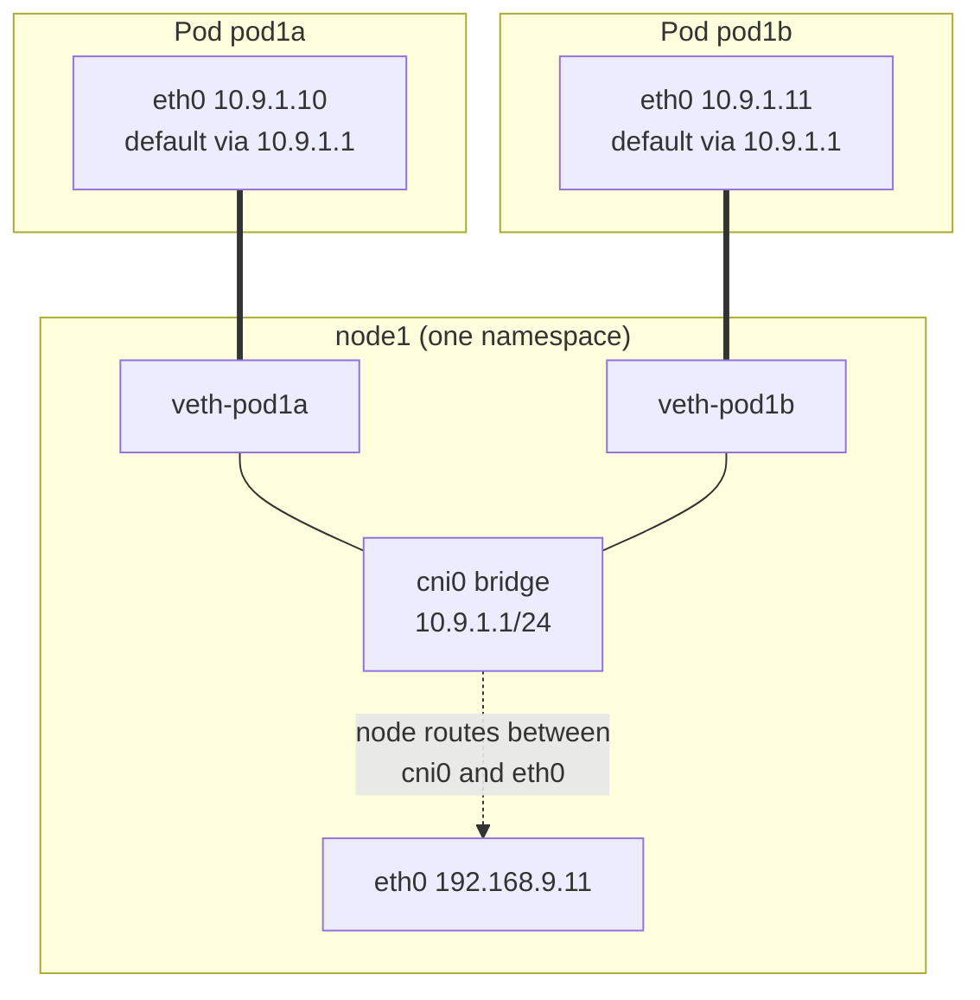
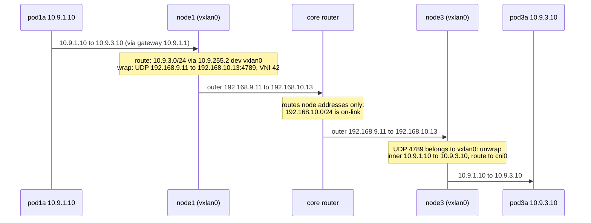

# Chapter 45: Virtual networking by hand

> **Exams:** CKNE · Foundations (Part V), supports D1 (Installing and Configuring CNI Plugins; Managing IPAM and Pod CIDR Allocation; Using Linux Tools (iptables, ip, tcpdump) for Packet-level Issues)
> **Difficulty:** Intermediate
> **Time:** ~75 min reading, ~60 min lab
> **Lab tier:** 0 (netlab)
> **Prerequisites:** Chapters 39 to 41 (bridges, addressing, routing)

## Learning objectives

After this chapter you can:

- Explain what Linux namespaces are, and how a container and a Kubernetes Pod use a network namespace
- Create network namespaces and veth pairs, and connect a namespace to a bridge, using only `ip`
- Explain how a simple CNI plugin wires a Pod on a node
- Connect Pod subnets on different nodes by plain routing, and say when that works
- Build a VXLAN overlay between two nodes, and recognize encapsulated traffic in a capture
- Explain the MTU cost of an overlay and how CNI plugins deal with it

## Concepts

### Namespaces

Since Chapter 37 you have used network namespaces as stand-ins for computers.
Now look at what they really are.

A **namespace** is a Linux kernel feature that gives a group of processes their
own private view of one kind of system resource. There are several kinds:

| Namespace | Isolates |
| --- | --- |
| `net` | network interfaces, addresses, routes, firewall rules, sockets |
| `pid` | process IDs (a container sees its own process 1) |
| `mnt` | the filesystem tree |
| `uts` | the host name |
| `ipc` | inter-process communication |
| `user` | user and group IDs |
| `cgroup` | the view of resource-control groups |

A **container** is just a normal process started inside a set of fresh
namespaces (plus limits on CPU and memory). There is no virtual machine: all
containers share the host's kernel. The network namespace is what gives a
container its own `eth0`, its own IP address, and its own `localhost`.

A new network namespace starts almost empty: only a loopback interface, and
even that is down. It has no connection to anything. Something has to plug it
into the world, and that is the job of the **CNI plugin** in Kubernetes.

> **Why this matters for Kubernetes:** a **Pod** is one network namespace shared
> by all its containers. Kubernetes first starts a tiny "pause" container that
> creates and holds the namespace; the Pod's real containers then join it. That
> is why containers in a Pod reach each other on `localhost` and share one IP
> address, and why a Pod's IP survives a container restart.

### veth pairs: virtual cables

A **veth pair** (virtual Ethernet) is two network interfaces joined back to
back: whatever enters one end comes out of the other. It is a cable with a
plug at each end. The two ends can live in different namespaces, and that is
the point: put one end inside a namespace as its `eth0`, keep the other end
outside, and the namespace has a connection.

Every "cable" in the netlab is a veth pair. `ip link` shows the far end's
interface number after the `@`: `eth0@if15` means "the peer of this interface is
interface 15", and `link-netns node1` says which namespace that peer is in.

### How a simple CNI plugin wires a Pod

When the kubelet starts a Pod, it asks the node's **CNI plugin** (Container
Network Interface) to connect the Pod's network namespace. A simple plugin,
such as the reference `bridge` plugin, does exactly what you will do by hand
in this chapter:

1. Create a veth pair.
2. Move one end into the Pod's namespace and name it `eth0`.
3. Attach the other end to a bridge on the node (often called `cni0`).
4. Ask its **IPAM** plugin (IP Address Management) for a free address from the
   node's Pod subnet, and put it on the Pod's `eth0`.
5. Add a default route inside the Pod via the bridge's address, which acts as
   the Pod's gateway.



*Text description: on node1, each Pod's eth0 is one end of a veth pair whose other end is attached to the bridge cni0, which holds the gateway address 10.9.1.1. Pods on the same node talk through the bridge; traffic to elsewhere goes to the gateway, and the node routes it out of its own eth0.*

Pods on the same node talk through the bridge, at layer 2, exactly like
Chapter 39's hosts on a switch. For anything else, a Pod sends packets to its
gateway (the bridge's address), and the node routes them, exactly like
Chapter 41's routers.

Not every CNI plugin uses a bridge. Cilium and Calico give each Pod a veth pair
but no bridge, and route each Pod individually on the node. The Pod side looks
the same in every case: an `eth0` with an address and a default route.

### Connecting nodes: routing

Each node has its own Pod subnet, carved out of the cluster's Pod CIDR
(Chapter 40's IPAM idea): node1 has `10.9.1.0/24`, node2 `10.9.2.0/24`. For a
Pod on node1 to reach a Pod on node2, node1 must know where `10.9.2.0/24` is.

When the nodes share a LAN, the answer is simple. Each node gets a route to
every other node's Pod subnet, via that node's address:

```text
node1:  10.9.2.0/24 via 192.168.9.12
node2:  10.9.1.0/24 via 192.168.9.11
```

Pod packets then travel between nodes unchanged, with Pod addresses as source
and destination. This is **native routing** (Flannel calls it `host-gw` mode,
and Calico and Cilium distribute such routes with BGP; Chapter 59). It is fast
and easy to debug, because a capture on the wire shows real Pod addresses.

It only works if every device between the nodes knows the Pod routes. Nodes on
one LAN reach each other directly, so nobody else has to. But if a router sits
between nodes, that router must also know every Pod subnet. Often it is a
router you do not control (a cloud provider's network, another team's core),
and it does not.

### Connecting nodes: overlays

An **overlay network** solves this by hiding Pod packets inside packets
between node addresses, which every router already knows how to deliver. The
network that carries them, the nodes' real network, is called the **underlay**.

The most common overlay protocol is **VXLAN** (Virtual Extensible LAN). A VXLAN
device on each node takes a whole Ethernet frame, Pod addresses and all, and
wraps it in:

- a VXLAN header (8 bytes) with a **VNI** (VXLAN Network Identifier) that
  says which overlay the frame belongs to,
- a UDP header (8 bytes), destination port **4789**,
- an outer IP header (20 bytes) from node address to node address,
- an outer Ethernet header (14 bytes) for the underlay link.

```text
+----------+---------+-----+-------+-------------------------------------------+
| outer    | outer IP| UDP | VXLAN | inner Ethernet | inner IP (Pod to Pod) | data |
| Ethernet | node to |4789 | VNI 42|                |                       |      |
| (14)     | node(20)| (8) | (8)   |                (the original frame)          |
+----------+---------+-----+-------+-------------------------------------------+
```

The receiving node's VXLAN device strips the outer headers and delivers the
original frame. Routers in between see only a UDP packet between two node
addresses. This is encapsulation again (Chapter 38), with one network carried
inside another.

Flannel's default `vxlan` mode, Calico's VXLAN mode, and Cilium's default
"tunnel" mode all work like this. Cilium also supports **Geneve**, a similar
protocol on UDP port 6081.

### Packet walk: through the overlay

A ping from pod1a (`10.9.1.10`, on node1) to pod3a (`10.9.3.10`, on node3,
behind the core router):



*Text description: pod1a sends to its gateway on node1. node1's route sends 10.9.3.0/24 into vxlan0, which wraps the packet in UDP between node1 and node3's addresses. core routes that like any other packet. node3's vxlan0 unwraps it and node3 delivers the original packet to pod3a through its bridge.*

### The price of an overlay: MTU

The underlay's MTU counts everything after the outer Ethernet header: the outer
IP header (20 bytes), UDP (8), VXLAN (8), and the inner Ethernet header (14).
That is 50 bytes. If the underlay's MTU is 1500, the packet inside can only be
1450 bytes. Linux sets a VXLAN device's MTU to 1450 for you,
but the Pods do not know about it. A Pod with MTU 1500 sends a 1500-byte
packet, the node cannot fit it into the tunnel, and one of two things happens:

- If the packet allows fragmentation, the node splits it, which is slow.
- If it does not (TCP normally sets "don't fragment"), the node drops it and
  sends back an ICMP "fragmentation needed" message with the right size. The
  sender learns the smaller size (**path MTU discovery**) and retries. If a
  firewall blocks that ICMP message, the sender never learns, and large
  transfers hang forever, the "MTU black hole".

CNI plugins avoid both by giving Pod interfaces a smaller MTU from the start:
1450 for VXLAN, less for encrypted tunnels. Getting it wrong is one of the
classic causes of "small requests work, big ones hang" in Kubernetes.

> **Why this matters for Kubernetes:** "Installing and Configuring CNI Plugins"
> means choosing exactly these options. Native routing or an overlay? VXLAN or
> Geneve? Which MTU? Which Pod CIDR, split how? Every CNI plugin's
> configuration file and Helm values are a version of this chapter's lab.

## Guided walkthrough

Start the lab and open a lab shell:

```bash
make lab CH=45
make shell
topo
```

```text
Chapter 45 lab: a Pod network built by hand

   pod1a 10.9.1.10      pod2a (unwired)          pod3a 10.9.3.10
        |                    .                        |
  [cni0 10.9.1.1]      [cni0 10.9.2.1]          [cni0 10.9.3.1]
     node1                node2                    node3
  192.168.9.11         192.168.9.12            192.168.10.13
     |eth0                |eth0                    |eth0
  +--+--------------------+--+                     |
  |   switch lan9 192.168.9.0/24  |               |
  +-------------+-----------------+               |
                |eth0 192.168.9.1      eth1 192.168.10.1
                +------------- core ---------------+
  Pod subnets: node1 10.9.1.0/24, node2 10.9.2.0/24, node3 10.9.3.0/24
  core belongs to "another team": it knows node addresses only.
```

The namespaces play two roles here: three are **nodes** and three are
**Pods**. In a real cluster the Pod namespaces would live inside each node
machine; here they all sit side by side in the netlab, connected the same way.
In this walkthrough you add one more Pod, `pod1b`, to node1 with nothing but
`ip` commands. This time there is no `topo.sh` helper doing it for you.

### Step 1: See the namespaces

```bash
ip netns list
```

```text
core (id: 0)
lan9 (id: 1)
node1 (id: 2)
node2 (id: 3)
node3 (id: 4)
pod1a (id: 5)
pod2a
pod3a (id: 6)
```

`ip netns` keeps named network namespaces as files in `/run/netns`. `lsns -t net`
lists every network namespace on the system, including ones without a name,
which is how containers usually have them.

### Step 2: Create a namespace

```bash
ip netns add pod1b
ip -n pod1b link
```

```text
1: lo: <LOOPBACK> mtu 65536 qdisc noop state DOWN mode DEFAULT group default qlen 1000
    link/loopback 00:00:00:00:00:00 brd 00:00:00:00:00:00
```

(You may also see `tunl0@NONE` here, as in Chapter 37.) A fresh namespace has
only a loopback interface, and it is down. Bring it up, or programs inside
cannot even reach `127.0.0.1`:

```bash
ip -n pod1b link set lo up
```

### Step 3: Create a veth pair, one end inside the Pod

`ip link add <name> type veth peer name <name>` creates both ends at once.
Adding `netns pod1b` to the peer creates that end directly inside the namespace:

```bash
ip link add veth-pod1b type veth peer name eth0 netns pod1b
ip link show veth-pod1b
ip -n pod1b link show eth0
```

```text
15: veth-pod1b@if3: <BROADCAST,MULTICAST> mtu 1500 qdisc noop state DOWN mode DEFAULT group default qlen 1000
    link/ether 66:04:e4:72:be:f1 brd ff:ff:ff:ff:ff:ff link-netns pod1b
3: eth0@if15: <BROADCAST,MULTICAST> mtu 1500 qdisc noop state DOWN mode DEFAULT group default qlen 1000
    link/ether 02:55:64:d9:4e:a6 brd ff:ff:ff:ff:ff:ff link-netnsid 0
```

The two ends point at each other: `veth-pod1b@if3` and `eth0@if15`. Both are
down, and neither has an address yet.

### Step 4: Move the node end into the node and attach it to the bridge

```bash
ip link set veth-pod1b netns node1
ip -n node1 link set veth-pod1b master cni0
ip -n node1 link set veth-pod1b up
ip -n node1 -br link show master cni0
```

```text
veth-pod1a@if12  UP             0e:e2:c4:89:61:63 <BROADCAST,MULTICAST,UP,LOWER_UP>
veth-pod1b@if3   DOWN           66:04:e4:72:be:f1 <NO-CARRIER,BROADCAST,MULTICAST,UP>
```

`ip link show master cni0` lists the bridge's ports, one per Pod. The new one
is `UP` but has `NO-CARRIER`: the Pod's end is still down (Chapter 38 showed the
same thing).

### Step 5: Configure the Pod end

```bash
ip -n pod1b addr add 10.9.1.11/24 dev eth0
ip -n pod1b link set eth0 up
on pod1b ping -c 1 10.9.1.10
```

```text
64 bytes from 10.9.1.10: icmp_seq=1 ttl=64 time=0.985 ms
```

pod1b reaches pod1a through the bridge, on-link, at layer 2. It cannot yet
reach anything outside its subnet: it has no default route. Add one via the
bridge's address, which is the Pod's gateway:

```bash
ip -n pod1b route add default via 10.9.1.1
on pod1b ip route
on pod1b ping -c 1 192.168.9.11
```

```text
default via 10.9.1.1 dev eth0
10.9.1.0/24 dev eth0 proto kernel scope link src 10.9.1.11
64 bytes from 192.168.9.11: icmp_seq=1 ttl=64 time=0.582 ms
```

That is the whole of what a bridge-based CNI plugin does for each Pod. The
bridge holds `10.9.1.1` because of the connected route on node1:

```text
10.9.1.0/24 dev cni0 proto kernel scope link src 10.9.1.1
```

### Step 6: A missing return route

pod1b can reach node1's own address. What about node2?

```bash
on pod1b ping -c 1 -W 1 192.168.9.12
```

No reply. In a second lab shell, capture on node2 and try again:

```bash
on node2 tcpdump -i eth0 -n icmp
```

```text
12:40:23.929204 IP 10.9.1.11 > 192.168.9.12: ICMP echo request, id 177, seq 1, length 64
12:40:23.929233 IP 192.168.9.12 > 10.9.1.11: ICMP echo reply, id 177, seq 1, length 64
12:40:23.929298 IP 192.168.9.1 > 192.168.9.12: ICMP net 10.9.1.11 unreachable, length 92
```

node1 forwarded the request with pod1b's address as the source, and node2
answered. But node2 has no route for `10.9.1.0/24`, so its reply went to its
default router, core, which knows no Pod subnets and said so. Ask node2's
routing table:

```bash
ip -n node2 route get 10.9.1.11
```

```text
10.9.1.11 via 192.168.9.1 dev eth0 src 192.168.9.12 uid 0
    cache
```

Pod addresses must be routable in both directions, by every node. Fixing that
for node1 and node2 is Task 2.

### Step 7: Read a VXLAN device

Task 3 asks you to build a VXLAN device. Once it exists, `ip -d` (details)
shows its settings:

```bash
ip -n node1 -d link show vxlan0
```

```text
4: vxlan0: <BROADCAST,MULTICAST,UP,LOWER_UP> mtu 1450 qdisc noqueue state UNKNOWN mode DEFAULT group default qlen 1000
    link/ether 3e:3b:43:d6:bd:70 brd ff:ff:ff:ff:ff:ff promiscuity 0 allmulti 0 minmtu 68 maxmtu 65535
    vxlan id 42 remote 192.168.10.13 local 192.168.9.11 dev eth0 srcport 0 0 dstport 4789 ttl auto ageing 300 ...
```

- `vxlan id 42`: the VNI; both ends must use the same one.
- `remote` and `local`: the underlay addresses of the two ends of this tunnel.
- `dev eth0`: the underlay interface.
- `dstport 4789`: the standard VXLAN port.
- `mtu 1450`: 1500 minus the 50 bytes of extra headers.

Real CNI plugins do not create one device per remote node. They use one VXLAN
device without a fixed `remote`, and fill its forwarding table (`bridge fdb`)
with an entry per remote node. A single point-to-point tunnel is enough to
see the idea.

A capture on the underlay shows both layers at once; tcpdump decodes the
VXLAN wrapper and the packet inside:

```text
12:39:06.877792 IP 192.168.9.11.54828 > 192.168.10.13.4789: VXLAN, flags [I] (0x08), vni 42
IP 10.9.1.10 > 10.9.3.10: ICMP echo request, id 177, seq 1, length 64
```

### Useful commands from this chapter

| Command | Does |
| --- | --- |
| `ip netns add <name>` / `ip netns list` | create / list named namespaces |
| `ip -n <ns> <command>` | run an `ip` command in a namespace |
| `ip link add a type veth peer name b [netns <ns>]` | create a veth pair |
| `ip link set <if> netns <ns>` | move an interface into a namespace |
| `ip link set <if> master <bridge>` | attach an interface to a bridge |
| `ip link show type veth` / `ip link show master cni0` | list veth interfaces / bridge ports |
| `ip link add vxlan0 type vxlan id <vni> remote <ip> local <ip> dstport 4789 dev eth0` | create a VXLAN tunnel end |
| `ip -d link show <if>` | detailed settings of an interface |
| `lsns -t net` | every network namespace on the system |

## Hands-on lab

Start (or restart) the lab and open a lab shell:

```bash
make reset CH=45
make shell
```

Run all commands in the lab shell; type `make check CH=45` on your machine after each task. Use `ip` commands only: build things the way a CNI plugin does. Do not change anything on `core`: it belongs to another team and knows node addresses only. Solutions: `chapters/45-virtual-networking-by-hand/lab/solutions.md`.

### Task 1: Wire a Pod

The Pod `pod2a` exists on node2 but has no network. Connect it to node2's bridge the way a CNI plugin would.

- `pod2a` has `10.9.2.10/24` on an interface named `eth0`
- `pod2a` can ping its gateway, node2's bridge address `10.9.2.1`

### Task 2: Route between nodes

node1 and node2 share a LAN. Make Pods on the two nodes reach each other by routing alone, with no tunnel.

- `pod1a` (`10.9.1.10`) and `pod2a` (`10.9.2.10`) can ping each other
- `core` has no routes to any Pod subnet

### Task 3: Build an overlay

node3 sits behind `core`, which cannot route Pod addresses. Connect node1 and node3 with a VXLAN tunnel, so their Pods can talk anyway.

- `pod1a` (`10.9.1.10`) and `pod3a` (`10.9.3.10`) can ping each other
- `core` still has no routes to any Pod subnet

### Task 4: Fit through the tunnel

Full-size packets from `pod1a` to `pod3a` do not fit through the tunnel. Configure the two Pods the way CNI plugins do for VXLAN.

- `pod1a`'s `eth0` and its node-side end `veth-pod1a` have MTU 1450
- `pod3a`'s `eth0` and its node-side end `veth-pod3a` have MTU 1450
- A 1450-byte packet with "don't fragment" set gets from `pod1a` to `pod3a`

## Exam tips

> **Exam tip:** To find which Pod a node's veth interface belongs to, read the
> peer index (`veth...@if12`), then look for interface 12 inside each Pod's
> namespace, or match MAC addresses. On a node with containerd,
> `crictl inspectp <pod-id>` shows the Pod's network namespace path, and
> `ip netns identify <pid>` maps a process to its namespace when it has a name.

> **Exam tip:** In a capture on a node's main interface, UDP port 4789 (VXLAN)
> or 6081 (Geneve) means overlay traffic. Add `-n` and tcpdump decodes the
> inner packet too, so you can filter and read Pod addresses inside the tunnel.

> **Exam tip:** When Pods on different nodes cannot talk but Pods on the same
> node can, the problem is between nodes: missing routes (native routing),
> a broken tunnel (overlay), a firewall blocking the overlay's UDP port, or an
> MTU problem.

## Common mistakes

- **Forgetting the loopback.** A namespace created by hand has `lo` down.
  Programs that talk to `127.0.0.1` fail until you bring it up.
- **Forgetting to bring up both ends of the veth pair.** Each end has its own
  state; one end down shows `NO-CARRIER` on the other.
- **Routing in one direction only.** Every node needs routes to every other
  node's Pod subnet, or replies go to the default router.
- **Mismatched VXLAN settings.** Both ends need the same VNI and port, and each
  end's `remote` must be the other's underlay address.
- **Forgetting the firewall.** VXLAN is UDP 4789 between nodes. A cloud security
  group or host firewall that blocks it silently breaks every cross-node Pod
  connection.

<!-- QUESTIONS:START -->

## End-of-chapter questions

**1.** `CKNE` What do the containers of one Kubernetes Pod share?

- **A.** Nothing; each container has its own network namespace
- **B.** One network namespace: one IP address, one set of ports, and localhost between them
- **C.** Only the filesystem
- **D.** The node's network namespace

**2.** `CKNE` What is a veth pair?

- **A.** Two physical network cards bonded together
- **B.** Two virtual interfaces joined back to back, so traffic entering one leaves the other; the ends can be in different namespaces
- **C.** A VLAN tag
- **D.** A pair of routes, one in each direction

**3.** `CKNE` A namespace was just created with `ip netns add test`. What does it contain?

- **A.** A copy of the host's interfaces
- **B.** Only a loopback interface, which is down
- **C.** A loopback interface and an eth0 with an address
- **D.** Nothing at all, not even loopback

**4.** `CKNE` In a bridge-based CNI setup, what is a Pod's default gateway?

- **A.** The node's eth0 address
- **B.** The address of the bridge (such as cni0) on the node
- **C.** The cluster's DNS server
- **D.** The first Pod on the node

**5.** `CKNE` Which steps does a simple bridge CNI plugin perform for a new Pod?

- **A.** Create a VM, install an OS, configure DNS
- **B.** Create a veth pair, move one end into the Pod as eth0, attach the other to the node's bridge, assign an address from IPAM, and add a default route
- **C.** Add the Pod's name to /etc/hosts on every node
- **D.** Open a firewall port for the Pod

**6.** `CKNE` Pods on node1 (10.9.1.0/24) cannot reach Pods on node2 (10.9.2.0/24). The nodes share a LAN. Captures show node2 receives the requests and replies, but the replies go to the default router. What is missing?

- **A.** A route on node2 for 10.9.1.0/24 via node1's address
- **B.** A VXLAN tunnel
- **C.** A DNS record
- **D.** A larger MTU

**7.** `CKNE` When does native routing between nodes stop working, so that an overlay becomes necessary?

- **A.** When the cluster has more than 10 nodes
- **B.** When packets between nodes cross a router that does not know the Pod subnets and cannot be taught them
- **C.** When Pods use IPv4
- **D.** When the nodes are on the same LAN

**8.** `CKNE` In a capture on a node's eth0 you see `IP 192.168.9.11.54828 > 192.168.10.13.4789: VXLAN, flags [I] (0x08), vni 42` followed by `IP 10.9.1.10 > 10.9.3.10: ICMP echo request`. What are you looking at?

- **A.** Two separate packets
- **B.** One VXLAN packet between two nodes, carrying a Pod-to-Pod ICMP packet inside
- **C.** A DNS query
- **D.** A routing loop

**9.** `CKNE` Why does a VXLAN device on a 1500-byte network have an MTU of 1450?

- **A.** VXLAN compresses packets by 50 bytes
- **B.** Encapsulation adds 50 bytes of headers inside the underlay's MTU (outer IP, UDP, VXLAN, inner Ethernet), so the inner packet must be 50 bytes smaller to fit
- **C.** It is a random default
- **D.** Because the VNI is 50

**10.** `CKNE` Small HTTP requests between Pods on different nodes work, but large responses hang. The cluster uses VXLAN, and a firewall drops all ICMP. What is the most likely cause?

- **A.** DNS is misconfigured
- **B.** Pod interfaces have MTU 1500, so full-size packets do not fit the tunnel, and the ICMP 'fragmentation needed' messages that would fix it are dropped (an MTU black hole)
- **C.** The VNI is wrong
- **D.** The Pods are on the same node

**11.** `CKNE` Which UDP port does VXLAN use by default, and which one Geneve?

- **A.** 53 and 443
- **B.** 4789 and 6081
- **C.** 8472 and 179
- **D.** 6443 and 10250

**12.** `CKNE` On a node, `ip link` shows `veth3a9f@if7`. What does `@if7` tell you?

- **A.** The interface is the 7th veth on the node
- **B.** The other end of this veth pair is interface number 7 (in another namespace, usually a Pod)
- **C.** The interface uses VLAN 7
- **D.** Seven Pods share it

<details>
<summary>Answers</summary>

**1. B.** A Pod is one network namespace, created by the pause container and joined by the Pod's other containers. Only Pods with hostNetwork: true use the node's namespace.

**2. B.** A veth pair is a virtual cable. CNI plugins put one end in the Pod as eth0 and keep the other end on the node.

**3. B.** New network namespaces start with lo only, and it is down. Everything else must be added, which is the CNI plugin's job for Pods.

**4. B.** The bridge holds the first address of the node's Pod subnet, which is on-link for every Pod on that node. The node then routes the traffic onward.

**5. B.** That is exactly the lab's Task 1. Plugins without a bridge (Cilium, Calico) skip the bridge and route to each Pod's veth instead.

**6. A.** node2 sends replies according to its own routing table. Without a route for node1's Pod subnet, they follow the default route to a router that knows no Pod subnets. Native routing needs routes on every node, in both directions.

**7. B.** Native routing needs every device on the path to route Pod addresses. If the underlay belongs to someone else, wrapping Pod packets in node-to-node packets (VXLAN, Geneve) avoids that requirement. BGP (Chapter 59) can teach routers the Pod subnets where that is allowed.

**8. B.** The outer packet is UDP to port 4789 between node addresses; tcpdump decodes the encapsulated inner packet on the next line. The VNI identifies the overlay.

**9. B.** 20 (outer IP) + 8 (UDP) + 8 (VXLAN) + 14 (inner Ethernet) = 50 bytes of overhead. The outer Ethernet header does not count, because an MTU is measured without it. Pod interfaces must use the smaller MTU, or full-size packets do not fit.

**10. B.** Path MTU discovery relies on ICMP. With ICMP blocked, senders never learn the smaller size. Setting the Pod MTU below the tunnel's MTU avoids the problem.

**11. B.** VXLAN's standard port is 4789; Geneve's is 6081. (Flannel and Cilium use 8472 for VXLAN by default, the Linux kernel's own default; 179 is BGP, a TCP port.) Firewalls between nodes must allow the overlay's port.

**12. B.** The number after @if is the peer's interface index. Inside the Pod, the interface with index 7 (usually eth0) is the other end.

</details>

<!-- QUESTIONS:END -->

## Further reading

- `man ip-netns`, `man veth`, and `man ip-link` (search for "VXLAN Type Support") in the lab shell
- RFC 7348, *Virtual eXtensible Local Area Network (VXLAN)*
- The CNI specification and its reference plugins (`bridge`, `host-local` IPAM) on the containernetworking GitHub organization
- The Kubernetes documentation page *Cluster Networking*, which lists the network model's requirements
