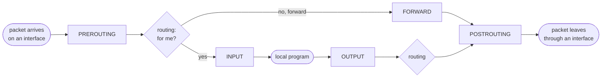
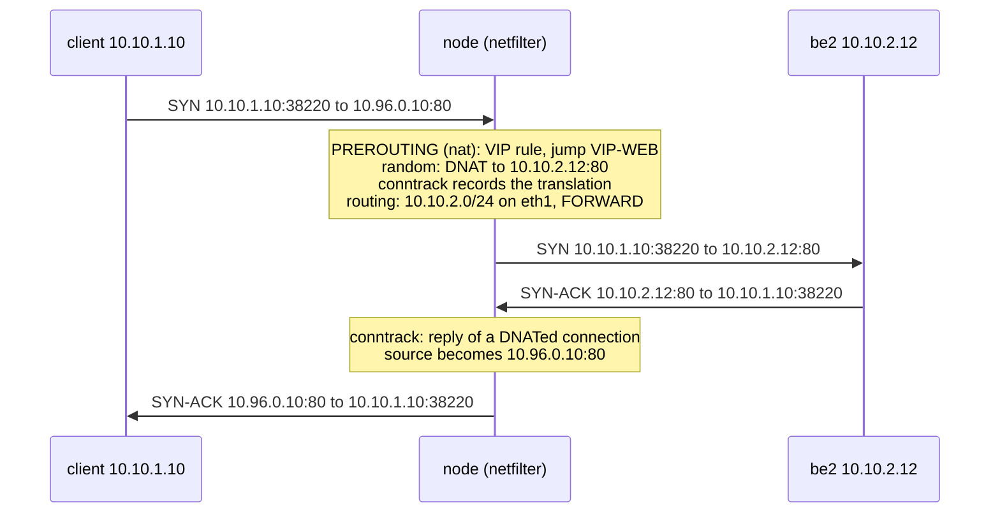

# Chapter 46: Netfilter: iptables, nftables, and conntrack

> **Exams:** CKNE · Foundations (Part V), supports D1 (Using Linux Tools (iptables, ip, tcpdump) for Packet-level Issues) and D2 (Understanding kube-proxy and CNI Alternatives)
> **Difficulty:** Intermediate
> **Time:** ~75 min reading, ~45 min lab
> **Lab tier:** 0 (netlab)
> **Prerequisites:** Chapter 41 (NAT), Chapter 42 (connections, DROP and REJECT)

## Learning objectives

After this chapter you can:

- Explain what netfilter is and where its hooks sit on a packet's path through a Linux host
- Name the iptables tables (`filter`, `nat`, `mangle`, `raw`) and the built-in chains, and say which chain a packet visits
- Read and write iptables rules: matches, targets, rule order, policies, and custom chains
- Read an nftables ruleset, and explain how iptables and nftables relate today
- Use conntrack to see connection state, and match on it in rules
- Build a kube-proxy-style virtual IP that load-balances across backends with DNAT

## Concepts

### Netfilter: hooks in the kernel

Every packet that enters, leaves, or crosses a Linux host passes through the
kernel's network stack. **Netfilter** is the framework inside that stack that
lets rules look at packets at fixed points, called **hooks**, and decide what
to do with them: let them pass, drop them, or change them.

Netfilter itself has no command. Tools load rules into it:

- **iptables** (and `ip6tables` for IPv6), the classic tool since 2001.
- **nftables** (the `nft` command), its successor, with one syntax for IPv4,
  IPv6, ARP, and bridges.

Both program the same hooks. Firewalls, NAT, Docker's port publishing, and
Kubernetes' Service handling in kube-proxy's iptables and nftables modes are
all netfilter rules.

### The packet's path

There are five hooks. Which ones a packet visits depends on where it is going:



*Text description: an arriving packet passes PREROUTING, then a routing decision. Packets for the host go through INPUT to a local program; packets to forward go through FORWARD and POSTROUTING and leave. Packets that local programs send go through OUTPUT, a routing decision, and POSTROUTING.*

- **PREROUTING**: every arriving packet, before the routing decision. This
  is where destination NAT goes, so that routing sees the new destination.
- **INPUT**: packets addressed to this host.
- **FORWARD**: packets passing through, on a router.
- **OUTPUT**: packets that this host's own programs send.
- **POSTROUTING**: every leaving packet, after routing. This is where source
  NAT goes, once the outgoing interface is known.

Three paths cover everything: arriving for me (PREROUTING, INPUT), passing
through (PREROUTING, FORWARD, POSTROUTING), and sent by me (OUTPUT,
POSTROUTING).

### iptables: tables, chains, rules

iptables groups rules into **tables** by purpose, and inside each table into
**chains**, one per hook it uses:

| Table | Purpose | Chains |
| --- | --- | --- |
| `filter` (the default) | allow or block | INPUT, FORWARD, OUTPUT |
| `nat` | change addresses and ports | PREROUTING, INPUT, OUTPUT, POSTROUTING |
| `mangle` | change other header fields, mark packets | all five |
| `raw` | exempt packets from connection tracking | PREROUTING, OUTPUT |

A **rule** is a set of **matches** and a **target**:

```bash
iptables -t filter -A INPUT -s 10.10.1.0/24 -p tcp --dport 22 -j ACCEPT
#        table     chain    match: source  match: TCP port 22   target
```

- Rules in a chain are checked **in order**, top to bottom. The first rule
  whose matches all fit decides with its target, and the rest are skipped.
- If no rule decides, the chain's **policy** applies (`ACCEPT` or `DROP`).
- Common matches: `-s` / `-d` (source / destination address or subnet),
  `-p tcp|udp|icmp`, `--sport` / `--dport` (ports, after `-p`), `-i` / `-o`
  (incoming / outgoing interface), and modules loaded with `-m`, such as
  `-m conntrack --ctstate ESTABLISHED` or `-m statistic`.
- Common targets: `ACCEPT`, `DROP`, `REJECT`, `LOG`, and in the `nat` table
  `DNAT`, `SNAT`, `MASQUERADE`, `REDIRECT`.

You can create your own chains and **jump** to them (`-j MYCHAIN`). When a
custom chain ends without a decision, processing returns to the rule after
the jump. Custom chains keep large rulesets organized, and kube-proxy uses
thousands of them.

The commands you need:

| Command | Does |
| --- | --- |
| `iptables -L -n -v --line-numbers` | list the filter table with counters and rule numbers |
| `iptables -t nat -L -n -v` | list another table |
| `iptables-save` | dump every rule in a form you can read, diff, and reload |
| `iptables -A CHAIN ...` / `-I CHAIN [n] ...` | append / insert a rule |
| `iptables -D CHAIN n` / `-R CHAIN n ...` | delete / replace rule number n |
| `iptables -N NAME` / `-F NAME` / `-X NAME` | create / flush / delete a chain |
| `iptables -P CHAIN DROP` | set a chain's policy |

The `pkts` and `bytes` counters in `-v` output are the best debugging tool
iptables has: send a test packet and see which rule's counter goes up.

### nftables

nftables replaces iptables' fixed tables and chains with ones you define
yourself. A ruleset looks like this:

```text
table inet guard {
  chain input {
    type filter hook input priority filter; policy accept;
    ip saddr 10.10.1.0/24 icmp type echo-request counter drop comment "testing, remove later"
  }
}
```

- A **table** has a family: `ip`, `ip6`, `inet` (both), `arp`, `bridge`.
- A **base chain** declares which hook it attaches to (`hook input`) and a
  priority. Several chains can sit on the same hook; they run in priority order.
- Rules read almost like English: match, `counter`, verdict.

`nft list ruleset` shows everything; `nft -a list ruleset` adds rule
**handles**, which you need to delete a single rule.

### iptables and nftables today

On current distributions, including this book's netlab, the `iptables`
command is really **iptables-nft**: it accepts the old syntax but stores the
rules as nftables tables named `ip filter`, `ip nat`, and so on. (Older systems
use **iptables-legacy**, which writes to the old kernel tables directly.)
`iptables -V` tells you which: `iptables v1.8.11 (nf_tables)`.

This has a practical consequence. Rules can exist that `iptables -L` never
shows: anything created with `nft` in tables of its own. When traffic is
blocked and iptables looks clean, check `nft list ruleset`. Every chain on a
hook runs, and a drop in any of them is final.

> **Why this matters for Kubernetes:** kube-proxy has three modes on Linux:
> `iptables` (the long-time default), `ipvs`, and `nftables` (generally
> available since Kubernetes 1.33). CNI plugins add their own rules too, and
> Cilium can replace kube-proxy entirely with eBPF programs that bypass
> these chains (Chapter 54). On a node, `iptables-save` and `nft list ruleset`
> show what kube-proxy and the CNI plugin did, and the CKNE expects you to read
> them.

### Connection tracking

Chapter 41 introduced **conntrack**, the kernel's table of connections. It is
part of netfilter and does two jobs:

1. It remembers NAT translations, so only the first packet of a connection goes
   through the `nat` table; every later packet, in both directions, is
   translated the same way automatically.
2. It gives every packet a **state** that rules can match:

| State | Meaning |
| --- | --- |
| `NEW` | the first packet of a connection |
| `ESTABLISHED` | part of a connection that has seen traffic in both directions |
| `RELATED` | a new connection that belongs to an existing one (for example an ICMP error about it) |
| `INVALID` | does not fit any known connection |
| `DNAT` / `SNAT` | the connection's address was translated |

The classic stateful firewall is two rules: allow `ESTABLISHED,RELATED`, then
decide about `NEW` connections one by one. Replies then need no rules of their
own.

`conntrack -L` lists the table, and `conntrack -E` prints events as they
happen. Each entry shows a connection twice, as it was sent and as the reply
is expected, so a NAT translation is visible as the difference between the two
halves.

### A load balancer made of rules

Here is the idea behind a Kubernetes Service, in netfilter terms. There is a
**virtual IP** (VIP), say `10.96.0.10`, that no interface has. Clients send
to it anyway; their default route takes the packets to a host with rules.
There, in PREROUTING:

1. A rule matches the VIP and port, and jumps to a chain for this service.
2. In that chain, one rule per backend DNATs the connection to that backend's
   address. A random match picks between them: the first rule matches with
   probability 1/n, the next with 1/(n-1) of what is left, and the last
   unconditionally.

conntrack then keeps every packet of that connection going to the same
backend, and reverses the translation on the replies.

kube-proxy's iptables mode builds exactly this, with generated chain names:

```text
-A KUBE-SERVICES -d 10.96.0.10/32 -p tcp --dport 80 -j KUBE-SVC-ABCDEF
-A KUBE-SVC-ABCDEF -m statistic --mode random --probability 0.50000000000 -j KUBE-SEP-111111
-A KUBE-SVC-ABCDEF -j KUBE-SEP-222222
-A KUBE-SEP-111111 -p tcp -j DNAT --to-destination 10.244.1.5:8080
-A KUBE-SEP-222222 -p tcp -j DNAT --to-destination 10.244.2.7:8080
```

`KUBE-SVC-*` is one chain per Service, and `KUBE-SEP-*` one chain per Service
endpoint (a backend Pod). This chapter's lab has you build the same structure by hand.

### Packet walk: through the virtual IP



*Text description: the client's SYN to the virtual IP is DNATed on the node to be2's address, recorded by conntrack, and forwarded. be2's reply comes back to the node, where conntrack rewrites its source back to the virtual IP before it reaches the client.*

The client only ever sees `10.96.0.10`; the backend sees the client's real
address. A capture on the node's two interfaces shows the same SYN before and
after translation:

```text
eth0: IP 10.10.1.10.38220 > 10.96.0.10.80: Flags [S], seq 95156001, ...
eth1: IP 10.10.1.10.38220 > 10.10.2.12.80: Flags [S], seq 95156001, ...
```

## Guided walkthrough

Start the lab and open a lab shell:

```bash
make lab CH=46
make shell
topo
```

```text
Chapter 46 lab: a node in front of two backends

  client 10.10.1.10 ---eth0--- node ---eth1--- switch "backends"
                       10.10.1.1    10.10.2.1     |          |
                                                 be1        be2
                                             10.10.2.11  10.10.2.12
                                              (web :80)   (web :80)
  Virtual IP to build on the node: 10.96.0.10, port 80
  (no host has this address; the client's default route points to node)
```

### Step 1: The virtual IP does not exist yet

```bash
on client curl http://10.96.0.10/
```

```text
curl: (7) Failed to connect to 10.96.0.10 port 80 after 0 ms: Could not connect to server
```

A capture on the client shows who said no:

```text
12:46:28.556002 IP 10.10.1.10.38154 > 10.96.0.10.80: Flags [S], seq 23322893, win 64240, length 0
12:46:28.556084 IP 10.10.1.1 > 10.10.1.10: ICMP net 10.96.0.10 unreachable, length 68
```

The SYN went to the node (the client's default route), and the node has no
route for `10.96.0.10`. A DNAT rule in PREROUTING will change the destination
*before* the node's routing decision, so the node will never need such a route.

### Step 2: List the filter rules

```bash
on node iptables -L -n -v
```

```text
Chain INPUT (policy ACCEPT 0 packets, 0 bytes)
 pkts bytes target     prot opt in     out     source               destination

Chain FORWARD (policy ACCEPT 0 packets, 0 bytes)
 pkts bytes target     prot opt in     out     source               destination

Chain OUTPUT (policy ACCEPT 0 packets, 0 bytes)
 pkts bytes target     prot opt in     out     source               destination
```

Empty chains, everything accepted. `-n` prints numbers instead of names, as
with tcpdump. Yet the client cannot ping the node. That is Task 1, and the
hint is in the section above about iptables and nftables.

### Step 3: Build a custom chain and a DNAT rule

This builds the single-backend version of the VIP from Task 2, so you can see
the result. Create a chain for the service in the `nat` table, and send the
VIP's traffic to it from PREROUTING:

```bash
on node iptables -t nat -N VIP-WEB
on node iptables -t nat -A PREROUTING -d 10.96.0.10/32 -p tcp --dport 80 -j VIP-WEB
on node iptables -t nat -A VIP-WEB -p tcp -j DNAT --to-destination 10.10.2.11:80
on client curl http://10.96.0.10/
```

```text
hello from be1 (10.10.2.11)
```

The DNAT rule needs its own `-p tcp`: a rule that changes a port must name the
protocol, or iptables refuses it with `Need TCP, UDP, SCTP or DCCP with port specification`.

### Step 4: Read the rules three ways

```bash
on node iptables -t nat -L VIP-WEB -n -v --line-numbers
on node iptables-save -t nat
on node nft list table ip nat
```

```text
Chain VIP-WEB (1 references)
num   pkts bytes target     prot opt in     out     source               destination
1        1    60 DNAT       tcp  --  *      *       0.0.0.0/0            0.0.0.0/0            to:10.10.2.11:80
*nat
:PREROUTING ACCEPT [0:0]
:INPUT ACCEPT [0:0]
:OUTPUT ACCEPT [0:0]
:POSTROUTING ACCEPT [0:0]
:VIP-WEB - [0:0]
-A PREROUTING -d 10.96.0.10/32 -p tcp -m tcp --dport 80 -j VIP-WEB
-A VIP-WEB -p tcp -j DNAT --to-destination 10.10.2.11:80
COMMIT
# Warning: table ip nat is managed by iptables-nft, do not touch!
table ip nat {
	chain VIP-WEB {
		ip protocol tcp counter packets 1 bytes 60 dnat to 10.10.2.11:80
	}

	chain PREROUTING {
		type nat hook prerouting priority dstnat; policy accept;
		ip daddr 10.96.0.10 tcp dport 80 counter packets 1 bytes 60 jump VIP-WEB
	}
}
```

`iptables-save` output is the format you will read most on Kubernetes nodes:
each line is the command that created the rule, minus the word `iptables`.
`nft` shows the same rules as nftables sees them, with a warning not to edit
iptables' tables with `nft`.

### Step 5: Watch conntrack

```bash
on client curl -s http://10.96.0.10/
on node conntrack -L -p tcp
```

```text
tcp      6 119 TIME_WAIT src=10.10.1.10 dst=10.96.0.10 sport=38168 dport=80 src=10.10.2.11 dst=10.10.1.10 sport=80 dport=38168 [ASSURED] mark=0 use=1
```

The first half is the connection as the client sent it (to `10.96.0.10`). The
second is the reply the node expects (from `10.10.2.11`). The difference is the
DNAT. `conntrack -E` streams events; run it in a second shell and repeat the
curl:

```text
    [NEW] tcp      6 120 SYN_SENT src=10.10.1.10 dst=10.96.0.10 sport=35410 dport=80 [UNREPLIED] src=10.10.2.12 dst=10.10.1.10 sport=80 dport=35410
 [UPDATE] tcp      6 60 SYN_RECV src=10.10.1.10 dst=10.96.0.10 sport=35410 dport=80 src=10.10.2.12 dst=10.10.1.10 sport=80 dport=35410
 [UPDATE] tcp      6 432000 ESTABLISHED src=10.10.1.10 dst=10.96.0.10 sport=35410 dport=80 src=10.10.2.12 dst=10.10.1.10 sport=80 dport=35410 [ASSURED]
```

You can follow the handshake from Chapter 42 through conntrack's states.

### Step 6: Undo it

The lab tasks start from scratch, so remove what you built: flush the custom
chain, delete the jump, and delete the chain (or simply run `make reset CH=46`):

```bash
on node iptables -t nat -D PREROUTING 1
on node iptables -t nat -F VIP-WEB
on node iptables -t nat -X VIP-WEB
```

A chain can only be deleted when it is empty and nothing jumps to it.

## Hands-on lab

Start (or restart) the lab and open a lab shell:

```bash
make reset CH=46
make shell
```

Run all commands in the lab shell; type `make check CH=46` on your machine after each task. Make all changes on the `node` host; do not change addresses or routes. Solutions: `chapters/46-netfilter/lab/solutions.md`.

### Task 1: Find the hidden rule

The client cannot ping the node, although `iptables -L` on the node shows no rules at all. Find what blocks it and remove it.

- The client can ping `10.10.1.1`

### Task 2: A virtual IP

Make `10.96.0.10` port 80 a virtual IP on the node that sends connections to a backend.

- From the client, `http://10.96.0.10/` returns a backend's page

### Task 3: Load balancing

Spread the virtual IP's connections across both backends, the way kube-proxy does.

- Repeated requests from the client to `http://10.96.0.10/` are answered by both `be1` and `be2`

### Task 4: Backends only through the virtual IP

Clients should reach the backends' web servers only through the virtual IP, never directly.

- From the client, `http://10.96.0.10/` still works
- From the client, `http://10.10.2.11/` and `http://10.10.2.12/` fail

## Exam tips

> **Exam tip:** To find a Service's rules on a node with kube-proxy in iptables
> mode: `iptables-save | grep <service-cluster-ip>` finds the `KUBE-SERVICES`
> line and its `KUBE-SVC-` chain; `iptables-save | grep KUBE-SVC-XXXX` shows the
> endpoint chains; and the `KUBE-SEP-` chains hold the Pod addresses. A Service
> with no endpoints gets a REJECT rule instead.

> **Exam tip:** Use the counters. `iptables -L -n -v` (or `-t nat`) before and
> after a test request shows which rule the packets hit. `iptables -Z` resets
> the counters, which makes the change easier to see.

> **Exam tip:** When iptables looks clean but traffic is blocked, run
> `nft list ruleset`. On nodes with Cilium, also remember that eBPF programs
> handle traffic without any iptables rules at all (Chapter 54).

## Common mistakes

- **Appending a rule after a rule that already decides.** Rules are checked in
  order. An ACCEPT appended after a DROP that matches the same packets is never
  reached. Use `-I` to insert at the top, or check `--line-numbers`.
- **DNAT in the wrong chain.** Destination changes belong in PREROUTING (for
  arriving packets) or OUTPUT (for the host's own); in POSTROUTING it is too
  late, because routing has already happened.
- **Filtering on the VIP in FORWARD.** By the time a packet reaches FORWARD,
  DNAT has already replaced the VIP with the backend's address. Match on
  `--ctstate DNAT` or on `--ctorigdst` instead.
- **Forgetting that conntrack remembers.** Changing a NAT rule does not affect
  connections that already exist. `conntrack -D` deletes entries, so new rules
  apply to new connections at once.
- **Mixing tools on the same table.** Do not edit iptables-nft's tables with
  `nft`. Use one tool per table.

<!-- QUESTIONS:START -->

## End-of-chapter questions

**1.** `CKNE` A packet arrives at a Linux router and is forwarded to another network. Which netfilter hooks does it pass, in order?

- **A.** INPUT, OUTPUT
- **B.** PREROUTING, FORWARD, POSTROUTING
- **C.** PREROUTING, INPUT, FORWARD
- **D.** OUTPUT, POSTROUTING

**2.** `CKNE` Which iptables table and chain do you use to block incoming SSH connections to the host itself?

- **A.** nat table, PREROUTING chain
- **B.** filter table, INPUT chain
- **C.** filter table, FORWARD chain
- **D.** mangle table, OUTPUT chain

**3.** `CKNE` The INPUT chain has rule 1 `-p tcp --dport 22 -j DROP` and rule 2 `-s 10.10.1.10 -j ACCEPT`. Can 10.10.1.10 connect to port 22?

- **A.** Yes, because rule 2 is more specific
- **B.** No, because rule 1 matches first and its DROP decides
- **C.** Yes, because ACCEPT always wins
- **D.** It depends on the chain's policy

**4.** `CKNE` `iptables -L -n -v` shows empty chains with policy ACCEPT, yet ping to the host is dropped. What should you check next?

- **A.** The routing table only
- **B.** `nft list ruleset`, because nftables tables of their own also hook into netfilter and iptables does not show them
- **C.** The MTU
- **D.** Nothing; iptables is always the complete picture

**5.** `CKNE` Why must a rule that DNATs traffic for a virtual IP be in PREROUTING?

- **A.** Because only PREROUTING can see TCP ports
- **B.** Because the destination must be rewritten before the routing decision, so the packet is routed to the backend
- **C.** Because POSTROUTING is only for IPv6
- **D.** Because FORWARD drops DNAT packets

**6.** `CKNE` kube-proxy's iptables mode creates chains named `KUBE-SVC-...` and `KUBE-SEP-...`. What are they?

- **A.** KUBE-SVC: one chain per Service that picks an endpoint; KUBE-SEP: one chain per endpoint that DNATs to its Pod address
- **B.** KUBE-SVC: firewall rules; KUBE-SEP: logging
- **C.** KUBE-SVC: SNAT for Services; KUBE-SEP: DNS rules
- **D.** Both hold NetworkPolicy rules

**7.** `CKNE` A Service has three endpoints. kube-proxy's chain has three rules with random matching. What probabilities make the split even?

- **A.** 0.33, 0.33, 0.33
- **B.** 0.33, 0.5, and then the last rule unconditionally
- **C.** 0.5, 0.5, 0.5
- **D.** 1, 1, 1

**8.** `CKNE` What does conntrack's `ESTABLISHED` state allow a firewall to do?

- **A.** Block all replies
- **B.** Allow reply packets of connections it already allowed, with one rule, instead of writing rules for every reply
- **C.** Encrypt established connections
- **D.** Load-balance connections

**9.** `CKNE` You changed a DNAT rule to point a virtual IP at a new backend, but an existing long-lived connection still reaches the old one. Why?

- **A.** iptables changes need a reboot
- **B.** conntrack keeps translating existing connections the way it decided on their first packet; only new connections see the new rule
- **C.** The new rule was added to the wrong table
- **D.** DNAT only works for UDP

**10.** `CKNE` A conntrack entry reads `src=10.10.1.10 dst=10.96.0.10 sport=38168 dport=80 src=10.10.2.11 dst=10.10.1.10 sport=80 dport=38168`. What happened to this connection?

- **A.** It was SNATed to 10.10.2.11
- **B.** It was sent to the virtual IP 10.96.0.10 and DNATed to the backend 10.10.2.11
- **C.** It failed
- **D.** Two separate connections were made

**11.** `CKNE` On a current Debian or Ubuntu system, `iptables -V` prints `iptables v1.8.11 (nf_tables)`. What does that mean?

- **A.** iptables is not installed
- **B.** The iptables command stores its rules as nftables tables (iptables-nft); nft list ruleset shows them too
- **C.** Only IPv6 is supported
- **D.** The kernel has no netfilter

**12.** `CKNE` Which three proxy modes does kube-proxy support on Linux?

- **A.** userspace, eBPF, and XDP
- **B.** iptables, ipvs, and nftables
- **C.** Envoy, HAProxy, and NGINX
- **D.** VXLAN, Geneve, and IPIP

<details>
<summary>Answers</summary>

**1. B.** Forwarded packets never touch INPUT or OUTPUT, which are for packets to and from the host itself. They pass PREROUTING, the routing decision, FORWARD, and POSTROUTING.

**2. B.** The filter table is for allowing and blocking; INPUT holds rules for packets addressed to this host. FORWARD is for packets passing through.

**3. B.** Rules are evaluated in order, and the first matching rule with a deciding target wins. Insert the ACCEPT above the DROP (iptables -I INPUT 1 ...) to allow that host.

**4. B.** iptables-nft only shows its own tables. Any nftables table created with nft runs on the same hooks, and a drop there is final.

**5. B.** Routing uses the destination address. Rewriting it in PREROUTING means routing sends the packet to the backend; later chains are too late.

**6. A.** KUBE-SERVICES matches the ClusterIP and port and jumps to the Service's KUBE-SVC chain, which picks a KUBE-SEP chain at random (-m statistic). Each KUBE-SEP chain DNATs to one Pod's address and port.

**7. B.** The first rule takes 1/3 of new connections. Of the remaining 2/3, the second takes half (1/3 of the total). The last rule takes everything that is left (1/3).

**8. B.** A stateful firewall accepts ESTABLISHED,RELATED packets first, then decides about NEW connections. Replies need no rules of their own.

**9. B.** Only the first packet of a connection goes through the nat table. conntrack applies the stored translation to the rest. conntrack -D can delete entries to force new decisions.

**10. B.** The first half is the original direction (to 10.96.0.10), the second the expected reply (from 10.10.2.11). The changed address between the halves is the DNAT.

**11. B.** iptables-nft translates the classic syntax into nftables rules in tables such as ip filter and ip nat. iptables-legacy writes to the old kernel tables instead.

**12. B.** kube-proxy programs iptables rules, IPVS virtual servers, or nftables rules. eBPF replacements such as Cilium's work without kube-proxy (Chapter 54); VXLAN and Geneve are overlays, not proxy modes.

</details>

<!-- QUESTIONS:END -->

## Further reading

- `man iptables`, `man iptables-extensions` (statistic, conntrack), `man nft`, and `man conntrack` in the lab shell
- The netfilter project's documentation, including the nftables wiki
- The Kubernetes documentation page *Virtual IPs and Service Proxies*, which describes kube-proxy's modes
