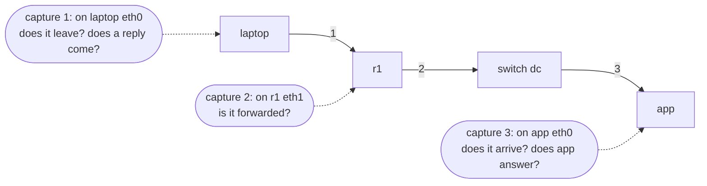
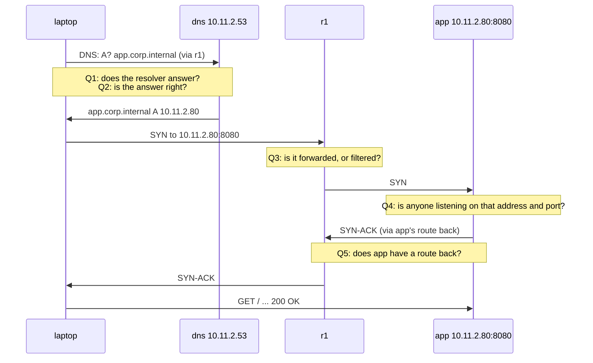

# Chapter 47: The troubleshooting method

> **Exams:** CKNE · Foundations (Part V), supports D1 (Troubleshooting Pod Connectivity (DNS, pod-to-pod); Using Linux Tools (iptables, ip, tcpdump) for Packet-level Issues) and D2 (Troubleshooting Service Network Traffic)
> **Difficulty:** Intermediate
> **Time:** ~45 min reading, ~60 min lab
> **Lab tier:** 0 (netlab)
> **Prerequisites:** Chapters 38 to 46

## Learning objectives

After this chapter you can:

- Follow a repeatable method to find a network fault instead of guessing
- Map a symptom (an error message, a timeout, a status code) to the layer it most likely comes from
- Choose the right tool for each layer, and know what its output proves and does not prove
- Use captures at chosen points on the path to split a problem in half
- Find and fix several stacked faults in one network, one at a time

## Concepts

### Why a method

Network faults are frustrating because one symptom has many possible causes.
"The app doesn't work" can be a cable, an address, a route, a firewall, a
missing listener, a DNS record, or the app itself. Under pressure, people
guess: restart things, change settings at random, and lose track of what they
changed. Sometimes the fault goes away and nobody knows why. Often a second
fault appears.

A method is slower for the first minute and much faster after that. Everything
in Part V has been preparing for it: you know the layers, what each one does,
and how to look at it.

### The method in six steps

1. **Define the symptom precisely.** Not "the network is down", but "from
   the laptop, `curl http://app.corp.internal:8080/` fails with
   `Resolving timed out`". Which source, which destination, which port, which
   exact error.
2. **Find what changed.** A configuration change, a deployment, a new node, a
   certificate that just expired. Most outages follow a change.
3. **Locate the layer.** Use the symptom to pick the most likely layer
   (the table below), then confirm with a tool from that layer.
4. **Split the path.** Pick a point halfway between source and destination and
   test there. Does the packet get that far? Then the fault is in the second
   half; otherwise, in the first. Repeat.
5. **Change one thing.** Form a hypothesis ("dns's switch port is not on the
   bridge"), make the one change that tests it, and check the original symptom
   again.
6. **Check again, and keep going.** Real outages often have more than one
   fault. Fixing one can reveal the next, with a different symptom. That is
   progress, not failure.

When you get stuck, go back to step 1: what exactly is the symptom now?

### From symptom to layer

Error messages are clues. Read them literally:

| Symptom | Most likely layer | First things to check |
| --- | --- | --- |
| `Cannot find device`, `NO-CARRIER`, interface `DOWN` | 1-2: link | `ip -br link` on both ends, bridge ports |
| `Destination Host Unreachable`, ARP `FAILED` / `INCOMPLETE` | 2: same LAN | the target is down, unplugged, or not on the bridge; wrong subnet |
| `Network is unreachable` (local) | 3: your routing table | `ip route`, default route |
| `Destination Net Unreachable` from a router | 3: that router | its routes |
| ping silent, request seen arriving at the target | 3: the return path | the target's routes, routers on the way back |
| ping works, TCP times out | 3-4: a filter | iptables/nftables counters, network policies, security groups |
| `Connection refused` | 4: the listener | `ss -ltnp` on the target: running? right address? right port? |
| `Resolving timed out`, `no servers could be reached` | 7: the resolver is unreachable | treat it like any other host: ping, route, link |
| `NXDOMAIN` | 7: the name | the record exists? typo? search list? |
| wrong address in the answer | 7: the record | zone data, caches, TTL |
| TLS errors (`unable to get local issuer`, name mismatch, expired) | 7: certificates | Chapter 44 |
| HTTP 4xx | 7: the request | path, host name, authentication |
| HTTP 502, 503, 504 from a proxy | 7: the backends behind it | Chapter 44 |

The difference between "refused" and "timed out" alone saves a lot of time:
refused means you reached the host, timed out means something is lost or
dropped on the way.

### The toolkit by layer

| Layer | Question | Tools |
| --- | --- | --- |
| Link | Is the cable plugged in and up? | `ip -br link`, `ip -d link`, `bridge link`, `ethtool` |
| Link | Who is on this LAN? | `ip neigh`, `arping`, `bridge fdb show` |
| Internet | Do I have an address and a route? | `ip -br addr`, `ip route`, `ip route get <dst>` |
| Internet | Do packets get there and back? | `ping`, `traceroute -n`, `mtr -n`, `tracepath` (also finds MTU) |
| Transport | Is anyone listening? | `ss -ltnp` / `ss -lunp` on the target |
| Transport | Does a connection open? | `nc -zv -w 2 <host> <port>`, `curl -v` |
| Transport | Is something filtering? | `iptables -L -n -v`, `iptables-save`, `nft list ruleset`, `conntrack -L` |
| Application | Does the name resolve? | `dig`, `dig @server`, `getent hosts` |
| Application | Does the service answer correctly? | `curl -v`, `curl -w`, `openssl s_client` |
| All | What is actually on the wire? | `tcpdump -n` at chosen points |

Two of them deserve an extra word.

**`mtr`** combines ping and traceroute: it shows every hop with its loss and
latency, updated live. `mtr -n -r -c 10 <host>` runs ten rounds and prints a
report, which is handy for pasting into a ticket.

**`curl -w`** prints timing for each phase of a request, which tells you
*where* a slow request spends its time:

```bash
curl -s -o /dev/null -w 'dns:%{time_namelookup}s connect:%{time_connect}s first-byte:%{time_starttransfer}s total:%{time_total}s code:%{http_code}\n' http://app.corp.internal:8080/
```

```text
dns:0.000642s connect:0.000735s first-byte:0.001521s total:0.001555s code:200
```

A large `dns` time points at the resolver; a large gap between `connect` and
`first-byte` points at the application.

### Capture points: splitting the path

A capture is the most direct evidence you can get. It shows what is really on
the wire at one point, regardless of what any configuration says should
happen. The trick is to choose the point.



*Text description: three capture points on the path from laptop to app: on the laptop's interface, on the router's outgoing interface, and on the app's interface. Each one answers whether the packet got that far and whether a reply came back.*

- The packet leaves the source but never arrives at the target: the fault is
  in between. Capture halfway.
- The packet arrives at the target, and the target replies, but the reply
  never reaches the source: look at the return path.
- The packet arrives, and the target does not reply: look at the target itself
  (listener, local firewall, a route back that points somewhere else).

Always filter tightly (`host`, `port`, `icmp`) so that the one packet you care
about is not lost in noise.

### Packet walk: the troubleshooter's view

This is the path a request takes in this chapter's lab, with the question to
ask at each step:



*Text description: the laptop first asks DNS for the app's address (does the resolver answer, and is the answer right?), then sends a SYN through r1 (forwarded or filtered?) to the app (is anything listening?), whose reply needs a route back to the laptop. Only then does HTTP run.*

Every arrow is a place where things can break, and every note is a question
you can answer with one tool from the table above.

> **Why this matters for Kubernetes:** Kubernetes troubleshooting is this
> method with more layers. A request from a Pod to a Service crosses: the Pod's
> resolver (`resolv.conf`, CoreDNS), the Service's virtual IP (kube-proxy or
> eBPF rules), endpoint selection (labels, readiness), NetworkPolicies, the
> node-to-node network (routes or an overlay), and finally the target Pod's
> listener. Parts VI and VII give you a tool for each. The method stays the same.

## Guided walkthrough

Start the lab and open a lab shell:

```bash
make lab CH=47
make shell
topo
```

```text
Chapter 47 lab: an office laptop and a small data centre

   laptop 10.11.1.10 ---eth0--- r1 ---eth1--- switch "dc"
   (resolver: 10.11.2.53,  10.11.1.1   10.11.2.1   |       |
    search corp.internal)                         dns     app
                                            10.11.2.53  10.11.2.80
                                             (dnsmasq)  (web :8080)
   Goal: on the laptop, curl http://app.corp.internal:8080/ works.
   DNS data: /etc/dns/hosts.corp (reload: pkill -HUP dnsmasq)
   The app: python3 -m http.server 8080 --directory /srv/app
```

This network has five faults, one or two per layer. The walkthrough does
steps 1 and 3 of the method for the first one, then leaves the rest to the lab.

### Step 1: Define the symptom

```bash
on laptop curl --max-time 5 http://app.corp.internal:8080/
```

```text
curl: (28) Resolving timed out after 5000 milliseconds
```

Precise symptom: from the laptop, resolving `app.corp.internal` times out.
Not "the app is down"; the request never got as far as the app.

### Step 2: Locate the layer

"Resolving timed out" is layer 7, but a *timeout* (rather than `NXDOMAIN`)
says the resolver did not answer at all. Confirm with dig:

```bash
on laptop dig app.corp.internal
```

```text
;; communications error to 10.11.2.53#53: timed out
;; no servers could be reached
```

The resolver at `10.11.2.53` is unreachable. A DNS server is just another
host, so the question becomes: can the laptop reach `10.11.2.53` at all?

### Step 3: Split the path

The path is laptop, r1, switch dc, dns. Test each hop, near to far:

```bash
on laptop ping -c 1 10.11.1.1
on laptop ping -c 1 10.11.2.1
on laptop ping -c 2 -W 1 10.11.2.53
```

The first two answer; the third does not. The fault is beyond r1's `eth1`, on
the dc LAN. `mtr` and `tracepath` show the same thing as a picture:

```bash
on laptop tracepath -n 10.11.2.53
```

```text
 1?: [LOCALHOST]                      pmtu 1500
 1:  10.11.1.1                                             0.047ms
 1:  10.11.1.1                                             0.009ms
 2:  no reply
 2:  10.11.1.1                                           3077.075ms !H
     Resume: pmtu 1500
```

`!H` means r1 reported "host unreachable": it could not deliver to the last
hop. Ask r1 why:

```bash
on r1 ip neigh
```

```text
10.11.1.10 dev eth0 lladdr ea:44:25:b2:17:0c DELAY
10.11.2.53 dev eth1 FAILED
```

`FAILED`: r1 asked "who has 10.11.2.53?" and got no answer. That is a layer 2
problem on the dc LAN: dns is down, unplugged, or not on the switch. From here,
Chapter 39's tools finish the job. That is Task 1.

### Step 4: Keep notes

Before you start the lab, open a scratch file (`nano /tmp/notes.txt`) and write
down each symptom, what you checked, and what you changed. It sounds like
bureaucracy. It is how you avoid fixing the same thing twice or undoing a fix
by accident, and in an exam, it is how you pick up a task where you left it.

## Hands-on lab

Start (or restart) the lab and open a lab shell:

```bash
make reset CH=47
make shell
```

Run all commands in the lab shell; type `make check CH=47` on your machine after each task. The tasks follow the order in which the faults show up: each fix reveals the next symptom. Do not change any IP address, and do not edit hosts files: fix the real faults. Solutions: `chapters/47-troubleshooting-method/lab/solutions.md`.

### Task 1: Names do not resolve

Users on the laptop say nothing resolves: every lookup times out. Make the DNS server reachable again.

- The laptop gets answers from the DNS server `10.11.2.53`

### Task 2: The wrong address

Names resolve now, but connecting to the app still fails, and the address in the answer looks suspicious. Find the right address and fix the source of the wrong one.

- On the laptop, `app.corp.internal` resolves to `10.11.2.80`

### Task 3: No reply

The laptop cannot even ping the app. Find out where the packets go missing, and fix it.

- The laptop can ping `10.11.2.80`

### Task 4: Connections time out

Ping works, but connections to the app's port 8080 hang until they time out. Find what blocks them and fix it.

- Connections from the laptop to `10.11.2.80:8080` get an answer (a page or a refusal) instead of timing out

### Task 5: Connection refused

Connections are now refused. Make the app serve the laptop.

- The laptop gets the app's page from `http://app.corp.internal:8080/`

## Exam tips

> **Exam tip:** Read the task, then reproduce the symptom yourself before
> changing anything. In the exam, the task text tells you what "fixed" looks
> like, and that is the test you run at the end.

> **Exam tip:** Budget your time. If a troubleshooting task does not yield in
> a few minutes, write down where you are, move to the next task, and come back.
> Tasks are graded independently.

> **Exam tip:** In Kubernetes, the order is the same as in this lab: DNS
> (`nslookup` from a Pod), then the Service and its endpoints
> (`kubectl get endpointslices`), then connectivity to a Pod IP directly, then
> NetworkPolicies, then the target Pod's listener (`ss -ltn` through `nsenter`
> or a debug container).

## Common mistakes

- **Changing several things at once.** If the problem goes away, you do not know
  which change fixed it, or which one broke something else.
- **Stopping at the first fix.** A fix that changes the symptom is progress.
  Re-test the original request after every change.
- **Trusting configuration over evidence.** "The rule says allow" is not proof.
  A capture or a counter is.
- **Testing from the wrong place.** A test from the router succeeds where the
  laptop fails, because the router's packets take a different path and have a
  different source address. Test from where the user is.
- **Skipping the bottom layers.** Checking DNS records for ten minutes before
  noticing that the DNS server is unreachable is the most common way to lose time.

<!-- QUESTIONS:START -->

## End-of-chapter questions

**1.** What is the first step of the troubleshooting method?

- **A.** Restart the service
- **B.** Define the symptom precisely: source, destination, port, and the exact error
- **C.** Run tcpdump on every host
- **D.** Check the firewall

**2.** `CKNE` curl fails with `Connection refused`. Which conclusion is right?

- **A.** A firewall on the path is silently dropping packets
- **B.** The target host was reached; check whether anything listens on that address and port
- **C.** DNS is broken
- **D.** The route is missing

**3.** `CKNE` curl fails with `Resolving timed out`, and `dig` says `no servers could be reached`. What should you check next?

- **A.** The DNS record for the name
- **B.** Whether the resolver's address is reachable at all: ping it, check routes and the link
- **C.** The application logs
- **D.** The TLS certificate

**4.** A router's `ip neigh` shows `10.11.2.53 dev eth1 FAILED`. Which layer is the problem most likely at?

- **A.** Layer 7: DNS
- **B.** Layer 2: nothing answers ARP for that address on the eth1 LAN
- **C.** Layer 4: a missing listener
- **D.** Layer 3: a missing default route on the router

**5.** `CKNE` A capture on the target shows the ping requests arriving, but the source never gets replies. Where do you look next?

- **A.** The source's default route
- **B.** The return path: the target's routing table and the routers between it and the source
- **C.** The DNS server
- **D.** The target's listener on port 80

**6.** `CKNE` Ping to a server works, but TCP connections to port 8080 time out. What is the most likely cause?

- **A.** The server's interface is down
- **B.** A filter on the path (firewall rule, NetworkPolicy, security group) drops the TCP packets
- **C.** The DNS record is wrong
- **D.** Nothing listens on port 8080

**7.** Why should you change only one thing at a time while troubleshooting?

- **A.** Because Linux only applies one change per minute
- **B.** So you know which change fixed (or broke) what, and can undo it
- **C.** To save typing
- **D.** Because firewall rules must be added in order

**8.** `curl -w` reports `dns:4.98s connect:4.99s first-byte:5.01s total:5.01s`. Where is the time spent?

- **A.** In the application
- **B.** In name resolution
- **C.** In the TCP handshake
- **D.** In the TLS handshake

**9.** You fixed a fault, and the error message changed from `Connection timed out` to `Connection refused`. What does that mean?

- **A.** Your fix made things worse
- **B.** Progress: packets now reach the host; the next fault is at the listener
- **C.** The first fault is still there
- **D.** DNS changed

**10.** Which tool shows each hop on a path with its packet loss and latency, updated continuously?

- **A.** ss
- **B.** mtr
- **C.** dig
- **D.** conntrack

**11.** `CKNE` From a router, a curl to the app works; from the user's laptop it fails. What is a likely reason the test from the router is misleading?

- **A.** Routers always bypass firewalls
- **B.** The router's packets take a different path and have a different source address, so they avoid the fault the laptop hits
- **C.** curl works differently on routers
- **D.** The laptop has a different MTU

**12.** `CKNE` A Pod cannot reach a Service by name. In which order should you investigate?

- **A.** NetworkPolicies, then DNS, then the listener
- **B.** DNS (does the name resolve?), then the Service and its endpoints, then connectivity to a Pod IP, then policies, then the target's listener
- **C.** Restart CoreDNS, then the Pods, then the nodes
- **D.** The node's MTU first

<details>
<summary>Answers</summary>

**1. B.** A precise symptom tells you which layer to look at and gives you a test to repeat after every change. Restarting first can destroy the evidence.

**2. B.** Refused means an answer came back (usually a TCP reset from the target). Silent drops cause timeouts, DNS failures fail before any connection, and missing routes give unreachable errors or timeouts.

**3. B.** A timeout means the resolver did not answer at all, so the record cannot be the problem yet. Treat the DNS server like any other unreachable host.

**4. B.** FAILED means ARP requests went unanswered. The host is down, unplugged, not attached to the switch, or on a different subnet.

**5. B.** The request arrived, so the forward path works. The reply follows the target's own routes, which may be missing or point elsewhere.

**6. B.** Working ping proves the path and the host. A timeout (rather than a refusal) on one port points at something dropping that traffic. A missing listener would give connection refused.

**7. B.** Several changes at once hide cause and effect. You may fix the symptom with one change while another introduces a new fault.

**8. B.** time_namelookup is almost five seconds, and every later phase adds only milliseconds. The resolver is slow, often a first nameserver that times out before the second one answers.

**9. B.** Real outages often have several faults. A new, different symptom means you moved up the stack.

**10. B.** mtr combines traceroute and ping. mtr -n -r -c 10 prints a report after ten rounds.

**11. B.** Source address and path matter: return routes, firewall rules, and NetworkPolicies often depend on them. Test from where the problem is.

**12. B.** Follow the request's own path: name, virtual IP, endpoints, network, policy, and finally the application. Each step narrows the fault to one layer.

</details>

<!-- QUESTIONS:END -->

## Further reading

- `man mtr`, `man tracepath`, and the "write-out" section of `man curl` (`-w` variables) in the lab shell
- The Kubernetes documentation pages *Debug Services* and *Debugging DNS Resolution*, which apply this method to clusters
- Brendan Gregg, *Systems Performance*, for the general method of narrowing down where time and errors come from
