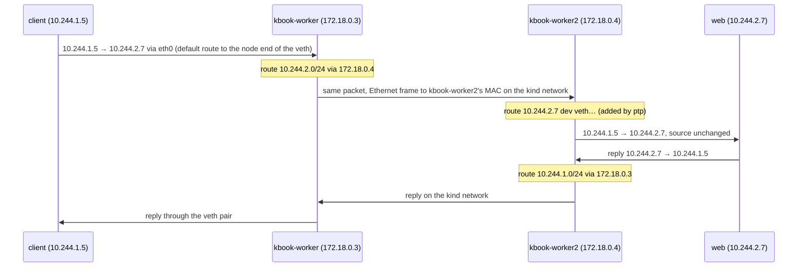

# Chapter 48: The Kubernetes network model and CNI

> **Exams:** CKNE · D1 Core Infrastructure and CNI (Installing and Configuring CNI Plugins; Managing IPAM and Pod CIDR Allocation; Troubleshooting Pod Connectivity (DNS, pod-to-pod))
> **Difficulty:** Intermediate
> **Time:** ~75 min reading, ~60 min lab
> **Lab tier:** 1 (kind, profile `nocni`)
> **Prerequisites:** Part V, especially Chapters 41 (routing and NAT) and 45 (virtual networking by hand); CKA-level Kubernetes basics (Chapters 04, 05, 11, and 21)

## Learning objectives

After this chapter you can:

- Build and inspect the book's Tier 1 lab cluster, and reach its nodes the way you reach exam hosts
- State the rules of the Kubernetes network model and the four communication problems it solves
- Say which component solves which problem: the CNI plugin, kube-proxy, and CoreDNS
- Explain what CNI is: who calls a plugin, how it gets its input, and what it returns
- Read and write a CNI configuration list with the `ptp` and `host-local` plugins
- Find each node's Pod CIDR, and connect the Pod networks of several nodes by hand
- Recognize the symptoms of a cluster without a working Pod network

## Concepts

### Part VI starts here: from namespaces to a cluster

In Part V every "computer" was a network namespace inside one container. From
now on the labs run on the book's kind cluster again, the one you built in
Chapter 03. It is still built from containers, so it runs on a laptop, but
everything on it is the real software.

As a reminder, **kind** (Kubernetes in Docker) runs each Kubernetes **node** as
a Docker container. Inside each node container run systemd, the container
runtime `containerd`, and the kubelet, exactly as on a virtual machine. The
book's cluster is called `kbook` and has three nodes:

| Node | Role | What runs there |
| --- | --- | --- |
| `kbook-control-plane` | control plane | the API server, etcd, the scheduler, the controller manager |
| `kbook-worker` | worker | your Pods |
| `kbook-worker2` | worker | your Pods |

The three node containers sit on a Docker network called `kind`
(`172.18.0.0/16` on most machines). To the nodes it is simply their LAN, just
like the `lan9` switch in Chapter 45.

Each lab chooses a **profile**, a recipe for the cluster, kept in
`envs/kind/profiles/<name>/`. Parts I to IV all use the default profile,
`calico`: Calico as the Pod network, plus metrics-server. This chapter uses
`nocni`, a cluster with no Pod network at all, because you are going to build
one. Most later chapters use `cilium`. A lab names its profile in
`lab/lab.env` (`LAB_PROFILE`), and `make lab` rebuilds the cluster when it
runs a different one, so moving between Parts costs a rebuild of a minute or
two. `make cluster-status` shows the current profile; `make cluster
PROFILE=<name>` builds one by hand, and `make cluster` goes back to `calico`.

> **Exam tip:** On the exam you work on hosts that you reach with `ssh`. In the
> lab, `docker exec -it kbook-worker bash` is the same thing: a root shell on a
> node. Everything you do there (`ip`, `iptables`, files in `/etc/cni/net.d`)
> works the same way on the exam's machines.

### The Kubernetes network model

Kubernetes does not ship a Pod network. It writes down rules that any
network must follow, and leaves the implementation to plugins. The rules,
called the **Kubernetes network model**, are:

1. Every Pod gets its own IP address. All containers of a Pod share it.
2. Every Pod can reach every other Pod, on any node, by its IP address,
   **without NAT**: the receiver sees the sender's real Pod address.
3. Agents on a node (the kubelet, for example) can reach every Pod on that node.

Rule 2 is what makes Kubernetes feel like one big flat network. Compare it
with Docker on a single machine, where containers hide behind the host's
address with masquerading, exactly like the home network in Chapter 41.

The rules leave one question open: how traffic reaches **outside** the
cluster. Most networks masquerade it, because outside machines have no route
back to Pod addresses. You will add that rule yourself in the lab.

### Four communication problems

The Kubernetes documentation splits networking into four problems. Each one
has a different owner.

| Problem | Solved by | Where in the book |
| --- | --- | --- |
| Container to container in one Pod | the shared network namespace: they talk over `localhost` | Chapter 45 |
| Pod to Pod | the **CNI plugin**: Pod interfaces, addresses, routes between nodes | this chapter, 49 to 52 |
| Pod to Service | **kube-proxy** (or a CNI plugin that replaces it): DNAT from the Service address to a Pod | Chapters 53 to 55 |
| Outside to Service | NodePort, LoadBalancer, Gateway API | Chapters 53, 57, 59 |

Chapter 21 gave a first tour of these pieces for the CKA; Parts VI to X take
each one apart. Two more pieces sit on top. **CoreDNS** gives Services names; it runs as
ordinary Pods, so it needs a working Pod network before it can start. Network
policies, covered in Part IX, are enforced by the CNI plugin.

> **Why this matters for Kubernetes:** When something is broken, this table
> tells you where to look. A Pod that cannot reach another Pod's IP is a CNI
> problem. A Pod that reaches the Pod IP but not the Service address is a
> kube-proxy problem. A Pod that reaches the Service address but not its name
> is a DNS problem.

### What CNI is

**CNI** (Container Network Interface) is a small specification from the CNCF.
It defines how a container runtime asks a program, the **CNI plugin**, to
connect a network namespace to the network. A plugin is not a daemon. It is
an executable file that runs once per request and exits.

When the scheduler places a Pod on a node, this happens on that node:

1. The kubelet asks the container runtime (containerd) to create the Pod's
   **sandbox**, the environment the Pod's containers will share.
2. containerd creates a new network namespace for it.
3. containerd reads the first configuration file, in alphabetical order, in
   `/etc/cni/net.d/`. It runs the plugin named in that file from
   `/opt/cni/bin/`.
4. The plugin creates the Pod's interface (usually a veth pair, as in
   Chapter 45), gives it an address, adds routes, and prints a JSON result.
5. containerd records the result and starts the containers inside the
   namespace. The address appears in `kubectl get pod -o wide`.

When the Pod is deleted, the same plugin runs again to clean up.

The runtime talks to the plugin in two ways:

- **Environment variables** say what to do and to whom: `CNI_COMMAND`
  (`ADD`, `DEL`, `CHECK`, or `VERSION`), `CNI_CONTAINERID`, `CNI_NETNS` (the
  path of the network namespace), `CNI_IFNAME` (usually `eth0`), and
  `CNI_PATH` (where to find other plugins).
- **Standard input** carries the network configuration, as JSON. The plugin
  prints its result (interfaces, addresses, routes) as JSON on standard output.

That is all there is to it. In the walkthrough you will run a plugin by hand,
with no Kubernetes involved at all.

### Configuration lists and chained plugins

A configuration file ending in `.conflist` holds a **configuration list**:
a network name and a list of plugins that run as a **chain**. On `ADD` they
run in order, and each one receives the previous plugin's result. On `DEL`
they run in reverse. Here is the configuration you will write in the lab:

```json
{
  "cniVersion": "1.0.0",
  "name": "kbook",
  "plugins": [
    {
      "type": "ptp",
      "ipMasq": false,
      "ipam": {
        "type": "host-local",
        "ranges": [[{"subnet": "10.244.1.0/24"}]],
        "routes": [{"dst": "0.0.0.0/0"}]
      }
    },
    {"type": "portmap", "capabilities": {"portMappings": true}}
  ]
}
```

- `type` names a binary in `/opt/cni/bin`.
- **`ptp`** ("point to point") creates a veth pair for each Pod. One end goes
  into the Pod as `eth0`. The node end stays in the node with no bridge, and the
  node gets a route to the Pod's address through that end. It is the
  bridge-less cousin of what you built in Chapter 45.
- `ipMasq` would masquerade everything the Pod sends outside its subnet. That
  breaks the no-NAT rule for Pods on other nodes, so it stays off here.
- `ipam` delegates the address to a second kind of plugin, an **IPAM plugin**.
  **`host-local`** hands out addresses from the `ranges` and records each
  allocation in a file under `/var/lib/cni/networks/<name>/` on the node.
  `routes` become routes inside the Pod, here a default route.
- **`portmap`** implements `hostPort` (a port on the node forwarded to the
  Pod) with DNAT rules. Most configurations include it.

Other plugins in the reference set are `bridge` (Chapter 45's design),
`macvlan`, `ipvlan`, `loopback`, `tuning`, and the IPAM plugins `dhcp` and
`static`. Full CNI solutions such as Cilium and Calico install their own
binary and configuration file and do much more. Chapter 49 covers them.

### IPAM: where Pod addresses come from

`host-local` only knows the range it is given, and it knows nothing about
other nodes. If two nodes used the same range, two Pods would get the same
address. So every node needs a range of its own.

In clusters built with kubeadm, and so in kind, the **cluster CIDR** is set
when the cluster is created (`podSubnet: 10.244.0.0/16` in the kind
configuration, `--cluster-cidr` on the controller manager). When a node
joins, the controller manager gives it the next free /24 from that range and
writes it to the node object as **`spec.podCIDR`**. Read it with:

```bash
kubectl get nodes -o custom-columns=NAME:.metadata.name,PODCIDR:.spec.podCIDR
```

The order is not fixed. The node that registers first gets `10.244.0.0/24`,
and that is usually, but not always, the control plane. Always read the value;
never guess it.

A /24 gives each node 254 usable addresses. kubelet's default limit is 110 Pods
per node, so that leaves room for Pods that are being replaced. Chapter 50
looks at other IPAM designs, where the CNI plugin ignores `podCIDR` and manages
the ranges itself.

### Connecting the nodes

After `ptp` has run, a Pod can reach its own node and the other Pods on that
node, because the node has a route to each of them. A packet for a Pod on
another node, say `10.244.2.7`, matches nothing more specific than the node's
default route. It goes out to the Docker network's gateway, which has never
heard of `10.244.2.0/24`.

You solved this in Chapter 45 with **native routing**. Every node needs a
route to every other node's Pod CIDR, via that node's address:

```text
on kbook-worker:   10.244.2.0/24 via <kbook-worker2's address>
on kbook-worker2:  10.244.1.0/24 via <kbook-worker's address>
```

This works because all nodes share one LAN. When they do not, the CNI plugin
wraps Pod packets in an overlay instead, as with VXLAN in Chapter 45. In both
designs, the CNI plugin, not you, adds the routes or tunnels on real clusters.
kind's default plugin, `kindnet`, adds the same routes you will add by hand.

### Leaving the cluster

The last rule a Pod network needs is masquerading for traffic that leaves the
Pod network. It is the Chapter 41 rule, with a twist:

```text
iptables -t nat -A POSTROUTING -s 10.244.0.0/16 ! -d 10.244.0.0/16 -j MASQUERADE
```

The `! -d 10.244.0.0/16` keeps traffic between Pods untouched, so rule 2 of the
network model still holds.

### Packet walk: Pod to Pod across nodes

`client` (`10.244.1.5` on `kbook-worker`) sends an HTTP request to `web`
(`10.244.2.7` on `kbook-worker2`) in a cluster networked with `ptp` and
native routes.



*Text description:* the client's packet leaves through its veth pair into
`kbook-worker`. The node's route to `10.244.2.0/24` sends it across the kind
network to `kbook-worker2`, which hands it to `web` through `web`'s veth pair.
The source address never changes, so `web` sees the client's real Pod IP. The
reply takes the mirror path, using `kbook-worker2`'s route to `10.244.1.0/24`.
Without either route, one direction is lost.

## Guided walkthrough

This walkthrough uses a fresh `nocni` cluster. Build it, or let `make lab
CH=48` build it for you later; either way it takes a minute or two.

You need `kind` and `kubectl` (Chapter 03) and `helm` (Chapter 14) on your
machine, besides Docker, at the versions pinned in `versions.env`. If cluster creation fails with "Too many open files", raise your
inotify limit as the error message says; kind needs it as soon as more than one
cluster runs.

### Step 1: Build a cluster without a network

```bash
make cluster PROFILE=nocni
```

```text
==> creating kind cluster kbook with profile 'nocni' (kindest/node:v1.37.0); this takes a minute or two
==> cluster kbook is ready (profile 'nocni', context kind-kbook)
```

kind also points `kubectl` at the new cluster, through the context
`kind-kbook`.

### Step 2: Nodes that are not ready

```bash
kubectl get nodes
```

```text
NAME                  STATUS     ROLES           AGE     VERSION
kbook-control-plane   NotReady   control-plane   2m24s   v1.37.0
kbook-worker          NotReady   <none>          2m12s   v1.37.0
kbook-worker2         NotReady   <none>          2m12s   v1.37.0
```

Every node is `NotReady`. Ask one of them why:

```bash
kubectl describe node kbook-worker | grep -A6 Conditions:
```

```text
Conditions:
  Type             Status  LastHeartbeatTime                 LastTransitionTime                Reason                       Message
  ----             ------  -----------------                 ------------------                ------                       -------
  MemoryPressure   False   Tue, 17 Nov 2026 17:35:56 +0100   Tue, 17 Nov 2026 17:33:54 +0100   KubeletHasSufficientMemory   kubelet has sufficient memory available
  DiskPressure     False   Tue, 17 Nov 2026 17:35:56 +0100   Tue, 17 Nov 2026 17:33:54 +0100   KubeletHasNoDiskPressure     kubelet has no disk pressure
  PIDPressure      False   Tue, 17 Nov 2026 17:35:56 +0100   Tue, 17 Nov 2026 17:33:54 +0100   KubeletHasSufficientPID      kubelet has sufficient PID available
  Ready            False   Tue, 17 Nov 2026 17:35:56 +0100   Tue, 17 Nov 2026 17:33:54 +0100   KubeletNotReady              container runtime network not ready: NetworkReady=false reason:NetworkPluginNotReady message:Network plugin returns error: cni plugin not initialized
```

The last line is the one to remember: `NetworkReady=false` and `cni plugin not
initialized`. The runtime has found no CNI configuration, so it cannot give
Pods a network, and the kubelet refuses to call the node ready.

### Step 3: Which Pods run anyway

```bash
kubectl get pods -A -o wide
```

```text
NAMESPACE            NAME                                          READY   STATUS    RESTARTS   AGE     IP           NODE                  NOMINATED NODE   READINESS GATES
kube-system          coredns-559f6c778d-57g2p                      0/1     Pending   0          2m15s   <none>       <none>                <none>           <none>
kube-system          coredns-559f6c778d-wdqp4                      0/1     Pending   0          2m15s   <none>       <none>                <none>           <none>
kube-system          etcd-kbook-control-plane                      1/1     Running   0          2m21s   172.18.0.3   kbook-control-plane   <none>           <none>
kube-system          kube-apiserver-kbook-control-plane            1/1     Running   0          2m21s   172.18.0.3   kbook-control-plane   <none>           <none>
kube-system          kube-controller-manager-kbook-control-plane   1/1     Running   0          2m23s   172.18.0.3   kbook-control-plane   <none>           <none>
kube-system          kube-proxy-445x4                              1/1     Running   0          2m12s   172.18.0.4   kbook-worker          <none>           <none>
kube-system          kube-proxy-8d5fl                              1/1     Running   0          2m15s   172.18.0.3   kbook-control-plane   <none>           <none>
kube-system          kube-proxy-zcwkk                              1/1     Running   0          2m12s   172.18.0.2   kbook-worker2         <none>           <none>
kube-system          kube-scheduler-kbook-control-plane            1/1     Running   0          2m23s   172.18.0.3   kbook-control-plane   <none>           <none>
local-path-storage   local-path-provisioner-75f7fc7dc5-2thqx       0/1     Pending   0          2m15s   <none>       <none>                <none>           <none>
```

Two groups stand out:

- The Pods that run have the **node's** address (`172.18.0.x`), not a Pod
  address. They use `hostNetwork: true`: no network namespace of their own, so
  no CNI plugin is needed. The control plane and kube-proxy work this way, which
  is how a cluster can start before it has a Pod network.
- CoreDNS and the storage provisioner are ordinary Pods. They stay `Pending`,
  because the scheduler does not place Pods on nodes that are not ready.

### Step 4: Each node's Pod CIDR

```bash
kubectl get nodes -o custom-columns=NAME:.metadata.name,PODCIDR:.spec.podCIDR
```

```text
NAME                  PODCIDR
kbook-control-plane   10.244.0.0/24
kbook-worker          10.244.1.0/24
kbook-worker2         10.244.2.0/24
```

The controller manager has already carved a /24 for each node out of the
cluster CIDR `10.244.0.0/16`. Nothing uses these ranges yet: no CNI plugin
reads them.

### Step 5: Look inside a node

Open a shell on a node the way you would `ssh` into an exam host, and look at
the two CNI directories:

```bash
docker exec -it kbook-worker bash
ls -la /etc/cni/net.d /opt/cni/bin
```

```text
/etc/cni/net.d:
total 8
drwx------ 2 root root 4096 Aug 26 21:01 .
drwxr-xr-x 3 root root 4096 Aug 26 21:01 ..

/opt/cni/bin:
total 19540
drwxr-xr-x 2 root root    4096 Aug 20 11:27 .
drwxr-xr-x 3 root root    4096 Aug 20 11:27 ..
-rwxr-xr-x 1 root root 4537164 Aug 20 11:26 host-local
-rwxr-xr-x 1 root root 4469619 Aug 20 11:26 loopback
-rwxr-xr-x 1 root root 5297145 Aug 20 11:26 portmap
-rwxr-xr-x 1 root root 5685715 Aug 20 11:26 ptp
```

The plugins are installed, but there is no configuration. That is the whole
reason the nodes are not ready. The kind node image ships only these four
plugins (no `bridge`), which is why the lab uses `ptp`.

### Step 6: Run a CNI plugin by hand

A CNI plugin is just a program, so you can run it yourself, still inside the
node shell. Create a namespace to play the Pod, and write a configuration
with a made-up range:

```bash
ip netns add demo
cat > /tmp/demo.json <<'JSON'
{
  "cniVersion": "1.0.0",
  "name": "demo",
  "type": "ptp",
  "ipam": {
    "type": "host-local",
    "ranges": [[{"subnet": "10.99.0.0/24"}]],
    "routes": [{"dst": "0.0.0.0/0"}]
  }
}
JSON
```

Now do what containerd does: set the environment variables, feed the
configuration on standard input, and run the plugin.

```bash
CNI_COMMAND=ADD CNI_CONTAINERID=demo1 CNI_NETNS=/var/run/netns/demo \
  CNI_IFNAME=eth0 CNI_PATH=/opt/cni/bin /opt/cni/bin/ptp < /tmp/demo.json
```

```text
{
    "cniVersion": "1.0.0",
    "interfaces": [
        {
            "mac": "d2:3b:c2:56:f2:88",
            "name": "vethee790df6"
        },
        {
            "mac": "9e:9e:1f:de:26:12",
            "name": "eth0",
            "sandbox": "/var/run/netns/demo"
        }
    ],
    "ips": [
        {
            "address": "10.99.0.2/24",
            "gateway": "10.99.0.1",
            "interface": 1
        }
    ],
    "routes": [
        {
            "dst": "0.0.0.0/0"
        }
    ]
}
```

That JSON is the **CNI result**: two interfaces (the node end and `eth0` in
the sandbox), the address `host-local` picked, and the routes. Check that the
plugin did what it says:

```bash
ip -n demo -br addr
ip -n demo route
ip route | grep 10.99
ls /var/lib/cni/networks/demo/
```

```text
lo               DOWN
tunl0@NONE       DOWN
eth0@if4         UP             10.99.0.2/24 fe80::9c9e:1fff:fede:2612/64
default via 10.99.0.1 dev eth0
10.99.0.0/24 via 10.99.0.1 dev eth0 src 10.99.0.2
10.99.0.1 dev eth0 scope link src 10.99.0.2
10.99.0.2 dev vethee790df6 scope host
10.99.0.2
last_reserved_ip.0
lock
```

Inside the "Pod" there is an `eth0` with an address and a default route. On the
node, `ptp` added a host route to `10.99.0.2` through the node end of the pair.
`host-local` recorded the address as a file named after it, which holds the
container ID and interface name. This is what every Pod on a `ptp` node gets.

Clean up with `DEL`, which needs the same container ID and interface name:

```bash
CNI_COMMAND=DEL CNI_CONTAINERID=demo1 CNI_NETNS=/var/run/netns/demo \
  CNI_IFNAME=eth0 CNI_PATH=/opt/cni/bin /opt/cni/bin/ptp < /tmp/demo.json
ip netns del demo
rm -rf /tmp/demo.json /var/lib/cni/networks/demo
exit
```

### Step 7: Debug a node with kubectl

The kind nodes have `ip` and `iptables` but no `tcpdump`. `kubectl debug node/`
starts a Pod on the node in the node's own network namespace, with any image
you like. The book uses netshoot, which has every network tool:

```bash
kubectl debug node/kbook-worker -it --profile=sysadmin --image=nicolaka/netshoot:v0.14
```

Inside that Pod you are "on" the node. `ip`, `tcpdump`, and the rest see the
node's interfaces:

```bash
hostname
ip -br addr show eth0
ip route get 10.244.1.2
```

```text
kbook-worker
eth0@if44        UP             172.18.0.2/16 fc00:f853:ccd:e793::2/64 fe80::c08c:ff:fe9a:b83a/64
10.244.1.2 via 172.18.0.4 dev eth0 src 172.18.0.2 uid 0
    cache
```

The debug Pod uses the host network, so it starts even on a node that is not
ready. It stays behind as `node-debugger-...` in the `default` namespace after
you exit; delete it with `kubectl delete pod <name>`.

### Useful commands from this chapter

| Command | What it shows |
| --- | --- |
| `kubectl get nodes -o custom-columns=NAME:.metadata.name,PODCIDR:.spec.podCIDR` | each node's Pod CIDR |
| `kubectl describe node <node>` | the Ready condition and why it is false |
| `kubectl get pods -A -o wide` | Pod addresses and nodes; `hostNetwork` Pods show the node's address |
| `ls /etc/cni/net.d /opt/cni/bin` (on a node) | the CNI configuration in use and the installed plugins |
| `ls /var/lib/cni/networks/<name>/` (on a node) | the addresses `host-local` has handed out |
| `kubectl debug node/<node> -it --profile=sysadmin --image=nicolaka/netshoot:v0.14` | a shell with every network tool in the node's network namespace |
| `ip route get <address>` | which route the node uses for an address |

## Hands-on lab

Start (or restart) the lab. Setup builds a brand-new `nocni` cluster each time,
so it takes a minute or two:

```bash
make lab CH=48
```

The namespace `ch48-cni` holds two Pods that are waiting for a network: `client`
(netshoot, scheduled to `kbook-worker`) and `web` (a small test server on port
8080, scheduled to `kbook-worker2`, behind the Service `web`). Its path
`/clientip` answers with the address the request came from, and `/hostname`
with the Pod's name. A server outside the cluster runs on the kind Docker
network; setup prints its address, and `docker inspect ch48-outside` shows it
again.

Work on the nodes with `docker exec -it <node> bash`, and with `kubectl` on your
machine. Type `make check CH=48` after each task. Do not install a CNI
solution such as Cilium: build the network from the plugins already on the
nodes. Solutions: `chapters/48-kubernetes-network-model/lab/solutions.md`.

### Task 1: Find a node's Pod range

Find the range of Pod addresses that Kubernetes assigned to the node `kbook-worker2`.

- `/tmp/kbook/ch48/podcidr` contains the Pod CIDR of `kbook-worker2`, for example `10.244.7.0/24`

### Task 2: Give the cluster a network

Install a CNI configuration on every node, using the `ptp` and `host-local` plugins that are already there, so the cluster comes to life.

- All three nodes are `Ready`
- `client` and `web` are running, each with an address from its own node's Pod CIDR

### Task 3: Pod to Pod across nodes

`client` and `web` run on different nodes. Make them reach each other, the way the Kubernetes network model requires.

- `client` gets an answer from `http://<web's Pod IP>:8080/clientip`
- `web` sees `client`'s own Pod IP as the source, not a node address

### Task 4: Services and DNS

`client` should reach `web` by its Service name, the normal way for Pods to find each other.

- `client` resolves `web.ch48-cni.svc.cluster.local`
- `client` gets the answer `web` from `http://web:8080/hostname`

### Task 5: Leave the cluster

`client` should reach the server outside the cluster, without breaking anything from Task 3.

- `client` gets an answer from `http://<outside server's address>:8080/clientip`
- The outside server sees `kbook-worker`'s node address as the source
- `web` still sees `client`'s own Pod IP (Task 3 still passes)

## Exam tips

> **Exam tip:** Nodes `NotReady` with `cni plugin not initialized` mean no CNI
> configuration in `/etc/cni/net.d`. Pods stuck in `ContainerCreating` with
> `FailedCreatePodSandBox` mean a configuration exists but the plugin fails;
> the event text is the plugin's own error message. Both are in
> `kubectl describe`.

> **Exam tip:** containerd uses the first file in `/etc/cni/net.d`, in
> alphabetical order. A leftover file from an old plugin (`10-flannel.conflist`
> next to `05-cilium.conflist`) is harmless only as long as it sorts after the
> one you want.

> **Exam tip:** `kubectl get pods -A -o wide` tells a lot at a glance: Pods
> showing the node's address are `hostNetwork` Pods and do not depend on the
> CNI plugin; Pods with no address, or `Pending`, do.

> **Exam tip:** The exam's allowed documentation includes kubernetes.io. The
> page "Cluster Networking" (search for it) states the network model, and
> "Network Plugins" describes how the kubelet and runtime use CNI.

## Common mistakes

- **The same range on every node.** Copying one configuration file to all
  nodes gives every node the same `host-local` range, and so duplicate Pod
  addresses. Each node needs its own `podCIDR`.
- **Routes to some nodes only.** The control plane runs Pods too (CoreDNS here).
  Every node needs a route to every other node's Pod CIDR.
- **Masquerading everything.** `ipMasq: true` in `ptp`, or a MASQUERADE rule
  without `! -d 10.244.0.0/16`, also rewrites Pod-to-Pod traffic between nodes.
  It still "works", but it breaks the network model: NetworkPolicy, logs, and
  anything else that relies on real Pod addresses see node addresses instead.
- **Invalid JSON.** A missing comma or brace in a `.conflist` makes the runtime
  skip the file, and the node stays `NotReady`. Check it with `jq . <file>` on
  the node (`jq` is installed on kind nodes).
- **Expecting existing Pods to change.** A new or changed CNI configuration
  applies to sandboxes created after it. Pods that already run keep the network
  they got; delete them to have them recreated.

<!-- QUESTIONS:START -->

## End-of-chapter questions

**1.** `CKNE` Which statement is part of the Kubernetes network model?

- **A.** Pods on different nodes reach each other through the node's address, using NAT
- **B.** Every Pod gets its own IP address, and every Pod can reach every other Pod by that address without NAT
- **C.** Pods can only reach Pods in the same namespace unless a NetworkPolicy allows more
- **D.** Each container in a Pod gets its own IP address

**2.** `CKNE` Two containers in the same Pod need to talk to each other. How do they do it?

- **A.** Through a Service that selects the Pod
- **B.** Through the Pod's IP address and a NAT rule on the node
- **C.** Through `localhost`, because they share one network namespace
- **D.** They cannot; containers must be in separate Pods to communicate

**3.** `CKNE` Which component calls the CNI plugin when a Pod is created on a node?

- **A.** The kube-scheduler
- **B.** kube-proxy
- **C.** The container runtime (for example containerd), when the kubelet asks it to create the Pod sandbox
- **D.** The API server

**4.** `CKNE` A new cluster's nodes are all `NotReady`, and `kubectl describe node` says `container runtime network not ready: NetworkReady=false ... cni plugin not initialized`. What is the most likely cause?

- **A.** kube-proxy is not running
- **B.** No CNI configuration has been installed in `/etc/cni/net.d` yet
- **C.** CoreDNS has crashed
- **D.** The nodes have run out of Pod IP addresses

**5.** `CKNE` How does a CNI plugin receive its configuration and the details of the Pod it should wire?

- **A.** Through command-line flags set by the kubelet
- **B.** By reading the Pod object from the API server
- **C.** The network configuration as JSON on standard input, and the Pod's details (command, network namespace path, interface name) in environment variables
- **D.** Through a gRPC call from kube-proxy

**6.** `CKNE` In a `.conflist` file, the plugins list is `ptp` followed by `portmap`. What does that mean?

- **A.** The runtime picks one of the two at random
- **B.** The plugins run in order as a chain: `ptp` creates the interface, then `portmap` adds port mappings, each receiving the previous result
- **C.** `portmap` is the fallback if `ptp` fails
- **D.** `ptp` runs on control-plane nodes and `portmap` on workers

**7.** `CKNE` What does the `host-local` IPAM plugin do?

- **A.** Asks the API server for a free address for every Pod
- **B.** Hands out addresses from a range given in the configuration and records the allocations in files on that node
- **C.** Gets addresses from a DHCP server on the node's network
- **D.** Gives every Pod the node's own address

**8.** `CKNE` Where does a node's `spec.podCIDR` come from in a kubeadm or kind cluster?

- **A.** The CNI plugin writes it when it starts
- **B.** The kube-controller-manager carves it out of the cluster CIDR (`--cluster-cidr`) when the node joins
- **C.** The kubelet picks a random free range
- **D.** It is always 10.244.N.0/24, where N is the node's index

**9.** `CKNE` Pods on one node work, but Pods on different nodes cannot reach each other. The CNI plugin is the plain `ptp` plugin with host-local IPAM. What is missing?

- **A.** A Service for every Pod
- **B.** A route on each node to every other node's Pod CIDR, via that node's address
- **C.** A second CNI configuration file
- **D.** Masquerading of all Pod traffic

**10.** `CKNE` Why do clusters masquerade traffic from Pods to destinations outside the Pod network?

- **A.** To hide Pod IPs from other Pods
- **B.** Because machines outside the cluster have no route back to the Pod CIDR, so replies would be lost
- **C.** Because Services require it
- **D.** To encrypt the traffic

**11. (Task)** `CKNE` Print the Pod CIDR of every node in the cluster, one node per line, as `<node> <podCIDR>`.

**12. (Task)** `CKNE` On node `kbook-worker`, find which CNI configuration the runtime uses and which plugin binaries are installed.

**13. (Task)** `CKNE` A Pod `app` in namespace `shop` stays in `ContainerCreating`. Find the message that explains why.

<details>
<summary>Answers</summary>

**1. B.** The model asks for one IP per Pod (shared by its containers) and Pod-to-Pod reachability across nodes with no address translation. NetworkPolicy can restrict traffic, but by default everything is allowed.

**2. C.** All containers of a Pod share one network namespace: the same interfaces, addresses, and ports. They talk over `localhost`, and two of them cannot listen on the same port.

**3. C.** The kubelet asks the runtime for a Pod sandbox; the runtime creates the network namespace and runs the plugin from `/opt/cni/bin` with the configuration from `/etc/cni/net.d`. The scheduler only picks the node.

**4. B.** The runtime reports the network ready only once it finds a valid CNI configuration. Until a network plugin is installed, nodes stay NotReady and ordinary Pods stay Pending. CoreDNS is a victim of this, not the cause.

**5. C.** CNI plugins are plain executables. The runtime sets `CNI_COMMAND`, `CNI_CONTAINERID`, `CNI_NETNS`, `CNI_IFNAME`, and `CNI_PATH`, writes the configuration to stdin, and reads the JSON result from stdout.

**6. B.** A configuration list is a chain. On ADD the plugins run in order and each gets the previous plugin's result; on DEL they run in reverse order.

**7. B.** host-local keeps its allocations under `/var/lib/cni/networks/<network name>/` on the node. It knows nothing about other nodes, which is why each node must get its own, non-overlapping range.

**8. B.** With `--allocate-node-cidrs`, the controller manager's node IPAM controller assigns each new node the next free block (a /24 by default) from the cluster CIDR. Some CNI plugins ignore this field and use their own IPAM, as later chapters show.

**9. B.** `ptp` only connects Pods to their own node. Reaching another node's Pods needs routes (or an overlay). Masquerading all Pod traffic would break the no-NAT rule of the network model.

**10. B.** An outside server's default route does not lead to 10.244.0.0/16, so it cannot answer a Pod address. Rewriting the source to the node's address fixes that. Traffic between Pods must stay un-NATed, so the rule excludes the Pod CIDR.

**11.**

```bash
kubectl get nodes -o jsonpath='{range .items[*]}{.metadata.name} {.spec.podCIDR}{"\n"}{end}'
```

`kubectl get nodes -o custom-columns=NAME:.metadata.name,CIDR:.spec.podCIDR` gives the same with a header.

**12.**

```bash
docker exec kbook-worker ls /etc/cni/net.d /opt/cni/bin
docker exec kbook-worker sh -c 'cat /etc/cni/net.d/*'
```

The runtime uses the first file in `/etc/cni/net.d` in lexical order, which is why plugins name theirs `05-cilium.conflist` or `10-calico.conflist`. On a real node, `ssh` in instead of `docker exec`.

**13.**

```bash
kubectl -n shop describe pod app | tail -n 20
kubectl -n shop get events --field-selector involvedObject.name=app
```

Look for `FailedCreatePodSandBox`: the text after it is the CNI plugin's own error, for example `failed to find plugin "bridge" in path [/opt/cni/bin]` or an IPAM range that is exhausted.

</details>

<!-- QUESTIONS:END -->

## Further reading

- Kubernetes documentation: [Cluster Networking](https://kubernetes.io/docs/concepts/cluster-administration/networking/) and [Network Plugins](https://kubernetes.io/docs/concepts/extend-kubernetes/compute-storage-net/network-plugins/)
- The CNI specification: [github.com/containernetworking/cni, SPEC.md](https://github.com/containernetworking/cni/blob/main/SPEC.md)
- The reference plugins: [cni.dev/plugins](https://www.cni.dev/plugins/current/), including [ptp](https://www.cni.dev/plugins/current/main/ptp/) and [host-local](https://www.cni.dev/plugins/current/ipam/host-local/)
- kind: [kind.sigs.k8s.io](https://kind.sigs.k8s.io/)
