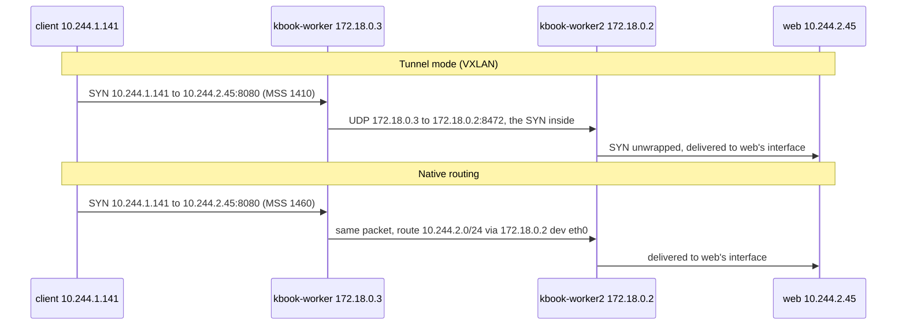

# Chapter 49: Installing and configuring CNI plugins

> **Exams:** CKNE · D1 Core Infrastructure and CNI (Installing and Configuring CNI Plugins; Managing IPAM and Pod CIDR Allocation)
> **Difficulty:** Intermediate
> **Time:** ~60 min reading, ~45 min lab
> **Lab tier:** 1 (kind, profile `nocni`)
> **Prerequisites:** Chapter 45 (VXLAN overlays by hand), Chapter 48 (CNI, the nocni cluster), Chapter 14 (Helm)

## Learning objectives

After this chapter you can:

- Explain what installing a CNI plugin puts on each node: an agent, a binary in `/opt/cni/bin`, and a configuration in `/etc/cni/net.d`
- Install Cilium with Helm or the `cilium` CLI, choose its IPAM mode, and check the result with `cilium status`
- Tell which CNI configuration a node's container runtime uses, and why a stale file can break a node
- Compare tunnel (overlay) and native routing, and switch Cilium between them
- Work out the right MTU for Pods in each routing mode, and set it
- Compare Cilium, Calico, and Flannel at the level the exam expects

## Concepts

### From a script by hand to a real plugin

In Chapter 48 you networked a cluster yourself: a `ptp` configuration on every
node, routes between the nodes, and a masquerade rule. It worked, but nothing
kept it working. A new node would have had no configuration, and nobody would
have added routes to it.

A production CNI plugin automates exactly those steps. It almost always arrives
as a **DaemonSet**, so one Pod runs on every node, now and on every node added
later. That Pod is the plugin's **agent**: a long-running program on the node
that does what you did by hand.

1. It copies the plugin's binary into `/opt/cni/bin` on the node.
2. It writes a configuration file into `/etc/cni/net.d`.
3. It keeps the node's network in shape: routes to the other nodes, firewall
   or eBPF rules, and the state of every Pod interface on the node.

The container runtime does not talk to the agent. It still does what Chapter 48
described: for every new Pod sandbox it reads the configuration, runs the
binary, and hands it the Pod's network namespace. The binary then asks the
agent, over a local socket, to finish the job. That is why a node whose agent
has crashed cannot start new Pods, even though the binary and the configuration
are still there.

Most plugins also run a small cluster-wide controller next to the agents.
Cilium calls it the **operator**: one or two Pods that do the work that is not
tied to a node, such as handing out IP ranges or cleaning up after deleted
nodes.

### Which configuration the runtime uses

A node may have more than one file in `/etc/cni/net.d`. The runtime does not
merge them: it sorts the file names and uses the **first** `.conf`,
`.conflist`, or `.json` file. That is why plugins name their files with a
number in front (`05-cilium.conflist`, `10-calico.conflist`): the number
decides who wins.

This rule causes a classic failure. You replace one plugin with another, and
the old plugin's file is still on some nodes with a lower number. Those nodes
keep using the old plugin, whose agent is gone, and every new Pod on them fails
with a sandbox error. Cilium protects itself against this by default: it
renames every other configuration file it finds to `*.cilium_bak` (the
`cni-exclusive` setting). Other plugins do not, so look at the directory on the
node whenever only some nodes misbehave.

> **Why this matters for Kubernetes:** "which CNI does this node really use?"
> is answered on the node, not in the API: list `/etc/cni/net.d`, take the
> first file, and read its `type`. That `type` is the binary the runtime runs.

### Three plugins you should recognize

The exam's documentation list includes Cilium, so this book uses it from here
on. You should still recognize the two other plugins you are most likely to
meet:

| | Cilium | Calico | Flannel |
| --- | --- | --- | --- |
| Data plane | **eBPF**: small programs loaded into the Linux kernel, attached to interfaces | iptables or nftables (an eBPF mode exists too) | the kernel's routing and bridge |
| Between nodes | VXLAN or Geneve tunnel, or native routing; BGP | IP-in-IP or VXLAN tunnel, or native routing with BGP | VXLAN (default), or host routes |
| IPAM | Kubernetes host-scope (the node's `podCIDR`), cluster-pool, multi-pool | its own IP pools (blocks per node) | the node's `podCIDR` |
| NetworkPolicy | yes, plus its own L3 to L7 policies | yes, plus its own policies | no |
| Install | Helm chart or `cilium` CLI | operator or a manifest | a manifest |

eBPF lets Cilium make forwarding and policy decisions inside the kernel without
long chains of iptables rules; Chapter 54 shows what that changes for Services.
**IP-in-IP** is another overlay: it wraps an IP packet directly in a second IP
header, with no UDP and no inner Ethernet header, so it costs 20 bytes instead
of VXLAN's 50. You have used Calico already: it is the CNI of the `calico`
profile that Parts I to IV run on (`envs/kind/profiles/calico/install.sh`
applies its manifest). Flannel has no NetworkPolicy support at all, which is
why clusters that use it for routing often add another plugin for policy.

### Installing Cilium: Helm or the CLI

Cilium is installed from its Helm chart, `cilium` in the repository
`https://helm.cilium.io`. The chart creates the agent DaemonSet (`cilium`),
the operator Deployment (`cilium-operator`), an Envoy DaemonSet for layer 7
features, and the ConfigMap `cilium-config`, which holds the agents'
configuration. Every Helm value ends up as a key in that ConfigMap: the value
`routingMode` becomes the key `routing-mode`, `ipam.mode` becomes `ipam`.

The `cilium` CLI offers `cilium install`, which is a wrapper around the same
chart: it detects the kind of cluster (kind, EKS, GKE, ...) and fills in a few
values for it, then installs the chart. Either way you end up with a Helm
release you can change later with `helm upgrade`. The CLI's real value is in
the commands for afterwards: `cilium status` (are the agents healthy?),
`cilium config view` (what is in `cilium-config`?), and `cilium connectivity
test` (a full end-to-end check that takes several minutes).

One default deserves attention. The chart's default **IPAM** mode is
**cluster-pool**: the Cilium operator hands each node a range from its own pool,
`10.0.0.0/8` unless you change it, and ignores the `podCIDR` that Kubernetes
assigned to the node. Both are valid designs (Chapter 50 compares them), but
mixing them up is a common surprise: Pod addresses that do not match
`kubectl get node -o jsonpath='{.spec.podCIDR}'`. This book's clusters use
`ipam.mode=kubernetes`, the **Kubernetes host-scope** mode, in which Cilium
uses each node's `podCIDR`, just like your `host-local` configuration did.

### Tunnel or native routing

A Pod's packet to a Pod on another node has a destination address in
`10.244.0.0/16`. The network between the nodes, the **underlay**, usually knows
nothing about those addresses. A CNI plugin has two ways to get the packet
across.

In **tunnel mode** (Cilium's default), the agent wraps the packet in VXLAN, as
you did by hand in Chapter 45: a new outer IP header from node to node, a UDP
header, and the VXLAN header. The underlay only ever sees node addresses, so it
needs no changes at all. Cilium uses UDP port 8472 for VXLAN, the Linux
default, rather than the standard 4789; `tcpdump` even mislabels that port as
"OTV". Geneve works the same way with a more flexible header.

In **native routing**, the packets cross the underlay unchanged, with Pod
addresses on the wire. That only works if the underlay knows where every Pod
CIDR lives. There are two ways:

- All nodes share one layer 2 network (like the kind nodes, or servers on one
  switch). Then each node can simply have a route to every other node's Pod
  CIDR via that node's address. Cilium writes those routes itself when you set
  `autoDirectNodeRoutes=true`, the same routes you wrote by hand in Chapter 48.
- The nodes sit in different subnets. Then the routers between them must learn
  the Pod CIDRs, usually through BGP (Chapter 59), or a cloud provider's route
  tables.

Native routing also needs `ipv4NativeRoutingCIDR`: the range that is reached
without NAT. Cilium masquerades traffic to anything outside it, and leaves
traffic inside it alone. For a cluster that is the Pod range, `10.244.0.0/16`.

| | Tunnel (VXLAN) | Native routing |
| --- | --- | --- |
| On the wire between nodes | node addresses, UDP 8472, Pod packet inside | Pod addresses |
| Needs from the underlay | only that nodes reach each other | routes to every Pod CIDR (shared L2, BGP, or cloud routes) |
| Overhead per packet | 50 bytes | none |
| Visible to firewalls and captures between nodes | only as UDP between nodes | as ordinary Pod traffic |
| Typical use | anywhere, especially when you do not control the network | data centers with BGP, clouds with native Pod routing |

### The MTU, and why 1450

Chapter 39 introduced the **MTU**, the largest packet a link carries, and
Chapter 45 showed that an overlay adds headers. The **encapsulation overhead**
of VXLAN over IPv4 is 50 bytes: 20 for the outer IP header, 8 for UDP, 8 for
VXLAN, and 14 for the inner Ethernet header. If the nodes' network has an MTU
of 1500, a Pod's packet may be at most 1450 bytes, or the wrapped packet no
longer fits.

The plugin, not the Pod, has to know this, and it tells the Pod. Cilium does it
with the Pod's routes: in tunnel mode the default route inside the Pod says
`mtu 1450`. TCP then announces a smaller **MSS** (maximum segment size: the
largest payload one TCP segment carries, the MTU minus 40 bytes of IP and TCP
headers) in its handshake, so both sides send segments that fit. In native
routing there is no overhead, and the Pod gets the full 1500.

When the MTU is wrong, the symptoms are confusing: ping works, a small `curl`
works, but large responses hang. Small packets fit; only the big ones are
dropped, and if the ICMP "too big" message that path MTU discovery (Chapter 45)
depends on is filtered somewhere, nobody is told. Whenever "small works, large
hangs", suspect the MTU. Cilium detects the MTU of the node's interface by
itself; you set it by hand (the Helm value `MTU`) when the detection is wrong,
for example when the underlay itself has extra overhead, such as a VPN or a
cloud network with a lower MTU.

### Changing the configuration later

`helm upgrade` changes the ConfigMap, but the Cilium agents read
`cilium-config` only when they start. A changed value does nothing until the
agents restart: `kubectl -n kube-system rollout restart daemonset/cilium`.
Pods keep running while the agents restart one node at a time.

Two more details of `helm upgrade` matter here. Without `--reuse-values`, an
upgrade starts again from the chart's defaults plus only the values on this
command line, so a forgotten value (`ipam.mode=kubernetes`, say) silently
returns to its default. And some changes cannot be made safely on a running
cluster at all: changing the IPAM mode or the Pod CIDR leaves existing Pods
with addresses the new configuration does not know. Those changes mean
recreating the Pods, or the cluster.

### Packet walk: the same request in both modes

`client` (`10.244.1.141` on `kbook-worker`, `172.18.0.3`) opens a connection
to `web` (`10.244.2.45` on `kbook-worker2`, `172.18.0.2`). First in tunnel
mode, then in native routing.



*Text description: in tunnel mode, client's SYN, with an MSS of 1410 because the Pod's MTU is 1450, reaches kbook-worker, which wraps it in a UDP packet from 172.18.0.3 to 172.18.0.2 on port 8472; kbook-worker2 unwraps it and delivers it to web. In native routing, the SYN carries an MSS of 1460, and kbook-worker forwards it unchanged, following its route for 10.244.2.0/24 via kbook-worker2's address 172.18.0.2 on eth0; kbook-worker2 delivers it to web.*

## Guided walkthrough

This walkthrough installs Cilium on a fresh `nocni` cluster, looks at what it
changed, captures the overlay on the wire, and then switches to native routing
and a custom MTU. You need `helm` (Chapter 14) and the `cilium` CLI at the
version pinned in `versions.env` (`CILIUM_CLI_VERSION`), from the
`cilium/cilium-cli` releases on GitHub. Your addresses and names will differ;
the shapes will not.

### Step 1: A cluster without a network

```bash
make cluster PROFILE=nocni
kubectl get nodes
docker exec kbook-worker ls /etc/cni/net.d /opt/cni/bin
```

```text
NAME                  STATUS     ROLES           AGE     VERSION
kbook-control-plane   NotReady   control-plane   9m39s   v1.37.0
kbook-worker          NotReady   <none>          9m27s   v1.37.0
kbook-worker2         NotReady   <none>          9m27s   v1.37.0
```

```text
/etc/cni/net.d:

/opt/cni/bin:
host-local
loopback
portmap
ptp
```

No configuration, and only the reference plugins kind ships: the same starting
point as Chapter 48.

### Step 2: What `cilium install` would do

The CLI can show the Helm values it would use, without installing anything:

```bash
cilium install --version 1.20.5 --set ipam.mode=kubernetes --dry-run-helm-values
```

```text
cluster:
  name: kind-kbook
ipam:
  mode: kubernetes
operator:
  replicas: 1
routingMode: tunnel
tunnelProtocol: vxlan
```

It recognized a kind cluster and chose one operator replica and a VXLAN
tunnel. This walkthrough uses Helm directly, so every value is visible.

### Step 3: Install Cilium with Helm

```bash
helm install cilium cilium --repo https://helm.cilium.io --version 1.20.5 \
  --namespace kube-system --set ipam.mode=kubernetes
```

```text
NAME: cilium
LAST DEPLOYED: Fri Nov 20 19:20:39 2026
NAMESPACE: kube-system
STATUS: deployed
REVISION: 1
TEST SUITE: None
NOTES:
You have successfully installed Cilium with Hubble.

Your release version is 1.20.5.
```

Helm returns at once; the agents start in the background. Wait for them:

```bash
cilium status --wait
```

```text
    /¯¯\
 /¯¯\__/¯¯\    Cilium:             OK
 \__/¯¯\__/    Operator:           OK
 /¯¯\__/¯¯\    Envoy DaemonSet:    OK
 \__/¯¯\__/    Hubble Relay:       disabled
    \__/       ClusterMesh:        disabled

DaemonSet              cilium                   Desired: 3, Ready: 3/3, Available: 3/3
DaemonSet              cilium-envoy             Desired: 3, Ready: 3/3, Available: 3/3
Deployment             cilium-operator          Desired: 2, Ready: 2/2, Available: 2/2
Containers:            cilium                   Running: 3
                       cilium-envoy             Running: 3
                       cilium-operator          Running: 2
Cluster Pods:          3/3 managed by Cilium
Helm chart version:    1.20.5
```

Plain Helm kept the chart's default of two operator replicas; the CLI would
have chosen one. The nodes are `Ready` now:

```bash
kubectl get nodes
```

```text
NAME                  STATUS   ROLES           AGE   VERSION
kbook-control-plane   Ready    control-plane   12m   v1.37.0
kbook-worker          Ready    <none>          12m   v1.37.0
kbook-worker2         Ready    <none>          12m   v1.37.0
```

### Step 4: What the agent put on the node

```bash
docker exec kbook-worker ls /etc/cni/net.d /opt/cni/bin
docker exec kbook-worker cat /etc/cni/net.d/05-cilium.conflist
```

```text
/etc/cni/net.d:
05-cilium.conflist

/opt/cni/bin:
cilium-cni
host-local
loopback
portmap
ptp
```

```text
{
  "cniVersion": "1.0.0",
  "name": "cilium",
  "plugins": [
    {
       "type": "cilium-cni",
       "enable-debug": false,
       "log-file": "/var/run/cilium/cilium-cni.log"
    }
  ]
}
```

A configuration list with a single plugin of type `cilium-cni`, the binary the
agent just copied in. There is no `ipam` section: the binary asks the agent,
and the agent decides. What the agents were told is in `cilium-config`:

```bash
cilium config view | grep -E '^(routing-mode|tunnel-protocol|ipam|auto-direct-node-routes|cni-exclusive) '
```

```text
auto-direct-node-routes                           false
cni-exclusive                                     true
ipam                                              kubernetes
routing-mode                                      tunnel
tunnel-protocol                                   vxlan
```

### Step 5: Pods, addresses, and the MTU in tunnel mode

Start a client on one worker and a web server on the other:

```bash
kubectl create namespace demo
kubectl -n demo run client --image=nicolaka/netshoot:v0.14 \
  --overrides='{"spec":{"nodeSelector":{"kubernetes.io/hostname":"kbook-worker"}}}' -- sleep infinity
kubectl -n demo run web --image=registry.k8s.io/e2e-test-images/agnhost:2.66.1 \
  --overrides='{"spec":{"nodeSelector":{"kubernetes.io/hostname":"kbook-worker2"}}}' -- netexec --http-port=8080
kubectl -n demo get pods -o wide
kubectl get nodes -o custom-columns=NAME:.metadata.name,IP:.status.addresses[0].address,PODCIDR:.spec.podCIDR
```

```text
NAME     READY   STATUS    RESTARTS   AGE   IP             NODE            NOMINATED NODE   READINESS GATES
client   1/1     Running   0          2s    10.244.1.141   kbook-worker    <none>           <none>
web      1/1     Running   0          2s    10.244.2.45    kbook-worker2   <none>           <none>
```

```text
NAME                  IP           PODCIDR
kbook-control-plane   172.18.0.4   10.244.0.0/24
kbook-worker          172.18.0.3   10.244.1.0/24
kbook-worker2         172.18.0.2   10.244.2.0/24
```

Each Pod's address is in its own node's `podCIDR`: that is
`ipam.mode=kubernetes` at work. Now the Pod's routes, and the node's:

```bash
kubectl -n demo exec client -- ip route
docker exec kbook-worker ip route | grep 10.244
```

```text
default via 10.244.1.131 dev eth0 mtu 1450
10.244.1.131 dev eth0 scope link
```

```text
10.244.0.0/24 via 10.244.1.131 dev cilium_host proto kernel src 10.244.1.131 mtu 1450
10.244.1.0/24 via 10.244.1.131 dev cilium_host proto kernel src 10.244.1.131
10.244.1.131 dev cilium_host proto kernel scope link
10.244.2.0/24 via 10.244.1.131 dev cilium_host proto kernel src 10.244.1.131 mtu 1450
```

The Pod's default route carries `mtu 1450`: 1500 minus VXLAN's 50 bytes. On
the node, the other nodes' Pod CIDRs all point at `cilium_host`, Cilium's own
interface, also with `mtu 1450`; Cilium's eBPF programs then send those packets
into the tunnel. There is no route that names another node.

### Step 6: The overlay on the wire

Capture on `kbook-worker`'s `eth0` with a node debug Pod (Chapter 48), while
`client` sends a request to `web`:

```bash
kubectl debug node/kbook-worker -it --profile=sysadmin --image=nicolaka/netshoot:v0.14 -- \
  tcpdump -i eth0 -n -c 2 udp port 8472
```

In a second terminal:

```bash
kubectl -n demo exec client -- curl -s http://10.244.2.45:8080/clientip
```

```text
10.244.1.141:53108
```

The capture (two packets, trimmed to the lines that matter):

```text
18:24:21.017038 IP 172.18.0.3.37802 > 172.18.0.2.8472: OTV, flags [I] (0x08), overlay 0, instance 8175
IP 10.244.1.141.46018 > 10.244.2.45.8080: Flags [S], seq 3067917996, win 64860, options [mss 1410,sackOK,TS val 1683777020 ecr 0,nop,wscale 10], length 0
18:24:21.017645 IP 172.18.0.2.55190 > 172.18.0.3.8472: OTV, flags [I] (0x08), overlay 0, instance 31984
IP 10.244.2.45.8080 > 10.244.1.141.46018: Flags [S.], seq 3978079110, ack 3067917997, win 64308, options [mss 1410,sackOK,TS val 2362268012 ecr 1683777020,nop,wscale 10], length 0
```

Read each packet as two lines. The first line is the outer packet: node to
node, UDP port 8472 (which `tcpdump` calls "OTV"). The second line is the Pod's
packet inside it: the SYN from `client` to `web` and the SYN-ACK back, with an
MSS of 1410, which is the Pod's MTU of 1450 minus 40. `web` saw the real
client address `10.244.1.141`: no NAT between Pods. Delete the debug Pod
afterwards: `kubectl get pods -A | grep node-debugger`.

### Step 7: Switch to native routing

```bash
helm upgrade cilium cilium --repo https://helm.cilium.io --version 1.20.5 \
  --namespace kube-system --reuse-values \
  --set routingMode=native --set ipv4NativeRoutingCIDR=10.244.0.0/16 --set autoDirectNodeRoutes=true
cilium config view | grep -E '^(routing-mode|auto-direct-node-routes|ipv4-native-routing-cidr) '
docker exec kbook-worker ip route | grep 10.244
```

```text
auto-direct-node-routes                           true
ipv4-native-routing-cidr                          10.244.0.0/16
routing-mode                                      native
```

```text
10.244.0.0/24 via 10.244.1.131 dev cilium_host proto kernel src 10.244.1.131 mtu 1450
10.244.1.0/24 via 10.244.1.131 dev cilium_host proto kernel src 10.244.1.131
10.244.1.131 dev cilium_host proto kernel scope link
10.244.2.0/24 via 10.244.1.131 dev cilium_host proto kernel src 10.244.1.131 mtu 1450
```

The ConfigMap says `native`, but the node's routes have not changed: the agents
are still running with the configuration they read when they started. Restart
them:

```bash
kubectl -n kube-system rollout restart daemonset/cilium
kubectl -n kube-system rollout status daemonset/cilium
docker exec kbook-worker ip route | grep 10.244
kubectl -n demo exec client -- ip route
```

```text
daemon set "cilium" successfully rolled out
```

```text
10.244.0.0/24 via 172.18.0.4 dev eth0 proto kernel
10.244.1.0/24 via 10.244.1.131 dev cilium_host proto kernel src 10.244.1.131
10.244.1.131 dev cilium_host proto kernel scope link
10.244.2.0/24 via 172.18.0.2 dev eth0 proto kernel
```

```text
default via 10.244.1.131 dev eth0 mtu 1500
10.244.1.131 dev eth0 scope link
```

Now the routes name the other nodes' addresses on `eth0`: the routes you wrote
by hand in Chapter 48, written by the agent. The Pod's MTU is back to 1500,
because nothing is added to its packets. The same capture, this time for the
Pod's own port:

```bash
kubectl debug node/kbook-worker -it --profile=sysadmin --image=nicolaka/netshoot:v0.14 -- \
  tcpdump -i eth0 -n -c 2 tcp port 8080
```

```text
18:25:18.116005 IP 10.244.1.141.49792 > 10.244.2.45.8080: Flags [S], seq 3690890639, win 64240, options [mss 1460,sackOK,TS val 1422420250 ecr 0,nop,wscale 10], length 0
18:25:18.116154 IP 10.244.2.45.8080 > 10.244.1.141.49792: Flags [S.], seq 1119384924, ack 3690890640, win 65160, options [mss 1460,sackOK,TS val 2391824104 ecr 1422420250,nop,wscale 10], length 0
```

Pod addresses directly on the node's wire, and an MSS of 1460.

### Step 8: Set the MTU yourself

Suppose the network between the nodes had a lower MTU than Cilium detected.
Set it explicitly:

```bash
helm upgrade cilium cilium --repo https://helm.cilium.io --version 1.20.5 \
  --namespace kube-system --reuse-values --set MTU=1400
kubectl -n kube-system rollout restart daemonset/cilium
kubectl -n kube-system rollout status daemonset/cilium
cilium config view | grep -E '^mtu '
kubectl -n demo exec client -- ip route
kubectl -n demo exec client -- cat /sys/class/net/eth0/mtu
```

```text
mtu                                               1400
```

```text
default via 10.244.1.131 dev eth0 mtu 1400
10.244.1.131 dev eth0 scope link
```

```text
1400
```

With an explicit MTU, Cilium sets both the route and the Pod's interface to
1400, for running Pods as well as new ones. Finally, the release's values, the
record of everything you changed:

```bash
helm get values cilium -n kube-system
```

```text
USER-SUPPLIED VALUES:
MTU: 1400
autoDirectNodeRoutes: true
ipam:
  mode: kubernetes
ipv4NativeRoutingCIDR: 10.244.0.0/16
routingMode: native
```

Clean up with `make cluster` (back to the default profile), or keep the
cluster for the lab, which builds its own anyway.

### Useful commands from this chapter

| Command | What it tells you |
| --- | --- |
| `docker exec <node> ls /etc/cni/net.d` (on the exam: `ls` on the node) | which CNI configuration files exist; the first one wins |
| `cilium status --wait` | whether the agents, operator, and Envoy are healthy |
| `cilium config view` | the agents' configuration (`cilium-config`) |
| `helm get values cilium -n kube-system` | the values the release was installed or upgraded with |
| `kubectl -n kube-system rollout restart daemonset/cilium` | makes the agents read a changed configuration |
| `kubectl exec <pod> -- ip route` | the Pod's routes, including the MTU the plugin chose |

## Hands-on lab

Start (or restart) the lab. Setup builds a brand-new cluster with no network
plugin, which takes a minute or two:

```bash
make lab CH=49
```

The namespace `ch49-cni` holds two Pods waiting for a network: `client`
(netshoot, on `kbook-worker`) and `web` (agnhost on port 8080, answering
`/clientip` with the caller's address, on `kbook-worker2`). Answer files go in
`/tmp/kbook/ch49/`, which already exists. You need `helm`; the `cilium` CLI
helps but is not required. Type `make check CH=49` after each task. Solutions:
`chapters/49-cni-plugins/lab/solutions.md`.

### Task 1: Install Cilium

Give the cluster a network with Cilium, so that Pod addresses come from each
node's own Pod range.

- Helm release `cilium` of chart `cilium` (`https://helm.cilium.io`), version `1.20.5`, in namespace `kube-system`
- The `cilium` DaemonSet is ready on all three nodes, and Cilium's IPAM mode is `kubernetes`
- All nodes are `Ready`
- `client` and `web` are `Running`, each with an address from its own node's `podCIDR`

### Task 2: Which configuration does the node use?

Find out which CNI configuration the container runtime on `kbook-worker2`
uses now, and which plugin binary it runs.

- `/tmp/kbook/ch49/cni-conf`: the full path of that configuration file
- `/tmp/kbook/ch49/cni-plugin`: the `type` of its (first) plugin

### Task 3: Native routing

Switch Cilium from the VXLAN tunnel to native routing between the nodes.

- Cilium's routing mode is `native`, with `autoDirectNodeRoutes` on and native routing CIDR `10.244.0.0/16`
- `kbook-worker` routes `kbook-worker2`'s Pod CIDR via `kbook-worker2`'s address on `eth0`, and the other way round
- `client` reaches `web` at its Pod IP on port 8080, and `web` sees `client`'s Pod IP

### Task 4: A lower MTU

The network between the nodes is about to get a lower MTU. Make Cilium give the
Pods an MTU of 1400.

- Cilium's MTU setting is `1400`
- `eth0` in `client` and in `web` has an MTU of 1400
- `client` still reaches `web` without NAT

## Exam tips

> **Exam tip:** "Install a CNI plugin" tasks come with a version and usually
> a few required settings. Put every one of them on one `helm install` command
> line with `--set`, and keep that command in a file: a later `helm upgrade`
> without `--reuse-values` would reset whatever you leave out.

> **Exam tip:** After changing Cilium's configuration, restart the agents with
> `kubectl -n kube-system rollout restart daemonset/cilium` and check the
> outcome on a node (`ip route`) or in a Pod, not in the ConfigMap. A changed
> ConfigMap alone proves nothing.

> **Exam tip:** On `docs.cilium.io`, *Installation* has the Helm and CLI
> install pages, and the *Routing* page among the networking concepts explains
> tunnel and native routing with the exact Helm values. The values reference lists every chart
> option; search it for the setting the task names.

> **Exam tip:** If only some nodes fail to start Pods after a plugin change,
> list `/etc/cni/net.d` on a failing node first. A leftover configuration with
> a lower number than the new plugin's is the usual cause.

## Common mistakes

- **Leaving Cilium's default IPAM.** Without `ipam.mode=kubernetes`, Pods get
  addresses from `10.0.0.0/8`, not from the nodes' `podCIDR`. Routing still
  works inside Cilium, but anything that relies on the node ranges does not.
  Changing the mode later does not renumber running Pods; recreate them.
- **Expecting `helm upgrade` to take effect at once.** The agents read their
  configuration at start; restart the DaemonSet.
- **`helm upgrade` without `--reuse-values`.** Every value not on that command
  line returns to the chart's default, including the IPAM mode.
- **Native routing between nodes in different subnets** without BGP or cloud
  routes. `autoDirectNodeRoutes` only writes routes to nodes on the same layer
  2 network; packets to the others are dropped.
- **Forgetting `ipv4NativeRoutingCIDR`** in native mode. It is how Cilium
  knows which destinations to reach without NAT; set it to the cluster's Pod
  range, `10.244.0.0/16` here.
- **An MTU that ignores the overlay.** A Pod MTU of 1500 in tunnel mode
  produces packets of 1550 on a 1500 link: small requests work, large ones
  hang.

<!-- QUESTIONS:START -->

## End-of-chapter questions

**1.** `CKNE` What does a CNI plugin's agent DaemonSet do when it starts on a new node?

- **A.** It replaces the node's container runtime with its own
- **B.** It copies the plugin binary to `/opt/cni/bin`, writes a configuration to `/etc/cni/net.d`, and keeps the node's routes and rules in shape
- **C.** It edits the kubelet's flags so that the kubelet calls the agent instead of a CNI binary
- **D.** It assigns the node its `podCIDR` in the Node object

**2.** `CKNE` A node's `/etc/cni/net.d` contains `05-cilium.conflist` and `00-flannel.conflist`. Which configuration does the container runtime use?

- **A.** Both, merged into one list
- **B.** `05-cilium.conflist`, because it is newer
- **C.** `00-flannel.conflist`, because it comes first in name order
- **D.** Neither: two files are an error, so no Pod can start

**3.** `CKNE` You install Cilium with Helm and only `--version`. Pods get addresses like `10.0.1.23`, but the nodes' `podCIDR`s are in `10.244.0.0/16`. Why?

- **A.** The kubelet ignored the CNI plugin and used Docker's network
- **B.** Cilium's default IPAM mode is cluster-pool, which hands out ranges from its own pool and ignores the nodes' `podCIDR`
- **C.** The Service CIDR overlaps the Pod CIDR
- **D.** Cilium always uses `10.0.0.0/8`; the `podCIDR` cannot be used with Cilium

**4.** `CKNE` You ran `helm upgrade` to switch Cilium to native routing. `cilium config view` shows `routing-mode native`, but the nodes still route Pod CIDRs through `cilium_host` and capture shows UDP 8472. What is missing?

- **A.** A restart of the cilium DaemonSet, because the agents read their configuration when they start
- **B.** A reboot of every node
- **C.** Deleting the `cilium-config` ConfigMap so that it is regenerated
- **D.** Nothing: native routing always keeps the VXLAN tunnel as well

**5.** `CKNE` The nodes' network has an MTU of 1500 and Cilium uses a VXLAN tunnel over IPv4. What is the largest Pod MTU that avoids fragmentation or drops?

- **A.** 1500
- **B.** 1480
- **C.** 1450
- **D.** 1400

**6.** `CKNE` Which requirement does native routing have that tunnel mode does not?

- **A.** The nodes must run the same Linux distribution
- **B.** The network between the nodes must know where every Pod CIDR is: a shared layer 2 network with direct routes, BGP, or cloud route tables
- **C.** Every Pod needs a public IP address
- **D.** kube-proxy must be removed

**7.** `CKNE` What does `autoDirectNodeRoutes=true` make Cilium do?

- **A.** Announce the Pod CIDRs to the upstream routers with BGP
- **B.** Write a route on each node to every other node's Pod CIDR via that node's address, for nodes on the same layer 2 network
- **C.** Route all Pod traffic through the control plane node
- **D.** Turn on the VXLAN tunnel as a fallback

**8.** `CKNE` After a CNI change, ping and small HTTP requests between Pods on different nodes work, but large downloads hang. What is the most likely cause?

- **A.** A NetworkPolicy that blocks large packets
- **B.** An MTU that is too large for the path, so the big packets are dropped
- **C.** DNS is slow
- **D.** The Pods' CPU limits are too low

**9.** `CKNE` Which of these plugins does not enforce Kubernetes NetworkPolicy by itself?

- **A.** Cilium
- **B.** Calico
- **C.** Flannel
- **D.** All three enforce it

**10. (Task)** `CKNE` Install Cilium 1.20.5 with Helm in namespace `kube-system`, with Kubernetes host-scope IPAM and native routing for the Pod range `10.244.0.0/16` on nodes that share one layer 2 network. Then confirm the agents are healthy.

**11. (Task)** `CKNE` Pods on node `node2` stay in `ContainerCreating` after the cluster moved from Flannel to Cilium; Pods on the other nodes are fine. Find and fix the cause on the node.

**12. (Task)** `CKNE` Cilium is installed with Helm (release `cilium` in `kube-system`). Set the Pods' MTU to 1400 without changing any other setting, and prove that a Pod uses it.

<details>
<summary>Answers</summary>

**1. B.** The runtime still reads `/etc/cni/net.d` and runs a binary from `/opt/cni/bin`; the agent installs both and then does the node-level work (routes, eBPF or iptables rules). The node's `podCIDR` is assigned by the controller manager, not by the agent.

**2. C.** The runtime sorts the file names and uses the first `.conf`, `.conflist`, or `.json` file. A leftover file with a lower number wins, which is why stale configurations break nodes after a plugin change.

**3. B.** The chart's default `ipam.mode` is `cluster-pool` (pool `10.0.0.0/8`). With `ipam.mode=kubernetes`, Cilium uses each node's `podCIDR` instead.

**4. A.** `helm upgrade` changes the ConfigMap, but the agents only read it at start. `kubectl -n kube-system rollout restart daemonset/cilium` applies it, one node at a time.

**5. C.** VXLAN adds 50 bytes: an outer IPv4 header (20), UDP (8), VXLAN (8), and the inner Ethernet header (14). 1500 - 50 = 1450, the value Cilium puts on the Pod's route in tunnel mode.

**6. B.** In native routing the packets carry Pod addresses between the nodes, so the underlay must route them. In tunnel mode the underlay sees only node addresses.

**7. B.** It writes the same kind of routes as Chapter 48's `ip route add 10.244.2.0/24 via 172.18.0.2`. It cannot help nodes in other subnets; for those you need BGP (Chapter 59) or cloud routes.

**8. B.** Small packets fit, large ones do not. If the ICMP messages that path MTU discovery depends on are lost, nobody tells the sender. Check the Pod's route MTU against the overlay's overhead.

**9. C.** Flannel only connects Pods (VXLAN by default). Clusters that use it and need policies add another plugin for policy enforcement.

**10.**

```bash
helm install cilium cilium --repo https://helm.cilium.io --version 1.20.5 \
  --namespace kube-system --set ipam.mode=kubernetes \
  --set routingMode=native --set ipv4NativeRoutingCIDR=10.244.0.0/16 --set autoDirectNodeRoutes=true
cilium status --wait
kubectl get nodes
```

On a fresh install no restart is needed: the agents start with this configuration. Check a node's routes (`ip route | grep 10.244`) for routes via the other nodes' addresses.

**11.**

```bash
ssh node2
ls /etc/cni/net.d
```

A leftover Flannel file with a lower number than Cilium's (for example `00-flannel.conflist` next to `05-cilium.conflist`) is used first. Move it away, for example `sudo mv /etc/cni/net.d/00-flannel.conflist /root/`, and delete the stuck Pods so they are created again. `kubectl describe pod` on a stuck Pod shows the sandbox error from the old plugin.

**12.**

```bash
helm upgrade cilium cilium --repo https://helm.cilium.io --version 1.20.5 \
  --namespace kube-system --reuse-values --set MTU=1400
kubectl -n kube-system rollout restart daemonset/cilium
kubectl -n kube-system rollout status daemonset/cilium
kubectl exec <pod> -- cat /sys/class/net/eth0/mtu
kubectl exec <pod> -- ip route
```

`--reuse-values` keeps the other settings; without it they return to the chart's defaults. The Pod shows MTU 1400 on `eth0` and on its default route.

</details>

<!-- QUESTIONS:END -->

## Further reading

- Cilium documentation: [Installation using Helm](https://docs.cilium.io/en/stable/installation/k8s-install-helm/) and the [Helm reference](https://docs.cilium.io/en/stable/helm-reference/)
- Cilium documentation: [Routing](https://docs.cilium.io/en/stable/network/concepts/routing/) (encapsulation and native routing)
- Cilium documentation: [IP Address Management](https://docs.cilium.io/en/stable/network/concepts/ipam/)
- Kubernetes documentation: [Network Plugins](https://kubernetes.io/docs/concepts/extend-kubernetes/compute-storage-net/network-plugins/)
- Calico documentation: [Determine best networking option](https://docs.tigera.io/calico/latest/networking/determine-best-networking); Flannel: [github.com/flannel-io/flannel](https://github.com/flannel-io/flannel)
