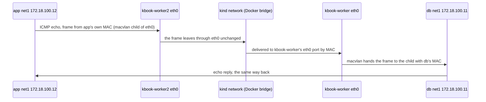

# Chapter 51: Multi-interface Pods with Multus

> **Exams:** CKNE · D1 Core Infrastructure and CNI (Configuring Multi-interface Pods)
> **Difficulty:** Intermediate
> **Time:** ~60 min reading, ~45 min lab
> **Lab tier:** 1 (kind, profile `cilium`)
> **Prerequisites:** Chapter 45 (veth pairs, bridges), Chapter 48 (CNI configuration and IPAM plugins), Chapter 49 (which configuration the runtime uses, Cilium's `cni-exclusive`)

## Learning objectives

After this chapter you can:

- Explain why some workloads need more than one network interface, and what Kubernetes itself offers for that (nothing)
- Describe how Multus works as a meta-plugin: the cluster network, delegate plugins, and the configuration it writes
- Install Multus next to Cilium, and fix the configuration conflict between them
- Define secondary networks with NetworkAttachmentDefinitions using macvlan, ipvlan, or bridge
- Attach a Pod to a secondary network with a chosen address and interface name, and read its network status
- Avoid duplicate addresses on secondary networks that span nodes

## Concepts

### One interface is not always enough

The Kubernetes network model (Chapter 48) gives every Pod exactly one network:
one interface, `eth0`, with one address from the cluster's Pod range. Services,
DNS, and NetworkPolicy are all built on that one network, and for most
applications it is all they need.

Some workloads need more. A storage client may have to reach a storage network
that is kept apart from application traffic. A network function (a virtual
router or firewall) needs an interface on each network it connects. A
latency-sensitive application may need a dedicated interface straight onto a
physical network, without the overlay. In all these cases the Pod needs a
**secondary interface**: a second network interface, on a **secondary
network**, next to its normal `eth0`.

Kubernetes has no field for this. A Pod spec cannot list networks, and the
kubelet asks the container runtime for one network per Pod sandbox. The
runtime runs one CNI configuration, the first one in `/etc/cni/net.d`
(Chapter 49). Any extra interface must therefore come from that one plugin.

### Multus, a meta-plugin

**Multus** is a CNI plugin that does no networking itself. It is a
**meta-plugin**: when the runtime calls it, it calls other CNI plugins, the
**delegates**, one after another, and returns the combined result.

1. First it calls the **cluster network**: the plugin that would have been
   used without Multus, Cilium here. That plugin creates `eth0`, so the Pod
   stays a normal Kubernetes Pod with a normal address.
2. Then, for every secondary network the Pod asks for, it calls that
   network's plugin (`macvlan`, `ipvlan`, `bridge`, ...), which adds `net1`,
   `net2`, and so on.

Multus finds out which networks a Pod asks for by reading the Pod's
annotations from the API server. It writes its own configuration file, named
`00-multus.conf`, so that it sorts before every other file and the runtime
calls it first. The file records which configuration is the cluster network.

Today's Multus comes as a **thick plugin**: a DaemonSet whose Pods run a
long-lived Multus daemon on every node, plus a small binary, `multus-shim`,
that the runtime calls and that forwards each request to the daemon. (The older
**thin plugin** does all the work in the binary itself.) Multus also installs a
CRD, NetworkAttachmentDefinition, described next.

Multus does not ship the delegate plugins. The binaries a secondary network
uses must already be in `/opt/cni/bin` on every node. Most distributions
install the CNI reference plugins there; kind's nodes have only four of them
(`ptp`, `host-local`, `loopback`, `portmap`), so this chapter's lab copies
`macvlan`, `ipvlan`, `bridge`, and `static` onto the nodes during setup.

### Multus and Cilium

Chapter 49 showed that Cilium, by default, moves every other configuration in
`/etc/cni/net.d` aside when its agent starts (`cni-exclusive`): it renames
`00-multus.conf` to `00-multus.conf.cilium_bak`. The runtime then calls Cilium
directly, Multus is never asked, and the annotations are ignored. The Pod still
starts, with only `eth0`, and nothing reports an error. That makes this the
first thing to check when secondary interfaces are missing.

The fix has two parts. Turn exclusive mode off (the Helm value
`cni.exclusive=false`) and restart the Cilium agents, so they leave other files
alone. Then restart the Multus DaemonSet, so it writes `00-multus.conf` again;
the renamed file is not restored by itself.

### NetworkAttachmentDefinitions

A secondary network is described by a **NetworkAttachmentDefinition** (NAD),
a namespaced object with one important field: `spec.config`, a complete CNI
configuration as a JSON string, exactly like a file in `/etc/cni/net.d`.

```yaml
apiVersion: k8s.cni.cncf.io/v1
kind: NetworkAttachmentDefinition
metadata:
  name: storage
  namespace: shop
spec:
  config: |
    {
      "cniVersion": "1.0.0",
      "type": "macvlan",
      "master": "eth0",
      "mode": "bridge",
      "ipam": {"type": "host-local", "subnet": "192.168.50.0/24"}
    }
```

A Pod asks for networks with the **network selection annotation**
`k8s.v1.cni.cncf.io/networks`. The short form is a comma-separated list of
NAD names (`storage`, or `other-namespace/storage`). The long form is a JSON
list that can also set the interface name, a static address, or a MAC address:

```yaml
metadata:
  annotations:
    k8s.v1.cni.cncf.io/networks: '[{"name": "storage", "ips": ["192.168.50.21/24"], "interface": "stor0"}]'
```

After the Pod starts, Multus writes the **network status annotation**,
`k8s.v1.cni.cncf.io/network-status`: one entry per interface, with its network,
name, addresses, and MAC address. It is the quickest proof that an attachment
worked.

Networks are attached when the Pod's sandbox is created, and only then. Adding
or changing the annotation on a running Pod does nothing; delete the Pod and
create it again, or change a Deployment's Pod template so that new Pods
replace the old ones.

### Three ways to build a secondary network

| | macvlan | ipvlan | bridge |
| --- | --- | --- | --- |
| What the Pod gets | a virtual interface on top of a node interface (`master`), with its **own MAC address** | a virtual interface on top of a node interface, **sharing the node's MAC address** | one end of a veth pair, plugged into a Linux bridge on the node |
| Reaches other nodes | yes, through the master interface's network | yes, through the master interface's network | only if the bridge is connected to an uplink |
| Good for | direct access to a physical network, where many MACs per port are allowed | networks that allow only one MAC per port (many clouds, some switches) | Pods on the same node, or a bridge you connect yourself |

**macvlan** creates child interfaces of a node interface, each with its own MAC
address, so each Pod appears on the physical network as a separate machine. Its
`bridge` mode lets children of the same parent talk to each other directly. A
known limitation: the children cannot talk to the node itself through the
parent interface. **ipvlan** is similar, but every child shares the parent's
MAC address, which matters where the network allows only one MAC per port, at
the price of address learning by IP instead of MAC. The **bridge** plugin is
Chapter 45's bridge as a CNI plugin.

### Addresses on a secondary network

The secondary network's IPAM is part of the NAD, and the usual choice,
`host-local`, has a trap. It keeps its record of handed-out addresses in a
directory **on the node** (`/var/lib/cni/networks/`). Two nodes using the same
NAD know nothing of each other's leases, so the first Pod on each node gets the
same address. On a macvlan network that spans nodes, that is a duplicate
address on one segment.

Three ways around it:

- **static** IPAM with the `ips` capability: every Pod names its address in the
  annotation, as above. Simple and predictable; you manage the addresses.
- A different `host-local` range per node (one NAD per node), which only works
  when Pods stay on their node.
- A cluster-wide IPAM plugin such as **whereabouts**, which stores leases in the
  Kubernetes API. It is a separate project with its own installation.

Kubernetes knows nothing about secondary interfaces. `kubectl get pod -o wide`
shows only `eth0`'s address, Services and DNS never point at a secondary
address, and NetworkPolicy does not filter secondary interfaces. Traffic on
them is outside the cluster network's control.

> **Why this matters for Kubernetes:** a secondary interface is a hole in
> everything the cluster normally guarantees: no policy, no Service, and an
> address the API server does not track. Use one when the workload truly needs
> it, and document its addresses.

### Packet walk: a ping on the storage network

`app` on `kbook-worker2` (storage address `172.18.100.12`) pings `db` on
`kbook-worker` (`172.18.100.11`) over a macvlan network on the nodes' `eth0`.



*Text description: app's net1 is a macvlan child of kbook-worker2's eth0 with its own MAC address, so its ICMP echo request leaves through eth0 as an ordinary Ethernet frame. The kind network delivers it to kbook-worker's eth0, where macvlan passes it to the child interface with db's MAC address, db's net1. No overlay, no Cilium, and no routing is involved: the two Pods sit on one layer 2 segment, and the reply takes the same path back.*

## Guided walkthrough

The walkthrough uses a fresh `cilium` cluster. It copies the reference plugins
onto the nodes, installs Multus at the version pinned in `versions.env`
(`MULTUS_VERSION`), and attaches Pods to macvlan networks. Your MAC addresses
and Pod addresses will differ.

### Step 1: Delegate plugins on the nodes

```bash
make cluster-fresh PROFILE=cilium
docker exec kbook-worker ls /opt/cni/bin
```

```text
cilium-cni
host-local
loopback
portmap
ptp
```

No `macvlan`, `ipvlan`, or `bridge`. Download the reference plugins (version
`CNI_PLUGINS_VERSION` from `containernetworking/plugins` on GitHub), check
the tarball, and copy the binaries you need into every node:

```bash
curl -fsSLO https://github.com/containernetworking/plugins/releases/download/v1.9.1/cni-plugins-linux-amd64-v1.9.1.tgz
curl -fsSLO https://github.com/containernetworking/plugins/releases/download/v1.9.1/cni-plugins-linux-amd64-v1.9.1.tgz.sha256
sha256sum -c cni-plugins-linux-amd64-v1.9.1.tgz.sha256
mkdir -p bin && tar -xzf cni-plugins-linux-amd64-v1.9.1.tgz -C bin ./macvlan ./ipvlan ./bridge ./static
for n in kbook-control-plane kbook-worker kbook-worker2; do
  for b in macvlan ipvlan bridge static; do docker cp bin/$b $n:/opt/cni/bin/$b; done
done
```

```text
cni-plugins-linux-amd64-v1.9.1.tgz: OK
```

On real nodes, the same binaries usually come from a distribution package; on
the exam, check `/opt/cni/bin` before you blame Multus.

### Step 2: Install Multus

The project's manifest refers to a moving image tag (`snapshot-thick`);
replace it with the pinned release:

```bash
curl -fsSL https://raw.githubusercontent.com/k8snetworkplumbingwg/multus-cni/v4.3.2/deployments/multus-daemonset-thick.yml |
  sed 's|multus-cni:snapshot-thick|multus-cni:v4.3.2-thick|' | kubectl apply -f -
kubectl -n kube-system rollout status daemonset/kube-multus-ds
```

Before it worked here, Cilium's exclusive mode had to be turned off, as the
Concepts section explained. With `cni.exclusive=false` applied and the agents
restarted (the same `helm upgrade --reuse-values` and `rollout restart` as in
Chapter 49), the node shows both files, Multus first:

```bash
docker exec kbook-worker ls /etc/cni/net.d
docker exec kbook-worker cat /etc/cni/net.d/00-multus.conf
docker exec kbook-worker ls /opt/cni/bin
```

```text
00-multus.conf
05-cilium.conflist
```

```text
{"cniVersion":"0.3.1","logLevel":"verbose","logToStderr":true,"name":"multus-cni-network","clusterNetwork":"/host/etc/cni/net.d/05-cilium.conflist","type":"multus-shim"}
```

```text
bridge
cilium-cni
host-local
ipvlan
loopback
macvlan
multus-shim
passthru
portmap
ptp
static
```

The configuration's `type` is `multus-shim`, the binary Multus added, and
`clusterNetwork` points at Cilium's file: Cilium still creates every Pod's
`eth0`.

### Step 3: A secondary network with host-local IPAM

```bash
kubectl create namespace demo
kubectl -n demo apply -f - <<'EOF'
apiVersion: k8s.cni.cncf.io/v1
kind: NetworkAttachmentDefinition
metadata:
  name: storage-net
spec:
  config: |
    {
      "cniVersion": "1.0.0",
      "type": "macvlan",
      "master": "eth0",
      "mode": "bridge",
      "ipam": {"type": "host-local", "subnet": "172.18.100.0/24", "rangeStart": "172.18.100.10", "rangeEnd": "172.18.100.50"}
    }
EOF
```

Start `pod-a` on `kbook-worker` and `pod-b` on `kbook-worker2`, both
netshoot Pods with the annotation `k8s.v1.cni.cncf.io/networks: storage-net`
and a `nodeSelector`:

```bash
kubectl -n demo get pods -o wide
kubectl -n demo exec pod-a -- ip -br addr
```

```text
NAME    READY   STATUS    RESTARTS   AGE   IP             NODE            NOMINATED NODE   READINESS GATES
pod-a   1/1     Running   0          2s    10.244.1.48    kbook-worker    <none>           <none>
pod-b   1/1     Running   0          2s    10.244.2.206   kbook-worker2   <none>           <none>
```

```text
lo               UNKNOWN        127.0.0.1/8 ::1/128
net1@if2         UP             172.18.100.10/24 fe80::dccd:9ff:fe28:52e6/64
eth0@if15        UP             10.244.1.48/32 fe80::905f:9cff:feca:3add/64
```

Two interfaces: `eth0` from Cilium, as always, and `net1` from macvlan. The
`-o wide` listing shows only `eth0`'s address. The network status annotation
shows both:

```bash
kubectl -n demo get pod pod-a -o jsonpath='{.metadata.annotations.k8s\.v1\.cni\.cncf\.io/network-status}'
```

```text
[{
    "name": "cilium",
    "interface": "eth0",
    "ips": [
        "10.244.1.48"
    ],
    "mac": "92:5f:9c:ca:3a:dd",
    "default": true,
    "dns": {},
    "gateway": [
        "10.244.1.50"
    ]
},{
    "name": "demo/storage-net",
    "interface": "net1",
    "ips": [
        "172.18.100.10"
    ],
    "mac": "de:cd:09:28:52:e6",
    "dns": {}
}]
```

Now look at `pod-b`'s storage address, and ping it from `pod-a`:

```bash
kubectl -n demo exec pod-b -- ip -4 -o addr show net1 | awk '{print $4}' | cut -d/ -f1
kubectl -n demo exec pod-a -- ping -c2 -W2 172.18.100.10
```

```text
172.18.100.10
```

```text
PING 172.18.100.10 (172.18.100.10) 56(84) bytes of data.
64 bytes from 172.18.100.10: icmp_seq=1 ttl=64 time=0.017 ms
64 bytes from 172.18.100.10: icmp_seq=2 ttl=64 time=0.026 ms
```

Both Pods got `172.18.100.10`. Each node's `host-local` started at the
beginning of the range, unaware of the other. The ping "works" in 0.017 ms
because `pod-a` is answering itself. This is the duplicate address trap from
the Concepts section, and nothing warns you about it.

### Step 4: Static addresses

Define the same network with static IPAM, so each Pod names its own address:

```bash
kubectl -n demo apply -f - <<'EOF'
apiVersion: k8s.cni.cncf.io/v1
kind: NetworkAttachmentDefinition
metadata:
  name: storage-static
spec:
  config: |
    {
      "cniVersion": "1.0.0",
      "type": "macvlan",
      "master": "eth0",
      "mode": "bridge",
      "capabilities": {"ips": true},
      "ipam": {"type": "static"}
    }
EOF
```

Recreate `pod-a` and `pod-b` with the long form of the annotation, for example
`'[{"name": "storage-static", "ips": ["172.18.100.11/24"]}]'` for `pod-a` and
`.12` for `pod-b`:

```bash
kubectl -n demo exec pod-a -- ip -br addr show net1
kubectl -n demo exec pod-b -- ip -br addr show net1
kubectl -n demo exec pod-a -- ping -c2 -W2 172.18.100.12
kubectl -n demo exec pod-a -- ip route
```

```text
net1@if2         UP             172.18.100.11/24 fe80::2800:edff:fed6:b31c/64
```

```text
net1@if2         UP             172.18.100.12/24 fe80::882f:56ff:febd:e732/64
```

```text
PING 172.18.100.12 (172.18.100.12) 56(84) bytes of data.
64 bytes from 172.18.100.12: icmp_seq=1 ttl=64 time=0.374 ms
64 bytes from 172.18.100.12: icmp_seq=2 ttl=64 time=0.110 ms
```

```text
default via 10.244.1.50 dev eth0 mtu 1450
10.244.1.50 dev eth0 scope link
172.18.100.0/24 dev net1 proto kernel scope link src 172.18.100.11
```

Distinct addresses, and a round trip across the kind network to the other
node. The Pod's routes keep the default route on `eth0`, through Cilium; only
`172.18.100.0/24` goes out through `net1`.

### Step 5: When Cilium takes over again

Turn Cilium's exclusive mode back on, restart its agents, and start a third Pod
with the annotation:

```bash
docker exec kbook-worker ls /etc/cni/net.d
kubectl -n demo exec pod-c -- ip -br addr
```

```text
00-multus.conf.cilium_bak
05-cilium.conflist
```

```text
lo               UNKNOWN        127.0.0.1/8 ::1/128
eth0@if21        UP             10.244.1.208/32 fe80::1462:77ff:fed2:6319/64
```

Cilium renamed Multus's file, the runtime called Cilium directly, and `pod-c`
has no `net1`. It has no network status annotation either: Multus never saw
it. Turning exclusive mode off again and restarting Cilium is not enough on its
own; the file stays renamed until Multus restarts:

```bash
docker exec kbook-worker ls /etc/cni/net.d
kubectl -n kube-system rollout restart daemonset/kube-multus-ds
kubectl -n kube-system rollout status daemonset/kube-multus-ds
docker exec kbook-worker ls /etc/cni/net.d
```

```text
00-multus.conf.cilium_bak
05-cilium.conflist
```

```text
daemon set "kube-multus-ds" successfully rolled out
```

```text
00-multus.conf
00-multus.conf.cilium_bak
05-cilium.conflist
```

### Step 6: Choosing the interface name

Recreate `pod-c` with an `interface` field in the annotation:
`'[{"name": "storage-static", "ips": ["172.18.100.13/24"], "interface": "stor0"}]'`.

```bash
kubectl -n demo exec pod-c -- ip -br addr
kubectl -n demo exec pod-c -- ping -c1 -W2 172.18.100.12
```

```text
lo               UNKNOWN        127.0.0.1/8 ::1/128
stor0@if2        UP             172.18.100.13/24 fe80::b069:51ff:feac:b72b/64
eth0@if25        UP             10.244.1.10/32 fe80::bc12:92ff:fed6:6f66/64
```

```text
1 packets transmitted, 1 received, 0% packet loss, time 0ms
rtt min/avg/max/mdev = 0.354/0.354/0.354/0.000 ms
```

Clean up with `make cluster` (back to the default profile).

### Useful commands from this chapter

| Command | What it tells you |
| --- | --- |
| `ls /etc/cni/net.d` on a node | whether Multus's `00-multus.conf` comes first, or was renamed |
| `ls /opt/cni/bin` on a node | whether the delegate plugin a NAD names is installed |
| `kubectl get network-attachment-definitions -A` (short: `net-attach-def`) | the secondary networks |
| `kubectl get pod <pod> -o jsonpath='{.metadata.annotations.k8s\.v1\.cni\.cncf\.io/network-status}'` | which interfaces the Pod really got |
| `kubectl exec <pod> -- ip -br addr` | the interfaces inside the Pod |
| `kubectl describe pod <pod>` | events from Multus or a delegate when an attachment fails |

## Hands-on lab

Start (or restart) the lab. Setup builds a brand-new `cilium` cluster, copies
the `macvlan`, `ipvlan`, `bridge`, and `static` plugins onto every node, and
installs Multus, which takes a few minutes:

```bash
make lab CH=51
```

Something is already wrong: Pods do not get secondary interfaces. Work in the
namespace `ch51-multus`. Starting manifests for the Pods in Task 3 are in
`chapters/51-multus/manifests/`. All storage addresses are in
`172.18.100.0/24`. Type `make check CH=51` after each task. Solutions:
`chapters/51-multus/lab/solutions.md`.

### Task 1: Put Multus in charge

Make the container runtime call Multus on every node, permanently.

- Cilium's `cni-exclusive` setting is `false`
- On every node, the first CNI configuration in `/etc/cni/net.d` is Multus's `00-multus.conf`

### Task 2: The storage network

Define a secondary network for storage traffic.

- NetworkAttachmentDefinition `storage` in `ch51-multus`
- macvlan on the nodes' `eth0`, in `bridge` mode
- static IPAM, with the `ips` capability enabled, so Pods choose their addresses

### Task 3: Attach db and app

Run two Pods that talk to each other over the storage network.

- Pod `db` on `kbook-worker` with `net1` on `storage`, address `172.18.100.21/24`
- Pod `app` on `kbook-worker2` with `net1` on `storage`, address `172.18.100.22/24`
- Both keep their normal Cilium address on `eth0`, and `app` can ping `172.18.100.21`

### Task 4: A named interface

Run one more Pod whose storage interface has a name of your choosing, rather
than `net1`.

- Pod `backup` (netshoot, on any node) with its `storage` interface named `stor0`, address `172.18.100.23/24`
- It keeps its Cilium address on `eth0`, and can ping `172.18.100.21`

## Exam tips

> **Exam tip:** When a Pod lacks its secondary interface, check in this order:
> the network status annotation (missing means Multus never ran), the node's
> `/etc/cni/net.d` (is `00-multus.conf` first?), the NAD's name and namespace,
> and `/opt/cni/bin` for the delegate binary. `kubectl describe pod` shows
> delegate errors, but a missing Multus produces none.

> **Exam tip:** Write the NAD's `config` as JSON and check it before you
> apply: an unbalanced brace in the string is accepted by the API server and
> only fails when a Pod starts. `echo '<json>' | jq .` in the terminal is a
> quick test.

> **Exam tip:** Annotation changes on a running Pod have no effect. For a bare
> Pod, `kubectl get pod <pod> -o yaml > pod.yaml`, edit, and `kubectl replace
> --force -f pod.yaml`; for a Deployment, edit the Pod template.

## Common mistakes

- **Cilium's exclusive mode left on.** Multus's file is renamed, and Pods
  silently start with `eth0` only.
- **Expecting the renamed file to come back.** After turning exclusive mode
  off, restart Multus so it writes `00-multus.conf` again.
- **A delegate plugin missing from `/opt/cni/bin`.** The Pod fails to start
  with an error that names the missing binary.
- **`host-local` on a network that spans nodes.** Each node hands out the same
  first address; use static IPAM, per-node ranges, or whereabouts.
- **The NAD in another namespace.** A short name refers to the Pod's own
  namespace; write `other-namespace/name` otherwise.
- **Expecting Kubernetes features on `net1`.** Services, DNS, and NetworkPolicy
  apply only to the cluster network.

<!-- QUESTIONS:START -->

## End-of-chapter questions

**1.** `CKNE` How does a Pod get a second network interface in a cluster with Multus?

- **A.** With a `networks:` list in the Pod spec
- **B.** With the annotation `k8s.v1.cni.cncf.io/networks`, naming NetworkAttachmentDefinitions
- **C.** With a second container that has `hostNetwork: true`
- **D.** With a Service of type `ExternalName`

**2.** `CKNE` What does Multus call first for every Pod?

- **A.** The secondary networks, in alphabetical order
- **B.** The cluster network: the plugin that would have run without Multus, which creates `eth0`
- **C.** kube-proxy
- **D.** The `static` IPAM plugin

**3.** `CKNE` Why is Multus's configuration file named `00-multus.conf`?

- **A.** The Multus binary only reads files that start with 00
- **B.** The runtime uses the first configuration in name order, so Multus must sort before the cluster network's file
- **C.** Kubernetes requires a numeric prefix on every CNI file
- **D.** It is a backup that is never read

**4.** `CKNE` After Multus is installed on a Cilium cluster, Pods with the networks annotation start normally but have only `eth0`, and no `network-status` annotation. What is the most likely cause?

- **A.** The NetworkAttachmentDefinition has a JSON error
- **B.** Cilium's `cni-exclusive` mode renamed Multus's configuration, so the runtime calls Cilium directly
- **C.** The macvlan binary is missing
- **D.** The Pods need a restart policy of `Always`

**5.** `CKNE` What does a NetworkAttachmentDefinition's `spec.config` contain?

- **A.** A list of Pod names allowed to attach
- **B.** A complete CNI configuration as a JSON string, like a file in `/etc/cni/net.d`
- **C.** A Kubernetes NetworkPolicy
- **D.** The Service CIDR for the secondary network

**6.** `CKNE` Two Pods on different nodes attach to the same macvlan NAD with `host-local` IPAM and both get `172.18.100.10`. Why?

- **A.** macvlan copies the node's address into every Pod
- **B.** host-local keeps its leases in a directory on each node, so the nodes do not know about each other's addresses
- **C.** The NAD's range has only one address
- **D.** Multus reuses addresses on purpose

**7.** `CKNE` Which plugin gives each Pod interface its own MAC address on the node's physical network?

- **A.** ipvlan
- **B.** macvlan
- **C.** loopback
- **D.** portmap

**8.** `CKNE` You add the networks annotation to a running Pod with `kubectl annotate`. What happens?

- **A.** Multus adds `net1` within a few seconds
- **B.** Nothing: networks are attached only when the Pod's sandbox is created
- **C.** The Pod restarts automatically
- **D.** The API server rejects the change

**9.** `CKNE` Which of these applies to a Pod's secondary interface `net1`?

- **A.** Kubernetes NetworkPolicy filters it like eth0
- **B.** A Service can select it with `targetPort: net1`
- **C.** None of the cluster network's features: it is not listed in the Pod's status, and neither Services nor NetworkPolicy use it
- **D.** kube-proxy load-balances across it

**10. (Task)** `CKNE` In namespace `net`, create a NetworkAttachmentDefinition `data` that attaches Pods to the node interface `ens4` with ipvlan in L2 mode and addresses from `192.168.60.0/24` handed out by host-local, for Pods that all run on one node.

**11. (Task)** `CKNE` Run Pod `probe` in namespace `net` with two secondary interfaces: `data` as `data0` and `storage` (in namespace `infra`) as `stor0`.

**12. (Task)** `CKNE` On a Cilium cluster, Multus was installed but no Pod gets its secondary interfaces. Fix it so that Multus stays in charge after future Cilium restarts.

<details>
<summary>Answers</summary>

**1. B.** Kubernetes has no field for extra networks. Multus reads the annotation and calls the delegate plugin of each named NetworkAttachmentDefinition after the cluster network.

**2. B.** The cluster network keeps the Pod a normal Kubernetes Pod. Its configuration path is recorded in Multus's own file as `clusterNetwork`.

**3. B.** Only one configuration is used per Pod: the first `.conf`, `.conflist`, or `.json` file. Multus has to be that file, and then it calls the others.

**4. B.** A JSON error or a missing binary makes the Pod fail with an error. A missing `network-status` annotation means Multus never ran; on Cilium, check for `00-multus.conf.cilium_bak` in `/etc/cni/net.d`.

**5. B.** Multus passes this configuration to the plugin it names in `type`, with the IPAM section inside it.

**6. B.** host-local is node-local. On a network that spans nodes, use static IPAM, a different range per node, or a cluster-wide IPAM plugin such as whereabouts.

**7. B.** macvlan children each have their own MAC; ipvlan children share the parent's MAC, which suits networks that allow only one MAC per port.

**8. B.** Recreate the Pod (or change a Deployment's Pod template) to get the new interfaces.

**9. C.** Secondary networks are outside Kubernetes' model. Their traffic is not filtered or load-balanced by the cluster's components.

**10.**

```bash
kubectl -n net apply -f - <<'EOF'
apiVersion: k8s.cni.cncf.io/v1
kind: NetworkAttachmentDefinition
metadata:
  name: data
spec:
  config: |
    {
      "cniVersion": "1.0.0",
      "type": "ipvlan",
      "master": "ens4",
      "mode": "l2",
      "ipam": {"type": "host-local", "subnet": "192.168.60.0/24"}
    }
EOF
```

host-local is fine here because all the Pods are on one node. Check that `ipvlan` is in `/opt/cni/bin` on that node.

**11.**

```yaml
apiVersion: v1
kind: Pod
metadata:
  name: probe
  namespace: net
  annotations:
    k8s.v1.cni.cncf.io/networks: '[{"name": "data", "interface": "data0"}, {"name": "storage", "namespace": "infra", "interface": "stor0"}]'
spec:
  containers:
    - name: probe
      image: nicolaka/netshoot:v0.14
      command: ["sleep", "infinity"]
```

Then `kubectl -n net exec probe -- ip -br addr` shows `eth0`, `data0`, and `stor0`, and the `network-status` annotation lists all three.

**12.**

```bash
ssh node1 ls /etc/cni/net.d     # 00-multus.conf.cilium_bak: Cilium moved it aside
helm upgrade cilium cilium --repo https://helm.cilium.io --version 1.20.5 \
  -n kube-system --reuse-values --set cni.exclusive=false
kubectl -n kube-system rollout restart daemonset/cilium
kubectl -n kube-system rollout restart daemonset/kube-multus-ds
ssh node1 ls /etc/cni/net.d     # 00-multus.conf is back, first in order
```

Then recreate the Pods that need secondary interfaces.

</details>

<!-- QUESTIONS:END -->

## Further reading

- Multus CNI: [github.com/k8snetworkplumbingwg/multus-cni](https://github.com/k8snetworkplumbingwg/multus-cni), including the quickstart and how-to-use guides
- The Network Plumbing Working Group's [NetworkAttachmentDefinition specification](https://github.com/k8snetworkplumbingwg/multi-net-spec)
- CNI reference plugins: [macvlan](https://www.cni.dev/plugins/current/main/macvlan/), [ipvlan](https://www.cni.dev/plugins/current/main/ipvlan/), [bridge](https://www.cni.dev/plugins/current/main/bridge/), [static](https://www.cni.dev/plugins/current/ipam/static/)
- Cilium documentation: the Multus page in the installation section (`cni.exclusive`)
- Whereabouts, a cluster-wide IPAM plugin: [github.com/k8snetworkplumbingwg/whereabouts](https://github.com/k8snetworkplumbingwg/whereabouts)
