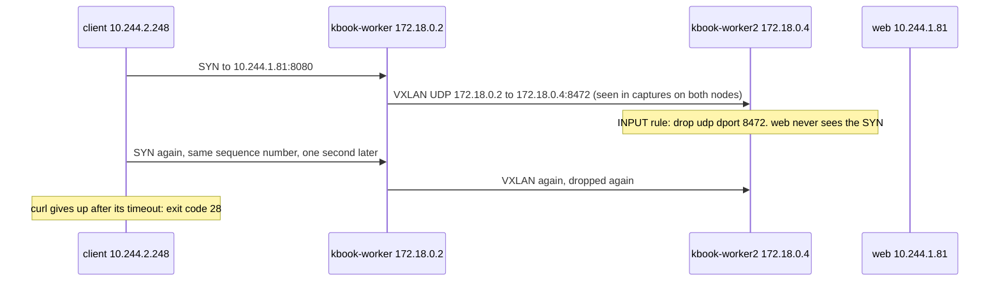

# Chapter 52: Troubleshooting Pod connectivity

> **Exams:** CKNE · D1 Core Infrastructure and CNI (Troubleshooting Pod Connectivity (DNS, pod-to-pod); Using Linux Tools (iptables, ip, tcpdump) for Packet-level Issues)
> **Difficulty:** Intermediate
> **Time:** ~60 min reading, ~45 min lab
> **Lab tier:** 1 (kind, profile `cilium`)
> **Prerequisites:** Chapter 47 (the troubleshooting method), Chapter 48 (Pod networking on a node), Chapter 49 (Cilium's tunnel)

## Learning objectives

After this chapter you can:

- Apply Chapter 47's layer-by-layer method to a Pod that cannot reach another Pod or resolve a name
- Debug a Pod that has no tools, with an ephemeral container that shares its network and processes
- Enter a Pod's network namespace from its node with `crictl` and `nsenter`
- Find the node-side interface of a Pod, and capture its traffic on the node
- Follow an overlay packet across two nodes with `tcpdump` and find where it stops
- Read Cilium's own view of a node with `cilium-dbg`
- Recognize the DNS failures that come from a Pod's spec rather than from CoreDNS

## Concepts

### The method, applied to Pods

Chapter 47 taught a method: start from the symptom, test one layer at a time
from the bottom up, and change only one thing at a time. A Pod problem adds
places to look, but not a new method. Turn the symptom into the right question
first:

| Symptom (from the client Pod) | What it tells you | Look next at |
| --- | --- | --- |
| `curl` answers at once with "connection refused" (exit code 7) | the packet reached the target's network stack, and nothing listens on that address and port | the target: what it listens on (`ss -lnt` inside it) |
| `curl` waits and times out (exit code 28) | packets are dropped, or replies never come back | the path: captures along it, firewalls, routes |
| "could not resolve host" | DNS failed before any packet was sent to the target | the client's `/etc/resolv.conf`, then CoreDNS |
| it works from some nodes but not others | a node-level problem | compare a working node with a broken one |

Two questions narrow almost every Pod connectivity problem quickly. Does it
work between Pods **on the same node**? If yes, the Pods and the plugin's
local part are fine, and the problem is between the nodes. Does it work **by
IP address but not by name**? Then it is DNS.

### Debugging a Pod without tools

Production images are often small: no shell, no `curl`, no `ss`. `kubectl
exec` cannot help when the command does not exist inside the container.
`kubectl debug` adds an **ephemeral container** to the running Pod: an extra
container with an image of your choice (netshoot has every tool this book
uses), started in the Pod's existing network namespace.

```bash
kubectl debug -it <pod> --image=nicolaka/netshoot:v0.14 --target=<container>
```

`--target` also puts the debug container into the target container's
**process namespace**, so `ss -lntp` and `ps` show the application's own
processes and sockets. An ephemeral container cannot be removed; it stays in
the Pod's spec (as `ephemeralContainers`) until the Pod is deleted, and it
does not restart.

### From the node: nsenter and the host-side interface

Sometimes you work on the node instead: on the exam, when you `ssh` into a
node, or when the problem is between the Pod and the node. Every Pod has a
network namespace on its node, and you can enter it with **nsenter**, which
runs a command inside the namespaces of another process:

```bash
crictl ps --name <container>          # the container ID
crictl inspect <id> | jq .info.pid    # the PID of its main process
nsenter -t <pid> -n ip -br addr       # ip, run in that process's network namespace
```

**crictl** is the container runtime's command-line client, present on every
kubeadm node (and in kind's nodes). Where `jq` is missing,
`crictl inspect --output go-template --template '{{.info.pid}}' <id>` prints
the PID on its own. `nsenter -n` enters only the network
namespace, so the node's own tools run there: useful when the Pod's image has
none.

To capture a Pod's traffic on its node, you need the node-side end of its veth
pair (Chapter 45). Inside the Pod, `eth0@if17` names the index of the other
end, 17, also readable as `/sys/class/net/eth0/iflink`. On the node, the
interface with index 17 is the Pod's peer; with Cilium its name starts with
`lxc`. `tcpdump -i lxc63f33b3cb89d` then captures exactly that Pod's traffic.

### Following an overlay packet

When traffic between nodes fails, capture on both of them. With Cilium in
tunnel mode the packets between nodes are VXLAN on UDP port 8472 (Chapter 49),
and `tcpdump` prints each one as two lines: the outer packet, node to node, and
the Pod's packet inside it.

- The packet **never leaves** the sender's node: the problem is on the sender
  (the plugin, a route, a firewall on the sender).
- It leaves, but **never arrives** at the receiving node: the network between
  the nodes drops it.
- It **arrives and is not answered**: the receiving node drops it, or the
  answer goes another way.

A TCP client that gets no answer sends its SYN again, with the same sequence
number, after one second, then after two, four, and so on. Repeated SYNs with
the same sequence number in a capture mean "no answer". Overlay traffic can
also be dropped by a perfectly ordinary firewall: a node that drops UDP 8472
cuts itself off from every other node's Pods, while its own Pods still talk to
each other.

### Cilium's own view: cilium-dbg

Each Cilium agent Pod contains **cilium-dbg**, a command-line tool that asks
that node's agent about its state. Run it in the agent Pod on the node you care
about:

| Command | Shows |
| --- | --- |
| `cilium-dbg status --brief` | whether the agent is healthy (`OK`) |
| `cilium-dbg status` | the full status: routing mode, IPAM, kube-proxy replacement, controllers |
| `cilium-dbg endpoint list` | every **endpoint** (a Pod Cilium manages on this node) with its ID, identity, labels, address, and state |
| `cilium-dbg monitor --type drop` | packets Cilium itself drops, with a reason (policy denied, no route, ...) |

`cilium-dbg monitor` only sees drops in Cilium's own eBPF programs. A packet
dropped by an iptables rule on the node never reaches them, so Cilium knows
nothing about it, and a capture is the right tool. Chapter 58 adds Hubble,
which shows the same flows cluster-wide.

### DNS problems that come from the Pod

Chapter 43 showed how a resolver uses `/etc/resolv.conf`. In a Pod, the
kubelet writes that file from the Pod's **`dnsPolicy`**:

| `dnsPolicy` | `/etc/resolv.conf` in the Pod |
| --- | --- |
| `ClusterFirst` (the default) | the cluster DNS Service (`10.96.0.10` here), the search list `<ns>.svc.cluster.local svc.cluster.local cluster.local`, and `ndots:5` |
| `Default` | the **node's** resolver configuration: no cluster DNS, so Service names do not resolve |
| `ClusterFirstWithHostNet` | cluster DNS for Pods with `hostNetwork: true` (which otherwise get the node's) |
| `None` | only what `dnsConfig` in the Pod spec says |

The name `Default` is misleading: it is not the default. A Pod with
`dnsPolicy: Default` resolves internet names through the node and fails on
every `*.svc.cluster.local` name. Like the rest of a Pod's spec, the DNS
policy cannot be changed on a running Pod; recreate it. When the policy is
right and names still fail, the problem is CoreDNS itself (Chapter 56):
check its Pods, its Service's endpoints, and whether the client can reach a
CoreDNS Pod at all.

> **Why this matters for Kubernetes:** "DNS is broken" is the most common
> first report of a network problem in a cluster, and it is often not DNS.
> Test by IP first: if the IP works, look at the Pod's `resolv.conf` and
> CoreDNS; if the IP fails too, DNS was never the problem.

### Packet walk: a SYN that is never answered

`client` on `kbook-worker` (`10.244.2.248`) connects to `web` on
`kbook-worker2` (`10.244.1.81`). `kbook-worker2` has a firewall rule that drops
UDP port 8472 in its INPUT chain.



*Text description: client's SYN to web is wrapped in VXLAN by kbook-worker and sent to kbook-worker2's UDP port 8472; captures on both nodes show it. kbook-worker2's INPUT chain drops it before the VXLAN device can unwrap it, so web never sees the SYN and nothing answers. client sends the same SYN again a second later, with the same sequence number, and it is dropped the same way, until curl times out with exit code 28.*

## Guided walkthrough

The walkthrough uses a `cilium` cluster with three test Pods in a namespace
`t`: `client` (netshoot) and `api` on `kbook-worker`, and `web` (agnhost) on
`kbook-worker2`. Two faults were planted first: `kbook-worker2` drops UDP
port 8472, and `api` runs `socat` listening on `127.0.0.1:8080` only. Your
addresses will differ.

### Step 1: Two different failures

```bash
kubectl -n t get pods -o wide
kubectl -n t exec client -- curl -s --max-time 4 http://10.244.1.81:8080/hostname; echo " rc=$?"
kubectl -n t exec client -- curl -s --max-time 3 http://10.244.2.123:8080/; echo " rc=$?"
```

```text
NAME     READY   STATUS    RESTARTS   AGE    IP             NODE            NOMINATED NODE   READINESS GATES
api      1/1     Running   0          40s    10.244.2.123   kbook-worker    <none>           <none>
client   1/1     Running   0          104s   10.244.2.248   kbook-worker    <none>           <none>
web      1/1     Running   0          104s   10.244.1.81    kbook-worker2   <none>           <none>
```

```text
command terminated with exit code 28
 rc=28
```

```text
command terminated with exit code 7
 rc=7
```

Exit code 28 to `web` on the other node: a timeout, packets lost somewhere.
Exit code 7 to `api` on the same node: refused at once, so the path is fine
and the problem is in `api` itself.

### Step 2: A Pod without the tool you need

Look at what `api` listens on, from an ephemeral container that shares its
network and process namespaces:

```bash
kubectl -n t debug -it api --image=nicolaka/netshoot:v0.14 --target=api -- ss -lntp
```

```text
State  Recv-Q Send-Q Local Address:Port Peer Address:PortProcess
LISTEN 0      5          127.0.0.1:8080      0.0.0.0:*    users:(("socat",pid=1,fd=5))
```

`socat` (PID 1 in the Pod, visible thanks to `--target`) listens on
`127.0.0.1` only: the loopback, unreachable from any other Pod. Its own
command line says so (`bind=127.0.0.1`); with `bind=0.0.0.0` it answers:

```bash
kubectl -n t exec client -- nc -w 2 10.244.2.123 8080 </dev/null; echo "rc=$?"
```

```text
api-ok
rc=0
```

### Step 3: Follow the packet between the nodes

Capture VXLAN on `kbook-worker` while `client` tries `web` again:

```bash
kubectl debug node/kbook-worker -it --profile=sysadmin --image=nicolaka/netshoot:v0.14 -- \
  tcpdump -i eth0 -n -c 3 udp port 8472
```

```text
15:13:37.045367 IP 172.18.0.2.44613 > 172.18.0.4.8472: OTV, flags [I] (0x08), overlay 0, instance 40695
IP 10.244.2.248.46532 > 10.244.1.81.8080: Flags [S], seq 2245288426, win 64860, options [mss 1410,sackOK,TS val 2325190983 ecr 0,nop,wscale 10], length 0
15:13:38.051484 IP 172.18.0.2.52762 > 172.18.0.4.8472: OTV, flags [I] (0x08), overlay 0, instance 40695
IP 10.244.2.248.46532 > 10.244.1.81.8080: Flags [S], seq 2245288426, win 64860, options [mss 1410,sackOK,TS val 2325191990 ecr 0,nop,wscale 10], length 0
```

The SYN leaves, wrapped in VXLAN to `kbook-worker2` (`172.18.0.4`), and one
second later the same SYN (same sequence number, `2245288426`) leaves again: no
answer came. The third packet of this capture was unrelated health-check
traffic, so it is left out. Now the receiving side, filtered to packets from
`kbook-worker`:

```bash
kubectl debug node/kbook-worker2 -it --profile=sysadmin --image=nicolaka/netshoot:v0.14 -- \
  tcpdump -i eth0 -n -c 2 udp port 8472 and src host 172.18.0.2
```

```text
15:14:03.999696 IP 172.18.0.2.44176 > 172.18.0.4.8472: OTV, flags [I] (0x08), overlay 0, instance 40695
IP 10.244.2.248.41338 > 10.244.1.81.8080: Flags [S], seq 2647224987, win 64860, options [mss 1410,sackOK,TS val 3076879198 ecr 0,nop,wscale 10], length 0
15:14:05.027596 IP 172.18.0.2.47101 > 172.18.0.4.8472: OTV, flags [I] (0x08), overlay 0, instance 40695
IP 10.244.2.248.41338 > 10.244.1.81.8080: Flags [S], seq 2647224987, win 64860, options [mss 1410,sackOK,TS val 3076880227 ecr 0,nop,wscale 10], length 0
```

The packets arrive on `kbook-worker2`'s wire, and nothing answers them. The
problem is on `kbook-worker2`, before the packet reaches `web`. Its firewall:

```bash
docker exec kbook-worker2 iptables -L INPUT -n --line-numbers
```

```text
Chain INPUT (policy ACCEPT)
num  target     prot opt source               destination
1    DROP       udp  --  0.0.0.0/0            0.0.0.0/0            udp dpt:8472
2    CILIUM_INPUT  all  --  0.0.0.0/0            0.0.0.0/0            /* cilium-feeder: CILIUM_INPUT */
3    KUBE-PROXY-FIREWALL  all  --  0.0.0.0/0            0.0.0.0/0            ctstate NEW /* kubernetes load balancer firewall */
4    KUBE-NODEPORTS  all  --  0.0.0.0/0            0.0.0.0/0            /* kubernetes health check service ports */
```

Rule 1 drops every VXLAN packet before Cilium's own rules are reached. Delete
it, and the request works:

```bash
docker exec kbook-worker2 iptables -D INPUT 1
kubectl -n t exec client -- curl -s --max-time 3 http://10.244.1.81:8080/hostname; echo
```

```text
web
```

### Step 4: Into a Pod from its node

On `kbook-worker2`, find `web`'s container and enter its network namespace:

```bash
docker exec -it kbook-worker2 bash
crictl ps --name web -q
crictl inspect 08902da1942b | jq .info.pid
nsenter -t 2343 -n ip -br addr
nsenter -t 2343 -n ss -lnt
```

```text
08902da1942bfce7178bdf47d0237d409da0708619055c7047d4b3f06b246724
```

```text
2343
```

```text
lo               UNKNOWN        127.0.0.1/8 ::1/128
eth0@if17        UP             10.244.1.81/32 fe80::d422:c7ff:fe4e:6bf/64
```

```text
State  Recv-Q Send-Q Local Address:Port Peer Address:Port
LISTEN 0      4096               *:8080            *:*
```

`web` listens on every address (`*:8080`), unlike `api`. Its `eth0` is
`@if17`: the node-side end of its veth pair has index 17:

```bash
ip -o link | awk -F': ' '$1 == 17 {print $2}'
```

```text
lxc63f33b3cb89d@if16
```

`tcpdump -i lxc63f33b3cb89d` on this node captures only `web`'s traffic.

### Step 5: Ask Cilium

Run `cilium-dbg` in the agent Pod on `kbook-worker2`:

```bash
kubectl -n kube-system get pods -l k8s-app=cilium --field-selector spec.nodeName=kbook-worker2
kubectl -n kube-system exec <that-pod> -c cilium-agent -- cilium-dbg status --brief
kubectl -n kube-system exec <that-pod> -c cilium-agent -- cilium-dbg endpoint list | grep -E '^ENDPOINT|10\.244\.1\.81'
```

```text
OK
```

```text
ENDPOINT   POLICY (ingress)   POLICY (egress)   IDENTITY   LABELS (source:key[=value])                                                         IPv6   IPv4           STATUS
2573       Disabled           Disabled          3707       k8s:io.cilium.k8s.namespace.labels.kubernetes.io/metadata.name=t                           10.244.1.81    ready
```

The agent was healthy all along, and `web` was a `ready` endpoint: the drop
happened in iptables, before Cilium's programs ever saw the packet. That is
why the capture, not Cilium, found it.

### Step 6: A Pod that cannot resolve Service names

A fourth Pod, `dnsbad`, was started with `dnsPolicy: Default`:

```bash
kubectl -n t get pod dnsbad -o jsonpath='{.spec.dnsPolicy}{"\n"}'
kubectl -n t exec dnsbad -- grep -v nameserver /etc/resolv.conf
kubectl -n t exec dnsbad -- dig +short +time=2 +tries=1 web.t.svc.cluster.local
kubectl -n t exec client -- cat /etc/resolv.conf
```

```text
Default
```

```text
search localdomain
options ndots:0
```

```text
;; communications error to <node resolver>#53: timed out
;; no servers could be reached
```

```text
search t.svc.cluster.local svc.cluster.local cluster.local localdomain
nameserver 10.96.0.10
options ndots:5
```

`dnsbad` has the node's resolver configuration (its `nameserver` line, the
node's upstream resolver, is left out here because it differs on every
machine), and that resolver knows nothing about `cluster.local`. `client`,
with the default `ClusterFirst`, asks CoreDNS at `10.96.0.10` and has the
cluster search list. Clean up with `make cluster`.

### Useful commands from this chapter

| Command | What it tells you |
| --- | --- |
| `kubectl debug -it <pod> --image=nicolaka/netshoot:v0.14 --target=<container>` | a shell with every tool, in the Pod's network and process namespaces |
| `kubectl debug node/<node> -it --profile=sysadmin --image=nicolaka/netshoot:v0.14` | a shell with every tool in the node's namespaces |
| `crictl ps --name <c>`, `crictl inspect <id> \| jq .info.pid`, `nsenter -t <pid> -n <cmd>` | a command inside a Pod's network namespace, from the node |
| `cat /sys/class/net/eth0/iflink` in the Pod, `ip -o link` on the node | the Pod's host-side interface |
| `tcpdump -n -i eth0 udp port 8472` on a node | Cilium's VXLAN traffic between nodes |
| `iptables -L INPUT -n --line-numbers` | rules that drop traffic before the plugin sees it |
| `cilium-dbg status`, `cilium-dbg endpoint list`, `cilium-dbg monitor --type drop` | the agent's health, its Pods, and Cilium's own drops |

## Hands-on lab

Start (or restart) the lab. Setup builds a brand-new `cilium` cluster:

```bash
make lab CH=52
```

The namespace `ch52-debug` holds `client` (netshoot, on `kbook-worker`), `web`
(agnhost on port 8080, on `kbook-worker2`, behind the Service `web`), and the
Deployment `api` (on `kbook-worker`, meant to answer `api-ok` on port 8080).
Three things are broken, and one question needs an answer. Answer files go in
`/tmp/kbook/ch52/`, which already exists. Type `make check CH=52` after each
task. Solutions: `chapters/52-troubleshooting-pod-connectivity/lab/solutions.md`.

### Task 1: Find web's interface on its node

Find the node-side interface of `web`'s `eth0`, the one you would capture on to
see only `web`'s traffic.

- `/tmp/kbook/ch52/web-veth`: its name, without the `@` part (for example `lxc0123456789ab`)

### Task 2: api refuses connections

Make `api` reachable from other Pods.

- `client` gets `api-ok` from the `api` Pod's address on port 8080 (test with `nc -w 2 <address> 8080`)

### Task 3: Nothing reaches kbook-worker2

Restore Pod-to-Pod traffic between the nodes.

- `client` on `kbook-worker` reaches `web` on `kbook-worker2` at `web`'s Pod IP on port 8080
- Cilium stays in tunnel mode

### Task 4: client cannot resolve Service names

Make `client` use cluster DNS.

- `client`, still on `kbook-worker`, resolves `web.ch52-debug.svc.cluster.local` to the Service's ClusterIP
- Its DNS policy is `ClusterFirst`

## Exam tips

> **Exam tip:** Read `curl`'s exit code before anything else: 7 (refused) and
> 28 (timeout) point to different layers, and 6 means the name did not
> resolve. Add `-v` to see where it stopped.

> **Exam tip:** On the exam's nodes, `crictl` and `nsenter` are there even
> when the Pod's image has nothing. `crictl ps`, `crictl inspect`, then
> `nsenter -t <pid> -n` gives you the Pod's network with the node's tools.

> **Exam tip:** When you capture, filter tightly (`host`, `port`, `src`) and
> limit the count (`-c 5`). An unfiltered capture on a node is flooded by
> health checks and API server traffic.

> **Exam tip:** `kubectl debug` creates an ephemeral container that stays in
> the Pod. That is harmless, but do not use `kubectl debug --copy-to` on the
> exam unless the task allows it: it creates a second Pod.

## Common mistakes

- **Testing by name first.** A DNS failure hides every other problem. Test by
  IP, then by name.
- **Capturing on one node only.** A packet that leaves one node and does not
  arrive at the other is the network's problem; one that arrives and is not
  answered is the receiver's. Only two captures tell them apart.
- **Trusting `cilium-dbg monitor` for every drop.** It sees only Cilium's own
  drops; iptables rules and the network between nodes drop silently.
- **Editing a running Pod's `dnsPolicy`.** The API server rejects it; recreate
  the Pod.
- **An application that listens on `127.0.0.1`.** It works inside its own Pod
  (`kubectl exec ... curl localhost`) and nowhere else. Check with `ss -lnt`.
- **Forgetting that `dnsPolicy: Default` is not the default.** It means "use
  the node's resolver".

<!-- QUESTIONS:START -->

## End-of-chapter questions

**1.** `CKNE` From a client Pod, `curl http://<pod-ip>:8080` fails immediately with exit code 7. What does that tell you?

- **A.** Packets are dropped between the nodes
- **B.** The packet reached the target's network stack, and nothing listens on that address and port
- **C.** DNS failed
- **D.** The client Pod has no network

**2.** `CKNE` Pods on the same node reach each other, but Pods on different nodes do not. Where should you look first?

- **A.** The Pods' application code
- **B.** Between the nodes: the overlay or routes, firewalls on the nodes, and the network that connects them
- **C.** CoreDNS
- **D.** The Service's selector

**3.** `CKNE` A Pod's image has no shell and no networking tools. How do you run `ss -lnt` in its network namespace and see its processes?

- **A.** `kubectl exec <pod> -- ss -lnt`
- **B.** `kubectl debug -it <pod> --image=nicolaka/netshoot:v0.14 --target=<container> -- ss -lntp`
- **C.** `kubectl logs <pod>`
- **D.** `kubectl port-forward <pod> 8080`

**4.** `CKNE` Inside a Pod, `ip -br link` shows `eth0@if17`. What is 17?

- **A.** The Pod's IP address suffix
- **B.** The interface index of the other end of the Pod's veth pair, on the node
- **C.** The number of packets dropped
- **D.** The node's ID in the cluster

**5.** `CKNE` On a node, which commands run `ip addr` inside a container's network namespace?

- **A.** `crictl ps`, `crictl inspect` to find its PID, then `nsenter -t <pid> -n ip addr`
- **B.** `kubectl exec` on the node
- **C.** `docker run --net=host ip addr`
- **D.** `ip netns exec cni0 ip addr`

**6.** `CKNE` A capture on the sending node shows the same SYN, with the same sequence number, sent twice one second apart. What does that mean?

- **A.** The connection was established twice
- **B.** No SYN-ACK came back, so TCP retransmitted the SYN
- **C.** The MTU is too large
- **D.** The Pod has two interfaces

**7.** `CKNE` VXLAN packets from kbook-worker arrive on kbook-worker2's `eth0`, but the target Pod never sees them and `cilium-dbg monitor --type drop` shows nothing. What is a likely cause?

- **A.** A NetworkPolicy denies the traffic
- **B.** A firewall rule on kbook-worker2 drops the packets before Cilium's programs see them, such as an INPUT rule dropping UDP 8472
- **C.** The Pod's DNS policy is wrong
- **D.** kube-proxy is not running

**8.** `CKNE` A Pod resolves internet names but not `web.shop.svc.cluster.local`. Its `/etc/resolv.conf` has no `cluster.local` search domains. What is the most likely cause?

- **A.** CoreDNS is down
- **B.** The Pod has `dnsPolicy: Default`, so it uses the node's resolver
- **C.** The Service has no endpoints
- **D.** The Pod uses IPv6

**9.** `CKNE` An application works with `kubectl exec <pod> -- curl localhost:8080` but other Pods get 'connection refused'. What should you check?

- **A.** Whether it listens on `127.0.0.1` only, with `ss -lnt` inside the Pod
- **B.** The node's routing table
- **C.** The CNI MTU
- **D.** CoreDNS's Corefile

**10. (Task)** `CKNE` Capture the traffic of Pod `api` in namespace `shop` on its node, on the node-side end of its veth pair.

**11. (Task)** `CKNE` Pods on node `node2` cannot be reached from Pods on other nodes, while Pods on `node2` reach each other. The cluster uses Cilium in VXLAN mode. Find and fix the cause on the node.

**12. (Task)** `CKNE` Pod `client` in namespace `app` cannot resolve any Service name. Find out whether the problem is the Pod or CoreDNS, and fix it if it is the Pod.

<details>
<summary>Answers</summary>

**1. B.** Exit code 7 is 'connection refused': the target answered with a TCP reset. A drop would make curl wait until its timeout (exit code 28).

**2. B.** Same-node traffic proves the Pods and the plugin's local part work. What differs for cross-node traffic is the path between the nodes.

**3. B.** `kubectl debug` adds an ephemeral container with the tools; `--target` shares the container's process namespace, so `ss -p` shows the application's sockets.

**4. B.** On the node, the interface with index 17 (`ip -o link`) is the Pod's peer; with Cilium its name starts with `lxc`. Capturing on it shows only that Pod's traffic.

**5. A.** `nsenter -n` enters the network namespace of a process, so the node's own tools run there. This works even when the container image has no tools.

**6. B.** TCP resends an unanswered SYN after one second, then after longer intervals. Next, capture on the receiving node to see whether the SYN arrives.

**7. B.** Cilium reports drops in its own eBPF programs, including policy drops. An iptables rule that drops the outer VXLAN packet acts before Cilium, so only a capture and the node's firewall rules reveal it.

**8. B.** With `dnsPolicy: Default` the kubelet copies the node's resolver configuration. The default policy is `ClusterFirst`, which points at the cluster DNS Service.

**9. A.** A socket bound to the loopback is reachable only from inside the Pod. `ss -lnt` shows `127.0.0.1:8080` instead of `*:8080` or `0.0.0.0:8080`.

**10.**

```bash
kubectl -n shop get pod api -o wide                  # the node
kubectl -n shop exec api -- cat /sys/class/net/eth0/iflink   # e.g. 17 (or use kubectl debug if the image has no cat)
ssh <node>
ip -o link | awk -F': ' '$1 == 17 {print $2}'        # e.g. lxc63f33b3cb89d@if16
sudo tcpdump -n -i lxc63f33b3cb89d
```

The name before `@` is the interface to capture on.

**11.**

```bash
ssh node1 sudo tcpdump -n -i eth0 -c 5 udp port 8472      # packets leave node1
ssh node2 sudo tcpdump -n -i eth0 -c 5 udp port 8472      # they arrive on node2 ...
ssh node2 sudo iptables -L INPUT -n --line-numbers         # ... and a rule drops them
ssh node2 sudo iptables -D INPUT <number>
```

Then test from a Pod on another node to a Pod on `node2` by IP. A cloud firewall or security group between the nodes causes the same symptom, but the packets would not arrive on `node2` at all.

**12.**

```bash
kubectl -n app exec client -- cat /etc/resolv.conf
kubectl -n app get pod client -o jsonpath='{.spec.dnsPolicy}{"\n"}'
kubectl -n kube-system get pods -l k8s-app=kube-dns
kubectl -n kube-system get endpointslices -l kubernetes.io/service-name=kube-dns
```

If `resolv.conf` does not point at the cluster DNS Service (or the policy is `Default` or `None` without the right `dnsConfig`), recreate the Pod with `dnsPolicy: ClusterFirst`: `kubectl get pod client -o yaml > c.yaml`, edit, `kubectl replace --force -f c.yaml`. If it does, and CoreDNS has no ready Pods or endpoints, the problem is CoreDNS.

</details>

<!-- QUESTIONS:END -->

## Further reading

- Kubernetes documentation: [Debug Running Pods](https://kubernetes.io/docs/tasks/debug/debug-application/debug-running-pod/) (ephemeral containers) and [Debugging DNS Resolution](https://kubernetes.io/docs/tasks/administer-cluster/dns-debugging-resolution/)
- Kubernetes documentation: [DNS for Services and Pods](https://kubernetes.io/docs/concepts/services-networking/dns-pod-service/) (`dnsPolicy`, `dnsConfig`)
- Cilium documentation: [Troubleshooting](https://docs.cilium.io/en/stable/operations/troubleshooting/)
- `man nsenter`, `man tcpdump`, and Chapter 47's method
