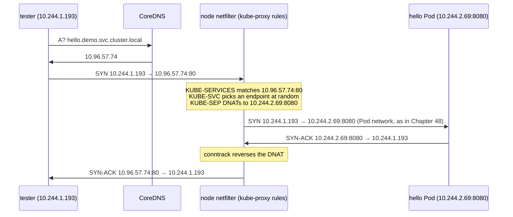

# Chapter 53: L4 Services

> **Exams:** CKNE · D2 Service Networking and DNS (Configuring L4 Services)
> **Difficulty:** Intermediate
> **Time:** ~60 min reading, ~45 min lab
> **Lab tier:** 1 (kind, profile `cilium`)
> **Prerequisites:** Chapter 11 (Services and cluster DNS), Chapter 46 (netfilter and DNAT), Chapter 48 (the network model, the lab cluster)

## Learning objectives

After this chapter you can:

- Explain why Pods need Services, and what a Service is on the wire: a virtual IP and DNAT
- Create ClusterIP, NodePort, LoadBalancer, headless, and ExternalName Services, by command and in YAML
- Get `port`, `targetPort`, named ports, and `nodePort` right, and spot a wrong `targetPort`
- Read EndpointSlices and the iptables rules kube-proxy writes for a Service
- Give LoadBalancer Services addresses with Cilium's LB-IPAM
- Use session affinity, and explain what single-stack and dual-stack Services are

## Concepts

### Why Pods need Services

Chapter 48 showed that every Pod has its own address. Those addresses are not
much use to a client on their own:

- Pods come and go. A Deployment replaces a crashed Pod with a new one, and the
  new one has a new address.
- There are several of them. Three replicas of a web app are three addresses,
  and a client should not have to pick one.

A **Service** solves both problems. It is a Kubernetes object that gives a group
of Pods one stable address and one stable name, and spreads connections across
them. Chapter 11 introduced Services from the application side; this chapter
looks at them as a network engineer does, down to the packets and the rules
that rewrite them. A Service works at layer 4 (Chapter 38): it forwards TCP or UDP
connections to a port, without looking at what is inside them. Layer 7 routing
by HTTP path or host is the job of the Gateway API, in Chapter 57.

### Selectors and EndpointSlices

A Service finds its Pods by **label selector**, the same mechanism a Deployment
uses. A Service with `selector: {app: shop}` belongs to every Pod labelled
`app=shop`, in the Service's namespace.

The control plane keeps a list of those Pods up to date in **EndpointSlice**
objects: one or more per Service, each holding Pod addresses, the port, and
whether each Pod is ready. Only ready Pods receive traffic. A Pod whose
readiness probe fails is taken out of rotation without being deleted; Chapter
55 covers that in detail. The older **Endpoints** object holds the same list
and still appears in `kubectl describe service`, but EndpointSlices are what
kube-proxy and CNI plugins read.

> **Exam tip:** When a Service does not answer, look at its endpoints first:
> `kubectl get endpointslices -l kubernetes.io/service-name=<svc>`. No
> endpoints means the selector matches no ready Pod. Endpoints that are there
> but refuse connections usually mean a wrong `targetPort`.

### The ports of a Service

A Service has up to three port numbers per entry in `spec.ports`. They are easy
to mix up:

| Field | Whose port | Example |
| --- | --- | --- |
| `port` | the Service's own port, on its ClusterIP | `80` |
| `targetPort` | the port the Pods' containers listen on | `8080`, or the name `http` |
| `nodePort` | a port opened on every node (NodePort and LoadBalancer only) | `30017` |

`targetPort` defaults to the same value as `port`. It can also be the **name**
of a container port (`ports: [{name: http, containerPort: 8080}]` in the Pod).
A named port lets each Pod use its own number under the same name, and lets you
change the number in the Deployment without touching the Service.

Each entry also has a `protocol` (`TCP`, the default, `UDP`, or `SCTP`) and,
when there is more than one entry, a `name`.

### What a Service is on the wire

You already know this mechanism. In Chapter 46 you built it by hand: a
**virtual IP** that no interface owns, and DNAT rules that rewrite connections
for it to one of several backends, picked at random. A ClusterIP Service is
exactly that.

- The API server gives the Service an address from the **service CIDR**
  (`10.96.0.0/16` in the lab cluster): its **ClusterIP**.
- **kube-proxy**, a DaemonSet on every node, watches Services and
  EndpointSlices and writes the DNAT rules into each node's netfilter tables,
  in chains named `KUBE-SERVICES`, `KUBE-SVC-...`, and `KUBE-SEP-...`.
- CoreDNS answers the name `<service>.<namespace>.svc.cluster.local` with the
  ClusterIP (Chapter 56 covers CoreDNS).

Because the rules exist on every node, a connection is translated on the node
where the client Pod runs, before it ever leaves that node. Nothing listens on
the ClusterIP, and you cannot ping it: there is a rule only for the Service's
ports and protocol.

The lab cluster runs Cilium as its CNI plugin next to kube-proxy in iptables
mode. kube-proxy's rules exist on every node, and they handle connections
that start on a node and NodePort traffic. Connections from Pods are
translated one step earlier, by Cilium's eBPF program on the host side of the
Pod's veth, with the same result. The packet walk below shows kube-proxy's
way, which is what you meet on most clusters. Chapter 54 shows the difference
with packet counters, compares kube-proxy's modes, and replaces kube-proxy
with Cilium entirely.

### Packet walk: a Pod calls a ClusterIP Service

`tester` (`10.244.1.193`) runs `curl http://hello/hostname`. The Service
`hello` has the ClusterIP `10.96.57.74` and two endpoints.



*Text description:* the Pod asks CoreDNS for the Service name and gets the
ClusterIP. Its SYN to the ClusterIP never leaves the node unchanged: the
netfilter rules kube-proxy wrote match the ClusterIP and port, pick one
endpoint at random, and rewrite the destination to that Pod's address and
`targetPort`. The packet then crosses the Pod network like any Pod-to-Pod
packet. conntrack remembers the translation, so the reply's source is turned
back into the ClusterIP before the client sees it.

### Service types

`spec.type` decides who can reach the Service. Each type builds on the one
before it.

| Type | Reachable from | How |
| --- | --- | --- |
| `ClusterIP` (default) | inside the cluster | a virtual IP from the service CIDR |
| `NodePort` | anything that can reach a node | a ClusterIP, plus the same port (30000 to 32767) open on **every** node's address |
| `LoadBalancer` | an external address | a NodePort, plus an external IP handed out by a load-balancer implementation and written to `status.loadBalancer` |
| `ExternalName` | inside the cluster, by name | no IP and no proxying: a DNS CNAME to another name |

A **NodePort** Service answers on its port on every node, even on nodes that run
none of its Pods; that node forwards the connection to a Pod elsewhere.
Without `nodePort` in the spec, Kubernetes picks a free port from 30000 to
32767. Setting one yourself is fine as long as it is free and in that range.

A **LoadBalancer** Service asks something outside Kubernetes for an external
address. In a cloud, the cloud controller manager creates a cloud load
balancer. On bare metal and in kind there is no cloud, so the Service stays
`<pending>` until something else provides addresses. Cilium does: its
**LB-IPAM** feature hands out addresses from **CiliumLoadBalancerIPPool**
objects:

```yaml
apiVersion: cilium.io/v2
kind: CiliumLoadBalancerIPPool
metadata:
  name: demo-pool
spec:
  blocks:
    - cidr: 172.18.250.0/29
```

LB-IPAM only **assigns** the address. kube-proxy then adds rules for it, so it
works inside the cluster at once. Making the rest of the network send packets
for that address to a node is a separate job: Cilium's L2 announcements (ARP,
Chapter 39) or BGP. Chapter 59 covers both. MetalLB and cloud-provider-kind are
other implementations of the same idea.

### Headless Services

A Service with `clusterIP: None` is **headless**. It has no virtual IP and no
kube-proxy rules. Instead, CoreDNS answers its name with the addresses of all
its ready Pods, so the client picks one itself. StatefulSets use headless
Services to give each Pod a stable name (`db-0.db.shop.svc.cluster.local`), and
clients that do their own load balancing, such as gRPC or database drivers,
use them to see every backend. `clusterIP` cannot be changed on an existing
Service, so decide when you create it.

### ExternalName Services

An **ExternalName** Service has no selector and no address. CoreDNS answers its
name with a CNAME to `spec.externalName`. It gives an outside dependency, or a
Service in another namespace, a local name. Nothing is proxied, so the port in
your URL must be the real port of the target, and HTTP and TLS clients still
send the original name in the `Host` header and SNI, which the target may
reject.

### Session affinity

By default each new connection goes to a random endpoint. With
`sessionAffinity: ClientIP`, every connection from the same client address goes
to the same endpoint, for up to `sessionAffinityConfig.clientIP.timeoutSeconds`
(three hours by default). kube-proxy implements it with the iptables `recent`
match. Affinity is per client IP, so many clients behind one NAT all land on
one Pod.

### IP families: single-stack and dual-stack

Every Service has `ipFamilies` and an `ipFamilyPolicy`. `SingleStack` (the
default) gives it one ClusterIP; on a **dual-stack** cluster (Chapter 40),
`PreferDualStack` or `RequireDualStack` gives it an IPv4 and an IPv6 address.
The lab cluster is IPv4 only, so every Service shows
`IP Family Policy: SingleStack` and `IP Families: IPv4`.

## Guided walkthrough

The walkthrough runs in a namespace of its own, `demo`, so it does not touch
the lab. You need the `cilium` cluster; `make lab CH=53` builds it, or run
`make cluster PROFILE=cilium`.

### Step 1: An app and a client

```bash
kubectl create namespace demo
kubectl -n demo create deployment hello --image=registry.k8s.io/e2e-test-images/agnhost:2.66.1 \
  --replicas=2 --port=8080 -- /agnhost netexec --http-port=8080
kubectl -n demo run tester --image=nicolaka/netshoot:v0.14 -- sleep infinity
kubectl -n demo get pods -o wide
```

```text
NAME                     READY   STATUS    RESTARTS   AGE   IP             NODE            NOMINATED NODE   READINESS GATES
hello-6b97c4469d-89d48   1/1     Running   0          2s    10.244.1.2     kbook-worker2   <none>           <none>
hello-6b97c4469d-srjwh   1/1     Running   0          2s    10.244.2.69    kbook-worker    <none>           <none>
tester                   1/1     Running   0          2s    10.244.1.193   kbook-worker2   <none>           <none>
```

`agnhost netexec` is a small test server from the Kubernetes project. Its path
`/hostname` answers with the Pod's name, so you can see which Pod served a
request.

### Step 2: A ClusterIP Service

```bash
kubectl -n demo expose deployment hello --port=80 --target-port=8080
kubectl -n demo get service hello
kubectl -n demo get endpointslices -l kubernetes.io/service-name=hello
```

```text
NAME    TYPE        CLUSTER-IP    EXTERNAL-IP   PORT(S)   AGE
hello   ClusterIP   10.96.57.74   <none>        80/TCP    1s
NAME          ADDRESSTYPE   PORTS   ENDPOINTS                AGE
hello-2vbst   IPv4          8080    10.244.1.2,10.244.2.69   1s
```

`kubectl expose` copies the Deployment's selector (`app=hello`) into the
Service. The EndpointSlice already lists both Pods, with the `targetPort`.
`kubectl describe` shows everything in one place:

```bash
kubectl -n demo describe service hello
```

```text
Name:                     hello
Namespace:                demo
Labels:                   app=hello
Annotations:              <none>
Selector:                 app=hello
Type:                     ClusterIP
IP Family Policy:         SingleStack
IP Families:              IPv4
IP:                       10.96.57.74
IPs:                      10.96.57.74
Port:                     <unset>  80/TCP
TargetPort:               8080/TCP
Endpoints:                10.244.1.2:8080,10.244.2.69:8080
Session Affinity:         None
Internal Traffic Policy:  Cluster
Events:                   <none>
```

Call it by name from the client a few times:

```bash
for i in 1 2 3 4 5 6; do kubectl -n demo exec tester -- curl -s http://hello/hostname; echo; done
```

```text
hello-6b97c4469d-srjwh
hello-6b97c4469d-srjwh
hello-6b97c4469d-89d48
hello-6b97c4469d-srjwh
hello-6b97c4469d-89d48
hello-6b97c4469d-89d48
```

The short name `hello` works because the Pod's `resolv.conf` searches
`demo.svc.cluster.local` first (Chapter 43). Each connection lands on a random
Pod.

### Step 3: The rules behind it

On any node, list the rules kube-proxy wrote for the Service. The comments name
the Service:

```bash
docker exec -it kbook-worker bash
iptables -t nat -S KUBE-SERVICES | grep demo/hello
iptables -t nat -S KUBE-SVC-OZAEK3YMZEHU6HQ6
iptables -t nat -S KUBE-SEP-XHM5CFRWGURPWPYO | grep DNAT
iptables -t nat -S KUBE-SEP-QTMVJLHT33PIDECS | grep DNAT
```

```text
-A KUBE-SERVICES -d 10.96.57.74/32 -p tcp -m comment --comment "demo/hello cluster IP" -m tcp --dport 80 -j KUBE-SVC-OZAEK3YMZEHU6HQ6
-N KUBE-SVC-OZAEK3YMZEHU6HQ6
-A KUBE-SVC-OZAEK3YMZEHU6HQ6 ! -s 10.244.0.0/16 -d 10.96.57.74/32 -p tcp -m comment --comment "demo/hello cluster IP" -m tcp --dport 80 -j KUBE-MARK-MASQ
-A KUBE-SVC-OZAEK3YMZEHU6HQ6 -m comment --comment "demo/hello -> 10.244.1.2:8080" -m statistic --mode random --probability 0.50000000000 -j KUBE-SEP-XHM5CFRWGURPWPYO
-A KUBE-SVC-OZAEK3YMZEHU6HQ6 -m comment --comment "demo/hello -> 10.244.2.69:8080" -j KUBE-SEP-QTMVJLHT33PIDECS
-A KUBE-SEP-XHM5CFRWGURPWPYO -p tcp -m comment --comment "demo/hello" -m tcp -j DNAT --to-destination 10.244.1.2:8080
-A KUBE-SEP-QTMVJLHT33PIDECS -p tcp -m comment --comment "demo/hello" -m tcp -j DNAT --to-destination 10.244.2.69:8080
```

This is your Chapter 46 load balancer, written by a program. The first rule
catches the ClusterIP and port. The `KUBE-SVC` chain picks the first endpoint
with probability 0.5 and otherwise falls through to the second. Each
`KUBE-SEP` ("service endpoint") chain does the DNAT. The `KUBE-MARK-MASQ` rule
marks connections from outside the Pod network, such as a process on the node,
for masquerading, so the reply comes back through this node. The chain names
are hashes: the `KUBE-SVC` name hashes the Service's namespace, name, port
name, and protocol, so yours is the same; the `KUBE-SEP` names also hash the
endpoint's address, so yours differ (Chapter 54).

### Step 4: NodePort

```bash
kubectl -n demo expose deployment hello --name=hello-np --type=NodePort --port=80 --target-port=8080
kubectl -n demo get service hello-np
kubectl get nodes -o custom-columns=NAME:.metadata.name,IP:.status.addresses[0].address
```

```text
NAME       TYPE       CLUSTER-IP      EXTERNAL-IP   PORT(S)        AGE
hello-np   NodePort   10.96.152.125   <none>        80:30383/TCP   1s
NAME                  IP
kbook-control-plane   172.18.0.4
kbook-worker          172.18.0.3
kbook-worker2         172.18.0.2
```

`80:30383/TCP` means Service port 80, node port 30383. Now test from outside
the cluster, from a plain container on the kind network:

```bash
docker run -d --name ch53-demo-out --network kind nicolaka/netshoot:v0.14 sleep infinity
for ip in 172.18.0.4 172.18.0.3 172.18.0.2; do
  docker exec ch53-demo-out curl -s http://$ip:30383/hostname; echo " <- $ip:30383"
done
docker exec ch53-demo-out curl -s --max-time 3 http://10.96.57.74/hostname; echo "exit $?"
```

```text
hello-6b97c4469d-srjwh <- 172.18.0.4:30383
hello-6b97c4469d-srjwh <- 172.18.0.3:30383
hello-6b97c4469d-89d48 <- 172.18.0.2:30383
exit 28
```

Every node answers, the control plane included, although it runs no `hello`
Pod. The ClusterIP does not work from outside (curl's exit code 28 is a
timeout): it exists only in the nodes' netfilter rules.

### Step 5: LoadBalancer and LB-IPAM

```bash
kubectl -n demo expose deployment hello --name=hello-lb --type=LoadBalancer --port=80 --target-port=8080
kubectl -n demo get service hello-lb
```

```text
NAME       TYPE           CLUSTER-IP     EXTERNAL-IP   PORT(S)        AGE
hello-lb   LoadBalancer   10.96.39.153   <pending>     80:31167/TCP   3s
```

`<pending>`: nothing hands out external addresses yet. Give Cilium a pool:

```bash
kubectl apply -f - <<'EOF'
apiVersion: cilium.io/v2
kind: CiliumLoadBalancerIPPool
metadata:
  name: demo-pool
spec:
  blocks:
    - cidr: 172.18.250.0/29
EOF
kubectl -n demo get service hello-lb
kubectl get ciliumloadbalancerippools
```

```text
NAME       TYPE           CLUSTER-IP     EXTERNAL-IP    PORT(S)        AGE
hello-lb   LoadBalancer   10.96.39.153   172.18.250.0   80:31167/TCP   8s
NAME        DISABLED   CONFLICTING   IPS AVAILABLE   AGE
demo-pool   false      False         7               4s
```

The Service got the first address of the block, and the pool has seven left.
The address is in the Service's status:

```bash
kubectl -n demo get service hello-lb -o yaml
```

```text
status:
  conditions:
  - lastTransitionTime: "2026-11-17T18:08:10Z"
    message: ""
    reason: satisfied
    status: "True"
    type: cilium.io/IPAMRequestSatisfied
  loadBalancer:
    ingress:
    - ip: 172.18.250.0
      ipMode: VIP
```

(Only the end of the output is shown.) Try the address from a Pod, a node, and
outside:

```bash
kubectl -n demo exec tester -- curl -s --max-time 3 http://172.18.250.0/hostname; echo " <- from a Pod"
docker exec kbook-worker curl -s --max-time 3 http://172.18.250.0/hostname; echo " <- from a node"
docker exec ch53-demo-out curl -s --max-time 3 http://172.18.250.0/hostname; echo "exit $? <- from outside"
```

```text
hello-6b97c4469d-89d48 <- from a Pod
hello-6b97c4469d-89d48 <- from a node
exit 28 <- from outside
```

Inside the cluster, kube-proxy's rules catch the external IP like a ClusterIP.
From outside, nobody answers ARP for `172.18.250.0` yet, so the packets go
nowhere. Announcing the address is Chapter 59's job.

### Step 6: Headless and ExternalName

```bash
kubectl -n demo expose deployment hello --name=hello-headless --cluster-ip=None --port=8080
kubectl -n demo get service hello-headless
kubectl -n demo exec tester -- dig +short hello-headless.demo.svc.cluster.local
```

```text
NAME             TYPE        CLUSTER-IP   EXTERNAL-IP   PORT(S)    AGE
hello-headless   ClusterIP   None         <none>        8080/TCP   1s
10.244.1.2
10.244.2.69
```

The name resolves straight to the Pod addresses. An ExternalName Service is a
DNS alias:

```bash
kubectl -n demo create service externalname docs --external-name=kubernetes.io
kubectl -n demo exec tester -- dig +noall +answer docs.demo.svc.cluster.local
```

```text
docs.demo.svc.cluster.local. 30	IN	CNAME	kubernetes.io.
kubernetes.io.		30	IN	A	15.197.167.90
kubernetes.io.		30	IN	A	3.33.186.135
```

### Step 7: Session affinity

```bash
kubectl -n demo patch service hello -p '{"spec":{"sessionAffinity":"ClientIP"}}'
for i in 1 2 3 4 5 6; do kubectl -n demo exec tester -- curl -s http://hello/hostname; echo; done
```

```text
hello-6b97c4469d-89d48
hello-6b97c4469d-89d48
hello-6b97c4469d-89d48
hello-6b97c4469d-89d48
hello-6b97c4469d-89d48
hello-6b97c4469d-89d48
```

Every request now goes to one Pod. On a node, the `KUBE-SVC` chain has gained
`recent` rules that remember which endpoint each client used, for 10800
seconds:

```text
-A KUBE-SVC-OZAEK3YMZEHU6HQ6 -m comment --comment "demo/hello -> 10.244.1.2:8080" -m recent --rcheck --seconds 10800 --reap --name KUBE-SEP-XHM5CFRWGURPWPYO --mask 255.255.255.255 --rsource -j KUBE-SEP-XHM5CFRWGURPWPYO
```

Clean up:

```bash
docker rm -f ch53-demo-out
kubectl delete ciliumloadbalancerippool demo-pool
kubectl delete namespace demo
```

### Useful commands from this chapter

| Command | What it does |
| --- | --- |
| `kubectl expose deployment <d> --port=80 --target-port=8080 [--type=NodePort\|LoadBalancer] [--name=<n>]` | a Service with the Deployment's selector |
| `kubectl create service clusterip\|nodeport\|loadbalancer\|externalname <n> ...` | a Service without a Deployment; add `--dry-run=client -o yaml` for a starting file |
| `kubectl get endpointslices -l kubernetes.io/service-name=<svc>` | the Pods behind a Service |
| `kubectl describe service <svc>` | ports, selector, endpoints, affinity, IP families |
| `iptables -t nat -S KUBE-SERVICES \| grep <ns>/<svc>` (on a node) | kube-proxy's rules for a Service |
| `kubectl get ciliumloadbalancerippools` | LB-IPAM pools and their free addresses |

## Hands-on lab

Start (or restart) the lab:

```bash
make lab CH=53
```

The namespace `ch53-services` contains:

- the Deployment `shop`: three Pods labelled `app=shop`, listening on port 8080 (named `http`)
- the Deployment `cart`: two Pods labelled `app=cart`, listening on port 9090 (named `api`), and a Service `cart` that does not work
- the Pod `client`, a netshoot Pod to test from with `kubectl -n ch53-services exec client -- curl ...`

A netshoot container outside the cluster, `ch53-outside`, sits on the kind
network: test from there with `docker exec ch53-outside curl ...`. Both test
servers answer `/hostname` with the Pod's name. Type `make check CH=53` after
each task. Solutions: `chapters/53-l4-services/lab/solutions.md`.

### Task 1: A Service for shop

Give the `shop` Pods one stable address and name inside the cluster.

- A Service named `shop` of type `ClusterIP` listens on port 80
- `client` gets an answer from a `shop` Pod at `http://shop/hostname`
- All three `shop` Pods are endpoints of the Service

### Task 2: Fix cart

The Service `cart` exists, but `client` cannot get an answer through it. Fix the Service. Do not change the `cart` Deployment.

- `client` gets an answer from a `cart` Pod at `http://cart/hostname`
- The Service still listens on port 80
- The `cart` Deployment is unchanged

### Task 3: Open shop to the outside

Make `shop` reachable from outside the cluster on a fixed port of every node.

- A Service named `shop-public` of type `NodePort`, port 80, node port `30017`
- `ch53-outside` gets an answer from a `shop` Pod at `http://<node address>:30017/hostname`, for every node

### Task 4: Sticky sessions

The shop's shopping-cart page keeps state in memory, so a client should keep talking to the same Pod.

- A Service named `shop-sticky` of type `ClusterIP`, port 80, in front of the `shop` Pods
- It uses client-IP session affinity
- Eight requests in a row from `client` to `http://shop-sticky/hostname` are all answered by the same `shop` Pod

### Task 5: Every Pod by name

A monitoring tool wants to find every `shop` Pod itself, through DNS.

- A headless Service named `shop-pods` (no cluster IP) selects the `shop` Pods
- `shop-pods.ch53-services.svc.cluster.local` resolves to the addresses of the three `shop` Pods

### Task 6: A load-balancer address

Give `shop` an external address with Cilium's LB-IPAM.

- A `CiliumLoadBalancerIPPool` named `ch53-pool` with the block `172.18.17.0/29`
- A Service named `shop-lb` of type `LoadBalancer`, port 80, gets an external IP from that pool
- `/tmp/kbook/ch53/lb-ip` contains that IP
- `client` gets an answer from a `shop` Pod at `http://<that IP>/hostname`

## Exam tips

> **Exam tip:** `kubectl expose` is the fastest way to a correct Service. For
> anything it cannot do (a fixed `nodePort`, session affinity, named
> `targetPort`), generate YAML with `--dry-run=client -o yaml > svc.yaml`, edit,
> and apply. The Service page on kubernetes.io has a complete example of every
> type.

> **Exam tip:** Read `PORT(S)` in `kubectl get service` carefully: `80/TCP`
> is a ClusterIP port; `80:30017/TCP` is Service port 80 on node port 30017.
> The `targetPort` is not shown there; use `kubectl describe service`.

> **Exam tip:** Changing a Service's `type`, ports, or selector is a normal
> edit (`kubectl edit`, `kubectl patch`). Changing `clusterIP` (for example
> to `None`) is not allowed: delete the Service and create it again.

> **Exam tip:** `curl` exit code 7 ("Could not connect", answered at once) and
> 28 (timeout) mean different things through a Service, as in Chapter 42. A
> quick refusal from a Service with endpoints usually means a wrong
> `targetPort`; a timeout means the packets are dropped somewhere.

## Common mistakes

- **`targetPort` set to the Service port.** If `targetPort` is left out, it
  defaults to `port`. An app on 8080 behind a Service on port 80 needs
  `targetPort: 8080` (or the port's name).
- **A selector that matches no Pod.** A typo in a label, or selecting a label
  only the Deployment has (not the Pod template), leaves the Service with no
  endpoints. Compare `kubectl get pods --show-labels` with the selector.
- **Testing a ClusterIP from your machine.** ClusterIPs exist only inside the
  cluster. Test from a Pod, or use a NodePort or LoadBalancer.
- **Pinging a Service.** kube-proxy translates only the Service's ports and
  protocol; ICMP to a ClusterIP gets no answer, even when the Service works.
- **A `nodePort` outside 30000 to 32767,** or one another Service already uses.
  The API server rejects it.
- **Expecting a LoadBalancer address to work everywhere at once.** An assigned
  address works inside the cluster; outside, the network must also learn where
  it lives (Chapter 59).

<!-- QUESTIONS:START -->

## End-of-chapter questions

**1.** `CKNE` How does a Service know which Pods to send traffic to?

- **A.** It sends traffic to every Pod in its namespace
- **B.** Its label selector; the control plane writes the matching ready Pods into EndpointSlices
- **C.** The Deployment registers its Pods with the Service when they start
- **D.** kube-proxy scans the node for containers listening on the Service's port

**2.** `CKNE` A Service has `port: 80` and no `targetPort`. The Pods listen on 8080. What happens?

- **A.** Kubernetes detects port 8080 from the container spec
- **B.** `targetPort` defaults to 80, so connections are forwarded to port 80 on the Pods and are refused
- **C.** The API server rejects the Service
- **D.** The Service has no endpoints

**3.** `CKNE` What is the advantage of setting `targetPort: http` instead of `targetPort: 8080`?

- **A.** The Service then speaks HTTP instead of TCP
- **B.** It refers to the container port named `http`, so the number can differ between Pods or change without editing the Service
- **C.** It makes the Service reachable from outside the cluster
- **D.** It enables session affinity for HTTP clients

**4.** `CKNE` Why does `ping` to a working ClusterIP get no reply?

- **A.** ClusterIPs are only reachable over IPv6
- **B.** Nothing owns the ClusterIP: kube-proxy only translates the Service's ports and protocol, so ICMP matches no rule
- **C.** CoreDNS blocks ICMP
- **D.** The Service has session affinity turned off

**5.** `CKNE` A NodePort Service has nodePort 30017, and its Pods all run on `node1`. A client connects to `node2:30017`. What happens?

- **A.** The connection is refused, because `node2` runs no Pod of the Service
- **B.** `node2` forwards the connection to a Pod on `node1`
- **C.** The client is redirected to `node1` with an HTTP redirect
- **D.** `node2` answers only if session affinity is on

**6.** `CKNE` In a kind cluster, a new LoadBalancer Service shows `EXTERNAL-IP <pending>` forever. Why?

- **A.** LoadBalancer Services need at least three replicas
- **B.** Nothing in the cluster hands out external addresses: there is no cloud controller, and no pool for an implementation such as Cilium LB-IPAM or MetalLB
- **C.** kube-proxy is in iptables mode
- **D.** The Service has no nodePort

**7.** `CKNE` Cilium's LB-IPAM has given a Service the address `172.18.17.1`. It works from Pods but not from a machine on the nodes' LAN. What is missing?

- **A.** A second pool
- **B.** Something that makes the LAN deliver packets for that address to a node, such as L2 announcements (ARP) or BGP
- **C.** A NetworkPolicy that allows the traffic
- **D.** Session affinity

**8.** `CKNE` What does a DNS lookup of a headless Service's name return?

- **A.** Nothing; headless Services have no DNS name
- **B.** The addresses of the Service's ready Pods
- **C.** A CNAME to the Deployment's name
- **D.** The ClusterIP

**9.** `CKNE` An ExternalName Service `db` points to `db.example.com`. A Pod connects to `db:5432`. What does kube-proxy do with the connection?

- **A.** DNATs it to `db.example.com`'s address
- **B.** Nothing: ExternalName is only a DNS CNAME, and the Pod connects to `db.example.com`'s address on port 5432 directly
- **C.** Proxies it through the node's address
- **D.** Rejects it, because ExternalName Services have no ports

**10.** `CKNE` A Service uses `sessionAffinity: ClientIP`. Hundreds of users reach it through one corporate NAT gateway. What happens?

- **A.** Each user gets their own Pod
- **B.** All of them land on the same Pod, because affinity is keyed on the source IP, which they share
- **C.** Affinity is turned off automatically
- **D.** Requests are spread evenly, as without affinity

**11. (Task)** `CKNE` In namespace `shop`, expose the Deployment `api` (container port 8080) as a Service named `api` on port 80, then show which Pod addresses it forwards to.

**12. (Task)** `CKNE` Create a Service `web-np` of type NodePort for the Pods labelled `app=web` in the current namespace: port 80, targetPort 8080, node port 30080.

**13. (Task)** `CKNE` On a node, find the iptables rules kube-proxy wrote for the Service `api` in namespace `shop`, and the Pod addresses they DNAT to.

<details>
<summary>Answers</summary>

**1. B.** The EndpointSlice controller watches Pods that match the Service's selector and records the ready ones. kube-proxy and CNI plugins program forwarding from the EndpointSlices.

**2. B.** `targetPort` defaults to the value of `port`. The endpoints are there, but nothing listens on 80 in the Pods, so clients get an immediate connection refused.

**3. B.** A named targetPort is looked up in each Pod's container ports. The Service stays layer 4; the name is only a label for a port number.

**4. B.** A ClusterIP is a virtual IP. Only connections to the Service's listed ports and protocols are DNATed to endpoints; anything else goes nowhere.

**5. B.** With the default `externalTrafficPolicy: Cluster`, every node accepts the node port and forwards to any endpoint. Chapter 55 shows the `Local` policy, which changes this.

**6. B.** Kubernetes only requests an external address. A cloud controller, MetalLB, cloud-provider-kind, or Cilium LB-IPAM with a CiliumLoadBalancerIPPool has to provide one.

**7. B.** LB-IPAM only assigns the address. Inside the cluster, Service rules catch it; outside, a router or host must learn which node owns it, which is what Chapter 59 sets up.

**8. B.** With `clusterIP: None` there is no virtual IP and no kube-proxy rule; CoreDNS returns one A record per ready endpoint, and the client chooses.

**9. B.** An ExternalName Service has no ClusterIP and no rules. CoreDNS answers with a CNAME, and the connection goes straight to the target.

**10. B.** ClientIP affinity knows nothing about users or cookies; one source address means one Pod. Cookie-based stickiness needs a layer 7 proxy.

**11.**

```bash
kubectl -n shop expose deployment api --port=80 --target-port=8080
kubectl -n shop get endpointslices -l kubernetes.io/service-name=api
```

`kubectl -n shop describe service api` shows the same addresses in its `Endpoints` line.

**12.**

```bash
kubectl create service nodeport web-np --tcp=80:8080 --node-port=30080 --dry-run=client -o yaml > web-np.yaml
# edit web-np.yaml: set spec.selector to app: web (create service sets app: web-np)
kubectl apply -f web-np.yaml
```

Or write the Service by hand with `type: NodePort`, `selector: {app: web}`, and `ports: [{port: 80, targetPort: 8080, nodePort: 30080}]`.

**13.**

```bash
iptables -t nat -S KUBE-SERVICES | grep shop/api
iptables -t nat -S | grep 'shop/api' | grep DNAT
```

The comments kube-proxy adds (`shop/api cluster IP`, `shop/api -> 10.244.1.7:8080`) make the rules easy to find without decoding the chain-name hashes.

</details>

<!-- QUESTIONS:END -->

## Further reading

- Kubernetes documentation: [Service](https://kubernetes.io/docs/concepts/services-networking/service/), [EndpointSlices](https://kubernetes.io/docs/concepts/services-networking/endpoint-slices/), and [Virtual IPs and Service Proxies](https://kubernetes.io/docs/reference/networking/virtual-ips/)
- Kubernetes documentation: [IPv4/IPv6 dual-stack](https://kubernetes.io/docs/concepts/services-networking/dual-stack/)
- Cilium documentation: [LoadBalancer IP Address Management (LB IPAM)](https://docs.cilium.io/en/stable/network/lb-ipam/)
