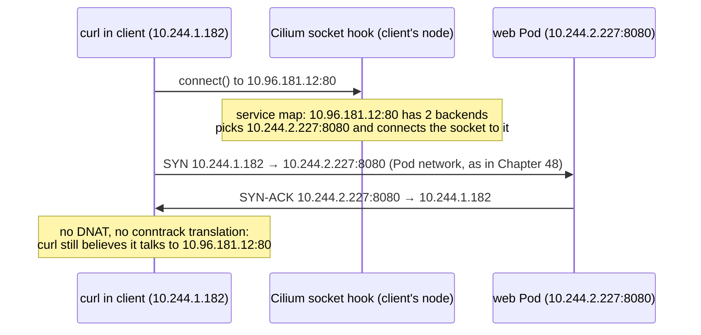

# Chapter 54: kube-proxy and its alternatives

> **Exams:** CKNE · D2 Service Networking and DNS (Understanding kube-proxy and CNI Alternatives)
> **Difficulty:** Advanced
> **Time:** ~60 min reading, ~45 min lab
> **Lab tier:** 1 (kind, profile `cilium`)
> **Prerequisites:** Chapter 46 (netfilter, nftables, and conntrack), Chapter 49 (CNI plugins and Cilium), Chapter 53 (L4 Services)

## Learning objectives

After this chapter you can:

- Explain what kube-proxy does on a node, and why no packet passes through it
- Compare kube-proxy's iptables, nftables, and IPVS modes: how each finds a Service, how each grows with the cluster, and where each stands in Kubernetes v1.37
- Find the mode a running kube-proxy uses, and switch it safely
- Read a Service's rules in iptables and nftables mode, and know their chain names in advance
- Explain how Cilium's kube-proxy replacement handles Services with eBPF, including socket-level load balancing
- Move a cluster from kube-proxy to Cilium's kube-proxy replacement, and clean up what kube-proxy leaves behind

## Concepts

### What kube-proxy does

Chapter 53 showed that a Service is a virtual IP and a set of DNAT rules on
every node. **kube-proxy** is the program that writes those rules. It runs as
a DaemonSet, one Pod per node, in the node's own network namespace. It
watches Services and EndpointSlices through the API server, and whenever one
changes, it rewrites the node's rules to match.

The name is older than the design. The first kube-proxy really was a proxy: a
program that accepted each connection and opened a second one to a Pod. That
mode is long gone. Today kube-proxy is a controller: it only writes rules, and
the kernel applies them to every packet. Stop kube-proxy, and existing
Services keep working; they just stop following changes.

How kube-proxy writes the rules is its **proxy mode**. On Linux there are
three:

| Mode | Kernel machinery | Status in v1.37 |
| --- | --- | --- |
| `iptables` | netfilter chains, written with `iptables-restore` | the default |
| `nftables` | an nftables table of kube-proxy's own | generally available since v1.33; the recommended mode for new clusters (kernel 5.13 or later) |
| `ipvs` | the kernel's IPVS load balancer, plus some iptables rules | deprecated since v1.35; off by default from v1.40, removed in v1.43 |

The mode is set in kube-proxy's configuration, which kubeadm (and so kind)
keeps in the ConfigMap `kube-proxy` in `kube-system`, under the key
`config.conf`. kube-proxy reads it when it starts, so a change takes effect
only after its Pods restart. Each kube-proxy also reports the mode it really
uses at `http://localhost:10249/proxyMode` on its node (Chapter 21 explains
why port 10249 listens on `127.0.0.1` only).

### iptables mode: a list, read from the top

Chapter 53 showed the rules for one Service. The chain `KUBE-SERVICES` holds
one rule per Service port, and each jumps to that Service's `KUBE-SVC-...`
chain. That chain picks an endpoint at random, with the probabilities chosen
so each endpoint gets an equal share: with three endpoints, the first rule
matches with probability 1/3, the second with 1/2 of what is left, and the
last always. Each `KUBE-SEP-...` chain then does the DNAT.

The chain names look random, but they are not. A `KUBE-SVC` name is the first
16 characters of a hash (SHA-256, written in base32) of the Service port's
name and protocol: `demo/web:http` plus `tcp` always gives
`KUBE-SVC-XRY76EGRC3BSCIIJ`, in every cluster. A `KUBE-SEP` name also hashes
the endpoint's address, so it changes whenever a Pod is replaced. The rule
comments carry the readable names, which is why `grep demo/web` is the
quickest way in.

This design has a cost that grows with the cluster. `KUBE-SERVICES` is a list,
and the kernel reads it from the top until a rule matches. Only the first
packet of a connection takes that walk (conntrack, Chapter 46, remembers the
answer for the rest), but with ten thousand Services that is still a long
walk. Every change also means kube-proxy writing rules back with
`iptables-restore`, which takes longer the more rules there are.

### nftables mode: one lookup

nftables (Chapter 46) can keep lookup tables next to its rules, which plain
iptables rules cannot (iptables needs a separate tool, ipset, for that). An
nftables table can hold **sets** (lists of values, such as addresses) and
**maps** (key to value). A **verdict map** maps a key to a
verdict, such as `goto` a chain. kube-proxy's nftables mode is built on one:

- kube-proxy owns two tables, `ip kube-proxy` and `ip6 kube-proxy`, and
  touches nothing else. Their base chains hook into netfilter like any other.
- The map `service-ips` has one element per Service port: ClusterIP,
  protocol, and port, mapped to `goto` that Service's chain. One rule in the
  chain `services` looks the packet up in it. Finding a Service costs one
  lookup, however many Services there are.
- Each Service chain, named `service-<hash>-<namespace>/<name>/<protocol>/<port name>`,
  picks an endpoint with a random number and a second map, and does the DNAT
  in the same rule.
- When a Service changes, kube-proxy changes only the elements and chains that
  belong to it.

The project calls nftables mode the replacement for both other modes. It needs
kernel 5.13 or later. A few details differ from iptables mode, and they
matter when you migrate: NodePorts answer only on the node's primary
addresses by default (`nodePortAddresses: primary`), not on every local
address, and not on `127.0.0.1`; and kube-proxy adds no workarounds for a
local firewall or for some old conntrack problems, so a host firewall must let
Kubernetes traffic through by itself.

### IPVS mode: deprecated

**IPVS** (IP Virtual Server) is a layer 4 load balancer built into the Linux
kernel. kube-proxy's `ipvs` mode creates one IPVS virtual server per Service
port, with the endpoints as its real servers, and puts every ClusterIP on a
**dummy interface** named `kube-ipvs0`: a virtual interface that only holds
addresses, so the node's kernel accepts packets for them. IPVS mode still
needs iptables rules too, for masquerading and NodePorts.

IPVS was added for large clusters, before nftables mode existed. It has been
deprecated since v1.35, because nftables mode does the same job with less
machinery. On v1.37 it still works, but kube-proxy logs an error-level message
at start, and the mode is planned to be off by default from v1.40 and removed
in v1.43. If you meet an IPVS cluster, the advice is to move it to nftables.

### Switching modes, and what stays behind

Switching is two steps: change `mode` in the ConfigMap, then restart the
kube-proxy DaemonSet. What happens to the old rules depends on the direction.
When kube-proxy starts, it removes rules of the other family only:

- Starting in `nftables` mode removes the rules of the `iptables` and `ipvs`
  modes (and the `kube-ipvs0` interface).
- Starting in `iptables` or `ipvs` mode removes the `nftables` mode's tables.
- Between `iptables` and `ipvs`, nothing is removed. Moving from IPVS to
  iptables leaves `kube-ipvs0` and the IPVS servers in place; the Kubernetes
  project recommends rebooting the nodes after such a switch.

### Who else does Services?

kube-proxy is one implementation of Services, not the only one. Several CNI
plugins can do the job themselves, with eBPF programs instead of netfilter
rules:

- Cilium can take over completely with its **kube-proxy replacement**
  (`kubeProxyReplacement=true`): its eBPF programs handle ClusterIP, NodePort,
  LoadBalancer, external IPs, and host ports, and kube-proxy is removed.
- Calico's eBPF data plane also replaces kube-proxy. kube-router can run a
  Service proxy of its own, built on IPVS.

There is a middle ground too, and the lab cluster is in it. With
`kubeProxyReplacement=false`, Cilium still translates ClusterIP traffic that
comes from Pods, in the eBPF program on the host side of each Pod's veth,
before netfilter sees the packet. kube-proxy's rules then handle the rest:
connections that start on the node itself, and NodePort traffic from
outside. The walkthrough shows this with packet counters.

### How the kube-proxy replacement works

Cilium's agent watches Services and EndpointSlices, like kube-proxy, and
writes them into eBPF maps: for each Service address and port, its
backends. `cilium-dbg service list` shows that table. The eBPF programs then
translate at two kinds of places:

- **Socket-level load balancing** (socket LB). When a program in a Pod or on
  the node opens a connection (the `connect` system call) to a Service
  address, a Cilium hook picks a backend and connects the socket straight to
  it. No packet ever carries the ClusterIP, so there is nothing to DNAT and
  nothing for conntrack to reverse. The program still believes it talks to the
  Service address.
- On the node's network device, for traffic that arrives from outside: a
  NodePort or LoadBalancer connection is translated by the eBPF program
  attached to the node's interface (`eth0` in kind), before the packet goes
  up the kernel's network stack.

Without kube-proxy, nothing sets up the ClusterIP of the `kubernetes` Service
(`10.96.0.1`) until Cilium runs, and Cilium itself needs the API server to
start. So the agents must be told the API server's real address: the Helm
values `k8sServiceHost` and `k8sServicePort`. A cluster can also start
without kube-proxy: kubeadm skips it with `--skip-phases=addon/kube-proxy`,
and kind with `kubeProxyMode: "none"` (the book's `cilium-kpr` profile does
this).

Removing kube-proxy from a running cluster leaves its rules behind: deleting
the DaemonSet stops the Pods, and nothing removes what they wrote. The rules
no longer follow changes, so they slowly go stale and only confuse whoever
debugs the node next. Remove them on every node: in iptables mode with
`iptables-save | grep -v KUBE | iptables-restore` (and the same for
`ip6tables`), in nftables mode by deleting the tables `ip kube-proxy` and
`ip6 kube-proxy`. The iptables command also deletes the kubelet's own small
`KUBE-` chains (`KUBE-KUBELET-CANARY`, `KUBE-FIREWALL`,
`KUBE-IPTABLES-HINT`); the kubelet notices and creates them again within a
minute.

> **Why this matters for Kubernetes:** "which component turns this Service
> into forwarding?" has three possible answers: kube-proxy's rules, the CNI
> plugin's eBPF programs, or both, depending on where the connection starts.
> Answer it first when a Service misbehaves, or you will read the wrong rules.

### Packet walk: a Pod calls a ClusterIP Service with socket LB

`client` (`10.244.1.182`) runs `curl http://web/hostname` on a cluster where
Cilium has replaced kube-proxy. The Service `web` has the ClusterIP
`10.96.181.12` and two endpoints.



*Text description:* curl asks to connect to the ClusterIP. Before any packet
exists, Cilium's hook on that system call looks the address up in its service
map, picks one of the two backends at random, and connects the socket to it.
The very first packet, the SYN, already carries the Pod's address and port
8080, and the reply comes straight back from that address. Compare Chapter
53's walk, where the SYN left the Pod addressed to the ClusterIP and was
rewritten on the node: a capture inside `client` then shows
`10.96.181.12.80` (Step 3 below); with socket LB it shows
`10.244.2.227.8080` (Step 7).

## Guided walkthrough

The walkthrough needs the `cilium` cluster (`make cluster PROFILE=cilium`, or
any lab that uses it). It changes kube-proxy and Cilium on every node, and
Step 6 removes kube-proxy for good; `make lab CH=54` notices that and builds
a new cluster for the lab.

### Step 1: Who handles Services here?

```bash
kubectl -n kube-system get daemonset kube-proxy
kubectl -n kube-system get configmap kube-proxy -o jsonpath='{.data.config\.conf}' | grep -E '^(mode|nodePortAddresses|metricsBindAddress):'
docker exec kbook-worker curl -s localhost:10249/proxyMode; echo
kubectl -n kube-system exec ds/cilium -c cilium-agent -- cilium-dbg status | grep KubeProxyReplacement
```

```text
NAME         DESIRED   CURRENT   READY   UP-TO-DATE   AVAILABLE   NODE SELECTOR            AGE
kube-proxy   3         3         3       3            3           kubernetes.io/os=linux   3m20s
metricsBindAddress: ""
mode: iptables
nodePortAddresses: null
iptables
KubeProxyReplacement:    False
```

kube-proxy runs on all three nodes, in iptables mode, and Cilium does not
replace it. An empty `metricsBindAddress` means the default,
`127.0.0.1:10249`, which is why the `proxyMode` request runs on the node
itself.

### Step 2: An app to look at

[`manifests/demo.yaml`](manifests/demo.yaml) creates the namespace `demo` with
two test servers behind the Service `web` (port 80, named `http`, to port
8080), and a netshoot Pod `client` on `kbook-worker`:

```bash
kubectl apply -f chapters/54-kube-proxy/manifests/demo.yaml
kubectl -n demo rollout status deployment web
kubectl -n demo get pods -o wide
kubectl -n demo get service web
```

```text
NAME                   READY   STATUS    RESTARTS   AGE   IP             NODE            NOMINATED NODE   READINESS GATES
client                 1/1     Running   0          2s    10.244.1.182   kbook-worker    <none>           <none>
web-5b466c4c44-jgj5s   1/1     Running   0          2s    10.244.2.227   kbook-worker2   <none>           <none>
web-5b466c4c44-jh58k   1/1     Running   0          2s    10.244.1.13    kbook-worker    <none>           <none>

NAME   TYPE        CLUSTER-IP     EXTERNAL-IP   PORT(S)   AGE
web    ClusterIP   10.96.181.12   <none>        80/TCP    4s
```

Your addresses differ; use your own in the commands below.

### Step 3: The iptables rules, and who uses them

```bash
docker exec kbook-worker iptables -t nat -S KUBE-SERVICES | grep demo/web
docker exec kbook-worker iptables -t nat -S KUBE-SVC-XRY76EGRC3BSCIIJ
```

```text
-A KUBE-SERVICES -d 10.96.181.12/32 -p tcp -m comment --comment "demo/web:http cluster IP" -m tcp --dport 80 -j KUBE-SVC-XRY76EGRC3BSCIIJ
-N KUBE-SVC-XRY76EGRC3BSCIIJ
-A KUBE-SVC-XRY76EGRC3BSCIIJ ! -s 10.244.0.0/16 -d 10.96.181.12/32 -p tcp -m comment --comment "demo/web:http cluster IP" -m tcp --dport 80 -j KUBE-MARK-MASQ
-A KUBE-SVC-XRY76EGRC3BSCIIJ -m comment --comment "demo/web:http -> 10.244.1.13:8080" -m statistic --mode random --probability 0.50000000000 -j KUBE-SEP-IAUY742WYDO3B4FY
-A KUBE-SVC-XRY76EGRC3BSCIIJ -m comment --comment "demo/web:http -> 10.244.2.227:8080" -j KUBE-SEP-P3QATHR3YCIHHV3D
```

Your `KUBE-SVC` name is the same as this one, because it is a hash of
`demo/web:http` and `tcp`. Python computes it:

```bash
python3 -c 'import base64,hashlib; print("KUBE-SVC-" + base64.b32encode(hashlib.sha256(b"demo/web:httptcp").digest()).decode()[:16])'
```

```text
KUBE-SVC-XRY76EGRC3BSCIIJ
```

Now find out who uses these rules. `-Z` sets the chain's packet counters to
zero, and `-L -v -x` shows them. First four requests from the Pod `client`,
which runs on `kbook-worker`:

```bash
docker exec kbook-worker iptables -t nat -Z KUBE-SVC-XRY76EGRC3BSCIIJ
for i in 1 2 3 4; do kubectl -n demo exec client -- curl -s http://web/hostname; echo; done
docker exec kbook-worker iptables -t nat -L KUBE-SVC-XRY76EGRC3BSCIIJ -n -v -x
```

```text
web-5b466c4c44-jgj5s
web-5b466c4c44-jgj5s
web-5b466c4c44-jh58k
web-5b466c4c44-jgj5s
Chain KUBE-SVC-XRY76EGRC3BSCIIJ (1 references)
    pkts      bytes target     prot opt in     out     source               destination
       0        0 KUBE-MARK-MASQ  tcp  --  *      *      !10.244.0.0/16        10.96.181.12         /* demo/web:http cluster IP */ tcp dpt:80
       0        0 KUBE-SEP-IAUY742WYDO3B4FY  all  --  *      *       0.0.0.0/0            0.0.0.0/0            /* demo/web:http -> 10.244.1.13:8080 */ statistic mode random probability 0.50000000000
       0        0 KUBE-SEP-P3QATHR3YCIHHV3D  all  --  *      *       0.0.0.0/0            0.0.0.0/0            /* demo/web:http -> 10.244.2.227:8080 */
```

Four answers, from both Pods, and not one packet through kube-proxy's chain.
Then the same from the node itself:

```bash
for i in 1 2 3 4; do docker exec kbook-worker curl -s http://10.96.181.12/hostname; echo; done
docker exec kbook-worker iptables -t nat -L KUBE-SVC-XRY76EGRC3BSCIIJ -n -v -x
```

```text
web-5b466c4c44-jh58k
web-5b466c4c44-jgj5s
web-5b466c4c44-jh58k
web-5b466c4c44-jgj5s
Chain KUBE-SVC-XRY76EGRC3BSCIIJ (1 references)
    pkts      bytes target     prot opt in     out     source               destination
       4      240 KUBE-MARK-MASQ  tcp  --  *      *      !10.244.0.0/16        10.96.181.12         /* demo/web:http cluster IP */ tcp dpt:80
       2      120 KUBE-SEP-IAUY742WYDO3B4FY  all  --  *      *       0.0.0.0/0            0.0.0.0/0            /* demo/web:http -> 10.244.1.13:8080 */ statistic mode random probability 0.50000000000
       2      120 KUBE-SEP-P3QATHR3YCIHHV3D  all  --  *      *       0.0.0.0/0            0.0.0.0/0            /* demo/web:http -> 10.244.2.227:8080 */
```

These four did go through the chain, one SYN each (60 bytes), and the
`KUBE-MARK-MASQ` rule marked them, because they come from outside the Pod
network. This is the middle ground from the Concepts section: Cilium answered
the Pod's connections in eBPF, and kube-proxy's rules answered the node's. A
capture inside `client` shows that the Pod still sends to the ClusterIP; the
translation happens after the packet leaves it:

```bash
kubectl -n demo exec -it client -- tcpdump -n -i eth0 -c 2 --immediate-mode tcp
```

and, in a second terminal, `kubectl -n demo exec client -- curl -s http://web/hostname`:

```text
16:17:53.548416 IP 10.244.1.182.35594 > 10.96.181.12.80: Flags [S], seq 3207987922, win 64860, options [mss 1410,sackOK,TS val 1439292219 ecr 0,nop,wscale 10], length 0
16:17:53.548621 IP 10.96.181.12.80 > 10.244.1.182.35594: Flags [S.], seq 2850669301, ack 3207987923, win 64308, options [mss 1410,sackOK,TS val 591784630 ecr 1439292219,nop,wscale 10], length 0
```

### Step 4: Switch to nftables

Edit the ConfigMap and change `mode: iptables` to `mode: nftables` (it is one
line in the `config.conf` key):

```bash
kubectl -n kube-system edit configmap kube-proxy
kubectl -n kube-system rollout restart daemonset kube-proxy
kubectl -n kube-system rollout status daemonset kube-proxy
docker exec kbook-worker curl -s localhost:10249/proxyMode; echo
kubectl -n kube-system logs ds/kube-proxy | grep Proxier
```

```text
daemon set "kube-proxy" successfully rolled out
nftables
I1128 16:17:56.521185       1 server_linux.go:231] "Using nftables Proxier"
```

If `proxyMode` prints nothing, kube-proxy is still starting; ask again a few
seconds later. Now look at the node. kube-proxy has its own tables, and its
iptables rules are gone:

```bash
docker exec kbook-worker nft list tables
docker exec kbook-worker sh -c 'iptables-save | grep -c KUBE-SVC'
```

```text
table ip nat
table ip mangle
table ip filter
table ip6 mangle
table ip6 nat
table ip6 filter
table ip raw
table ip kube-proxy
table ip6 kube-proxy
0
```

The first seven tables belong to iptables-nft (Chapter 46). The lookup
happens in the chain `services`, through the map `service-ips`:

```bash
docker exec kbook-worker nft list chain ip kube-proxy services
docker exec kbook-worker nft list map ip kube-proxy service-ips
```

```text
table ip kube-proxy {
	chain services {
		ip daddr @cluster-ips ip saddr != 10.244.0.0/16 meta mark set meta mark | 0x00004000 comment "masquerade clusterIP traffic from outside cluster"
		ip daddr . meta l4proto . th dport vmap @service-ips
		ip daddr @nodeport-ips meta l4proto . th dport vmap @service-nodeports
	}
}
table ip kube-proxy {
	map service-ips {
		type ipv4_addr . inet_proto . inet_service : verdict
		comment "ClusterIP, ExternalIP and LoadBalancer IP traffic"
		elements = { 10.96.0.10 . tcp . 53 : goto service-NWBZK7IH-kube-system/kube-dns/tcp/dns-tcp,
			     10.96.0.10 . udp . 53 : goto service-FY5PMXPG-kube-system/kube-dns/udp/dns,
			     10.96.181.12 . tcp . 80 : goto service-AXK6CI2C-demo/web/tcp/http,
			     10.96.96.230 . tcp . 80 : goto service-Z24RNR5Z-kube-system/hubble-relay/tcp/,
			     10.96.0.1 . tcp . 443 : goto service-2QRHZV4L-default/kubernetes/tcp/https,
			     10.96.83.125 . tcp . 443 : goto local-SNHDLTI3-kube-system/hubble-peer/tcp/peer-service,
			     10.96.0.10 . tcp . 9153 : goto service-AS2KJYAD-kube-system/kube-dns/tcp/metrics }
	}
}
```

Read the middle rule of `services`: take the packet's destination address,
protocol, and destination port (`th dport`, the transport header's port),
look the three up in `service-ips`, and follow the verdict (`vmap`). The
first rule marks traffic from outside the Pod network for masquerading, as
`KUBE-MARK-MASQ` did; the last does the same lookup for NodePorts. `web`'s
chain does the rest in one rule:

```bash
docker exec kbook-worker nft list chain ip kube-proxy service-AXK6CI2C-demo/web/tcp/http
```

```text
table ip kube-proxy {
	chain service-AXK6CI2C-demo/web/tcp/http {
		meta l4proto tcp dnat ip to numgen random mod 2 map { 0 : 10.244.1.13 . 8080, 1 : 10.244.2.227 . 8080 }
	}
}
```

`numgen random mod 2` draws 0 or 1, and the map turns the number into an
endpoint for the DNAT. The `8`-character hash in the chain name is computed
like the `KUBE-SVC` one, from `demo/web/tcp/http`, so it is the same in your
cluster. (`local-...` marks a Service whose `internalTrafficPolicy` is
`Local`, Chapter 55.)

### Step 5: A look at IPVS, and back

Set `mode: ipvs` the same way, restart kube-proxy, and look. The kernel's IPVS
table lists addresses in hexadecimal; `printf '%02X' 10 96 181 12` turns your
ClusterIP into the string to search for (here `0A60B50C`):

```bash
kubectl -n kube-system logs ds/kube-proxy | grep -E 'Proxier|deprecated'
docker exec kbook-worker ip -br address show kube-ipvs0
docker exec kbook-worker sh -c 'head -3 /proc/net/ip_vs; grep -A2 0A60B50C /proc/net/ip_vs'
```

```text
I1128 16:18:11.066214       1 server_linux.go:191] "Using ipvs Proxier"
E1128 16:18:11.066243       1 server_linux.go:193] "The ipvs proxier has been deprecated and will be disabled by default in Kubernetes 1.40 and removed in Kubernetes 1.43. Migrate to the 'nftables' proxier instead."
kube-ipvs0       DOWN           10.96.0.1/32 10.96.181.12/32 10.96.83.125/32 10.96.96.230/32 10.96.0.10/32
IP Virtual Server version 1.2.1 (size=4096)
Prot LocalAddress:Port Scheduler Flags
  -> RemoteAddress:Port Forward Weight ActiveConn InActConn
TCP  0A60B50C:0050 rr
  -> 0AF402E3:1F90      Masq    1      0          0
  -> 0AF4010D:1F90      Masq    1      0          0
```

Every ClusterIP sits on `kube-ipvs0`. The kind node has no `ipvsadm`, so the
IPVS table comes from the kernel in hexadecimal: `0A60B50C:0050` is
`10.96.181.12:80`, scheduled round-robin (`rr`) to `0AF402E3:1F90`
(`10.244.2.227:8080`) and `0AF4010D:1F90` (`10.244.1.13:8080`). Starting in
`ipvs` mode removed the nftables tables. Now set `mode: nftables` again and
restart kube-proxy; this direction cleans up the IPVS state:

```bash
docker exec kbook-worker ip -br address show kube-ipvs0
docker exec kbook-worker sh -c 'wc -l < /proc/net/ip_vs'
```

```text
Device "kube-ipvs0" does not exist.
3
```

Only the three header lines of the IPVS table are left.

### Step 6: Replace kube-proxy with Cilium

Upgrade the Cilium release with the same chart version it runs now (Helm shows
it as `cilium-1.20.5`), keeping all its other values:

```bash
helm -n kube-system list
helm upgrade cilium cilium --repo https://helm.cilium.io --version 1.20.5 --namespace kube-system \
  --reuse-values --set kubeProxyReplacement=true \
  --set k8sServiceHost=kbook-control-plane --set k8sServicePort=6443
kubectl -n kube-system rollout restart daemonset cilium
kubectl -n kube-system rollout status daemonset cilium
kubectl -n kube-system exec ds/cilium -c cilium-agent -- cilium-dbg status | grep KubeProxyReplacement
```

```text
NAME  	NAMESPACE  	REVISION	UPDATED                                	STATUS  	CHART        	APP VERSION
cilium	kube-system	1       	2026-11-28 17:16:23.848961752 +0100 CET	deployed	cilium-1.20.5	1.20.5
Release "cilium" has been upgraded. Happy Helming!
...
daemon set "cilium" successfully rolled out
KubeProxyReplacement:    True   [eth0    172.18.0.3 fc00:f853:ccd:e793::3 fe80::8850:34ff:fe99:2c5e (Direct Routing)]
```

`kbook-control-plane` is the API server's address on the kind network, and
6443 its port. The upgrade changes the ConfigMap `cilium-config`, but the
running agents read it only when they start, so restart them. Both kube-proxy
and Cilium now handle Services, which is harmless: Cilium's programs act
first. Remove kube-proxy, the ConfigMap too (so that a `kubeadm upgrade` does
not install kube-proxy again), and then its rules on every node. It ran in
nftables mode, so its rules are two tables:

```bash
kubectl -n kube-system delete daemonset kube-proxy
kubectl -n kube-system delete configmap kube-proxy
docker exec kbook-worker nft list tables | grep kube-proxy
for n in kbook-control-plane kbook-worker kbook-worker2; do
  docker exec $n nft delete table ip kube-proxy
  docker exec $n nft delete table ip6 kube-proxy
done
```

```text
table ip kube-proxy
table ip6 kube-proxy
```

The tables outlived kube-proxy until you deleted them. Services still work,
from the Pod and from the node:

```bash
kubectl -n demo exec client -- curl -s http://web/hostname; echo
docker exec kbook-worker curl -s http://10.96.181.12/hostname; echo
```

```text
web-5b466c4c44-jh58k
web-5b466c4c44-jgj5s
```

### Step 7: What changed on the wire

Capture inside `client` again, and curl `web` from a second terminal:

```bash
kubectl -n demo exec -it client -- tcpdump -n -i eth0 -c 2 --immediate-mode tcp
```

```text
16:19:15.174800 IP 10.244.1.182.41382 > 10.244.2.227.8080: Flags [S], seq 1987106830, win 64860, options [mss 1410,sackOK,TS val 3072041352 ecr 0,nop,wscale 10], length 0
16:19:15.175406 IP 10.244.2.227.8080 > 10.244.1.182.41382: Flags [S.], seq 3073987154, ack 1987106831, win 64308, options [mss 1410,sackOK,TS val 1623564004 ecr 3072041352,nop,wscale 10], length 0
```

In Step 3 the SYN went to `10.96.181.12.80`. Now it goes to
`10.244.2.227.8080`: socket LB connected curl's socket to a backend before
the first packet existed. The table it used lives in the agent on the client's
node:

```bash
agent=$(kubectl -n kube-system get pods -l k8s-app=cilium --field-selector spec.nodeName=kbook-worker -o name)
kubectl -n kube-system exec $agent -c cilium-agent -- cilium-dbg service list
kubectl -n kube-system exec $agent -c cilium-agent -- cilium-dbg status --verbose | sed -n '/KubeProxyReplacement Details/,/^BPF/p'
```

```text
ID   Frontend               Service Type   Backend
...
5    10.96.0.1:443/TCP      ClusterIP      1 => 172.18.0.4:6443/TCP (active)
...
7    10.96.181.12:80/TCP    ClusterIP      1 => 10.244.1.13:8080/TCP (active)
                                           2 => 10.244.2.227:8080/TCP (active)
KubeProxyReplacement Details:
  Status:               True
  Socket LB:            Enabled
  Socket LB Tracing:    Enabled
  Socket LB Coverage:   Full
  Devices:              eth0    172.18.0.2 fc00:f853:ccd:e793::2 fe80::cccf:9cff:fe71:7689 (Direct Routing)
  Mode:                 SNAT
  Backend Selection:    Random
  Session Affinity:     Enabled
  ...
  Services:
  - ClusterIP:      Enabled
  - NodePort:       Enabled (Range: 30000-32767)
  - LoadBalancer:   Enabled
  - externalIPs:    Enabled
  - HostPort:       Enabled
```

`Socket LB: Enabled` is the connect-time translation, and `Devices: eth0` is
where NodePort traffic from outside is handled. `Mode: SNAT` means a NodePort
connection forwarded to a Pod on another node is masqueraded, as kube-proxy
would do. Clean up with `kubectl delete namespace demo`; the cluster stays
without kube-proxy.

### Useful commands from this chapter

| Command | What it does |
| --- | --- |
| `kubectl -n kube-system get configmap kube-proxy -o jsonpath='{.data.config\.conf}' \| grep ^mode` | the configured kube-proxy mode |
| `curl -s localhost:10249/proxyMode` (on a node) | the mode kube-proxy really runs in |
| `kubectl -n kube-system rollout restart daemonset kube-proxy` | apply a changed kube-proxy configuration |
| `iptables -t nat -S KUBE-SERVICES \| grep <ns>/<svc>` (on a node) | iptables mode: a Service's entry rule and its `KUBE-SVC` chain |
| `iptables -t nat -L <chain> -n -v -x`, `iptables -t nat -Z <chain>` | read and zero a chain's packet counters |
| `nft list map ip kube-proxy service-ips` (on a node) | nftables mode: every Service port and its chain |
| `nft list chain ip kube-proxy <chain>` | nftables mode: one Service's endpoints |
| `cilium-dbg status \| grep KubeProxyReplacement` (in the agent) | is Cilium replacing kube-proxy? |
| `cilium-dbg service list` (in the agent) | Cilium's Service table on that node |
| `iptables-save \| grep -v KUBE \| iptables-restore` (on a node) | remove kube-proxy's iptables rules once kube-proxy is gone |

## Hands-on lab

The lab works like a KodeKloud lab: one task at a time, a check after each, and
progress that is saved between sessions. It has two parts: `modes`, kube-proxy's
iptables and nftables modes, and `replace`, Cilium's kube-proxy replacement.
Choose one with `PART`; `modes` is the default.

```bash
make lab CH=54 PART=modes       # set up a part and show its task 1
make check CH=54 PART=modes     # check the current task; if it is right, show the next
make question CH=54 PART=modes  # show the current task again
make reset CH=54 PART=modes     # back to the starting state and task 1
make verify CH=54 PART=modes    # check every task of the part at once
make teardown CH=54 PART=modes  # remove the part
```

Both parts change kube-proxy and Cilium on every node. `make lab` and
`make reset` therefore reuse the cluster only while kube-proxy and Cilium are
untouched, and build a new `cilium` cluster otherwise (a few minutes);
`make teardown` deletes a changed cluster. Full solutions are in
[`lab/solutions.md`](lab/solutions.md).

Each part starts from the same state. kube-proxy runs in iptables mode, and
Cilium does not replace it. In the part's namespace (`ch54-modes` or
`ch54-replace`):

- the Deployment `shop`: two Pods labelled `app=shop`, listening on port 8080 (named `http`)
- the Service `shop` (ClusterIP, port 80, port name `http`) and the Service `shop-np` (NodePort `30054`)
- the Pod `client`, a netshoot Pod to test from with `kubectl -n <namespace> exec client -- ...`

`ch54-outside` is a netshoot container on the kind network, outside the
cluster: `docker exec ch54-outside curl http://<node address>:30054/hostname`.
Work on a node with `docker exec -it kbook-worker bash`. Remember Step 3:
in this cluster Cilium already handles Pod-to-ClusterIP traffic, so the checks
test Services from each node's own network namespace and from outside, where
kube-proxy's rules (or their replacement) do the work. Answers go to
`/tmp/kbook/ch54/`.

### Part modes: iptables and nftables

#### Task 1: Find shop's chain

Find the chain that kube-proxy's iptables rules send connections for `shop`'s
ClusterIP to.

- `/tmp/kbook/ch54/svc-chain` contains the name of that chain (it starts with `KUBE-SVC-`)

#### Task 2: Move kube-proxy to nftables

Switch kube-proxy on every node to nftables mode, without breaking Services.

- The ConfigMap `kube-proxy` in `kube-system` sets `mode: nftables`
- On every node, kube-proxy reports `nftables` at `http://localhost:10249/proxyMode`, and its `service-ips` map holds `shop`'s ClusterIP
- No node has `KUBE-SVC-` or `KUBE-SEP-` chains left in iptables
- `shop` answers at its ClusterIP from every node, and at NodePort `30054` of every node from `ch54-outside`

#### Task 3: Find shop's nftables chain

Find the chain that kube-proxy's nftables rules send connections for `shop`'s
ClusterIP to.

- `/tmp/kbook/ch54/nft-chain` contains the name of the chain that the `service-ips` map sends `shop`'s ClusterIP to (it starts with `service-`)

### Part replace: Cilium instead of kube-proxy

#### Task 1: Turn on the kube-proxy replacement

Change the Cilium Helm release `cilium` in `kube-system` (keep its chart
version and its other values) so that Cilium replaces kube-proxy.

- The ConfigMap `cilium-config` has `kube-proxy-replacement: "true"`
- The Cilium agents reach the API server directly at `kbook-control-plane`, port `6443` (their `KUBERNETES_SERVICE_HOST` and `KUBERNETES_SERVICE_PORT`)
- The Cilium agent on every node reports `KubeProxyReplacement: True` in `cilium-dbg status`

#### Task 2: Remove kube-proxy

Remove kube-proxy and everything it left on the nodes.

- No DaemonSet, ConfigMap, or Pods named `kube-proxy` in `kube-system`
- No node has iptables chains (IPv4 or IPv6) that kube-proxy created, or an nftables table `kube-proxy`; the kubelet's own `KUBE-KUBELET-CANARY`, `KUBE-FIREWALL`, and `KUBE-IPTABLES-HINT` may stay
- `client` gets an answer from a `shop` Pod at `http://shop/hostname`
- `shop` answers at its ClusterIP from every node, and at NodePort `30054` of every node from `ch54-outside`

#### Task 3: What client puts on the wire

Capture the first packet (the SYN) that `client` sends for
`http://shop/hostname`, on `client`'s own interface `eth0`. tcpdump prints the
destination as `10.244.1.7.8080`; write it as `10.244.1.7:8080`.

- `/tmp/kbook/ch54/wire-dst` contains the destination of that SYN as `address:port`: a `shop` Pod's address and port `8080`

## Exam tips

> **Exam tip:** Before reading any rules, find out what implements Services:
> `kubectl -n kube-system get daemonset` (is there a `kube-proxy`?), its
> ConfigMap's `mode`, and the CNI plugin's status (`cilium-dbg status | grep
> KubeProxyReplacement`). Thirty seconds here saves reading the wrong tables.

> **Exam tip:** kube-proxy reads its configuration only at start. After
> editing the ConfigMap, `kubectl -n kube-system rollout restart daemonset
> kube-proxy`, then confirm on a node with `curl -s localhost:10249/proxyMode`.

> **Exam tip:** `grep` for the Service's `namespace/name` in iptables or
> nftables output instead of decoding hashes: kube-proxy writes it into every
> comment and every nftables chain name.

> **Exam tip:** When you change Cilium with Helm, always pass `--reuse-values`
> and the chart version already installed (`helm -n kube-system list`).
> Without `--reuse-values`, every value set at install time falls back to the
> chart's default.

## Common mistakes

- **Editing the ConfigMap and stopping there.** kube-proxy keeps running in
  the old mode until its Pods restart.
- **Reading kube-proxy's counters for Pod traffic on a Cilium cluster.**
  Cilium translates Pod-to-ClusterIP connections before netfilter sees them,
  even with kube-proxy present; test from the node to exercise kube-proxy's
  rules.
- **Turning on the replacement without `k8sServiceHost`.** Once kube-proxy is
  gone, the agents cannot reach `10.96.0.1` while they start, and they never
  become ready.
- **Forgetting to restart the Cilium agents.** `helm upgrade` changes
  `cilium-config`, but the running agents keep their old settings.
- **Deleting the kube-proxy DaemonSet and calling it done.** Its rules stay on
  every node, frozen at the moment it stopped. Delete the ConfigMap too, and
  clean each node.
- **Switching from IPVS to iptables and expecting a clean node.** Neither mode
  removes the other's state; nftables mode removes both.
- **Expecting NodePorts on every local address in nftables mode.** By default
  they answer only on the node's primary addresses, and never on `127.0.0.1`.

<!-- QUESTIONS:START -->

## End-of-chapter questions

**1.** `CKNE` In iptables or nftables mode, what does the kube-proxy process do with a packet sent to a ClusterIP?

- **A.** It accepts the connection and opens a second one to a Pod
- **B.** Nothing: the packet never reaches it; kube-proxy only writes the rules that the kernel applies
- **C.** It looks up the endpoint in the API server for every packet
- **D.** It encapsulates the packet and sends it to the node that runs the Pod

**2.** `CKNE` The ConfigMap `kube-proxy` says `mode: nftables`. How do you confirm which mode kube-proxy on node `kbook-worker` really runs in?

- **A.** `kubectl get nodes -o wide`
- **B.** On the node: `curl -s localhost:10249/proxyMode`
- **C.** `kubectl -n kube-system get configmap kube-proxy -o yaml` again
- **D.** `iptables -L` on the node: if it is empty, the mode is nftables

**3.** `CKNE` In iptables mode, a Service has three endpoints. Which probabilities does the `KUBE-SVC` chain use, in order?

- **A.** 0.33, 0.33, 0.33
- **B.** 0.33, then 0.5, then the last rule matches always
- **C.** 1, 1, 1: the kernel picks one at random
- **D.** 0.5, 0.25, 0.25

**4.** `CKNE` Why does kube-proxy's nftables mode cope with many Services better than its iptables mode?

- **A.** nftables runs in user space, so it does not slow the kernel down
- **B.** It finds a Service with one lookup in a verdict map (address, protocol, port to chain) instead of walking a list of rules, and changes only what belongs to a changed Service
- **C.** It sends only the first packet of each connection through the rules
- **D.** It caches DNS answers for Services

**5.** `CKNE` What is the status of kube-proxy's `ipvs` mode in Kubernetes v1.37?

- **A.** Removed; kube-proxy refuses to start with `mode: ipvs`
- **B.** The recommended mode for large clusters
- **C.** Deprecated: it still works, kube-proxy logs an error-level deprecation message, and it is planned to be off by default from v1.40 and removed in v1.43
- **D.** Generally available since v1.33

**6.** `CKNE` You change `mode: iptables` to `mode: nftables` in the ConfigMap `kube-proxy`. Ten minutes later, `nft list tables` on a node still shows no `kube-proxy` table. Why?

- **A.** The node's kernel is too old for nftables mode
- **B.** kube-proxy reads its configuration only when it starts; restart the DaemonSet
- **C.** The ConfigMap must also be applied to every node by hand
- **D.** kube-proxy needs a node reboot to change modes

**7.** `CKNE` A cluster moved kube-proxy from `ipvs` to `iptables` mode, and every node still has the interface `kube-ipvs0` with all ClusterIPs on it. Why?

- **A.** The switch failed and kube-proxy still runs in IPVS mode
- **B.** kube-proxy removes only the other family's rules at start: iptables and IPVS mode do not clean up after each other; starting in nftables mode would have removed both
- **C.** Cilium creates `kube-ipvs0`
- **D.** The kubelet recreates `kube-ipvs0` on every start

**8.** `CKNE` Two clusters each have a Service `web` in namespace `demo` with a TCP port named `http`, and kube-proxy in iptables mode. Which chain names are the same in both clusters?

- **A.** None: kube-proxy picks random names
- **B.** The `KUBE-SVC` chain, a hash of `demo/web:http` and the protocol; the `KUBE-SEP` chains differ, because their hash includes each endpoint's address
- **C.** Both the `KUBE-SVC` and the `KUBE-SEP` chains
- **D.** Only the `KUBE-SEP` chains

**9.** `CKNE` On a cluster with Cilium (`kubeProxyReplacement=false`) and kube-proxy in iptables mode, requests from a Pod to a ClusterIP work, but the Service's `KUBE-SVC` chain counts no packets. Requests from the node itself are counted. Why?

- **A.** The counters only count NodePort traffic
- **B.** Cilium's eBPF program on the host side of the Pod's veth translates Pod-to-ClusterIP connections before netfilter sees them; kube-proxy's rules handle the node's own connections and NodePorts
- **C.** The Pod's traffic is sent through the VXLAN tunnel, which skips netfilter
- **D.** conntrack answers every packet after the first, so nothing is ever counted

**10.** `CKNE` Why must `k8sServiceHost` and `k8sServicePort` be set when Cilium replaces kube-proxy?

- **A.** Cilium announces the API server's address with BGP
- **B.** Without kube-proxy, the ClusterIP of the `kubernetes` Service works only once Cilium runs, but the agent needs the API server to start; it must know the API server's real address
- **C.** They set the address on which Cilium serves its own API
- **D.** They are needed only for NodePort Services

**11.** `CKNE` On a cluster where Cilium replaces kube-proxy, a capture inside a client Pod shows its SYN for `http://web/` going to `10.244.2.227:8080`, not to the ClusterIP. What does that show?

- **A.** DNS returned the Pod's address instead of the ClusterIP
- **B.** The Service is headless
- **C.** Socket-level load balancing: Cilium connected the socket to a backend when the program called connect, so no packet ever carries the ClusterIP
- **D.** kube-proxy still runs and rewrote the packet inside the Pod

**12. (Task)** `CKNE` A cluster runs kube-proxy in iptables mode on kernel 6.x. Move every node to nftables mode and show that it worked.

**13. (Task)** `CKNE` kube-proxy runs in nftables mode. On node `kbook-worker`, find which Pod addresses the Service `web` in namespace `demo` (port name `http`) sends connections to, using only the node's rules.

**14. (Task)** `CKNE` A kind cluster runs Cilium (Helm release `cilium` in `kube-system`) next to kube-proxy in iptables mode. The API server is `kbook-control-plane:6443`. Replace kube-proxy with Cilium, and leave no kube-proxy rules on the nodes.

<details>
<summary>Answers</summary>

**1. B.** kube-proxy is a controller: it watches Services and EndpointSlices and writes netfilter rules (or nftables tables). The kernel translates every packet. The name comes from its long-removed first mode, which really proxied connections. If kube-proxy stops, the rules keep working; they just stop following changes.

**2. B.** kube-proxy reports the mode it uses on its metrics port, which listens on 127.0.0.1:10249 by default, so ask on the node. The ConfigMap only says what the Pods read when they last started; an edit without a restart changes nothing. Its log also says `Using nftables Proxier`. An empty iptables listing proves nothing: iptables-nft and kubelet chains are there in every mode.

**3. B.** The rules are read in order. The first matches a third of new connections; of the two thirds left, the second matches half; the last catches the rest. Each endpoint gets one third. kube-proxy writes `-m statistic --mode random --probability` on every rule but the last.

**4. B.** In iptables mode, `KUBE-SERVICES` is a list read from the top, one rule per Service port. In nftables mode, the map `service-ips` is looked up once, however many Services there are. Both modes send only a connection's first packet through the rules (conntrack handles the rest), so that is not the difference.

**5. C.** IPVS mode was deprecated in v1.35. The recommended replacement is nftables mode (generally available since v1.33, kernel 5.13 or later), which does the same job with less machinery. A cluster still on IPVS should move to nftables.

**6. B.** kube-proxy does not watch its own ConfigMap. `kubectl -n kube-system rollout restart daemonset kube-proxy` starts new Pods that read the new mode; they also remove the old iptables-mode rules. Then check `/proxyMode` on a node. A kernel that is too old would make the new Pods fail, which you would see in their logs.

**7. B.** Starting in nftables mode removes iptables- and IPVS-mode leftovers; starting in iptables or IPVS mode removes nftables-mode tables. Between iptables and IPVS nothing is removed, which is why the project recommends rebooting the nodes after such a switch (or moving to nftables instead).

**8. B.** kube-proxy names chains after a hash (SHA-256, base32, 16 characters) of the Service port name and protocol, so `KUBE-SVC-XRY76EGRC3BSCIIJ` is `demo/web:http` over TCP everywhere. Endpoint chains also hash the endpoint, so they change when Pods are replaced. nftables mode does the same with an 8-character hash in names like `service-AXK6CI2C-demo/web/tcp/http`.

**9. B.** Even without the full kube-proxy replacement, Cilium load-balances ClusterIP traffic that leaves Pods. kube-proxy's rules remain for connections that start in the node's own network namespace and for traffic from outside. Test from the right place when you debug either one.

**10. B.** Pods normally reach the API server through `10.96.0.1`, which kube-proxy's rules (or Cilium's programs) translate. With kube-proxy removed, that translation depends on Cilium, so Cilium cannot use it to start. The Helm values become the agents' `KUBERNETES_SERVICE_HOST` and `KUBERNETES_SERVICE_PORT`.

**11. C.** With socket LB, the translation happens at the system call, before the first packet exists, so there is no per-packet DNAT and no conntrack translation to reverse. The program still believes it is connected to the Service address. With kube-proxy, or Cilium without the replacement, the same capture shows the ClusterIP and port 80.

**12.**

Change the mode and restart kube-proxy:

```bash
kubectl -n kube-system edit configmap kube-proxy     # mode: nftables
kubectl -n kube-system rollout restart daemonset kube-proxy
kubectl -n kube-system rollout status daemonset kube-proxy
```

Then, on each node:

```bash
curl -s localhost:10249/proxyMode; echo         # nftables
nft list tables | grep kube-proxy               # ip kube-proxy, ip6 kube-proxy
iptables-save | grep -c KUBE-SVC                # 0: the old rules are gone
```

kube-proxy removes its iptables-mode rules itself when it starts in nftables mode. Test a Service from a node (`curl http://<ClusterIP>/`) and a NodePort from outside; remember that NodePorts now answer only on the nodes' primary addresses.

**13.**

```bash
docker exec -it kbook-worker bash
nft list map ip kube-proxy service-ips | grep demo/web
nft list chain ip kube-proxy service-AXK6CI2C-demo/web/tcp/http
```

The map element shows the ClusterIP, protocol, and port, and the chain it jumps to. The chain's `dnat ip to numgen random mod N map { 0 : <address> . <port>, ... }` lists the endpoints. The chain name is in the map, so you do not need to compute the hash.

**14.**

```bash
helm -n kube-system list            # the chart version, e.g. cilium-1.20.5
helm upgrade cilium cilium --repo https://helm.cilium.io --version 1.20.5 --namespace kube-system \
  --reuse-values --set kubeProxyReplacement=true \
  --set k8sServiceHost=kbook-control-plane --set k8sServicePort=6443
kubectl -n kube-system rollout restart daemonset cilium
kubectl -n kube-system exec ds/cilium -c cilium-agent -- cilium-dbg status | grep KubeProxyReplacement
kubectl -n kube-system delete daemonset kube-proxy
kubectl -n kube-system delete configmap kube-proxy
for n in kbook-control-plane kbook-worker kbook-worker2; do
  docker exec $n sh -c 'iptables-save | grep -v KUBE | iptables-restore; ip6tables-save | grep -v KUBE | ip6tables-restore'
done
```

Turn the replacement on first, so Services never stop working; then remove kube-proxy, wait until its Pods are gone, and clean the nodes. The cleanup also removes the kubelet's own `KUBE-` chains, which it creates again. Deleting the ConfigMap keeps `kubeadm upgrade` from installing kube-proxy again.

</details>

<!-- QUESTIONS:END -->

## Further reading

- Kubernetes documentation: [Virtual IPs and Service Proxies](https://kubernetes.io/docs/reference/networking/virtual-ips/), including the notes on migrating from iptables mode to nftables
- Kubernetes blog: [NFTables mode for kube-proxy](https://kubernetes.io/blog/2025/02/28/nftables-kube-proxy/) and [Scheduling the removal of the kube-proxy IPVS backend](https://kubernetes.io/blog/2026/11/16/ipvs-removal/)
- Cilium documentation: [Kubernetes Without kube-proxy](https://docs.cilium.io/en/stable/network/kubernetes/kubeproxy-free/)
